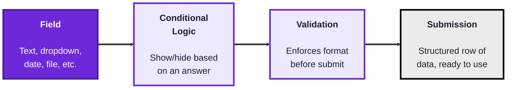
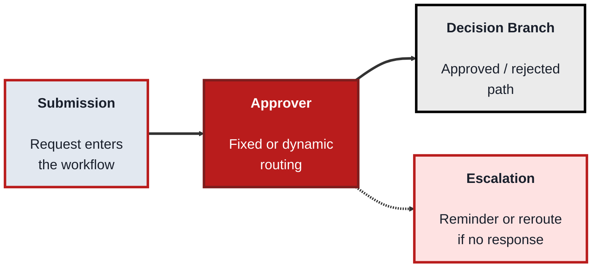
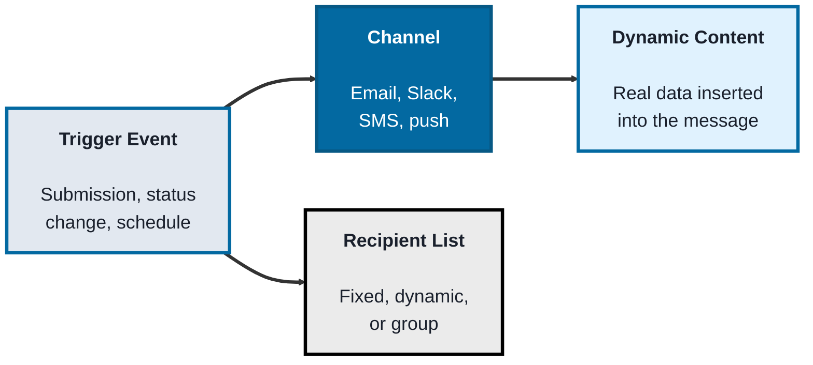
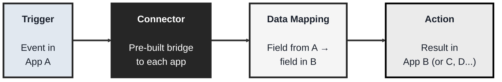

<!-- order: 7 -->
## Module: Business Workflows (Low-Code / No-Code TechArchs)

**Purpose:** Build business solutions without extensive programming.

**Time:** about 5 hours

**By the end of this module, you'll be able to:**
- Build a form with conditional logic and required fields that sends submissions to a spreadsheet
- Build a sheet-based approval process in Make with separate Approved and Rejected routes
- Add notifications that use dynamic content from the original submission
- Connect the workflow to another system with correct data mapping
- Explain escalation rules and how usage-based pricing (tasks, credits) affects workflow design

**Tools needed for this module:** A web browser and an email address to sign up for free tiers — a form tool like [Google Forms](https://forms.google.com) or [Jotform](https://www.jotform.com), Google Sheets, and the automation platform [Make](https://www.make.com). The labs use Make because Zapier's free plan has been limited to simple two-step Zaps without filters or paths, while Make's free plan has included multi-step scenarios, routers, and filters (within a monthly credit allowance and a limit on active scenarios). Check each tool's current plan page, because limits change. No coding environment or installs are required, everything happens in the browser. You won't need every tool set up at once, each topic only needs its own account.

### Topic 1: Forms

#### Concept

**Forms** are the entry point of most business workflows, the place where a human's input (a request, an application, an order) becomes structured data a system can act on. A no-code form builder lets you design that entry point visually, choosing field types and rules without writing validation code yourself.

- A **field** is a single input on a form, common types are short text, dropdown, checkbox, date, and file upload
- **Conditional logic** shows or skips questions based on an earlier answer, so a form only asks relevant questions (for example, only asking "reason for return" if "request type" is set to Return). Tools differ: Jotform can show or hide individual fields, while Google Forms works by sending people to a different section based on their answer
- **Validation** enforces a field's format before submission (a valid email, a number within a range, a required field that can't be left blank), without the form builder needing to write any code. Simple tools have limits: Google Forms cannot check that one date comes after another
- A **submission** is one completed instance of the form, typically stored as a row in a connected spreadsheet or database, ready to feed the rest of a workflow

#### Structure at a Glance


- A well-built form is what makes everything downstream (approvals, notifications, integrations) reliable, messy or missing data at the form stage causes problems everywhere else in a workflow
- Most no-code form tools can send submissions to a spreadsheet, which is often the simplest possible "database" for a small workflow. Usually you switch this on once: in Google Forms, open the Responses tab and click "Link to Sheets"

#### Where you'd actually use this

Any process that starts with someone requesting or reporting something, expense requests, time-off requests, IT help tickets, customer intake, or event registration, especially where you want structured, consistent data instead of freeform emails.

#### Lab

1. **Create a free account** with a form tool such as [Google Forms](https://forms.google.com) or [Jotform](https://www.jotform.com).
2. **Build a simple "Time Off Request" form** with fields for name, email, start date, end date, and reason (dropdown: Vacation, Sick, Other).
3. **Add conditional logic** so a "please specify" question is only asked when "Other" is selected as the reason. In Google Forms, put the "Reason" dropdown as the last question of section 1, put "Please specify" in a new section 2, and add a section 3 (can be empty, or holding a final "Anything else?" question). On the Reason question, open the three-dot menu, choose "Go to section based on answer", send "Other" to section 2 and the other answers to section 3. Set section 2's "After section 2" option to "Submit form" or section 3. In Jotform, use Settings, Conditions, "Show/Hide Field" instead.
4. **Add validation**: mark name, start date, and end date as required. Google Forms cannot check that the end date is after the start date, so either check it later in your automation (a filter that flags rows where end date is before start date) or use Jotform, whose date field can limit allowed dates.
5. **Connect a spreadsheet**: in Google Forms, open the Responses tab and click "Link to Sheets" to create a responses sheet (Jotform can do this through its Google Sheets integration).
6. **Submit a test entry** and confirm it lands as a new row in the linked spreadsheet, with all fields captured correctly.

#### Checkpoint
You have a working form with conditional logic and required fields, and a test submission has landed correctly in a linked spreadsheet.

#### Quiz
1. What is "conditional logic" in a form, and give an example use case?
2. What does "validation" do, and name one example of a validation rule?
3. What is a "submission," and where does it typically end up?
4. Why does the quality of a form's data matter for the rest of a workflow?
5. What's a common, no-setup destination for storing form submissions?

*Answers: 1) Logic that shows or skips questions based on an earlier answer, for example only asking a "reason for return" field if the request type is set to Return. 2) It enforces a field's format before submission, like requiring a valid email, a number within a range, or a required field that can't be blank. 3) One completed instance of the form; it typically ends up as a row in a connected spreadsheet or database. 4) Because approvals, notifications, and integrations downstream all depend on that data being complete and consistent, messy data at the form stage causes problems everywhere else. 5) A linked spreadsheet; in Google Forms you create the link once from the Responses tab with Link to Sheets.*

---

### Topic 2: Approvals

#### Concept

**Approvals** turn a submission into a decision point, routing it to the right person (or people) and pausing the workflow until they respond. No-code approval steps let you define who approves, in what order, and what happens next, all visually, without writing routing logic in code.

- An **approver** is the person (or role) a request is routed to, they can be fixed (always the same manager) or dynamic (based on a field, like department or amount)
- **Sequential approval** requires approvers to respond one after another in order, **parallel approval** sends the request to multiple approvers at once, either one is a fit depending on how strict the process needs to be
- A **decision branch** is what happens next based on the approver's response, approved records typically move forward, rejected ones typically stop or loop back for changes
- An **escalation** automatically reroutes or reminds when an approver doesn't respond within a set time, preventing a request from getting permanently stuck

#### Structure at a Glance


- Dynamic approver routing (like "route to the requester's manager, whoever that is") is what makes an approval step scale across a whole organization, without building a separate flow for every team
- Skipping escalation rules is a common beginner mistake, without one, a single unresponsive approver can silently stall every request behind them

#### Where you'd actually use this

Any decision that needs sign-off before proceeding, expense approvals, time-off requests, purchase orders, content publishing, or contract review, especially where the approver depends on who submitted the request or how large the request is.

#### Lab

1. **Continue from the Time Off Request form** built in Topic 1 (or use any existing form with a spreadsheet destination).
2. **Add two columns** to the right of the form's columns in the responses sheet: `Status` and `Processed`. Make has no built-in approval button (and Zapier's free plan may not allow multi-step Zaps; check the current plan), so the approver will decide by typing `Approved` or `Rejected` in the `Status` column (tip: use Data, Data validation, Dropdown to offer only those two values).
3. **Scenario A (ask for approval)**: in Make, create a scenario with Google Sheets "Watch New Rows" on the responses sheet, then Gmail "Send an Email" to a fixed approver (yourself, for testing). Include the request details and the link to the sheet, with the instruction "Set Status to Approved or Rejected". Schedule it and switch it on.
4. **Scenario B (act on the decision)**: create a second scenario with Google Sheets "Search Rows" that finds rows where `Status` is not empty and `Processed` is empty. Add a Router with two routes: filter one on `Status` equal to `Approved`, the other on `Status` equal to `Rejected`. On both routes, end with Google Sheets "Update a Row" that sets `Processed` to `yes` (map the row number from Search Rows), so the same row is never handled twice. Schedule it (for example every 15 minutes) and switch it on. Your free plan's active-scenario limit may mean switching off older scenarios first.
5. **Test both paths** by submitting two test requests, setting one row's Status to Approved and the other to Rejected, then clicking "Run once" on Scenario B and confirming each row is marked as processed through the correct route.
6. **Optional, add an escalation**: create a third scenario scheduled once a day, with Google Sheets "Search Rows" for rows where `Status` is empty, a filter that keeps only rows whose `Timestamp` is earlier than `addDays(now; -2)` (use the Date "earlier than" operator), and a Gmail email reminding the approver. If your plan has no free active-scenario slot, write this design down instead of building it.

#### Checkpoint
You have a working approval step that routes a submission to an approver, who decides by updating the Status column, and a second scenario that handles Approved and Rejected rows on separate routes. You can explain what an escalation rule is for (for example, a scheduled reminder for rows still blank after two days).

#### Quiz
1. What is the difference between a fixed approver and a dynamic approver?
2. What is the difference between sequential and parallel approval?
3. What is a "decision branch"?
4. What does an escalation rule do, and why is it important?
5. Name one real-world process, other than time off, that commonly needs an approval step.

*Answers: 1) A fixed approver is always the same person, a dynamic approver is determined by a field on the request, like department or amount. 2) Sequential approval requires approvers to respond one after another in order, parallel approval sends the request to multiple approvers at once. 3) What happens next based on the approver's response, an approved path typically moves the record forward, a rejected path typically stops it or loops back for changes. 4) It automatically reroutes or reminds when an approver doesn't respond in time, it's important because without it a single unresponsive approver can silently stall every request behind them. 5) Expense approvals, purchase orders, content publishing, or contract review are all valid answers.*

---

### Topic 3: Notifications

#### Concept

**Notifications** keep people informed as a workflow moves, without them needing to check a system manually. A no-code notification step lets you send a message (email, Slack, SMS, or an in-app alert) triggered automatically by an event elsewhere in the workflow.

- A **trigger event** is whatever causes the notification to fire, a new submission, a status change, an approval, or a scheduled time
- A **channel** is where the notification is delivered, email, Slack, SMS, or a push notification are the most common in no-code tools
- **Dynamic content** (also called merge fields or variables) inserts real data from the triggering record into the message, so a notification reads "Your request for March 3–5 was approved" instead of a generic message
- A **recipient list** defines who gets the notification, it can be a single fixed person, a dynamic person (like "the requester"), or a group

#### Structure at a Glance


- Dynamic content is what separates a genuinely useful notification from a generic, easily-ignored one, specific details make people act on a message instead of skimming past it
- Sending too many notifications for minor events is a common design mistake, it trains people to ignore the channel entirely, undermining the ones that actually matter

#### Where you'd actually use this

Anywhere a person needs to know something changed without checking manually, a requester learning their request was approved, a manager learning a new request is waiting, or a team channel getting pinged when a customer submits an urgent ticket.

#### Lab

1. **Continue from the approval automation** built in Topic 2.
2. **Add a notification step** in Scenario B, on the "Approved" route before "Update a Row", send an email to the original requester using dynamic content to include their name and the approved dates.
3. **Add a second notification** on the "Rejected" route, with a different message and, if your tool supports it, a different channel (for example, a Slack message to a manager instead of an email).
4. **Personalize the message** using at least two dynamic fields (like name and date range) pulled from the original submission.
5. **Submit two new test requests**, set their Status values, run Scenario B, and confirm each one triggers the correct notification, with the correct dynamic content filled in.

#### Checkpoint
You have working notifications on both the approved and rejected paths of your workflow, each using dynamic content pulled from the original submission.

#### Quiz
1. What is a "trigger event" for a notification?
2. Name three common notification channels.
3. What is "dynamic content," and why does it matter?
4. What defines a "recipient list," and give an example of a dynamic recipient?
5. What's a common mistake when designing notifications, and what problem does it cause?

*Answers: 1) Whatever causes the notification to fire, such as a new submission, a status change, an approval, or a scheduled time. 2) Email, Slack, and SMS (push notification is also acceptable). 3) Real data from the triggering record inserted into the message, like a name or date range; it matters because specific messages get acted on, while generic ones tend to get ignored. 4) Who receives the notification, it can be fixed, dynamic, or a group, an example of a dynamic recipient is "the requester," whoever that happens to be for a given submission. 5) Sending too many notifications for minor events, which trains people to ignore the channel entirely, undermining the notifications that actually matter.*

---

### Topic 4: Integrations

#### Concept

**Integrations** connect a workflow to other systems, so data doesn't have to be copied by hand between tools. A no-code integration platform (like Zapier or Make) lets you connect one app's trigger to another app's action visually, without writing to each app's API directly.

- A **connector** (sometimes called an app or integration) is a pre-built bridge to a specific service (Google Sheets, Slack, Salesforce, HubSpot), handling the technical authentication and API calls behind the scenes
- A **trigger** is the event in one app that starts the integration (a new form submission, a new CRM contact), and an **action** is what happens next in another app (create a row, send a message, update a record)
- A **data mapping** connects a field from the trigger app to a field in the action app (mapping the form's "email" field to the CRM's "email" field), so the right data lands in the right place
- A **multi-step zap** (or scenario) chains several actions together after a single trigger, for example: new form submission triggers an approval email, then a CRM update, then a Slack notification, all from one event

#### Structure at a Glance


- Integrations are what turn separate tools (a form, an approval step, a CRM, a chat app) into one connected workflow, without them, each tool is an isolated island requiring manual copy-paste between them
- Most no-code platforms charge based on usage per month: Zapier counts "tasks" (individual actions run), and Make counts "credits" (called "operations" until 2025, roughly one per module run). This matters when designing a multi-step workflow that might trigger dozens of times a day

#### Where you'd actually use this

Connecting a form to a CRM, connecting a CRM to a spreadsheet or accounting tool, or connecting any approval or notification step in this module to an actual outside system your business already uses, rather than leaving each tool disconnected.

#### Lab

1. **Continue from the full form-to-notification workflow** built across Topics 1–3.
2. **Add one more step to the "Approved" route in Scenario B**: connect to a CRM tool (or a second spreadsheet, standing in for one) and create a new record using the connector for that app.
3. **Map the data**, connecting the form's name, date, and reason fields to the corresponding fields in the CRM or second spreadsheet.
4. **Check the multi-step chain**: confirm that one form submission now results in an approval email (Scenario A), and, once the approver sets the Status, a notification, a new CRM record, and the Processed mark (Scenario B). Build this in Make: on Zapier's free plan a Zap may be limited to one action (check the current plan).
5. **Submit one final test request** end-to-end and trace it through every step, form, approval, notification, and integration, confirming each one fires correctly in sequence.

#### Checkpoint
You have a full multi-step automation in Make where a single form submission results in an approval step, a notification, and a downstream integration creating a record in another system, and you can explain what a connector and a data mapping are.

#### Quiz
1. What is a "connector" in a no-code integration platform?
2. What is the difference between a trigger and an action?
3. What is "data mapping," and why is it necessary?
4. What is a multi-step zap (or scenario)?
5. What's a common pricing model for no-code integration platforms, and why does it matter for workflow design?

*Answers: 1) A pre-built bridge to a specific service (like Google Sheets, Slack, or a CRM) that handles authentication and API calls behind the scenes. 2) A trigger is the event in one app that starts the integration, an action is what happens next in another app as a result. 3) Connecting a field from the trigger app to a field in the action app, so the right data lands in the right place, it's necessary because apps don't automatically know which of their fields correspond to which of another app's fields. 4) A chain of several actions triggered by a single event, for example a form submission triggering an approval email, then a CRM update, then a Slack notification; Make's free plan has allowed this, while multi-step Zaps may need a paid Zapier plan. 5) Platforms charge by monthly usage, tasks in Zapier and credits (formerly operations) in Make, which matters because a workflow with many chained steps or high volume can add up quickly.*

```watch
{
 "scenes": [
  {
   "kind": "title",
   "art": "pipeline",
   "kicker": "Module · Business workflows",
   "title": "From request to result",
   "beats": [
    {
     "say": "Welcome to Business Workflows."
    },
    {
     "say": "Across four topics you'll build one time off request workflow, without code: a form, an approval, notifications, and an integration."
    },
    {
     "say": "The labs use Make, because its free plan has included multi-step scenarios, routers and filters. Limits change, so check the current plan."
    }
   ]
  },
  {
   "kind": "diagram",
   "kicker": "Topic 1 · Forms",
   "title": "Conditional logic: only ask what's relevant",
   "nodes": [
    {
     "id": "s1",
     "label": "Section 1",
     "x": 14,
     "y": 30,
     "sub": "name, dates, Reason",
     "art": "form"
    },
    {
     "id": "s2",
     "label": "Section 2",
     "x": 50,
     "y": 16,
     "sub": "Please specify",
     "art": "pencil"
    },
    {
     "id": "s3",
     "label": "Section 3",
     "x": 50,
     "y": 70,
     "sub": "Anything else?",
     "art": "form"
    },
    {
     "id": "sheet",
     "label": "Responses sheet",
     "x": 86,
     "y": 50,
     "sub": "one row per submission",
     "art": "table"
    }
   ],
   "edges": [
    {
     "from": "s1",
     "to": "s2"
    },
    {
     "from": "s1",
     "to": "s3"
    },
    {
     "from": "s2",
     "to": "s3"
    },
    {
     "from": "s3",
     "to": "sheet"
    }
   ],
   "beats": [
    {
     "say": "A form turns a request into structured data. Here's the Time Off Request form, in three sections.",
     "show": 3
    },
    {
     "say": "Section one holds name, email, both dates, and a Reason dropdown, last.",
     "on": "s1"
    },
    {
     "say": "Go to section based on answer sends Other to section two: please specify.",
     "on": "s2",
     "send": {
      "from": "s1",
      "to": "s2",
      "label": "Reason: Other"
     }
    },
    {
     "say": "Vacation or Sick skip to section three, and never see that question.",
     "on": "s3",
     "send": {
      "from": "s1",
      "to": "s3",
      "label": "Reason: Sick"
     }
    },
    {
     "say": "Linked to Sheets, every submission lands as a new row.",
     "show": 4,
     "on": "sheet",
     "send": {
      "from": "s3",
      "to": "sheet",
      "label": "new row"
     }
    }
   ]
  },
  {
   "kind": "table",
   "kicker": "Topic 1 · Validation",
   "title": "Required fields, and the check Google Forms can't do",
   "columns": [
    "Name",
    "Start date",
    "End date",
    "Reason"
   ],
   "rows": [
    [
     "Amara",
     "Mar 3",
     "Mar 5",
     "Vacation"
    ],
    [
     "Ben",
     "Mar 12",
     "Mar 13",
     "Other"
    ],
    [
     "Chi",
     "Mar 20",
     "Mar 18",
     "Sick"
    ]
   ],
   "beats": [
    {
     "say": "Here are three submissions in the responses sheet."
    },
    {
     "say": "Validation checks fields before submit. Name and both dates are required, so none can be blank.",
     "col": 0
    },
    {
     "say": "Google Forms can't check that the end comes after the start, so the automation flags it later.",
     "sql": "Flag if End date < Start date",
     "col": 2
    },
    {
     "say": "Chi's request ends before it starts, so it gets flagged.",
     "sql": "Flag if End date < Start date",
     "hl": 2,
     "dim": true
    }
   ]
  },
  {
   "kind": "diagram",
   "kicker": "Topic 2 · Approvals",
   "title": "Scenario A: ask the approver",
   "nodes": [
    {
     "id": "form",
     "label": "Form",
     "x": 12,
     "y": 50,
     "sub": "a new request",
     "art": "form"
    },
    {
     "id": "sheet",
     "label": "Responses sheet",
     "x": 40,
     "y": 22,
     "sub": "Status + Processed",
     "art": "table"
    },
    {
     "id": "make",
     "label": "Scenario A",
     "x": 68,
     "y": 50,
     "sub": "Watch New Rows",
     "art": "gear"
    },
    {
     "id": "boss",
     "label": "Approver",
     "x": 40,
     "y": 80,
     "sub": "fixed: you, for now",
     "art": "persona"
    }
   ],
   "edges": [
    {
     "from": "form",
     "to": "sheet"
    },
    {
     "from": "sheet",
     "to": "make"
    },
    {
     "from": "make",
     "to": "boss"
    },
    {
     "from": "boss",
     "to": "sheet"
    }
   ],
   "beats": [
    {
     "say": "Make has no approval button, so the sheet gets two extra columns: Status and Processed.",
     "show": 4
    },
    {
     "say": "Amara submits her request, and it lands as a new row.",
     "on": "form",
     "send": {
      "from": "form",
      "to": "sheet",
      "label": "new row"
     }
    },
    {
     "say": "Scenario A watches for new rows, and picks hers up.",
     "on": "make",
     "send": {
      "from": "sheet",
      "to": "make",
      "label": "Amara's row"
     }
    },
    {
     "say": "It emails a fixed approver the details and the sheet link.",
     "on": "boss",
     "send": {
      "from": "make",
      "to": "boss",
      "label": "email + link"
     }
    },
    {
     "say": "The approver decides by setting Status to Approved or Rejected.",
     "on": "sheet",
     "send": {
      "from": "boss",
      "to": "sheet",
      "label": "Approved"
     }
    },
    {
     "say": "In a bigger company, the approver could be dynamic, like the requester's manager.",
     "on": "boss"
    }
   ]
  },
  {
   "kind": "table",
   "kicker": "Topic 2 · Approvals",
   "title": "Which rows does each scenario pick up?",
   "columns": [
    "Name",
    "Timestamp",
    "Status",
    "Processed"
   ],
   "rows": [
    [
     "Dee",
     "Feb 10",
     "Approved",
     "yes"
    ],
    [
     "Chi",
     "Feb 16",
     "",
     ""
    ],
    [
     "Amara",
     "Feb 18",
     "Approved",
     ""
    ],
    [
     "Ben",
     "Feb 19",
     "Rejected",
     ""
    ],
    [
     "Eve",
     "Feb 19",
     "",
     ""
    ]
   ],
   "beats": [
    {
     "say": "The sheet, a little later. Today is February twentieth."
    },
    {
     "say": "Scenario B searches for rows with a Status but no Processed mark.",
     "sql": "Search Rows: Status not empty\nAND Processed empty",
     "col": 2
    },
    {
     "say": "That finds Amara and Ben.",
     "sql": "Search Rows: Status not empty\nAND Processed empty",
     "hl": [
      2,
      3
     ],
     "dim": true
    },
    {
     "say": "Dee was handled on an earlier run. Processed says yes, so she's skipped.",
     "sql": "Search Rows: Status not empty\nAND Processed empty",
     "hl": 0,
     "col": 3
    },
    {
     "say": "The optional escalation scenario runs daily, and finds rows with no Status.",
     "sql": "Search Rows: Status empty",
     "hl": [
      1,
      4
     ],
     "dim": true
    },
    {
     "say": "A filter keeps only those older than two days.",
     "sql": "Status empty AND Timestamp\nearlier than addDays(now; -2)",
     "col": 1
    },
    {
     "say": "Only Chi has waited too long, so the approver gets a reminder.",
     "sql": "Status empty AND Timestamp\nearlier than addDays(now; -2)",
     "hl": 1,
     "dim": true
    }
   ]
  },
  {
   "kind": "diagram",
   "kicker": "Topics 2 to 4 · Scenario B",
   "title": "A Router sends each decision down its own route",
   "nodes": [
    {
     "id": "search",
     "label": "Search Rows",
     "x": 10,
     "y": 50,
     "sub": "decided, unprocessed",
     "art": "search"
    },
    {
     "id": "router",
     "label": "Router",
     "x": 30,
     "y": 50,
     "sub": "two filtered routes",
     "art": "fork"
    },
    {
     "id": "mail",
     "label": "Email requester",
     "x": 54,
     "y": 20,
     "sub": "Approved route",
     "art": "mail"
    },
    {
     "id": "crm",
     "label": "Create record",
     "x": 78,
     "y": 20,
     "sub": "CRM or second sheet",
     "art": "idcard"
    },
    {
     "id": "slack",
     "label": "Slack manager",
     "x": 60,
     "y": 80,
     "sub": "Rejected route",
     "art": "chat"
    },
    {
     "id": "update",
     "label": "Update a Row",
     "x": 90,
     "y": 52,
     "sub": "Processed = yes",
     "art": "table"
    }
   ],
   "edges": [
    {
     "from": "search",
     "to": "router"
    },
    {
     "from": "router",
     "to": "mail"
    },
    {
     "from": "mail",
     "to": "crm"
    },
    {
     "from": "crm",
     "to": "update"
    },
    {
     "from": "router",
     "to": "slack"
    },
    {
     "from": "slack",
     "to": "update"
    }
   ],
   "beats": [
    {
     "say": "Scenario B runs every fifteen minutes.",
     "show": 2
    },
    {
     "say": "Search Rows hands Amara and Ben to a Router.",
     "on": "router",
     "send": {
      "from": "search",
      "to": "router",
      "label": "Amara, Ben"
     }
    },
    {
     "say": "The Approved route's filter lets Amara through, and she gets an email.",
     "show": 3,
     "on": "mail",
     "send": {
      "from": "router",
      "to": "mail",
      "label": "Amara: Approved"
     }
    },
    {
     "say": "Then a connector creates a record in a C R M, or a second sheet.",
     "show": 4,
     "on": "crm",
     "send": {
      "from": "mail",
      "to": "crm",
      "label": "mapped fields"
     }
    },
    {
     "say": "Ben takes the Rejected route: a different message, on Slack, to a manager.",
     "show": 5,
     "on": "slack",
     "send": {
      "from": "router",
      "to": "slack",
      "label": "Ben: Rejected"
     }
    },
    {
     "say": "Both routes end by setting Processed to yes, so the next run skips them.",
     "show": 6,
     "on": "update",
     "send": {
      "from": "crm",
      "to": "update",
      "label": "Processed = yes"
     }
    },
    {
     "say": "Make counts credits, roughly one per module run, so a busy chain adds up.",
     "on": [
      "search",
      "router",
      "mail",
      "crm",
      "slack",
      "update"
     ]
    }
   ]
  },
  {
   "kind": "table",
   "kicker": "Topic 3 · Notifications",
   "title": "Dynamic content fills the message from the row",
   "columns": [
    "Field",
    "Amara's row"
   ],
   "rows": [
    [
     "Name",
     "Amara"
    ],
    [
     "Email",
     "amara@example.com"
    ],
    [
     "Start date",
     "Mar 3"
    ],
    [
     "End date",
     "Mar 5"
    ]
   ],
   "beats": [
    {
     "say": "Amara's approval is the trigger event. Here's her row."
    },
    {
     "say": "The email has gaps, called merge fields, filled from the row.",
     "sql": "Hi {{Name}}, your request for\n{{Start date}} to {{End date}} was approved."
    },
    {
     "say": "The recipient is dynamic: whoever made the request.",
     "sql": "To: {{Email}}",
     "hl": 1,
     "dim": true
    },
    {
     "say": "The name fills the greeting.",
     "sql": "Hi Amara, your request for\n{{Start date}} to {{End date}} was approved.",
     "hl": 0,
     "dim": true
    },
    {
     "say": "And the two dates fill the date range.",
     "sql": "Hi Amara, your request for\nMar 3 to Mar 5 was approved.",
     "hl": [
      2,
      3
     ],
     "dim": true
    },
    {
     "say": "Specific messages get acted on. Too many, and people ignore the channel.",
     "sql": "Hi Amara, your request for\nMar 3 to Mar 5 was approved."
    }
   ]
  },
  {
   "kind": "table",
   "kicker": "Topic 4 · Integrations",
   "title": "Data mapping: each field to the right place",
   "columns": [
    "Form field (trigger)",
    "CRM field (action)"
   ],
   "rows": [
    [
     "Name",
     "Contact name"
    ],
    [
     "Email",
     "Email"
    ],
    [
     "Start date",
     "Leave start"
    ],
    [
     "End date",
     "Leave end"
    ],
    [
     "Reason",
     "Leave type"
    ]
   ],
   "beats": [
    {
     "say": "An integration links a trigger in one app to an action in another."
    },
    {
     "say": "On the left, fields from Amara's form submission.",
     "col": 0
    },
    {
     "say": "On the right, fields of the new C R M record.",
     "col": 1,
     "sql": "Action: Create a Record"
    },
    {
     "say": "The apps don't know which fields match, so you map them: email to email.",
     "sql": "Action: Create a Record",
     "hl": 1,
     "dim": true
    },
    {
     "say": "And name, the dates, and the reason.",
     "sql": "Action: Create a Record",
     "hl": [
      0,
      2,
      3,
      4
     ],
     "dim": true
    }
   ]
  },
  {
   "kind": "quiz",
   "art": "ask",
   "kicker": "Quick check",
   "title": "Why does Scenario B set Processed to yes on every route?",
   "options": [
    "To send the notification",
    "So the same row is never handled twice",
    "Because Make requires it to run"
   ],
   "answer": 1,
   "good": "That's right. Marking each row as processed means the next scheduled run skips it, so the same request is never handled twice.",
   "bad": "Not quite. Marking each row as processed means the next scheduled run skips it, so the same request is never handled twice.",
   "beats": [
    {
     "say": "Quick check.",
     "show": 0
    },
    {
     "say": "Why does Scenario B set Processed to yes on every route?",
     "show": 0
    },
    {
     "say": "Tap your answer.",
     "show": 1
    }
   ]
  },
  {
   "kind": "list",
   "art": "proof",
   "kicker": "Checkpoint",
   "title": "You're done when",
   "items": [
    [
     "Form with logic and validation",
     ""
    ],
    [
     "Approved and Rejected routes work",
     ""
    ],
    [
     "Notifications with dynamic content",
     ""
    ],
    [
     "Integration with correct mapping",
     ""
    ],
    [
     "You can trace a submission end to end",
     ""
    ]
   ],
   "beats": [
    {
     "say": "That's the module.",
     "show": 0
    },
    {
     "say": "You're done when:",
     "show": 0
    },
    {
     "say": "your form has conditional logic and validation, and submissions land in a sheet,",
     "show": 1
    },
    {
     "say": "your approval step handles Approved and Rejected differently,",
     "show": 2
    },
    {
     "say": "both paths send notifications with dynamic content,",
     "show": 3
    },
    {
     "say": "the workflow creates a record in another system with correct data mapping,",
     "show": 4
    },
    {
     "say": "and you can trace one submission end to end.",
     "show": 5
    },
    {
     "say": "You've finished Business Workflows. Well done.",
     "show": 5
    }
   ]
  }
 ]
}
```

---

## Module Completion Checklist
- [ ] Built a form with conditional logic and validation, and confirmed a submission lands correctly in a connected spreadsheet
- [ ] Built an approval step that routes a submission and updates a record differently for Approved versus Rejected
- [ ] Added notifications with dynamic content on both the approved and rejected paths
- [ ] Connected the workflow to a downstream system (CRM or spreadsheet) using a no-code integration platform, with correct data mapping
- [ ] Can trace a single form submission end-to-end through form, approval, notification, and integration steps, explaining what happens at each stage
