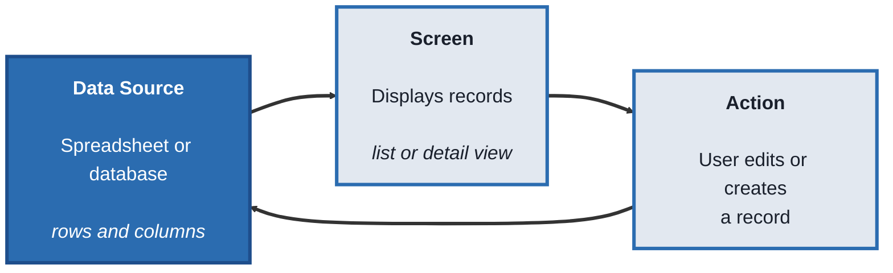
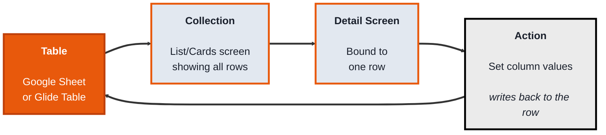
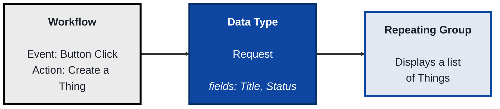
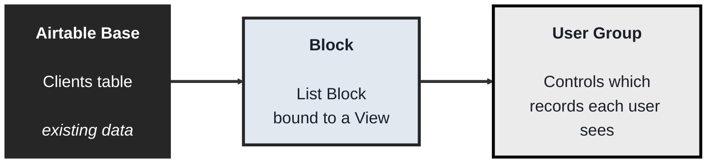

<!-- order: 3 -->
# Internal Apps: A Practical Beginner's Course

## Course Overview

**By the end of this course, you'll be able to:**
- Describe any internal app as a data source, screens, actions, and permissions
- Build a Glide app on a Google Sheet with a list, a detail screen, and a button that writes back to the sheet
- Build a Bubble app with a custom data type, a repeating group, a create workflow, a conditional, and a privacy rule
- Build a Softr portal on Airtable that shows each signed-in client only their own record
- Explain why data-level permissions (privacy rules, record ownership) matter more than hiding things on screen

**Who this is for:** Beginners who want to build functional, data-driven apps — task trackers, client portals, inventory tools, request forms with a review queue — connected to real data, with logins and permissions, without writing a traditional backend.

**How the course works:** Four modules. Every topic follows the same pattern:
- **Concept** - what it is, in plain language
- **Structure at a Glance** - the core building blocks you'll actually work with
- **Where you'd actually use this** - a real business scenario
- **Lab** - hands-on, buildable examples
- **Checkpoint**
- **Quiz** - five questions with answers

**Time:** about 6 hours in total

**Tools needed:** Free accounts on [Glide](https://glideapps.com), [Bubble](https://bubble.io), and [Softr](https://softr.io). A free [Google Sheets](https://sheets.google.com) or [Airtable](https://airtable.com) account is also needed for two of the modules. You won't need all three platforms at once — each module only needs its own tool.

**Free plan note:** Free plans change often. Before you start, check the current free-plan limits on Glide's and Softr's pricing pages (for example, how many rows, users, apps, or user groups you get, and whether features like Row Owners are included). If a lab step needs a feature your free plan doesn't include, treat that step as "needs a paid plan or trial: follow along" and keep going with the rest of the lab.

---

## Module 0: What Internal App Builders Actually Do

**Time:** about 30 minutes

### Concept

An **internal app builder** turns a set of data into a working application with screens, actions, and permissions — different from a website builder, which mainly displays content publicly. Every platform in this course is built from the same underlying idea, even though the interface and vocabulary differ:

- A **data source** is where the app's information actually lives — a spreadsheet, a database, or the platform's own built-in storage
- A **screen** (or view) displays data from the source, either as a list of many records or the detail of one
- An **action** lets a user change the data — creating a new record, editing a field, marking something complete — and that change writes back to the data source
- **Permissions** (sometimes called user roles or record ownership) control which users can see or edit which records, since an internal app usually shouldn't show every user everything

### Structure at a Glance


This same shape — data source, screen, action writing back to the source — appears in every tool this course covers.

### Where you'd actually use this

Any situation where a team needs a real tool, not just a document: a task tracker where each person sees only their own work, a client portal showing each client only their own records, an inventory tracker a warehouse team updates from their phones, an internal request queue with an admin review screen.

### Lab

Pick a simple dataset shaped like a spreadsheet — for example, a task list with columns `Task`, `Assignee`, `Status`. Sketch what an app built on this data would need: a list screen showing all tasks, a detail screen for one task, and an action to change its `Status`. This sketch is exactly what you'll build in every module that follows.

### Checkpoint
You can describe the data source, screen, and action concepts, and you have a written sketch of a simple app's list screen, detail screen, and one action.

### Quiz
1. What is a data source, in the context of an internal app builder?
2. What's the difference between a list screen and a detail screen?
3. What does an action actually do?
4. What do permissions (or record ownership) control?
5. How is an internal app builder different from a website builder, in what it's mainly used for?

*Answers: 1) Where the app's information actually lives — a spreadsheet, database, or the platform's own built-in storage. 2) A list screen shows many records at once; a detail screen shows the full information for one specific record. 3) Lets a user change data — creating, editing, or completing a record — with that change writing back to the data source. 4) Which users can see or edit which specific records, since an internal app usually shouldn't show every user everything. 5) A website builder mainly displays content publicly; an internal app builder builds functional tools with data, actions, and permissions for a team or specific users.*

```watch
{
 "scenes": [
  {
   "kind": "title",
   "art": "dashboard",
   "kicker": "Module 0 · What internal app builders do",
   "title": "Data in, working tool out",
   "beats": [
    {
     "say": "Welcome to Internal Apps."
    },
    {
     "say": "An internal app builder turns a set of data into a working application, with screens, actions and permissions."
    },
    {
     "say": "That's different from a website builder, which mainly displays content publicly."
    }
   ]
  },
  {
   "kind": "table",
   "kicker": "Concept",
   "title": "Website builder or internal app builder?",
   "columns": [
    "",
    "Website builder",
    "Internal app builder"
   ],
   "rows": [
    [
     "Main job",
     "Display content",
     "A working tool"
    ],
    [
     "Who uses it",
     "The public",
     "A team or set of users"
    ],
    [
     "Data",
     "Pages to read",
     "Records you change"
    ],
    [
     "Permissions",
     "Same for everyone",
     "Per user, per record"
    ]
   ],
   "beats": [
    {
     "say": "Let's compare the two kinds of builder side by side."
    },
    {
     "say": "A website builder mainly displays content, and it's usually public.",
     "col": 1
    },
    {
     "say": "An internal app builder builds a working tool, for a team or for specific users.",
     "col": 2,
     "hl": [
      0,
      1
     ],
     "dim": true
    },
    {
     "say": "Its data isn't just read. People create and change records.",
     "col": 2,
     "hl": 2,
     "dim": true
    },
    {
     "say": "And not everyone sees everything. Permissions decide who sees which records.",
     "col": 2,
     "hl": 3,
     "dim": true
    }
   ]
  },
  {
   "kind": "diagram",
   "kicker": "Concept · Structure at a glance",
   "title": "Data source, screen, action, and back",
   "nodes": [
    {
     "id": "ds",
     "label": "Data source",
     "x": 12,
     "y": 50,
     "sub": "rows and columns",
     "art": "database"
    },
    {
     "id": "sc",
     "label": "Screen",
     "x": 50,
     "y": 18,
     "sub": "list or detail view",
     "art": "phone"
    },
    {
     "id": "ac",
     "label": "Action",
     "x": 50,
     "y": 82,
     "sub": "create or edit",
     "art": "cursor"
    },
    {
     "id": "us",
     "label": "Users",
     "x": 88,
     "y": 50,
     "sub": "permissions",
     "art": "people"
    }
   ],
   "edges": [
    {
     "from": "ds",
     "to": "sc"
    },
    {
     "from": "sc",
     "to": "ac"
    },
    {
     "from": "ac",
     "to": "ds"
    },
    {
     "from": "sc",
     "to": "us"
    }
   ],
   "beats": [
    {
     "say": "Every platform in this course is built from the same few parts.",
     "show": 0
    },
    {
     "say": "First, a data source: where the information actually lives. A spreadsheet, a database, or the platform's own storage.",
     "show": 1,
     "on": "ds"
    },
    {
     "say": "A screen displays that data, as a list of many records, or the detail of one.",
     "show": 2,
     "on": "sc",
     "send": {
      "from": "ds",
      "to": "sc",
      "label": "records"
     }
    },
    {
     "say": "An action lets a user change the data, like marking a task complete.",
     "show": 3,
     "on": "ac",
     "send": {
      "from": "sc",
      "to": "ac",
      "label": "tap"
     }
    },
    {
     "say": "And that change writes back to the data source. That loop is in every tool you'll use.",
     "show": 3,
     "on": "ds",
     "send": {
      "from": "ac",
      "to": "ds",
      "label": "write back"
     }
    },
    {
     "say": "Finally, permissions control which users see or edit which records.",
     "show": 4,
     "on": "us",
     "send": {
      "from": "sc",
      "to": "us",
      "label": "only their rows"
     }
    }
   ]
  },
  {
   "kind": "table",
   "kicker": "Concept",
   "title": "One dataset, three ways to look at it",
   "columns": [
    "Task",
    "Assignee",
    "Status"
   ],
   "rows": [
    [
     "Order labels",
     "ana@team.co",
     "Open"
    ],
    [
     "Fix printer",
     "ben@team.co",
     "Open"
    ],
    [
     "Book venue",
     "ana@team.co",
     "Done"
    ],
    [
     "Update price list",
     "cy@team.co",
     "Open"
    ]
   ],
   "beats": [
    {
     "say": "Here's a simple task list, the kind of data you'll use all course."
    },
    {
     "say": "A list screen shows many records at once.",
     "hl": [
      0,
      1,
      2,
      3
     ]
    },
    {
     "say": "A detail screen shows the full information for one record.",
     "hl": 1,
     "dim": true
    },
    {
     "say": "An action changes a field on that record, like its status.",
     "hl": 1,
     "dim": true,
     "col": 2
    },
    {
     "say": "And with permissions, Ana would only see the tasks assigned to her.",
     "sql": "Show rows where Assignee = the signed-in user",
     "hl": [
      0,
      2
     ],
     "dim": true,
     "col": 1
    }
   ]
  },
  {
   "kind": "array",
   "kicker": "Lab",
   "title": "Sketch your app before you build it",
   "values": [
    "Dataset",
    "List screen",
    "Detail screen",
    "One action"
   ],
   "beats": [
    {
     "say": "Your lab is a sketch, in four pieces."
    },
    {
     "say": "Pick a dataset shaped like a spreadsheet, for example task, assignee and status.",
     "hl": 0,
     "note": "Task · Assignee · Status"
    },
    {
     "say": "Sketch a list screen that shows all the tasks.",
     "ok": [
      0
     ],
     "hl": 1,
     "note": "All tasks"
    },
    {
     "say": "A detail screen for one task.",
     "ok": [
      0,
      1
     ],
     "hl": 2,
     "note": "One task, every field"
    },
    {
     "say": "And one action, which changes that task's status.",
     "ok": [
      0,
      1,
      2
     ],
     "hl": 3,
     "note": "Status → Done"
    },
    {
     "say": "That sketch is exactly what you'll build in every module that follows.",
     "ok": [
      0,
      1,
      2,
      3
     ]
    }
   ]
  },
  {
   "kind": "quiz",
   "art": "ask",
   "kicker": "Quick check",
   "title": "What's the difference between a list screen and a detail screen?",
   "options": [
    "A list screen shows many records; a detail screen shows one record in full",
    "A list screen is for admins only",
    "A detail screen can't be edited"
   ],
   "answer": 0,
   "good": "That's right. A list screen shows many records at once; a detail screen shows the full information for one specific record.",
   "bad": "Not quite. A list screen shows many records at once; a detail screen shows the full information for one specific record.",
   "beats": [
    {
     "say": "Quick check.",
     "show": 0
    },
    {
     "say": "What's the difference between a list screen and a detail screen?",
     "show": 0
    },
    {
     "say": "Tap your answer.",
     "show": 1
    }
   ]
  },
  {
   "kind": "list",
   "art": "proof",
   "kicker": "Checkpoint",
   "title": "You're done when",
   "items": [
    [
     "You can describe source, screen and action",
     ""
    ],
    [
     "Your app sketch is written down",
     ""
    ]
   ],
   "beats": [
    {
     "say": "That's Module 0.",
     "show": 0
    },
    {
     "say": "You're done when:",
     "show": 0
    },
    {
     "say": "you can describe data sources, screens and actions,",
     "show": 1
    },
    {
     "say": "and you have a sketch of a list screen, a detail screen and one action.",
     "show": 2
    },
    {
     "say": "Next, in Module 1, turning a spreadsheet into an app with Glide.",
     "show": 2
    }
   ]
  }
 ]
}
```

---

## Module 1: Glide - Spreadsheet Straight Into an App

**Time:** about 1.5 hours

### Concept

**Glide** turns a spreadsheet directly into a working, mobile-friendly app — connect a Google Sheet (or use Glide's own built-in Tables), and Glide automatically maps its columns into visual screens. It's built around speed: "sheet in, app out," with minimal setup between having data and having a usable app.

### Structure at a Glance


- A **Table** is Glide's term for a connected data source — a Google Sheet tab or a native Glide Table, made of rows and columns
- A **Collection** (List, Cards, or Calendar) is a screen showing multiple rows from a Table at once
- A **Detail screen** shows all the fields for one specific row, opened by tapping it in a Collection
- An **Action** like "Set column values" lets a button write a new value into a specific column for that row — this is how a user's tap actually changes the underlying data
- **Row Owners** is Glide's built-in permission feature — restricting which rows a specific logged-in user can see, based on a column matching their email

### Where you'd actually use this

Fast internal tools built directly from data your team already keeps in a spreadsheet: a task tracker, a simple CRM, a field team's daily checklist app, anywhere a spreadsheet already exists and just needs a proper mobile interface on top of it.

### Lab

1. **Create a Google Sheet** with columns: `Task`, `Assignee` (an email address), `Status` (values like "Open" or "Done").

2. **Create a new Glide app** and connect it to this sheet as your Table.

3. **Add a Collection screen** displaying all rows from the Table, showing `Task` and `Status` in the list view.

4. **Tap into the Detail screen** for a row (Glide generates this automatically) and confirm all its fields display.

5. **Add an Action button** on the Detail screen labeled "Mark Complete," using the **Set column values** action to set `Status` to "Done" when tapped.

6. **Set up Row Owners** using the `Assignee` column, so each signed-in user only sees rows where they're listed as the assignee.

7. **Publish the app** (check the current free-plan limits on Glide's pricing page; if Row Owners or sign-in for extra users isn't included on your plan, follow along with this step), sign in as a test user matching one of your `Assignee` emails, and confirm you only see that user's tasks — then tap "Mark Complete" and confirm the Google Sheet itself updates with the new status.

### Checkpoint
You have a published Glide app connected to a real Google Sheet, showing only a signed-in user's own rows via Row Owners, with a working action that updates the sheet.

### Quiz
1. What is a Table in Glide?
2. What's the difference between a Collection and a Detail screen?
3. What does the "Set column values" action actually do?
4. What does Row Owners control?
5. After tapping "Mark Complete" in the app, where did the actual change get saved?

*Answers: 1) Glide's term for a connected data source — a Google Sheet tab or native Glide Table made of rows and columns. 2) A Collection shows multiple rows at once as a list; a Detail screen shows all the fields for one specific row. 3) Writes a new value into a specific column for a specific row, which is how a button tap actually changes the underlying data. 4) Which rows a specific signed-in user is allowed to see, based on a column (like an email address) matching their login. 5) The original Google Sheet itself — Glide writes changes directly back to the connected spreadsheet.*

```watch
{
 "scenes": [
  {
   "kind": "title",
   "art": "phone",
   "kicker": "Module 1 · Glide",
   "title": "Spreadsheet straight into an app",
   "beats": [
    {
     "say": "Welcome to Module 1."
    },
    {
     "say": "Glide turns a spreadsheet directly into a working, mobile-friendly app. Sheet in, app out."
    }
   ]
  },
  {
   "kind": "diagram",
   "kicker": "Structure at a glance",
   "title": "Glide's loop from sheet to screen and back",
   "nodes": [
    {
     "id": "t",
     "label": "Table",
     "x": 12,
     "y": 50,
     "sub": "Google Sheet tab",
     "art": "table"
    },
    {
     "id": "co",
     "label": "Collection",
     "x": 48,
     "y": 18,
     "sub": "list of all rows",
     "art": "phone"
    },
    {
     "id": "dt",
     "label": "Detail screen",
     "x": 86,
     "y": 50,
     "sub": "one row",
     "art": "layout"
    },
    {
     "id": "ab",
     "label": "Action button",
     "x": 48,
     "y": 82,
     "sub": "Set column values",
     "art": "cursor"
    }
   ],
   "edges": [
    {
     "from": "t",
     "to": "co"
    },
    {
     "from": "co",
     "to": "dt"
    },
    {
     "from": "dt",
     "to": "ab"
    },
    {
     "from": "ab",
     "to": "t"
    }
   ],
   "beats": [
    {
     "say": "In Glide, your data source is called a Table: a Google Sheet tab, or a Glide Table.",
     "show": 1,
     "on": "t"
    },
    {
     "say": "A Collection screen shows many rows at once, as a list, cards, or a calendar.",
     "show": 2,
     "on": "co",
     "send": {
      "from": "t",
      "to": "co",
      "label": "all rows"
     }
    },
    {
     "say": "Tap one row, and its Detail screen shows every field.",
     "show": 3,
     "on": "dt",
     "send": {
      "from": "co",
      "to": "dt",
      "label": "tap a row"
     }
    },
    {
     "say": "On that screen, a button runs an action called set column values.",
     "show": 4,
     "on": "ab",
     "send": {
      "from": "dt",
      "to": "ab",
      "label": "Mark Complete"
     }
    },
    {
     "say": "It writes the new value straight back into that row of the sheet.",
     "show": 4,
     "on": "t",
     "send": {
      "from": "ab",
      "to": "t",
      "label": "Status = Done"
     }
    }
   ]
  },
  {
   "kind": "table",
   "kicker": "Lab · Steps 1 to 4",
   "title": "Your sheet becomes a list and a detail screen",
   "columns": [
    "Task",
    "Assignee",
    "Status"
   ],
   "rows": [
    [
     "Order labels",
     "ana@team.co",
     "Open"
    ],
    [
     "Fix printer",
     "ben@team.co",
     "Open"
    ],
    [
     "Book venue",
     "ana@team.co",
     "Done"
    ],
    [
     "Update price list",
     "cy@team.co",
     "Open"
    ]
   ],
   "beats": [
    {
     "say": "Step one: a Google Sheet with task, assignee as an email address, and status."
    },
    {
     "say": "Connect a new Glide app to it, and this sheet becomes your Table.",
     "sql": "Table: Tasks sheet"
    },
    {
     "say": "Add a Collection that shows the task in the list.",
     "col": 0
    },
    {
     "say": "And its status.",
     "col": 2
    },
    {
     "say": "Tap the Fix printer row, and Glide's generated Detail screen shows all of its fields.",
     "hl": 1,
     "dim": true
    }
   ]
  },
  {
   "kind": "array",
   "kicker": "Lab · Step 5",
   "title": "Mark Complete writes into one cell",
   "values": [
    "Open",
    "Open",
    "Done",
    "Open"
   ],
   "beats": [
    {
     "say": "Here's the status column of the sheet, one value per row."
    },
    {
     "say": "You're on the Detail screen for row two, Fix printer. Its status is open.",
     "hl": 1,
     "ptr": {
      "row": 1
     },
     "note": "Detail screen: Fix printer"
    },
    {
     "say": "You tap Mark Complete. Set column values targets just the status column of this row.",
     "hl": 1,
     "ptr": {
      "row": 1
     },
     "note": "Set column values: Status → \"Done\""
    },
    {
     "say": "The value changes to done, in the Google Sheet itself.",
     "vals": [
      "Open",
      "Done",
      "Done",
      "Open"
     ],
     "ok": 1,
     "ptr": {
      "row": 1
     },
     "note": "Saved to the sheet"
    },
    {
     "say": "The other rows aren't touched.",
     "vals": [
      "Open",
      "Done",
      "Done",
      "Open"
     ],
     "ok": 1,
     "hl": [
      0,
      2,
      3
     ]
    }
   ]
  },
  {
   "kind": "table",
   "kicker": "Lab · Step 6",
   "title": "Row Owners: each user sees only their rows",
   "columns": [
    "Task",
    "Assignee",
    "Status"
   ],
   "rows": [
    [
     "Order labels",
     "ana@team.co",
     "Open"
    ],
    [
     "Fix printer",
     "ben@team.co",
     "Open"
    ],
    [
     "Book venue",
     "ana@team.co",
     "Done"
    ],
    [
     "Update price list",
     "cy@team.co",
     "Open"
    ]
   ],
   "beats": [
    {
     "say": "Now set up Row Owners on the assignee column."
    },
    {
     "say": "Glide now only sends a signed-in user the rows where the assignee matches their email.",
     "sql": "Row Owners: Assignee = signed-in email",
     "col": 1
    },
    {
     "say": "Sign in as Ana, and you get two rows.",
     "hl": [
      0,
      2
     ],
     "dim": true,
     "col": 1
    },
    {
     "say": "Sign in as Ben, and you get just one.",
     "hl": 1,
     "dim": true,
     "col": 1
    }
   ]
  },
  {
   "kind": "array",
   "kicker": "Lab · Step 7",
   "title": "Publish, then prove it works",
   "values": [
    "Publish",
    "Sign in",
    "Only your tasks",
    "Mark Complete",
    "Check the sheet"
   ],
   "beats": [
    {
     "say": "Last, publish the app and test it like a real user.",
     "hl": 0,
     "note": "Check the free plan includes Row Owners"
    },
    {
     "say": "Sign in as a test user whose email matches one assignee.",
     "ok": [
      0
     ],
     "hl": 1
    },
    {
     "say": "You should see only that user's tasks.",
     "ok": [
      0,
      1
     ],
     "hl": 2,
     "note": "Row Owners at work"
    },
    {
     "say": "Tap Mark Complete on one of them.",
     "ok": [
      0,
      1,
      2
     ],
     "hl": 3
    },
    {
     "say": "Then open the Google Sheet. The status there has changed too.",
     "ok": [
      0,
      1,
      2,
      3,
      4
     ],
     "note": "If your plan lacks Row Owners, follow along"
    }
   ]
  },
  {
   "kind": "quiz",
   "art": "ask",
   "kicker": "Quick check",
   "title": "After tapping Mark Complete in the app, where did the change actually get saved?",
   "options": [
    "Only on the phone",
    "In a separate Glide backup",
    "In the original Google Sheet"
   ],
   "answer": 2,
   "good": "That's right. Glide writes changes directly back to the connected Google Sheet.",
   "bad": "Not quite. Glide writes changes directly back to the connected Google Sheet.",
   "beats": [
    {
     "say": "Quick check.",
     "show": 0
    },
    {
     "say": "After tapping Mark Complete in the app, where did the change actually get saved?",
     "show": 0
    },
    {
     "say": "Tap your answer.",
     "show": 1
    }
   ]
  },
  {
   "kind": "list",
   "art": "proof",
   "kicker": "Checkpoint",
   "title": "You're done when",
   "items": [
    [
     "A published Glide app on a real sheet",
     ""
    ],
    [
     "Row Owners shows only your rows",
     ""
    ],
    [
     "Mark Complete updates the sheet",
     ""
    ]
   ],
   "beats": [
    {
     "say": "That's Module 1.",
     "show": 0
    },
    {
     "say": "You're done when:",
     "show": 0
    },
    {
     "say": "you have a published Glide app connected to a real Google Sheet,",
     "show": 1
    },
    {
     "say": "showing a signed-in user only their own rows,",
     "show": 2
    },
    {
     "say": "with an action that updates the sheet.",
     "show": 3
    },
    {
     "say": "Next, in Module 2, a full logic engine with Bubble.",
     "show": 3
    }
   ]
  }
 ]
}
```

---

## Module 2: Bubble - A Full Application Logic Engine

**Time:** about 2 hours

### Concept

**Bubble** is a more powerful, general-purpose no-code platform for building complete web applications with custom logic, its own built-in database, and a visual **workflow** editor connecting events to actions — suited for internal tools more complex than a direct spreadsheet mapping, where you need real conditional logic and a data structure designed specifically for your app.

### Structure at a Glance


- A **Data Type** is a custom structure you define (like "Request" or "Task") with its own **fields** — Bubble's database is built specifically for your app, not borrowed from a spreadsheet
- A **Thing** is one actual record of a Data Type — one specific Request, with real values in its fields
- A **Repeating Group** is an element that displays a list of Things on a page, similar to a Collection in Glide, but more flexible in what each item can visually contain
- A **Workflow** connects an **Event** (a button click, a page load, a form submission) to one or more **Actions** (create a Thing, modify a Thing, send an email)
- A **Conditional** changes an element's appearance or visibility based on a rule (e.g., highlight a row red if its Status is "Urgent")
- A **Privacy Rule** restricts which users can view or edit specific Things, enforced by Bubble itself rather than by what's simply hidden on a page

### Where you'd actually use this

Internal tools that need real custom logic beyond a straightforward data display: an approval workflow with multiple statuses and conditional routing, a request-tracking system with role-based views, any tool where "if this, then that" logic needs to run when a user does something.

### Lab

1. **Create a new Bubble app** and open the Data tab. Create a new **Data Type** called `Request` with fields: `Title` (text), `Status` (text), `Requester` (text).

2. **Build a page with a Repeating Group**: set its Type of content to `Request` and its Data source to "Do a search for Requests", then add a Text element in the first cell showing the current cell's Request's `Title`. This will show every Request Thing once you have some.

3. **Add a form and a button** to the page (a text input for `Title`, another for `Requester`) with a **Workflow**: Event = "Button A is clicked," Action = "Create a new Request" using the input values.

4. **Preview the app, submit the form,** and confirm a new Thing appears automatically in the Repeating Group without refreshing the page.

5. **Add a Conditional** to the Text element inside the cell (or a Group holding it): on its Conditional tab, add "When Current cell's Request's Status is Urgent", then set the property Background style to a red flat color (or Font color to red).

6. **Manually set one Thing's Status to "Urgent"** in the Data tab, and confirm that row highlights red in the app.

7. **Add a Privacy Rule**: in the Data tab, open Privacy, select `Request`, and define a new rule with the condition "Current User is logged in" that allows "View all fields" and "Find this in searches". Then, in the "Everyone else (default permissions)" row, uncheck those same permissions (they are on by default). Preview while logged out and confirm the Repeating Group is empty. (To see it filled again, you would add sign-up and log-in, as the No-Code Web App Builder (Bubble): Hands-On Project Tutorials course does.)

### Checkpoint
You have a working Bubble app with a custom Data Type, a Repeating Group displaying real Things, a Workflow that creates new Things from a form, a working Conditional, and a Privacy Rule restricting visibility to logged-in users.

### Quiz
1. What is a Data Type in Bubble, and how is it different from just using a spreadsheet?
2. What is a Thing?
3. What does a Workflow connect together?
4. What does a Conditional do?
5. What does a Privacy Rule actually enforce, compared to just hiding something visually on a page?

*Answers: 1) A custom data structure you define specifically for your app, with its own fields — unlike a spreadsheet, it's built inside Bubble's own database rather than borrowed from an external sheet. 2) One actual record of a Data Type, with real values filled into its fields. 3) An Event (like a button click or form submission) to one or more Actions (like creating or modifying a Thing). 4) Changes an element's appearance or visibility based on a rule, such as highlighting a row when a field matches a specific value. 5) It's enforced by Bubble itself at the data level, so a user genuinely cannot access the restricted data even by inspecting the page — unlike simply hiding an element visually, which wouldn't actually protect the underlying data.*

```watch
{
 "scenes": [
  {
   "kind": "title",
   "art": "gear",
   "kicker": "Module 2 · Bubble",
   "title": "A full application logic engine",
   "beats": [
    {
     "say": "Welcome to Module 2."
    },
    {
     "say": "Bubble builds complete web apps, with its own built-in database, custom logic, and a visual workflow editor."
    },
    {
     "say": "It's for tools that need more than a spreadsheet mapping."
    }
   ]
  },
  {
   "kind": "table",
   "kicker": "Lab · Step 1",
   "title": "A Data Type you design, and its Things",
   "columns": [
    "Title",
    "Status",
    "Requester"
   ],
   "rows": [
    [
     "New laptop",
     "Open",
     "Maya"
    ],
    [
     "Office keys",
     "Urgent",
     "Jon"
    ],
    [
     "Desk chair",
     "Open",
     "Lee"
    ]
   ],
   "beats": [
    {
     "say": "In Bubble, you design the data yourself. Here's a Data Type called Request.",
     "sql": "Data Type: Request\nfields: Title, Status, Requester (text)"
    },
    {
     "say": "Its fields are title, status and requester. It lives in Bubble's own database, not a spreadsheet."
    },
    {
     "say": "Each record is called a Thing. This is one Thing: a request for a new laptop.",
     "hl": 0,
     "dim": true
    },
    {
     "say": "A Repeating Group searches for Requests and shows one cell per Thing.",
     "sql": "Repeating Group · Type: Request\nData source: Do a search for Requests",
     "hl": [
      0,
      1,
      2
     ]
    },
    {
     "say": "In each cell, a text element shows the current cell's Request's title.",
     "hl": [
      0,
      1,
      2
     ],
     "col": 0
    }
   ]
  },
  {
   "kind": "diagram",
   "kicker": "Lab · Steps 3 and 4",
   "title": "A Workflow turns a click into a new Thing",
   "nodes": [
    {
     "id": "form",
     "label": "Form",
     "x": 10,
     "y": 50,
     "sub": "Title + Requester",
     "art": "form"
    },
    {
     "id": "wf",
     "label": "Workflow",
     "x": 36,
     "y": 22,
     "sub": "event → action",
     "art": "bolt"
    },
    {
     "id": "db",
     "label": "Requests",
     "x": 64,
     "y": 50,
     "sub": "Bubble database",
     "art": "database"
    },
    {
     "id": "rg",
     "label": "Repeating Group",
     "x": 90,
     "y": 22,
     "sub": "list on the page",
     "art": "layout"
    }
   ],
   "edges": [
    {
     "from": "form",
     "to": "wf"
    },
    {
     "from": "wf",
     "to": "db"
    },
    {
     "from": "db",
     "to": "rg"
    }
   ],
   "beats": [
    {
     "say": "Add a form with a title input, a requester input, and a button.",
     "show": 1,
     "on": "form"
    },
    {
     "say": "A Workflow connects an event to an action. The event: button A is clicked.",
     "show": 2,
     "on": "wf",
     "send": {
      "from": "form",
      "to": "wf",
      "label": "Button A clicked"
     }
    },
    {
     "say": "The action: create a new Request, using the input values.",
     "show": 3,
     "on": "db",
     "send": {
      "from": "wf",
      "to": "db",
      "label": "Create a Request"
     }
    },
    {
     "say": "The Repeating Group is already searching for Requests, so it picks up the new Thing.",
     "show": 4,
     "on": "rg",
     "send": {
      "from": "db",
      "to": "rg",
      "label": "new Thing"
     }
    },
    {
     "say": "Preview and submit, and it appears in the list without refreshing the page.",
     "show": 4,
     "on": [
      "form",
      "rg"
     ]
    }
   ]
  },
  {
   "kind": "table",
   "kicker": "Lab · Steps 5 and 6",
   "title": "A Conditional styles a row by rule",
   "columns": [
    "Title",
    "Status",
    "Requester"
   ],
   "rows": [
    [
     "New laptop",
     "Open",
     "Maya"
    ],
    [
     "Office keys",
     "Urgent",
     "Jon"
    ],
    [
     "Desk chair",
     "Open",
     "Lee"
    ]
   ],
   "beats": [
    {
     "say": "Now add a Conditional to the text element inside each cell.",
     "sql": "When Current cell's Request's Status is Urgent\n→ Background style: red"
    },
    {
     "say": "In the Data tab, you set one Thing's status to urgent: the office keys.",
     "col": 1
    },
    {
     "say": "Bubble checks the rule for every cell. Only this one matches, so only this row turns red.",
     "hl": 1,
     "dim": true,
     "col": 1
    },
    {
     "say": "The other rows don't match, so they keep their normal style.",
     "hl": [
      0,
      2
     ],
     "col": 1
    }
   ]
  },
  {
   "kind": "table",
   "kicker": "Lab · Step 7",
   "title": "A Privacy Rule on Request",
   "columns": [
    "Who",
    "View all fields",
    "Find in searches"
   ],
   "rows": [
    [
     "Current User logged in",
     "Yes",
     "Yes"
    ],
    [
     "Everyone else",
     "No (unchecked)",
     "No (unchecked)"
    ]
   ],
   "beats": [
    {
     "say": "Last step: in the Data tab, open Privacy and choose Request."
    },
    {
     "say": "Add a rule: when the current user is logged in, they can view all fields and find Requests in searches.",
     "hl": 0,
     "dim": true
    },
    {
     "say": "Those permissions are on for everyone by default, so uncheck them in the everyone else row.",
     "hl": 1,
     "dim": true
    },
    {
     "say": "Now only logged-in users can find a Request at all.",
     "col": 0
    }
   ]
  },
  {
   "kind": "diagram",
   "kicker": "Concept · Privacy Rules",
   "title": "Protect the data, not just the page",
   "nodes": [
    {
     "id": "anon",
     "label": "Logged-out visitor",
     "x": 12,
     "y": 22,
     "sub": "preview, no login",
     "art": "eye"
    },
    {
     "id": "user",
     "label": "Logged-in user",
     "x": 12,
     "y": 78,
     "sub": "signed in",
     "art": "people"
    },
    {
     "id": "rule",
     "label": "Privacy Rule",
     "x": 50,
     "y": 50,
     "sub": "checked by Bubble",
     "art": "shield"
    },
    {
     "id": "db",
     "label": "Requests",
     "x": 88,
     "y": 50,
     "sub": "3 Things",
     "art": "database"
    }
   ],
   "edges": [
    {
     "from": "anon",
     "to": "rule"
    },
    {
     "from": "user",
     "to": "rule"
    },
    {
     "from": "rule",
     "to": "db"
    }
   ],
   "beats": [
    {
     "say": "Every search for Requests goes through Bubble's privacy rules first.",
     "show": 4,
     "on": "rule"
    },
    {
     "say": "Preview while logged out, and the page asks for the list.",
     "on": "anon",
     "send": {
      "from": "anon",
      "to": "rule",
      "label": "search"
     }
    },
    {
     "say": "The visitor fails the rule, so nothing is sent back. The Repeating Group is empty.",
     "on": "rule",
     "send": {
      "from": "rule",
      "to": "anon",
      "label": "0 results"
     }
    },
    {
     "say": "A logged-in user passes the rule, and gets the Requests.",
     "on": "user",
     "send": {
      "from": "rule",
      "to": "user",
      "label": "3 Requests"
     }
    },
    {
     "say": "Because the data never leaves the server, inspecting the page can't reveal it. Hiding an element can't promise that.",
     "on": [
      "rule",
      "db"
     ]
    }
   ]
  },
  {
   "kind": "quiz",
   "art": "ask",
   "kicker": "Quick check",
   "title": "What does a Privacy Rule enforce that simply hiding an element doesn't?",
   "options": [
    "A faster page load",
    "Data-level protection, so restricted data can't be reached even by inspecting the page",
    "A nicer layout for logged-out users"
   ],
   "answer": 1,
   "good": "That's right. A Privacy Rule is enforced by Bubble at the data level. Hiding an element visually doesn't actually protect the data underneath.",
   "bad": "Not quite. A Privacy Rule is enforced by Bubble at the data level. Hiding an element visually doesn't actually protect the data underneath.",
   "beats": [
    {
     "say": "Quick check.",
     "show": 0
    },
    {
     "say": "What does a Privacy Rule enforce that simply hiding an element doesn't?",
     "show": 0
    },
    {
     "say": "Tap your answer.",
     "show": 1
    }
   ]
  },
  {
   "kind": "list",
   "art": "proof",
   "kicker": "Checkpoint",
   "title": "You're done when",
   "items": [
    [
     "Data Type and Repeating Group work",
     ""
    ],
    [
     "A Workflow creates Things",
     ""
    ],
    [
     "A Conditional highlights urgent rows",
     ""
    ],
    [
     "A Privacy Rule protects the data",
     ""
    ]
   ],
   "beats": [
    {
     "say": "That's Module 2.",
     "show": 0
    },
    {
     "say": "You're done when:",
     "show": 0
    },
    {
     "say": "you have a Bubble app with a custom Data Type and a Repeating Group of real Things,",
     "show": 1
    },
    {
     "say": "a Workflow that creates Things from a form,",
     "show": 2
    },
    {
     "say": "a working Conditional,",
     "show": 3
    },
    {
     "say": "and a Privacy Rule limiting visibility to logged-in users.",
     "show": 4
    },
    {
     "say": "Next, in Module 3, client portals with Softr on Airtable.",
     "show": 4
    }
   ]
  }
 ]
}
```

---

## Module 3: Softr - No-Code Portals on Top of Airtable

**Time:** about 2 hours

### Concept

**Softr** builds client-facing and internal web apps directly on top of an existing **Airtable** base (or other supported data sources), using pre-built **Blocks** — lists, tables, forms, charts — that bind to your data with minimal configuration. It's built for **portals**: client portals, member directories, internal dashboards, where the data structure already exists in Airtable and you mainly need a clean, permissioned interface on top of it.

### Structure at a Glance


- A **Block** is Softr's pre-built page component — a List, Table, Chart, or Form — that binds directly to data from your connected source
- An **Airtable View** is a specific, filtered/sorted way of looking at a table in Airtable; a Softr Block typically binds to one View, not the raw table, so filtering can be controlled from Airtable itself
- A **User Group** defines a set of logged-in users and what they're allowed to access; combined with **record ownership** (matching a record's field, like an email, to the logged-in user), this is how a portal shows each client only their own data
- An **Action button** can be linked to trigger an Airtable automation, letting a click in Softr kick off a process defined back in Airtable

### Where you'd actually use this

Client portals where each client should log in and see only their own project status or invoices, member directories, internal dashboards built on data your team already manages in Airtable, situations where the underlying data structure is already solid and the main need is a clean, permissioned front end.

### Lab

1. **Create an Airtable base** with a `Clients` table containing fields: `Name`, `Email`, `Project Status`.

2. **Create a View in Airtable** (e.g., "Active Clients") filtered to only show clients with a non-empty `Project Status`.

3. **Create a new Softr app** and connect it to your Airtable base.

4. **Add a List Block to a page,** bound to your `Clients` table's "Active Clients" View, displaying `Name` and `Project Status`.

5. **Set up a User Group** for logged-in clients, and configure record ownership so a logged-in user only sees the Client record where their login email matches the `Email` field.

6. **Publish the portal**, sign in as a test user matching one client's email, and confirm you only see that one client's record, not the full list.

7. **Add a separate, admin-only page** (check Softr's current free-plan limits on user groups; if a second group isn't included, follow along with this step) with a Table Block showing all `Clients` records unfiltered by ownership, and restrict that page to a separate "Admin" User Group.

### Checkpoint
You have a published Softr portal connected to a real Airtable base, showing a logged-in client only their own record via record ownership, plus a separate admin-only page showing everything.

### Quiz
1. What is a Block in Softr?
2. Why does a Block typically bind to an Airtable View instead of the raw table?
3. What does a User Group control?
4. What does "record ownership" mean, in the context of a client portal?
5. How did the lab keep the admin page separate from what regular client users can see?

*Answers: 1) A pre-built page component — like a List, Table, Chart, or Form — that binds directly to data from a connected source such as Airtable. 2) Because a View is a specific, filtered/sorted way of looking at the data, letting you control what's shown from within Airtable itself rather than rebuilding that filtering logic in Softr. 3) A defined set of logged-in users and what pages or data they're allowed to access. 4) Matching a record's field, like an email address, to the logged-in user, so that user only sees their own record instead of every record in the table. 5) By restricting the admin page to a separate "Admin" User Group, distinct from the client-facing User Group used for record-owned data.*

```watch
{
 "scenes": [
  {
   "kind": "title",
   "art": "layout",
   "kicker": "Module 3 · Softr",
   "title": "No-code portals on Airtable",
   "beats": [
    {
     "say": "Welcome to the last module."
    },
    {
     "say": "Softr builds client-facing and internal web apps on top of an existing Airtable base, using pre-built Blocks."
    },
    {
     "say": "It's made for portals, where the data already exists and you need a clean, permissioned front end."
    }
   ]
  },
  {
   "kind": "diagram",
   "kicker": "Structure at a glance",
   "title": "From Airtable base to a client's screen",
   "nodes": [
    {
     "id": "base",
     "label": "Airtable base",
     "x": 12,
     "y": 50,
     "sub": "Clients table",
     "art": "database"
    },
    {
     "id": "view",
     "label": "Airtable View",
     "x": 40,
     "y": 20,
     "sub": "Active Clients",
     "art": "funnel"
    },
    {
     "id": "block",
     "label": "List Block",
     "x": 66,
     "y": 50,
     "sub": "Softr page",
     "art": "layout"
    },
    {
     "id": "ug",
     "label": "User Group",
     "x": 90,
     "y": 20,
     "sub": "logged-in clients",
     "art": "people"
    }
   ],
   "edges": [
    {
     "from": "base",
     "to": "view"
    },
    {
     "from": "view",
     "to": "block"
    },
    {
     "from": "block",
     "to": "ug"
    },
    {
     "from": "block",
     "to": "base"
    }
   ],
   "beats": [
    {
     "say": "Softr sits on top of data you already keep in Airtable.",
     "show": 1,
     "on": "base"
    },
    {
     "say": "An Airtable View is a filtered, sorted look at a table.",
     "show": 2,
     "on": "view",
     "send": {
      "from": "base",
      "to": "view",
      "label": "filter + sort"
     }
    },
    {
     "say": "A Softr Block, like a list, table, chart or form, binds to that View, not the raw table.",
     "show": 3,
     "on": "block",
     "send": {
      "from": "view",
      "to": "block",
      "label": "View records"
     }
    },
    {
     "say": "A User Group decides which logged-in users can reach it, and with record ownership, which records.",
     "show": 4,
     "on": "ug",
     "send": {
      "from": "block",
      "to": "ug",
      "label": "own record"
     }
    },
    {
     "say": "And an action button can trigger an automation back in Airtable.",
     "show": 4,
     "on": [
      "block",
      "base"
     ],
     "send": {
      "from": "block",
      "to": "base",
      "label": "run automation"
     }
    }
   ]
  },
  {
   "kind": "table",
   "kicker": "Lab · Steps 1 to 4",
   "title": "The View does the filtering, in Airtable",
   "columns": [
    "Name",
    "Email",
    "Project Status"
   ],
   "rows": [
    [
     "Ada Lane",
     "ada@lane.co",
     "In progress"
    ],
    [
     "Bo Kim",
     "bo@kim.io",
     ""
    ],
    [
     "Cara Diaz",
     "cara@diaz.com",
     "In review"
    ],
    [
     "Dev Rao",
     "dev@rao.net",
     "Complete"
    ]
   ],
   "beats": [
    {
     "say": "Create a Clients table in Airtable, with name, email and project status."
    },
    {
     "say": "Bo Kim has no project status yet.",
     "hl": 1,
     "col": 2
    },
    {
     "say": "Create a View called Active Clients, filtered to a non-empty project status. Bo drops out.",
     "sql": "View: Active Clients\nProject Status is not empty",
     "hl": [
      0,
      2,
      3
     ],
     "dim": true,
     "col": 2
    },
    {
     "say": "Connect a Softr app, and bind a List Block to that View, showing the name.",
     "sql": "List Block → Clients · Active Clients",
     "hl": [
      0,
      2,
      3
     ],
     "dim": true,
     "col": 0
    },
    {
     "say": "And the project status. The filtering stays in Airtable, not in Softr.",
     "hl": [
      0,
      2,
      3
     ],
     "dim": true,
     "col": 2
    }
   ]
  },
  {
   "kind": "table",
   "kicker": "Lab · Steps 5 and 6",
   "title": "Record ownership: one client, one record",
   "columns": [
    "Name",
    "Email",
    "Project Status"
   ],
   "rows": [
    [
     "Ada Lane",
     "ada@lane.co",
     "In progress"
    ],
    [
     "Bo Kim",
     "bo@kim.io",
     ""
    ],
    [
     "Cara Diaz",
     "cara@diaz.com",
     "In review"
    ],
    [
     "Dev Rao",
     "dev@rao.net",
     "Complete"
    ]
   ],
   "beats": [
    {
     "say": "Now set up a User Group for logged-in clients, and turn on record ownership."
    },
    {
     "say": "A client only sees the record whose email field matches their login email.",
     "sql": "Record ownership: Email = login email",
     "col": 1
    },
    {
     "say": "Publish, and sign in as Cara. You see Cara's record, and nothing else.",
     "hl": 2,
     "dim": true,
     "col": 1
    },
    {
     "say": "Sign in as Ada instead, and you see only Ada's.",
     "hl": 0,
     "dim": true,
     "col": 1
    }
   ]
  },
  {
   "kind": "table",
   "kicker": "Lab · Step 7",
   "title": "Two pages, two User Groups",
   "columns": [
    "Page",
    "Block",
    "User Group",
    "Shows"
   ],
   "rows": [
    [
     "Client portal",
     "List Block",
     "Clients",
     "Their own record"
    ],
    [
     "Admin page",
     "Table Block",
     "Admin",
     "Every client"
    ]
   ],
   "beats": [
    {
     "say": "Finally, add a separate admin-only page."
    },
    {
     "say": "The client portal stays the same: clients see just their own record.",
     "hl": 0,
     "dim": true
    },
    {
     "say": "The admin page uses a Table Block with every client, not filtered by ownership.",
     "hl": 1,
     "dim": true,
     "col": 3
    },
    {
     "say": "And it's restricted to a separate Admin User Group, so clients can't open it.",
     "hl": 1,
     "dim": true,
     "col": 2
    },
    {
     "say": "If your free plan doesn't include a second group, follow along with this step.",
     "col": 2
    }
   ]
  },
  {
   "kind": "quiz",
   "art": "ask",
   "kicker": "Quick check",
   "title": "Why does a Softr Block typically bind to an Airtable View instead of the raw table?",
   "options": [
    "Raw tables can't be connected",
    "Views load faster on phones",
    "A View is already filtered and sorted, so you control what's shown from Airtable itself"
   ],
   "answer": 2,
   "good": "That's right. A View lets you control filtering from within Airtable, instead of rebuilding that logic in Softr.",
   "bad": "Not quite. A View lets you control filtering from within Airtable, instead of rebuilding that logic in Softr.",
   "beats": [
    {
     "say": "Quick check.",
     "show": 0
    },
    {
     "say": "Why does a Softr Block typically bind to an Airtable View instead of the raw table?",
     "show": 0
    },
    {
     "say": "Tap your answer.",
     "show": 1
    }
   ]
  },
  {
   "kind": "list",
   "art": "proof",
   "kicker": "Checkpoint",
   "title": "You're done when",
   "items": [
    [
     "A published portal on Airtable",
     ""
    ],
    [
     "Each client sees only their record",
     ""
    ],
    [
     "An admin-only page shows everything",
     ""
    ]
   ],
   "beats": [
    {
     "say": "That's the final module.",
     "show": 0
    },
    {
     "say": "You're done when:",
     "show": 0
    },
    {
     "say": "you have a published Softr portal on a real Airtable base,",
     "show": 1
    },
    {
     "say": "showing each signed-in client only their own record,",
     "show": 2
    },
    {
     "say": "plus a separate admin-only page showing everything.",
     "show": 3
    },
    {
     "say": "You've finished Internal Apps. Well done.",
     "show": 3
    }
   ]
  }
 ]
}
```
