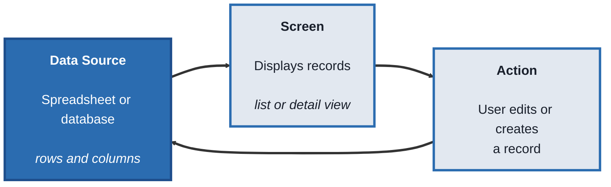
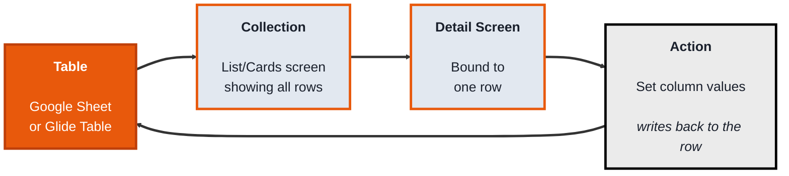
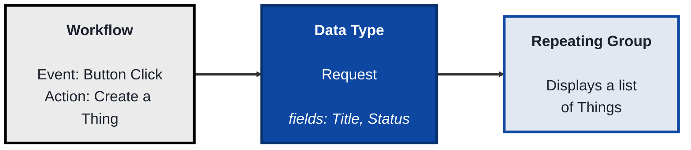
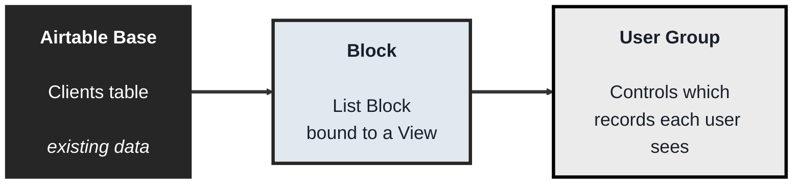

<!-- order: 3 -->
# Internal Apps: A Practical Beginner's Course

## Course Overview

**By the end of this course, you'll be able to:**
- Describe any internal app as a data source, screens, actions, and permissions
- Build a Glide app on a Google Sheet with a list, a detail screen, and a button that writes back to the sheet
- Build a Bubble app with a custom data type, a repeating group, a create workflow, a conditional, and a privacy rule
- Build a Softr portal on Airtable that shows each signed-in client only their own record
- Explain why data-level permissions (privacy rules, record ownership) matter more than hiding things on screen

**Who this is for:** Beginners who want to build functional, data-driven apps — task trackers, client portals, inventory tools, request forms with a review queue — connected to real data, with logins and permissions, without writing a traditional backend.

**How the course works:** Four modules. Every topic follows the same pattern:
- **Concept** - what it is, in plain language
- **Structure at a Glance** - the core building blocks you'll actually work with
- **Where you'd actually use this** - a real business scenario
- **Lab** - hands-on, buildable examples
- **Checkpoint**
- **Quiz** - five questions with answers

**Time:** about 6 hours in total

**Tools needed:** Free accounts on [Glide](https://glideapps.com), [Bubble](https://bubble.io), and [Softr](https://softr.io). A free [Google Sheets](https://sheets.google.com) or [Airtable](https://airtable.com) account is also needed for two of the modules. You won't need all three platforms at once — each module only needs its own tool.

**Free plan note:** Free plans change often. Before you start, check the current free-plan limits on Glide's and Softr's pricing pages (for example, how many rows, users, apps, or user groups you get, and whether features like Row Owners are included). If a lab step needs a feature your free plan doesn't include, treat that step as "needs a paid plan or trial: follow along" and keep going with the rest of the lab.

---

## Module 0: What Internal App Builders Actually Do

**Time:** about 30 minutes

### Concept

An **internal app builder** turns a set of data into a working application with screens, actions, and permissions — different from a website builder, which mainly displays content publicly. Every platform in this course is built from the same underlying idea, even though the interface and vocabulary differ:

- A **data source** is where the app's information actually lives — a spreadsheet, a database, or the platform's own built-in storage
- A **screen** (or view) displays data from the source, either as a list of many records or the detail of one
- An **action** lets a user change the data — creating a new record, editing a field, marking something complete — and that change writes back to the data source
- **Permissions** (sometimes called user roles or record ownership) control which users can see or edit which records, since an internal app usually shouldn't show every user everything

### Structure at a Glance


This same shape — data source, screen, action writing back to the source — appears in every tool this course covers.

### Where you'd actually use this

Any situation where a team needs a real tool, not just a document: a task tracker where each person sees only their own work, a client portal showing each client only their own records, an inventory tracker a warehouse team updates from their phones, an internal request queue with an admin review screen.

### Lab

Pick a simple dataset shaped like a spreadsheet — for example, a task list with columns `Task`, `Assignee`, `Status`. Sketch what an app built on this data would need: a list screen showing all tasks, a detail screen for one task, and an action to change its `Status`. This sketch is exactly what you'll build in every module that follows.

### Checkpoint
You can describe the data source, screen, and action concepts, and you have a written sketch of a simple app's list screen, detail screen, and one action.

### Quiz
1. What is a data source, in the context of an internal app builder?
2. What's the difference between a list screen and a detail screen?
3. What does an action actually do?
4. What do permissions (or record ownership) control?
5. How is an internal app builder different from a website builder, in what it's mainly used for?

*Answers: 1) Where the app's information actually lives — a spreadsheet, database, or the platform's own built-in storage. 2) A list screen shows many records at once; a detail screen shows the full information for one specific record. 3) Lets a user change data — creating, editing, or completing a record — with that change writing back to the data source. 4) Which users can see or edit which specific records, since an internal app usually shouldn't show every user everything. 5) A website builder mainly displays content publicly; an internal app builder builds functional tools with data, actions, and permissions for a team or specific users.*

```watch
{
 "scenes": [
  {
   "kind": "title",
   "art": "boxes",
   "kicker": "Module 0 · What internal app builders do",
   "title": "Data in, working tool out",
   "beats": [
    {
     "say": "Welcome to Internal Apps."
    },
    {
     "say": "An internal app builder turns a set of data into a working application, with screens, actions and permissions."
    },
    {
     "say": "That's different from a website builder, which mainly displays content publicly."
    }
   ]
  },
  {
   "kind": "list",
   "art": "blocks",
   "kicker": "Concept",
   "title": "The four building blocks",
   "items": [
    [
     "Data source",
     "Where the data lives"
    ],
    [
     "Screen",
     "List or detail view"
    ],
    [
     "Action",
     "Writes back to the source"
    ],
    [
     "Permissions",
     "Who sees or edits what"
    ]
   ],
   "beats": [
    {
     "say": "Every platform in this course shares the same idea.",
     "show": 0
    },
    {
     "say": "A data source is where the information lives: a spreadsheet, a database, or the platform's own storage.",
     "show": 1
    },
    {
     "say": "A screen displays that data, as a list of many records, or the detail of one.",
     "show": 2
    },
    {
     "say": "An action lets a user change the data, and the change writes back to the source.",
     "show": 3
    },
    {
     "say": "And permissions control which users can see or edit which records.",
     "show": 4
    }
   ]
  },
  {
   "kind": "flow",
   "art": "loop",
   "kicker": "Structure at a glance",
   "title": "A loop back to the data",
   "steps": [
    "Data source",
    "Screen",
    "Action",
    "Back to the data source"
   ],
   "beats": [
    {
     "say": "Here's the shape you'll see in every tool.",
     "show": 0
    },
    {
     "say": "The data source holds rows and columns.",
     "show": 1
    },
    {
     "say": "A screen displays the records.",
     "show": 2
    },
    {
     "say": "An action edits or creates a record, and that writes back to the data source.",
     "show": 3
    }
   ]
  },
  {
   "kind": "list",
   "art": "pencil",
   "kicker": "Lab",
   "title": "Sketch a task tracker",
   "items": [
    [
     "List screen",
     "All tasks"
    ],
    [
     "Detail screen",
     "One task"
    ],
    [
     "Action",
     "Change its Status"
    ]
   ],
   "beats": [
    {
     "say": "Your lab is a sketch.",
     "show": 0
    },
    {
     "say": "Take a task list with three columns: task, assignee and status.",
     "show": 0
    },
    {
     "say": "Sketch a list screen showing all tasks.",
     "show": 1
    },
    {
     "say": "A detail screen for one task.",
     "show": 2
    },
    {
     "say": "And an action that changes its status. You'll build exactly this in every module.",
     "show": 3
    }
   ]
  },
  {
   "kind": "quiz",
   "art": "ask",
   "kicker": "Quick check",
   "title": "What's the difference between a list screen and a detail screen?",
   "options": [
    "A list screen shows many records; a detail screen shows one record in full",
    "A list screen is for admins only",
    "A detail screen can't be edited"
   ],
   "answer": 0,
   "good": "That's right. A list screen shows many records at once; a detail screen shows the full information for one specific record.",
   "bad": "Not quite. A list screen shows many records at once; a detail screen shows the full information for one specific record.",
   "beats": [
    {
     "say": "Quick check.",
     "show": 0
    },
    {
     "say": "What's the difference between a list screen and a detail screen?",
     "show": 0
    },
    {
     "say": "Tap your answer.",
     "show": 1
    }
   ]
  },
  {
   "kind": "list",
   "art": "proof",
   "kicker": "Checkpoint",
   "title": "You're done when",
   "items": [
    [
     "You can describe source, screen and action",
     ""
    ],
    [
     "Your app sketch is written down",
     ""
    ]
   ],
   "beats": [
    {
     "say": "That's Module 0.",
     "show": 0
    },
    {
     "say": "You're done when:",
     "show": 0
    },
    {
     "say": "you can describe data sources, screens and actions,",
     "show": 1
    },
    {
     "say": "and you have a sketch of a list screen, a detail screen and one action.",
     "show": 2
    },
    {
     "say": "Next, in Module 1, turning a spreadsheet into an app with Glide.",
     "show": 2
    }
   ]
  }
 ]
}
```

---

## Module 1: Glide - Spreadsheet Straight Into an App

**Time:** about 1.5 hours

### Concept

**Glide** turns a spreadsheet directly into a working, mobile-friendly app — connect a Google Sheet (or use Glide's own built-in Tables), and Glide automatically maps its columns into visual screens. It's built around speed: "sheet in, app out," with minimal setup between having data and having a usable app.

### Structure at a Glance


- A **Table** is Glide's term for a connected data source — a Google Sheet tab or a native Glide Table, made of rows and columns
- A **Collection** (List, Cards, or Calendar) is a screen showing multiple rows from a Table at once
- A **Detail screen** shows all the fields for one specific row, opened by tapping it in a Collection
- An **Action** like "Set column values" lets a button write a new value into a specific column for that row — this is how a user's tap actually changes the underlying data
- **Row Owners** is Glide's built-in permission feature — restricting which rows a specific logged-in user can see, based on a column matching their email

### Where you'd actually use this

Fast internal tools built directly from data your team already keeps in a spreadsheet: a task tracker, a simple CRM, a field team's daily checklist app, anywhere a spreadsheet already exists and just needs a proper mobile interface on top of it.

### Lab

1. **Create a Google Sheet** with columns: `Task`, `Assignee` (an email address), `Status` (values like "Open" or "Done").

2. **Create a new Glide app** and connect it to this sheet as your Table.

3. **Add a Collection screen** displaying all rows from the Table, showing `Task` and `Status` in the list view.

4. **Tap into the Detail screen** for a row (Glide generates this automatically) and confirm all its fields display.

5. **Add an Action button** on the Detail screen labeled "Mark Complete," using the **Set column values** action to set `Status` to "Done" when tapped.

6. **Set up Row Owners** using the `Assignee` column, so each signed-in user only sees rows where they're listed as the assignee.

7. **Publish the app** (check the current free-plan limits on Glide's pricing page; if Row Owners or sign-in for extra users isn't included on your plan, follow along with this step), sign in as a test user matching one of your `Assignee` emails, and confirm you only see that user's tasks — then tap "Mark Complete" and confirm the Google Sheet itself updates with the new status.

### Checkpoint
You have a published Glide app connected to a real Google Sheet, showing only a signed-in user's own rows via Row Owners, with a working action that updates the sheet.

### Quiz
1. What is a Table in Glide?
2. What's the difference between a Collection and a Detail screen?
3. What does the "Set column values" action actually do?
4. What does Row Owners control?
5. After tapping "Mark Complete" in the app, where did the actual change get saved?

*Answers: 1) Glide's term for a connected data source — a Google Sheet tab or native Glide Table made of rows and columns. 2) A Collection shows multiple rows at once as a list; a Detail screen shows all the fields for one specific row. 3) Writes a new value into a specific column for a specific row, which is how a button tap actually changes the underlying data. 4) Which rows a specific signed-in user is allowed to see, based on a column (like an email address) matching their login. 5) The original Google Sheet itself — Glide writes changes directly back to the connected spreadsheet.*

```watch
{
 "scenes": [
  {
   "kind": "title",
   "art": "phone",
   "kicker": "Module 1 · Glide",
   "title": "Spreadsheet straight into an app",
   "beats": [
    {
     "say": "Welcome to Module 1."
    },
    {
     "say": "Glide turns a spreadsheet directly into a working, mobile-friendly app. Sheet in, app out."
    }
   ]
  },
  {
   "kind": "list",
   "art": "blocks",
   "kicker": "Structure at a glance",
   "title": "Glide's building blocks",
   "items": [
    [
     "Table",
     "Google Sheet or Glide Table"
    ],
    [
     "Collection",
     "Many rows"
    ],
    [
     "Detail screen",
     "One row"
    ],
    [
     "Set column values",
     "A button writes to the row"
    ],
    [
     "Row Owners",
     "Rows matched to the user's email"
    ]
   ],
   "beats": [
    {
     "say": "Glide has its own words.",
     "show": 0
    },
    {
     "say": "A Table is the connected data source, a Google Sheet tab or a Glide Table.",
     "show": 1
    },
    {
     "say": "A Collection is a screen showing many rows, as a list, cards, or a calendar.",
     "show": 2
    },
    {
     "say": "A Detail screen shows every field of one row.",
     "show": 3
    },
    {
     "say": "An action, like set column values, lets a button write a new value into the row.",
     "show": 4
    },
    {
     "say": "And Row Owners limits which rows a signed-in user can see, by matching a column to their email.",
     "show": 5
    }
   ]
  },
  {
   "kind": "flow",
   "art": "table",
   "kicker": "Lab · Steps 1 to 5",
   "title": "Build the task app",
   "steps": [
    "Sheet: Task · Assignee · Status",
    "Connect a Glide app",
    "Collection + Detail screen",
    "\"Mark Complete\" button"
   ],
   "beats": [
    {
     "say": "Create a Google Sheet with task, assignee as an email address, and status columns.",
     "show": 1
    },
    {
     "say": "Create a Glide app connected to that sheet.",
     "show": 2
    },
    {
     "say": "Add a Collection showing task and status, and tap into the Detail screen Glide generates.",
     "show": 3
    },
    {
     "say": "Then add a Mark Complete button that sets status to done.",
     "show": 4
    }
   ]
  },
  {
   "kind": "list",
   "art": "lock",
   "kicker": "Lab · Steps 6 and 7",
   "title": "Row Owners, then prove it",
   "items": [
    [
     "Publish + sign in",
     "As a test assignee"
    ],
    [
     "✓ Only your tasks",
     "Row Owners at work"
    ],
    [
     "✓ Sheet updates",
     "Mark Complete writes back"
    ]
   ],
   "beats": [
    {
     "say": "Set up Row Owners on the assignee column.",
     "show": 0
    },
    {
     "say": "Publish, and sign in as a test user matching one assignee's email.",
     "show": 1
    },
    {
     "say": "You should only see that user's tasks.",
     "show": 2
    },
    {
     "say": "Tap Mark Complete, and the Google Sheet itself updates. If your free plan lacks Row Owners, follow along.",
     "show": 3
    }
   ]
  },
  {
   "kind": "quiz",
   "art": "ask",
   "kicker": "Quick check",
   "title": "After tapping Mark Complete in the app, where did the change actually get saved?",
   "options": [
    "Only on the phone",
    "In a separate Glide backup",
    "In the original Google Sheet"
   ],
   "answer": 2,
   "good": "That's right. Glide writes changes directly back to the connected Google Sheet.",
   "bad": "Not quite. Glide writes changes directly back to the connected Google Sheet.",
   "beats": [
    {
     "say": "Quick check.",
     "show": 0
    },
    {
     "say": "After tapping Mark Complete in the app, where did the change actually get saved?",
     "show": 0
    },
    {
     "say": "Tap your answer.",
     "show": 1
    }
   ]
  },
  {
   "kind": "list",
   "art": "proof",
   "kicker": "Checkpoint",
   "title": "You're done when",
   "items": [
    [
     "A published Glide app on a real sheet",
     ""
    ],
    [
     "Row Owners shows only your rows",
     ""
    ],
    [
     "Mark Complete updates the sheet",
     ""
    ]
   ],
   "beats": [
    {
     "say": "That's Module 1.",
     "show": 0
    },
    {
     "say": "You're done when:",
     "show": 0
    },
    {
     "say": "you have a published Glide app connected to a real Google Sheet,",
     "show": 1
    },
    {
     "say": "showing a signed-in user only their own rows,",
     "show": 2
    },
    {
     "say": "with an action that updates the sheet.",
     "show": 3
    },
    {
     "say": "Next, in Module 2, a full logic engine with Bubble.",
     "show": 3
    }
   ]
  }
 ]
}
```

---

## Module 2: Bubble - A Full Application Logic Engine

**Time:** about 2 hours

### Concept

**Bubble** is a more powerful, general-purpose no-code platform for building complete web applications with custom logic, its own built-in database, and a visual **workflow** editor connecting events to actions — suited for internal tools more complex than a direct spreadsheet mapping, where you need real conditional logic and a data structure designed specifically for your app.

### Structure at a Glance


- A **Data Type** is a custom structure you define (like "Request" or "Task") with its own **fields** — Bubble's database is built specifically for your app, not borrowed from a spreadsheet
- A **Thing** is one actual record of a Data Type — one specific Request, with real values in its fields
- A **Repeating Group** is an element that displays a list of Things on a page, similar to a Collection in Glide, but more flexible in what each item can visually contain
- A **Workflow** connects an **Event** (a button click, a page load, a form submission) to one or more **Actions** (create a Thing, modify a Thing, send an email)
- A **Conditional** changes an element's appearance or visibility based on a rule (e.g., highlight a row red if its Status is "Urgent")
- A **Privacy Rule** restricts which users can view or edit specific Things, enforced by Bubble itself rather than by what's simply hidden on a page

### Where you'd actually use this

Internal tools that need real custom logic beyond a straightforward data display: an approval workflow with multiple statuses and conditional routing, a request-tracking system with role-based views, any tool where "if this, then that" logic needs to run when a user does something.

### Lab

1. **Create a new Bubble app** and open the Data tab. Create a new **Data Type** called `Request` with fields: `Title` (text), `Status` (text), `Requester` (text).

2. **Build a page with a Repeating Group**: set its Type of content to `Request` and its Data source to "Do a search for Requests", then add a Text element in the first cell showing the current cell's Request's `Title`. This will show every Request Thing once you have some.

3. **Add a form and a button** to the page (a text input for `Title`, another for `Requester`) with a **Workflow**: Event = "Button A is clicked," Action = "Create a new Request" using the input values.

4. **Preview the app, submit the form,** and confirm a new Thing appears automatically in the Repeating Group without refreshing the page.

5. **Add a Conditional** to the Text element inside the cell (or a Group holding it): on its Conditional tab, add "When Current cell's Request's Status is Urgent", then set the property Background style to a red flat color (or Font color to red).

6. **Manually set one Thing's Status to "Urgent"** in the Data tab, and confirm that row highlights red in the app.

7. **Add a Privacy Rule**: in the Data tab, open Privacy, select `Request`, and define a new rule with the condition "Current User is logged in" that allows "View all fields" and "Find this in searches". Then, in the "Everyone else (default permissions)" row, uncheck those same permissions (they are on by default). Preview while logged out and confirm the Repeating Group is empty. (To see it filled again, you would add sign-up and log-in, as the No-Code Web App Builder (Bubble): Hands-On Project Tutorials course does.)

### Checkpoint
You have a working Bubble app with a custom Data Type, a Repeating Group displaying real Things, a Workflow that creates new Things from a form, a working Conditional, and a Privacy Rule restricting visibility to logged-in users.

### Quiz
1. What is a Data Type in Bubble, and how is it different from just using a spreadsheet?
2. What is a Thing?
3. What does a Workflow connect together?
4. What does a Conditional do?
5. What does a Privacy Rule actually enforce, compared to just hiding something visually on a page?

*Answers: 1) A custom data structure you define specifically for your app, with its own fields — unlike a spreadsheet, it's built inside Bubble's own database rather than borrowed from an external sheet. 2) One actual record of a Data Type, with real values filled into its fields. 3) An Event (like a button click or form submission) to one or more Actions (like creating or modifying a Thing). 4) Changes an element's appearance or visibility based on a rule, such as highlighting a row when a field matches a specific value. 5) It's enforced by Bubble itself at the data level, so a user genuinely cannot access the restricted data even by inspecting the page — unlike simply hiding an element visually, which wouldn't actually protect the underlying data.*

```watch
{
 "scenes": [
  {
   "kind": "title",
   "art": "database",
   "kicker": "Module 2 · Bubble",
   "title": "A full application logic engine",
   "beats": [
    {
     "say": "Welcome to Module 2."
    },
    {
     "say": "Bubble builds complete web apps, with its own built-in database, custom logic, and a visual workflow editor."
    },
    {
     "say": "It's for tools that need more than a spreadsheet mapping."
    }
   ]
  },
  {
   "kind": "list",
   "art": "layers",
   "kicker": "Structure at a glance",
   "title": "Bubble's building blocks",
   "items": [
    [
     "Data Type · Thing",
     "Your structure · one record"
    ],
    [
     "Repeating Group",
     "A list of Things"
    ],
    [
     "Workflow",
     "Event → actions"
    ],
    [
     "Conditional",
     "Style by rule"
    ],
    [
     "Privacy Rule",
     "Enforced at the data level"
    ]
   ],
   "beats": [
    {
     "say": "Bubble has six key ideas.",
     "show": 0
    },
    {
     "say": "A Data Type is a structure you define, with its own fields. A Thing is one record of it.",
     "show": 1
    },
    {
     "say": "A Repeating Group displays a list of Things on a page.",
     "show": 2
    },
    {
     "say": "A Workflow connects an event, like a button click, to actions, like create a Thing.",
     "show": 3
    },
    {
     "say": "A Conditional changes how an element looks, based on a rule.",
     "show": 4
    },
    {
     "say": "And a Privacy Rule restricts who can view or edit Things, enforced by Bubble itself.",
     "show": 5
    }
   ]
  },
  {
   "kind": "flow",
   "art": "database",
   "kicker": "Lab · Steps 1 to 4",
   "title": "Requests, end to end",
   "steps": [
    "Data Type: Request",
    "Repeating Group",
    "Workflow: create a Request",
    "Preview: it appears"
   ],
   "beats": [
    {
     "say": "Create a Data Type called Request, with title, status and requester fields.",
     "show": 1
    },
    {
     "say": "Add a Repeating Group that searches for Requests, showing each one's title.",
     "show": 2
    },
    {
     "say": "Add a form and a button, with a workflow: when the button is clicked, create a new Request.",
     "show": 3
    },
    {
     "say": "Preview, submit, and the new Thing appears without refreshing the page.",
     "show": 4
    }
   ]
  },
  {
   "kind": "big",
   "art": "palette",
   "kicker": "Lab · Steps 5 and 6",
   "title": "Highlight urgent requests",
   "big": "Status is Urgent",
   "sub": "→ the row turns red",
   "beats": [
    {
     "say": "Next, add a Conditional to the text in each cell: when the current cell's Request's status is urgent, make it red.",
     "show": 0
    },
    {
     "say": "Set one Thing's status to urgent in the Data tab, and that row turns red.",
     "show": 1
    }
   ]
  },
  {
   "kind": "quote",
   "art": "shield",
   "kicker": "Lab · Step 7",
   "title": "Protect the data, not just the page",
   "quote": "Hidden on the page ≠ protected. Privacy Rules guard the data itself.",
   "beats": [
    {
     "say": "Finally, a Privacy Rule on Request: logged-in users can view all fields and find it in searches.",
     "show": 0
    },
    {
     "say": "Uncheck those same permissions for everyone else, then preview logged out. The list is empty.",
     "show": 1
    },
    {
     "say": "Hiding something on screen doesn't protect it. A privacy rule does, even if someone inspects the page.",
     "show": 1
    }
   ]
  },
  {
   "kind": "quiz",
   "art": "ask",
   "kicker": "Quick check",
   "title": "What does a Privacy Rule enforce that simply hiding an element doesn't?",
   "options": [
    "A faster page load",
    "Data-level protection, so restricted data can't be reached even by inspecting the page",
    "A nicer layout for logged-out users"
   ],
   "answer": 1,
   "good": "That's right. A Privacy Rule is enforced by Bubble at the data level. Hiding an element visually doesn't actually protect the data underneath.",
   "bad": "Not quite. A Privacy Rule is enforced by Bubble at the data level. Hiding an element visually doesn't actually protect the data underneath.",
   "beats": [
    {
     "say": "Quick check.",
     "show": 0
    },
    {
     "say": "What does a Privacy Rule enforce that simply hiding an element doesn't?",
     "show": 0
    },
    {
     "say": "Tap your answer.",
     "show": 1
    }
   ]
  },
  {
   "kind": "list",
   "art": "proof",
   "kicker": "Checkpoint",
   "title": "You're done when",
   "items": [
    [
     "Data Type and Repeating Group work",
     ""
    ],
    [
     "A Workflow creates Things",
     ""
    ],
    [
     "A Conditional highlights urgent rows",
     ""
    ],
    [
     "A Privacy Rule protects the data",
     ""
    ]
   ],
   "beats": [
    {
     "say": "That's Module 2.",
     "show": 0
    },
    {
     "say": "You're done when:",
     "show": 0
    },
    {
     "say": "you have a Bubble app with a custom Data Type and a Repeating Group of real Things,",
     "show": 1
    },
    {
     "say": "a Workflow that creates Things from a form,",
     "show": 2
    },
    {
     "say": "a working Conditional,",
     "show": 3
    },
    {
     "say": "and a Privacy Rule limiting visibility to logged-in users.",
     "show": 4
    },
    {
     "say": "Next, in Module 3, client portals with Softr on Airtable.",
     "show": 4
    }
   ]
  }
 ]
}
```

---

## Module 3: Softr - No-Code Portals on Top of Airtable

**Time:** about 2 hours

### Concept

**Softr** builds client-facing and internal web apps directly on top of an existing **Airtable** base (or other supported data sources), using pre-built **Blocks** — lists, tables, forms, charts — that bind to your data with minimal configuration. It's built for **portals**: client portals, member directories, internal dashboards, where the data structure already exists in Airtable and you mainly need a clean, permissioned interface on top of it.

### Structure at a Glance


- A **Block** is Softr's pre-built page component — a List, Table, Chart, or Form — that binds directly to data from your connected source
- An **Airtable View** is a specific, filtered/sorted way of looking at a table in Airtable; a Softr Block typically binds to one View, not the raw table, so filtering can be controlled from Airtable itself
- A **User Group** defines a set of logged-in users and what they're allowed to access; combined with **record ownership** (matching a record's field, like an email, to the logged-in user), this is how a portal shows each client only their own data
- An **Action button** can be linked to trigger an Airtable automation, letting a click in Softr kick off a process defined back in Airtable

### Where you'd actually use this

Client portals where each client should log in and see only their own project status or invoices, member directories, internal dashboards built on data your team already manages in Airtable, situations where the underlying data structure is already solid and the main need is a clean, permissioned front end.

### Lab

1. **Create an Airtable base** with a `Clients` table containing fields: `Name`, `Email`, `Project Status`.

2. **Create a View in Airtable** (e.g., "Active Clients") filtered to only show clients with a non-empty `Project Status`.

3. **Create a new Softr app** and connect it to your Airtable base.

4. **Add a List Block to a page,** bound to your `Clients` table's "Active Clients" View, displaying `Name` and `Project Status`.

5. **Set up a User Group** for logged-in clients, and configure record ownership so a logged-in user only sees the Client record where their login email matches the `Email` field.

6. **Publish the portal**, sign in as a test user matching one client's email, and confirm you only see that one client's record, not the full list.

7. **Add a separate, admin-only page** (check Softr's current free-plan limits on user groups; if a second group isn't included, follow along with this step) with a Table Block showing all `Clients` records unfiltered by ownership, and restrict that page to a separate "Admin" User Group.

### Checkpoint
You have a published Softr portal connected to a real Airtable base, showing a logged-in client only their own record via record ownership, plus a separate admin-only page showing everything.

### Quiz
1. What is a Block in Softr?
2. Why does a Block typically bind to an Airtable View instead of the raw table?
3. What does a User Group control?
4. What does "record ownership" mean, in the context of a client portal?
5. How did the lab keep the admin page separate from what regular client users can see?

*Answers: 1) A pre-built page component — like a List, Table, Chart, or Form — that binds directly to data from a connected source such as Airtable. 2) Because a View is a specific, filtered/sorted way of looking at the data, letting you control what's shown from within Airtable itself rather than rebuilding that filtering logic in Softr. 3) A defined set of logged-in users and what pages or data they're allowed to access. 4) Matching a record's field, like an email address, to the logged-in user, so that user only sees their own record instead of every record in the table. 5) By restricting the admin page to a separate "Admin" User Group, distinct from the client-facing User Group used for record-owned data.*

```watch
{
 "scenes": [
  {
   "kind": "title",
   "art": "people",
   "kicker": "Module 3 · Softr",
   "title": "No-code portals on Airtable",
   "beats": [
    {
     "say": "Welcome to the last module."
    },
    {
     "say": "Softr builds client-facing and internal web apps on top of an existing Airtable base, using pre-built Blocks."
    },
    {
     "say": "It's made for portals, where the data already exists and you need a clean, permissioned front end."
    }
   ]
  },
  {
   "kind": "list",
   "art": "blocks",
   "kicker": "Structure at a glance",
   "title": "Softr's building blocks",
   "items": [
    [
     "Block",
     "List · Table · Chart · Form"
    ],
    [
     "Airtable View",
     "Filtered, sorted data"
    ],
    [
     "User Group + ownership",
     "Each client sees their own"
    ],
    [
     "Action button",
     "Triggers an Airtable automation"
    ]
   ],
   "beats": [
    {
     "say": "Softr has four key ideas.",
     "show": 0
    },
    {
     "say": "A Block is a pre-built page component, like a list, table, chart or form, bound to your data.",
     "show": 1
    },
    {
     "say": "A Block usually binds to an Airtable View, a filtered, sorted look at a table, so filtering is controlled in Airtable.",
     "show": 2
    },
    {
     "say": "A User Group defines logged-in users and what they can access. With record ownership, each client sees only their own data.",
     "show": 3
    },
    {
     "say": "And an action button can trigger an Airtable automation.",
     "show": 4
    }
   ]
  },
  {
   "kind": "flow",
   "art": "database",
   "kicker": "Lab · Steps 1 to 4",
   "title": "From base to portal",
   "steps": [
    "Airtable: Clients table",
    "View: Active Clients",
    "Connect a Softr app",
    "List Block on the View"
   ],
   "beats": [
    {
     "say": "Create an Airtable base with a Clients table: name, email and project status.",
     "show": 1
    },
    {
     "say": "Create an Active Clients view, showing only clients with a project status.",
     "show": 2
    },
    {
     "say": "Create a Softr app, connected to your base.",
     "show": 3
    },
    {
     "say": "Add a List Block bound to the Active Clients view, showing name and project status.",
     "show": 4
    }
   ]
  },
  {
   "kind": "list",
   "art": "lock",
   "kicker": "Lab · Steps 5 to 7",
   "title": "Each client sees only their own",
   "items": [
    [
     "Client User Group",
     "Login email = Email field"
    ],
    [
     "✓ One record only",
     "Signed in as a client"
    ],
    [
     "Admin User Group",
     "Separate page, every client"
    ]
   ],
   "beats": [
    {
     "say": "Set up a User Group for clients, with record ownership matching their login email to the email field.",
     "show": 1
    },
    {
     "say": "Publish, sign in as one client, and confirm you see only that one record.",
     "show": 2
    },
    {
     "say": "Then add an admin-only page with a Table Block of every client, restricted to a separate Admin group. If your free plan lacks a second group, follow along.",
     "show": 3
    }
   ]
  },
  {
   "kind": "quiz",
   "art": "ask",
   "kicker": "Quick check",
   "title": "Why does a Softr Block typically bind to an Airtable View instead of the raw table?",
   "options": [
    "Raw tables can't be connected",
    "Views load faster on phones",
    "A View is already filtered and sorted, so you control what's shown from Airtable itself"
   ],
   "answer": 2,
   "good": "That's right. A View lets you control filtering from within Airtable, instead of rebuilding that logic in Softr.",
   "bad": "Not quite. A View lets you control filtering from within Airtable, instead of rebuilding that logic in Softr.",
   "beats": [
    {
     "say": "Quick check.",
     "show": 0
    },
    {
     "say": "Why does a Softr Block typically bind to an Airtable View instead of the raw table?",
     "show": 0
    },
    {
     "say": "Tap your answer.",
     "show": 1
    }
   ]
  },
  {
   "kind": "list",
   "art": "proof",
   "kicker": "Checkpoint",
   "title": "You're done when",
   "items": [
    [
     "A published portal on Airtable",
     ""
    ],
    [
     "Each client sees only their record",
     ""
    ],
    [
     "An admin-only page shows everything",
     ""
    ]
   ],
   "beats": [
    {
     "say": "That's the final module.",
     "show": 0
    },
    {
     "say": "You're done when:",
     "show": 0
    },
    {
     "say": "you have a published Softr portal on a real Airtable base,",
     "show": 1
    },
    {
     "say": "showing each signed-in client only their own record,",
     "show": 2
    },
    {
     "say": "plus a separate admin-only page showing everything.",
     "show": 3
    },
    {
     "say": "You've finished Internal Apps. Well done.",
     "show": 3
    }
   ]
  }
 ]
}
```
