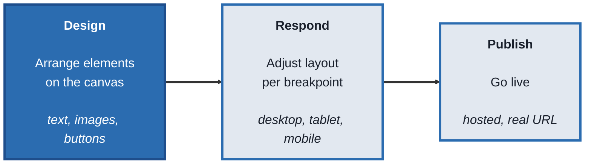
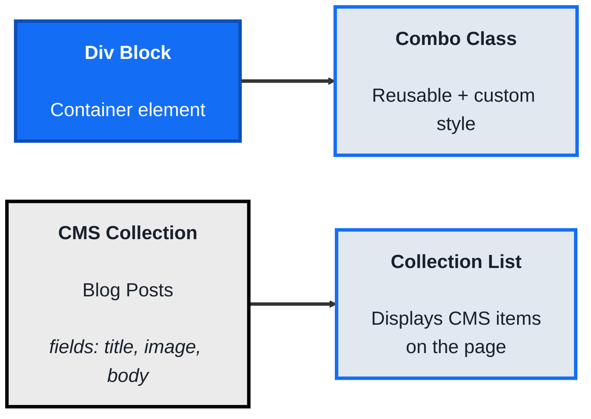
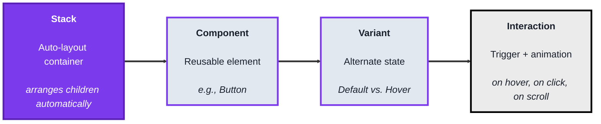
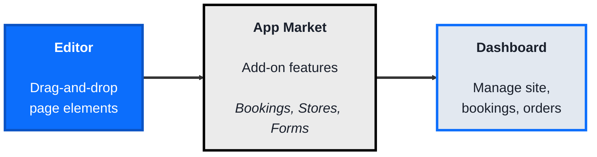

<!-- order: 1 -->
# Website Builders: A Practical Beginner's Course

## Course Overview

**By the end of this course, you'll be able to:**
- Explain canvases, elements, breakpoints, and publishing, and plan a simple site
- Build a Webflow page with flexbox, a combo class, and a CMS collection list, then publish it
- Build a Framer page with stacks, a button component with a hover variant, and an edited AI-generated section
- Add a Wix app such as Bookings or Forms and confirm a live test submission in the Dashboard
- Compare Webflow, Framer, and Wix and choose one for a given kind of site

**Who this is for:** Beginners who want to build real, live websites — landing pages, portfolios, small business sites — visually, without writing HTML, CSS, or JavaScript by hand.

**How the course works:** Four modules. Every topic follows the same pattern:
- **Concept** - what it is, in plain language
- **Structure at a Glance** - the core building blocks you'll actually work with
- **Where you'd actually use this** - a real business scenario
- **Lab** - hands-on, buildable examples
- **Checkpoint**
- **Quiz** - five questions with answers

**Time:** about 6 hours in total

**Tools needed:** Free accounts on [Webflow](https://webflow.com), [Framer](https://framer.com), and [Wix](https://wix.com). You won't need all three at once — each module only needs its own tool. These tools update their interfaces often, so if a button or panel name in a lab doesn't match exactly, look for the closest equivalent or search the tool's help center.

---

## Module 0: What Website Builders Actually Do

**Time:** about 30 minutes

### Concept

A **website builder** lets you visually construct a real, live website by arranging elements on a canvas, instead of writing markup and styling code by hand. Every platform in this course is built from the same underlying idea, even though the interface and vocabulary differ:

- A **canvas** is the visual workspace where you place and arrange elements (text, images, buttons, sections)
- An **element** is any individual piece on the page — a heading, an image, a button, a container that holds other elements
- A **breakpoint** is a screen-size setting (desktop, tablet, mobile) that lets you adjust how the page looks on different devices, since a layout that works on a laptop often needs to change on a phone
- **Publishing** takes your visual design and turns it into an actual, live website with a real URL, hosted by the platform

### Structure at a Glance


This same shape — design, make it responsive, publish — appears in every tool this course covers.

### Where you'd actually use this

Any situation where a business or individual needs a real website quickly: a small business homepage, a portfolio, a landing page for a product launch, an event page — without hiring a developer or writing code.

### Lab

Sketch a simple 3-page site on paper: **Home**, **About**, **Contact**. For each page, list the elements it needs (e.g., Home: headline, hero image, three feature blocks, call-to-action button). This element list is exactly what you'll be placing on a canvas in every module that follows.

### Checkpoint
You can describe the canvas, element, breakpoint, and publishing concepts, and you have a written 3-page site plan with elements listed per page.

### Quiz
1. What is a canvas, in the context of a website builder?
2. What is an element?
3. What is a breakpoint, and why does it matter?
4. What does "publishing" actually do?
5. Do these platforms require writing HTML/CSS by hand to build a real website?

*Answers: 1) The visual workspace where you place and arrange elements to build a page. 2) Any individual piece on a page, such as a heading, image, button, or container. 3) A screen-size setting (desktop, tablet, mobile) that lets you adjust layout per device, since designs often need to change across screen sizes. 4) It takes your visual design and turns it into a real, live website hosted at an actual URL. 5) No, that's the core purpose of these platforms — building real websites through a visual interface instead of hand-written code.*

```watch
{
 "scenes": [
  {
   "kind": "title",
   "art": "layout",
   "kicker": "Module 0 · What website builders do",
   "title": "Build a real site, visually",
   "beats": [
    {
     "say": "Welcome to Website Builders."
    },
    {
     "say": "A website builder lets you build a real, live website by arranging elements on a canvas, instead of writing markup and styling code by hand."
    },
    {
     "say": "Across this course you'll use three of them: Webflow, Framer and Wix."
    }
   ]
  },
  {
   "kind": "table",
   "kicker": "Concept",
   "title": "Four ideas every builder shares",
   "columns": [
    "Idea",
    "What it is",
    "Example"
   ],
   "rows": [
    [
     "Canvas",
     "the visual workspace",
     "where you arrange"
    ],
    [
     "Element",
     "one piece of the page",
     "heading, button"
    ],
    [
     "Breakpoint",
     "a screen-size setting",
     "desktop, tablet, phone"
    ],
    [
     "Publishing",
     "design to live site",
     "a real URL"
    ]
   ],
   "beats": [
    {
     "say": "Every platform in this course is built on the same four ideas.",
     "col": 0
    },
    {
     "say": "The canvas is the visual workspace where you place and arrange things.",
     "hl": 0
    },
    {
     "say": "An element is any single piece: a heading, an image, a button, or a container holding other elements.",
     "hl": 1
    },
    {
     "say": "A breakpoint is a screen size setting, like desktop, tablet or mobile.",
     "hl": 2
    },
    {
     "say": "And publishing turns your design into a live website, hosted by the platform, at a real U R L.",
     "hl": 3
    }
   ]
  },
  {
   "kind": "diagram",
   "kicker": "Structure at a glance",
   "title": "Design, respond, publish",
   "nodes": [
    {
     "id": "canvas",
     "label": "Canvas",
     "x": 12,
     "y": 35,
     "sub": "arrange elements",
     "art": "layout"
    },
    {
     "id": "bp",
     "label": "Breakpoints",
     "x": 45,
     "y": 35,
     "sub": "desktop, tablet, mobile",
     "art": "phone"
    },
    {
     "id": "host",
     "label": "Platform host",
     "x": 82,
     "y": 35,
     "sub": "publishes your site",
     "art": "cloud"
    },
    {
     "id": "visitor",
     "label": "Visitor",
     "x": 82,
     "y": 82,
     "sub": "opens the real URL",
     "art": "browser"
    }
   ],
   "edges": [
    {
     "from": "canvas",
     "to": "bp"
    },
    {
     "from": "bp",
     "to": "host"
    },
    {
     "from": "host",
     "to": "visitor"
    }
   ],
   "beats": [
    {
     "say": "The same shape appears in every tool.",
     "show": 1
    },
    {
     "say": "Design: you arrange text, images and buttons on the canvas.",
     "on": "canvas"
    },
    {
     "say": "Respond: you adjust that layout for each breakpoint.",
     "show": 2,
     "on": "bp",
     "send": {
      "from": "canvas",
      "to": "bp",
      "label": "your design"
     }
    },
    {
     "say": "Publish: the platform turns it into a live site and hosts it for you.",
     "show": 3,
     "on": "host",
     "send": {
      "from": "bp",
      "to": "host",
      "label": "publish"
     }
    },
    {
     "say": "Now anyone can open it at a real address, and get the layout that fits their screen.",
     "show": 4,
     "on": "visitor",
     "send": {
      "from": "host",
      "to": "visitor",
      "label": "live page"
     }
    }
   ]
  },
  {
   "kind": "table",
   "kicker": "Concept · Breakpoints",
   "title": "One page, adjusted per screen",
   "columns": [
    "Element",
    "Desktop",
    "Mobile"
   ],
   "rows": [
    [
     "Headline",
     "large, one line",
     "smaller, wraps"
    ],
    [
     "Hero image",
     "beside the headline",
     "above the headline"
    ],
    [
     "3 feature blocks",
     "3 side by side",
     "stacked, 1 per row"
    ],
    [
     "CTA button",
     "inline",
     "full width"
    ]
   ],
   "beats": [
    {
     "say": "Here's an example of why breakpoints matter. A home page, on two screen sizes."
    },
    {
     "say": "On a laptop, the three feature blocks fit side by side.",
     "hl": 2,
     "col": 1
    },
    {
     "say": "On a phone, that would be far too cramped, so at the mobile breakpoint they stack.",
     "hl": 2,
     "col": 2
    },
    {
     "say": "Other elements shift too: the hero image moves above the headline, and the button stretches.",
     "hl": [
      1,
      3
     ],
     "col": 2
    },
    {
     "say": "Same elements, same content. Only the layout changes per breakpoint.",
     "col": 0
    }
   ]
  },
  {
   "kind": "array",
   "kicker": "Lab",
   "title": "Plan a three-page site on paper",
   "values": [
    "Headline",
    "Hero image",
    "Feature 1",
    "Feature 2",
    "Feature 3",
    "CTA button"
   ],
   "beats": [
    {
     "say": "Your lab is on paper. Sketch three pages: Home, About and Contact.",
     "note": "Page: Home"
    },
    {
     "say": "For each page, list the elements it needs. Home starts with a headline,",
     "hl": 0,
     "note": "Page: Home"
    },
    {
     "say": "a hero image,",
     "ok": [
      0
     ],
     "hl": 1,
     "note": "Page: Home"
    },
    {
     "say": "three feature blocks,",
     "ok": [
      0,
      1
     ],
     "hl": [
      2,
      3,
      4
     ],
     "note": "Page: Home"
    },
    {
     "say": "and a call to action button.",
     "ok": [
      0,
      1,
      2,
      3,
      4
     ],
     "hl": 5,
     "note": "Page: Home"
    },
    {
     "say": "Do the same for About and Contact. That list is exactly what you'll place on a canvas in every module.",
     "ok": [
      0,
      1,
      2,
      3,
      4,
      5
     ],
     "note": "Next: About, then Contact"
    }
   ]
  },
  {
   "kind": "quiz",
   "art": "ask",
   "kicker": "Quick check",
   "title": "What is a breakpoint, and why does it matter?",
   "options": [
    "A screen size setting that lets you adjust the layout per device",
    "The point where a site stops loading",
    "A pause in publishing while the site is reviewed"
   ],
   "answer": 0,
   "good": "That's right. A breakpoint is a screen size setting, like desktop, tablet or mobile, so you can adjust the layout when a design needs to change across screen sizes.",
   "bad": "Not quite. A breakpoint is a screen size setting, like desktop, tablet or mobile, so you can adjust the layout when a design needs to change across screen sizes.",
   "beats": [
    {
     "say": "Quick check.",
     "show": 0
    },
    {
     "say": "What is a breakpoint, and why does it matter?",
     "show": 0
    },
    {
     "say": "Tap your answer.",
     "show": 1
    }
   ]
  },
  {
   "kind": "list",
   "art": "proof",
   "kicker": "Checkpoint",
   "title": "You're done when",
   "items": [
    [
     "You can explain the four concepts",
     ""
    ],
    [
     "You have a three-page site plan",
     ""
    ]
   ],
   "beats": [
    {
     "say": "That's Module 0.",
     "show": 0
    },
    {
     "say": "You're done when:",
     "show": 0
    },
    {
     "say": "you can describe canvas, element, breakpoint and publishing,",
     "show": 1
    },
    {
     "say": "and you have a written three-page site plan, with elements listed per page.",
     "show": 2
    },
    {
     "say": "Next, in Module 1, Webflow.",
     "show": 2
    }
   ]
  }
 ]
}
```

---

## Module 1: Webflow - Visual Control with Real CSS Underneath

**Time:** about 2 hours

### Concept

**Webflow** is a visual builder that generates real, clean HTML and CSS behind the scenes, giving you near-code-level control over layout and styling through a visual interface built around the same concepts professional developers use (boxes, flexbox, grid) — plus a built-in **CMS** for content that changes or repeats, like blog posts or team member profiles.

### Structure at a Glance


- A **Div Block** is Webflow's basic container element — nearly everything on a page starts as a Div Block holding other elements
- A **class** applies a reusable style (like a CSS class); a **combo class** layers an additional, more specific style on top of a base class without duplicating it
- A **CMS Collection** is a structured content type (like "Blog Posts" or "Team Members") with defined **fields** (title, image, body text)
- A **Collection List** is an element you place on a page that automatically displays items from a Collection, so adding a new blog post doesn't require redesigning the page

### Where you'd actually use this

Sites where design fidelity matters and needs to match a specific brand exactly, agency and marketing sites, and any content-heavy site (blogs, portfolios with many projects) where new items should automatically appear in the existing design without manual page edits.

### Lab

1. **Create a new Webflow project** and open the Designer. Add a **Div Block** to the canvas from the Add panel.

2. **Apply layout to the Div Block.** In the Style panel, set its display to **Flex**, and add a Heading and an Image inside it. Notice the flex settings (direction, alignment) control how the children arrange themselves.

3. **Create a combo class.** Give the Div Block a base class (e.g., `card`), then add a second, more specific class on top (e.g., `card featured`) and change only the background color on the combo class — confirm the base styling stays intact everywhere else `card` is used.

4. **Create a CMS Collection.** In the CMS panel, create a new Collection called "Blog Posts" with fields: Title (text), Cover Image (image), Summary (text).

5. **Add two sample items** to the Collection with real placeholder content.

6. **Add a Collection List to your page,** bind it to the "Blog Posts" Collection, and drag a Heading and Image inside the list's template, binding them to the Title and Cover Image fields.

7. **Publish the site** to your free `.webflow.io` subdomain, and confirm both blog post items appear automatically on the live page.

### Checkpoint
You have a published Webflow page with a styled Div Block using a combo class, and a working CMS Collection List displaying real content items.

### Quiz
1. What is a Div Block in Webflow?
2. What does a combo class let you do that a single class doesn't?
3. What is a CMS Collection?
4. What is a Collection List, and why is it useful compared to manually placing each item?
5. What happens when you add a new item to a Collection after a Collection List is already built and published?

*Answers: 1) Webflow's basic container element, used to hold and arrange other elements on the page. 2) Layer an additional, more specific style on top of a reusable base class, without duplicating or overriding the base style everywhere it's used. 3) A structured content type with defined fields (like title, image, body) used for content that repeats, such as blog posts or team members. 4) An element that automatically displays items from a CMS Collection on the page — useful because new items appear automatically without redesigning the page manually. 5) The new item automatically appears in the Collection List on the live site, without any manual page editing required.*

```watch
{
 "scenes": [
  {
   "kind": "title",
   "art": "palette",
   "kicker": "Module 1 · Webflow",
   "title": "Visual control, real CSS underneath",
   "beats": [
    {
     "say": "Welcome to Module 1."
    },
    {
     "say": "Webflow is a visual builder that generates real, clean H T M L and C S S behind the scenes."
    },
    {
     "say": "It's built around the same ideas professional developers use, like boxes, flexbox and grid, plus a built-in C M S for content that repeats."
    }
   ]
  },
  {
   "kind": "array",
   "kicker": "Lab · Steps 1 and 2",
   "title": "Build a flex card in the Designer",
   "values": [
    "Div Block",
    "Display: Flex",
    "+ Heading",
    "+ Image"
   ],
   "beats": [
    {
     "say": "Create a Webflow project, open the Designer, and add a Div Block from the Add panel.",
     "hl": 0,
     "note": "The basic container"
    },
    {
     "say": "Nearly everything on a page starts as a Div Block holding other elements.",
     "ok": [
      0
     ],
     "note": "The basic container"
    },
    {
     "say": "In the Style panel, set its display to flex.",
     "ok": [
      0
     ],
     "hl": 1,
     "note": "Style panel"
    },
    {
     "say": "Put a heading inside it,",
     "ok": [
      0,
      1
     ],
     "hl": 2,
     "note": "Children of the Div Block"
    },
    {
     "say": "and an image.",
     "ok": [
      0,
      1,
      2
     ],
     "hl": 3,
     "note": "Children of the Div Block"
    },
    {
     "say": "Now the flex settings, direction and alignment, control how those children arrange themselves.",
     "ok": [
      0,
      1,
      2,
      3
     ],
     "note": "Direction · alignment"
    }
   ]
  },
  {
   "kind": "table",
   "kicker": "Lab · Step 3",
   "title": "A combo class changes one card, not all",
   "columns": [
    "Element",
    "Classes",
    "Background"
   ],
   "rows": [
    [
     "Card 1",
     "card",
     "base colour"
    ],
    [
     "Card 2",
     "card",
     "base colour"
    ],
    [
     "Card 3",
     "card featured",
     "new colour"
    ]
   ],
   "beats": [
    {
     "say": "Give the Div Block a base class called card. Here, three elements use it.",
     "col": 1
    },
    {
     "say": "Every element with the card class shares the same reusable style.",
     "sql": ".card → base style",
     "hl": [
      0,
      1,
      2
     ],
     "col": 2
    },
    {
     "say": "Now add a combo class on top of one of them: card featured.",
     "sql": ".card → base style\ncombo: card featured",
     "hl": 2,
     "col": 1
    },
    {
     "say": "Change only the background colour on the combo class.",
     "sql": ".card → base style\ncombo: card featured → background",
     "hl": 2,
     "dim": true,
     "col": 2
    },
    {
     "say": "Everywhere else card is used, the base styling stays intact. No duplicate class needed.",
     "hl": [
      0,
      1
     ],
     "col": 2
    }
   ]
  },
  {
   "kind": "table",
   "kicker": "Lab · Steps 4 and 5",
   "title": "A Collection is a content type with fields",
   "columns": [
    "Title",
    "Cover Image",
    "Summary"
   ],
   "rows": [
    [
     "Opening day",
     "opening.jpg",
     "We're open!"
    ],
    [
     "Spring menu",
     "spring.jpg",
     "Five new dishes"
    ]
   ],
   "beats": [
    {
     "say": "In the C M S panel, create a Collection called Blog Posts.",
     "sql": "Collection: Blog Posts"
    },
    {
     "say": "Give it three fields. A title, which is text,",
     "col": 0
    },
    {
     "say": "a cover image,",
     "col": 1
    },
    {
     "say": "and a summary, also text.",
     "col": 2
    },
    {
     "say": "Then add two sample items. Each item is one row of real placeholder content, like these examples.",
     "hl": [
      0,
      1
     ]
    }
   ]
  },
  {
   "kind": "diagram",
   "kicker": "Lab · Steps 6 and 7",
   "title": "New posts appear without editing the page",
   "nodes": [
    {
     "id": "you",
     "label": "You",
     "x": 12,
     "y": 25,
     "sub": "add a CMS item",
     "art": "pencil"
    },
    {
     "id": "cms",
     "label": "Blog Posts",
     "x": 50,
     "y": 25,
     "sub": "CMS Collection",
     "art": "database"
    },
    {
     "id": "list",
     "label": "Collection List",
     "x": 50,
     "y": 75,
     "sub": "heading ← Title",
     "art": "layout"
    },
    {
     "id": "live",
     "label": "Live page",
     "x": 88,
     "y": 75,
     "sub": "your .webflow.io site",
     "art": "browser"
    }
   ],
   "edges": [
    {
     "from": "you",
     "to": "cms"
    },
    {
     "from": "cms",
     "to": "list"
    },
    {
     "from": "list",
     "to": "live"
    }
   ],
   "beats": [
    {
     "say": "Add a Collection List to your page, and bind it to Blog Posts.",
     "show": 3,
     "on": [
      "cms",
      "list"
     ]
    },
    {
     "say": "Inside its template, bind a heading to the title field, and an image to the cover image.",
     "on": "list",
     "send": {
      "from": "cms",
      "to": "list",
      "label": "Title, Image"
     }
    },
    {
     "say": "Publish to your free webflow dot io subdomain. Both posts appear on the live page automatically.",
     "show": 4,
     "on": "live",
     "send": {
      "from": "list",
      "to": "live",
      "label": "2 posts"
     }
    },
    {
     "say": "Later, you add a third post in the C M S.",
     "on": "you",
     "send": {
      "from": "you",
      "to": "cms",
      "label": "new item"
     }
    },
    {
     "say": "The Collection List picks it up, and after you publish again, it's on the live page. No redesign.",
     "on": [
      "list",
      "live"
     ],
     "send": {
      "from": "list",
      "to": "live",
      "label": "3 posts"
     }
    }
   ]
  },
  {
   "kind": "quiz",
   "art": "ask",
   "kicker": "Quick check",
   "title": "What does a combo class let you do that a single class doesn't?",
   "options": [
    "Apply styles only on mobile",
    "Link a page to a CMS Collection",
    "Layer a more specific style on a base class without duplicating or overriding it"
   ],
   "answer": 2,
   "good": "That's right. A combo class layers an extra, more specific style on top of a reusable base class, without changing the base everywhere else it's used.",
   "bad": "Not quite. A combo class layers an extra, more specific style on top of a reusable base class, without changing the base everywhere else it's used.",
   "beats": [
    {
     "say": "Quick check.",
     "show": 0
    },
    {
     "say": "What does a combo class let you do that a single class doesn't?",
     "show": 0
    },
    {
     "say": "Tap your answer.",
     "show": 1
    }
   ]
  },
  {
   "kind": "list",
   "art": "proof",
   "kicker": "Checkpoint",
   "title": "You're done when",
   "items": [
    [
     "Published page with a combo class",
     ""
    ],
    [
     "A working Collection List",
     ""
    ]
   ],
   "beats": [
    {
     "say": "That's Module 1.",
     "show": 0
    },
    {
     "say": "You're done when:",
     "show": 0
    },
    {
     "say": "you have a published Webflow page with a styled Div Block using a combo class,",
     "show": 1
    },
    {
     "say": "and a working Collection List showing real content items.",
     "show": 2
    },
    {
     "say": "Next, in Module 2, Framer.",
     "show": 2
    }
   ]
  }
 ]
}
```

---

## Module 2: Framer - Design-First with Motion and AI

**Time:** about 1.5 hours

### Concept

**Framer** grew out of a design and prototyping tool, and carries that heritage into how it builds real, live websites: layout is built with **stacks**, frames set to an auto-arranging Stack layout (similar to auto-layout in design tools), and it emphasizes polished animations, interactive components, and AI-assisted site generation as first-class features rather than add-ons.

### Structure at a Glance


- A **Stack** (a frame whose layout is set to Stack) automatically arranges the elements placed inside it (in a row, column, or grid) and re-flows them as content changes, instead of you manually positioning each one
- A **Component** is a reusable element (like a button or navigation bar) — editing the original Component updates every place it's used
- A **Variant** defines an alternate visual state of a Component, such as how a button looks on hover versus its default appearance
- An **Interaction** connects a **trigger** (hover, click, scroll into view) to a resulting animation or Variant change. Framer groups some of these under names like interactions or effects, and the exact labels change between versions

### Where you'd actually use this

High-design marketing and landing pages where motion and polish matter, portfolios that benefit from interactive touches, and situations where you want to go from a rough idea to a live, animated site quickly using AI-assisted generation as a starting point.

### Lab

1. **Create a new Framer project.** Add a frame to the canvas, set its layout to **Stack**, and set its direction to vertical.

2. **Add a Heading and a Text element inside the Stack,** and notice how they automatically space themselves according to the Stack's settings, without manual positioning.

3. **Create a Button Component.** Style its default appearance, then add a **Hover Variant** with a different background color.

4. **Add a hover interaction** in the Button Component so that hovering switches to the Hover Variant with a smooth transition (the exact panel name may differ in your version of Framer), and preview it to confirm the button animates on mouseover.

5. **Try Framer's AI tools:** use Framer's AI page or section generator (its name changes between versions) with a short prompt (e.g., "a pricing section for a SaaS product") and review the generated layout it produces.

6. **Adjust the AI-generated section** by editing text directly and swapping one element's Stack arrangement (e.g., row to column) to see how children reflow automatically.

7. **Publish the site** to your free Framer subdomain, and test the hover animation on the live published page, not just in the editor.

### Checkpoint
You have a published Framer page using at least one Stack for layout, a Button Component with a working hover animation, and one AI-generated section you customized.

### Quiz
1. What does a Stack do that manual element positioning doesn't?
2. What is a Component, and what happens when you edit the original?
3. What is a Variant?
4. What does an Interaction connect together?
5. What did editing the AI-generated section demonstrate about how Framer AI output works?

*Answers: 1) Automatically arranges and re-flows the elements placed inside it (in a row, column, or grid), instead of requiring manual positioning of each one. 2) A reusable element, like a button or nav bar; editing the original Component updates every place it's used across the site. 3) An alternate visual state of a Component, such as how it looks on hover compared to its default appearance. 4) A trigger (like hover, click, or scroll) to a resulting animation or Variant change. 5) That AI-generated sections are built from the same real, editable Stacks and elements as anything built manually — not a locked image or a separate special format — so they can be adjusted like any other part of the page.*

```watch
{
 "scenes": [
  {
   "kind": "title",
   "art": "sparkle",
   "kicker": "Module 2 · Framer",
   "title": "Design first, with motion and A I",
   "beats": [
    {
     "say": "Welcome to Module 2."
    },
    {
     "say": "Framer grew out of a design and prototyping tool, and it builds real, live websites with that heritage."
    },
    {
     "say": "Polished animation, interactive components and A I site generation are first-class features, not add-ons."
    }
   ]
  },
  {
   "kind": "table",
   "kicker": "Structure at a glance",
   "title": "Framer's building blocks",
   "columns": [
    "Block",
    "What it does",
    "In the lab"
   ],
   "rows": [
    [
     "Stack",
     "auto-arranges children",
     "frame, vertical"
    ],
    [
     "Component",
     "reusable element",
     "a Button"
    ],
    [
     "Variant",
     "an alternate state",
     "Hover"
    ],
    [
     "Interaction",
     "trigger → animation",
     "hover → Hover"
    ]
   ],
   "beats": [
    {
     "say": "Four building blocks, and you'll use every one in the lab.",
     "col": 0
    },
    {
     "say": "A Stack is a frame set to the Stack layout. It arranges what's inside in a row, column or grid, and re-flows it as content changes.",
     "hl": 0
    },
    {
     "say": "A Component is a reusable element, like a button.",
     "hl": 1
    },
    {
     "say": "A Variant is an alternate state of a Component, like how the button looks on hover.",
     "hl": 2
    },
    {
     "say": "And an Interaction connects a trigger, like hover, click or scroll, to an animation or Variant change. The exact labels change between versions.",
     "hl": 3
    }
   ]
  },
  {
   "kind": "array",
   "kicker": "Lab · Steps 1 and 2",
   "title": "A Stack spaces its children for you",
   "values": [
    "Heading",
    "Text"
   ],
   "beats": [
    {
     "say": "Create a Framer project. Add a frame, set its layout to Stack, and its direction to vertical.",
     "note": "Frame · layout: Stack · vertical"
    },
    {
     "say": "Add a heading inside the Stack.",
     "hl": 0,
     "note": "Frame · layout: Stack · vertical"
    },
    {
     "say": "Then a text element. Notice they space themselves, with no manual positioning.",
     "ok": [
      0
     ],
     "hl": 1,
     "note": "Spacing comes from the Stack"
    },
    {
     "say": "Add or remove a child, and the Stack re-flows the rest automatically.",
     "ok": [
      0,
      1
     ],
     "note": "Children re-flow as content changes"
    }
   ]
  },
  {
   "kind": "diagram",
   "kicker": "Lab · Steps 3 and 4",
   "title": "A button that reacts to hover",
   "nodes": [
    {
     "id": "mouse",
     "label": "Mouse",
     "x": 12,
     "y": 50,
     "sub": "the trigger",
     "art": "cursor"
    },
    {
     "id": "btn",
     "label": "Button",
     "x": 50,
     "y": 50,
     "sub": "Component · Default",
     "art": "blocks"
    },
    {
     "id": "hover",
     "label": "Hover Variant",
     "x": 88,
     "y": 50,
     "sub": "new background",
     "art": "palette"
    }
   ],
   "edges": [
    {
     "from": "mouse",
     "to": "btn"
    },
    {
     "from": "btn",
     "to": "hover"
    }
   ],
   "beats": [
    {
     "say": "Create a Button Component, and style its default appearance.",
     "show": 2,
     "on": "btn"
    },
    {
     "say": "Add a Hover Variant with a different background colour.",
     "show": 3,
     "on": "hover"
    },
    {
     "say": "Now add a hover interaction. When the mouse moves over the button, that's the trigger.",
     "on": "mouse",
     "send": {
      "from": "mouse",
      "to": "btn",
      "label": "hover"
     }
    },
    {
     "say": "The button switches to its Hover Variant, with a smooth transition.",
     "on": "hover",
     "send": {
      "from": "btn",
      "to": "hover",
      "label": "switch variant"
     }
    },
    {
     "say": "Preview it, and confirm the button animates on mouse over.",
     "on": [
      "btn",
      "hover"
     ]
    },
    {
     "say": "And because it's a Component, editing the original updates every place the button is used.",
     "on": "btn"
    }
   ]
  },
  {
   "kind": "array",
   "kicker": "Lab · Steps 5 to 7",
   "title": "Generate a section, then make it yours",
   "values": [
    "Prompt",
    "Generated",
    "Edit text",
    "Row → column",
    "Publish",
    "Hover live"
   ],
   "beats": [
    {
     "say": "Try Framer's A I page or section generator. Its name changes between versions.",
     "hl": 0,
     "note": "\"a pricing section for a SaaS product\""
    },
    {
     "say": "Give it a short prompt, like a pricing section for a SaaS product, and review the layout it makes.",
     "ok": [
      0
     ],
     "hl": 1,
     "note": "Built from real Stacks and elements"
    },
    {
     "say": "Edit its text directly.",
     "ok": [
      0,
      1
     ],
     "hl": 2
    },
    {
     "say": "Switch one Stack from row to column, and watch its children reflow automatically.",
     "ok": [
      0,
      1,
      2
     ],
     "hl": 3,
     "note": "Same editable Stacks as your own"
    },
    {
     "say": "Publish to your free Framer subdomain.",
     "ok": [
      0,
      1,
      2,
      3
     ],
     "hl": 4
    },
    {
     "say": "And test the hover animation on the live page, not just in the editor.",
     "ok": [
      0,
      1,
      2,
      3,
      4
     ],
     "hl": 5,
     "note": "Test it live"
    }
   ]
  },
  {
   "kind": "quiz",
   "art": "ask",
   "kicker": "Quick check",
   "title": "What did editing the AI-generated section show?",
   "options": [
    "AI sections are locked images you can only replace",
    "AI sections are built from the same real, editable Stacks and elements as anything else",
    "AI sections must be exported before you can edit them"
   ],
   "answer": 1,
   "good": "That's right. A I generated sections are built from real, editable Stacks and elements, not a locked image or a special format, so you can adjust them like any other part of the page.",
   "bad": "Not quite. A I generated sections are built from real, editable Stacks and elements, not a locked image or a special format, so you can adjust them like any other part of the page.",
   "beats": [
    {
     "say": "Quick check.",
     "show": 0
    },
    {
     "say": "What did editing the A I generated section show?",
     "show": 0
    },
    {
     "say": "Tap your answer.",
     "show": 1
    }
   ]
  },
  {
   "kind": "list",
   "art": "proof",
   "kicker": "Checkpoint",
   "title": "You're done when",
   "items": [
    [
     "Published page with a Stack",
     ""
    ],
    [
     "A button with a hover animation",
     ""
    ],
    [
     "One customised AI section",
     ""
    ]
   ],
   "beats": [
    {
     "say": "That's Module 2.",
     "show": 0
    },
    {
     "say": "You're done when:",
     "show": 0
    },
    {
     "say": "you have a published Framer page using at least one Stack for layout,",
     "show": 1
    },
    {
     "say": "a Button Component with a working hover animation,",
     "show": 2
    },
    {
     "say": "and one A I generated section you customised.",
     "show": 3
    },
    {
     "say": "Next, in Module 3, Wix.",
     "show": 3
    }
   ]
  }
 ]
}
```

---

## Module 3: Wix - All-in-One Business Website Builder

**Time:** about 1.5 hours

### Concept

**Wix** is built for ease of use and speed, especially for non-designers and small business owners: a drag-and-drop editor for placing elements, an **App Market** of pre-built integrations (booking calendars, online stores, forms) that add real business functionality without custom development, and an AI-assisted setup flow that generates a starting site from a few questions.

### Structure at a Glance


- The **Editor** is Wix's visual page builder, where elements can be placed and resized directly on the canvas
- An **App** from the **App Market** adds a specific piece of business functionality — like Wix Bookings (appointment scheduling) or Wix Stores (e-commerce) — that plugs directly into your site's pages
- The **Dashboard** is where you manage everything the App Market apps power: viewing bookings, processing orders, checking form submissions, separate from the visual page editor

### Where you'd actually use this

A small business owner who needs a working website fast, along with real functionality — appointment booking, an online store, a contact form that emails submissions — without hiring a developer or configuring separate third-party tools.

**Choosing between them.** Now that you've seen all three, here's how they compare:

| Tool | Its strength | Pick it for |
|---|---|---|
| **Webflow** | Near-code-level control that generates real HTML and CSS, plus a built-in CMS | Sites that must match a brand exactly, and content-heavy sites like blogs or large portfolios |
| **Framer** | Design-first layout with stacks, polished animations, interactive components, and AI-assisted generation | High-design landing pages and portfolios where motion and polish matter |
| **Wix** | Ease and speed, with App Market apps (bookings, stores, forms) managed from the Dashboard | Small businesses that need a working site with real functionality fast |

### Lab

1. **Create a new Wix site** (either starting blank or using the AI-assisted setup with a few prompts about your business type).

2. **Open the Editor and add a Section** with a heading, a paragraph of text, and a button, placing and resizing each element directly on the canvas.

3. **Add the Wix Bookings app** from the Wix App Market (in the editor, look for an "Add Apps" or "App Market" button), or add a form instead if Bookings doesn't fit your example business (in some Wix editors, forms are added from the Add Elements panel rather than the App Market).

4. **Configure one basic setting** in the app — for Bookings, create a single service with a name and duration; for Forms, add one custom field.

5. **Add the app's element to a page** — place the booking widget (or the form) onto your page from the Add Elements panel, if the app didn't add it for you when installed.

6. **Publish the site,** then submit a real test booking or form entry on the live published page.

7. **Check the Dashboard** and confirm your test booking or form submission actually appears there.

### Checkpoint
You have a published Wix site with at least one App Market app installed and placed on a page, and you've confirmed a real test submission appears in the Dashboard.

### Quiz
1. What is the Editor in Wix?
2. What does an App from the App Market actually add to a site?
3. Name one example of a Wix App Market app and what it does.
4. What is the Dashboard used for, separate from the page Editor?
5. After publishing, how did you confirm the app was actually working, not just visually placed on the page?

*Answers: 1) Wix's visual, drag-and-drop page builder, where elements are placed and resized directly on the canvas. 2) Real business functionality — such as appointment scheduling or e-commerce — that plugs directly into the site's pages, beyond what's possible with basic page elements alone. 3) Wix Bookings (appointment scheduling) or Wix Stores (e-commerce) or Wix Forms (custom forms), among others. 4) Managing what the installed apps power — viewing bookings, processing orders, or checking form submissions — separate from visually editing pages. 5) By submitting a real test booking or form entry on the live site and confirming it actually appeared in the Dashboard afterward.*

```watch
{
 "scenes": [
  {
   "kind": "title",
   "art": "package",
   "kicker": "Module 3 · Wix",
   "title": "An all-in-one business site",
   "beats": [
    {
     "say": "Welcome to the last module."
    },
    {
     "say": "Wix is built for ease and speed, especially for non-designers and small business owners."
    },
    {
     "say": "It has a drag and drop editor, an App Market of ready-made business features, and an A I assisted setup that builds a starting site from a few questions."
    }
   ]
  },
  {
   "kind": "diagram",
   "kicker": "Structure at a glance",
   "title": "Editor, App Market, Dashboard",
   "nodes": [
    {
     "id": "market",
     "label": "App Market",
     "x": 12,
     "y": 25,
     "sub": "Bookings, Stores, Forms",
     "art": "plug"
    },
    {
     "id": "editor",
     "label": "Editor",
     "x": 48,
     "y": 25,
     "sub": "drag-and-drop pages",
     "art": "layout"
    },
    {
     "id": "visitor",
     "label": "Customer",
     "x": 12,
     "y": 75,
     "sub": "on the live site",
     "art": "phone"
    },
    {
     "id": "site",
     "label": "Live site",
     "x": 48,
     "y": 75,
     "sub": "booking widget",
     "art": "browser"
    },
    {
     "id": "dash",
     "label": "Dashboard",
     "x": 86,
     "y": 75,
     "sub": "bookings, orders",
     "art": "dashboard"
    }
   ],
   "edges": [
    {
     "from": "market",
     "to": "editor"
    },
    {
     "from": "editor",
     "to": "site"
    },
    {
     "from": "visitor",
     "to": "site"
    },
    {
     "from": "site",
     "to": "dash"
    }
   ],
   "beats": [
    {
     "say": "The Editor is Wix's visual page builder, where you place and resize elements on the canvas.",
     "show": 2,
     "on": "editor"
    },
    {
     "say": "An App from the App Market plugs real business functionality into your pages, like Wix Bookings.",
     "on": "market",
     "send": {
      "from": "market",
      "to": "editor",
      "label": "Bookings app"
     }
    },
    {
     "say": "You publish, and the booking widget is live on your site.",
     "show": 4,
     "on": "site",
     "send": {
      "from": "editor",
      "to": "site",
      "label": "publish"
     }
    },
    {
     "say": "A customer books an appointment on the live site.",
     "on": "visitor",
     "send": {
      "from": "visitor",
      "to": "site",
      "label": "book a slot"
     }
    },
    {
     "say": "And the booking lands in the Dashboard, where you manage bookings, orders and form submissions, separate from the page editor.",
     "show": 5,
     "on": "dash",
     "send": {
      "from": "site",
      "to": "dash",
      "label": "new booking"
     }
    }
   ]
  },
  {
   "kind": "table",
   "kicker": "Lab · Steps 1 to 5",
   "title": "Add one app, set one thing, place it",
   "columns": [
    "Choice",
    "One setting",
    "On the page"
   ],
   "rows": [
    [
     "Wix Bookings",
     "1 service: name, time",
     "booking widget"
    ],
    [
     "Wix Forms",
     "1 custom field",
     "the form"
    ]
   ],
   "beats": [
    {
     "say": "Create a Wix site, blank or with the A I assisted setup, and add a section with a heading, a paragraph and a button."
    },
    {
     "say": "Then add the Wix Bookings app from the App Market,",
     "hl": 0,
     "col": 0
    },
    {
     "say": "or a form, if Bookings doesn't fit your business. In some editors, forms live in the Add Elements panel.",
     "hl": 1,
     "col": 0
    },
    {
     "say": "Configure one setting: a single service with a name and duration, or one custom form field.",
     "hl": [
      0,
      1
     ],
     "col": 1
    },
    {
     "say": "Then place the booking widget or the form on your page, if the app didn't add it for you.",
     "hl": [
      0,
      1
     ],
     "col": 2
    }
   ]
  },
  {
   "kind": "array",
   "kicker": "Lab · Steps 6 and 7",
   "title": "Prove it actually works",
   "values": [
    "Publish",
    "Test on live site",
    "Check Dashboard"
   ],
   "beats": [
    {
     "say": "Placing an app isn't the same as proving it works.",
     "note": "Placed ≠ working"
    },
    {
     "say": "Publish the site.",
     "hl": 0
    },
    {
     "say": "Submit a real test booking or form entry on the live page, not the editor.",
     "ok": [
      0
     ],
     "hl": 1,
     "note": "Use the live URL"
    },
    {
     "say": "Open the Dashboard, and confirm your test submission actually appears there.",
     "ok": [
      0,
      1
     ],
     "hl": 2,
     "note": "It's there: the app works"
    }
   ]
  },
  {
   "kind": "table",
   "kicker": "Choosing between them",
   "title": "Which builder for which site?",
   "columns": [
    "Tool",
    "Its strength",
    "Pick it for"
   ],
   "rows": [
    [
     "Webflow",
     "real HTML/CSS + CMS",
     "exact brand, blogs"
    ],
    [
     "Framer",
     "stacks, motion, AI",
     "high-design pages"
    ],
    [
     "Wix",
     "apps + Dashboard, fast",
     "small business sites"
    ]
   ],
   "beats": [
    {
     "say": "Now that you've seen all three, here's how they compare.",
     "col": 1
    },
    {
     "say": "A content-heavy site that must match a brand exactly, like a blog or a large portfolio? Webflow.",
     "hl": 0,
     "dim": true,
     "col": 2
    },
    {
     "say": "A high-design landing page where motion and polish matter? Framer.",
     "hl": 1,
     "dim": true,
     "col": 2
    },
    {
     "say": "A small business that needs bookings or a store working fast? Wix.",
     "hl": 2,
     "dim": true,
     "col": 2
    }
   ]
  },
  {
   "kind": "quiz",
   "art": "ask",
   "kicker": "Quick check",
   "title": "How did you confirm the app was really working, not just placed on the page?",
   "options": [
    "It looked right in the Editor preview",
    "By submitting a real test on the live site and seeing it in the Dashboard",
    "Wix showed a green check next to the app"
   ],
   "answer": 1,
   "good": "That's right. You submitted a real test booking or form entry on the live site, and confirmed it appeared in the Dashboard.",
   "bad": "Not quite. You submitted a real test booking or form entry on the live site, and confirmed it appeared in the Dashboard.",
   "beats": [
    {
     "say": "Quick check.",
     "show": 0
    },
    {
     "say": "How did you confirm the app was really working, not just placed on the page?",
     "show": 0
    },
    {
     "say": "Tap your answer.",
     "show": 1
    }
   ]
  },
  {
   "kind": "list",
   "art": "proof",
   "kicker": "Checkpoint",
   "title": "You're done when",
   "items": [
    [
     "Published site with an app placed",
     ""
    ],
    [
     "A test submission in the Dashboard",
     ""
    ]
   ],
   "beats": [
    {
     "say": "That's the final module.",
     "show": 0
    },
    {
     "say": "You're done when:",
     "show": 0
    },
    {
     "say": "you have a published Wix site with at least one App Market app installed and placed on a page,",
     "show": 1
    },
    {
     "say": "and you've confirmed a real test submission appears in the Dashboard.",
     "show": 2
    },
    {
     "say": "You've finished Website Builders. Well done.",
     "show": 2
    }
   ]
  }
 ]
}
```
