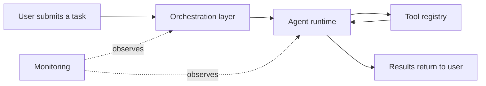
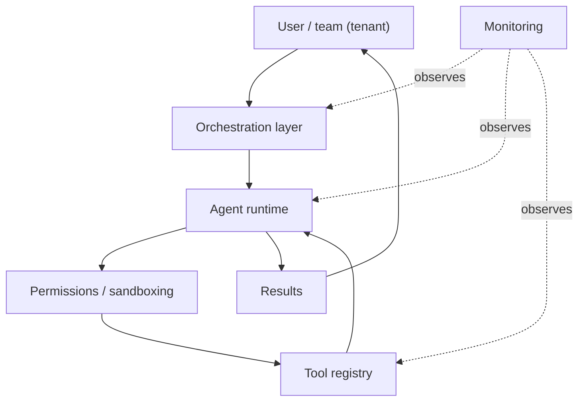

<!-- order: 20 -->
# AI Agent Platform Engineer: Hands-On Project Tutorials

This course is a series of hands-on projects. You learn each idea at the moment you need it, while building the thing.

Follow the projects in order. Each one hands off a skill or artifact to the next.


## Before you start: set up your notebook

**Time: about 15 minutes**

This course runs in **Google Colab**, a free Jupyter notebook in your browser and the standard workspace for AI and data work. There's nothing to install.

1. Go to [colab.research.google.com](https://colab.research.google.com) and sign in with a Google account.
2. Give each project its own notebook: choose **File → New notebook**, then click the title at the top to rename it after the project.
3. Notebooks have two kinds of cells. **Code cells** run Python: type or paste code, then press **Shift + Enter**. **Text cells** hold your notes and written answers: choose **Insert → Text cell**.
4. Install libraries in a code cell with `%pip install ...`. The `%` form installs them into the notebook you're using.
5. Put each code block from a project in its own code cell, in order, and run them top to bottom. When a later step changes earlier code, edit that cell and run it again.
6. To use a file you downloaded, such as a CSV, drag it into the **Files** panel (the folder icon on the left). Files your code creates appear there too. Colab clears them when the session ends, so download anything you want to keep, or connect Google Drive from the same panel.

Prefer to work on your own computer? The same notebooks run in JupyterLab or in VS Code with the Jupyter extension. Skip the Colab key cell below; instead, set the key in your terminal with `export ANTHROPIC_API_KEY="paste-your-key-here"` (Mac/Linux) or `$env:ANTHROPIC_API_KEY="paste-your-key-here"` (Windows PowerShell) before starting Jupyter from that same terminal.

**Your Claude API key.** Projects that call Claude need an API key from [console.anthropic.com](https://console.anthropic.com). API use is paid and billed by how much text you send and receive. The requests in this course are small, but set a low monthly spending limit in the console before you begin. Keep the key out of your code: in Colab, click the **key icon** in the left sidebar, add a secret named `ANTHROPIC_API_KEY`, and turn on notebook access. Then run this cell at the top of every notebook that calls Claude:

```python
import os
from google.colab import userdata
os.environ["ANTHROPIC_API_KEY"] = userdata.get("ANTHROPIC_API_KEY")
```

**One project runs on your computer.** Project 5 builds a job queue that keeps running in the background, and a notebook can't host that. It says so at the top and uses a code editor (VS Code) and your terminal instead. It needs a Mac, Linux, or Windows with **WSL** (Windows Subsystem for Linux), because the queue worker it uses doesn't run on native Windows. It also needs **Docker Desktop** to run Redis. Every other project runs in Colab.

---

## Project 1 (Module 1): Diagram the Architecture of an Agent Platform

**Time: about 1.5 hours**

**Goal:** Plan the platform before writing any platform code, so every later project has a place to plug into.

**Step 1: Create the project notebook.**
Create a new notebook for this project (**File → New notebook**) and name it `agent_platform_diagram_project`.

**Step 2: Define the platform's purpose.**
Write one sentence: what kinds of agents will this platform run, and for whom? Example: "A platform that lets internal teams build and run task-automation agents with access to company tools."

**Step 3: Understand the difference between an agent and an agent platform.**
An **agent** is a single AI system that plans and takes actions toward a goal; an **agent platform** is the infrastructure that lets many agents (possibly built by different people) run, access tools, and be managed centrally.

**Step 4: List the platform's core components.**
- **Agent runtime**: where agent logic actually executes.
- **Tool registry**: a catalog of tools agents can call.
- **Orchestration layer**: manages multiple agents and tasks.
- **Permissions/sandboxing**: controls what agents can access.
- **Monitoring**: tracks what agents are doing.

**Step 5: Consider multi-tenancy.**
**multi-tenant** means the platform serves multiple separate users or teams, each of whose agents and data must stay isolated from the others.

**Step 6: The request flow.**
A task moves through the platform like this, with monitoring watching every stage:



**Step 7: Note a security consideration.**
Write one sentence: what's the worst thing an agent on this platform could do if given too much unchecked access, and how would you prevent it?

**Step 8: The full platform architecture.**
Here are all the components from Steps 4 to 6 in one picture, with the request flowing top to bottom and monitoring observing everything:



### Final Project Structure
```text
agent_platform_diagram_project/
│
├── platform_purpose.md
├── architecture_diagram.png
```

### What You Learned
- ✅ The difference between an agent and an agent platform
- ✅ Core platform components (runtime, registry, orchestration, permissions, monitoring)
- ✅ Multi-tenancy considerations
- ✅ Diagramming a request flow through the platform
- ✅ Baseline security thinking for agent platforms
- ✅ Producing a complete architecture diagram

### Portfolio Project
**AI Agent Platform Architecture Diagram**: Designed a labeled architecture diagram for a multi-tenant agent platform, covering runtime, tool registry, orchestration, permissions, and monitoring components.
**Skills:** Systems Architecture, Platform Design, Security Thinking, Technical Documentation.

**Deliverable:** A platform architecture diagram with all core components and a documented security consideration.

### Quiz

1. What is the difference between an agent and an agent platform?
2. What does the tool registry do in an agent platform?
3. What does "multi-tenant" mean for an agent platform?
4. Why does monitoring connect to several components instead of sitting at one point in the request flow?

*Answers: 1) An agent is one AI system that plans and acts toward a goal; a platform is the shared infrastructure that lets many agents run, use tools, and be managed centrally. 2) It is a catalog of the tools agents can call, so tools are looked up by name instead of hardcoded into each agent. 3) The platform serves several separate users or teams, and each one's agents and data must stay isolated from the others. 4) Problems can happen at any stage (orchestration, the runtime, or tool calls), so monitoring has to observe all of them.*

---

## Project 2 (Module 2): Build a Basic Tool-Calling Script

**Time: about 2.5 hours**

**Goal:** Build the smallest working unit, one agent calling one tool, before scaling to anything more complex.

**Step 1: Create the project notebook.**
Create a new notebook for this project (**File → New notebook**) and name it `tool_calling_project`.
```python
%pip install requests
```

**Step 2: Write one simple tool function.**
Add a **code cell**, paste in the code below, and run it with **Shift + Enter**.
```python
def get_weather(city):
    # in a real implementation, this would call a weather API
    return f"The weather in {city} is 72°F and sunny."
```

**Step 3: Describe the tool for the model.**
```python
tool_definition = {
    "name": "get_weather",
    "description": "Get the current weather for a given city.",
    "input_schema": {
        "type": "object",
        "properties": {"city": {"type": "string", "description": "The city name"}},
        "required": ["city"]
    }
}
```
The **input_schema** tells the model exactly what arguments the tool expects and their types.

**Step 4: Send a request with the tool available.**
```python
import os
import requests

response = requests.post(
    "https://api.anthropic.com/v1/messages",
    headers={
        "x-api-key": os.environ["ANTHROPIC_API_KEY"],
        "anthropic-version": "2023-06-01",
        "content-type": "application/json",
    },
    json={
        "model": "claude-sonnet-5-5",
        "max_tokens": 300,
        "tools": [tool_definition],
        "messages": [{"role": "user", "content": "What's the weather like in Tokyo?"}]
    }
)
print(response.json())
```

**Step 5: Parse the tool call from the response.**
```python
tool_block = None
for block in response.json()["content"]:
    if block["type"] == "tool_use":
        tool_block = block
        tool_name = block["name"]
        tool_input = block["input"]
        print(f"Model wants to call {tool_name} with {tool_input}")
```
The response's `content` is a list of blocks. A `tool_use` block has an `id`, the tool `name`, and the `input` arguments. We keep the whole block in `tool_block` because Step 7 needs its `id`.

**Step 6: Execute the tool and get the result.**
```python
if tool_name == "get_weather":
    result = get_weather(**tool_input)
print(result)
```

**Step 7: Send the tool result back to the model.**
```python
follow_up = requests.post(
    "https://api.anthropic.com/v1/messages",
    headers={
        "x-api-key": os.environ["ANTHROPIC_API_KEY"],
        "anthropic-version": "2023-06-01",
        "content-type": "application/json",
    },
    json={
        "model": "claude-sonnet-5-5",
        "max_tokens": 300,
        "tools": [tool_definition],
        "messages": [
            {"role": "user", "content": "What's the weather like in Tokyo?"},
            {"role": "assistant", "content": response.json()["content"]},
            {"role": "user", "content": [{"type": "tool_result", "tool_use_id": tool_block["id"], "content": result}]}
        ]
    }
)
for block in follow_up.json()["content"]:
    if block["type"] == "text":
        print(block["text"])
```
A **tool_result** message feeds the tool's output back into the conversation, letting the model use it to compose a final natural-language answer. Its `tool_use_id` must match the `id` of the `tool_use` block it answers.

**Step 8: Test with a request that shouldn't trigger the tool.**
Send the same request as Step 4, with only the question changed:
```python
no_tool_response = requests.post(
    "https://api.anthropic.com/v1/messages",
    headers={
        "x-api-key": os.environ["ANTHROPIC_API_KEY"],
        "anthropic-version": "2023-06-01",
        "content-type": "application/json",
    },
    json={
        "model": "claude-sonnet-5-5",
        "max_tokens": 300,
        "tools": [tool_definition],
        "messages": [{"role": "user", "content": "What's 2+2?"}]
    }
)
for block in no_tool_response.json()["content"]:
    print(block["type"], block.get("text", ""))
```
Confirm the output shows only `text` blocks and no `tool_use` block: the model answered directly without calling `get_weather`.

### Final Project Structure
```text
tool_calling_project (Colab notebook)
│
├── tool function and definition (Steps 2–3)
├── request, parse, execute, follow-up (Steps 4–7)
├── no-tool test (Step 8)
```

### What You Learned
- ✅ Defining a tool with a clear input schema
- ✅ Sending a request with tools available to the model
- ✅ Parsing a model's tool call from the response
- ✅ Executing the tool and capturing its result
- ✅ Sending the tool result back for a final response
- ✅ Testing both tool-triggering and non-triggering cases

### Portfolio Project
**Basic Tool-Calling Script**: Implemented the full tool-calling round trip, from tool definition through model request, parsing, execution, and result round-trip, with tested positive and negative cases.
**Skills:** LLM APIs, Tool Calling, Python, Agentic AI Fundamentals.

**Deliverable:** A working tool-calling script demonstrating the full request-parse-execute-respond cycle.

### Quiz

1. What does a tool's `input_schema` tell the model?
2. When the model wants to use a tool, what does it put in the response's `content` list?
3. Who actually runs the `get_weather` function: the model or your code?
4. How does the model know which tool call a `tool_result` answers?
5. What should happen when you ask "What's 2+2?" with the weather tool available?

*Answers: 1) Which arguments the tool expects, their types, and which ones are required. 2) A block of type `tool_use` containing an `id`, the tool `name`, and its `input` arguments. 3) Your code runs it; the model only asks for the call, and you send the result back. 4) The `tool_result` block's `tool_use_id` matches the `id` of the `tool_use` block. 5) The model answers directly with text and makes no `tool_use` call, because the tool isn't relevant.*

---

## Project 3 (Module 3): Build a Single-Purpose AI Agent

**Time: about 3 hours**

**Goal:** Turn the Project 2 script into a full agent with planning and memory, able to take multiple steps toward a goal, not just one tool call.

**Step 1: Create the project notebook.**
Create a new notebook for this project (**File → New notebook**) and name it `single_agent_project`.
Run the API key cell from "Before you start" at the top. Everything else this project needs is defined below, so you don't need anything from the Project 2 notebook.

**Step 2: Define 3 tools for a single-purpose notes agent.**
Add a **code cell**, paste in the code below, and run it with **Shift + Enter**. The notes live in a Python dictionary, so the agent can really search and add to them.
```python
NOTES = {
    "Meeting prep": "Agenda: budget review, hiring plan",
    "Grocery list": "eggs, rice, tomatoes",
}

def search_notes(query):
    matches = [title for title, text in NOTES.items()
               if query.lower() in (title + " " + text).lower()]
    if not matches:
        return f"No notes match '{query}'."
    return f"Found {len(matches)} note(s): " + ", ".join(matches)

def create_note(title, content):
    NOTES[title] = content
    return f"Created note: {title}"

def list_notes():
    return "Notes: " + ", ".join(NOTES.keys())
```

**Step 3: Describe the tools and connect names to functions.**
Add a **code cell**, paste in the code below, and run it.
```python
tool_definitions = [
    {
        "name": "search_notes",
        "description": "Search saved notes by keyword. Returns matching note titles.",
        "input_schema": {
            "type": "object",
            "properties": {"query": {"type": "string", "description": "Word or phrase to search for"}},
            "required": ["query"],
        },
    },
    {
        "name": "create_note",
        "description": "Create a new note with a title and content.",
        "input_schema": {
            "type": "object",
            "properties": {
                "title": {"type": "string"},
                "content": {"type": "string"},
            },
            "required": ["title", "content"],
        },
    },
    {
        "name": "list_notes",
        "description": "List the titles of all saved notes.",
        "input_schema": {"type": "object", "properties": {}},
    },
]

TOOL_FUNCTIONS = {
    "search_notes": search_notes,
    "create_note": create_note,
    "list_notes": list_notes,
}

def execute_tool(name, tool_input):
    if name not in TOOL_FUNCTIONS:
        return f"Error: unknown tool '{name}'."
    return TOOL_FUNCTIONS[name](**tool_input)
```
`execute_tool` looks up the Python function by the name the model asked for and calls it with the model's arguments.

**Step 4: Write the function that calls the model.**
Add a **code cell**, paste in the code below, and run it. The `system` field is a top-level instruction that shapes how the model behaves for the whole conversation.
```python
import os
import requests

def call_model_with_tools(messages, tool_definitions):
    response = requests.post(
        "https://api.anthropic.com/v1/messages",
        headers={
            "x-api-key": os.environ["ANTHROPIC_API_KEY"],
            "anthropic-version": "2023-06-01",
            "content-type": "application/json",
        },
        json={
            "model": "claude-sonnet-5-5",
            "max_tokens": 1024,
            "system": "You are a notes assistant. Use the tools to look up and create notes. "
                      "If a search finds nothing, say so honestly.",
            "tools": tool_definitions,
            "messages": messages,
        },
        timeout=60,
    )
    response.raise_for_status()
    return response.json()
```

**Step 5: Implement the agent loop.**
An **agent loop** repeatedly asks the model "given everything so far, what's the next step?", calling tools as needed, until the model decides the task is complete. Add a **code cell**, paste in the code below, and run it.
```python
def run_agent(user_goal, max_steps=5):
    messages = [{"role": "user", "content": user_goal}]
    for step in range(max_steps):
        response = call_model_with_tools(messages, tool_definitions)
        content = response["content"]
        messages.append({"role": "assistant", "content": content})

        tool_calls = [b for b in content if b["type"] == "tool_use"]
        if not tool_calls:
            # No tool calls means the model gave its final answer.
            return "".join(b["text"] for b in content if b["type"] == "text")

        print(f"Step {step}: calling {[c['name'] for c in tool_calls]}")
        tool_results = []
        for call in tool_calls:
            result = execute_tool(call["name"], call["input"])
            tool_results.append(
                {"type": "tool_result", "tool_use_id": call["id"], "content": result}
            )
        # All results for this turn go back in ONE user message.
        messages.append({"role": "user", "content": tool_results})
    return "Max steps reached without completion."
```
`max_steps` is a **safety limit**: it caps how many actions the agent can take before stopping, whether or not it's "done." The `print` line logs each step, so you can see the agent's decisions as it works.

**Step 6: Test with a single-step goal.**
```python
print(run_agent("Search my notes for 'meeting'."))
```
You should see one logged step calling `search_notes`, then the final answer.

**Step 7: Test with a multi-step goal.**
```python
print(run_agent("Check if I have a note about groceries, and if not, create one."))
print(NOTES)
```
Watch the log: the agent searches first, then decides what to do based on the result. Printing `NOTES` shows whether it created anything.

**Step 8: Understand the agent's memory.**
The `messages` list grows on every step: the goal, each model reply, and each tool result. Because the whole list is sent on every call, the agent can use earlier tool results in later decisions within the same task. That list is the agent's short-term memory. Add a **text cell** and explain, in two sentences, what the agent would forget if you only sent the latest message each time.

### Final Project Structure
```text
single_agent_project (Colab notebook)
│
├── tools and tool definitions (Steps 2–3)
├── call_model_with_tools (Step 4)
├── run_agent loop (Step 5)
├── tests and notes (Steps 6–8)
```

### What You Learned
- ✅ The agent loop pattern (repeated act-observe-decide cycles)
- ✅ Implementing a bounded agent loop with a step safety limit
- ✅ Using a top-level system prompt to guide the agent
- ✅ Testing single-step vs. multi-step goal completion
- ✅ Maintaining conversation memory across agent steps
- ✅ Logging agent reasoning for debuggability

### Portfolio Project
**Single-Purpose AI Agent**: Built a bounded agent loop capable of multi-step tool use and reasoning toward a goal, with conversation memory and step-by-step logging.
**Skills:** Agentic AI, Python, LLM APIs, Tool Calling, Agent Design.

**Deliverable:** A working single-purpose agent, tested on both single-step and multi-step goals.

### Quiz

1. How does the agent loop know the task is finished?
2. Why does the loop have a `max_steps` limit?
3. Where does the agent's memory of earlier tool results come from?
4. If the model asks for two tools in one turn, how are their results sent back?

*Answers: 1) When the model's reply contains no `tool_use` blocks, it has given its final answer, so the loop returns the text. 2) It is a safety limit that stops an agent from looping forever or taking too many actions, even if it never says it's done. 3) The `messages` list keeps the goal, every model reply, and every tool result, and the whole list is sent on each call. 4) Both `tool_result` blocks go together in one user message, each with the `tool_use_id` of the call it answers.*

---

## Project 4 (Module 4): Build a Platform That Registers and Runs Multiple Tools

**Time: about 3 hours**

**Goal:** Scale from one agent to a registry of tools multiple agents can use, the first real platform component.

**Step 1: Create the project notebook.**
Create a new notebook for this project (**File → New notebook**) and name it `tool_registry_project`. Run the API key cell from "Before you start" at the top.

**Step 2: Add the tool functions.**
Add a **code cell**, paste in the code below, and run it. These are the tools from Projects 2 and 3 in one place.
```python
NOTES = {
    "Meeting prep": "Agenda: budget review, hiring plan",
    "Grocery list": "eggs, rice, tomatoes",
}

def get_weather(city):
    # A fake weather tool. A real one would call a weather API.
    return f"The weather in {city} is 72°F and sunny."

def search_notes(query):
    matches = [title for title, text in NOTES.items()
               if query.lower() in (title + " " + text).lower()]
    if not matches:
        return f"No notes match '{query}'."
    return f"Found {len(matches)} note(s): " + ", ".join(matches)

def create_note(title, content):
    NOTES[title] = content
    return f"Created note: {title}"

def list_notes():
    return "Notes: " + ", ".join(NOTES.keys())
```

**Step 3: Build the tool registry class.**
A **registry** is a central catalog that stores things (here, tools) so they can be looked up by name rather than hardcoded. Add a **code cell**, paste in the whole class below (keep it in one cell, since the methods belong inside the class), and run it.
```python
class ToolRegistry:
    def __init__(self):
        self.tools = {}

    def register(self, name, function, description, input_schema):
        self.tools[name] = {
            "function": function,
            "description": description,
            "input_schema": input_schema,
        }

    def get_tool_definitions(self):
        return [
            {"name": name, "description": t["description"], "input_schema": t["input_schema"]}
            for name, t in self.tools.items()
        ]

    def execute(self, name, **kwargs):
        if name not in self.tools:
            return f"Error: unknown tool '{name}'."
        return self.tools[name]["function"](**kwargs)
```
`register` adds a tool, `get_tool_definitions` builds the `tools` list the API expects (name, description, input_schema), and `execute` runs a tool by name.

**Step 4: Register several tools.**
```python
registry = ToolRegistry()
registry.register(
    "get_weather", get_weather, "Get the current weather for a city.",
    {"type": "object", "properties": {"city": {"type": "string"}}, "required": ["city"]},
)
registry.register(
    "search_notes", search_notes, "Search saved notes by keyword.",
    {"type": "object", "properties": {"query": {"type": "string"}}, "required": ["query"]},
)
registry.register(
    "list_notes", list_notes, "List the titles of all saved notes.",
    {"type": "object", "properties": {}},
)
print([t["name"] for t in registry.get_tool_definitions()])
```

**Step 5: Update the agent loop to use the registry.**
This is the Project 3 loop, changed in three places: it takes a `registry`, gets its tool list from the registry, and runs tools with `registry.execute`. It also catches tool errors, which you'll test in Project 6. Add a **code cell**, paste in the code below, and run it.
```python
import os
import requests

SYSTEM_PROMPT = ("You are a helpful assistant. Use the tools when they help. "
                 "If a tool finds nothing or fails, say so honestly.")

def call_model_with_tools(messages, tool_definitions):
    response = requests.post(
        "https://api.anthropic.com/v1/messages",
        headers={
            "x-api-key": os.environ["ANTHROPIC_API_KEY"],
            "anthropic-version": "2023-06-01",
            "content-type": "application/json",
        },
        json={
            "model": "claude-sonnet-5-5",
            "max_tokens": 1024,
            "system": SYSTEM_PROMPT,
            "tools": tool_definitions,
            "messages": messages,
        },
        timeout=60,
    )
    response.raise_for_status()
    return response.json()

def run_agent(user_goal, registry, max_steps=5):
    tool_definitions = registry.get_tool_definitions()
    messages = [{"role": "user", "content": user_goal}]
    for step in range(max_steps):
        response = call_model_with_tools(messages, tool_definitions)
        content = response["content"]
        messages.append({"role": "assistant", "content": content})

        tool_calls = [b for b in content if b["type"] == "tool_use"]
        if not tool_calls:
            return "".join(b["text"] for b in content if b["type"] == "text")

        print(f"Step {step}: calling {[c['name'] for c in tool_calls]}")
        tool_results = []
        for call in tool_calls:
            try:
                result = registry.execute(call["name"], **call["input"])
                tool_results.append({"type": "tool_result", "tool_use_id": call["id"],
                                     "content": str(result)})
            except Exception as error:
                tool_results.append({"type": "tool_result", "tool_use_id": call["id"],
                                     "content": f"Tool failed: {error}", "is_error": True})
        messages.append({"role": "user", "content": tool_results})
    return "Max steps reached without completion."
```

**Step 6: Add a new tool without changing the agent.**
```python
registry.register(
    "create_note", create_note, "Create a new note with a title and content.",
    {"type": "object",
     "properties": {"title": {"type": "string"}, "content": {"type": "string"}},
     "required": ["title", "content"]},
)
print(run_agent("Create a note called 'Test' with content 'Hello'.", registry))
print(NOTES)
```
You didn't touch `run_agent`, yet the agent can now use `create_note`. That's the point of a registry.

**Step 7: Support multiple agents sharing the same registry.**
```python
weather_agent_goal = "What's the weather in Paris?"
notes_agent_goal = "Search my notes for 'budget'."
print(run_agent(weather_agent_goal, registry))
print(run_agent(notes_agent_goal, registry))
```

**Step 8: Document the registry's public interface.**
Add a **text cell** headed `README` and write your notes in it.
Note the `register`, `get_tool_definitions`, and `execute` methods, and how a new tool would be added.

### Final Project Structure
```text
tool_registry_project (Colab notebook)
│
├── tool functions (Step 2)
├── ToolRegistry class and registrations (Steps 3–4)
├── call_model_with_tools and run_agent (Step 5)
├── README text cell (Step 8)
```

### What You Learned
- ✅ Designing a tool registry data structure
- ✅ Generating tool definitions dynamically from a registry
- ✅ Decoupling agent logic from specific tool implementations
- ✅ Adding new tools without modifying agent code
- ✅ Supporting multiple agents sharing one registry
- ✅ Documenting a platform component's interface

### Portfolio Project
**Multi-Tool Agent Registry**: Built a tool registry system decoupling agent logic from tool implementations, supporting dynamic tool addition and multiple agents sharing a common tool catalog.
**Skills:** Software Architecture, Python, Agentic AI Platforms, API Design.

**Deliverable:** A working tool registry with multiple registered tools, used by at least two different agent goals without code changes.

### Quiz

1. What problem does a tool registry solve compared with hardcoding tools in the agent?
2. What does `get_tool_definitions` return, and where is it used?
3. Why must all of a class's methods be in the same code cell as the `class` line?
4. In Step 6, why could the agent use `create_note` without any change to `run_agent`?

*Answers: 1) Tools are stored in one catalog and looked up by name, so agents and tools are decoupled and tools can be added or removed without editing agent code. 2) A list of tool definitions with `name`, `description`, and `input_schema`, which `run_agent` sends to the API as the `tools` field. 3) Python decides what belongs to a class by indentation, so an indented method in a separate cell is an error and isn't part of the class. 4) The agent asks the registry for its tool list on every run, so a newly registered tool is included automatically.*

---

## Project 5 (Module 5): Build a Queue-Based Agent Execution System

**Time: about 4 hours**

**Goal:** Add the infrastructure needed to run agents at scale, beyond one agent running synchronously in a notebook.

> **This project runs on your computer, not in Colab.** It builds a job queue that keeps running in the background, which a notebook can't host. You need:
> - **macOS, Linux, or Windows with WSL.** The `rq` worker uses a Unix feature (`fork`) that native Windows doesn't have. On Windows, install WSL (open PowerShell as administrator, run `wsl --install`, restart), then do every step of this project inside the Ubuntu terminal.
> - **Python 3.12 or newer.**
> - **Docker Desktop** (free for personal use, from docker.com), to run Redis. On Windows, turn on WSL integration in Docker Desktop's settings.
> - **VS Code** to create the files, and your terminal to run commands.

**Step 1: Create the project folder and a virtual environment.**
```bash
mkdir queue_execution_project
cd queue_execution_project
python3 -m venv .venv
source .venv/bin/activate
pip install redis rq requests
```
A **virtual environment** (`.venv`) keeps this project's packages separate from the rest of your computer. Run `source .venv/bin/activate` again in every new terminal you open for this project.

**Step 2: Understand why queuing matters.**
A **task queue** holds pending jobs until a **worker** is free to process them, decoupling "submitting a task" from "executing a task."

**Step 3: Start a local Redis instance with Docker.**
Open Docker Desktop first, then run:
```bash
docker run -d --name agent-redis -p 6379:6379 redis
docker ps
```
**Redis** is an in-memory data store commonly used as the backing store for task queues because of its speed. `docker ps` should list a running container named `agent-redis`.

**Step 4: Export your notebook code to .py files.**
A worker can only import code from `.py` files, not from a Colab notebook. Create these three files in the `queue_execution_project` folder (in VS Code: **File → New File**, then save with the name shown). They contain the same code as your Project 4 notebook.

`tools.py`:
```python
NOTES = {
    "Meeting prep": "Agenda: budget review, hiring plan",
    "Grocery list": "eggs, rice, tomatoes",
}

def get_weather(city):
    # A fake weather tool. A real one would call a weather API.
    return f"The weather in {city} is 72°F and sunny."

def search_notes(query):
    matches = [title for title, text in NOTES.items()
               if query.lower() in (title + " " + text).lower()]
    if not matches:
        return f"No notes match '{query}'."
    return f"Found {len(matches)} note(s): " + ", ".join(matches)

def create_note(title, content):
    NOTES[title] = content
    return f"Created note: {title}"

def list_notes():
    return "Notes: " + ", ".join(NOTES.keys())
```

`registry.py`:
```python
from tools import get_weather, search_notes, create_note, list_notes


class ToolRegistry:
    def __init__(self):
        self.tools = {}

    def register(self, name, function, description, input_schema):
        self.tools[name] = {
            "function": function,
            "description": description,
            "input_schema": input_schema,
        }

    def get_tool_definitions(self):
        return [
            {"name": name, "description": t["description"], "input_schema": t["input_schema"]}
            for name, t in self.tools.items()
        ]

    def execute(self, name, **kwargs):
        if name not in self.tools:
            return f"Error: unknown tool '{name}'."
        return self.tools[name]["function"](**kwargs)


def build_registry():
    registry = ToolRegistry()
    registry.register(
        "get_weather", get_weather, "Get the current weather for a city.",
        {"type": "object", "properties": {"city": {"type": "string"}}, "required": ["city"]},
    )
    registry.register(
        "search_notes", search_notes, "Search saved notes by keyword.",
        {"type": "object", "properties": {"query": {"type": "string"}}, "required": ["query"]},
    )
    registry.register(
        "list_notes", list_notes, "List the titles of all saved notes.",
        {"type": "object", "properties": {}},
    )
    registry.register(
        "create_note", create_note, "Create a new note with a title and content.",
        {"type": "object",
         "properties": {"title": {"type": "string"}, "content": {"type": "string"}},
         "required": ["title", "content"]},
    )
    return registry


registry = build_registry()
```

`agent.py`:
```python
import os
import requests

SYSTEM_PROMPT = ("You are a helpful assistant. Use the tools when they help. "
                 "If a tool finds nothing or fails, say so honestly.")


def call_model_with_tools(messages, tool_definitions):
    response = requests.post(
        "https://api.anthropic.com/v1/messages",
        headers={
            "x-api-key": os.environ["ANTHROPIC_API_KEY"],
            "anthropic-version": "2023-06-01",
            "content-type": "application/json",
        },
        json={
            "model": "claude-sonnet-5-5",
            "max_tokens": 1024,
            "system": SYSTEM_PROMPT,
            "tools": tool_definitions,
            "messages": messages,
        },
        timeout=60,
    )
    response.raise_for_status()
    return response.json()


def run_agent(user_goal, registry, max_steps=5):
    tool_definitions = registry.get_tool_definitions()
    messages = [{"role": "user", "content": user_goal}]
    for step in range(max_steps):
        response = call_model_with_tools(messages, tool_definitions)
        content = response["content"]
        messages.append({"role": "assistant", "content": content})

        tool_calls = [b for b in content if b["type"] == "tool_use"]
        if not tool_calls:
            return "".join(b["text"] for b in content if b["type"] == "text")

        print(f"Step {step}: calling {[c['name'] for c in tool_calls]}")
        tool_results = []
        for call in tool_calls:
            try:
                result = registry.execute(call["name"], **call["input"])
                tool_results.append({"type": "tool_result", "tool_use_id": call["id"],
                                     "content": str(result)})
            except Exception as error:
                tool_results.append({"type": "tool_result", "tool_use_id": call["id"],
                                     "content": f"Tool failed: {error}", "is_error": True})
        messages.append({"role": "user", "content": tool_results})
    return "Max steps reached without completion."
```

**Step 5: Set your API key in the terminal (not in a file).**
The worker reads your key from an **environment variable**. Set it in the terminal where you'll start the worker:
```bash
export ANTHROPIC_API_KEY="paste-your-key-here"
```
This lasts only until you close that terminal, which is what you want. Never write the key into `agent.py` or any other file, and don't commit it anywhere.

**Step 6: Define the agent task as a queueable function.**
Create `tasks.py`:
```python
from agent import run_agent
from registry import registry


def run_agent_task(user_goal):
    return run_agent(user_goal, registry)
```
The queue stores a reference to `tasks.run_agent_task`; the worker imports this file to run it.

**Step 7: Enqueue a task.**
Create `submit_task.py`:
```python
from redis import Redis
from rq import Queue
from tasks import run_agent_task

q = Queue(connection=Redis())
job = q.enqueue(run_agent_task, "What's the weather in Berlin?")
print(f"Job queued: {job.id}")
```
Run it:
```bash
python submit_task.py
```
`enqueue` submits the task and returns immediately with a **job ID**, without waiting for the task to finish. Copy the job ID it prints. The job just waits in Redis for now, because no worker is running yet.

**Step 8: Start a worker to process the queue.**
In the terminal where you exported `ANTHROPIC_API_KEY` (with the virtual environment active and inside the project folder), run:
```bash
rq worker
```
A **worker** is a separate process that pulls jobs off the queue and actually executes them. You'll see it pick up your Berlin job and print the agent's step log. Leave it running.

On a Mac, if the worker crashes with an error mentioning `fork` or `objc`, stop it with **Ctrl + C**, run `export OBJC_DISABLE_INITIALIZE_FORK_SAFETY=YES`, and start it again.

**Step 9: Check job status and results.**
Create `check_job.py`:
```python
import sys
from redis import Redis
from rq.job import Job

job = Job.fetch(sys.argv[1], connection=Redis())
print("Status:", job.get_status())
print("Result:", job.return_value())
```
In a second terminal (activate the virtual environment there too), run it with the job ID you copied:
```bash
python check_job.py <job-id>
```
The status should be `finished` and the result should be the agent's answer.

**Step 10: Test with multiple concurrent tasks.**
Create `submit_many.py`:
```python
from redis import Redis
from rq import Queue
from tasks import run_agent_task

q = Queue(connection=Redis())
for goal in ["Weather in Rome?", "Search my notes for 'budget'.", "Weather in Cairo?"]:
    job = q.enqueue(run_agent_task, goal)
    print(f"Queued {job.id}: {goal}")
```
Open a third terminal, activate the virtual environment, run `export ANTHROPIC_API_KEY="paste-your-key-here"`, and start a second `rq worker`. Then run `python submit_many.py` from any terminal. Watch both worker terminals: the jobs are split between them and run at the same time, not strictly one after another.

**Step 11: Shut everything down.**
Stop each worker with **Ctrl + C**, then stop and remove Redis:
```bash
docker stop agent-redis
docker rm agent-redis
deactivate
```

### Final Project Structure
```text
queue_execution_project/
│
├── .venv/
├── tools.py
├── registry.py
├── agent.py
├── tasks.py
├── submit_task.py
├── check_job.py
├── submit_many.py
```

### What You Learned
- ✅ Why task queues decouple submission from execution
- ✅ Setting up Redis as a queue backing store with Docker
- ✅ Moving notebook code into importable `.py` files
- ✅ Passing secrets through environment variables, not files
- ✅ Enqueuing agent tasks non-blockingly
- ✅ Running workers to process queued tasks
- ✅ Checking job status and retrieving results
- ✅ Verifying concurrent processing with multiple workers

### Portfolio Project
**Queue-Based Agent Execution System**: Built a Redis/RQ-backed task queue for running agent tasks asynchronously, with job status tracking and verified concurrent execution across multiple workers.
**Skills:** Task Queues, Redis, Distributed Systems Fundamentals, Python, Agentic AI Platforms.

**Deliverable:** A working queue-based execution system, tested with multiple concurrent agent tasks and verified parallel processing.

### Quiz

1. What does `q.enqueue` return, and does it wait for the agent to finish?
2. Why did you have to move the notebook code into `.py` files?
3. Why is the API key set with `export` in the terminal instead of written into `agent.py`?
4. What changes when you run two workers instead of one?
5. Why doesn't this project run on native Windows?

*Answers: 1) It returns a job with an ID straight away; the task runs later when a worker picks it up. 2) The worker is a separate Python process that imports your functions by module name, and it can only import `.py` files. 3) Keys written into files get shared, copied, or committed by accident; an environment variable keeps the secret out of the code and lasts only for that terminal session. 4) Jobs are split between the workers, so several run at the same time instead of waiting in line. 5) The `rq` worker relies on Unix `fork`, which native Windows lacks, so Windows users run it inside WSL.*

---

## Project 6 (Module 6): Build an Evaluation Suite for Agent Reliability

**Time: about 2.5 hours**

**Goal:** Test agent behaviors before trusting them in production, the discipline that separates a working demo from a dependable platform.

**Step 1: Create the project notebook.**
Create a new notebook for this project (**File → New notebook**) and name it `agent_evaluation_project`. This project runs in Colab.
Run the API key cell, then paste in and run the three code cells from Project 4: the tool functions (Step 2), the `ToolRegistry` class (Step 3), and `call_model_with_tools` with `run_agent` (Step 5). Then register the tools:
```python
registry = ToolRegistry()
registry.register(
    "get_weather", get_weather, "Get the current weather for a city.",
    {"type": "object", "properties": {"city": {"type": "string"}}, "required": ["city"]},
)
registry.register(
    "search_notes", search_notes, "Search saved notes by keyword.",
    {"type": "object", "properties": {"query": {"type": "string"}}, "required": ["query"]},
)
registry.register(
    "list_notes", list_notes, "List the titles of all saved notes.",
    {"type": "object", "properties": {}},
)
registry.register(
    "create_note", create_note, "Create a new note with a title and content.",
    {"type": "object",
     "properties": {"title": {"type": "string"}, "content": {"type": "string"}},
     "required": ["title", "content"]},
)
```

**Step 2: Build a test set of agent goals.**
Add a **code cell** with your goals as a Python list. Start with these and add your own until you have 10 to 15, covering simple single-tool tasks, multi-step tasks, ambiguous goals, and goals with no relevant tool:
```python
test_goals = [
    "What's the weather in Lagos?",                                   # single tool
    "List my notes.",                                                 # single tool
    "Search my notes for 'budget' and tell me which note mentions it.",  # single tool
    "Check if I have a note about travel, and if not, create one called 'Travel' with content 'Pack passport'.",  # multi-step
    "What's the weather in Paris and in Tokyo?",                      # multi-step
    "Help me with my notes.",                                         # ambiguous
    "Book me a flight to Accra.",                                     # no relevant tool
]
```

**Step 3: Define success criteria per test.**
Add a **text cell** headed `evaluation_criteria` and write your notes in it.
For each goal, write what a correct outcome looks like (which tool(s) should be called, roughly what the final answer should contain). For "Book me a flight," the correct outcome is that the agent says it can't book flights.

**Step 4: Run the test suite.**
Add a **code cell**, paste in the code below, and run it with **Shift + Enter**.
```python
results = []
for goal in test_goals:
    print("GOAL:", goal)
    output = run_agent(goal, registry)
    print("ANSWER:", output, "\n")
    results.append({"goal": goal, "output": output})
```

**Step 5: Score correctness.**
Add a **code cell** that records your judgement for each result, then counts them:
```python
# Template: replace each "?" with "pass", "fail", or "partial" after reading the answers.
scores = ["?"] * len(results)

from collections import Counter
print(Counter(scores))
```
Compare each answer against your Step 3 criteria before filling in the list.

**Step 6: Test hallucination handling.**
```python
print(run_agent("Search my notes for 'quarterly tax filing' and summarise what the note says.", registry))
```
No such note exists. Confirm the agent reports that honestly rather than inventing a plausible-sounding summary. A made-up answer here is a **hallucination**, and it's a fail.

**Step 7: Test failure recovery.**
Register a tool that always crashes, then ask the agent to use it:
```python
def get_stock_price(symbol):
    raise ConnectionError("stock service is down")

registry.register(
    "get_stock_price", get_stock_price, "Get the latest stock price for a ticker symbol.",
    {"type": "object", "properties": {"symbol": {"type": "string"}}, "required": ["symbol"]},
)
print(run_agent("What's the stock price of ACME?", registry))
```
The `try`/`except` in `run_agent` catches the error and sends it back as a `tool_result` with `"is_error": True`. Confirm the loop doesn't crash and the agent tells you the tool failed instead of making up a price.

**Step 8: Write the evaluation report.**
Add a **text cell** headed `evaluation_report` and write your notes in it.
Structure: Test set → Pass/fail/partial rates → Hallucination findings → Failure recovery findings → Recommendations.

### Final Project Structure
```text
agent_evaluation_project (Colab notebook)
│
├── setup cells from Project 4 (Step 1)
├── test_goals list (Step 2)
├── evaluation_criteria text cell (Step 3)
├── test run and scores (Steps 4–5)
├── hallucination and failure tests (Steps 6–7)
├── evaluation_report text cell (Step 8)
```

### What You Learned
- ✅ Building a diverse agent test set (easy, hard, ambiguous, unsupported)
- ✅ Defining measurable success criteria per test
- ✅ Running and scoring a full evaluation suite
- ✅ Testing hallucination handling specifically
- ✅ Testing graceful failure recovery
- ✅ Writing an evaluation report with reliability recommendations

### Portfolio Project
**Agent Reliability Evaluation Suite**: Built a systematic evaluation suite testing agent correctness, hallucination handling, and failure recovery across diverse goal types, with a scored reliability report.
**Skills:** AI Evaluation, Test Engineering, Python, Agentic AI Reliability.

**Deliverable:** A complete evaluation suite with pass/fail scoring and a written reliability report.

### Quiz

1. Why include goals that no tool can handle, like booking a flight?
2. Why write success criteria before running the tests?
3. What counts as a hallucination in the Step 6 test?
4. What stops a crashing tool from crashing the whole agent loop?

*Answers: 1) To check the agent admits it can't do something instead of pretending or misusing an unrelated tool. 2) So you judge results against a fixed standard rather than adjusting expectations to whatever the agent produced. 3) The agent inventing a summary of a note that doesn't exist, instead of saying no such note was found. 4) The `try`/`except` in `run_agent` catches the error and returns it to the model as a `tool_result` marked `is_error`, so the model can report the failure.*

---

## Project 7 (Module 7): Add Access Control and Audit Logging to an Agent Platform

**Time: about 3 hours**

**Goal:** Secure and govern what agents are allowed to do, closing the loop back to Project 1's security consideration.

**Step 1: Create the project notebook.**
Create a new notebook for this project (**File → New notebook**) and name it `access_control_project`. This project runs in Colab and doesn't call Claude, so you don't need the API key cell.
Paste in and run two code cells from Project 4: the tool functions (Step 2) and the `ToolRegistry` class (Step 3).

**Step 2: Add a risky tool and define permission levels.**
Add a **code cell**, paste in the code below, and run it with **Shift + Enter**.
```python
def send_email(to, subject, body):
    # A fake email tool. It only pretends to send.
    return f"Email sent to {to} with subject '{subject}'."

PERMISSION_LEVELS = {
    "get_weather": "public",
    "search_notes": "user",
    "send_email": "restricted",
}
LEVEL_RANK = {"public": 0, "user": 1, "restricted": 2}
```
Tagging each tool with a **permission level** lets the platform decide who (or which agents) can invoke it. `LEVEL_RANK` orders the levels, so a "user" caller can use "public" and "user" tools but not "restricted" ones.

**Step 3: Extend the registry to check permissions.**
Instead of rewriting `ToolRegistry`, make a **subclass**: a new class that keeps everything from `ToolRegistry` (`self.tools`, `register`, `get_tool_definitions`) and replaces only `execute`. Add a **code cell**, paste in the code below, and run it.
```python
class SecureToolRegistry(ToolRegistry):
    def _has_access(self, user_level, required_level):
        return LEVEL_RANK[user_level] >= LEVEL_RANK[required_level]

    def execute(self, name, agent_id, user_permission_level, **kwargs):
        required_level = PERMISSION_LEVELS.get(name, "restricted")
        if not self._has_access(user_permission_level, required_level):
            raise PermissionError(f"Access denied to tool: {name}")
        return self.tools[name]["function"](**kwargs)

def build_secure_registry():
    registry = SecureToolRegistry()
    registry.register("get_weather", get_weather, "Get the current weather for a city.",
                      {"type": "object", "properties": {"city": {"type": "string"}}, "required": ["city"]})
    registry.register("search_notes", search_notes, "Search saved notes by keyword.",
                      {"type": "object", "properties": {"query": {"type": "string"}}, "required": ["query"]})
    registry.register("send_email", send_email, "Send an email.",
                      {"type": "object",
                       "properties": {"to": {"type": "string"}, "subject": {"type": "string"},
                                      "body": {"type": "string"}},
                       "required": ["to", "subject", "body"]})
    return registry

registry = build_secure_registry()
```
Every call now says which agent is calling (`agent_id`) and at what level (`user_permission_level`). A tool missing from `PERMISSION_LEVELS` defaults to "restricted". This is **least privilege**: access must be explicitly granted rather than assumed.

**Step 4: Test permission enforcement.**
```python
try:
    registry.execute("send_email", agent_id="agent-1", user_permission_level="public",
                     to="test@example.com", subject="Hi", body="Hello")
except PermissionError as error:
    print("Blocked as expected:", error)

print(registry.execute("get_weather", agent_id="agent-1", user_permission_level="public", city="Paris"))
```
The first call should be blocked; the second should return the weather.

**Step 5: Add audit logging for every tool call.**
Add a **code cell**, paste in the code below, and run it with **Shift + Enter**.
```python
import json, datetime

def log_tool_call(agent_id, tool_name, arguments, allowed, result=None):
    entry = {
        "timestamp": datetime.datetime.now().isoformat(),
        "agent_id": agent_id,
        "tool": tool_name,
        "arguments": arguments,
        "allowed": allowed,
        "result": str(result)[:200] if result is not None else None,
    }
    with open("audit_log.jsonl", "a") as f:
        f.write(json.dumps(entry) + "\n")
```
An **audit log** is a permanent record of who did what and when. Each line of a `.jsonl` file is one JSON entry.

**Step 6: Wire audit logging into the registry.**
Replace your Step 3 class with this full version (it adds the two `log_tool_call` lines), run the cell, then rebuild the registry:
```python
class SecureToolRegistry(ToolRegistry):
    def _has_access(self, user_level, required_level):
        return LEVEL_RANK[user_level] >= LEVEL_RANK[required_level]

    def execute(self, name, agent_id, user_permission_level, **kwargs):
        required_level = PERMISSION_LEVELS.get(name, "restricted")
        allowed = self._has_access(user_permission_level, required_level)
        if not allowed:
            log_tool_call(agent_id, name, kwargs, allowed=False)
            raise PermissionError(f"Access denied to tool: {name}")
        result = self.tools[name]["function"](**kwargs)
        log_tool_call(agent_id, name, kwargs, allowed=True, result=result)
        return result

registry = build_secure_registry()
```
Denied calls are logged too. Denials are often the most important entries in a security review.

**Step 7: Add a sandbox restriction for risky tools.**
```python
def sandboxed_execute(name, agent_id, user_permission_level, **kwargs):
    if PERMISSION_LEVELS.get(name, "restricted") == "restricted":
        log_tool_call(agent_id, name, kwargs, allowed=True, result="[sandbox] not actually run")
        return f"[SANDBOX MODE] Would execute {name} with {kwargs}, but did not run it."
    return registry.execute(name, agent_id=agent_id,
                            user_permission_level=user_permission_level, **kwargs)

print(sandboxed_execute("send_email", agent_id="agent-2", user_permission_level="restricted",
                        to="team@example.com", subject="Report", body="Weekly report"))
print(sandboxed_execute("get_weather", agent_id="agent-2", user_permission_level="public", city="Lagos"))
try:
    registry.execute("search_notes", agent_id="agent-3", user_permission_level="public", query="budget")
except PermissionError as error:
    print("Blocked as expected:", error)
```
A **sandbox** here means simulating an action's effects without actually performing it, useful for testing agent behavior involving high-risk tools without real consequences.

**Step 8: Review the audit log after a test run.**
```python
!cat audit_log.jsonl
```
Confirm it clearly shows which calls were allowed, which were denied, and by which agent.

### Final Project Structure
```text
access_control_project (Colab notebook)
│
├── tool functions and ToolRegistry from Project 4 (Step 1)
├── permissions and SecureToolRegistry (Steps 2–3, 6)
├── log_tool_call (Step 5)
├── sandboxed_execute (Step 7)
├── audit_log.jsonl (in the Files panel)
```

### What You Learned
- ✅ Defining permission levels for tools
- ✅ Extending a class with a subclass instead of rewriting it
- ✅ Implementing least-privilege access checks
- ✅ Testing both denied and allowed access cases
- ✅ Building structured audit logging
- ✅ Logging both successful and denied tool calls
- ✅ Sandboxing risky tools for safe testing

### Portfolio Project
**Agent Platform Access Control & Audit System**: Implemented least-privilege permission enforcement and structured audit logging for a tool registry, including a sandbox mode for safely testing high-risk tool behavior.
**Skills:** Access Control, Security Engineering, Audit Logging, Python, Agentic AI Platforms.

**Deliverable:** A permission-enforced registry with a complete, reviewed audit log of allowed and denied tool calls.

### Quiz

1. Why is `SecureToolRegistry` written as a subclass of `ToolRegistry` instead of a new class with only `execute`?
2. What permission level does a tool get if it's missing from `PERMISSION_LEVELS`, and why?
3. Why does the audit log record denied calls as well as allowed ones?
4. What does `sandboxed_execute` do with a restricted tool?

*Answers: 1) A subclass keeps `self.tools`, `register`, and `get_tool_definitions` from the parent and only replaces `execute`; a new class with just `execute` would have no way to register or store tools. 2) It defaults to "restricted", following least privilege: access must be granted explicitly, never assumed. 3) Denials show who tried to do something they weren't allowed to, which is often the most important evidence in a security review. 4) It logs the attempt and returns a message describing what would have happened, without actually running the tool.*
