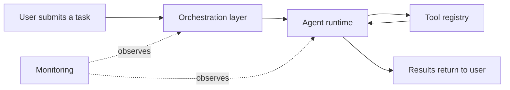
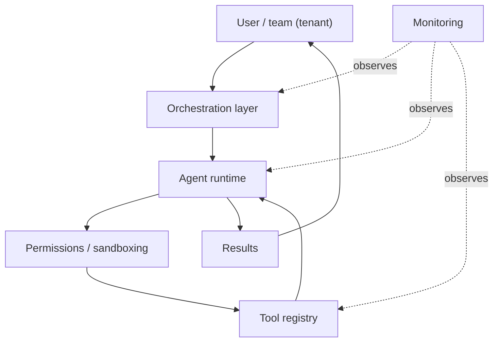

<!-- order: 20 -->
# AI Agent Platform Engineer: Hands-On Project Tutorials

This course is a series of hands-on projects. You learn each idea at the moment you need it, while building the thing.

**By the end of this course, you'll be able to:**
- Diagram the core components of a multi-tenant agent platform
- Build the full tool-calling round trip and a bounded agent loop with the Claude Messages API
- Build a tool registry that lets several agents share tools without code changes
- Run agent tasks in the background with a Redis-backed job queue and multiple workers
- Test agent reliability, including hallucination handling and recovery from failing tools
- Add permission checks, audit logging, and a sandbox mode for risky tools
- Publish the platform's tools as an MCP server that keeps those permission checks and the audit log in front of every call

Follow the projects in order. Each one hands off a skill or artifact to the next.


## Before you start: set up your notebook

**Time: about 15 minutes**

This course runs in **Google Colab**, a free Jupyter notebook in your browser and the standard workspace for AI and data work. There's nothing to install.

1. Go to [colab.research.google.com](https://colab.research.google.com) and sign in with a Google account.
2. Give each project its own notebook: choose **File → New notebook**, then click the title at the top to rename it after the project.
3. Notebooks have two kinds of cells. **Code cells** run Python: type or paste code, then press **Shift + Enter**. **Text cells** hold your notes and written answers: choose **Insert → Text cell**.
4. Install libraries in a code cell with `%pip install ...`. The `%` form installs them into the notebook you're using.
5. Put each code block from a project in its own code cell, in order, and run them top to bottom. When a later step changes earlier code, edit that cell and run it again.
6. To use a file you downloaded, such as a CSV, drag it into the **Files** panel (the folder icon on the left). Files your code creates appear there too. Colab clears them when the session ends, so download anything you want to keep, or connect Google Drive from the same panel.

Prefer to work on your own computer? The same notebooks run in JupyterLab or in VS Code with the Jupyter extension. Skip the Colab key cell below; instead, set the key in your terminal with `export ANTHROPIC_API_KEY="paste-your-key-here"` (Mac/Linux) or `$env:ANTHROPIC_API_KEY="paste-your-key-here"` (Windows PowerShell) before starting Jupyter from that same terminal.

**Your Claude API key.** Projects that call Claude need an API key from [console.anthropic.com](https://console.anthropic.com). API use is paid and billed by how much text you send and receive. The requests in this course are small, but set a low monthly spending limit in the console before you begin. Keep the key out of your code: in Colab, click the **key icon** in the left sidebar, add a secret named `ANTHROPIC_API_KEY`, and turn on notebook access. Then run this cell at the top of every notebook that calls Claude:

```python
import os
from google.colab import userdata
os.environ["ANTHROPIC_API_KEY"] = userdata.get("ANTHROPIC_API_KEY")
```

**One project runs on your computer.** Project 5 builds a job queue that keeps running in the background, and a notebook can't host that. It says so at the top and uses a code editor (VS Code) and your terminal instead. It needs a Mac, Linux, or Windows with **WSL** (Windows Subsystem for Linux), because the queue worker it uses doesn't run on native Windows. It also needs **Docker Desktop** to run Redis. Every other project runs in Colab (Project 8 adds one optional step on your own computer).

---

## Project 1 (Module 1): Diagram the Architecture of an Agent Platform

**Time: about 1.5 hours**

**Goal:** Plan the platform before writing any platform code, so every later project has a place to plug into.

**Step 1: Create the project notebook.**
Create a new notebook for this project (**File → New notebook**) and name it `agent_platform_diagram_project`.

**Step 2: Define the platform's purpose.**
Write one sentence: what kinds of agents will this platform run, and for whom? Example: "A platform that lets internal teams build and run task-automation agents with access to company tools."

**Step 3: Understand the difference between an agent and an agent platform.**
An **agent** is a single AI system that plans and takes actions toward a goal; an **agent platform** is the infrastructure that lets many agents (possibly built by different people) run, access tools, and be managed centrally.

**Step 4: List the platform's core components.**
- **Agent runtime**: where agent logic actually executes.
- **Tool registry**: a catalog of tools agents can call.
- **Orchestration layer**: manages multiple agents and tasks.
- **Permissions/sandboxing**: controls what agents can access.
- **Monitoring**: tracks what agents are doing.

**Step 5: Consider multi-tenancy.**
**multi-tenant** means the platform serves multiple separate users or teams, each of whose agents and data must stay isolated from the others.

**Step 6: The request flow.**
A task moves through the platform like this, with monitoring watching every stage:



**Step 7: Note a security consideration.**
Write one sentence: what's the worst thing an agent on this platform could do if given too much unchecked access, and how would you prevent it?

**Step 8: The full platform architecture.**
Here are all the components from Steps 4 to 6 in one picture, with the request flowing top to bottom and monitoring observing everything:



### Final Project Structure

```text
agent_platform_diagram_project/
│
├── platform_purpose.md
├── architecture_diagram.png
```

### What You Learned
- ✅ The difference between an agent and an agent platform
- ✅ Core platform components (runtime, registry, orchestration, permissions, monitoring)
- ✅ Multi-tenancy considerations
- ✅ Diagramming a request flow through the platform
- ✅ Baseline security thinking for agent platforms
- ✅ Producing a complete architecture diagram

### Portfolio Project
**AI Agent Platform Architecture Diagram**: Designed a labeled architecture diagram for a multi-tenant agent platform, covering runtime, tool registry, orchestration, permissions, and monitoring components.
**Skills:** Systems Architecture, Platform Design, Security Thinking, Technical Documentation.

**Deliverable:** A platform architecture diagram with all core components and a documented security consideration.

### Quiz

1. What is the difference between an agent and an agent platform?
2. What does the tool registry do in an agent platform?
3. What does "multi-tenant" mean for an agent platform?
4. Why does monitoring connect to several components instead of sitting at one point in the request flow?

*Answers: 1) An agent is one AI system that plans and acts toward a goal; a platform is the shared infrastructure that lets many agents run, use tools, and be managed centrally. 2) It is a catalog of the tools agents can call, so tools are looked up by name instead of hardcoded into each agent. 3) The platform serves several separate users or teams, and each one's agents and data must stay isolated from the others. 4) Problems can happen at any stage (orchestration, the runtime, or tool calls), so monitoring has to observe all of them.*

```watch
{
 "scenes": [
  {
   "kind": "title",
   "art": "architecture",
   "kicker": "Project 1 · Platform architecture",
   "title": "Plan the platform first",
   "beats": [
    {
     "say": "Welcome to A I Agent Platform Engineer."
    },
    {
     "say": "In this first project, you plan the platform before writing any platform code, so every later project has a place to plug into."
    }
   ]
  },
  {
   "kind": "list",
   "art": "people",
   "kicker": "Concept",
   "title": "Agent versus agent platform",
   "items": [
    [
     "Agent",
     "One AI system acting toward a goal"
    ],
    [
     "Agent platform",
     "Shared infrastructure for many agents"
    ]
   ],
   "beats": [
    {
     "say": "Start with one distinction.",
     "show": 0
    },
    {
     "say": "An agent is a single A I system that plans and takes actions toward a goal.",
     "show": 1
    },
    {
     "say": "An agent platform is the infrastructure that lets many agents, possibly built by different people, run, access tools, and be managed centrally.",
     "show": 2
    }
   ]
  },
  {
   "kind": "list",
   "art": "layers",
   "kicker": "Concept",
   "title": "The core components",
   "items": [
    [
     "Agent runtime",
     "Where agent logic runs"
    ],
    [
     "Tool registry",
     "Catalog of callable tools"
    ],
    [
     "Orchestration",
     "Manages agents and tasks"
    ],
    [
     "Permissions / sandboxing",
     "Controls access"
    ],
    [
     "Monitoring",
     "Tracks what agents do"
    ]
   ],
   "beats": [
    {
     "say": "A platform has five core components.",
     "show": 0
    },
    {
     "say": "The agent runtime, where agent logic actually executes.",
     "show": 1
    },
    {
     "say": "The tool registry, a catalog of tools agents can call.",
     "show": 2
    },
    {
     "say": "The orchestration layer, which manages multiple agents and tasks.",
     "show": 3
    },
    {
     "say": "Permissions and sandboxing, which control what agents can access.",
     "show": 4
    },
    {
     "say": "And monitoring, which tracks what agents are doing.",
     "show": 5
    }
   ]
  },
  {
   "kind": "flow",
   "art": "path",
   "kicker": "Concept",
   "title": "How a request flows",
   "steps": [
    "Tenant submits a task",
    "Orchestration layer",
    "Agent runtime",
    "Permissions → tool registry",
    "Results to the user"
   ],
   "beats": [
    {
     "say": "Here's how a task moves through the platform.",
     "show": 0
    },
    {
     "say": "A user, or tenant, submits a task to the orchestration layer.",
     "show": 1
    },
    {
     "say": "It hands the task to the agent runtime.",
     "show": 2
    },
    {
     "say": "Tool calls pass through permissions, then the tool registry, and back to the runtime.",
     "show": 3
    },
    {
     "say": "Results return to the user. And monitoring observes every stage, because problems can happen anywhere.",
     "show": 4
    }
   ]
  },
  {
   "kind": "list",
   "art": "lock",
   "kicker": "Lab",
   "title": "Multi-tenancy and security",
   "items": [
    [
     "Multi-tenant",
     "Each team's agents and data isolated"
    ],
    [
     "Security sentence",
     "Worst case, and how to prevent it"
    ],
    [
     "Architecture diagram",
     "Every component, one picture"
    ]
   ],
   "beats": [
    {
     "say": "Two more ideas go into your notes.",
     "show": 0
    },
    {
     "say": "Multi-tenant means the platform serves several separate users or teams, and each one's agents and data must stay isolated from the others.",
     "show": 1
    },
    {
     "say": "Then write one sentence: the worst thing an agent could do with too much unchecked access, and how you'd prevent it.",
     "show": 2
    },
    {
     "say": "Finish with a full architecture diagram of every component.",
     "show": 3
    }
   ]
  },
  {
   "kind": "quiz",
   "art": "ask",
   "kicker": "Quick check",
   "title": "What does \"multi-tenant\" mean for an agent platform?",
   "options": [
    "It serves several separate users or teams, each kept isolated",
    "It runs several copies of one agent for speed",
    "It stores every team's data in one shared pool"
   ],
   "answer": 0,
   "good": "That's right. The platform serves several separate users or teams, and each one's agents and data must stay isolated from the others.",
   "bad": "Not quite. The platform serves several separate users or teams, and each one's agents and data must stay isolated from the others.",
   "beats": [
    {
     "say": "Quick check.",
     "show": 0
    },
    {
     "say": "What does \"multi-tenant\" mean for an agent platform?",
     "show": 0
    },
    {
     "say": "Tap your answer.",
     "show": 1
    }
   ]
  },
  {
   "kind": "list",
   "art": "proof",
   "kicker": "Checkpoint",
   "title": "You're done when",
   "items": [
    [
     "A diagram with every core component",
     ""
    ],
    [
     "A documented security consideration",
     ""
    ]
   ],
   "beats": [
    {
     "say": "That's Project 1.",
     "show": 0
    },
    {
     "say": "You're done when:",
     "show": 0
    },
    {
     "say": "you have an architecture diagram with all the core components,",
     "show": 1
    },
    {
     "say": "and a documented security consideration.",
     "show": 2
    },
    {
     "say": "Next, in Module 2, a basic tool-calling script.",
     "show": 2
    }
   ]
  }
 ]
}
```

---

## Project 2 (Module 2): Build a Basic Tool-Calling Script

**Time: about 2.5 hours**

**Goal:** Build the smallest working unit, one agent calling one tool, before scaling to anything more complex.

If you haven't built an agent before, take the Agentic AI Fundamentals course earlier in this track first: it covers the agent loop, tools, and MCP, and this course builds the platform around them.

**Step 1: Create the project notebook.**
Create a new notebook for this project (**File → New notebook**) and name it `tool_calling_project`.

```python
%pip install requests
```

**Step 2: Write one simple tool function.**
Add a **code cell**, paste in the code below, and run it with **Shift + Enter**.

```python
def get_weather(city):
    # in a real implementation, this would call a weather API
    return f"The weather in {city} is 72°F and sunny."
```

**Step 3: Describe the tool for the model.**

```python
tool_definition = {
    "name": "get_weather",
    "description": "Get the current weather for a given city.",
    "input_schema": {
        "type": "object",
        "properties": {"city": {"type": "string", "description": "The city name"}},
        "required": ["city"]
    }
}
```

The **input_schema** tells the model exactly what arguments the tool expects and their types.

**Step 4: Send a request with the tool available.**

```python
import os
import requests

response = requests.post(
    "https://api.anthropic.com/v1/messages",
    headers={
        "x-api-key": os.environ["ANTHROPIC_API_KEY"],
        "anthropic-version": "2023-06-01",
        "content-type": "application/json",
    },
    json={
        "model": "claude-sonnet-5-5",
        "max_tokens": 300,
        "tools": [tool_definition],
        "messages": [{"role": "user", "content": "What's the weather like in Tokyo?"}]
    }
)
print(response.json())
```

**Step 5: Parse the tool call from the response.**

```python
tool_block = None
for block in response.json()["content"]:
    if block["type"] == "tool_use":
        tool_block = block
        tool_name = block["name"]
        tool_input = block["input"]
        print(f"Model wants to call {tool_name} with {tool_input}")
```

The response's `content` is a list of blocks. A `tool_use` block has an `id`, the tool `name`, and the `input` arguments. We keep the whole block in `tool_block` because Step 7 needs its `id`.

**Step 6: Execute the tool and get the result.**

```python
if tool_name == "get_weather":
    result = get_weather(**tool_input)
print(result)
```

**Step 7: Send the tool result back to the model.**

```python
follow_up = requests.post(
    "https://api.anthropic.com/v1/messages",
    headers={
        "x-api-key": os.environ["ANTHROPIC_API_KEY"],
        "anthropic-version": "2023-06-01",
        "content-type": "application/json",
    },
    json={
        "model": "claude-sonnet-5-5",
        "max_tokens": 300,
        "tools": [tool_definition],
        "messages": [
            {"role": "user", "content": "What's the weather like in Tokyo?"},
            {"role": "assistant", "content": response.json()["content"]},
            {"role": "user", "content": [{"type": "tool_result", "tool_use_id": tool_block["id"], "content": result}]}
        ]
    }
)
for block in follow_up.json()["content"]:
    if block["type"] == "text":
        print(block["text"])
```

A **tool_result** message feeds the tool's output back into the conversation, letting the model use it to compose a final natural-language answer. Its `tool_use_id` must match the `id` of the `tool_use` block it answers.

**Step 8: Test with a request that shouldn't trigger the tool.**
Send the same request as Step 4, with only the question changed:

```python
no_tool_response = requests.post(
    "https://api.anthropic.com/v1/messages",
    headers={
        "x-api-key": os.environ["ANTHROPIC_API_KEY"],
        "anthropic-version": "2023-06-01",
        "content-type": "application/json",
    },
    json={
        "model": "claude-sonnet-5-5",
        "max_tokens": 300,
        "tools": [tool_definition],
        "messages": [{"role": "user", "content": "What's 2+2?"}]
    }
)
for block in no_tool_response.json()["content"]:
    print(block["type"], block.get("text", ""))
```

Confirm the output shows only `text` blocks and no `tool_use` block: the model answered directly without calling `get_weather`.

### Final Project Structure

```text
tool_calling_project (Colab notebook)
│
├── tool function and definition (Steps 2–3)
├── request, parse, execute, follow-up (Steps 4–7)
├── no-tool test (Step 8)
```

### What You Learned
- ✅ Defining a tool with a clear input schema
- ✅ Sending a request with tools available to the model
- ✅ Parsing a model's tool call from the response
- ✅ Executing the tool and capturing its result
- ✅ Sending the tool result back for a final response
- ✅ Testing both tool-triggering and non-triggering cases

### Portfolio Project
**Basic Tool-Calling Script**: Implemented the full tool-calling round trip, from tool definition through model request, parsing, execution, and result round-trip, with tested positive and negative cases.
**Skills:** LLM APIs, Tool Calling, Python, Agentic AI Fundamentals.

**Deliverable:** A working tool-calling script demonstrating the full request-parse-execute-respond cycle.

### Quiz

1. What does a tool's `input_schema` tell the model?
2. When the model wants to use a tool, what does it put in the response's `content` list?
3. Who actually runs the `get_weather` function: the model or your code?
4. How does the model know which tool call a `tool_result` answers?
5. What should happen when you ask "What's 2+2?" with the weather tool available?

*Answers: 1) Which arguments the tool expects, their types, and which ones are required. 2) A block of type `tool_use` containing an `id`, the tool `name`, and its `input` arguments. 3) Your code runs it; the model only asks for the call, and you send the result back. 4) The `tool_result` block's `tool_use_id` matches the `id` of the `tool_use` block. 5) The model answers directly with text and makes no `tool_use` call, because the tool isn't relevant.*

```watch
{
 "scenes": [
  {
   "kind": "title",
   "art": "api",
   "kicker": "Project 2 · Tool calling",
   "title": "One agent, one tool",
   "beats": [
    {
     "say": "Welcome to Module 2."
    },
    {
     "say": "You'll build the smallest working unit, one model calling one tool, before scaling to anything more complex."
    }
   ]
  },
  {
   "kind": "code",
   "art": "blueprint",
   "kicker": "Steps 2 and 3",
   "title": "A tool and its definition",
   "file": "tool_calling_project",
   "code": "def get_weather(city):\n    return f\"The weather in {city} is 72°F and sunny.\"\n\ntool_definition = {\n    \"name\": \"get_weather\",\n    \"description\": \"Get the current weather for a given city.\",\n    \"input_schema\": {\n        \"type\": \"object\",\n        \"properties\": {\"city\": {\"type\": \"string\", \"description\": \"The city name\"}},\n        \"required\": [\"city\"]\n    }\n}",
   "beats": [
    {
     "say": "First, a simple tool function, get weather, that takes a city.",
     "show": 0
    },
    {
     "say": "Then describe it for the model, with a name, a description and an input schema.",
     "show": 1
    },
    {
     "say": "The input schema tells the model exactly what arguments the tool expects, and their types.",
     "show": 1
    }
   ]
  },
  {
   "kind": "flow",
   "art": "loop",
   "kicker": "Steps 4 to 7",
   "title": "The full round trip",
   "steps": [
    "Request with tools",
    "Parse the tool_use block",
    "Your code runs the tool",
    "Send the tool_result back"
   ],
   "beats": [
    {
     "say": "The round trip has four parts.",
     "show": 0
    },
    {
     "say": "Send a request to the Messages A P I, with the tool available.",
     "show": 1
    },
    {
     "say": "Parse the response. A tool use block holds an I D, the tool name, and its input.",
     "show": 2
    },
    {
     "say": "Your code runs the tool. The model only asks for the call.",
     "show": 3
    },
    {
     "say": "Then send a tool result back, so the model can write its final answer.",
     "show": 4
    }
   ]
  },
  {
   "kind": "code",
   "art": "chain",
   "kicker": "Step 7",
   "title": "Match the result to the call",
   "file": "tool_calling_project",
   "code": "\"messages\": [\n    {\"role\": \"user\", \"content\": \"What's the weather like in Tokyo?\"},\n    {\"role\": \"assistant\", \"content\": response.json()[\"content\"]},\n    {\"role\": \"user\", \"content\": [{\"type\": \"tool_result\",\n        \"tool_use_id\": tool_block[\"id\"], \"content\": result}]}\n]",
   "beats": [
    {
     "say": "The follow-up request replays the conversation.",
     "show": 0
    },
    {
     "say": "The user's question, the model's reply, then a tool result.",
     "show": 1
    },
    {
     "say": "Its tool use I D must match the I D of the tool use block it answers.",
     "show": 1
    }
   ]
  },
  {
   "kind": "big",
   "art": "test",
   "kicker": "Step 8",
   "title": "A request that needs no tool",
   "big": "\"What's 2+2?\"",
   "sub": "only text blocks, no tool_use",
   "beats": [
    {
     "say": "Last, ask something the tool can't help with: what's two plus two.",
     "show": 0
    },
    {
     "say": "Confirm you get only text blocks, and no tool use block. The model answered directly.",
     "show": 1
    }
   ]
  },
  {
   "kind": "quiz",
   "art": "ask",
   "kicker": "Quick check",
   "title": "Who actually runs the get_weather function?",
   "options": [
    "The model, on Anthropic's servers",
    "The API runs it automatically",
    "Your code; the model only asks for the call"
   ],
   "answer": 2,
   "good": "That's right. Your code runs it. The model only asks for the call, and you send the result back.",
   "bad": "Not quite. Your code runs it. The model only asks for the call, and you send the result back.",
   "beats": [
    {
     "say": "Quick check.",
     "show": 0
    },
    {
     "say": "Who actually runs the get_weather function?",
     "show": 0
    },
    {
     "say": "Tap your answer.",
     "show": 1
    }
   ]
  },
  {
   "kind": "list",
   "art": "proof",
   "kicker": "Checkpoint",
   "title": "You're done when",
   "items": [
    [
     "The full round trip works",
     ""
    ],
    [
     "A no-tool question gets plain text",
     ""
    ]
   ],
   "beats": [
    {
     "say": "That's Project 2.",
     "show": 0
    },
    {
     "say": "You're done when:",
     "show": 0
    },
    {
     "say": "your script runs the full request, parse, execute and respond cycle,",
     "show": 1
    },
    {
     "say": "and a no-tool question gets a direct text answer.",
     "show": 2
    },
    {
     "say": "Next, in Module 3, a single-purpose agent.",
     "show": 2
    }
   ]
  }
 ]
}
```

---

## Project 3 (Module 3): Build a Single-Purpose AI Agent

**Time: about 3 hours**

**Goal:** Turn the Project 2 script into a full agent with planning and memory, able to take multiple steps toward a goal, not just one tool call.

**Step 1: Create the project notebook.**
Create a new notebook for this project (**File → New notebook**) and name it `single_agent_project`.
Run the API key cell from "Before you start" at the top. Everything else this project needs is defined below, so you don't need anything from the Project 2 notebook.

**Step 2: Define 3 tools for a single-purpose notes agent.**
Add a **code cell**, paste in the code below, and run it with **Shift + Enter**. The notes live in a Python dictionary, so the agent can really search and add to them.

```python
NOTES = {
    "Meeting prep": "Agenda: budget review, hiring plan",
    "Grocery list": "eggs, rice, tomatoes",
}

def search_notes(query):
    matches = [title for title, text in NOTES.items()
               if query.lower() in (title + " " + text).lower()]
    if not matches:
        return f"No notes match '{query}'."
    return f"Found {len(matches)} note(s): " + ", ".join(matches)

def create_note(title, content):
    NOTES[title] = content
    return f"Created note: {title}"

def list_notes():
    return "Notes: " + ", ".join(NOTES.keys())
```

**Step 3: Describe the tools and connect names to functions.**
Add a **code cell**, paste in the code below, and run it.

```python
tool_definitions = [
    {
        "name": "search_notes",
        "description": "Search saved notes by keyword. Returns matching note titles.",
        "input_schema": {
            "type": "object",
            "properties": {"query": {"type": "string", "description": "Word or phrase to search for"}},
            "required": ["query"],
        },
    },
    {
        "name": "create_note",
        "description": "Create a new note with a title and content.",
        "input_schema": {
            "type": "object",
            "properties": {
                "title": {"type": "string"},
                "content": {"type": "string"},
            },
            "required": ["title", "content"],
        },
    },
    {
        "name": "list_notes",
        "description": "List the titles of all saved notes.",
        "input_schema": {"type": "object", "properties": {}},
    },
]

TOOL_FUNCTIONS = {
    "search_notes": search_notes,
    "create_note": create_note,
    "list_notes": list_notes,
}

def execute_tool(name, tool_input):
    if name not in TOOL_FUNCTIONS:
        return f"Error: unknown tool '{name}'."
    return TOOL_FUNCTIONS[name](**tool_input)
```

`execute_tool` looks up the Python function by the name the model asked for and calls it with the model's arguments.

**Step 4: Write the function that calls the model.**
Add a **code cell**, paste in the code below, and run it. The `system` field is a top-level instruction that shapes how the model behaves for the whole conversation.

```python
import os
import requests

def call_model_with_tools(messages, tool_definitions):
    response = requests.post(
        "https://api.anthropic.com/v1/messages",
        headers={
            "x-api-key": os.environ["ANTHROPIC_API_KEY"],
            "anthropic-version": "2023-06-01",
            "content-type": "application/json",
        },
        json={
            "model": "claude-sonnet-5-5",
            "max_tokens": 1024,
            "system": "You are a notes assistant. Use the tools to look up and create notes. "
                      "If a search finds nothing, say so honestly.",
            "tools": tool_definitions,
            "messages": messages,
        },
        timeout=60,
    )
    response.raise_for_status()
    return response.json()
```

**Step 5: Implement the agent loop.**
An **agent loop** repeatedly asks the model "given everything so far, what's the next step?", calling tools as needed, until the model decides the task is complete. Add a **code cell**, paste in the code below, and run it.

```python
def run_agent(user_goal, max_steps=5):
    messages = [{"role": "user", "content": user_goal}]
    for step in range(max_steps):
        response = call_model_with_tools(messages, tool_definitions)
        content = response["content"]
        messages.append({"role": "assistant", "content": content})

        tool_calls = [b for b in content if b["type"] == "tool_use"]
        if not tool_calls:
            # No tool calls means the model gave its final answer.
            return "".join(b["text"] for b in content if b["type"] == "text")

        print(f"Step {step}: calling {[c['name'] for c in tool_calls]}")
        tool_results = []
        for call in tool_calls:
            result = execute_tool(call["name"], call["input"])
            tool_results.append(
                {"type": "tool_result", "tool_use_id": call["id"], "content": result}
            )
        # All results for this turn go back in ONE user message.
        messages.append({"role": "user", "content": tool_results})
    return "Max steps reached without completion."
```

`max_steps` is a **safety limit**: it caps how many actions the agent can take before stopping, whether or not it's "done." The `print` line logs each step, so you can see the agent's decisions as it works.

**Step 6: Test with a single-step goal.**

```python
print(run_agent("Search my notes for 'meeting'."))
```

You should see one logged step calling `search_notes`, then the final answer.

**Step 7: Test with a multi-step goal.**

```python
print(run_agent("Check if I have a note about groceries, and if not, create one."))
print(NOTES)
```

Watch the log: the agent searches first, then decides what to do based on the result. Printing `NOTES` shows whether it created anything.

**Step 8: Understand the agent's memory.**
The `messages` list grows on every step: the goal, each model reply, and each tool result. Because the whole list is sent on every call, the agent can use earlier tool results in later decisions within the same task. That list is the agent's short-term memory. Add a **text cell** and explain, in two sentences, what the agent would forget if you only sent the latest message each time.

### Final Project Structure

```text
single_agent_project (Colab notebook)
│
├── tools and tool definitions (Steps 2–3)
├── call_model_with_tools (Step 4)
├── run_agent loop (Step 5)
├── tests and notes (Steps 6–8)
```

### What You Learned
- ✅ The agent loop pattern (repeated act-observe-decide cycles)
- ✅ Implementing a bounded agent loop with a step safety limit
- ✅ Using a top-level system prompt to guide the agent
- ✅ Testing single-step vs. multi-step goal completion
- ✅ Maintaining conversation memory across agent steps
- ✅ Logging agent reasoning for debuggability

### Portfolio Project
**Single-Purpose AI Agent**: Built a bounded agent loop capable of multi-step tool use and reasoning toward a goal, with conversation memory and step-by-step logging.
**Skills:** Agentic AI, Python, LLM APIs, Tool Calling, Agent Design.

**Deliverable:** A working single-purpose agent, tested on both single-step and multi-step goals.

### Quiz

1. How does the agent loop know the task is finished?
2. Why does the loop have a `max_steps` limit?
3. Where does the agent's memory of earlier tool results come from?
4. If the model asks for two tools in one turn, how are their results sent back?

*Answers: 1) When the model's reply contains no `tool_use` blocks, it has given its final answer, so the loop returns the text. 2) It is a safety limit that stops an agent from looping forever or taking too many actions, even if it never says it's done. 3) The `messages` list keeps the goal, every model reply, and every tool result, and the whole list is sent on each call. 4) Both `tool_result` blocks go together in one user message, each with the `tool_use_id` of the call it answers.*

```watch
{
 "scenes": [
  {
   "kind": "title",
   "art": "loop",
   "kicker": "Project 3 · A single-purpose agent",
   "title": "From one call to many steps",
   "beats": [
    {
     "say": "Welcome to Module 3."
    },
    {
     "say": "You'll turn the tool-calling script into a full notes agent, with planning and memory, able to take several steps toward a goal."
    }
   ]
  },
  {
   "kind": "list",
   "art": "doc",
   "kicker": "Steps 2 and 3",
   "title": "Three notes tools",
   "items": [
    [
     "search_notes",
     "Find notes by keyword"
    ],
    [
     "create_note",
     "Title and content"
    ],
    [
     "list_notes",
     "All note titles"
    ]
   ],
   "beats": [
    {
     "say": "The notes live in a Python dictionary, so the agent can really search and add to them.",
     "show": 0
    },
    {
     "say": "Search notes, by keyword.",
     "show": 1
    },
    {
     "say": "Create note, with a title and content.",
     "show": 2
    },
    {
     "say": "And list notes.",
     "show": 3
    },
    {
     "say": "A small execute tool function looks up the Python function by the name the model asked for, and calls it with the model's arguments.",
     "show": 3
    }
   ]
  },
  {
   "kind": "code",
   "art": "loop",
   "kicker": "Step 5",
   "title": "The agent loop",
   "file": "single_agent_project",
   "code": "def run_agent(user_goal, max_steps=5):\n    messages = [{\"role\": \"user\", \"content\": user_goal}]\n    for step in range(max_steps):\n        response = call_model_with_tools(messages, tool_definitions)\n        content = response[\"content\"]\n        messages.append({\"role\": \"assistant\", \"content\": content})\n        tool_calls = [b for b in content if b[\"type\"] == \"tool_use\"]\n        if not tool_calls:\n            return \"\".join(b[\"text\"] for b in content if b[\"type\"] == \"text\")\n        tool_results = []\n        for call in tool_calls:\n            result = execute_tool(call[\"name\"], call[\"input\"])\n            tool_results.append({\"type\": \"tool_result\", \"tool_use_id\": call[\"id\"], \"content\": result})\n        messages.append({\"role\": \"user\", \"content\": tool_results})\n    return \"Max steps reached without completion.\"",
   "beats": [
    {
     "say": "An agent loop keeps asking the model: given everything so far, what's the next step?",
     "show": 0
    },
    {
     "say": "If the reply has no tool calls, that's the final answer.",
     "show": 1
    },
    {
     "say": "Otherwise, run every tool, and send all the results back in one user message.",
     "show": 1
    },
    {
     "say": "Max steps is a safety limit. It caps how many actions the agent can take, whether or not it's done.",
     "show": 1
    }
   ]
  },
  {
   "kind": "flow",
   "art": "test",
   "kicker": "Steps 6 and 7",
   "title": "Single step, then multi-step",
   "steps": [
    "\"Search my notes for 'meeting'\"",
    "\"Check for groceries; if not, create one\"",
    "Search first, then decide"
   ],
   "beats": [
    {
     "say": "Test it twice.",
     "show": 0
    },
    {
     "say": "First, search my notes for meeting. One logged step calls search notes, then the answer.",
     "show": 1
    },
    {
     "say": "Then: check for a groceries note, and if there isn't one, create it.",
     "show": 2
    },
    {
     "say": "Watch the log. The agent searches first, then decides what to do based on the result.",
     "show": 3
    }
   ]
  },
  {
   "kind": "quote",
   "art": "database",
   "kicker": "Step 8",
   "title": "The agent's memory",
   "quote": "The messages list is the agent's short-term memory.",
   "beats": [
    {
     "say": "Where does the memory come from?",
     "show": 0
    },
    {
     "say": "The messages list grows every step: the goal, each model reply, and each tool result. The whole list is sent on every call.",
     "show": 1
    },
    {
     "say": "That list is the agent's short-term memory.",
     "show": 1
    }
   ]
  },
  {
   "kind": "quiz",
   "art": "ask",
   "kicker": "Quick check",
   "title": "How does the agent loop know the task is finished?",
   "options": [
    "The model sends a special done tool",
    "The reply contains no tool_use blocks",
    "max_steps is reached"
   ],
   "answer": 1,
   "good": "That's right. When the model's reply has no tool use blocks, it has given its final answer, so the loop returns the text.",
   "bad": "Not quite. When the model's reply has no tool use blocks, it has given its final answer, so the loop returns the text.",
   "beats": [
    {
     "say": "Quick check.",
     "show": 0
    },
    {
     "say": "How does the agent loop know the task is finished?",
     "show": 0
    },
    {
     "say": "Tap your answer.",
     "show": 1
    }
   ]
  },
  {
   "kind": "list",
   "art": "proof",
   "kicker": "Checkpoint",
   "title": "You're done when",
   "items": [
    [
     "Single-step and multi-step goals work",
     ""
    ],
    [
     "Bounded by max_steps, with a step log",
     ""
    ]
   ],
   "beats": [
    {
     "say": "That's Project 3.",
     "show": 0
    },
    {
     "say": "You're done when:",
     "show": 0
    },
    {
     "say": "your agent completes both a single-step and a multi-step goal,",
     "show": 1
    },
    {
     "say": "with a step limit and a log of each step.",
     "show": 2
    },
    {
     "say": "Next, in Module 4, a tool registry.",
     "show": 2
    }
   ]
  }
 ]
}
```

---

## Project 4 (Module 4): Build a Platform That Registers and Runs Multiple Tools

**Time: about 3 hours**

**Goal:** Scale from one agent to a registry of tools multiple agents can use, the first real platform component.

**Step 1: Create the project notebook.**
Create a new notebook for this project (**File → New notebook**) and name it `tool_registry_project`. Run the API key cell from "Before you start" at the top.

**Step 2: Add the tool functions.**
Add a **code cell**, paste in the code below, and run it. These are the tools from Projects 2 and 3 in one place.

```python
NOTES = {
    "Meeting prep": "Agenda: budget review, hiring plan",
    "Grocery list": "eggs, rice, tomatoes",
}

def get_weather(city):
    # A fake weather tool. A real one would call a weather API.
    return f"The weather in {city} is 72°F and sunny."

def search_notes(query):
    matches = [title for title, text in NOTES.items()
               if query.lower() in (title + " " + text).lower()]
    if not matches:
        return f"No notes match '{query}'."
    return f"Found {len(matches)} note(s): " + ", ".join(matches)

def create_note(title, content):
    NOTES[title] = content
    return f"Created note: {title}"

def list_notes():
    return "Notes: " + ", ".join(NOTES.keys())
```

**Step 3: Build the tool registry class.**
A **registry** is a central catalog that stores things (here, tools) so they can be looked up by name rather than hardcoded. Add a **code cell**, paste in the whole class below (keep it in one cell, since the methods belong inside the class), and run it.

```python
class ToolRegistry:
    def __init__(self):
        self.tools = {}

    def register(self, name, function, description, input_schema):
        self.tools[name] = {
            "function": function,
            "description": description,
            "input_schema": input_schema,
        }

    def get_tool_definitions(self):
        return [
            {"name": name, "description": t["description"], "input_schema": t["input_schema"]}
            for name, t in self.tools.items()
        ]

    def execute(self, name, **kwargs):
        if name not in self.tools:
            return f"Error: unknown tool '{name}'."
        return self.tools[name]["function"](**kwargs)
```

`register` adds a tool, `get_tool_definitions` builds the `tools` list the API expects (name, description, input_schema), and `execute` runs a tool by name.

In production platforms, tools are often served by **MCP (Model Context Protocol) servers**: separate programs that list their tools with the same name, description, and input schema, so a platform can discover and call them at run time. Your registry is the same idea inside one Python program, and in Project 8 you'll publish it as an MCP server.

**Step 4: Register several tools.**

```python
registry = ToolRegistry()
registry.register(
    "get_weather", get_weather, "Get the current weather for a city.",
    {"type": "object", "properties": {"city": {"type": "string"}}, "required": ["city"]},
)
registry.register(
    "search_notes", search_notes, "Search saved notes by keyword.",
    {"type": "object", "properties": {"query": {"type": "string"}}, "required": ["query"]},
)
registry.register(
    "list_notes", list_notes, "List the titles of all saved notes.",
    {"type": "object", "properties": {}},
)
print([t["name"] for t in registry.get_tool_definitions()])
```

**Step 5: Update the agent loop to use the registry.**
This is the Project 3 loop, changed in three places: it takes a `registry`, gets its tool list from the registry, and runs tools with `registry.execute`. It also catches tool errors, which you'll test in Project 6. Add a **code cell**, paste in the code below, and run it.

```python
import os
import requests

SYSTEM_PROMPT = ("You are a helpful assistant. Use the tools when they help. "
                 "If a tool finds nothing or fails, say so honestly.")

def call_model_with_tools(messages, tool_definitions):
    response = requests.post(
        "https://api.anthropic.com/v1/messages",
        headers={
            "x-api-key": os.environ["ANTHROPIC_API_KEY"],
            "anthropic-version": "2023-06-01",
            "content-type": "application/json",
        },
        json={
            "model": "claude-sonnet-5-5",
            "max_tokens": 1024,
            "system": SYSTEM_PROMPT,
            "tools": tool_definitions,
            "messages": messages,
        },
        timeout=60,
    )
    response.raise_for_status()
    return response.json()

def run_agent(user_goal, registry, max_steps=5):
    tool_definitions = registry.get_tool_definitions()
    messages = [{"role": "user", "content": user_goal}]
    for step in range(max_steps):
        response = call_model_with_tools(messages, tool_definitions)
        content = response["content"]
        messages.append({"role": "assistant", "content": content})

        tool_calls = [b for b in content if b["type"] == "tool_use"]
        if not tool_calls:
            return "".join(b["text"] for b in content if b["type"] == "text")

        print(f"Step {step}: calling {[c['name'] for c in tool_calls]}")
        tool_results = []
        for call in tool_calls:
            try:
                result = registry.execute(call["name"], **call["input"])
                tool_results.append({"type": "tool_result", "tool_use_id": call["id"],
                                     "content": str(result)})
            except Exception as error:
                tool_results.append({"type": "tool_result", "tool_use_id": call["id"],
                                     "content": f"Tool failed: {error}", "is_error": True})
        messages.append({"role": "user", "content": tool_results})
    return "Max steps reached without completion."
```

**Step 6: Add a new tool without changing the agent.**

```python
registry.register(
    "create_note", create_note, "Create a new note with a title and content.",
    {"type": "object",
     "properties": {"title": {"type": "string"}, "content": {"type": "string"}},
     "required": ["title", "content"]},
)
print(run_agent("Create a note called 'Test' with content 'Hello'.", registry))
print(NOTES)
```

You didn't touch `run_agent`, yet the agent can now use `create_note`. That's the point of a registry.

**Step 7: Support multiple agents sharing the same registry.**

```python
weather_agent_goal = "What's the weather in Paris?"
notes_agent_goal = "Search my notes for 'budget'."
print(run_agent(weather_agent_goal, registry))
print(run_agent(notes_agent_goal, registry))
```

**Step 8: Document the registry's public interface.**
Add a **text cell** headed `README` and write your notes in it.
Note the `register`, `get_tool_definitions`, and `execute` methods, and how a new tool would be added.

### Final Project Structure

```text
tool_registry_project (Colab notebook)
│
├── tool functions (Step 2)
├── ToolRegistry class and registrations (Steps 3–4)
├── call_model_with_tools and run_agent (Step 5)
├── README text cell (Step 8)
```

### What You Learned
- ✅ Designing a tool registry data structure
- ✅ Generating tool definitions dynamically from a registry
- ✅ Decoupling agent logic from specific tool implementations
- ✅ Adding new tools without modifying agent code
- ✅ Supporting multiple agents sharing one registry
- ✅ Documenting a platform component's interface

### Portfolio Project
**Multi-Tool Agent Registry**: Built a tool registry system decoupling agent logic from tool implementations, supporting dynamic tool addition and multiple agents sharing a common tool catalog.
**Skills:** Software Architecture, Python, Agentic AI Platforms, API Design.

**Deliverable:** A working tool registry with multiple registered tools, used by at least two different agent goals without code changes.

### Quiz

1. What problem does a tool registry solve compared with hardcoding tools in the agent?
2. What does `get_tool_definitions` return, and where is it used?
3. Why must all of a class's methods be in the same code cell as the `class` line?
4. In Step 6, why could the agent use `create_note` without any change to `run_agent`?

*Answers: 1) Tools are stored in one catalog and looked up by name, so agents and tools are decoupled and tools can be added or removed without editing agent code. 2) A list of tool definitions with `name`, `description`, and `input_schema`, which `run_agent` sends to the API as the `tools` field. 3) Python decides what belongs to a class by indentation, so an indented method in a separate cell is an error and isn't part of the class. 4) The agent asks the registry for its tool list on every run, so a newly registered tool is included automatically.*

```watch
{
 "scenes": [
  {
   "kind": "title",
   "art": "boxes",
   "kicker": "Project 4 · Tool registry",
   "title": "Many tools, many agents",
   "beats": [
    {
     "say": "Welcome to Module 4."
    },
    {
     "say": "You'll scale from one agent to a registry of tools that several agents can use. It's the first real platform component."
    }
   ]
  },
  {
   "kind": "code",
   "art": "boxes",
   "kicker": "Step 3",
   "title": "The ToolRegistry class",
   "file": "tool_registry_project",
   "code": "class ToolRegistry:\n    def __init__(self):\n        self.tools = {}\n    def register(self, name, function, description, input_schema):\n        self.tools[name] = {\"function\": function, \"description\": description,\n                            \"input_schema\": input_schema}\n\n    def get_tool_definitions(self):\n        return [{\"name\": name, \"description\": t[\"description\"], \"input_schema\": t[\"input_schema\"]}\n                for name, t in self.tools.items()]\n\n    def execute(self, name, **kwargs):\n        if name not in self.tools:\n            return f\"Error: unknown tool '{name}'.\"\n        return self.tools[name][\"function\"](**kwargs)",
   "beats": [
    {
     "say": "A registry is a central catalog that stores tools, so they're looked up by name instead of hardcoded.",
     "show": 0
    },
    {
     "say": "Register adds a tool.",
     "show": 1
    },
    {
     "say": "Get tool definitions builds the tools list the A P I expects.",
     "show": 1
    },
    {
     "say": "And execute runs a tool by name. Keep the whole class in one cell, because the methods belong inside it.",
     "show": 1
    }
   ]
  },
  {
   "kind": "list",
   "art": "loop",
   "kicker": "Step 5",
   "title": "The loop, changed in three places",
   "items": [
    [
     "Takes a registry",
     "run_agent(goal, registry)"
    ],
    [
     "Tools from the registry",
     "get_tool_definitions()"
    ],
    [
     "Runs via the registry",
     "registry.execute(...)"
    ],
    [
     "Catches errors",
     "\"is_error\": True"
    ]
   ],
   "beats": [
    {
     "say": "The Project 3 loop changes in three places.",
     "show": 0
    },
    {
     "say": "It takes a registry.",
     "show": 1
    },
    {
     "say": "It gets its tool list from the registry.",
     "show": 2
    },
    {
     "say": "It runs tools with registry dot execute.",
     "show": 3
    },
    {
     "say": "It also catches tool errors, and sends them back marked as an error. You'll test that in Project 6.",
     "show": 4
    }
   ]
  },
  {
   "kind": "big",
   "art": "growth",
   "kicker": "Steps 6 and 7",
   "title": "A new tool, no agent changes",
   "big": "0 lines changed",
   "sub": "in run_agent, to add create_note",
   "beats": [
    {
     "say": "Now register create note, and ask the agent to create a note.",
     "show": 0
    },
    {
     "say": "You didn't touch run agent, yet it can use the new tool. That's the point of a registry.",
     "show": 1
    },
    {
     "say": "Then run a weather goal and a notes goal through the same registry.",
     "show": 2
    }
   ]
  },
  {
   "kind": "quote",
   "art": "api",
   "kicker": "Looking ahead",
   "title": "Registries and M C P",
   "quote": "Your registry is the same idea as an MCP server, inside one Python program.",
   "beats": [
    {
     "say": "In production, tools are often served by M C P servers, Model Context Protocol.",
     "show": 0
    },
    {
     "say": "They list tools with the same name, description and input schema, so a platform can discover them at run time. In Project 8, you'll publish your registry as one.",
     "show": 1
    }
   ]
  },
  {
   "kind": "quiz",
   "art": "ask",
   "kicker": "Quick check",
   "title": "Why could the agent use create_note without any change to run_agent?",
   "options": [
    "It asks the registry for its tool list on every run",
    "Claude already knows about create_note",
    "run_agent was restarted"
   ],
   "answer": 0,
   "good": "That's right. The agent asks the registry for its tool list on every run, so a newly registered tool is included automatically.",
   "bad": "Not quite. The agent asks the registry for its tool list on every run, so a newly registered tool is included automatically.",
   "beats": [
    {
     "say": "Quick check.",
     "show": 0
    },
    {
     "say": "Why could the agent use create_note without any change to run_agent?",
     "show": 0
    },
    {
     "say": "Tap your answer.",
     "show": 1
    }
   ]
  },
  {
   "kind": "list",
   "art": "proof",
   "kicker": "Checkpoint",
   "title": "You're done when",
   "items": [
    [
     "Two agent goals share one registry",
     ""
    ],
    [
     "A README documents the interface",
     ""
    ]
   ],
   "beats": [
    {
     "say": "That's Project 4.",
     "show": 0
    },
    {
     "say": "You're done when:",
     "show": 0
    },
    {
     "say": "your registry has several tools, used by at least two agent goals without code changes,",
     "show": 1
    },
    {
     "say": "and a README note documents its interface.",
     "show": 2
    },
    {
     "say": "Next, in Module 5, a queue for running agents in the background.",
     "show": 2
    }
   ]
  }
 ]
}
```

---

## Project 5 (Module 5): Build a Queue-Based Agent Execution System

**Time: about 4 hours**

**Goal:** Add the infrastructure needed to run agents at scale, beyond one agent running synchronously in a notebook.

> **This project runs on your computer, not in Colab.** It builds a job queue that keeps running in the background, which a notebook can't host. You need:
> - **macOS, Linux, or Windows with WSL.** The `rq` worker uses a Unix feature (`fork`) that native Windows doesn't have. On Windows, install WSL (open PowerShell as administrator, run `wsl --install`, restart), then do every step of this project inside the Ubuntu terminal.
> - **Python 3.12 or newer.**
> - **Docker Desktop** (free for personal use, from docker.com), to run Redis. On Windows, turn on WSL integration in Docker Desktop's settings.
> - **VS Code** to create the files, and your terminal to run commands.

**Step 1: Create the project folder and a virtual environment.**

```bash
mkdir queue_execution_project
cd queue_execution_project
python3 -m venv .venv
source .venv/bin/activate
pip install redis rq requests
```

A **virtual environment** (`.venv`) keeps this project's packages separate from the rest of your computer. Run `source .venv/bin/activate` again in every new terminal you open for this project.

**Step 2: Understand why queuing matters.**
A **task queue** holds pending jobs until a **worker** is free to process them, decoupling "submitting a task" from "executing a task."

**Step 3: Start a local Redis instance with Docker.**
Open Docker Desktop first, then run:

```bash
docker run -d --name agent-redis -p 6379:6379 redis
docker ps
```

**Redis** is an in-memory data store commonly used as the backing store for task queues because of its speed. `docker ps` should list a running container named `agent-redis`.

**Step 4: Export your notebook code to .py files.**
A worker can only import code from `.py` files, not from a Colab notebook. Create these three files in the `queue_execution_project` folder (in VS Code: **File → New File**, then save with the name shown). They contain the same code as your Project 4 notebook.

`tools.py`:

```python
NOTES = {
    "Meeting prep": "Agenda: budget review, hiring plan",
    "Grocery list": "eggs, rice, tomatoes",
}

def get_weather(city):
    # A fake weather tool. A real one would call a weather API.
    return f"The weather in {city} is 72°F and sunny."

def search_notes(query):
    matches = [title for title, text in NOTES.items()
               if query.lower() in (title + " " + text).lower()]
    if not matches:
        return f"No notes match '{query}'."
    return f"Found {len(matches)} note(s): " + ", ".join(matches)

def create_note(title, content):
    NOTES[title] = content
    return f"Created note: {title}"

def list_notes():
    return "Notes: " + ", ".join(NOTES.keys())
```

`registry.py`:

```python
from tools import get_weather, search_notes, create_note, list_notes


class ToolRegistry:
    def __init__(self):
        self.tools = {}

    def register(self, name, function, description, input_schema):
        self.tools[name] = {
            "function": function,
            "description": description,
            "input_schema": input_schema,
        }

    def get_tool_definitions(self):
        return [
            {"name": name, "description": t["description"], "input_schema": t["input_schema"]}
            for name, t in self.tools.items()
        ]

    def execute(self, name, **kwargs):
        if name not in self.tools:
            return f"Error: unknown tool '{name}'."
        return self.tools[name]["function"](**kwargs)


def build_registry():
    registry = ToolRegistry()
    registry.register(
        "get_weather", get_weather, "Get the current weather for a city.",
        {"type": "object", "properties": {"city": {"type": "string"}}, "required": ["city"]},
    )
    registry.register(
        "search_notes", search_notes, "Search saved notes by keyword.",
        {"type": "object", "properties": {"query": {"type": "string"}}, "required": ["query"]},
    )
    registry.register(
        "list_notes", list_notes, "List the titles of all saved notes.",
        {"type": "object", "properties": {}},
    )
    registry.register(
        "create_note", create_note, "Create a new note with a title and content.",
        {"type": "object",
         "properties": {"title": {"type": "string"}, "content": {"type": "string"}},
         "required": ["title", "content"]},
    )
    return registry


registry = build_registry()
```

`agent.py`:

```python
import os
import requests

SYSTEM_PROMPT = ("You are a helpful assistant. Use the tools when they help. "
                 "If a tool finds nothing or fails, say so honestly.")


def call_model_with_tools(messages, tool_definitions):
    response = requests.post(
        "https://api.anthropic.com/v1/messages",
        headers={
            "x-api-key": os.environ["ANTHROPIC_API_KEY"],
            "anthropic-version": "2023-06-01",
            "content-type": "application/json",
        },
        json={
            "model": "claude-sonnet-5-5",
            "max_tokens": 1024,
            "system": SYSTEM_PROMPT,
            "tools": tool_definitions,
            "messages": messages,
        },
        timeout=60,
    )
    response.raise_for_status()
    return response.json()


def run_agent(user_goal, registry, max_steps=5):
    tool_definitions = registry.get_tool_definitions()
    messages = [{"role": "user", "content": user_goal}]
    for step in range(max_steps):
        response = call_model_with_tools(messages, tool_definitions)
        content = response["content"]
        messages.append({"role": "assistant", "content": content})

        tool_calls = [b for b in content if b["type"] == "tool_use"]
        if not tool_calls:
            return "".join(b["text"] for b in content if b["type"] == "text")

        print(f"Step {step}: calling {[c['name'] for c in tool_calls]}")
        tool_results = []
        for call in tool_calls:
            try:
                result = registry.execute(call["name"], **call["input"])
                tool_results.append({"type": "tool_result", "tool_use_id": call["id"],
                                     "content": str(result)})
            except Exception as error:
                tool_results.append({"type": "tool_result", "tool_use_id": call["id"],
                                     "content": f"Tool failed: {error}", "is_error": True})
        messages.append({"role": "user", "content": tool_results})
    return "Max steps reached without completion."
```

**Step 5: Set your API key in the terminal (not in a file).**
The worker reads your key from an **environment variable**. Set it in the terminal where you'll start the worker:

```bash
export ANTHROPIC_API_KEY="paste-your-key-here"
```

This lasts only until you close that terminal, which is what you want. Never write the key into `agent.py` or any other file, and don't commit it anywhere.

**Step 6: Define the agent task as a queueable function.**
Create `tasks.py`:

```python
from agent import run_agent
from registry import registry


def run_agent_task(user_goal):
    return run_agent(user_goal, registry)
```

The queue stores a reference to `tasks.run_agent_task`; the worker imports this file to run it.

**Step 7: Enqueue a task.**
Create `submit_task.py`:

```python
from redis import Redis
from rq import Queue
from tasks import run_agent_task

q = Queue(connection=Redis())
job = q.enqueue(run_agent_task, "What's the weather in Berlin?")
print(f"Job queued: {job.id}")
```

Run it:

```bash
python submit_task.py
```

`enqueue` submits the task and returns immediately with a **job ID**, without waiting for the task to finish. Copy the job ID it prints. The job just waits in Redis for now, because no worker is running yet.

**Step 8: Start a worker to process the queue.**
In the terminal where you exported `ANTHROPIC_API_KEY` (with the virtual environment active and inside the project folder), run:

```bash
rq worker
```

A **worker** is a separate process that pulls jobs off the queue and actually executes them. You'll see it pick up your Berlin job and print the agent's step log. Leave it running.

On a Mac, if the worker crashes with an error mentioning `fork` or `objc`, stop it with **Ctrl + C**, run `export OBJC_DISABLE_INITIALIZE_FORK_SAFETY=YES`, and start it again.

**Step 9: Check job status and results.**
Create `check_job.py`:

```python
import sys
from redis import Redis
from rq.job import Job

job = Job.fetch(sys.argv[1], connection=Redis())
print("Status:", job.get_status())
print("Result:", job.return_value())
```

In a second terminal (activate the virtual environment there too), run it with the job ID you copied:

```bash
python check_job.py <job-id>
```

The status should be `finished` and the result should be the agent's answer.

**Step 10: Test with multiple concurrent tasks.**
Create `submit_many.py`:

```python
from redis import Redis
from rq import Queue
from tasks import run_agent_task

q = Queue(connection=Redis())
for goal in ["Weather in Rome?", "Search my notes for 'budget'.", "Weather in Cairo?"]:
    job = q.enqueue(run_agent_task, goal)
    print(f"Queued {job.id}: {goal}")
```

Open a third terminal, activate the virtual environment, run `export ANTHROPIC_API_KEY="paste-your-key-here"`, and start a second `rq worker`. Then run `python submit_many.py` from any terminal. Watch both worker terminals: the jobs are split between them and run at the same time, not strictly one after another.

**Step 11: Shut everything down.**
Stop each worker with **Ctrl + C**, then stop and remove Redis:

```bash
docker stop agent-redis
docker rm agent-redis
deactivate
```

### Final Project Structure

```text
queue_execution_project/
│
├── .venv/
├── tools.py
├── registry.py
├── agent.py
├── tasks.py
├── submit_task.py
├── check_job.py
├── submit_many.py
```

### What You Learned
- ✅ Why task queues decouple submission from execution
- ✅ Setting up Redis as a queue backing store with Docker
- ✅ Moving notebook code into importable `.py` files
- ✅ Passing secrets through environment variables, not files
- ✅ Enqueuing agent tasks non-blockingly
- ✅ Running workers to process queued tasks
- ✅ Checking job status and retrieving results
- ✅ Verifying concurrent processing with multiple workers

### Portfolio Project
**Queue-Based Agent Execution System**: Built a Redis/RQ-backed task queue for running agent tasks asynchronously, with job status tracking and verified concurrent execution across multiple workers.
**Skills:** Task Queues, Redis, Distributed Systems Fundamentals, Python, Agentic AI Platforms.

**Deliverable:** A working queue-based execution system, tested with multiple concurrent agent tasks and verified parallel processing.

### Quiz

1. What does `q.enqueue` return, and does it wait for the agent to finish?
2. Why did you have to move the notebook code into `.py` files?
3. Why is the API key set with `export` in the terminal instead of written into `agent.py`?
4. What changes when you run two workers instead of one?
5. Why doesn't this project run on native Windows?

*Answers: 1) It returns a job with an ID straight away; the task runs later when a worker picks it up. 2) The worker is a separate Python process that imports your functions by module name, and it can only import `.py` files. 3) Keys written into files get shared, copied, or committed by accident; an environment variable keeps the secret out of the code and lasts only for that terminal session. 4) Jobs are split between the workers, so several run at the same time instead of waiting in line. 5) The `rq` worker relies on Unix `fork`, which native Windows lacks, so Windows users run it inside WSL.*

```watch
{
 "scenes": [
  {
   "kind": "title",
   "art": "stack",
   "kicker": "Project 5 · Queue-based execution",
   "title": "Run agents at scale",
   "beats": [
    {
     "say": "Welcome to Module 5."
    },
    {
     "say": "This project runs on your computer, not in Colab. You need mac O S, Linux, or Windows with W S L, plus Docker Desktop to run Redis."
    },
    {
     "say": "A task queue holds pending jobs until a worker is free, decoupling submitting a task from executing it."
    }
   ]
  },
  {
   "kind": "flow",
   "art": "terminal",
   "kicker": "Steps 1 to 5",
   "title": "Set up the project",
   "steps": [
    "venv + pip install redis rq requests",
    "docker run … redis",
    "tools.py · registry.py · agent.py",
    "export ANTHROPIC_API_KEY"
   ],
   "beats": [
    {
     "say": "Create a project folder and a virtual environment, and install redis, r q and requests.",
     "show": 1
    },
    {
     "say": "Start Redis with Docker. It's an in-memory data store, commonly used behind task queues because of its speed.",
     "show": 2
    },
    {
     "say": "Move your Project 4 code into tools dot py, registry dot py and agent dot py. A worker can only import code from dot py files.",
     "show": 3
    },
    {
     "say": "Set your A P I key with export in the terminal. Never write it into a file.",
     "show": 4
    }
   ]
  },
  {
   "kind": "code",
   "art": "rocket",
   "kicker": "Steps 6 and 7",
   "title": "Enqueue a task",
   "file": "submit_task.py",
   "code": "from redis import Redis\nfrom rq import Queue\nfrom tasks import run_agent_task\n\nq = Queue(connection=Redis())\njob = q.enqueue(run_agent_task, \"What's the weather in Berlin?\")\nprint(f\"Job queued: {job.id}\")",
   "beats": [
    {
     "say": "Tasks dot py wraps run agent in a queueable function.",
     "show": 0
    },
    {
     "say": "Then submit task dot py enqueues a goal.",
     "show": 1
    },
    {
     "say": "Enqueue returns straight away with a job I D. It doesn't wait for the agent to finish.",
     "show": 1
    }
   ]
  },
  {
   "kind": "flow",
   "art": "stack",
   "kicker": "Steps 8 to 10",
   "title": "Workers do the work",
   "steps": [
    "rq worker",
    "python check_job.py <job-id>",
    "Two workers, three jobs"
   ],
   "beats": [
    {
     "say": "The job just waits in Redis until you start a worker with r q worker.",
     "show": 1
    },
    {
     "say": "A worker is a separate process that pulls jobs off the queue and runs them.",
     "show": 1
    },
    {
     "say": "Check job dot py shows the status, finished, and the agent's answer.",
     "show": 2
    },
    {
     "say": "Then start a second worker and submit three goals. The jobs are split between them and run at the same time.",
     "show": 3
    }
   ]
  },
  {
   "kind": "quote",
   "art": "warning",
   "kicker": "Step 11",
   "title": "Shut it down",
   "quote": "docker stop agent-redis · docker rm agent-redis · deactivate",
   "beats": [
    {
     "say": "When you're done, stop each worker with control C.",
     "show": 0
    },
    {
     "say": "Then stop and remove the Redis container, and deactivate the virtual environment.",
     "show": 1
    }
   ]
  },
  {
   "kind": "quiz",
   "art": "ask",
   "kicker": "Quick check",
   "title": "What changes when you run two workers instead of one?",
   "options": [
    "Each job runs twice",
    "Jobs wait in line until the first worker stops",
    "Jobs are split between them and run at the same time"
   ],
   "answer": 2,
   "good": "That's right. Jobs are split between the workers, so several run at the same time instead of waiting in line.",
   "bad": "Not quite. Jobs are split between the workers, so several run at the same time instead of waiting in line.",
   "beats": [
    {
     "say": "Quick check.",
     "show": 0
    },
    {
     "say": "What changes when you run two workers instead of one?",
     "show": 0
    },
    {
     "say": "Tap your answer.",
     "show": 1
    }
   ]
  },
  {
   "kind": "list",
   "art": "proof",
   "kicker": "Checkpoint",
   "title": "You're done when",
   "items": [
    [
     "Queued tasks run in the background",
     ""
    ],
    [
     "Two workers run jobs concurrently",
     ""
    ]
   ],
   "beats": [
    {
     "say": "That's Project 5.",
     "show": 0
    },
    {
     "say": "You're done when:",
     "show": 0
    },
    {
     "say": "your queue runs agent tasks in the background with job status tracking,",
     "show": 1
    },
    {
     "say": "and two workers process several tasks at the same time.",
     "show": 2
    },
    {
     "say": "Next, in Module 6, an evaluation suite.",
     "show": 2
    }
   ]
  }
 ]
}
```

---

## Project 6 (Module 6): Build an Evaluation Suite for Agent Reliability

**Time: about 2.5 hours**

**Goal:** Test agent behaviors before trusting them in production, the discipline that separates a working demo from a dependable platform.

**Step 1: Create the project notebook.**
Create a new notebook for this project (**File → New notebook**) and name it `agent_evaluation_project`. This project runs in Colab.
Run the API key cell, then paste in and run the three code cells from Project 4: the tool functions (Step 2), the `ToolRegistry` class (Step 3), and `call_model_with_tools` with `run_agent` (Step 5). Then register the tools:

```python
registry = ToolRegistry()
registry.register(
    "get_weather", get_weather, "Get the current weather for a city.",
    {"type": "object", "properties": {"city": {"type": "string"}}, "required": ["city"]},
)
registry.register(
    "search_notes", search_notes, "Search saved notes by keyword.",
    {"type": "object", "properties": {"query": {"type": "string"}}, "required": ["query"]},
)
registry.register(
    "list_notes", list_notes, "List the titles of all saved notes.",
    {"type": "object", "properties": {}},
)
registry.register(
    "create_note", create_note, "Create a new note with a title and content.",
    {"type": "object",
     "properties": {"title": {"type": "string"}, "content": {"type": "string"}},
     "required": ["title", "content"]},
)
```

**Step 2: Build a test set of agent goals.**
Add a **code cell** with your goals as a Python list. Start with these and add your own until you have 10 to 15, covering simple single-tool tasks, multi-step tasks, ambiguous goals, and goals with no relevant tool:

```python
test_goals = [
    "What's the weather in Lagos?",                                   # single tool
    "List my notes.",                                                 # single tool
    "Search my notes for 'budget' and tell me which note mentions it.",  # single tool
    "Check if I have a note about travel, and if not, create one called 'Travel' with content 'Pack passport'.",  # multi-step
    "What's the weather in Paris and in Tokyo?",                      # multi-step
    "Help me with my notes.",                                         # ambiguous
    "Book me a flight to Accra.",                                     # no relevant tool
]
```

**Step 3: Define success criteria per test.**
Add a **text cell** headed `evaluation_criteria` and write your notes in it.
For each goal, write what a correct outcome looks like (which tool(s) should be called, roughly what the final answer should contain). For "Book me a flight," the correct outcome is that the agent says it can't book flights.

**Step 4: Run the test suite.**
Add a **code cell**, paste in the code below, and run it with **Shift + Enter**.

```python
results = []
for goal in test_goals:
    print("GOAL:", goal)
    output = run_agent(goal, registry)
    print("ANSWER:", output, "\n")
    results.append({"goal": goal, "output": output})
```

**Step 5: Score correctness.**
Add a **code cell** that records your judgement for each result, then counts them:

```python
# Template: replace each "?" with "pass", "fail", or "partial" after reading the answers.
scores = ["?"] * len(results)

from collections import Counter
print(Counter(scores))
```

Compare each answer against your Step 3 criteria before filling in the list.

**Step 6: Test hallucination handling.**

```python
print(run_agent("Search my notes for 'quarterly tax filing' and summarise what the note says.", registry))
```

No such note exists. Confirm the agent reports that honestly rather than inventing a plausible-sounding summary. A made-up answer here is a **hallucination**, and it's a fail.

**Step 7: Test failure recovery.**
Register a tool that always crashes, then ask the agent to use it:

```python
def get_stock_price(symbol):
    raise ConnectionError("stock service is down")

registry.register(
    "get_stock_price", get_stock_price, "Get the latest stock price for a ticker symbol.",
    {"type": "object", "properties": {"symbol": {"type": "string"}}, "required": ["symbol"]},
)
print(run_agent("What's the stock price of ACME?", registry))
```

The `try`/`except` in `run_agent` catches the error and sends it back as a `tool_result` with `"is_error": True`. Confirm the loop doesn't crash and the agent tells you the tool failed instead of making up a price.

**Step 8: Write the evaluation report.**
Add a **text cell** headed `evaluation_report` and write your notes in it.
Structure: Test set → Pass/fail/partial rates → Hallucination findings → Failure recovery findings → Recommendations.

### Final Project Structure

```text
agent_evaluation_project (Colab notebook)
│
├── setup cells from Project 4 (Step 1)
├── test_goals list (Step 2)
├── evaluation_criteria text cell (Step 3)
├── test run and scores (Steps 4–5)
├── hallucination and failure tests (Steps 6–7)
├── evaluation_report text cell (Step 8)
```

### What You Learned
- ✅ Building a diverse agent test set (easy, hard, ambiguous, unsupported)
- ✅ Defining measurable success criteria per test
- ✅ Running and scoring a full evaluation suite
- ✅ Testing hallucination handling specifically
- ✅ Testing graceful failure recovery
- ✅ Writing an evaluation report with reliability recommendations

### Portfolio Project
**Agent Reliability Evaluation Suite**: Built a systematic evaluation suite testing agent correctness, hallucination handling, and failure recovery across diverse goal types, with a scored reliability report.
**Skills:** AI Evaluation, Test Engineering, Python, Agentic AI Reliability.

**Deliverable:** A complete evaluation suite with pass/fail scoring and a written reliability report.

### Quiz

1. Why include goals that no tool can handle, like booking a flight?
2. Why write success criteria before running the tests?
3. What counts as a hallucination in the Step 6 test?
4. What stops a crashing tool from crashing the whole agent loop?

*Answers: 1) To check the agent admits it can't do something instead of pretending or misusing an unrelated tool. 2) So you judge results against a fixed standard rather than adjusting expectations to whatever the agent produced. 3) The agent inventing a summary of a note that doesn't exist, instead of saying no such note was found. 4) The `try`/`except` in `run_agent` catches the error and returns it to the model as a `tool_result` marked `is_error`, so the model can report the failure.*

```watch
{
 "scenes": [
  {
   "kind": "title",
   "art": "test",
   "kicker": "Project 6 · Evaluation suite",
   "title": "Test before you trust",
   "beats": [
    {
     "say": "Welcome to Module 6."
    },
    {
     "say": "You'll test agent behaviour before trusting it in production. That's the discipline that separates a working demo from a dependable platform."
    }
   ]
  },
  {
   "kind": "list",
   "art": "target",
   "kicker": "Steps 2 and 3",
   "title": "A varied test set",
   "items": [
    [
     "Single tool",
     "\"What's the weather in Lagos?\""
    ],
    [
     "Multi-step",
     "\"Paris and Tokyo?\""
    ],
    [
     "Ambiguous",
     "\"Help me with my notes.\""
    ],
    [
     "No relevant tool",
     "\"Book me a flight to Accra.\""
    ]
   ],
   "beats": [
    {
     "say": "Build a list of ten to fifteen goals, covering four kinds.",
     "show": 0
    },
    {
     "say": "Simple single-tool tasks, like the weather in Lagos.",
     "show": 1
    },
    {
     "say": "Multi-step tasks, like the weather in Paris and in Tokyo.",
     "show": 2
    },
    {
     "say": "Ambiguous goals, like help me with my notes.",
     "show": 3
    },
    {
     "say": "And goals with no relevant tool, like book me a flight to Accra.",
     "show": 4
    },
    {
     "say": "Write success criteria for each before you run anything. For the flight, the agent should say it can't book flights.",
     "show": 4
    }
   ]
  },
  {
   "kind": "flow",
   "art": "graph",
   "kicker": "Steps 4 and 5",
   "title": "Run and score",
   "steps": [
    "Run every goal",
    "Compare to criteria",
    "pass · fail · partial"
   ],
   "beats": [
    {
     "say": "Run every goal through the agent and save the answers.",
     "show": 1
    },
    {
     "say": "Compare each answer with your criteria.",
     "show": 2
    },
    {
     "say": "Mark each one pass, fail or partial, then count them.",
     "show": 3
    }
   ]
  },
  {
   "kind": "quote",
   "art": "search",
   "kicker": "Step 6",
   "title": "Test for hallucination",
   "quote": "\"Summarise my note about quarterly tax filing.\" There is no such note.",
   "beats": [
    {
     "say": "Ask the agent to summarise a note about quarterly tax filing.",
     "show": 0
    },
    {
     "say": "No such note exists. A made-up summary is a hallucination, and it's a fail. The agent should say so honestly.",
     "show": 1
    }
   ]
  },
  {
   "kind": "code",
   "art": "shield",
   "kicker": "Step 7",
   "title": "Test failure recovery",
   "file": "agent_evaluation_project",
   "code": "def get_stock_price(symbol):\n    raise ConnectionError(\"stock service is down\")\n\nregistry.register(\n    \"get_stock_price\", get_stock_price, \"Get the latest stock price for a ticker symbol.\",\n    {\"type\": \"object\", \"properties\": {\"symbol\": {\"type\": \"string\"}}, \"required\": [\"symbol\"]},\n)\nprint(run_agent(\"What's the stock price of ACME?\", registry))",
   "beats": [
    {
     "say": "Now register a tool that always crashes.",
     "show": 0
    },
    {
     "say": "The try and except in run agent catches the error, and sends it back as a tool result marked is error.",
     "show": 1
    },
    {
     "say": "Confirm the loop doesn't crash, and the agent says the tool failed instead of inventing a price.",
     "show": 1
    }
   ]
  },
  {
   "kind": "quiz",
   "art": "ask",
   "kicker": "Quick check",
   "title": "Why write success criteria before running the tests?",
   "options": [
    "So the tests run faster",
    "So you judge against a fixed standard, not whatever the agent produced",
    "Because the API requires them"
   ],
   "answer": 1,
   "good": "That's right. Writing them first means you judge results against a fixed standard, rather than adjusting expectations to whatever the agent produced.",
   "bad": "Not quite. Writing them first means you judge results against a fixed standard, rather than adjusting expectations to whatever the agent produced.",
   "beats": [
    {
     "say": "Quick check.",
     "show": 0
    },
    {
     "say": "Why write success criteria before running the tests?",
     "show": 0
    },
    {
     "say": "Tap your answer.",
     "show": 1
    }
   ]
  },
  {
   "kind": "list",
   "art": "proof",
   "kicker": "Checkpoint",
   "title": "You're done when",
   "items": [
    [
     "Scored results across varied goals",
     ""
    ],
    [
     "A written reliability report",
     ""
    ]
   ],
   "beats": [
    {
     "say": "That's Project 6.",
     "show": 0
    },
    {
     "say": "You're done when:",
     "show": 0
    },
    {
     "say": "your suite has pass and fail scoring across varied goals,",
     "show": 1
    },
    {
     "say": "and a written report covers hallucination, failure recovery and recommendations.",
     "show": 2
    },
    {
     "say": "Next, in Module 7, access control and audit logging.",
     "show": 2
    }
   ]
  }
 ]
}
```

---

## Project 7 (Module 7): Add Access Control and Audit Logging to an Agent Platform

**Time: about 3 hours**

**Goal:** Secure and govern what agents are allowed to do, closing the loop back to Project 1's security consideration.

**Step 1: Create the project notebook.**
Create a new notebook for this project (**File → New notebook**) and name it `access_control_project`. This project runs in Colab and doesn't call Claude, so you don't need the API key cell.
Paste in and run two code cells from Project 4: the tool functions (Step 2) and the `ToolRegistry` class (Step 3).

**Step 2: Add a risky tool and define permission levels.**
Add a **code cell**, paste in the code below, and run it with **Shift + Enter**.

```python
def send_email(to, subject, body):
    # A fake email tool. It only pretends to send.
    return f"Email sent to {to} with subject '{subject}'."

PERMISSION_LEVELS = {
    "get_weather": "public",
    "search_notes": "user",
    "send_email": "restricted",
}
LEVEL_RANK = {"public": 0, "user": 1, "restricted": 2}
```

Tagging each tool with a **permission level** lets the platform decide who (or which agents) can invoke it. `LEVEL_RANK` orders the levels, so a "user" caller can use "public" and "user" tools but not "restricted" ones.

**Step 3: Extend the registry to check permissions.**
Instead of rewriting `ToolRegistry`, make a **subclass**: a new class that keeps everything from `ToolRegistry` (`self.tools`, `register`, `get_tool_definitions`) and replaces only `execute`. Add a **code cell**, paste in the code below, and run it.

```python
class SecureToolRegistry(ToolRegistry):
    def _has_access(self, user_level, required_level):
        return LEVEL_RANK[user_level] >= LEVEL_RANK[required_level]

    def execute(self, name, agent_id, user_permission_level, **kwargs):
        required_level = PERMISSION_LEVELS.get(name, "restricted")
        if not self._has_access(user_permission_level, required_level):
            raise PermissionError(f"Access denied to tool: {name}")
        return self.tools[name]["function"](**kwargs)

def build_secure_registry():
    registry = SecureToolRegistry()
    registry.register("get_weather", get_weather, "Get the current weather for a city.",
                      {"type": "object", "properties": {"city": {"type": "string"}}, "required": ["city"]})
    registry.register("search_notes", search_notes, "Search saved notes by keyword.",
                      {"type": "object", "properties": {"query": {"type": "string"}}, "required": ["query"]})
    registry.register("send_email", send_email, "Send an email.",
                      {"type": "object",
                       "properties": {"to": {"type": "string"}, "subject": {"type": "string"},
                                      "body": {"type": "string"}},
                       "required": ["to", "subject", "body"]})
    return registry

registry = build_secure_registry()
```

Every call now says which agent is calling (`agent_id`) and at what level (`user_permission_level`). A tool missing from `PERMISSION_LEVELS` defaults to "restricted". This is **least privilege**: access must be explicitly granted rather than assumed.

**Step 4: Test permission enforcement.**

```python
try:
    registry.execute("send_email", agent_id="agent-1", user_permission_level="public",
                     to="test@example.com", subject="Hi", body="Hello")
except PermissionError as error:
    print("Blocked as expected:", error)

print(registry.execute("get_weather", agent_id="agent-1", user_permission_level="public", city="Paris"))
```

The first call should be blocked; the second should return the weather.

**Step 5: Add audit logging for every tool call.**
Add a **code cell**, paste in the code below, and run it with **Shift + Enter**.

```python
import json, datetime

def log_tool_call(agent_id, tool_name, arguments, allowed, result=None):
    entry = {
        "timestamp": datetime.datetime.now().isoformat(),
        "agent_id": agent_id,
        "tool": tool_name,
        "arguments": arguments,
        "allowed": allowed,
        "result": str(result)[:200] if result is not None else None,
    }
    with open("audit_log.jsonl", "a") as f:
        f.write(json.dumps(entry) + "\n")
```

An **audit log** is a permanent record of who did what and when. Each line of a `.jsonl` file is one JSON entry.

**Step 6: Wire audit logging into the registry.**
Replace your Step 3 class with this full version (it adds the two `log_tool_call` lines), run the cell, then rebuild the registry:

```python
class SecureToolRegistry(ToolRegistry):
    def _has_access(self, user_level, required_level):
        return LEVEL_RANK[user_level] >= LEVEL_RANK[required_level]

    def execute(self, name, agent_id, user_permission_level, **kwargs):
        required_level = PERMISSION_LEVELS.get(name, "restricted")
        allowed = self._has_access(user_permission_level, required_level)
        if not allowed:
            log_tool_call(agent_id, name, kwargs, allowed=False)
            raise PermissionError(f"Access denied to tool: {name}")
        result = self.tools[name]["function"](**kwargs)
        log_tool_call(agent_id, name, kwargs, allowed=True, result=result)
        return result

registry = build_secure_registry()
```

Denied calls are logged too. Denials are often the most important entries in a security review.

**Step 7: Add a sandbox restriction for risky tools.**

```python
def sandboxed_execute(name, agent_id, user_permission_level, **kwargs):
    required_level = PERMISSION_LEVELS.get(name, "restricted")
    if not registry._has_access(user_permission_level, required_level):
        log_tool_call(agent_id, name, kwargs, allowed=False)
        raise PermissionError(f"Access denied to tool: {name}")
    if required_level == "restricted":
        log_tool_call(agent_id, name, kwargs, allowed=True, result="[sandbox] not actually run")
        return f"[SANDBOX MODE] Would execute {name} with {kwargs}, but did not run it."
    return registry.execute(name, agent_id=agent_id,
                            user_permission_level=user_permission_level, **kwargs)

print(sandboxed_execute("send_email", agent_id="agent-2", user_permission_level="restricted",
                        to="team@example.com", subject="Report", body="Weekly report"))
print(sandboxed_execute("get_weather", agent_id="agent-2", user_permission_level="public", city="Lagos"))
try:
    registry.execute("search_notes", agent_id="agent-3", user_permission_level="public", query="budget")
except PermissionError as error:
    print("Blocked as expected:", error)
```

A **sandbox** here means simulating an action's effects without actually performing it, useful for testing agent behavior involving high-risk tools without real consequences. The permission check still runs first, so sandbox mode never lets a caller try a tool above its level.

**Step 8: Review the audit log after a test run.**

```python
!cat audit_log.jsonl
```

Confirm it clearly shows which calls were allowed, which were denied, and by which agent.

### Final Project Structure

```text
access_control_project (Colab notebook)
│
├── tool functions and ToolRegistry from Project 4 (Step 1)
├── permissions and SecureToolRegistry (Steps 2–3, 6)
├── log_tool_call (Step 5)
├── sandboxed_execute (Step 7)
├── audit_log.jsonl (in the Files panel)
```

### What You Learned
- ✅ Defining permission levels for tools
- ✅ Extending a class with a subclass instead of rewriting it
- ✅ Implementing least-privilege access checks
- ✅ Testing both denied and allowed access cases
- ✅ Building structured audit logging
- ✅ Logging both successful and denied tool calls
- ✅ Sandboxing risky tools for safe testing

### Portfolio Project
**Agent Platform Access Control & Audit System**: Implemented least-privilege permission enforcement and structured audit logging for a tool registry, including a sandbox mode for safely testing high-risk tool behavior.
**Skills:** Access Control, Security Engineering, Audit Logging, Python, Agentic AI Platforms.

**Deliverable:** A permission-enforced registry with a complete, reviewed audit log of allowed and denied tool calls.

### Quiz

1. Why is `SecureToolRegistry` written as a subclass of `ToolRegistry` instead of a new class with only `execute`?
2. What permission level does a tool get if it's missing from `PERMISSION_LEVELS`, and why?
3. Why does the audit log record denied calls as well as allowed ones?
4. What does `sandboxed_execute` do with a restricted tool?

*Answers: 1) A subclass keeps `self.tools`, `register`, and `get_tool_definitions` from the parent and only replaces `execute`; a new class with just `execute` would have no way to register or store tools. 2) It defaults to "restricted", following least privilege: access must be granted explicitly, never assumed. 3) Denials show who tried to do something they weren't allowed to, which is often the most important evidence in a security review. 4) It logs the attempt and returns a message describing what would have happened, without actually running the tool.*

```watch
{
 "scenes": [
  {
   "kind": "title",
   "art": "shield",
   "kicker": "Project 7 · Access control and audit",
   "title": "Govern what agents can do",
   "beats": [
    {
     "say": "Welcome to Module 7."
    },
    {
     "say": "You'll secure and govern what agents are allowed to do, closing the loop on the security note from Project 1."
    }
   ]
  },
  {
   "kind": "list",
   "art": "key",
   "kicker": "Step 2",
   "title": "Permission levels",
   "items": [
    [
     "get_weather",
     "public"
    ],
    [
     "search_notes",
     "user"
    ],
    [
     "send_email",
     "restricted"
    ]
   ],
   "beats": [
    {
     "say": "Add a risky tool, a fake send email, then tag each tool with a permission level.",
     "show": 0
    },
    {
     "say": "Get weather is public.",
     "show": 1
    },
    {
     "say": "Search notes needs the user level.",
     "show": 2
    },
    {
     "say": "Send email is restricted.",
     "show": 3
    },
    {
     "say": "Levels are ranked, so a user caller can use public and user tools, but not restricted ones.",
     "show": 3
    }
   ]
  },
  {
   "kind": "code",
   "art": "lock",
   "kicker": "Steps 3 and 6",
   "title": "A secure registry",
   "file": "access_control_project",
   "code": "class SecureToolRegistry(ToolRegistry):\n    def _has_access(self, user_level, required_level):\n        return LEVEL_RANK[user_level] >= LEVEL_RANK[required_level]\n\n    def execute(self, name, agent_id, user_permission_level, **kwargs):\n        required_level = PERMISSION_LEVELS.get(name, \"restricted\")\n        allowed = self._has_access(user_permission_level, required_level)\n        if not allowed:\n            log_tool_call(agent_id, name, kwargs, allowed=False)\n            raise PermissionError(f\"Access denied to tool: {name}\")\n        result = self.tools[name][\"function\"](**kwargs)\n        log_tool_call(agent_id, name, kwargs, allowed=True, result=result)\n        return result",
   "beats": [
    {
     "say": "Make a subclass of the registry. It keeps everything, and replaces only execute.",
     "show": 0
    },
    {
     "say": "Every call says which agent is calling, and at what level.",
     "show": 1
    },
    {
     "say": "A tool missing from the levels defaults to restricted. That's least privilege: access is granted, never assumed.",
     "show": 1
    },
    {
     "say": "And every call is written to an audit log, including denied ones.",
     "show": 1
    }
   ]
  },
  {
   "kind": "list",
   "art": "file",
   "kicker": "Step 5",
   "title": "The audit log",
   "items": [
    [
     "audit_log.jsonl",
     "One JSON entry per line"
    ],
    [
     "Fields",
     "timestamp · agent_id · tool · arguments · allowed · result"
    ]
   ],
   "beats": [
    {
     "say": "An audit log is a permanent record of who did what, and when.",
     "show": 0
    },
    {
     "say": "Each line of audit log dot J S O N L is one J S O N entry.",
     "show": 1
    },
    {
     "say": "It records the time, the agent, the tool, its arguments, and whether it was allowed.",
     "show": 2
    },
    {
     "say": "Denials are often the most important entries in a security review.",
     "show": 2
    }
   ]
  },
  {
   "kind": "flow",
   "art": "warning",
   "kicker": "Steps 7 and 8",
   "title": "Sandbox the risky tools",
   "steps": [
    "Permission check first",
    "Restricted? Log it, don't run it",
    "Review audit_log.jsonl"
   ],
   "beats": [
    {
     "say": "A sandbox simulates an action's effects without performing it.",
     "show": 0
    },
    {
     "say": "The permission check still runs first.",
     "show": 1
    },
    {
     "say": "If the tool is restricted, it's logged, and a message describes what would have happened.",
     "show": 2
    },
    {
     "say": "Then review the audit log: allowed calls, denied calls, and which agent made each.",
     "show": 3
    }
   ]
  },
  {
   "kind": "quiz",
   "art": "ask",
   "kicker": "Quick check",
   "title": "What permission level does a tool get if it's missing from PERMISSION_LEVELS?",
   "options": [
    "Restricted, because access must be granted, never assumed",
    "Public, so nothing breaks",
    "User, as a middle ground"
   ],
   "answer": 0,
   "good": "That's right. It defaults to restricted, following least privilege: access must be granted explicitly, never assumed.",
   "bad": "Not quite. It defaults to restricted, following least privilege: access must be granted explicitly, never assumed.",
   "beats": [
    {
     "say": "Quick check.",
     "show": 0
    },
    {
     "say": "What permission level does a tool get if it's missing from PERMISSION_LEVELS?",
     "show": 0
    },
    {
     "say": "Tap your answer.",
     "show": 1
    }
   ]
  },
  {
   "kind": "list",
   "art": "proof",
   "kicker": "Checkpoint",
   "title": "You're done when",
   "items": [
    [
     "Permissions enforced on every call",
     ""
    ],
    [
     "A reviewed audit log of allowed and denied calls",
     ""
    ]
   ],
   "beats": [
    {
     "say": "That's Project 7.",
     "show": 0
    },
    {
     "say": "You're done when:",
     "show": 0
    },
    {
     "say": "your registry enforces permissions on every tool call,",
     "show": 1
    },
    {
     "say": "and a reviewed audit log shows allowed and denied calls.",
     "show": 2
    },
    {
     "say": "Next, in Module 8, you'll expose the platform's tools through M C P.",
     "show": 2
    }
   ]
  }
 ]
}
```

---

## Project 8 (Module 8): Expose Your Platform's Tools Through MCP

**Time: about 3 hours**

**Goal:** Turn the platform's tool registry into an MCP server, so any MCP-capable app can use your tools, while the Project 7 permission checks and audit log still guard every single call.

> **What you need:**
> - **Google Colab** (recommended) or Jupyter on your own computer with Python 3.10 or newer. No Docker and nothing to keep running: the MCP server starts as a subprocess of the notebook and stops when each connection closes.
> - Your Claude API key for Steps 7 and 8 (Steps 1 to 6 don't call Claude).
> - Optional, for Step 10 only: an MCP-capable desktop app on your own computer.
>
> **Can't run it?** Read along: follow each step and study the expected output described under it. You'll still learn everything the quiz checks.

This project builds on the Agentic AI Fundamentals course, Module 3, where you wrote a small MCP server, connected a `ClientSession` over stdio, and handed MCP tools to Claude. If MCP's host, client, and server roles are new to you, do that module first. Here you apply the same pieces to the platform you've built across Projects 4 to 7, and focus on the platform question MCP leaves to you: **who is calling, and are they allowed?**

**Step 1: Create the project notebook and install the MCP SDK.**
Create a new notebook (**File → New notebook**) and name it `mcp_platform_project`. Run the API key cell from "Before you start", then install the packages:

```python
%pip install "mcp>=2" requests
```

This is version 2 or later of the official MCP Python SDK, the same version the Fundamentals course uses. Its server class is `MCPServer` (`from mcp.server import MCPServer`). Older tutorials use version 1, where it was called `FastMCP`; that import doesn't work here.

**Step 2: Decide how the server knows who is calling.**
In Project 7, every call to `SecureToolRegistry.execute` passed an `agent_id` and a `user_permission_level`. An MCP tool call only carries the tool's name and its arguments, so the server needs another way to learn the caller's identity.

With the **stdio** transport, the client starts the server as its own subprocess, one server per connection. That makes the launcher the natural place to set identity: the client starts the server with two **environment variables**, `AGENT_ID` and `PERMISSION_LEVEL`, and the server reads them once at startup.

Two rules follow, and they are the security core of this project:
- **The permission level is never a tool argument.** Tool arguments are written by the model. If `permission_level` were an argument, a confused or manipulated model could simply ask for "restricted".
- **If the level is missing or unknown, fall back to the lowest one ("public").** That's least privilege again, as in Project 7.

(For a remote server over Streamable HTTP there's no launcher, so identity comes from a login token instead. The MCP specification uses OAuth for this. The permission check on every call stays exactly the same.)

**Step 3: Write the MCP server.**
The `%%writefile` line saves the cell as `platform_server.py` instead of running it. The file contains your Project 4 tools and `ToolRegistry`, your Project 7 permissions, `log_tool_call`, and `SecureToolRegistry`, plus a short MCP section at the bottom. Two small changes to the old code: the tool functions now have **type hints** (`city: str`), because MCP builds each tool's input schema from them, and the audit log path is fixed next to the server file, because a desktop app may start the server from a different folder.

```python
%%writefile platform_server.py
import datetime
import json
import os
from functools import wraps
from pathlib import Path

from mcp.server import MCPServer
from mcp.server.mcpserver.exceptions import ToolError

# ---------- Tools (Projects 4 and 7), now with type hints ----------
NOTES = {
    "Meeting prep": "Agenda: budget review, hiring plan",
    "Grocery list": "eggs, rice, tomatoes",
}

def get_weather(city: str) -> str:
    # A fake weather tool. A real one would call a weather API.
    return f"The weather in {city} is 72°F and sunny."

def search_notes(query: str) -> str:
    matches = [title for title, text in NOTES.items()
               if query.lower() in (title + " " + text).lower()]
    if not matches:
        return f"No notes match '{query}'."
    return f"Found {len(matches)} note(s): " + ", ".join(matches)

def create_note(title: str, content: str) -> str:
    NOTES[title] = content
    return f"Created note: {title}"

def list_notes() -> str:
    return "Notes: " + ", ".join(NOTES.keys())

def send_email(to: str, subject: str, body: str) -> str:
    # A fake email tool. It only pretends to send.
    return f"Email sent to {to} with subject '{subject}'."

# ---------- Permissions and audit log (Project 7) ----------
PERMISSION_LEVELS = {
    "get_weather": "public",
    "search_notes": "user",
    "list_notes": "user",
    "create_note": "user",
    "send_email": "restricted",
}
LEVEL_RANK = {"public": 0, "user": 1, "restricted": 2}

AUDIT_LOG = Path(__file__).with_name("audit_log.jsonl")

def log_tool_call(agent_id, tool_name, arguments, allowed, result=None):
    entry = {
        "timestamp": datetime.datetime.now().isoformat(),
        "agent_id": agent_id,
        "tool": tool_name,
        "arguments": arguments,
        "allowed": allowed,
        "result": str(result)[:200] if result is not None else None,
    }
    with open(AUDIT_LOG, "a") as f:
        f.write(json.dumps(entry) + "\n")

# ---------- Registry (Project 4) and secure registry (Project 7) ----------
class ToolRegistry:
    def __init__(self):
        self.tools = {}

    def register(self, name, function, description, input_schema):
        self.tools[name] = {
            "function": function,
            "description": description,
            "input_schema": input_schema,
        }

    def get_tool_definitions(self):
        return [
            {"name": name, "description": t["description"], "input_schema": t["input_schema"]}
            for name, t in self.tools.items()
        ]

    def execute(self, name, **kwargs):
        if name not in self.tools:
            return f"Error: unknown tool '{name}'."
        return self.tools[name]["function"](**kwargs)

class SecureToolRegistry(ToolRegistry):
    def _has_access(self, user_level, required_level):
        return LEVEL_RANK[user_level] >= LEVEL_RANK[required_level]

    def execute(self, name, agent_id, user_permission_level, **kwargs):
        required_level = PERMISSION_LEVELS.get(name, "restricted")
        allowed = self._has_access(user_permission_level, required_level)
        if not allowed:
            log_tool_call(agent_id, name, kwargs, allowed=False)
            raise PermissionError(f"Access denied to tool: {name}")
        result = self.tools[name]["function"](**kwargs)
        log_tool_call(agent_id, name, kwargs, allowed=True, result=result)
        return result

def build_secure_registry():
    registry = SecureToolRegistry()
    registry.register("get_weather", get_weather, "Get the current weather for a city.",
                      {"type": "object", "properties": {"city": {"type": "string"}}, "required": ["city"]})
    registry.register("search_notes", search_notes, "Search saved notes by keyword.",
                      {"type": "object", "properties": {"query": {"type": "string"}}, "required": ["query"]})
    registry.register("list_notes", list_notes, "List the titles of all saved notes.",
                      {"type": "object", "properties": {}})
    registry.register("create_note", create_note, "Create a new note with a title and content.",
                      {"type": "object",
                       "properties": {"title": {"type": "string"}, "content": {"type": "string"}},
                       "required": ["title", "content"]})
    registry.register("send_email", send_email, "Send an email.",
                      {"type": "object",
                       "properties": {"to": {"type": "string"}, "subject": {"type": "string"},
                                      "body": {"type": "string"}},
                       "required": ["to", "subject", "body"]})
    return registry

registry = build_secure_registry()

# ---------- MCP section (new) ----------
# Who is calling: set by whoever launched this server, never by the model.
CALLER_ID = os.environ.get("AGENT_ID", "unknown-agent")
CALLER_LEVEL = os.environ.get("PERMISSION_LEVEL", "public")
if CALLER_LEVEL not in LEVEL_RANK:
    CALLER_LEVEL = "public"   # unknown level: least privilege

mcp = MCPServer("agent-platform-tools")

def expose(name):
    """Publish one registry tool over MCP, with the permission check in front."""
    original = registry.tools[name]["function"]

    @wraps(original)   # copies the name and type hints, so MCP builds the right schema
    def guarded(**kwargs):
        try:
            return registry.execute(name, agent_id=CALLER_ID,
                                    user_permission_level=CALLER_LEVEL, **kwargs)
        except PermissionError as error:
            raise ToolError(str(error)) from error   # sent back as an error result

    mcp.add_tool(guarded, name=name, description=registry.tools[name]["description"])

for tool_name in registry.tools:
    expose(tool_name)

if __name__ == "__main__":
    mcp.run()   # stdio transport by default
```

How the MCP section works:
- `expose` wraps each registry tool in a `guarded` function. MCP only ever sees `guarded`, and `guarded` only ever runs the tool through `registry.execute`, so **no MCP call can skip the permission check or the audit log**.
- `@wraps(original)` copies the original function's name and signature onto the wrapper. MCP reads that signature to build the input schema, so `get_weather` still advertises one required string, `city`.
- `ToolError` is the SDK's way to send a readable error back to the client as a result with `is_error` set to `True`. Other exceptions are hidden from the client on purpose (it only sees "Error executing tool ..."), so you don't leak internal details.
- Loading a new tool is still one `registry.register` line: the `for` loop publishes everything in the registry.
- The server must never `print`: with stdio, standard output carries the protocol messages, and stray text would corrupt them. The SDK sends its own logs to standard error instead.

**Step 4: Write a helper that connects as a given caller.**
Each caller gets its own server process, started with its own identity. An `asynccontextmanager` lets you write `async with platform_session(...) as session:`, and closing that block stops the server process.

```python
import sys
from contextlib import asynccontextmanager
from mcp import ClientSession, StdioServerParameters
from mcp.client.stdio import stdio_client

server_log = open("mcp_server.log", "w")   # the server's own log messages go here

@asynccontextmanager
async def platform_session(agent_id, permission_level):
    params = StdioServerParameters(
        command=sys.executable,
        args=["platform_server.py"],
        env={"AGENT_ID": agent_id, "PERMISSION_LEVEL": permission_level},
    )
    async with stdio_client(params, errlog=server_log) as (read, write):
        async with ClientSession(read, write) as session:
            await session.initialize()
            yield session
```

The SDK starts the server with only a small set of safe environment variables plus the ones you pass in `env`. Your `ANTHROPIC_API_KEY` is not passed to the server, which is what you want: the server doesn't need it.

**Step 5: List the tools and make allowed calls.**
Colab already runs an event loop, so you can use `await` and `async with` directly at the top level of a cell.

```python
async with platform_session("notes-agent", "user") as session:
    listed = await session.list_tools()
    for tool in listed.tools:
        print(tool.name, "-", tool.description)
        print("   schema:", tool.input_schema)

    result = await session.call_tool("get_weather", {"city": "Accra"})
    print("\nget_weather:", result.content[0].text, "| error?", result.is_error)

    result = await session.call_tool("search_notes", {"query": "budget"})
    print("search_notes:", result.content[0].text, "| error?", result.is_error)
```

You should see all five tools. Each schema lists the same properties and required fields you wrote by hand in Project 4, generated from the type hints (with a few extra keys such as `title`). Both calls succeed with `error? False`. If something fails, open `mcp_server.log` in the **Files** panel to see the server's error.

**Step 6: Test that a low-permission caller is refused and logged.**
This is the most important test in the project. Connect as a "public" agent and call two tools above its level directly, without any model involved:

```python
denied_calls = [
    ("search_notes", {"query": "budget"}),
    ("send_email", {"to": "team@example.com", "subject": "Hi", "body": "Hello"}),
]
async with platform_session("intern-bot", "public") as session:
    for name, args in denied_calls:
        result = await session.call_tool(name, args)
        print(name, "->", result.content[0].text, "| error?", result.is_error)
        assert result.is_error, f"{name} should have been refused"
        assert "Access denied" in result.content[0].text

    result = await session.call_tool("get_weather", {"city": "Lagos"})
    assert not result.is_error
    print("get_weather ->", result.content[0].text)
print("Permission test passed.")
```

Expected output: both restricted calls come back with `Error executing tool send_email: Access denied to tool: send_email` (and the same for `search_notes`) and `error? True`, the public `get_weather` call works, and the last line says the test passed. If an `assert` fails, the check isn't in front of that tool: look at `expose` in Step 3.

Now check the audit log. The server wrote it, not the notebook, so this also proves the log works across the MCP boundary:

```python
import json

with open("audit_log.jsonl") as f:
    entries = [json.loads(line) for line in f]

for e in entries:
    status = "ALLOWED" if e["allowed"] else "DENIED "
    print(status, e["agent_id"], e["tool"], e["arguments"])

denied = [e for e in entries if e["agent_id"] == "intern-bot" and not e["allowed"]]
assert {e["tool"] for e in denied} >= {"search_notes", "send_email"}
print(f"\n{len(denied)} denied call(s) logged for intern-bot.")
```

You should see the two allowed calls from `notes-agent`, then two `DENIED` lines and one `ALLOWED` line for `intern-bot`.

Notice that `intern-bot` could still *see* `send_email` in the tool list. Some platforms also hide tools above the caller's level from `list_tools`, which is a nice extra. But hiding is not protection: a caller can always send a `call_tool` request by name, which is exactly what this test did. The check on every call is what keeps you safe.

**Step 7: Let Claude use the MCP tools.**
This is the Project 4 agent loop with two changes: the tool list comes from the MCP server, and each tool runs with `session.call_tool` instead of `registry.execute`. The conversion from MCP tools to Claude tools is the one you saw in the Fundamentals course.

```python
import os
import requests

SYSTEM_PROMPT = ("You are a helpful assistant. Use the tools when they help. "
                 "If a tool finds nothing, fails, or is not allowed, say so honestly.")

def call_model_with_tools(messages, tool_definitions):
    response = requests.post(
        "https://api.anthropic.com/v1/messages",
        headers={
            "x-api-key": os.environ["ANTHROPIC_API_KEY"],
            "anthropic-version": "2023-06-01",
            "content-type": "application/json",
        },
        json={
            "model": "claude-sonnet-5-5",
            "max_tokens": 1024,
            "system": SYSTEM_PROMPT,
            "tools": tool_definitions,
            "messages": messages,
        },
        timeout=60,
    )
    response.raise_for_status()
    return response.json()

def mcp_tools_to_claude(listed):
    return [{"name": t.name, "description": t.description or "", "input_schema": t.input_schema}
            for t in listed.tools]

async def run_mcp_agent(session, user_goal, max_steps=5):
    tool_definitions = mcp_tools_to_claude(await session.list_tools())
    messages = [{"role": "user", "content": user_goal}]
    for step in range(max_steps):
        response = call_model_with_tools(messages, tool_definitions)
        content = response["content"]
        messages.append({"role": "assistant", "content": content})

        tool_calls = [b for b in content if b["type"] == "tool_use"]
        if not tool_calls:
            return "".join(b["text"] for b in content if b["type"] == "text")

        print(f"Step {step}: calling {[c['name'] for c in tool_calls]}")
        tool_results = []
        for call in tool_calls:
            result = await session.call_tool(call["name"], call["input"])   # runs on the MCP server
            text = "\n".join(c.text for c in result.content if c.type == "text")
            tool_results.append({"type": "tool_result", "tool_use_id": call["id"],
                                 "content": text, "is_error": bool(result.is_error)})
        messages.append({"role": "user", "content": tool_results})
    return "Max steps reached without completion."
```

A refused call comes back from the server as an error result, and the loop passes it to Claude as a `tool_result` with `"is_error": True`, the same way Project 6 handled a crashing tool. Claude can then explain that it wasn't allowed.

**Step 8: Run the agent as two different callers.**

```python
async with platform_session("notes-agent", "user") as session:
    print(await run_mcp_agent(session, "What's the weather in Nairobi, and do I have any notes about budget?"))

print("-" * 40)

async with platform_session("intern-bot", "public") as session:
    print(await run_mcp_agent(session, "Email team@example.com with the subject 'Weekly report' "
                                       "and the body 'All tasks are on track.'"))
```

For `notes-agent`, you should see steps calling `get_weather` and `search_notes`, then an answer mentioning the weather and the "Meeting prep" note. For `intern-bot`, Claude tries `send_email`, gets the "Access denied" error, and tells you it couldn't send the email. Run the audit log cell from Step 6 again: the new denied `send_email` entry for `intern-bot` is there, recorded by the server whether the request came from a test or from Claude.

**Step 9: Note what each piece is responsible for.**
Add a **text cell** headed `responsibilities` and write one line for each: what the MCP server decides (which tools exist, whether this caller may run them, what gets logged), what the client/launcher decides (who the caller is), and what Claude decides (which allowed tool to try next). Then add one sentence on why the permission level must come from the launcher and not from a tool argument.

**Step 10 (optional, on your own computer): Use the same server from a desktop app.**
Because `platform_server.py` speaks standard MCP over stdio, any MCP-capable desktop app can launch it, with no changes. You can't do this from Colab, because the app must start the server on your own computer.

1. Download `platform_server.py` from the Colab **Files** panel and save it in a folder, for example `mcp_platform` in your home folder.
2. In a terminal, create a virtual environment in that folder and install the SDK:

   ```bash
   cd ~/mcp_platform
   python3 -m venv .venv
   source .venv/bin/activate
   pip install "mcp>=2"
   ```

   (On Windows PowerShell, activate with `.venv\Scripts\Activate.ps1` instead.)
3. Add the server to your app's MCP configuration. Many desktop apps, including Claude Desktop, use a JSON file with an `mcpServers` section. In Claude Desktop, open **Settings → Developer → Edit Config**. Example only: file locations, menu names, and the exact format can change, so check your app's MCP documentation (for Claude Desktop, see "Connect to local MCP servers" at modelcontextprotocol.io) before copying it.

   ```json
   {
     "mcpServers": {
       "agent-platform-tools": {
         "command": "/Users/yourname/mcp_platform/.venv/bin/python",
         "args": ["/Users/yourname/mcp_platform/platform_server.py"],
         "env": {
           "AGENT_ID": "desktop-user",
           "PERMISSION_LEVEL": "user"
         }
       }
     }
   }
   ```

   Replace both paths with the real absolute paths on your computer (on Windows they look like `C:\\Users\\yourname\\mcp_platform\\.venv\\Scripts\\python.exe`, with doubled backslashes inside JSON). Using the virtual environment's Python makes sure the app runs the server with `mcp` installed.
4. Fully quit and restart the app. Ask it for the weather in a city: it should call `get_weather`. Ask it to send an email: the server refuses, because this config launches it at the "user" level. Open `audit_log.jsonl` in the `mcp_platform` folder to see both calls recorded under `desktop-user`.
5. When you're done, remove the `agent-platform-tools` entry from the config and restart the app, so the server no longer starts.

Notice who sets the permission level here: the person who edits the config file. That's the same rule as Step 2: identity comes from the launcher, never from the model.

**Step 11: Clean up.**
Nothing keeps running in Colab: each server process stopped when its `async with` block ended. Download `platform_server.py` and `audit_log.jsonl` from the **Files** panel if you want to keep them. Note that `create_note` changes only last while one server process runs, because the notes live in memory; a real platform would store them in a database.

### Final Project Structure

```text
mcp_platform_project (Colab notebook)
│
├── install and API key cells (Step 1)
├── platform_server.py, written by %%writefile (Step 3)
├── platform_session helper (Step 4)
├── list/call tests and the permission test (Steps 5–6)
├── run_mcp_agent and two-caller run (Steps 7–8)
├── responsibilities text cell (Step 9)
├── audit_log.jsonl and mcp_server.log (in the Files panel)
```

### What You Learned
- ✅ Publishing an existing tool registry as an MCP server with `MCPServer`
- ✅ Keeping permission checks and audit logging in front of every MCP tool call
- ✅ Passing caller identity through the launcher, never through tool arguments
- ✅ Returning readable refusals with `ToolError` instead of leaking internal errors
- ✅ Testing that a low-permission caller is refused and logged
- ✅ Letting Claude use MCP tools through the Messages API agent loop
- ✅ Connecting the same server to an MCP-capable desktop app

### Portfolio Project
**Permission-Aware MCP Server for an Agent Platform**: Exposed a platform tool registry as an MCP server with least-privilege permission checks and audit logging on every call, verified with a low-permission caller test and used by a Claude agent over stdio.
**Skills:** Model Context Protocol (MCP), Access Control, Audit Logging, Python, Agentic AI Platforms.

**Deliverable:** A working `platform_server.py`, a passing permission test, and an audit log showing allowed and denied calls from different callers.

### Quiz

1. How does the MCP server in this project learn which agent is calling and at what permission level?
2. Why must the permission level never be a tool argument?
3. Why doesn't hiding a tool from `list_tools` replace the permission check on every call?
4. Why does `guarded` raise `ToolError` instead of letting the `PermissionError` escape?
5. What happens in the agent loop when Claude asks for a tool the caller isn't allowed to use?

*Answers: 1) The client that launches the server sets the `AGENT_ID` and `PERMISSION_LEVEL` environment variables, and the server reads them once at startup, falling back to "public" if the level is missing or unknown. 2) Tool arguments are written by the model, so a confused or manipulated model could simply claim a higher level. 3) Any client can send a `call_tool` request by name without listing first, so only a check at call time actually stops it. 4) The SDK sends a `ToolError` message back as a readable error result, while other exceptions are reduced to a generic error so internal details don't leak. 5) The server refuses and logs the call, the loop sends the refusal to Claude as a `tool_result` marked `is_error`, and Claude reports that it wasn't allowed.*

```watch
{
 "scenes": [
  {
   "kind": "title",
   "art": "api",
   "kicker": "Project 8 · MCP server",
   "title": "Publish your tools safely",
   "beats": [
    {
     "say": "Welcome to the last module."
    },
    {
     "say": "You'll turn the tool registry into an M C P server, so any M C P capable app can use your tools, while the Project 7 permission checks and audit log still guard every call."
    }
   ]
  },
  {
   "kind": "list",
   "art": "key",
   "kicker": "Step 2",
   "title": "Who is calling?",
   "items": [
    [
     "Launcher sets identity",
     "AGENT_ID · PERMISSION_LEVEL"
    ],
    [
     "✗ Never a tool argument",
     "The model writes arguments"
    ],
    [
     "Unknown level → public",
     "Least privilege"
    ]
   ],
   "beats": [
    {
     "say": "An M C P tool call only carries the tool's name and its arguments. So how does the server know who's calling?",
     "show": 0
    },
    {
     "say": "With the standard I O transport, the client launches the server. It sets two environment variables, agent I D and permission level.",
     "show": 1
    },
    {
     "say": "Rule one: the permission level is never a tool argument. The model writes those, and could simply ask for restricted.",
     "show": 2
    },
    {
     "say": "Rule two: if the level is missing or unknown, fall back to public. Least privilege again.",
     "show": 3
    }
   ]
  },
  {
   "kind": "code",
   "art": "shield",
   "kicker": "Step 3",
   "title": "Guard every tool",
   "file": "platform_server.py",
   "code": "def expose(name):\n    original = registry.tools[name][\"function\"]\n\n    @wraps(original)\n    def guarded(**kwargs):\n        try:\n            return registry.execute(name, agent_id=CALLER_ID,\n                                    user_permission_level=CALLER_LEVEL, **kwargs)\n        except PermissionError as error:\n            raise ToolError(str(error)) from error\n\n    mcp.add_tool(guarded, name=name, description=registry.tools[name][\"description\"])",
   "beats": [
    {
     "say": "At the bottom of platform server dot py, expose wraps each registry tool in a guarded function.",
     "show": 0
    },
    {
     "say": "M C P only sees guarded, and guarded only runs tools through registry dot execute. So no call can skip the permission check or the audit log.",
     "show": 1
    },
    {
     "say": "Wraps copies the name and type hints, so M C P builds the right schema.",
     "show": 1
    },
    {
     "say": "A refusal becomes a tool error, a readable error result, without leaking internal details.",
     "show": 1
    }
   ]
  },
  {
   "kind": "flow",
   "art": "test",
   "kicker": "Steps 4 to 6",
   "title": "Test it as different callers",
   "steps": [
    "platform_session(agent_id, level)",
    "notes-agent: allowed calls",
    "intern-bot: refused",
    "Denials in audit_log.jsonl"
   ],
   "beats": [
    {
     "say": "A helper starts one server process per caller, with its own identity.",
     "show": 1
    },
    {
     "say": "As notes agent, at the user level, list all five tools and make two allowed calls.",
     "show": 2
    },
    {
     "say": "As intern bot, at the public level, call search notes and send email directly. Both come back as access denied errors.",
     "show": 3
    },
    {
     "say": "The audit log, written by the server, shows the denied calls for intern bot.",
     "show": 4
    }
   ]
  },
  {
   "kind": "quote",
   "art": "warning",
   "kicker": "Key idea",
   "title": "Hiding is not protection",
   "quote": "A caller can always call a tool by name. Only the check on every call protects you.",
   "beats": [
    {
     "say": "Intern bot could still see send email in the tool list.",
     "show": 0
    },
    {
     "say": "Hiding tools is a nice extra, but any caller can send a call by name. The check on every call is what keeps you safe.",
     "show": 1
    },
    {
     "say": "Then let Claude use the tools. When intern bot's agent tries send email, it gets the refusal, and says it couldn't send it.",
     "show": 1
    }
   ]
  },
  {
   "kind": "quiz",
   "art": "ask",
   "kicker": "Quick check",
   "title": "Why must the permission level never be a tool argument?",
   "options": [
    "Tool arguments can't hold strings",
    "MCP strips unknown arguments",
    "The model writes the arguments, so it could claim a higher level"
   ],
   "answer": 2,
   "good": "That's right. Tool arguments are written by the model, so a confused or manipulated model could simply claim a higher level.",
   "bad": "Not quite. Tool arguments are written by the model, so a confused or manipulated model could simply claim a higher level.",
   "beats": [
    {
     "say": "Quick check.",
     "show": 0
    },
    {
     "say": "Why must the permission level never be a tool argument?",
     "show": 0
    },
    {
     "say": "Tap your answer.",
     "show": 1
    }
   ]
  },
  {
   "kind": "list",
   "art": "proof",
   "kicker": "Checkpoint",
   "title": "You're done when",
   "items": [
    [
     "A working platform_server.py",
     ""
    ],
    [
     "A passing permission test",
     ""
    ],
    [
     "An audit log of allowed and denied calls",
     ""
    ]
   ],
   "beats": [
    {
     "say": "That's the final module.",
     "show": 0
    },
    {
     "say": "You're done when:",
     "show": 0
    },
    {
     "say": "you have a working platform server dot py,",
     "show": 1
    },
    {
     "say": "a passing permission test,",
     "show": 2
    },
    {
     "say": "and an audit log showing allowed and denied calls from different callers.",
     "show": 3
    },
    {
     "say": "You've finished A I Agent Platform Engineer. Well done.",
     "show": 3
    }
   ]
  }
 ]
}
```
