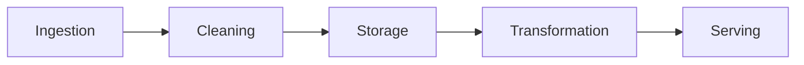
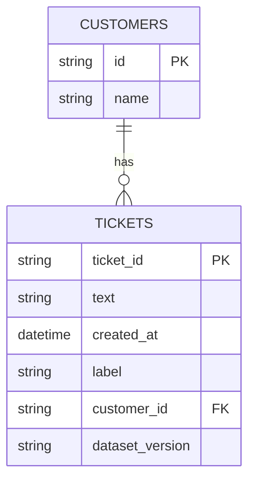

<!-- order: 19 -->
# AI Data Engineer: Hands-On Project Tutorials

This course is a series of hands-on projects. You learn each idea at the moment you need it, while building the thing.

**By the end of this course, you'll be able to:**
- Map the five stages of a data pipeline for an AI use case
- Clean a messy dataset with pandas and check the result with assertions
- Design a versioned SQL schema and build a batch ETL pipeline that loads into it
- Prepare labeled, stratified train/validation/test splits and check them for data leakage
- Build and query a vector store from a set of documents
- Add schema checks, value checks, and a simple drift check that stop bad data before it is loaded

Follow the projects in order. Each one hands off a skill or artifact to the next.


## Before you start: set up your notebook

**Time: about 15 minutes**

This course runs in **Google Colab**, a free Jupyter notebook in your browser and the standard workspace for AI and data work. There's nothing to install.

1. Go to [colab.research.google.com](https://colab.research.google.com) and sign in with a Google account.
2. Give each project its own notebook: choose **File → New notebook**, then click the title at the top to rename it after the project.
3. Notebooks have two kinds of cells. **Code cells** run Python: type or paste code, then press **Shift + Enter**. **Text cells** hold your notes and written answers: choose **Insert → Text cell**.
4. Install libraries in a code cell with `%pip install ...`. The `%` form installs them into the notebook you're using.
5. Put each code block from a project in its own code cell, in order, and run them top to bottom. When a later step changes earlier code, edit that cell and run it again.
6. To use a file you downloaded, such as a CSV, drag it into the **Files** panel (the folder icon on the left). Files your code creates appear there too. Colab clears them when the session ends, so download anything you want to keep, or connect Google Drive from the same panel.

Prefer to work on your own computer? The same notebooks run in JupyterLab or in VS Code with the Jupyter extension.

---

## Project 1 (Module 1): Map a Data Pipeline for an AI Use Case

**Time: about 1.5 hours**

**Goal:** Before writing any code, learn to see data movement as a pipeline of stages, so every later project has a place to plug into.

**Step 1: Create the project notebook.**
Create a new notebook for this project (**File → New notebook**) and name it `data_pipeline_map_project`.

**Step 2: Define the AI use case.**
Add a **text cell** headed `use_case` and write your notes in it.
Write one sentence: what AI application will consume this data, and what does it need to work? Example: "A customer support chatbot needs cleaned, labeled support tickets to fine-tune on."

**Step 3: Identify the data source.**
A **data source** is where raw data originates, a database, an API, uploaded files, or a stream of events.

**Step 4: List the five pipeline stages.**
- **Ingestion**: pulling raw data from the source.
- **Cleaning**: fixing or removing bad data.
- **Storage**: where cleaned data lives.
- **Transformation**: turning raw data into a form a model can use (labels, embeddings).
- **Serving**: how the AI application actually accesses the final data.

**Step 5: Sketch data volume and frequency.**
Estimate: how much data, and how often does new data arrive (once, daily, continuously)?

**Step 6: Note data quality risks.**
List: what could be wrong with this data? (duplicates, missing fields, inconsistent formats, mislabeled examples)

**Step 7: The pipeline.**
Data flows through five stages, left to right:



### Final Project Structure

*If you worked in a notebook, these are the sections of your notebook (text and code cells), not separate files. Save or export them as files when you put the project in your portfolio.*

```text
data_pipeline_map_project/
│
├── use_case.md
├── pipeline_diagram.png
```

### What You Learned
- ✅ Defining an AI use case's data requirements
- ✅ Identifying data sources
- ✅ The five stages of a data pipeline
- ✅ Estimating data volume and frequency
- ✅ Anticipating data quality risks
- ✅ Turning a use case into a pipeline diagram

### Portfolio Project
**AI Data Pipeline Architecture Map**: Translated an AI application's data requirements into a five-stage pipeline diagram covering ingestion, cleaning, storage, transformation, and serving.
**Skills:** Data Architecture, Systems Thinking, Technical Documentation, AI Data Engineering.

**Deliverable:** A one-page data pipeline map for your example AI use case, covering source, stages, volume, and quality risks.

### Quiz

1. What are the five pipeline stages, in order?
2. What is the difference between the Cleaning stage and the Transformation stage?
3. Why estimate data volume and arrival frequency before building anything?
4. Give two data quality risks you might list for a support-ticket dataset.

*Answers: 1) Ingestion, Cleaning, Storage, Transformation, Serving. 2) Cleaning fixes or removes bad data; Transformation turns clean data into a form a model can use, such as labels or embeddings. 3) They decide how the pipeline must be built, for example a one-time script versus a daily or continuous job. 4) Any two of: duplicate tickets, missing fields, inconsistent formats, or mislabeled examples.*

```watch
{
 "scenes": [
  {
   "kind": "title",
   "art": "path",
   "kicker": "Project 1 · Map a pipeline",
   "title": "See data as a pipeline",
   "beats": [
    {
     "say": "Welcome to A I Data Engineer: Hands-On Project Tutorials."
    },
    {
     "say": "Before writing any code, you'll learn to see data movement as a pipeline of stages, so every later project has a place to plug into."
    }
   ]
  },
  {
   "kind": "quote",
   "art": "target",
   "kicker": "Steps 2 and 3",
   "title": "Start with the use case",
   "quote": "A customer support chatbot needs cleaned, labeled support tickets to fine-tune on.",
   "beats": [
    {
     "say": "In a text cell headed use case, write one sentence.",
     "show": 0
    },
    {
     "say": "What A I application will consume this data, and what does it need to work?",
     "show": 1
    },
    {
     "say": "Then name the data source: where raw data originates. A database, an A P I, uploaded files, or a stream of events.",
     "show": 1
    }
   ]
  },
  {
   "kind": "flow",
   "art": "architecture",
   "kicker": "Step 4",
   "title": "The five pipeline stages",
   "steps": [
    "Ingestion",
    "Cleaning",
    "Storage",
    "Transformation",
    "Serving"
   ],
   "beats": [
    {
     "say": "Data flows through five stages, left to right.",
     "show": 0
    },
    {
     "say": "Ingestion: pulling raw data from the source.",
     "show": 1
    },
    {
     "say": "Cleaning: fixing or removing bad data.",
     "show": 2
    },
    {
     "say": "Storage: where cleaned data lives.",
     "show": 3
    },
    {
     "say": "Transformation: turning it into a form a model can use, like labels or embeddings.",
     "show": 4
    },
    {
     "say": "And serving: how the A I application actually accesses the final data.",
     "show": 5
    }
   ]
  },
  {
   "kind": "list",
   "art": "warning",
   "kicker": "Steps 5 and 6",
   "title": "Volume, frequency and risks",
   "items": [
    [
     "Volume",
     "How much data?"
    ],
    [
     "Frequency",
     "Once, daily, or continuous?"
    ],
    [
     "Quality risks",
     "Duplicates, missing fields, formats, bad labels"
    ]
   ],
   "beats": [
    {
     "say": "Next, sketch the volume: how much data is there?",
     "show": 1
    },
    {
     "say": "And the frequency: does new data arrive once, daily, or continuously?",
     "show": 2
    },
    {
     "say": "Then note the quality risks: duplicates, missing fields, inconsistent formats, and mislabeled examples.",
     "show": 3
    }
   ]
  },
  {
   "kind": "quiz",
   "art": "ask",
   "kicker": "Quick check",
   "title": "What's the difference between the Cleaning stage and the Transformation stage?",
   "options": [
    "Cleaning fixes or removes bad data; Transformation turns it into a form a model can use",
    "Cleaning happens after storage; Transformation happens before it",
    "They're two names for the same stage"
   ],
   "answer": 0,
   "good": "That's right. Cleaning fixes or removes bad data. Transformation turns clean data into something a model can use, such as labels or embeddings.",
   "bad": "Not quite. Cleaning fixes or removes bad data. Transformation turns clean data into something a model can use, such as labels or embeddings.",
   "beats": [
    {
     "say": "Quick check.",
     "show": 0
    },
    {
     "say": "What's the difference between the Cleaning stage and the Transformation stage?",
     "show": 0
    },
    {
     "say": "Tap your answer.",
     "show": 1
    }
   ]
  },
  {
   "kind": "list",
   "art": "proof",
   "kicker": "Checkpoint",
   "title": "You're done when",
   "items": [
    [
     "A one-page pipeline map",
     ""
    ],
    [
     "Source, stages, volume and risks",
     ""
    ]
   ],
   "beats": [
    {
     "say": "That's Project 1.",
     "show": 0
    },
    {
     "say": "You're done when:",
     "show": 0
    },
    {
     "say": "you have a one-page pipeline map for your A I use case,",
     "show": 1
    },
    {
     "say": "covering source, stages, volume, and quality risks.",
     "show": 2
    },
    {
     "say": "Next, in Module 2, a data cleaning script.",
     "show": 2
    }
   ]
  }
 ]
}
```

---

## Project 2 (Module 2): Build a Data Cleaning Script

**Time: about 2.5 hours**

**Goal:** Get hands-on with real, messy data, the unavoidable first technical task in almost every AI data role.

**Step 1: Create the project notebook.**
Create a new notebook for this project (**File → New notebook**) and name it `data_cleaning_project`.
```python
%pip install pandas
```

**Step 2: Get a messy dataset.**
This cell builds a practice file, `raw_data.csv`, of 60 made-up customer support tickets with the problems real data has: missing values, inconsistent casing, stray spaces, a bad date, and duplicate rows. Later projects use this same file.
```python
import random
import pandas as pd

random.seed(0)  # same "random" data every time you run it
templates = {
    "billing": ["I was charged twice this month", "My invoice shows the wrong amount",
                "How do I get a refund?", "My card payment failed", "Why did my subscription price go up?"],
    "bug": ["The app crashes when I upload a photo", "The login button does nothing",
            "Search results never load", "The page freezes on checkout", "Notifications show the wrong date"],
}
messy_spellings = {"billing": ["billing", "Billing", " BILLING "], "bug": ["bug", "Bug ", "BUG"]}

rows = []
for i in range(1, 61):
    category = random.choice(["billing", "bug"])
    rows.append({
        "ticket_id": f"T{i:03d}",
        "text": f"  {random.choice(templates[category])} (ref {i})  ",
        "customer_email": f"User{i % 15}@Example.com ",
        "created_at": f"2026-09-{(i % 28) + 1:02d}",
        "category": random.choice(messy_spellings[category]),
    })
raw = pd.DataFrame(rows)

# Add realistic problems
raw.loc[[3, 17, 29], "text"] = None              # missing text (a field we can't work without)
raw.loc[[5, 22], "category"] = None              # missing category (a placeholder is fine)
raw.loc[8, "created_at"] = "not a date"          # a value that can't be parsed
raw.loc[12, "category"] = "feature request"      # a category later projects don't expect
raw = pd.concat([raw, raw.iloc[[0, 1, 2]]], ignore_index=True)  # 3 duplicate rows

raw.to_csv("raw_data.csv", index=False)
print(raw.shape)
```
Prefer real data? Use any CSV with similar problems and replace the column names in the steps below with your own.

**Step 3: Load and inspect the data.**
Add a **code cell**, paste in the code below, and run it with **Shift + Enter**.
```python
import pandas as pd
df = pd.read_csv("raw_data.csv")
print(df.shape)
print(df.isnull().sum())
print(df.duplicated().sum())
```
`.isnull().sum()` counts missing values per column; `.duplicated().sum()` counts exact duplicate rows.

**Step 4: Handle missing values.**
```python
df = df.dropna(subset=["text"])
df["category"] = df["category"].fillna("unknown")
```
**dropping** removes rows with missing data in columns you can't work without; **filling** replaces gaps in columns where a placeholder is acceptable.

**Step 5: Remove duplicates.**
```python
df = df.drop_duplicates()
```
Duplicate rows silently bias any model or statistic trained on this data toward whatever's overrepresented.

**Step 6: Standardize formats.**
```python
df["text"] = df["text"].str.strip()
df["customer_email"] = df["customer_email"].str.lower().str.strip()
df["category"] = df["category"].str.lower().str.strip()
df["created_at"] = pd.to_datetime(df["created_at"], errors="coerce")
print(df["category"].value_counts())
```
**standardizing** means forcing values into one consistent format (lowercase text, a single date format) so "Billing", "billing", and " BILLING " aren't treated as three different values. `errors="coerce"` turns dates that can't be read, like `"not a date"`, into `NaT` (pandas' "missing date") instead of crashing.

**Step 7: Validate the cleaned result.**
```python
assert df.isnull().sum()["text"] == 0
assert df.duplicated().sum() == 0
print("Cleaning validated.")
```
An **assertion** halts the script if a condition isn't met, a cheap, automatic sanity check.

**Step 8: Save the cleaned dataset.**
```python
df.to_csv("cleaned_data.csv", index=False)
```
Download `raw_data.csv` and `cleaned_data.csv` from the **Files** panel (right-click → **Download**). Projects 4, 5, and 7 use them.

### Final Project Structure

*If you worked in a notebook, these are the sections of your notebook (text and code cells), not separate files. Save or export them as files when you put the project in your portfolio.*

```text
data_cleaning_project/
│
├── raw_data.csv
├── clean_data.py
├── cleaned_data.csv
```

### What You Learned
- ✅ Diagnosing missing values and duplicates
- ✅ Deciding when to drop vs. fill missing data
- ✅ Removing duplicate rows
- ✅ Standardizing inconsistent formats
- ✅ Validating cleaning results with assertions
- ✅ Saving a cleaned dataset for downstream use

### Portfolio Project
**Data Cleaning Pipeline Script**: Built a reusable Python script that diagnoses, cleans, standardizes, and validates a messy real-world dataset, producing a verified clean output file.
**Skills:** Python, Pandas, Data Cleaning, Data Quality, AI Data Engineering.

**Deliverable:** A data cleaning script and a validated, cleaned CSV file.

### Quiz

1. When should you drop rows with missing values, and when should you fill them instead?
2. Why do duplicate rows matter for AI training data?
3. Why lowercase and strip values like "Billing" and " BILLING "?
4. What does `errors="coerce"` do in `pd.to_datetime`?
5. What does an `assert` do in a cleaning script?

*Answers: 1) Drop rows when a column you can't work without is missing (like the ticket text); fill when a placeholder such as "unknown" is acceptable (like the category). 2) They make some examples count more than once, which biases any model or statistic toward them. 3) So the same value written different ways is treated as one value instead of several. 4) It turns values that can't be read as dates into `NaT` (a missing date) instead of stopping with an error. 5) It stops the script with an error if a condition isn't true, an automatic check that cleaning worked.*

```watch
{
 "scenes": [
  {
   "kind": "title",
   "art": "mess",
   "kicker": "Project 2 · Clean the data",
   "title": "Real, messy data",
   "beats": [
    {
     "say": "Welcome to Project 2."
    },
    {
     "say": "Cleaning messy data is the unavoidable first technical task in almost every A I data role."
    },
    {
     "say": "You'll build a practice file of sixty made-up support tickets with missing values, inconsistent casing, stray spaces, a bad date, and duplicate rows."
    }
   ]
  },
  {
   "kind": "code",
   "art": "search",
   "kicker": "Step 3",
   "title": "Load and inspect",
   "file": "data_cleaning_project",
   "code": "import pandas as pd\ndf = pd.read_csv(\"raw_data.csv\")\nprint(df.shape)\nprint(df.isnull().sum())\nprint(df.duplicated().sum())",
   "beats": [
    {
     "say": "First, load the file with pandas and inspect it.",
     "show": 0
    },
    {
     "say": "Is null, sum, counts the missing values in each column.",
     "show": 1
    },
    {
     "say": "Duplicated, sum, counts exact duplicate rows.",
     "show": 1
    }
   ]
  },
  {
   "kind": "list",
   "art": "table",
   "kicker": "Steps 4 and 5",
   "title": "Drop, fill, deduplicate",
   "items": [
    [
     "Drop",
     "Missing text: can't work without it"
    ],
    [
     "Fill",
     "Missing category → \"unknown\""
    ],
    [
     "Deduplicate",
     "Duplicates bias the model"
    ]
   ],
   "beats": [
    {
     "say": "Now handle the gaps.",
     "show": 0
    },
    {
     "say": "Drop rows missing a column you can't work without, like the ticket text.",
     "show": 1
    },
    {
     "say": "Fill gaps where a placeholder is fine, like a category of unknown.",
     "show": 2
    },
    {
     "say": "Then remove duplicates. Duplicate rows silently bias any model or statistic toward whatever's overrepresented.",
     "show": 3
    }
   ]
  },
  {
   "kind": "code",
   "art": "pencil",
   "kicker": "Step 6",
   "title": "Standardize formats",
   "file": "data_cleaning_project",
   "code": "df[\"text\"] = df[\"text\"].str.strip()\ndf[\"customer_email\"] = df[\"customer_email\"].str.lower().str.strip()\ndf[\"category\"] = df[\"category\"].str.lower().str.strip()\ndf[\"created_at\"] = pd.to_datetime(df[\"created_at\"], errors=\"coerce\")\nprint(df[\"category\"].value_counts())",
   "beats": [
    {
     "say": "Standardizing forces values into one consistent format.",
     "show": 0
    },
    {
     "say": "Strip spaces and lowercase, so Billing, billing, and capital BILLING aren't three different values.",
     "show": 1
    },
    {
     "say": "Errors equals coerce turns a date that can't be read, like not a date, into a missing date, instead of crashing.",
     "show": 1
    }
   ]
  },
  {
   "kind": "code",
   "art": "shield",
   "kicker": "Steps 7 and 8",
   "title": "Prove it, then save it",
   "file": "data_cleaning_project",
   "code": "assert df.isnull().sum()[\"text\"] == 0\nassert df.duplicated().sum() == 0\nprint(\"Cleaning validated.\")\n\ndf.to_csv(\"cleaned_data.csv\", index=False)",
   "beats": [
    {
     "say": "An assertion halts the script if a condition isn't met. A cheap, automatic sanity check.",
     "show": 0
    },
    {
     "say": "Check there's no missing text and no duplicates left.",
     "show": 1
    },
    {
     "say": "Then save cleaned data dot C S V, and download both files. Projects 4, 5 and 7 use them.",
     "show": 1
    }
   ]
  },
  {
   "kind": "quiz",
   "art": "ask",
   "kicker": "Quick check",
   "title": "When should you fill a missing value instead of dropping the row?",
   "options": [
    "Whenever the column has text in it",
    "Never, always drop rows with gaps",
    "When a placeholder such as unknown is acceptable, like the category"
   ],
   "answer": 2,
   "good": "That's right. Drop rows when a column you can't work without is missing, like the ticket text. Fill when a placeholder is acceptable, like the category.",
   "bad": "Not quite. Drop rows when a column you can't work without is missing, like the ticket text. Fill when a placeholder is acceptable, like the category.",
   "beats": [
    {
     "say": "Quick check.",
     "show": 0
    },
    {
     "say": "When should you fill a missing value instead of dropping the row?",
     "show": 0
    },
    {
     "say": "Tap your answer.",
     "show": 1
    }
   ]
  },
  {
   "kind": "list",
   "art": "proof",
   "kicker": "Checkpoint",
   "title": "You're done when",
   "items": [
    [
     "A data cleaning script",
     ""
    ],
    [
     "A validated, cleaned CSV",
     ""
    ]
   ],
   "beats": [
    {
     "say": "That's Project 2.",
     "show": 0
    },
    {
     "say": "You're done when:",
     "show": 0
    },
    {
     "say": "you have a data cleaning script,",
     "show": 1
    },
    {
     "say": "and a validated, cleaned C S V file.",
     "show": 2
    },
    {
     "say": "Next, in Module 3, a schema for a training dataset store.",
     "show": 2
    }
   ]
  }
 ]
}
```

---

## Project 3 (Module 3): Design a Schema for a Training Dataset Store

**Time: about 2 hours**

**Goal:** Decide how cleaned data should be structured and stored, the step between "I have clean data" and "a model can reliably use this data."

**Step 1: Create the project notebook.**
Create a new notebook for this project (**File → New notebook**) and name it `schema_design_project`.

**Step 2: Identify your entities.**
An **entity** is a distinct "thing" your data describes, e.g., for a support-ticket dataset: `tickets`, `customers`, `labels`.

**Step 3: Define fields for each entity.**
Add a **text cell** headed `schema` and write your notes in it.
For each entity, list its fields and types: `ticket_id (string), text (string), created_at (datetime), label (string)`.

**Step 4: Define relationships between entities.**
A **foreign key** is a field in one table that references the identifier of another (e.g., `tickets.customer_id` points to `customers.id`).

**Step 5: Add versioning fields.**
Add `dataset_version` and `created_at` fields to your core table.
**dataset versioning** means every row (or dataset snapshot) can be traced to exactly when and how it was produced.

**Step 6: Write the schema as SQL.**
```sql
CREATE TABLE customers (
    id TEXT PRIMARY KEY,
    name TEXT
);

CREATE TABLE tickets (
    ticket_id TEXT PRIMARY KEY,
    text TEXT NOT NULL,
    created_at TIMESTAMP,
    label TEXT,
    customer_id TEXT REFERENCES customers(id),
    dataset_version TEXT
);
```
`PRIMARY KEY` uniquely identifies each row; `NOT NULL` enforces that a field can't be left empty; `REFERENCES` makes `customer_id` a foreign key pointing at `customers.id`.

Now run the schema to prove it works. Python's built-in `sqlite3` module creates a small database file, so there's nothing to install. Add a **code cell**, paste in the code below, and run it:
```python
import sqlite3

schema = """
CREATE TABLE IF NOT EXISTS customers (
    id TEXT PRIMARY KEY,
    name TEXT
);
CREATE TABLE IF NOT EXISTS tickets (
    ticket_id TEXT PRIMARY KEY,
    text TEXT NOT NULL,
    created_at TIMESTAMP,
    label TEXT,
    customer_id TEXT REFERENCES customers(id),
    dataset_version TEXT
);
"""
conn = sqlite3.connect("schema_test.db")
conn.executescript(schema)
conn.execute("INSERT OR REPLACE INTO customers VALUES ('C1', 'Ada')")
conn.execute("INSERT OR REPLACE INTO tickets VALUES "
             "('T001', 'I was charged twice', '2026-09-01', 'billing_issue', 'C1', 'v1')")
conn.commit()

try:
    conn.execute("INSERT INTO tickets (ticket_id, text) VALUES ('T002', NULL)")
except sqlite3.IntegrityError as error:
    print("Rejected as expected:", error)

print(conn.execute("SELECT * FROM tickets").fetchall())
conn.close()
```
The empty-text row is rejected with `NOT NULL constraint failed: tickets.text`, which shows the schema itself guards data quality, not just your cleaning code.

**Step 7: The schema.**
Your tables and their foreign-key relationship look like this:



### Final Project Structure

*If you worked in a notebook, these are the sections of your notebook (text and code cells), not separate files. Save or export them as files when you put the project in your portfolio.*

```text
schema_design_project/
│
├── schema.md
├── schema.sql
├── schema_diagram.png
```

### What You Learned
- ✅ Identifying entities in a dataset
- ✅ Defining fields and types
- ✅ Modeling relationships with foreign keys
- ✅ Adding dataset versioning for traceability
- ✅ Writing schema as executable SQL
- ✅ Diagramming a data model

### Portfolio Project
**Training Dataset Schema Design**: Designed a versioned, relational schema for a training dataset store, including entity relationships and executable SQL table definitions.
**Skills:** Database Design, SQL, Data Modeling, AI Data Engineering.

**Deliverable:** A schema document, SQL table definitions, and a diagram for your training dataset store.

### Quiz

1. What is an entity in a schema?
2. What does a foreign key such as `tickets.customer_id` do?
3. What do `PRIMARY KEY` and `NOT NULL` enforce?
4. Why add a `dataset_version` field to a training data table?

*Answers: 1) A distinct thing the data describes, such as tickets or customers, which usually becomes its own table. 2) It stores the id of a row in another table, linking each ticket to the customer it belongs to. 3) `PRIMARY KEY` makes each row's identifier unique; `NOT NULL` stops a field from being left empty. 4) So every row can be traced to when and how it was produced, which lets you reproduce or compare training runs.*

```watch
{
 "scenes": [
  {
   "kind": "title",
   "art": "database",
   "kicker": "Project 3 · Design a schema",
   "title": "Structure before storage",
   "beats": [
    {
     "say": "Welcome to Project 3."
    },
    {
     "say": "Now decide how cleaned data should be structured and stored. It's the step between I have clean data, and a model can reliably use this data."
    }
   ]
  },
  {
   "kind": "list",
   "art": "boxes",
   "kicker": "Steps 2 to 5",
   "title": "Entities, fields, keys, versions",
   "items": [
    [
     "Entities",
     "tickets, customers, labels"
    ],
    [
     "Fields + types",
     "ticket_id (string), created_at (datetime)"
    ],
    [
     "Foreign key",
     "tickets.customer_id → customers.id"
    ],
    [
     "Versioning",
     "dataset_version, created_at"
    ]
   ],
   "beats": [
    {
     "say": "An entity is a distinct thing your data describes, like tickets, customers, and labels.",
     "show": 1
    },
    {
     "say": "For each entity, list its fields and their types.",
     "show": 2
    },
    {
     "say": "A foreign key is a field that references another table's identifier, like tickets dot customer I D pointing to customers dot I D.",
     "show": 3
    },
    {
     "say": "And versioning fields mean every row can be traced to exactly when and how it was produced.",
     "show": 4
    }
   ]
  },
  {
   "kind": "code",
   "art": "code",
   "kicker": "Step 6",
   "title": "The schema as S Q L",
   "file": "schema.sql",
   "code": "CREATE TABLE customers (\n    id TEXT PRIMARY KEY,\n    name TEXT\n);\n\nCREATE TABLE tickets (\n    ticket_id TEXT PRIMARY KEY,\n    text TEXT NOT NULL,\n    created_at TIMESTAMP,\n    label TEXT,\n    customer_id TEXT REFERENCES customers(id),\n    dataset_version TEXT\n);",
   "beats": [
    {
     "say": "Write the schema as S Q L.",
     "show": 0
    },
    {
     "say": "Primary key uniquely identifies each row.",
     "show": 1
    },
    {
     "say": "Not null means the text can't be left empty.",
     "show": 1
    },
    {
     "say": "References makes customer I D a foreign key pointing at customers.",
     "show": 1
    }
   ]
  },
  {
   "kind": "code",
   "art": "lock",
   "kicker": "Step 6 · Run it",
   "title": "The schema guards quality too",
   "file": "schema_design_project",
   "code": "conn = sqlite3.connect(\"schema_test.db\")\nconn.executescript(schema)\n\ntry:\n    conn.execute(\"INSERT INTO tickets (ticket_id, text) VALUES ('T002', NULL)\")\nexcept sqlite3.IntegrityError as error:\n    print(\"Rejected as expected:\", error)",
   "beats": [
    {
     "say": "Run it with Python's built-in S Q Lite module. Nothing to install.",
     "show": 0
    },
    {
     "say": "Insert a valid ticket, then try one with empty text.",
     "show": 1
    },
    {
     "say": "It's rejected: not null constraint failed. The schema itself guards data quality, not just your cleaning code.",
     "show": 1
    }
   ]
  },
  {
   "kind": "quiz",
   "art": "ask",
   "kicker": "Quick check",
   "title": "Why add a dataset version field to a training data table?",
   "options": [
    "So every row can be traced to when and how it was produced",
    "So the database runs queries faster",
    "Because S Q L requires it on every table"
   ],
   "answer": 0,
   "good": "That's right. Versioning lets you trace every row to when and how it was produced, so you can reproduce or compare training runs.",
   "bad": "Not quite. Versioning lets you trace every row to when and how it was produced, so you can reproduce or compare training runs.",
   "beats": [
    {
     "say": "Quick check.",
     "show": 0
    },
    {
     "say": "Why add a dataset version field to a training data table?",
     "show": 0
    },
    {
     "say": "Tap your answer.",
     "show": 1
    }
   ]
  },
  {
   "kind": "list",
   "art": "proof",
   "kicker": "Checkpoint",
   "title": "You're done when",
   "items": [
    [
     "A schema document",
     ""
    ],
    [
     "SQL table definitions",
     ""
    ],
    [
     "A schema diagram",
     ""
    ]
   ],
   "beats": [
    {
     "say": "That's Project 3.",
     "show": 0
    },
    {
     "say": "You're done when:",
     "show": 0
    },
    {
     "say": "you have a schema document,",
     "show": 1
    },
    {
     "say": "S Q L table definitions,",
     "show": 2
    },
    {
     "say": "and a diagram for your training dataset store.",
     "show": 3
    },
    {
     "say": "Next, in Module 4, a batch E T L pipeline.",
     "show": 3
    }
   ]
  }
 ]
}
```

---

## Project 4 (Module 4): Build a Batch ETL Pipeline

**Time: about 3 hours**

**Goal:** Automate the move from raw data to stored data, connecting Project 2's cleaning and Project 3's schema into a repeatable process.

**Step 1: Create the project notebook.**
Create a new notebook for this project (**File → New notebook**) and name it `etl_pipeline_project`.
```python
%pip install pandas sqlalchemy
```
Upload `raw_data.csv` from Project 2 to the **Files** panel.

**Step 2: Understand ETL.**
**ETL** stands for **Extract** (pull raw data from a source), **Transform** (clean and reshape it), **Load** (write it into storage). **ELT** does the same steps in a different order, transforming after loading.

**Step 3: Write the Extract step.**
Add a **code cell**, paste in the code below, and run it with **Shift + Enter**.
```python
import pandas as pd

def extract(path):
    return pd.read_csv(path)
```

**Step 4: Write the Transform step.**
```python
def transform(df):
    df = df.dropna(subset=["text"]).drop_duplicates().copy()
    df["text"] = df["text"].str.strip()
    df["customer_email"] = df["customer_email"].str.lower().str.strip()
    df["category"] = df["category"].fillna("unknown").str.lower().str.strip()
    df["created_at"] = pd.to_datetime(df["created_at"], errors="coerce")
    return df
```
These are the same cleaning rules as Project 2, now packed into one function the pipeline can run on every new file. `.copy()` gives you a separate table to edit, which avoids a pandas warning.

**Step 5: Write the Load step.**
```python
from sqlalchemy import create_engine

def load(df, table_name, engine):
    df.to_sql(table_name, engine, if_exists="append", index=False)
```
`if_exists="append"` adds new rows without erasing existing ones, critical for a pipeline that runs repeatedly on new data.

**Step 6: Wire the three stages together.**
```python
def run_pipeline(path, table_name, engine):
    df = extract(path)
    df = transform(df)
    load(df, table_name, engine)
    print(f"Loaded {len(df)} rows into {table_name}")

engine = create_engine("sqlite:///data_store.db")
run_pipeline("raw_data.csv", "tickets", engine)
print(pd.read_sql("SELECT COUNT(*) AS row_count FROM tickets", engine))
```
SQLite stores the whole database in one file, `data_store.db`, so there's no server to set up.

**Step 7: Test with a second batch of data.**
This cell makes a small file representing "tomorrow's data" and runs the pipeline on it:
```python
new_batch = pd.DataFrame([
    {"ticket_id": "T101", "text": "I can't update my billing address", "customer_email": "Ada@Example.com",
     "created_at": "2026-10-01", "category": "Billing"},
    {"ticket_id": "T102", "text": "The export button downloads an empty file", "customer_email": "sam@example.com ",
     "created_at": "2026-10-01", "category": "bug"},
    {"ticket_id": "T103", "text": "Please cancel the extra charge on my account", "customer_email": "lee@example.com",
     "created_at": "2026-10-02", "category": " BILLING"},
])
new_batch.to_csv("new_data.csv", index=False)

run_pipeline("new_data.csv", "tickets", engine)
print(pd.read_sql("SELECT COUNT(*) AS row_count FROM tickets", engine))
```
The row count grows by 3. Notice what would happen if you ran `raw_data.csv` a second time: append mode would add every row again as duplicates. Real pipelines guard against this, for example by tracking which files were already loaded.

**Step 8: Add basic logging.**
Replace your `run_pipeline` cell with this version, which writes a line to `pipeline.log` every run:
```python
import logging

logging.basicConfig(filename="pipeline.log", level=logging.INFO,
                    format="%(asctime)s %(levelname)s %(message)s", force=True)

def run_pipeline(path, table_name, engine):
    df = extract(path)
    df = transform(df)
    load(df, table_name, engine)
    logging.info(f"Pipeline run completed: {len(df)} rows from {path} loaded into {table_name}.")
    print(f"Loaded {len(df)} rows into {table_name}")
```
Run it on a file once more (for example `new_data.csv`), then open `pipeline.log` from the **Files** panel. A log is a lasting record of every run, so you can see what happened even after the notebook output is gone. `force=True` replaces any logging setup Colab already has.

### Final Project Structure

*If you worked in a notebook, these are the sections of your notebook (text and code cells), not separate files. Save or export them as files when you put the project in your portfolio.*

```text
etl_pipeline_project/
│
├── etl.py
├── raw_data.csv
├── data_store.db
├── pipeline.log
```

### What You Learned
- ✅ The Extract, Transform, Load pattern
- ✅ Isolating pipeline stages into reusable functions
- ✅ Writing to a database with SQLAlchemy
- ✅ Appending vs. replacing data safely
- ✅ Testing pipeline repeatability across multiple runs
- ✅ Adding basic pipeline logging

### Portfolio Project
**Batch ETL Pipeline**: Built a reusable Extract-Transform-Load pipeline that ingests raw CSV data, applies cleaning logic, and loads it into a structured database, tested across multiple repeated runs.
**Skills:** Python, SQL, ETL/ELT, SQLAlchemy, Data Pipelines, AI Data Engineering.

**Deliverable:** A working ETL pipeline script that repeatably processes new data into a structured store.

### Quiz

1. What do the three letters in ETL stand for, and what does each stage do?
2. How is ELT different from ETL?
3. What does `if_exists="append"` do, and what is its risk if you load the same file twice?
4. Why split the pipeline into separate `extract`, `transform`, and `load` functions?
5. Why write a log file instead of only printing messages?

*Answers: 1) Extract pulls raw data from a source, Transform cleans and reshapes it, and Load writes it into storage. 2) ELT loads the raw data first and transforms it afterward, inside the storage system. 3) It adds new rows without erasing existing ones; loading the same file twice adds every row again as duplicates. 4) Each stage can be tested, reused, and changed on its own, and the same steps run the same way on every new file. 5) A log keeps a lasting record of each run that you can check later, even after the notebook output is gone.*

```watch
{
 "scenes": [
  {
   "kind": "title",
   "art": "loop",
   "kicker": "Project 4 · Batch E T L",
   "title": "Automate raw to stored",
   "beats": [
    {
     "say": "Welcome to Project 4."
    },
    {
     "say": "You'll connect Project 2's cleaning and Project 3's schema into one repeatable process."
    }
   ]
  },
  {
   "kind": "flow",
   "art": "layers",
   "kicker": "Step 2",
   "title": "What E T L means",
   "steps": [
    "Extract: pull raw data",
    "Transform: clean and reshape",
    "Load: write to storage"
   ],
   "beats": [
    {
     "say": "E T L stands for three stages.",
     "show": 0
    },
    {
     "say": "Extract: pull raw data from a source.",
     "show": 1
    },
    {
     "say": "Transform: clean and reshape it.",
     "show": 2
    },
    {
     "say": "Load: write it into storage.",
     "show": 3
    },
    {
     "say": "E L T does the same steps in a different order, transforming after loading.",
     "show": 3
    }
   ]
  },
  {
   "kind": "code",
   "art": "code",
   "kicker": "Steps 3 to 6",
   "title": "Three functions, one pipeline",
   "file": "etl_pipeline_project",
   "code": "def load(df, table_name, engine):\n    df.to_sql(table_name, engine, if_exists=\"append\", index=False)\n\ndef run_pipeline(path, table_name, engine):\n    df = extract(path)\n    df = transform(df)\n    load(df, table_name, engine)\n    print(f\"Loaded {len(df)} rows into {table_name}\")\n\nengine = create_engine(\"sqlite:///data_store.db\")\nrun_pipeline(\"raw_data.csv\", \"tickets\", engine)",
   "beats": [
    {
     "say": "Each stage is its own function. Transform holds the same cleaning rules as Project 2.",
     "show": 0
    },
    {
     "say": "Load uses if exists equals append, so new rows are added without erasing existing ones.",
     "show": 1
    },
    {
     "say": "Run pipeline wires them together, into a S Q Lite file called data store dot D B. No server to set up.",
     "show": 1
    }
   ]
  },
  {
   "kind": "big",
   "art": "warning",
   "kicker": "Step 7",
   "title": "Tomorrow's data",
   "big": "+3 rows",
   "sub": "Loading the same file twice duplicates every row",
   "beats": [
    {
     "say": "Now make a small file of tomorrow's data, and run the pipeline on it. The row count grows by three.",
     "show": 0
    },
    {
     "say": "But careful. Run raw data dot C S V a second time, and append mode adds every row again as duplicates. Real pipelines guard against this, for example by tracking which files were already loaded.",
     "show": 1
    }
   ]
  },
  {
   "kind": "code",
   "art": "doc",
   "kicker": "Step 8",
   "title": "Keep a log",
   "file": "etl_pipeline_project",
   "code": "import logging\n\nlogging.basicConfig(filename=\"pipeline.log\", level=logging.INFO,\n                    format=\"%(asctime)s %(levelname)s %(message)s\", force=True)\n\n# inside run_pipeline, after load(...):\nlogging.info(f\"Pipeline run completed: {len(df)} rows from {path} loaded into {table_name}.\")",
   "beats": [
    {
     "say": "Finally, add logging.",
     "show": 0
    },
    {
     "say": "Every run writes a line to pipeline dot log.",
     "show": 1
    },
    {
     "say": "A log is a lasting record of every run, so you can see what happened even after the notebook output is gone.",
     "show": 1
    }
   ]
  },
  {
   "kind": "quiz",
   "art": "ask",
   "kicker": "Quick check",
   "title": "What's the risk of if exists equals append when you load the same file twice?",
   "options": [
    "The table is erased and rebuilt",
    "Every row is added again as duplicates",
    "The pipeline refuses to run"
   ],
   "answer": 1,
   "good": "That's right. Append adds new rows without erasing existing ones, so loading the same file twice adds every row again as duplicates.",
   "bad": "Not quite. Append adds new rows without erasing existing ones, so loading the same file twice adds every row again as duplicates.",
   "beats": [
    {
     "say": "Quick check.",
     "show": 0
    },
    {
     "say": "What's the risk of if exists equals append when you load the same file twice?",
     "show": 0
    },
    {
     "say": "Tap your answer.",
     "show": 1
    }
   ]
  },
  {
   "kind": "list",
   "art": "proof",
   "kicker": "Checkpoint",
   "title": "You're done when",
   "items": [
    [
     "A working ETL pipeline",
     ""
    ],
    [
     "New data loads repeatably",
     ""
    ]
   ],
   "beats": [
    {
     "say": "That's Project 4.",
     "show": 0
    },
    {
     "say": "You're done when:",
     "show": 0
    },
    {
     "say": "you have a working E T L pipeline,",
     "show": 1
    },
    {
     "say": "that repeatably processes new data into a structured store.",
     "show": 2
    },
    {
     "say": "Next, in Module 5, a labeled dataset for training.",
     "show": 2
    }
   ]
  }
 ]
}
```

---

## Project 5 (Module 5): Prepare a Labeled Dataset for Training

**Time: about 2.5 hours**

**Goal:** Take cleaned, stored data (Project 4's output) and turn it into something a model can actually be trained on.

**Step 1: Create the project notebook.**
Create a new notebook for this project (**File → New notebook**) and name it `labeled_dataset_project`.
```python
%pip install pandas scikit-learn
```
Upload `cleaned_data.csv` from Project 2 to the **Files** panel.

**Step 2: Load your cleaned data.**
```python
import pandas as pd
df = pd.read_csv("cleaned_data.csv")
print(df.shape)
print(df["category"].value_counts())
```
This holds the same cleaned tickets your Project 4 pipeline loads into its database. (To read from the database instead, upload `data_store.db` and use `pd.read_sql("SELECT * FROM tickets", create_engine("sqlite:///data_store.db"))` after `from sqlalchemy import create_engine`.)

**Step 3: Define labeling criteria.**
Add a **text cell** headed `labeling_guide` and write your notes in it.
Write clear rules for what each label means, with 2–3 examples per label.

**Step 4: Apply labels.**
For a small dataset, label manually using your guide; for a larger one, use an existing labeled column or a simple rule-based heuristic as a starting point.
```python
df["label"] = df["category"].map({"billing": "billing_issue", "bug": "technical_issue"})

# Categories missing from the map (like "unknown" or "feature request") become NaN (empty).
unlabeled = df["label"].isna().sum()
print(f"Dropping {unlabeled} rows with no label")
df = df.dropna(subset=["label"])
```
`.map()` returns NaN for any value not in the dictionary. Those rows must be removed (or labeled by hand) before splitting, because the split in Step 6 can't handle missing labels.

**Step 5: Check label distribution.**
```python
print(df["label"].value_counts())
```
**class imbalance** here means some labels have far fewer examples than others. Each label also needs enough examples (at least about 10) for the stratified split in Step 6 to work; with too few, scikit-learn stops with an error saying a class has too few members.

**Step 6: Split into train, validation, and test sets.**
```python
from sklearn.model_selection import train_test_split
train, temp = train_test_split(df, test_size=0.3, random_state=42, stratify=df["label"])
val, test = train_test_split(temp, test_size=0.5, random_state=42, stratify=temp["label"])
print(len(train), len(val), len(test))
```
This gives about 70% train, 15% validation, and 15% test.
`stratify` ensures each split has roughly the same label distribution as the full dataset. A **validation set** is used during model development; a **test set** is held back until final evaluation only.

**Step 7: Check for data leakage.**
**data leakage** happens when information from the test set (or future data) accidentally influences training, e.g., duplicate rows across splits, or a feature that encodes the label indirectly.
```python
id_overlap = set(train["ticket_id"]) & set(test["ticket_id"])
text_overlap = set(train["text"]) & set(test["text"])
assert len(id_overlap) == 0, "Leakage: the same ticket_id is in train and test!"
assert len(text_overlap) == 0, "Leakage: the same ticket text is in train and test!"
print("No leakage found between train and test.")
```
Checking the text as well as the id catches the same ticket saved twice under different ids.

**Step 8: Save the final labeled splits.**
```python
train.to_csv("train.csv", index=False)
val.to_csv("val.csv", index=False)
test.to_csv("test.csv", index=False)
```

### Final Project Structure

*If you worked in a notebook, these are the sections of your notebook (text and code cells), not separate files. Save or export them as files when you put the project in your portfolio.*

```text
labeled_dataset_project/
│
├── labeling_guide.md
├── prepare_labels.py
├── train.csv
├── val.csv
├── test.csv
```

### What You Learned
- ✅ Writing clear labeling criteria
- ✅ Applying labels consistently
- ✅ Detecting class imbalance in labeled data
- ✅ Splitting data into train/validation/test with stratification
- ✅ Detecting and preventing data leakage
- ✅ Producing model-ready labeled datasets

### Portfolio Project
**Labeled Training Dataset Preparation**: Defined labeling criteria, applied labels to a cleaned dataset, checked for class imbalance and data leakage, and produced stratified train/validation/test splits.
**Skills:** Data Labeling, Scikit-learn, Data Quality, ML Data Preparation, AI Data Engineering.

**Deliverable:** A labeling guide plus stratified, leakage-checked train/validation/test CSV files.

### Quiz

1. What happens to a category that isn't in the dictionary you pass to `.map()`, and how do you handle it?
2. What does `stratify` do when splitting data?
3. What is the difference between a validation set and a test set?
4. What is data leakage? Give one example.

*Answers: 1) It becomes NaN (no label); drop those rows with `dropna(subset=["label"])` or label them by hand before splitting. 2) It keeps the label proportions in each split roughly the same as in the full dataset. 3) The validation set is used while developing the model; the test set is held back and used only for the final evaluation. 4) It is when information from the test set or the future influences training, for example the same ticket appearing in both train and test.*

```watch
{
 "scenes": [
  {
   "kind": "title",
   "art": "test",
   "kicker": "Project 5 · Labeled dataset",
   "title": "Ready to train on",
   "beats": [
    {
     "say": "Welcome to Project 5."
    },
    {
     "say": "You'll take cleaned, stored data and turn it into something a model can actually be trained on."
    }
   ]
  },
  {
   "kind": "code",
   "art": "pencil",
   "kicker": "Steps 3 and 4",
   "title": "Write the rules, apply the labels",
   "file": "labeled_dataset_project",
   "code": "df[\"label\"] = df[\"category\"].map({\"billing\": \"billing_issue\", \"bug\": \"technical_issue\"})\n\nunlabeled = df[\"label\"].isna().sum()\nprint(f\"Dropping {unlabeled} rows with no label\")\ndf = df.dropna(subset=[\"label\"])",
   "beats": [
    {
     "say": "First write a labeling guide: clear rules for each label, with two or three examples each.",
     "show": 0
    },
    {
     "say": "Then apply labels. Here, a simple rule maps billing to billing issue, and bug to technical issue.",
     "show": 1
    },
    {
     "say": "Any category not in the map, like unknown or feature request, becomes empty. Drop those rows before splitting.",
     "show": 1
    }
   ]
  },
  {
   "kind": "code",
   "art": "fork",
   "kicker": "Steps 5 and 6",
   "title": "Stratified splits",
   "file": "labeled_dataset_project",
   "code": "from sklearn.model_selection import train_test_split\ntrain, temp = train_test_split(df, test_size=0.3, random_state=42, stratify=df[\"label\"])\nval, test = train_test_split(temp, test_size=0.5, random_state=42, stratify=temp[\"label\"])\nprint(len(train), len(val), len(test))",
   "beats": [
    {
     "say": "Check the label counts for class imbalance. Each label needs at least about ten examples for the split to work.",
     "show": 0
    },
    {
     "say": "Then split: about seventy percent train, fifteen validation, fifteen test.",
     "show": 1
    },
    {
     "say": "Stratify keeps each split's label mix close to the full dataset. Validation is for development; test is held back for the final evaluation.",
     "show": 1
    }
   ]
  },
  {
   "kind": "code",
   "art": "shield",
   "kicker": "Step 7",
   "title": "Check for data leakage",
   "file": "labeled_dataset_project",
   "code": "id_overlap = set(train[\"ticket_id\"]) & set(test[\"ticket_id\"])\ntext_overlap = set(train[\"text\"]) & set(test[\"text\"])\nassert len(id_overlap) == 0, \"Leakage: the same ticket_id is in train and test!\"\nassert len(text_overlap) == 0, \"Leakage: the same ticket text is in train and test!\"\nprint(\"No leakage found between train and test.\")",
   "beats": [
    {
     "say": "Data leakage is when information from the test set, or the future, accidentally influences training.",
     "show": 0
    },
    {
     "say": "Check that no ticket I D appears in both train and test.",
     "show": 1
    },
    {
     "say": "And check the text too. That catches the same ticket saved twice under different I Ds.",
     "show": 1
    }
   ]
  },
  {
   "kind": "quiz",
   "art": "ask",
   "kicker": "Quick check",
   "title": "What does stratify do when splitting data?",
   "options": [
    "It shuffles the rows into random order",
    "It removes duplicate rows from each split",
    "It keeps the label proportions in each split close to the full dataset"
   ],
   "answer": 2,
   "good": "That's right. Stratify keeps the label proportions in each split roughly the same as in the full dataset.",
   "bad": "Not quite. Stratify keeps the label proportions in each split roughly the same as in the full dataset.",
   "beats": [
    {
     "say": "Quick check.",
     "show": 0
    },
    {
     "say": "What does stratify do when splitting data?",
     "show": 0
    },
    {
     "say": "Tap your answer.",
     "show": 1
    }
   ]
  },
  {
   "kind": "list",
   "art": "proof",
   "kicker": "Checkpoint",
   "title": "You're done when",
   "items": [
    [
     "A labeling guide",
     ""
    ],
    [
     "Stratified, leakage-checked splits",
     ""
    ]
   ],
   "beats": [
    {
     "say": "That's Project 5.",
     "show": 0
    },
    {
     "say": "You're done when:",
     "show": 0
    },
    {
     "say": "you have a labeling guide,",
     "show": 1
    },
    {
     "say": "plus stratified, leakage-checked train, validation and test files.",
     "show": 2
    },
    {
     "say": "Next, in Module 6, a vector store from a document set.",
     "show": 2
    }
   ]
  }
 ]
}
```

---

## Project 6 (Module 6): Build a Vector Store from a Document Set

**Time: about 3 hours**

**Goal:** Extend your data engineering skills to unstructured text and the retrieval systems behind modern AI applications like RAG chatbots.

**Step 1: Create the project notebook.**
Create a new notebook for this project (**File → New notebook**) and name it `vector_store_project`.
```python
%pip install sentence-transformers chromadb
```

**Step 2: Gather a document set.**
Collect 10–20 text documents (articles, FAQs, or paragraphs) and save each as a `.txt` file. In the **Files** panel, create a folder named `documents` (right-click → **New folder**) and upload the files into it.

**Step 3: Chunk the documents.**
Add a **code cell**, paste in the code below, and run it with **Shift + Enter**.
```python
def chunk_text(text, chunk_size=200, overlap=50):
    words = text.split()
    chunks = []
    for i in range(0, len(words), chunk_size - overlap):
        chunks.append(" ".join(words[i:i + chunk_size]))
        if i + chunk_size >= len(words):  # this chunk reached the end of the text
            break
    return chunks
```
**chunking** splits long documents into smaller pieces; **overlap** repeats a few words between chunks so context isn't lost at the boundary. With these settings, each new chunk starts 150 words after the previous one.

Now load every file in the folder and chunk it, keeping track of which file each chunk came from:
```python
import os

chunks = []         # the text of every chunk, from every document
chunk_sources = []  # the file name each chunk came from
for filename in sorted(os.listdir("documents")):
    if not filename.endswith(".txt"):
        continue
    with open(os.path.join("documents", filename), encoding="utf-8") as f:
        text = f.read()
    for chunk in chunk_text(text):
        chunks.append(chunk)
        chunk_sources.append(filename)

print(f"{len(chunks)} chunks from {len(set(chunk_sources))} documents")
print(chunks[0][:200])
```

**Step 4: Generate embeddings.**
```python
from sentence_transformers import SentenceTransformer
model = SentenceTransformer("all-MiniLM-L6-v2")
embeddings = model.encode(chunks)
```
An **embedding** is a list of numbers representing a chunk's meaning, texts with similar meaning end up with mathematically similar embeddings.

**Step 5: Store embeddings in a vector database.**
```python
import chromadb
client = chromadb.Client()
collection = client.get_or_create_collection("documents")

collection.add(
    documents=chunks,
    embeddings=embeddings.tolist(),
    ids=[f"chunk_{i}" for i in range(len(chunks))],
    metadatas=[{"source": name} for name in chunk_sources],
)
print(collection.count(), "chunks stored")
```
A **vector database** stores embeddings and is optimized to quickly find the closest matches to a new query embedding. The `source` metadata records which file each chunk came from. `get_or_create_collection` lets you rerun the cell without an "already exists" error; if you change your documents, restart the runtime first so old chunks don't stay in the collection.

**Step 6: Query the vector store.**
```python
query = "How do I reset my password?"  # change this to fit your documents
query_embedding = model.encode([query])
results = collection.query(query_embeddings=query_embedding.tolist(), n_results=3)
for document, metadata, distance in zip(results["documents"][0], results["metadatas"][0], results["distances"][0]):
    print(f"{metadata['source']} (distance {distance:.3f}): {document[:150]}")
```
A smaller **distance** means a closer match in meaning.

**Step 7: Evaluate retrieval quality.**
Try 5 different queries and manually judge whether the top results are actually relevant.

**Step 8: Document your chunking and embedding choices.**
Add a **text cell** headed `vector_store_notes` and write your notes in it.
Record chunk size, overlap, embedding model used, and your retrieval evaluation results.

### Final Project Structure

*If you worked in a notebook, these are the sections of your notebook (text and code cells), not separate files. Save or export them as files when you put the project in your portfolio.*

```text
vector_store_project/
│
├── documents/
├── build_vector_store.py
├── vector_store_notes.md
```

### What You Learned
- ✅ Chunking long text into retrievable pieces
- ✅ Generating embeddings for semantic meaning
- ✅ Storing and querying a vector database
- ✅ Retrieving results by meaning, not just keywords
- ✅ Evaluating retrieval quality manually
- ✅ Documenting chunking and embedding decisions

### Portfolio Project
**Document Vector Store for Semantic Search**: Built a chunking and embedding pipeline over a real document set, stored it in a vector database, and evaluated retrieval quality across multiple queries.
**Skills:** Embeddings, Vector Databases, RAG Foundations, Python, AI Data Engineering.

**Deliverable:** A working vector store built from a real document set, with a retrieval evaluation.

### Quiz

1. Why split documents into chunks before embedding them?
2. What does the overlap between chunks prevent?
3. What is an embedding?
4. Why must the query be embedded with the same model as the chunks?
5. Why store the source file name as metadata with each chunk?

*Answers: 1) Smaller pieces can be matched to a question more precisely, and embedding models only read a limited amount of text at once. 2) It keeps an idea that falls on a chunk boundary from being cut in half and losing its context. 3) A list of numbers that represents a text's meaning, so texts with similar meaning get similar numbers. 4) Embeddings from different models live in different number spaces and can't be compared meaningfully. 5) So each search result can point back to the document it came from, for checking or citing.*

```watch
{
 "scenes": [
  {
   "kind": "title",
   "art": "search",
   "kicker": "Project 6 · Vector store",
   "title": "Search by meaning",
   "beats": [
    {
     "say": "Welcome to Project 6."
    },
    {
     "say": "Now you'll work with unstructured text, and the retrieval systems behind modern A I applications like R A G chatbots."
    },
    {
     "say": "Start by gathering ten to twenty text documents into a folder called documents."
    }
   ]
  },
  {
   "kind": "code",
   "art": "blocks",
   "kicker": "Step 3",
   "title": "Chunk with overlap",
   "file": "vector_store_project",
   "code": "def chunk_text(text, chunk_size=200, overlap=50):\n    words = text.split()\n    chunks = []\n    for i in range(0, len(words), chunk_size - overlap):\n        chunks.append(\" \".join(words[i:i + chunk_size]))\n        if i + chunk_size >= len(words):  # this chunk reached the end of the text\n            break\n    return chunks",
   "beats": [
    {
     "say": "Chunking splits long documents into smaller pieces.",
     "show": 0
    },
    {
     "say": "Overlap repeats a few words between chunks, so context isn't lost at the boundary.",
     "show": 1
    },
    {
     "say": "With these settings, each new chunk starts a hundred and fifty words after the last.",
     "show": 1
    }
   ]
  },
  {
   "kind": "code",
   "art": "database",
   "kicker": "Steps 4 and 5",
   "title": "Embed and store",
   "file": "vector_store_project",
   "code": "model = SentenceTransformer(\"all-MiniLM-L6-v2\")\nembeddings = model.encode(chunks)\n\ncollection = client.get_or_create_collection(\"documents\")\ncollection.add(\n    documents=chunks,\n    embeddings=embeddings.tolist(),\n    ids=[f\"chunk_{i}\" for i in range(len(chunks))],\n    metadatas=[{\"source\": name} for name in chunk_sources],\n)",
   "beats": [
    {
     "say": "An embedding is a list of numbers representing a chunk's meaning. Similar meanings get similar numbers.",
     "show": 0
    },
    {
     "say": "Encode every chunk with a sentence transformers model.",
     "show": 1
    },
    {
     "say": "Then store them in a Chroma collection. A vector database finds the closest matches to a new query fast. The source metadata records which file each chunk came from.",
     "show": 1
    }
   ]
  },
  {
   "kind": "code",
   "art": "ask",
   "kicker": "Step 6",
   "title": "Ask it a question",
   "file": "vector_store_project",
   "code": "query = \"How do I reset my password?\"  # change this to fit your documents\nquery_embedding = model.encode([query])\nresults = collection.query(query_embeddings=query_embedding.tolist(), n_results=3)",
   "beats": [
    {
     "say": "Embed the query with the same model, and ask for the three closest chunks.",
     "show": 0
    },
    {
     "say": "Each result shows its source file, and a distance. A smaller distance means a closer match in meaning.",
     "show": 1
    }
   ]
  },
  {
   "kind": "list",
   "art": "doc",
   "kicker": "Steps 7 and 8",
   "title": "Judge it, write it down",
   "items": [
    [
     "Evaluate",
     "5 queries, judged by hand"
    ],
    [
     "Document",
     "Chunk size, overlap, model, results"
    ]
   ],
   "beats": [
    {
     "say": "Try five different queries, and judge by hand whether the top results are actually relevant.",
     "show": 1
    },
    {
     "say": "Then record your choices in a text cell: chunk size, overlap, the embedding model, and how retrieval went.",
     "show": 2
    }
   ]
  },
  {
   "kind": "quiz",
   "art": "ask",
   "kicker": "Quick check",
   "title": "Why must the query be embedded with the same model as the chunks?",
   "options": [
    "Embeddings from different models live in different number spaces and can't be compared",
    "Chroma only accepts one model per notebook",
    "A different model would be too slow"
   ],
   "answer": 0,
   "good": "That's right. Embeddings from different models live in different number spaces, so they can't be compared meaningfully.",
   "bad": "Not quite. Embeddings from different models live in different number spaces, so they can't be compared meaningfully.",
   "beats": [
    {
     "say": "Quick check.",
     "show": 0
    },
    {
     "say": "Why must the query be embedded with the same model as the chunks?",
     "show": 0
    },
    {
     "say": "Tap your answer.",
     "show": 1
    }
   ]
  },
  {
   "kind": "list",
   "art": "proof",
   "kicker": "Checkpoint",
   "title": "You're done when",
   "items": [
    [
     "A working vector store",
     ""
    ],
    [
     "A retrieval evaluation",
     ""
    ]
   ],
   "beats": [
    {
     "say": "That's Project 6.",
     "show": 0
    },
    {
     "say": "You're done when:",
     "show": 0
    },
    {
     "say": "you have a working vector store built from a real document set,",
     "show": 1
    },
    {
     "say": "with a retrieval evaluation.",
     "show": 2
    },
    {
     "say": "Next, in Module 7, data validation and monitoring.",
     "show": 2
    }
   ]
  }
 ]
}
```

---

## Project 7 (Module 7): Build a Data Validation and Monitoring Check

**Time: about 2.5 hours**

**Goal:** Add quality control on top of your pipeline, so bad data gets caught automatically instead of silently poisoning downstream models.

**Step 1: Create the project notebook.**
Create a new notebook for this project (**File → New notebook**) and name it `data_validation_project`.
```python
%pip install pandas sqlalchemy
```
Upload `raw_data.csv` and `cleaned_data.csv` from Project 2 and `new_data.csv` from Project 4 to the **Files** panel. Then paste and run your Project 4 cells that define `extract`, `transform`, and `load` (Steps 3–5).

**Step 2: Define validation rules from what you already know.**
Add a **text cell** headed `validation_rules` and write your notes in it.
Using your Project 3 schema and Project 2's cleaning checks, list rules: required fields, expected types, acceptable value ranges.

**Step 3: Implement schema validation.**
Add a **code cell**, paste in the code below, and run it with **Shift + Enter**.
```python
import pandas as pd

REQUIRED_COLUMNS = ["ticket_id", "text", "customer_email", "created_at", "category"]

def validate_schema(df, required_columns):
    missing = set(required_columns) - set(df.columns)
    assert not missing, f"Missing columns: {missing}"
```
This runs on the raw file, before any cleaning, so a file with the wrong shape is rejected right away.

**Step 4: Implement value range checks.**
```python
ALLOWED_CATEGORIES = {"billing", "bug", "unknown"}

def validate_ranges(df):
    problems = []
    bad_dates = df["created_at"].isnull().sum()
    if bad_dates:
        problems.append(f"{bad_dates} rows have a missing or invalid created_at")
    if (df["text"].str.len() == 0).any():
        problems.append("Some tickets have empty text")
    unexpected = set(df["category"]) - ALLOWED_CATEGORIES
    if unexpected:
        problems.append(f"Unexpected category values: {unexpected}")
    assert not problems, "; ".join(problems)
```
This runs on the cleaned data, after `transform`. It collects every problem first, so one run tells you everything that's wrong instead of stopping at the first issue.

**Step 5: Understand data drift.**
**data drift** is when the statistical properties of incoming data change over time (e.g., average text length doubles, or a new label category starts appearing) even though the schema still technically validates.

**Step 6: Implement a simple drift check.**
```python
def check_drift(df, baseline_mean, baseline_std, column, threshold=3):
    current_mean = df[column].mean()
    z_score = abs(current_mean - baseline_mean) / baseline_std
    if z_score > threshold:
        print(f"WARNING: Possible drift detected in {column} (z-score {z_score:.1f})")
    else:
        print(f"No drift detected in {column} (z-score {z_score:.1f})")

# Baseline: ticket text length in data you already trust
baseline = pd.read_csv("cleaned_data.csv")
baseline_lengths = baseline["text"].str.len()

# Today's batch
new_df = transform(extract("new_data.csv"))
new_df["text_length"] = new_df["text"].str.len()
check_drift(new_df, baseline_lengths.mean(), baseline_lengths.std(), "text_length")
```
This compares today's average against a saved baseline, a large deviation (measured in standard deviations) flags a possible shift. It's a simple rule of thumb, not a full statistical test, but it catches big changes cheaply.

**Step 7: Wire validation into your Project 4 pipeline.**
```python
from sqlalchemy import create_engine

def run_pipeline_with_validation(path, table_name, engine):
    df = extract(path)
    validate_schema(df, REQUIRED_COLUMNS)
    df = transform(df)
    validate_ranges(df)
    load(df, table_name, engine)
    print(f"Validated and loaded {len(df)} rows from {path}")

engine = create_engine("sqlite:///data_store.db")
run_pipeline_with_validation("new_data.csv", "tickets", engine)
```
Validation runs *before* `load`, so bad data never reaches the database.

**Step 8: Test it against intentionally broken data.**
First make a deliberately bad CSV with a missing column and an invalid category, and confirm the pipeline stops with a clear error:
```python
broken = pd.read_csv("new_data.csv").drop(columns=["created_at"])
broken.loc[0, "category"] = "spam"
broken.to_csv("broken_test_data.csv", index=False)

try:
    run_pipeline_with_validation("broken_test_data.csv", "tickets", engine)
except AssertionError as error:
    print("Pipeline stopped:", error)
```
You should see `Pipeline stopped: Missing columns: {'created_at'}`. Now try the original messy `raw_data.csv`:
```python
try:
    run_pipeline_with_validation("raw_data.csv", "tickets", engine)
except AssertionError as error:
    print("Pipeline stopped:", error)
```
It stops too, naming the invalid date and the unexpected `feature request` category from Project 2. Decide what the right fix is (update `ALLOWED_CATEGORIES`, or drop or relabel those rows in `transform`) and write your decision in the `validation_rules` cell.

### Final Project Structure

*If you worked in a notebook, these are the sections of your notebook (text and code cells), not separate files. Save or export them as files when you put the project in your portfolio.*

```text
data_validation_project/
│
├── validation_rules.md
├── validate.py
├── broken_test_data.csv
```

### What You Learned
- ✅ Turning implicit assumptions into explicit validation rules
- ✅ Schema validation (required columns, types)
- ✅ Value range and category validation
- ✅ Understanding data drift vs. schema violations
- ✅ Implementing a simple statistical drift check
- ✅ Wiring validation into a real pipeline and testing it against bad data

### Portfolio Project
**Data Pipeline Validation & Monitoring**: Built and tested schema validation, value range checks, and a statistical drift detector, integrated directly into a working ETL pipeline.
**Skills:** Data Quality Engineering, Data Validation, Statistical Monitoring, Python, AI Data Engineering.

**Deliverable:** A validation module wired into your pipeline, tested against intentionally broken data.

### Quiz

1. Why validate the schema before transforming the data, and the value ranges after?
2. What is data drift, and how is it different from a schema violation?
3. How does the simple drift check decide whether to warn?
4. Why does validation run before the load step?

*Answers: 1) The schema check confirms the raw file has the columns the transform needs; the range checks test the cleaned values the database will actually receive. 2) Drift is a change in the data's statistics over time, such as average text length doubling, while the columns and types still pass; a schema violation is a missing column or wrong structure. 3) It measures how many baseline standard deviations today's average is from the baseline average, and warns when that z-score is above the threshold of 3. 4) So bad data is stopped before it ever reaches the database and the models trained from it.*

```watch
{
 "scenes": [
  {
   "kind": "title",
   "art": "shield",
   "kicker": "Project 7 · Validate and monitor",
   "title": "Stop bad data at the door",
   "beats": [
    {
     "say": "Welcome to the last project."
    },
    {
     "say": "You'll add quality control on top of your pipeline, so bad data gets caught automatically instead of silently poisoning downstream models."
    }
   ]
  },
  {
   "kind": "list",
   "art": "test",
   "kicker": "Steps 2 to 4",
   "title": "Two kinds of checks",
   "items": [
    [
     "Schema check",
     "Before transform · required columns"
    ],
    [
     "Value checks",
     "After transform · dates, text, categories"
    ]
   ],
   "beats": [
    {
     "say": "Start by writing rules from your Project 3 schema and Project 2 cleaning checks.",
     "show": 0
    },
    {
     "say": "The schema check runs on the raw file, before cleaning. Any missing required column, and the file is rejected right away.",
     "show": 1
    },
    {
     "say": "The value checks run on the cleaned data: invalid dates, empty text, and unexpected categories.",
     "show": 2
    },
    {
     "say": "They collect every problem first, so one run tells you everything that's wrong.",
     "show": 2
    }
   ]
  },
  {
   "kind": "code",
   "art": "graph",
   "kicker": "Steps 5 and 6",
   "title": "A simple drift check",
   "file": "data_validation_project",
   "code": "def check_drift(df, baseline_mean, baseline_std, column, threshold=3):\n    current_mean = df[column].mean()\n    z_score = abs(current_mean - baseline_mean) / baseline_std\n    if z_score > threshold:\n        print(f\"WARNING: Possible drift detected in {column} (z-score {z_score:.1f})\")\n    else:\n        print(f\"No drift detected in {column} (z-score {z_score:.1f})\")",
   "beats": [
    {
     "say": "Data drift is when incoming data's statistics change over time, even though the schema still validates. Like average text length doubling.",
     "show": 0
    },
    {
     "say": "This check compares today's average to a trusted baseline, in standard deviations.",
     "show": 1
    },
    {
     "say": "Above a z score of three, it warns. A simple rule of thumb, not a full statistical test, but it catches big changes cheaply.",
     "show": 1
    }
   ]
  },
  {
   "kind": "code",
   "art": "lock",
   "kicker": "Step 7",
   "title": "Validate before you load",
   "file": "data_validation_project",
   "code": "def run_pipeline_with_validation(path, table_name, engine):\n    df = extract(path)\n    validate_schema(df, REQUIRED_COLUMNS)\n    df = transform(df)\n    validate_ranges(df)\n    load(df, table_name, engine)\n    print(f\"Validated and loaded {len(df)} rows from {path}\")",
   "beats": [
    {
     "say": "Now wire validation into your Project 4 pipeline.",
     "show": 0
    },
    {
     "say": "Schema check after extract. Value checks after transform.",
     "show": 1
    },
    {
     "say": "Both run before load, so bad data never reaches the database.",
     "show": 1
    }
   ]
  },
  {
   "kind": "list",
   "art": "warning",
   "kicker": "Step 8",
   "title": "Break it on purpose",
   "items": [
    [
     "✗ Missing column",
     "Pipeline stopped: Missing columns"
    ],
    [
     "✗ raw_data.csv",
     "Invalid date + \"feature request\""
    ]
   ],
   "beats": [
    {
     "say": "Finally, test it against bad data.",
     "show": 0
    },
    {
     "say": "A file missing the created at column stops with: missing columns.",
     "show": 1
    },
    {
     "say": "The original messy raw data stops too, naming the invalid date and the unexpected feature request category.",
     "show": 2
    },
    {
     "say": "Decide the right fix, and write your decision in your validation rules.",
     "show": 2
    }
   ]
  },
  {
   "kind": "quiz",
   "art": "ask",
   "kicker": "Quick check",
   "title": "Why does validation run before the load step?",
   "options": [
    "Because loading is the slowest step",
    "So bad data is stopped before it reaches the database and the models trained from it",
    "Because S Q L can't store invalid dates"
   ],
   "answer": 1,
   "good": "That's right. Validating before load stops bad data before it ever reaches the database and the models trained from it.",
   "bad": "Not quite. Validating before load stops bad data before it ever reaches the database and the models trained from it.",
   "beats": [
    {
     "say": "Quick check.",
     "show": 0
    },
    {
     "say": "Why does validation run before the load step?",
     "show": 0
    },
    {
     "say": "Tap your answer.",
     "show": 1
    }
   ]
  },
  {
   "kind": "list",
   "art": "proof",
   "kicker": "Checkpoint",
   "title": "You're done when",
   "items": [
    [
     "Validation wired into the pipeline",
     ""
    ],
    [
     "Tested against broken data",
     ""
    ]
   ],
   "beats": [
    {
     "say": "That's the final project.",
     "show": 0
    },
    {
     "say": "You're done when:",
     "show": 0
    },
    {
     "say": "you have a validation module wired into your pipeline,",
     "show": 1
    },
    {
     "say": "tested against intentionally broken data.",
     "show": 2
    },
    {
     "say": "You've finished A I Data Engineer. Well done.",
     "show": 2
    }
   ]
  }
 ]
}
```
