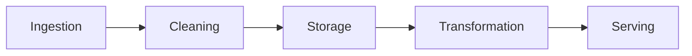
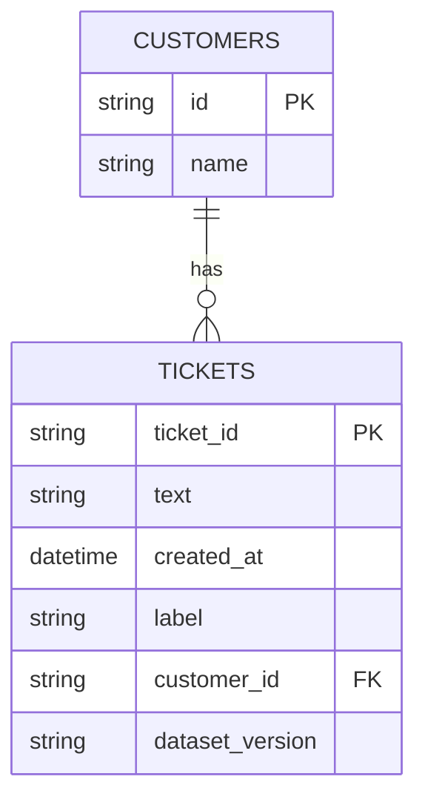

<!-- order: 17 -->
# AI Data Engineer: Hands-On Project Tutorials

This course is a series of hands-on projects. You learn each idea at the moment you need it, while building the thing.

Follow the projects in order. Each one hands off a skill or artifact to the next.


## Before you start: set up your notebook

This course runs in **Google Colab**, a free Jupyter notebook in your browser and the standard workspace for AI and data work. There's nothing to install.

1. Go to [colab.research.google.com](https://colab.research.google.com) and sign in with a Google account.
2. Give each project its own notebook: choose **File → New notebook**, then click the title at the top to rename it after the project.
3. Notebooks have two kinds of cells. **Code cells** run Python: type or paste code, then press **Shift + Enter**. **Text cells** hold your notes and written answers: choose **Insert → Text cell**.
4. Install libraries in a code cell with `%pip install ...`. The `%` form installs them into the notebook you're using.
5. Put each code block from a project in its own code cell, in order, and run them top to bottom. When a later step changes earlier code, edit that cell and run it again.
6. To use a file you downloaded, such as a CSV, drag it into the **Files** panel (the folder icon on the left). Files your code creates appear there too. Colab clears them when the session ends, so download anything you want to keep, or connect Google Drive from the same panel.

Prefer to work on your own computer? The same notebooks run in JupyterLab or in VS Code with the Jupyter extension.

---

## Project 1 (Module 1): Map a Data Pipeline for an AI Use Case

**Goal:** Before writing any code, learn to see data movement as a pipeline of stages, so every later project has a place to plug into.

**Step 1: Create the project notebook.**
Create a new notebook for this project (**File → New notebook**) and name it `data_pipeline_map_project`.

**Step 2: Define the AI use case.**
Add a **text cell** headed `use_case` and write your notes in it.
Write one sentence: what AI application will consume this data, and what does it need to work? Example: "A customer support chatbot needs cleaned, labeled support tickets to fine-tune on."

**Step 3: Identify the data source.**
A **data source** is where raw data originates, a database, an API, uploaded files, or a stream of events.

**Step 4: List the five pipeline stages.**
- **Ingestion**: pulling raw data from the source.
- **Cleaning**: fixing or removing bad data.
- **Storage**: where cleaned data lives.
- **Transformation**: turning raw data into a form a model can use (labels, embeddings).
- **Serving**: how the AI application actually accesses the final data.

**Step 5: Sketch data volume and frequency.**
Estimate: how much data, and how often does new data arrive (once, daily, continuously)?

**Step 6: Note data quality risks.**
List: what could be wrong with this data? (duplicates, missing fields, inconsistent formats, mislabeled examples)

**Step 7: The pipeline.**
Data flows through five stages, left to right:



### Final Project Structure
```text
data_pipeline_map_project/
│
├── use_case.md
├── pipeline_diagram.png
```

### What You Learned
- ✅ Defining an AI use case's data requirements
- ✅ Identifying data sources
- ✅ The five stages of a data pipeline
- ✅ Estimating data volume and frequency
- ✅ Anticipating data quality risks
- ✅ Turning a use case into a pipeline diagram

### Portfolio Project
**AI Data Pipeline Architecture Map**: Translated an AI application's data requirements into a five-stage pipeline diagram covering ingestion, cleaning, storage, transformation, and serving.
**Skills:** Data Architecture, Systems Thinking, Technical Documentation, AI Data Engineering.

**Deliverable:** A one-page data pipeline map for your example AI use case, covering source, stages, volume, and quality risks.

### Quiz

1. What are the five pipeline stages, in order?
2. What is the difference between the Cleaning stage and the Transformation stage?
3. Why estimate data volume and arrival frequency before building anything?
4. Give two data quality risks you might list for a support-ticket dataset.

*Answers: 1) Ingestion, Cleaning, Storage, Transformation, Serving. 2) Cleaning fixes or removes bad data; Transformation turns clean data into a form a model can use, such as labels or embeddings. 3) They decide how the pipeline must be built, for example a one-time script versus a daily or continuous job. 4) Any two of: duplicate tickets, missing fields, inconsistent formats, or mislabeled examples.*

---

## Project 2 (Module 2): Build a Data Cleaning Script

**Goal:** Get hands-on with real, messy data, the unavoidable first technical task in almost every AI data role.

**Step 1: Create the project notebook.**
Create a new notebook for this project (**File → New notebook**) and name it `data_cleaning_project`.
```python
%pip install pandas
```

**Step 2: Get a messy dataset.**
This cell builds a practice file, `raw_data.csv`, of 60 made-up customer support tickets with the problems real data has: missing values, inconsistent casing, stray spaces, a bad date, and duplicate rows. Later projects use this same file.
```python
import random
import pandas as pd

random.seed(0)  # same "random" data every time you run it
templates = {
    "billing": ["I was charged twice this month", "My invoice shows the wrong amount",
                "How do I get a refund?", "My card payment failed", "Why did my subscription price go up?"],
    "bug": ["The app crashes when I upload a photo", "The login button does nothing",
            "Search results never load", "The page freezes on checkout", "Notifications show the wrong date"],
}
messy_spellings = {"billing": ["billing", "Billing", " BILLING "], "bug": ["bug", "Bug ", "BUG"]}

rows = []
for i in range(1, 61):
    category = random.choice(["billing", "bug"])
    rows.append({
        "ticket_id": f"T{i:03d}",
        "text": f"  {random.choice(templates[category])} (ref {i})  ",
        "customer_email": f"User{i % 15}@Example.com ",
        "created_at": f"2026-09-{(i % 28) + 1:02d}",
        "category": random.choice(messy_spellings[category]),
    })
raw = pd.DataFrame(rows)

# Add realistic problems
raw.loc[[3, 17, 29], "text"] = None              # missing text (a field we can't work without)
raw.loc[[5, 22], "category"] = None              # missing category (a placeholder is fine)
raw.loc[8, "created_at"] = "not a date"          # a value that can't be parsed
raw.loc[12, "category"] = "feature request"      # a category later projects don't expect
raw = pd.concat([raw, raw.iloc[[0, 1, 2]]], ignore_index=True)  # 3 duplicate rows

raw.to_csv("raw_data.csv", index=False)
print(raw.shape)
```
Prefer real data? Use any CSV with similar problems and replace the column names in the steps below with your own.

**Step 3: Load and inspect the data.**
Add a **code cell**, paste in the code below, and run it with **Shift + Enter**.
```python
import pandas as pd
df = pd.read_csv("raw_data.csv")
print(df.shape)
print(df.isnull().sum())
print(df.duplicated().sum())
```
`.isnull().sum()` counts missing values per column; `.duplicated().sum()` counts exact duplicate rows.

**Step 4: Handle missing values.**
```python
df = df.dropna(subset=["text"])
df["category"] = df["category"].fillna("unknown")
```
**dropping** removes rows with missing data in columns you can't work without; **filling** replaces gaps in columns where a placeholder is acceptable.

**Step 5: Remove duplicates.**
```python
df = df.drop_duplicates()
```
Duplicate rows silently bias any model or statistic trained on this data toward whatever's overrepresented.

**Step 6: Standardize formats.**
```python
df["text"] = df["text"].str.strip()
df["customer_email"] = df["customer_email"].str.lower().str.strip()
df["category"] = df["category"].str.lower().str.strip()
df["created_at"] = pd.to_datetime(df["created_at"], errors="coerce")
print(df["category"].value_counts())
```
**standardizing** means forcing values into one consistent format (lowercase text, a single date format) so "Billing", "billing", and " BILLING " aren't treated as three different values. `errors="coerce"` turns dates that can't be read, like `"not a date"`, into `NaT` (pandas' "missing date") instead of crashing.

**Step 7: Validate the cleaned result.**
```python
assert df.isnull().sum()["text"] == 0
assert df.duplicated().sum() == 0
print("Cleaning validated.")
```
An **assertion** halts the script if a condition isn't met, a cheap, automatic sanity check.

**Step 8: Save the cleaned dataset.**
```python
df.to_csv("cleaned_data.csv", index=False)
```
Download `raw_data.csv` and `cleaned_data.csv` from the **Files** panel (right-click → **Download**). Projects 4, 5, and 7 use them.

### Final Project Structure
```text
data_cleaning_project/
│
├── raw_data.csv
├── clean_data.py
├── cleaned_data.csv
```

### What You Learned
- ✅ Diagnosing missing values and duplicates
- ✅ Deciding when to drop vs. fill missing data
- ✅ Removing duplicate rows
- ✅ Standardizing inconsistent formats
- ✅ Validating cleaning results with assertions
- ✅ Saving a cleaned dataset for downstream use

### Portfolio Project
**Data Cleaning Pipeline Script**: Built a reusable Python script that diagnoses, cleans, standardizes, and validates a messy real-world dataset, producing a verified clean output file.
**Skills:** Python, Pandas, Data Cleaning, Data Quality, AI Data Engineering.

**Deliverable:** A data cleaning script and a validated, cleaned CSV file.

### Quiz

1. When should you drop rows with missing values, and when should you fill them instead?
2. Why do duplicate rows matter for AI training data?
3. Why lowercase and strip values like "Billing" and " BILLING "?
4. What does `errors="coerce"` do in `pd.to_datetime`?
5. What does an `assert` do in a cleaning script?

*Answers: 1) Drop rows when a column you can't work without is missing (like the ticket text); fill when a placeholder such as "unknown" is acceptable (like the category). 2) They make some examples count more than once, which biases any model or statistic toward them. 3) So the same value written different ways is treated as one value instead of several. 4) It turns values that can't be read as dates into `NaT` (a missing date) instead of stopping with an error. 5) It stops the script with an error if a condition isn't true, an automatic check that cleaning worked.*

---

## Project 3 (Module 3): Design a Schema for a Training Dataset Store

**Goal:** Decide how cleaned data should be structured and stored, the step between "I have clean data" and "a model can reliably use this data."

**Step 1: Create the project notebook.**
Create a new notebook for this project (**File → New notebook**) and name it `schema_design_project`.

**Step 2: Identify your entities.**
An **entity** is a distinct "thing" your data describes, e.g., for a support-ticket dataset: `tickets`, `customers`, `labels`.

**Step 3: Define fields for each entity.**
Add a **text cell** headed `schema` and write your notes in it.
For each entity, list its fields and types: `ticket_id (string), text (string), created_at (datetime), label (string)`.

**Step 4: Define relationships between entities.**
A **foreign key** is a field in one table that references the identifier of another (e.g., `tickets.customer_id` points to `customers.id`).

**Step 5: Add versioning fields.**
Add `dataset_version` and `created_at` fields to your core table.
**dataset versioning** means every row (or dataset snapshot) can be traced to exactly when and how it was produced.

**Step 6: Write the schema as SQL.**
```sql
CREATE TABLE tickets (
    ticket_id TEXT PRIMARY KEY,
    text TEXT NOT NULL,
    created_at TIMESTAMP,
    label TEXT,
    dataset_version TEXT
);
```
`PRIMARY KEY` uniquely identifies each row; `NOT NULL` enforces that a field can't be left empty.

**Step 7: The schema.**
Your tables and their foreign-key relationship look like this:



### Final Project Structure
```text
schema_design_project/
│
├── schema.md
├── schema.sql
├── schema_diagram.png
```

### What You Learned
- ✅ Identifying entities in a dataset
- ✅ Defining fields and types
- ✅ Modeling relationships with foreign keys
- ✅ Adding dataset versioning for traceability
- ✅ Writing schema as executable SQL
- ✅ Diagramming a data model

### Portfolio Project
**Training Dataset Schema Design**: Designed a versioned, relational schema for a training dataset store, including entity relationships and executable SQL table definitions.
**Skills:** Database Design, SQL, Data Modeling, AI Data Engineering.

**Deliverable:** A schema document, SQL table definitions, and a diagram for your training dataset store.

### Quiz

1. What is an entity in a schema?
2. What does a foreign key such as `tickets.customer_id` do?
3. What do `PRIMARY KEY` and `NOT NULL` enforce?
4. Why add a `dataset_version` field to a training data table?

*Answers: 1) A distinct thing the data describes, such as tickets or customers, which usually becomes its own table. 2) It stores the id of a row in another table, linking each ticket to the customer it belongs to. 3) `PRIMARY KEY` makes each row's identifier unique; `NOT NULL` stops a field from being left empty. 4) So every row can be traced to when and how it was produced, which lets you reproduce or compare training runs.*

---

## Project 4 (Module 4): Build a Batch ETL Pipeline

**Goal:** Automate the move from raw data to stored data, connecting Project 2's cleaning and Project 3's schema into a repeatable process.

**Step 1: Create the project notebook.**
Create a new notebook for this project (**File → New notebook**) and name it `etl_pipeline_project`.
```python
%pip install pandas sqlalchemy
```
Upload `raw_data.csv` from Project 2 to the **Files** panel.

**Step 2: Understand ETL.**
**ETL** stands for **Extract** (pull raw data from a source), **Transform** (clean and reshape it), **Load** (write it into storage). **ELT** does the same steps in a different order, transforming after loading.

**Step 3: Write the Extract step.**
Add a **code cell**, paste in the code below, and run it with **Shift + Enter**.
```python
import pandas as pd

def extract(path):
    return pd.read_csv(path)
```

**Step 4: Write the Transform step.**
```python
def transform(df):
    df = df.dropna(subset=["text"]).drop_duplicates().copy()
    df["text"] = df["text"].str.strip()
    df["customer_email"] = df["customer_email"].str.lower().str.strip()
    df["category"] = df["category"].fillna("unknown").str.lower().str.strip()
    df["created_at"] = pd.to_datetime(df["created_at"], errors="coerce")
    return df
```
These are the same cleaning rules as Project 2, now packed into one function the pipeline can run on every new file. `.copy()` gives you a separate table to edit, which avoids a pandas warning.

**Step 5: Write the Load step.**
```python
from sqlalchemy import create_engine

def load(df, table_name, engine):
    df.to_sql(table_name, engine, if_exists="append", index=False)
```
`if_exists="append"` adds new rows without erasing existing ones, critical for a pipeline that runs repeatedly on new data.

**Step 6: Wire the three stages together.**
```python
def run_pipeline(path, table_name, engine):
    df = extract(path)
    df = transform(df)
    load(df, table_name, engine)
    print(f"Loaded {len(df)} rows into {table_name}")

engine = create_engine("sqlite:///data_store.db")
run_pipeline("raw_data.csv", "tickets", engine)
print(pd.read_sql("SELECT COUNT(*) AS row_count FROM tickets", engine))
```
SQLite stores the whole database in one file, `data_store.db`, so there's no server to set up.

**Step 7: Test with a second batch of data.**
This cell makes a small file representing "tomorrow's data" and runs the pipeline on it:
```python
new_batch = pd.DataFrame([
    {"ticket_id": "T101", "text": "I can't update my billing address", "customer_email": "Ada@Example.com",
     "created_at": "2026-10-01", "category": "Billing"},
    {"ticket_id": "T102", "text": "The export button downloads an empty file", "customer_email": "sam@example.com ",
     "created_at": "2026-10-01", "category": "bug"},
    {"ticket_id": "T103", "text": "Please cancel the extra charge on my account", "customer_email": "lee@example.com",
     "created_at": "2026-10-02", "category": " BILLING"},
])
new_batch.to_csv("new_data.csv", index=False)

run_pipeline("new_data.csv", "tickets", engine)
print(pd.read_sql("SELECT COUNT(*) AS row_count FROM tickets", engine))
```
The row count grows by 3. Notice what would happen if you ran `raw_data.csv` a second time: append mode would add every row again as duplicates. Real pipelines guard against this, for example by tracking which files were already loaded.

**Step 8: Add basic logging.**
Replace your `run_pipeline` cell with this version, which writes a line to `pipeline.log` every run:
```python
import logging

logging.basicConfig(filename="pipeline.log", level=logging.INFO,
                    format="%(asctime)s %(levelname)s %(message)s", force=True)

def run_pipeline(path, table_name, engine):
    df = extract(path)
    df = transform(df)
    load(df, table_name, engine)
    logging.info(f"Pipeline run completed: {len(df)} rows from {path} loaded into {table_name}.")
    print(f"Loaded {len(df)} rows into {table_name}")
```
Run it on a file once more (for example `new_data.csv`), then open `pipeline.log` from the **Files** panel. A log is a lasting record of every run, so you can see what happened even after the notebook output is gone. `force=True` replaces any logging setup Colab already has.

### Final Project Structure
```text
etl_pipeline_project/
│
├── etl.py
├── raw_data.csv
├── data_store.db
├── pipeline.log
```

### What You Learned
- ✅ The Extract, Transform, Load pattern
- ✅ Isolating pipeline stages into reusable functions
- ✅ Writing to a database with SQLAlchemy
- ✅ Appending vs. replacing data safely
- ✅ Testing pipeline repeatability across multiple runs
- ✅ Adding basic pipeline logging

### Portfolio Project
**Batch ETL Pipeline**: Built a reusable Extract-Transform-Load pipeline that ingests raw CSV data, applies cleaning logic, and loads it into a structured database, tested across multiple repeated runs.
**Skills:** Python, SQL, ETL/ELT, SQLAlchemy, Data Pipelines, AI Data Engineering.

**Deliverable:** A working ETL pipeline script that repeatably processes new data into a structured store.

### Quiz

1. What do the three letters in ETL stand for, and what does each stage do?
2. How is ELT different from ETL?
3. What does `if_exists="append"` do, and what is its risk if you load the same file twice?
4. Why split the pipeline into separate `extract`, `transform`, and `load` functions?
5. Why write a log file instead of only printing messages?

*Answers: 1) Extract pulls raw data from a source, Transform cleans and reshapes it, and Load writes it into storage. 2) ELT loads the raw data first and transforms it afterward, inside the storage system. 3) It adds new rows without erasing existing ones; loading the same file twice adds every row again as duplicates. 4) Each stage can be tested, reused, and changed on its own, and the same steps run the same way on every new file. 5) A log keeps a lasting record of each run that you can check later, even after the notebook output is gone.*

---

## Project 5 (Module 5): Prepare a Labeled Dataset for Training

**Goal:** Take cleaned, stored data (Project 4's output) and turn it into something a model can actually be trained on.

**Step 1: Create the project notebook.**
Create a new notebook for this project (**File → New notebook**) and name it `labeled_dataset_project`.
```python
%pip install pandas scikit-learn
```
Upload `cleaned_data.csv` from Project 2 to the **Files** panel.

**Step 2: Load your cleaned data.**
```python
import pandas as pd
df = pd.read_csv("cleaned_data.csv")
print(df.shape)
print(df["category"].value_counts())
```
This holds the same cleaned tickets your Project 4 pipeline loads into its database. (To read from the database instead, upload `data_store.db` and use `pd.read_sql("SELECT * FROM tickets", create_engine("sqlite:///data_store.db"))` after `from sqlalchemy import create_engine`.)

**Step 3: Define labeling criteria.**
Add a **text cell** headed `labeling_guide` and write your notes in it.
Write clear rules for what each label means, with 2–3 examples per label.

**Step 4: Apply labels.**
For a small dataset, label manually using your guide; for a larger one, use an existing labeled column or a simple rule-based heuristic as a starting point.
```python
df["label"] = df["category"].map({"billing": "billing_issue", "bug": "technical_issue"})

# Categories missing from the map (like "unknown" or "feature request") become NaN (empty).
unlabeled = df["label"].isna().sum()
print(f"Dropping {unlabeled} rows with no label")
df = df.dropna(subset=["label"])
```
`.map()` returns NaN for any value not in the dictionary. Those rows must be removed (or labeled by hand) before splitting, because the split in Step 6 can't handle missing labels.

**Step 5: Check label distribution.**
```python
print(df["label"].value_counts())
```
**class imbalance** here means some labels have far fewer examples than others. Each label also needs enough examples (at least about 10) for the stratified split in Step 6 to work; with too few, scikit-learn stops with an error saying a class has too few members.

**Step 6: Split into train, validation, and test sets.**
```python
from sklearn.model_selection import train_test_split
train, temp = train_test_split(df, test_size=0.3, random_state=42, stratify=df["label"])
val, test = train_test_split(temp, test_size=0.5, random_state=42, stratify=temp["label"])
print(len(train), len(val), len(test))
```
This gives about 70% train, 15% validation, and 15% test.
`stratify` ensures each split has roughly the same label distribution as the full dataset. A **validation set** is used during model development; a **test set** is held back until final evaluation only.

**Step 7: Check for data leakage.**
**data leakage** happens when information from the test set (or future data) accidentally influences training, e.g., duplicate rows across splits, or a feature that encodes the label indirectly.
```python
id_overlap = set(train["ticket_id"]) & set(test["ticket_id"])
text_overlap = set(train["text"]) & set(test["text"])
assert len(id_overlap) == 0, "Leakage: the same ticket_id is in train and test!"
assert len(text_overlap) == 0, "Leakage: the same ticket text is in train and test!"
print("No leakage found between train and test.")
```
Checking the text as well as the id catches the same ticket saved twice under different ids.

**Step 8: Save the final labeled splits.**
```python
train.to_csv("train.csv", index=False)
val.to_csv("val.csv", index=False)
test.to_csv("test.csv", index=False)
```

### Final Project Structure
```text
labeled_dataset_project/
│
├── labeling_guide.md
├── prepare_labels.py
├── train.csv
├── val.csv
├── test.csv
```

### What You Learned
- ✅ Writing clear labeling criteria
- ✅ Applying labels consistently
- ✅ Detecting class imbalance in labeled data
- ✅ Splitting data into train/validation/test with stratification
- ✅ Detecting and preventing data leakage
- ✅ Producing model-ready labeled datasets

### Portfolio Project
**Labeled Training Dataset Preparation**: Defined labeling criteria, applied labels to a cleaned dataset, checked for class imbalance and data leakage, and produced stratified train/validation/test splits.
**Skills:** Data Labeling, Scikit-learn, Data Quality, ML Data Preparation, AI Data Engineering.

**Deliverable:** A labeling guide plus stratified, leakage-checked train/validation/test CSV files.

### Quiz

1. What happens to a category that isn't in the dictionary you pass to `.map()`, and how do you handle it?
2. What does `stratify` do when splitting data?
3. What is the difference between a validation set and a test set?
4. What is data leakage? Give one example.

*Answers: 1) It becomes NaN (no label); drop those rows with `dropna(subset=["label"])` or label them by hand before splitting. 2) It keeps the label proportions in each split roughly the same as in the full dataset. 3) The validation set is used while developing the model; the test set is held back and used only for the final evaluation. 4) It is when information from the test set or the future influences training, for example the same ticket appearing in both train and test.*

---

## Project 6 (Module 6): Build a Vector Store from a Document Set

**Goal:** Extend your data engineering skills to unstructured text and the retrieval systems behind modern AI applications like RAG chatbots.

**Step 1: Create the project notebook.**
Create a new notebook for this project (**File → New notebook**) and name it `vector_store_project`.
```python
%pip install sentence-transformers chromadb
```

**Step 2: Gather a document set.**
Collect 10–20 text documents (articles, FAQs, or paragraphs) and save each as a `.txt` file. In the **Files** panel, create a folder named `documents` (right-click → **New folder**) and upload the files into it.

**Step 3: Chunk the documents.**
Add a **code cell**, paste in the code below, and run it with **Shift + Enter**.
```python
def chunk_text(text, chunk_size=200, overlap=50):
    words = text.split()
    chunks = []
    for i in range(0, len(words), chunk_size - overlap):
        chunks.append(" ".join(words[i:i + chunk_size]))
        if i + chunk_size >= len(words):  # this chunk reached the end of the text
            break
    return chunks
```
**chunking** splits long documents into smaller pieces; **overlap** repeats a few words between chunks so context isn't lost at the boundary. With these settings, each new chunk starts 150 words after the previous one.

Now load every file in the folder and chunk it, keeping track of which file each chunk came from:
```python
import os

chunks = []         # the text of every chunk, from every document
chunk_sources = []  # the file name each chunk came from
for filename in sorted(os.listdir("documents")):
    if not filename.endswith(".txt"):
        continue
    with open(os.path.join("documents", filename), encoding="utf-8") as f:
        text = f.read()
    for chunk in chunk_text(text):
        chunks.append(chunk)
        chunk_sources.append(filename)

print(f"{len(chunks)} chunks from {len(set(chunk_sources))} documents")
print(chunks[0][:200])
```
```python
from sentence_transformers import SentenceTransformer
model = SentenceTransformer("all-MiniLM-L6-v2")
embeddings = model.encode(chunks)
```
An **embedding** is a list of numbers representing a chunk's meaning, texts with similar meaning end up with mathematically similar embeddings.

**Step 5: Store embeddings in a vector database.**
```python
import chromadb
client = chromadb.Client()
collection = client.get_or_create_collection("documents")

collection.add(
    documents=chunks,
    embeddings=embeddings.tolist(),
    ids=[f"chunk_{i}" for i in range(len(chunks))],
    metadatas=[{"source": name} for name in chunk_sources],
)
print(collection.count(), "chunks stored")
```
A **vector database** stores embeddings and is optimized to quickly find the closest matches to a new query embedding. The `source` metadata records which file each chunk came from. `get_or_create_collection` lets you rerun the cell without an "already exists" error; if you change your documents, restart the runtime first so old chunks don't stay in the collection.

**Step 6: Query the vector store.**
```python
query = "How do I reset my password?"  # change this to fit your documents
query_embedding = model.encode([query])
results = collection.query(query_embeddings=query_embedding.tolist(), n_results=3)
for document, metadata, distance in zip(results["documents"][0], results["metadatas"][0], results["distances"][0]):
    print(f"{metadata['source']} (distance {distance:.3f}): {document[:150]}")
```
A smaller **distance** means a closer match in meaning.

**Step 7: Evaluate retrieval quality.**
Try 5 different queries and manually judge whether the top results are actually relevant.

**Step 8: Document your chunking and embedding choices.**
Add a **text cell** headed `vector_store_notes` and write your notes in it.
Record chunk size, overlap, embedding model used, and your retrieval evaluation results.

### Final Project Structure
```text
vector_store_project/
│
├── documents/
├── build_vector_store.py
├── vector_store_notes.md
```

### What You Learned
- ✅ Chunking long text into retrievable pieces
- ✅ Generating embeddings for semantic meaning
- ✅ Storing and querying a vector database
- ✅ Retrieving results by meaning, not just keywords
- ✅ Evaluating retrieval quality manually
- ✅ Documenting chunking and embedding decisions

### Portfolio Project
**Document Vector Store for Semantic Search**: Built a chunking and embedding pipeline over a real document set, stored it in a vector database, and evaluated retrieval quality across multiple queries.
**Skills:** Embeddings, Vector Databases, RAG Foundations, Python, AI Data Engineering.

**Deliverable:** A working vector store built from a real document set, with a retrieval evaluation.

### Quiz

1. Why split documents into chunks before embedding them?
2. What does the overlap between chunks prevent?
3. What is an embedding?
4. Why must the query be embedded with the same model as the chunks?
5. Why store the source file name as metadata with each chunk?

*Answers: 1) Smaller pieces can be matched to a question more precisely, and embedding models only read a limited amount of text at once. 2) It keeps an idea that falls on a chunk boundary from being cut in half and losing its context. 3) A list of numbers that represents a text's meaning, so texts with similar meaning get similar numbers. 4) Embeddings from different models live in different number spaces and can't be compared meaningfully. 5) So each search result can point back to the document it came from, for checking or citing.*

---

## Project 7 (Module 7): Build a Data Validation and Monitoring Check

**Goal:** Add quality control on top of your pipeline, so bad data gets caught automatically instead of silently poisoning downstream models.

**Step 1: Create the project notebook.**
Create a new notebook for this project (**File → New notebook**) and name it `data_validation_project`.
```python
%pip install pandas sqlalchemy
```
Upload `raw_data.csv` and `cleaned_data.csv` from Project 2 and `new_data.csv` from Project 4 to the **Files** panel. Then paste and run your Project 4 cells that define `extract`, `transform`, and `load` (Steps 3–5).

**Step 2: Define validation rules from what you already know.**
Add a **text cell** headed `validation_rules` and write your notes in it.
Using your Project 3 schema and Project 2's cleaning checks, list rules: required fields, expected types, acceptable value ranges.

**Step 3: Implement schema validation.**
Add a **code cell**, paste in the code below, and run it with **Shift + Enter**.
```python
import pandas as pd

REQUIRED_COLUMNS = ["ticket_id", "text", "customer_email", "created_at", "category"]

def validate_schema(df, required_columns):
    missing = set(required_columns) - set(df.columns)
    assert not missing, f"Missing columns: {missing}"
```
This runs on the raw file, before any cleaning, so a file with the wrong shape is rejected right away.

**Step 4: Implement value range checks.**
```python
ALLOWED_CATEGORIES = {"billing", "bug", "unknown"}

def validate_ranges(df):
    problems = []
    bad_dates = df["created_at"].isnull().sum()
    if bad_dates:
        problems.append(f"{bad_dates} rows have a missing or invalid created_at")
    if (df["text"].str.len() == 0).any():
        problems.append("Some tickets have empty text")
    unexpected = set(df["category"]) - ALLOWED_CATEGORIES
    if unexpected:
        problems.append(f"Unexpected category values: {unexpected}")
    assert not problems, "; ".join(problems)
```
This runs on the cleaned data, after `transform`. It collects every problem first, so one run tells you everything that's wrong instead of stopping at the first issue.

**Step 5: Understand data drift.**
**data drift** is when the statistical properties of incoming data change over time (e.g., average text length doubles, or a new label category starts appearing) even though the schema still technically validates.

**Step 6: Implement a simple drift check.**
```python
def check_drift(df, baseline_mean, baseline_std, column, threshold=3):
    current_mean = df[column].mean()
    z_score = abs(current_mean - baseline_mean) / baseline_std
    if z_score > threshold:
        print(f"WARNING: Possible drift detected in {column} (z-score {z_score:.1f})")
    else:
        print(f"No drift detected in {column} (z-score {z_score:.1f})")

# Baseline: ticket text length in data you already trust
baseline = pd.read_csv("cleaned_data.csv")
baseline_lengths = baseline["text"].str.len()

# Today's batch
new_df = transform(extract("new_data.csv"))
new_df["text_length"] = new_df["text"].str.len()
check_drift(new_df, baseline_lengths.mean(), baseline_lengths.std(), "text_length")
```
This compares today's average against a saved baseline, a large deviation (measured in standard deviations) flags a possible shift. It's a simple rule of thumb, not a full statistical test, but it catches big changes cheaply.

**Step 7: Wire validation into your Project 4 pipeline.**
```python
from sqlalchemy import create_engine

def run_pipeline_with_validation(path, table_name, engine):
    df = extract(path)
    validate_schema(df, REQUIRED_COLUMNS)
    df = transform(df)
    validate_ranges(df)
    load(df, table_name, engine)
    print(f"Validated and loaded {len(df)} rows from {path}")

engine = create_engine("sqlite:///data_store.db")
run_pipeline_with_validation("new_data.csv", "tickets", engine)
```
Validation runs *before* `load`, so bad data never reaches the database.

**Step 8: Test it against intentionally broken data.**
First make a deliberately bad CSV with a missing column and an invalid category, and confirm the pipeline stops with a clear error:
```python
broken = pd.read_csv("new_data.csv").drop(columns=["created_at"])
broken.loc[0, "category"] = "spam"
broken.to_csv("broken_test_data.csv", index=False)

try:
    run_pipeline_with_validation("broken_test_data.csv", "tickets", engine)
except AssertionError as error:
    print("Pipeline stopped:", error)
```
You should see `Pipeline stopped: Missing columns: {'created_at'}`. Now try the original messy `raw_data.csv`:
```python
try:
    run_pipeline_with_validation("raw_data.csv", "tickets", engine)
except AssertionError as error:
    print("Pipeline stopped:", error)
```
It stops too, naming the invalid date and the unexpected `feature request` category from Project 2. Decide what the right fix is (update `ALLOWED_CATEGORIES`, or drop or relabel those rows in `transform`) and write your decision in the `validation_rules` cell.

### Final Project Structure
```text
data_validation_project/
│
├── validation_rules.md
├── validate.py
├── broken_test_data.csv
```

### What You Learned
- ✅ Turning implicit assumptions into explicit validation rules
- ✅ Schema validation (required columns, types)
- ✅ Value range and category validation
- ✅ Understanding data drift vs. schema violations
- ✅ Implementing a simple statistical drift check
- ✅ Wiring validation into a real pipeline and testing it against bad data

### Portfolio Project
**Data Pipeline Validation & Monitoring**: Built and tested schema validation, value range checks, and a statistical drift detector, integrated directly into a working ETL pipeline.
**Skills:** Data Quality Engineering, Data Validation, Statistical Monitoring, Python, AI Data Engineering.

**Deliverable:** A validation module wired into your pipeline, tested against intentionally broken data.

### Quiz

1. Why validate the schema before transforming the data, and the value ranges after?
2. What is data drift, and how is it different from a schema violation?
3. How does the simple drift check decide whether to warn?
4. Why does validation run before the load step?

*Answers: 1) The schema check confirms the raw file has the columns the transform needs; the range checks test the cleaned values the database will actually receive. 2) Drift is a change in the data's statistics over time, such as average text length doubling, while the columns and types still pass; a schema violation is a missing column or wrong structure. 3) It measures how many baseline standard deviations today's average is from the baseline average, and warns when that z-score is above the threshold of 3. 4) So bad data is stopped before it ever reaches the database and the models trained from it.*
