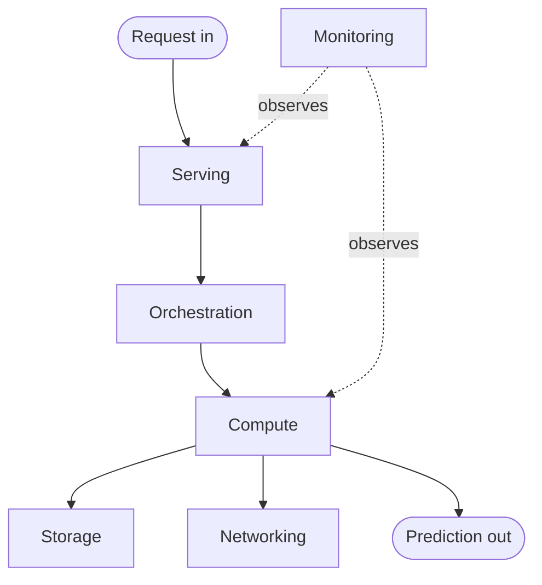

<!-- order: 25 -->
# AI Infrastructure Engineer: Hands-On Project Tutorials

This course is a series of hands-on projects. You learn each idea at the moment you need it, while building the thing.

**By the end of this course, you'll be able to:**
- Map the layers of an AI infrastructure stack and choose compute, storage, networking, and orchestration options
- Write Bash scripts that monitor CPU, memory, disk, and network, with alerts, logs, and a cron schedule
- Create a cloud VM, open a port safely, deploy a service to it, and shut it down to control cost
- Package a service as a Docker image, push it to a registry, and run it on a server
- Benchmark latency, throughput, and cost per 1,000 requests across two machine types
- Deploy a model API on Kubernetes with autoscaling and verify it scales under load
- Instrument a model API with Prometheus metrics, graph request rate, p95 latency, and errors in Grafana, and fire alert rules, all running locally with Docker Compose

Follow the projects in order. Each one hands off a skill or artifact to the next.


## Before you start: your terminal

**Time: about 15 minutes**

Unlike the other AI courses, this one works in a **terminal** on purpose: infrastructure is built, deployed, and monitored from the command line, so practising there is part of the skill. None of these projects run in Google Colab. You work in files and a terminal.

**Which terminal to use.** The commands in this course are Linux commands. Use one of these:
- **Linux**, or **WSL** on Windows (open PowerShell as administrator, run `wsl --install`, restart, then use the Ubuntu terminal).
- **[Google Cloud Shell](https://shell.cloud.google.com)**: a free Linux terminal in your browser, with Docker and the `gcloud` tool already installed.
- **Terminal on a Mac** works for most projects, but some Linux commands in Project 2 (`top -bn1`, `free`, `ss`) don't exist on macOS. Mac users should do Project 2 in Cloud Shell (Project 2 lists Mac equivalents too).

**Where each project runs:**

| Project | Where it runs | Cost |
|---|---|---|
| 1. Stack map | Anywhere (planning documents) | Free |
| 2. Monitoring scripts | Linux, WSL, or Cloud Shell | Free |
| 3. Cloud instance | Cloud Shell, creating a Google Cloud VM | Free tier VM; small charges possible |
| 4. Containers | Your computer with Docker (or Cloud Shell), plus the Project 3 VM | Free tier VM; small charges possible |
| 5. Benchmarking | Your computer or Cloud Shell, plus cloud VMs | A few cents for a short-lived second VM |
| 6. Autoscaling | Your computer: Docker plus a local Kubernetes cluster (kind) | Free |
| 7. Monitoring and alerting | Your computer with Docker (Docker Compose: the API, Prometheus, and Grafana) | Free |

**Cloud costs.** Projects 3 to 5 create real cloud resources, which can cost money. Google Cloud needs a billing account even for free-tier use. Before Project 3, set a **budget alert** (Google Cloud console → **Billing → Budgets & alerts**, for example $5), and always do each project's shutdown step when you finish.

---

## Project 1 (Module 1): Map the Infrastructure Stack for an AI System

**Time: about 1.5 hours**

**Goal:** Before deploying anything, learn to see an AI system as a stack of layers, so every later project has a place to plug into.

**Step 1: Set up a project folder for your planning docs.**

```bash
mkdir infra_stack_project
cd infra_stack_project
```

**Step 2: Define what the system needs to do.**
Write one sentence in a file named `requirements.md`: what model are you serving, and who's using it? Example: "Serve an image-classification model to a mobile app, expecting 50 requests per second."

**Step 3: Understand the two infrastructure modes: training vs. inference.**
*Training* is the (usually one-time or periodic) process of teaching a model from data, heavy, GPU-hungry, can take hours. *Inference* is running the trained model to get predictions, lighter per-request, but needs to happen fast and often.

**Step 4: List the six core layers of an AI infrastructure stack.**
- **Compute**: the machines (CPU/GPU) that run your code.
- **Storage**: where your model files and data live.
- **Networking**: how requests reach your service.
- **Containerization/Orchestration**: how your app is packaged and kept running.
- **Serving**: the layer that turns "a model file" into "an API you can call."
- **Monitoring/Observability**: how you know it's working.

**Step 5: Choose compute type for your example system.**
Learn the difference: **CPU** (general-purpose, cheap, fine for small/light models), **GPU** (parallel processing, needed for large deep learning models), **hardware accelerator** (any specialized chip, GPU, TPU, built for ML math).

**Step 6: Choose a storage approach.**
**object storage** (e.g., a bucket-style store for large files like model weights), **model registry** (a versioned catalog of trained models, so you always know which version is live).

**Step 7: Choose a networking approach.**
**API gateway** (a front door that routes external requests to the right internal service), **load balancer** (spreads incoming traffic across multiple copies of your service so no single machine gets overwhelmed).

**Step 8: Choose an orchestration approach.**
**container** (a lightweight, self-contained package of your app plus everything it needs to run), **orchestrator** (a system, like Kubernetes, that starts, stops, and scales containers automatically).

**Step 9: The infrastructure stack.**
A request enters at the serving layer and a prediction flows back out, with every layer watched by monitoring:



### Final Project Structure

```text
infra_stack_project/
│
├── requirements.md
├── stack_diagram.png
```

### What You Learned
- ✅ Training vs. inference infrastructure
- ✅ The six core layers of an AI infrastructure stack
- ✅ Compute type tradeoffs (CPU vs. GPU vs. accelerator)
- ✅ Storage concepts (object storage, model registry)
- ✅ Networking concepts (API gateway, load balancer)
- ✅ Orchestration concepts (container, orchestrator)
- ✅ Turning requirements into an architecture diagram

### Portfolio Project
**AI System Infrastructure Stack Map**: Translated a business requirement into a labeled, six-layer infrastructure architecture diagram covering compute, storage, networking, orchestration, serving, and monitoring.
**Skills:** Systems Thinking, Cloud Architecture Fundamentals, Technical Documentation, AI Infrastructure.

**Deliverable:** A one-page infrastructure stack map for your example AI system, labeled with your choices from Steps 5–8.

### Quiz

1. What is the difference between training and inference infrastructure needs?
2. When does a model need a GPU rather than a CPU?
3. What does a load balancer do?
4. What is the difference between a container and an orchestrator?

*Answers: 1) Training is heavy, GPU-hungry, and happens occasionally; inference is lighter per request but must be fast and happen often. 2) When it's a large deep learning model whose math benefits from many calculations in parallel; small, light models run fine on CPUs. 3) It spreads incoming traffic across several copies of a service so no single machine is overwhelmed. 4) A container is one packaged app with everything it needs; an orchestrator such as Kubernetes starts, stops, and scales many containers automatically.*

```watch
{
 "scenes": [
  {
   "kind": "title",
   "art": "layers",
   "kicker": "Project 1 · The infrastructure stack",
   "title": "See the system as layers",
   "beats": [
    {
     "say": "Welcome to A I Infrastructure Engineer."
    },
    {
     "say": "Before deploying anything, you'll learn to see an A I system as a stack of layers, so every later project has a place to plug into."
    }
   ]
  },
  {
   "kind": "table",
   "kicker": "Step 3",
   "title": "Training versus inference",
   "columns": [
    "",
    "Training",
    "Inference"
   ],
   "rows": [
    [
     "Job",
     "Teach model from data",
     "Run model, predict"
    ],
    [
     "Load",
     "Heavy, GPU-hungry",
     "Light per request"
    ],
    [
     "How often",
     "Once or now and then",
     "Fast, and very often"
    ]
   ],
   "beats": [
    {
     "say": "Infrastructure works in two modes. Training on one side, inference on the other.",
     "col": 0
    },
    {
     "say": "Training teaches a model from data. Inference runs the trained model to get predictions.",
     "hl": 0,
     "dim": true
    },
    {
     "say": "Training is heavy and hungry for G P Us, and can take hours. Inference is light for each single request.",
     "hl": 1,
     "dim": true
    },
    {
     "say": "But training happens once, or now and then, while inference must be fast and happen all the time.",
     "hl": 2,
     "dim": true
    },
    {
     "say": "Your example system, an image classifier serving a mobile app at fifty requests per second, is an inference system.",
     "col": 2
    }
   ]
  },
  {
   "kind": "table",
   "kicker": "Step 4",
   "title": "Six core layers",
   "columns": [
    "Layer",
    "Its job"
   ],
   "rows": [
    [
     "Compute",
     "Machines that run code"
    ],
    [
     "Storage",
     "Model files and data"
    ],
    [
     "Networking",
     "How requests arrive"
    ],
    [
     "Orchestration",
     "Package, keep running"
    ],
    [
     "Serving",
     "Model file → API"
    ],
    [
     "Monitoring",
     "Is it working?"
    ]
   ],
   "beats": [
    {
     "say": "Every A I system sits on six core layers."
    },
    {
     "say": "Compute: the C P U and G P U machines that run your code.",
     "hl": 0,
     "dim": true
    },
    {
     "say": "Storage: where your model files and data live.",
     "hl": 1,
     "dim": true
    },
    {
     "say": "Networking: how requests reach your service.",
     "hl": 2,
     "dim": true
    },
    {
     "say": "Orchestration: how your app is packaged and kept running.",
     "hl": 3,
     "dim": true
    },
    {
     "say": "Serving turns a model file into an A P I you can call.",
     "hl": 4,
     "dim": true
    },
    {
     "say": "And monitoring is how you know it's all working.",
     "hl": 5,
     "dim": true
    }
   ]
  },
  {
   "kind": "table",
   "kicker": "Step 5",
   "title": "Choose your compute",
   "columns": [
    "Type",
    "Strength",
    "Good for"
   ],
   "rows": [
    [
     "CPU",
     "General-purpose, cheap",
     "Small, light models"
    ],
    [
     "GPU",
     "Parallel processing",
     "Large deep learning"
    ],
    [
     "Accelerator",
     "Chip built for ML math",
     "e.g. GPU, TPU"
    ]
   ],
   "beats": [
    {
     "say": "Step five: choose the compute type."
    },
    {
     "say": "A C P U is general purpose and cheap. Small, light models run fine on it.",
     "hl": 0,
     "dim": true
    },
    {
     "say": "A G P U does many calculations in parallel, which large deep learning models need.",
     "hl": 1,
     "dim": true
    },
    {
     "say": "And accelerator is the word for any chip built for machine learning maths, like a G P U or a T P U.",
     "hl": 2,
     "dim": true
    }
   ]
  },
  {
   "kind": "array",
   "kicker": "Step 6",
   "title": "Storage: weights in a bucket, versions in a registry",
   "values": [
    "model v1",
    "model v2",
    "model v3"
   ],
   "beats": [
    {
     "say": "Big files like model weights go in object storage, a bucket-style store.",
     "note": "weights → object storage"
    },
    {
     "say": "A model registry is a versioned catalog of every model you've trained.",
     "hl": [
      0,
      1,
      2
     ],
     "note": "model registry"
    },
    {
     "say": "It marks which version is live, so you always know what's answering requests. Here, version two.",
     "ptr": {
      "live": 1
     },
     "note": "v2 is live"
    },
    {
     "say": "When version three is deployed, the registry records the change.",
     "ptr": {
      "live": 2
     },
     "ok": [
      0,
      1
     ],
     "note": "v3 is live"
    }
   ]
  },
  {
   "kind": "diagram",
   "kicker": "Steps 7 and 8",
   "title": "Networking and orchestration in action",
   "nodes": [
    {
     "id": "app",
     "label": "Mobile app",
     "x": 10,
     "y": 30,
     "sub": "50 requests/sec",
     "art": "phone"
    },
    {
     "id": "gw",
     "label": "API gateway",
     "x": 32,
     "y": 70,
     "sub": "the front door",
     "art": "globe"
    },
    {
     "id": "lb",
     "label": "Load balancer",
     "x": 56,
     "y": 40,
     "sub": "spreads traffic",
     "art": "router"
    },
    {
     "id": "c1",
     "label": "Container 1",
     "x": 88,
     "y": 15,
     "sub": "your app",
     "art": "container"
    },
    {
     "id": "c2",
     "label": "Container 2",
     "x": 88,
     "y": 50,
     "sub": "your app",
     "art": "container"
    },
    {
     "id": "c3",
     "label": "Container 3",
     "x": 88,
     "y": 85,
     "sub": "your app",
     "art": "container"
    }
   ],
   "edges": [
    {
     "from": "app",
     "to": "gw"
    },
    {
     "from": "gw",
     "to": "lb"
    },
    {
     "from": "lb",
     "to": "c1"
    },
    {
     "from": "lb",
     "to": "c2"
    },
    {
     "from": "lb",
     "to": "c3"
    }
   ],
   "beats": [
    {
     "say": "Here's the networking layer, and the containers behind it.",
     "show": 6
    },
    {
     "say": "A request from the mobile app arrives at the A P I gateway, the front door.",
     "on": "gw",
     "send": {
      "from": "app",
      "to": "gw",
      "label": "request"
     }
    },
    {
     "say": "The gateway routes it to the right internal service, here, through a load balancer.",
     "on": "lb",
     "send": {
      "from": "gw",
      "to": "lb",
      "label": "request"
     }
    },
    {
     "say": "The load balancer sends the first request to copy one.",
     "on": "c1",
     "send": {
      "from": "lb",
      "to": "c1",
      "label": "request 1"
     }
    },
    {
     "say": "The next goes to copy two, and the one after to copy three, so no single machine is overwhelmed.",
     "on": [
      "c2",
      "c3"
     ],
     "send": {
      "from": "lb",
      "to": "c3",
      "label": "request 3"
     }
    },
    {
     "say": "Each copy is a container, a self-contained package of your app. An orchestrator like Kubernetes starts, stops and scales them.",
     "on": [
      "c1",
      "c2",
      "c3"
     ]
    }
   ]
  },
  {
   "kind": "diagram",
   "kicker": "Step 9",
   "title": "Follow one request through the stack",
   "nodes": [
    {
     "id": "app",
     "label": "Request in",
     "x": 10,
     "y": 30,
     "sub": "from the app",
     "art": "phone"
    },
    {
     "id": "srv",
     "label": "Serving",
     "x": 38,
     "y": 30,
     "sub": "model → API",
     "art": "api"
    },
    {
     "id": "orch",
     "label": "Orchestration",
     "x": 66,
     "y": 30,
     "sub": "Kubernetes",
     "art": "boxes"
    },
    {
     "id": "cmp",
     "label": "Compute",
     "x": 66,
     "y": 75,
     "sub": "CPU or GPU",
     "art": "chip"
    },
    {
     "id": "stor",
     "label": "Storage",
     "x": 92,
     "y": 75,
     "sub": "model weights",
     "art": "database"
    },
    {
     "id": "mon",
     "label": "Monitoring",
     "x": 30,
     "y": 75,
     "sub": "watches it all",
     "art": "eye"
    }
   ],
   "edges": [
    {
     "from": "app",
     "to": "srv"
    },
    {
     "from": "srv",
     "to": "orch"
    },
    {
     "from": "orch",
     "to": "cmp"
    },
    {
     "from": "cmp",
     "to": "stor"
    },
    {
     "from": "cmp",
     "to": "app"
    },
    {
     "from": "mon",
     "to": "srv"
    },
    {
     "from": "mon",
     "to": "cmp"
    }
   ],
   "beats": [
    {
     "say": "Now put it together, and follow one request.",
     "show": 5
    },
    {
     "say": "A request enters at the serving layer.",
     "on": "srv",
     "send": {
      "from": "app",
      "to": "srv",
      "label": "image"
     }
    },
    {
     "say": "Orchestration hands it to a running copy on the compute layer.",
     "on": [
      "orch",
      "cmp"
     ],
     "send": {
      "from": "orch",
      "to": "cmp",
      "label": "image"
     }
    },
    {
     "say": "Compute uses the model it loaded from storage.",
     "on": [
      "cmp",
      "stor"
     ],
     "send": {
      "from": "stor",
      "to": "cmp",
      "label": "weights"
     }
    },
    {
     "say": "And the prediction flows back out.",
     "on": "app",
     "send": {
      "from": "cmp",
      "to": "app",
      "label": "prediction"
     }
    },
    {
     "say": "All the while, monitoring watches serving and compute, so you know it's working.",
     "show": 6,
     "on": "mon",
     "send": {
      "from": "srv",
      "to": "mon",
      "label": "observes"
     }
    }
   ]
  },
  {
   "kind": "quiz",
   "art": "ask",
   "kicker": "Quick check",
   "title": "What does a load balancer do?",
   "options": [
    "Spreads incoming traffic across several copies of a service",
    "Stores model weights in a bucket",
    "Teaches the model from new data"
   ],
   "answer": 0,
   "good": "That's right. It spreads incoming traffic across several copies of a service, so no single machine is overwhelmed.",
   "bad": "Not quite. It spreads incoming traffic across several copies of a service, so no single machine is overwhelmed.",
   "beats": [
    {
     "say": "Quick check.",
     "show": 0
    },
    {
     "say": "What does a load balancer do?",
     "show": 0
    },
    {
     "say": "Tap your answer.",
     "show": 1
    }
   ]
  },
  {
   "kind": "list",
   "art": "proof",
   "kicker": "Checkpoint",
   "title": "You're done when",
   "items": [
    [
     "A one-page stack map",
     ""
    ],
    [
     "Labeled with your choices",
     ""
    ]
   ],
   "beats": [
    {
     "say": "That's Project 1.",
     "show": 0
    },
    {
     "say": "You're done when:",
     "show": 0
    },
    {
     "say": "you have a one-page infrastructure stack map for your example system,",
     "show": 1
    },
    {
     "say": "labeled with your compute, storage, networking and orchestration choices.",
     "show": 2
    },
    {
     "say": "Next, in Module 2, shell scripts that monitor a machine.",
     "show": 2
    }
   ]
  }
 ]
}
```

---

## Project 2 (Module 2): Write Shell Scripts to Monitor System Resources

**Time: about 3 hours**

**Goal:** See what a machine is doing under the hood, the skill every later deployment and monitoring project depends on.

**Where this runs:** a Linux terminal, WSL, or Google Cloud Shell. The scripts use Linux-only commands. On a Mac, use Cloud Shell for this project; if you want to try the commands on your Mac anyway, the equivalents are `top -l 1 | grep "CPU usage"` (instead of `top -bn1`), `vm_stat` (instead of `free`), and `netstat -an | grep LISTEN` (instead of `ss -tulwn`).

**Step 1: Open a terminal and confirm you're in a shell.**
A **shell** is a program that takes typed commands and runs them on the machine (e.g., `bash`). A **command** is a single instruction to the operating system (e.g., "show me my files," "tell me where I am"). A **script** is a saved file of commands the computer runs automatically, instead of you typing them one by one every time.

**Step 2: Set up a project folder.**

```bash
pwd
mkdir monitoring_project
cd monitoring_project
pwd
```

`pwd` (print working directory) shows where you are; `mkdir` creates a folder; `cd` moves into it.

**Step 3: Write and run your first script.**

```bash
nano hello.sh
```

Paste:

```bash
#!/bin/bash
echo "Hello AI Infrastructure Engineer!"
```

Save, then make it runnable and run it:

```bash
chmod +x hello.sh
./hello.sh
```

`#!/bin/bash` is a **shebang**: it tells Linux which program should execute this file. `chmod +x` grants the file **execute permission**, without which Linux refuses to run it as a program.

**Step 4: Build a standalone CPU monitor.**

```bash
nano cpu_monitor.sh
```

```bash
#!/bin/bash
CPU=$(top -bn1 | grep "Cpu(s)" | awk '{print $2}')
echo "CPU Usage: $CPU%"
```

```bash
chmod +x cpu_monitor.sh
./cpu_monitor.sh
```

**CPU utilization** is the percentage of processing capacity currently in use; `top -bn1` takes a single, non-interactive snapshot instead of the live-updating view.

**Step 5: Build a standalone memory monitor.**

```bash
nano memory_monitor.sh
```

```bash
#!/bin/bash
MEMORY=$(free | awk '/Mem:/ {printf("%.2f"), $3/$2 * 100}')
echo "Memory Usage: $MEMORY%"
```

```bash
chmod +x memory_monitor.sh
./memory_monitor.sh
```

**RAM** is short-term working memory; when it fills up, the system slows dramatically or crashes the process (an **out-of-memory / OOM error**).

**Step 6: Build a standalone disk monitor.**

```bash
nano disk_monitor.sh
```

```bash
#!/bin/bash
DISK=$(df / | tail -1 | awk '{print $5}')
echo "Disk Usage: $DISK"
```

```bash
chmod +x disk_monitor.sh
./disk_monitor.sh
```

This reads how much space is used vs. free on the root partition.

**Step 7: Check running processes.**

```bash
ps aux
ps -eo pid,comm,%cpu --sort=-%cpu | head
```

`ps aux` lists every running **process**; sorting by `%cpu` shows which specific program is responsible for high usage.

**Step 8: Build a standalone network monitor.**

```bash
nano network_monitor.sh
```

```bash
#!/bin/bash
NETWORK=$(ss -tulwn | wc -l)
echo "Network Connections: $NETWORK"
```

```bash
chmod +x network_monitor.sh
./network_monitor.sh
```

`ss -tulwn` lists which **ports** (numbered network doors) are open and listening for traffic.

**Step 9: Build a standalone GPU monitor (if available).**
This step only works on a machine with an NVIDIA GPU and its drivers installed. Cloud Shell and most laptops don't have one, so if `nvidia-smi` says "command not found," read the step and move on.

```bash
nano gpu_monitor.sh
```

```bash
#!/bin/bash
nvidia-smi
```

```bash
chmod +x gpu_monitor.sh
./gpu_monitor.sh
```

`nvidia-smi` reports GPU utilization, memory, temperature, and which processes are using the GPU.

**Step 10: Combine everything into one dashboard script.**

```bash
nano monitor.sh
```

```bash
#!/bin/bash
CPU=$(top -bn1 | grep "Cpu(s)" | awk '{print $2}')
MEMORY=$(free | awk '/Mem:/ {printf("%.2f"), $3/$2 * 100}')
DISK=$(df / | tail -1 | awk '{print $5}')
NETWORK=$(ss -tulwn | wc -l)

echo "=========================="
echo "AI SERVER MONITOR"
echo "=========================="
echo "CPU Usage: $CPU%"
echo "Memory Usage: $MEMORY%"
echo "Disk Usage: $DISK"
echo "Network Connections: $NETWORK"
echo "=========================="
```

```bash
chmod +x monitor.sh
./monitor.sh
```

Bundling checks into one script turns five separate manual routines into a single reusable tool.

**Step 11: Add a threshold alert.**
Open `monitor.sh` again (`nano monitor.sh`) and add these lines at the end. They use `bc`, a calculator for decimals; if you get "bc: command not found," install it with `sudo apt install -y bc`.

```bash
CPU_VALUE=$(echo $CPU | cut -d'%' -f1)
if (( $(echo "$CPU_VALUE > 80" | bc -l) )); then
  echo "WARNING: CPU usage above 80%"
fi
```

A **threshold alert** fires when a metric crosses a defined line, the simplest form of monitoring.

**Step 12: Add a live, auto-refreshing dashboard.**

```bash
watch -n 1 ./monitor.sh
```

`watch -n 1` re-runs a command every 1 second and redraws the terminal.

**Step 13: Add logging.**

```bash
./monitor.sh >> monitor.log
cat monitor.log
```

`>>` **appends** command output to a file instead of just printing it to the screen.

**Step 14: Schedule it to run automatically.**

```bash
crontab -e
```

Template: replace `/full/path/to` with the folder `pwd` printed in Step 2. Add:

```bash
*/5 * * * * /full/path/to/monitoring_project/monitor.sh >> /full/path/to/monitoring_project/monitor.log
```

**cron** is Linux's built-in scheduler; this line runs `monitor.sh` every 5 minutes and appends the result to your log. Cron needs a machine that stays on: it works on Linux, and on WSL after you start it with `sudo service cron start`. Cloud Shell shuts down when you close it, so scheduled jobs there won't keep running.

### Final Project Structure

```text
monitoring_project/
│
├── hello.sh
├── cpu_monitor.sh
├── memory_monitor.sh
├── disk_monitor.sh
├── network_monitor.sh
├── gpu_monitor.sh
├── monitor.sh
├── monitor.log
```

### What You Learned
- ✅ Terminal and shell fundamentals
- ✅ Linux commands (`pwd`, `ls`, `mkdir`, `cd`, `ps`, `top`, `free`, `df`, `ss`)
- ✅ Bash scripting and permissions (`chmod +x`)
- ✅ CPU, memory, disk, process, network, and GPU monitoring
- ✅ Threshold alerting
- ✅ Live dashboards (`watch`)
- ✅ Logging (`>>`)
- ✅ Scheduling with cron

### Portfolio Project
**Linux Resource Monitoring Toolkit**: Built a Linux monitoring toolkit using Bash scripting to monitor CPU, memory, disk, network, process, and GPU utilization, with live dashboard viewing, logging, and scheduled execution via cron.
**Skills:** Linux, Bash, System Administration, Automation, Monitoring, AI Infrastructure.

**Deliverable:** A full `monitoring_project/` folder with individual and combined monitoring scripts, a threshold alert, a live dashboard mode, logging, and a cron schedule.

### Quiz

1. What does `chmod +x` do, and why is it needed before `./monitor.sh`?
2. What is the difference between `>` and `>>` when saving output to a file?
3. What does the cron line `*/5 * * * *` mean?
4. Which command would you use to find the program responsible for high CPU usage?
5. Why don't `free` and `ss` work in the Mac Terminal?

*Answers: 1) It gives the file execute permission; without it, the system refuses to run the script as a program. 2) `>` replaces the file's contents each time, while `>>` adds the new output to the end. 3) Run the command every 5 minutes. 4) `ps -eo pid,comm,%cpu --sort=-%cpu | head`, which lists processes sorted by CPU use. 5) They are Linux tools; macOS has different equivalents, which is why this project uses Linux, WSL, or Cloud Shell.*

```watch
{
 "scenes": [
  {
   "kind": "title",
   "art": "terminal",
   "kicker": "Project 2 · Monitoring scripts",
   "title": "See what the machine is doing",
   "beats": [
    {
     "say": "Welcome to Project 2."
    },
    {
     "say": "You'll write Bash scripts that show what a machine is doing under the hood, the skill every later project depends on."
    },
    {
     "say": "It runs on Linux, W S L, or Google Cloud Shell. On a Mac, use Cloud Shell."
    }
   ]
  },
  {
   "kind": "diagram",
   "kicker": "Step 4",
   "title": "A pipe passes output from command to command",
   "nodes": [
    {
     "id": "top",
     "label": "top -bn1",
     "x": 12,
     "y": 30,
     "sub": "one snapshot",
     "art": "terminal"
    },
    {
     "id": "grep",
     "label": "grep \"Cpu(s)\"",
     "x": 38,
     "y": 70,
     "sub": "keeps one line",
     "art": "search"
    },
    {
     "id": "awk",
     "label": "awk '{print $2}'",
     "x": 64,
     "y": 30,
     "sub": "takes word two",
     "art": "funnel"
    },
    {
     "id": "cpu",
     "label": "CPU",
     "x": 90,
     "y": 70,
     "sub": "a shell variable",
     "art": "gauge"
    }
   ],
   "edges": [
    {
     "from": "top",
     "to": "grep"
    },
    {
     "from": "grep",
     "to": "awk"
    },
    {
     "from": "awk",
     "to": "cpu"
    }
   ],
   "beats": [
    {
     "say": "A shell like bash runs commands. The pipe symbol sends one command's output into the next.",
     "show": 4
    },
    {
     "say": "top dash b n one takes a single snapshot of the machine, a whole screen of numbers.",
     "on": "top",
     "send": {
      "from": "top",
      "to": "grep",
      "label": "full snapshot"
     }
    },
    {
     "say": "grep keeps only the line that mentions C P U.",
     "on": "grep",
     "send": {
      "from": "grep",
      "to": "awk",
      "label": "%Cpu(s): 3.1 us"
     }
    },
    {
     "say": "awk prints the second word on that line. For example, three point one, the share used by user programs.",
     "on": "awk",
     "send": {
      "from": "awk",
      "to": "cpu",
      "label": "3.1"
     }
    },
    {
     "say": "The dollar sign and brackets capture that result in a variable called C P U.",
     "on": "cpu"
    }
   ]
  },
  {
   "kind": "walk",
   "kicker": "Steps 3 and 4",
   "title": "Make the script runnable, then run it",
   "file": "cpu_monitor.sh",
   "code": "#!/bin/bash\nCPU=$(top -bn1 | grep \"Cpu(s)\" | awk '{print $2}')\necho \"CPU Usage: $CPU%\"\n\n# in the terminal:\n./cpu_monitor.sh\nchmod +x cpu_monitor.sh\n./cpu_monitor.sh",
   "beats": [
    {
     "say": "The first line is the shebang. It tells Linux to run this file with bash.",
     "line": 1
    },
    {
     "say": "Line two is the pipeline you just saw. Line three prints the result.",
     "line": [
      2,
      3
     ]
    },
    {
     "say": "Try running it straight away, and Linux refuses.",
     "line": 6,
     "out": "bash: ./cpu_monitor.sh: Permission denied"
    },
    {
     "say": "chmod plus x gives the file execute permission.",
     "line": 7
    },
    {
     "say": "Run it again. Now the pipeline fills in C P U.",
     "line": [
      8,
      2
     ],
     "vars": {
      "CPU": "3.1"
     }
    },
    {
     "say": "And echo prints the usage, with a percent sign added.",
     "line": 3,
     "out": "CPU Usage: 3.1%"
    }
   ]
  },
  {
   "kind": "table",
   "kicker": "Steps 5 to 10",
   "title": "One small monitor per resource",
   "columns": [
    "Resource",
    "Command",
    "Prints, e.g."
   ],
   "rows": [
    [
     "CPU",
     "top -bn1",
     "3.1%"
    ],
    [
     "Memory",
     "free",
     "31.25%"
    ],
    [
     "Disk",
     "df /",
     "9%"
    ],
    [
     "Network",
     "ss -tulwn | wc -l",
     "7"
    ],
    [
     "Processes",
     "ps aux",
     "who uses the CPU"
    ],
    [
     "GPU",
     "nvidia-smi",
     "only if you have one"
    ]
   ],
   "beats": [
    {
     "say": "You build the same kind of script for each resource. Your numbers will differ.",
     "col": 1
    },
    {
     "say": "Memory, with free: how full the RAM is. When it fills up, things slow down or crash with an out of memory error.",
     "hl": 1,
     "dim": true
    },
    {
     "say": "Disk, with d f: how much of the root partition is used.",
     "hl": 2,
     "dim": true
    },
    {
     "say": "Network, with s s: the ports open and listening, counted with w c.",
     "hl": 3,
     "dim": true
    },
    {
     "say": "p s lists every process. Sorted by C P U, it shows which program is to blame.",
     "hl": 4,
     "dim": true
    },
    {
     "say": "And nvidia smi reports on a G P U, but only on a machine that has one.",
     "hl": 5,
     "dim": true
    },
    {
     "say": "Then monitor dot s h puts the first four into one report.",
     "hl": [
      0,
      1,
      2,
      3
     ],
     "dim": true,
     "sql": "monitor.sh"
    }
   ]
  },
  {
   "kind": "walk",
   "kicker": "Step 11",
   "title": "A threshold alert, traced twice",
   "file": "monitor.sh",
   "code": "CPU_VALUE=$(echo $CPU | cut -d'%' -f1)\nif (( $(echo \"$CPU_VALUE > 80\" | bc -l) )); then\n  echo \"WARNING: CPU usage above 80%\"\nfi",
   "beats": [
    {
     "say": "These lines go at the end of monitor dot s h. Say C P U came back as three point one.",
     "vars": {
      "CPU": "3.1"
     }
    },
    {
     "say": "cut removes a percent sign, if there is one. C P U value is three point one.",
     "line": 1,
     "vars": {
      "CPU_VALUE": "3.1"
     }
    },
    {
     "say": "b c, a calculator for decimals, checks: is three point one above eighty? It prints zero, meaning no.",
     "line": 2,
     "vars": {
      "bc says": "0"
     }
    },
    {
     "say": "So the warning is skipped. Now imagine a busy machine, at ninety two point five.",
     "line": 4,
     "vars": {
      "CPU": "92.5",
      "CPU_VALUE": "92.5"
     }
    },
    {
     "say": "This time b c prints one, meaning yes.",
     "line": 2,
     "vars": {
      "bc says": "1"
     }
    },
    {
     "say": "So the alert fires. A line crossed, a warning printed: the simplest form of monitoring.",
     "line": 3,
     "out": "WARNING: CPU usage above 80%"
    }
   ]
  },
  {
   "kind": "array",
   "kicker": "Step 13",
   "title": "Two greater-than signs append to the log",
   "values": [
    "report 1"
   ],
   "beats": [
    {
     "say": "Each box is one full report from monitor dot s h, saved in monitor dot log."
    },
    {
     "say": "Run it again with two greater-than signs, and the new report is added to the end.",
     "vals": [
      "report 1",
      "report 2"
     ],
     "hl": 1,
     "note": "./monitor.sh >> monitor.log"
    },
    {
     "say": "And again. The log keeps growing, so you keep your history.",
     "vals": [
      "report 1",
      "report 2",
      "report 3"
     ],
     "hl": 2,
     "note": ">> appends"
    },
    {
     "say": "With a single greater-than sign, the file is replaced, and the history is gone.",
     "vals": [
      "report 4"
     ],
     "hl": 0,
     "note": "> replaces the file"
    }
   ]
  },
  {
   "kind": "table",
   "kicker": "Step 14",
   "title": "Reading the cron schedule",
   "columns": [
    "Field",
    "Value",
    "Means"
   ],
   "rows": [
    [
     "Minute",
     "*/5",
     "every 5th minute"
    ],
    [
     "Hour",
     "*",
     "every hour"
    ],
    [
     "Day of month",
     "*",
     "every day"
    ],
    [
     "Month",
     "*",
     "every month"
    ],
    [
     "Day of week",
     "*",
     "any day of the week"
    ]
   ],
   "beats": [
    {
     "say": "cron is Linux's built in scheduler. Each line starts with five time fields.",
     "sql": "*/5 * * * *  monitor.sh >> monitor.log"
    },
    {
     "say": "Star slash five in the minute field means every fifth minute.",
     "hl": 0,
     "dim": true,
     "col": 1
    },
    {
     "say": "A star in every other field means any hour, any day, any month.",
     "hl": [
      1,
      2,
      3,
      4
     ],
     "dim": true,
     "col": 1
    },
    {
     "say": "So monitor dot s h runs every five minutes, and appends to the log. Use the full path that p w d printed.",
     "col": 2
    },
    {
     "say": "Cron needs a machine that stays on. Cloud Shell shuts down when you close it."
    }
   ]
  },
  {
   "kind": "quiz",
   "art": "ask",
   "kicker": "Quick check",
   "title": "What is the difference between one greater-than sign and two when saving output?",
   "options": [
    "One appends, two replaces",
    "One replaces the file, two adds to the end",
    "There's no difference"
   ],
   "answer": 1,
   "good": "That's right. A single greater-than replaces the file's contents each time. Two of them add the new output to the end.",
   "bad": "Not quite. A single greater-than replaces the file's contents each time. Two of them add the new output to the end.",
   "beats": [
    {
     "say": "Quick check.",
     "show": 0
    },
    {
     "say": "What is the difference between one greater-than sign and two when saving output?",
     "show": 0
    },
    {
     "say": "Tap your answer.",
     "show": 1
    }
   ]
  },
  {
   "kind": "list",
   "art": "proof",
   "kicker": "Checkpoint",
   "title": "You're done when",
   "items": [
    [
     "Individual and combined scripts",
     ""
    ],
    [
     "Alert, live mode and logging",
     ""
    ],
    [
     "A cron schedule",
     ""
    ]
   ],
   "beats": [
    {
     "say": "That's Project 2.",
     "show": 0
    },
    {
     "say": "You're done when:",
     "show": 0
    },
    {
     "say": "your monitoring project folder has individual and combined scripts,",
     "show": 1
    },
    {
     "say": "with a threshold alert, a live dashboard mode and logging,",
     "show": 2
    },
    {
     "say": "and a cron schedule.",
     "show": 3
    },
    {
     "say": "Next, in Module 3, your first cloud server.",
     "show": 3
    }
   ]
  }
 ]
}
```

---

## Project 3 (Module 3): Deploy a Service to a Cloud Compute Instance

**Time: about 3.5 hours**

**Goal:** Move from your local machine to a real cloud server, the foundation every later deployment builds on.

**Where this runs:** [Google Cloud Shell](https://shell.cloud.google.com), which already has the `gcloud` command-line tool. You'll create a small virtual machine on **Google Cloud Compute Engine**.

> **Cost warning.** This project creates a real cloud server. Google Cloud's Always Free tier includes one `e2-micro` VM per month in the `us-central1`, `us-west1`, or `us-east1` regions, with up to 30 GB of standard disk. The commands below stay inside those limits, but free-tier rules change and some items (such as the public IP address) may add small charges. Check the current terms at [cloud.google.com/free](https://cloud.google.com/free), keep the budget alert from "Before you start" switched on, and do Step 12 when you finish. Never create a GPU VM by accident: those cost dollars per hour.

**Step 1: Set up a project folder and pick your Google Cloud project.**
In Cloud Shell:

```bash
mkdir cloud_deploy_project
cd cloud_deploy_project
gcloud projects list
```

Template: replace `YOUR_PROJECT_ID` with a project ID from that list (create one in the console under **IAM & Admin → Create a project** if the list is empty, and link a billing account to it).

```bash
gcloud config set project YOUR_PROJECT_ID
gcloud services enable compute.googleapis.com
```

**Step 2: Understand what a cloud provider gives you.**
**IaaS (Infrastructure as a Service)** means renting raw compute (a virtual machine) by the hour/second instead of buying physical hardware.

**Step 3: Create a compute instance.**
An **instance** is a virtual machine (VM), an emulated computer running on shared physical hardware. **Instance type** (Google calls it **machine type**) describes its specs. `e2-micro` has 2 shared virtual CPUs and 1 GB of RAM: small, but enough for a test service.

```bash
gcloud compute instances create ai-service-vm \
  --zone=us-central1-a \
  --machine-type=e2-micro \
  --image-family=ubuntu-2404-lts-amd64 \
  --image-project=ubuntu-os-cloud \
  --boot-disk-size=30GB \
  --boot-disk-type=pd-standard \
  --tags=ai-service
```

The output shows the VM's `EXTERNAL_IP`. Write it down; this is its **public IP**.

**Step 4: Configure network access.**
A **firewall rule** (AWS calls it a **security group**) controls which **ports** are allowed to receive traffic from the outside world. This rule opens port 8000, only on VMs tagged `ai-service`:

```bash
gcloud compute firewall-rules create allow-ai-service-8000 \
  --allow=tcp:8000 \
  --target-tags=ai-service \
  --source-ranges=0.0.0.0/0
```

`0.0.0.0/0` means "from anywhere on the internet," which is fine for a short test but is why you delete this rule in Step 12.

**Step 5: Write a minimal "hello world" service.**
Still in Cloud Shell, in your `cloud_deploy_project` folder:

```bash
nano main.py
```

```python
from fastapi import FastAPI

app = FastAPI()


@app.get("/")
def hello():
    return {"message": "Hello from the cloud!"}
```

Save with **Ctrl + O**, **Enter**, then exit with **Ctrl + X**.

**Step 6: Copy the file to the server.**

```bash
gcloud compute scp main.py ai-service-vm:~ --zone=us-central1-a
```

**scp** (secure copy) sends files over the same encrypted connection SSH uses. The first time, `gcloud` creates an SSH **key pair** for you (press **Enter** to accept the defaults). On other providers you'd do the same with plain `scp -i your-key.pem main.py user@<public-ip>:~`.

**Step 7: Connect to the instance.**
**SSH (Secure Shell)** is an encrypted remote-login protocol; a **key pair** (public/private key) proves your identity instead of a password. `gcloud` copies your public key to the VM and keeps the private key in Cloud Shell.

```bash
gcloud compute ssh ai-service-vm --zone=us-central1-a
```

Your prompt changes to show you're now on the VM. Run `ls` to confirm `main.py` arrived.

**Step 8: Install what your service needs, in a virtual environment.**
On the VM:

```bash
sudo apt update
sudo apt install -y python3-venv
python3 -m venv ~/venv
source ~/venv/bin/activate
pip install fastapi uvicorn
```

A **package manager** (`apt`, `pip`) installs and tracks software so you don't do it by hand. Ubuntu 24.04 blocks `pip install` into the system Python (you'd see an "externally-managed-environment" error), so you create a **virtual environment** (`~/venv`): a private Python just for this service.

**Step 9: Run your service.**

```bash
uvicorn main:app --host 0.0.0.0 --port 8000
```

Binding to `0.0.0.0` (not `127.0.0.1`) means "accept traffic from any address," which is required for external access. Leave this running.

**Step 10: Test it from outside the server.**
Open a second Cloud Shell tab (the **+** icon) and run, with the IP from Step 3:

```bash
curl http://<public-ip>:8000
```

You should see `{"message":"Hello from the cloud!"}`. You can also open `http://<public-ip>:8000` in your browser. **curl** is a command-line tool for sending HTTP requests, the same kind of request a browser or app would send.

**Step 11: Stop the service.**
In the first tab, press **Ctrl + C** to stop uvicorn, then type `exit` to leave the VM.

**Step 12: Shut down or delete what you created.**
Project 4 reuses this VM. If you'll do Project 4 soon, stop the VM (a stopped VM doesn't use CPU time; its disk stays within the free tier):

```bash
gcloud compute instances stop ai-service-vm --zone=us-central1-a
```

Start it again later with `gcloud compute instances start ai-service-vm --zone=us-central1-a` (the public IP may change; `gcloud compute instances list` shows the new one).

When you're completely done with Projects 3 to 5, delete everything:

```bash
gcloud compute instances delete ai-service-vm --zone=us-central1-a
gcloud compute firewall-rules delete allow-ai-service-8000
```

### Final Project Structure

```text
cloud_deploy_project/
│
├── main.py           # written in Cloud Shell, copied to the VM
```

### What You Learned
- ✅ IaaS and virtual machine fundamentals
- ✅ Instance (machine) types and cost/performance tradeoffs
- ✅ Firewall rules and security groups
- ✅ SSH, scp, and key-pair authentication
- ✅ Installing dependencies on a remote server in a virtual environment
- ✅ Running a service bound to all network interfaces
- ✅ Verifying a deployment from outside the server
- ✅ Stopping and deleting cloud resources to control cost

### Portfolio Project
**Cloud-Deployed Web Service**: Provisioned a cloud compute instance, configured network access and SSH authentication, and deployed a live FastAPI service reachable from the public internet.
**Skills:** Cloud Computing, Linux Server Administration, Networking, SSH, Python, AI Infrastructure.

**Deliverable:** A live, publicly reachable service running on a cloud compute instance, confirmed with `curl` from outside the server, and then shut down.

### Quiz

1. What does a firewall rule (security group) control?
2. Why does uvicorn bind to `0.0.0.0` instead of `127.0.0.1`?
3. Why did you install FastAPI inside a virtual environment on the VM?
4. How did `main.py` get from Cloud Shell onto the VM?
5. Why is the final shutdown step part of the project, not an optional extra?

*Answers: 1) Which ports can receive traffic, and from which addresses. 2) `0.0.0.0` accepts connections from any network address, while `127.0.0.1` only accepts connections from the server itself. 3) Ubuntu 24.04 blocks pip installs into the system Python, and a virtual environment keeps the service's packages separate. 4) With `gcloud compute scp`, which copies files over an encrypted SSH connection. 5) Cloud resources keep running, and can keep costing money, until you stop or delete them.*

```watch
{
 "scenes": [
  {
   "kind": "title",
   "art": "cloud",
   "kicker": "Project 3 · A cloud instance",
   "title": "From your machine to the cloud",
   "beats": [
    {
     "say": "Welcome to Project 3."
    },
    {
     "say": "You'll move from your own machine to a real cloud server on Google Cloud Compute Engine, working from Cloud Shell."
    },
    {
     "say": "It creates real resources, so keep your budget alert on, and always do the shutdown step."
    }
   ]
  },
  {
   "kind": "diagram",
   "kicker": "Steps 3, 6 and 7",
   "title": "Create the VM, copy the code, log in",
   "nodes": [
    {
     "id": "cs",
     "label": "Cloud Shell",
     "x": 14,
     "y": 50,
     "sub": "gcloud tool",
     "art": "terminal"
    },
    {
     "id": "vm",
     "label": "ai-service-vm",
     "x": 60,
     "y": 50,
     "sub": "e2-micro · Ubuntu",
     "art": "server"
    },
    {
     "id": "key",
     "label": "Key pair",
     "x": 60,
     "y": 85,
     "sub": "public + private",
     "art": "key"
    }
   ],
   "edges": [
    {
     "from": "cs",
     "to": "vm"
    },
    {
     "from": "cs",
     "to": "key"
    },
    {
     "from": "key",
     "to": "vm"
    }
   ],
   "beats": [
    {
     "say": "You work from Cloud Shell, and rent a virtual machine by the hour. That's infrastructure as a service.",
     "show": 1
    },
    {
     "say": "g cloud compute instances create makes an e two micro V M: two shared virtual C P Us and one gigabyte of RAM.",
     "show": 2,
     "on": "vm",
     "send": {
      "from": "cs",
      "to": "vm",
      "label": "instances create"
     }
    },
    {
     "say": "Write down its external I P. That's its public address.",
     "show": 2,
     "on": "vm"
    },
    {
     "say": "The first time you connect, g cloud makes a key pair. The public half goes onto the V M.",
     "show": 3,
     "on": "key",
     "send": {
      "from": "key",
      "to": "vm",
      "label": "public key"
     }
    },
    {
     "say": "Then g cloud compute s c p copies main dot p y over the same encrypted connection S S H uses.",
     "show": 3,
     "on": "cs",
     "send": {
      "from": "cs",
      "to": "vm",
      "label": "main.py"
     }
    },
    {
     "say": "And g cloud compute s s h logs you in. The private key proves it's you, no password needed.",
     "show": 3,
     "on": [
      "cs",
      "vm"
     ],
     "send": {
      "from": "cs",
      "to": "vm",
      "label": "ssh"
     }
    }
   ]
  },
  {
   "kind": "table",
   "kicker": "Step 4",
   "title": "Which requests does the firewall let in?",
   "columns": [
    "From",
    "Port",
    "VM tag",
    "Result"
   ],
   "rows": [
    [
     "anywhere",
     "8000",
     "ai-service",
     "allowed"
    ],
    [
     "anywhere",
     "8000",
     "no tag",
     "blocked"
    ],
    [
     "anywhere",
     "9090",
     "ai-service",
     "blocked"
    ]
   ],
   "beats": [
    {
     "say": "A firewall rule, called a security group on A W S, controls which ports can receive outside traffic.",
     "sql": "allow tcp:8000\ntarget-tags: ai-service\nsource-ranges: 0.0.0.0/0"
    },
    {
     "say": "A request from anywhere, to port eight thousand, on a V M tagged A I service, matches the rule. It's allowed.",
     "hl": 0,
     "dim": true
    },
    {
     "say": "The same port on a V M without the tag doesn't match, so it's blocked.",
     "hl": 1,
     "dim": true,
     "col": 2
    },
    {
     "say": "And a different port, like nine thousand and ninety, isn't opened at all.",
     "hl": 2,
     "dim": true,
     "col": 1
    },
    {
     "say": "Zero dot zero dot zero dot zero slash zero means from anywhere. Fine for a short test, which is why you delete the rule later.",
     "col": 0
    }
   ]
  },
  {
   "kind": "walk",
   "kicker": "Steps 8 to 10",
   "title": "Install, run, and test from outside",
   "file": "terminal",
   "code": "# on the VM:\nsudo apt install -y python3-venv\npython3 -m venv ~/venv\nsource ~/venv/bin/activate\npip install fastapi uvicorn\nuvicorn main:app --host 0.0.0.0 --port 8000\n\n# in a second Cloud Shell tab:\ncurl http://<public-ip>:8000",
   "beats": [
    {
     "say": "On the V M, Ubuntu blocks pip from installing into the system Python.",
     "line": 1
    },
    {
     "say": "So install the venv tool, and make a virtual environment, a private Python just for this service.",
     "line": [
      2,
      3
     ]
    },
    {
     "say": "Activate it. Your prompt now starts with venv in brackets.",
     "line": 4,
     "vars": {
      "venv": "active"
     }
    },
    {
     "say": "pip installs Fast A P I and uvicorn inside it.",
     "line": 5,
     "vars": {
      "venv": "active",
      "installed": "fastapi, uvicorn"
     }
    },
    {
     "say": "Start uvicorn on host zero dot zero dot zero dot zero, port eight thousand, and leave it running.",
     "line": 6,
     "out": "INFO: Uvicorn running on http://0.0.0.0:8000"
    },
    {
     "say": "From a second Cloud Shell tab, curl the public I P. Hello from the cloud.",
     "line": 9,
     "out": "{\"message\":\"Hello from the cloud!\"}"
    }
   ]
  },
  {
   "kind": "table",
   "kicker": "Step 9",
   "title": "Why bind to 0.0.0.0?",
   "columns": [
    "--host",
    "From the VM itself",
    "From outside"
   ],
   "rows": [
    [
     "127.0.0.1",
     "works",
     "refused"
    ],
    [
     "0.0.0.0",
     "works",
     "works"
    ]
   ],
   "beats": [
    {
     "say": "The host setting decides which addresses uvicorn listens on."
    },
    {
     "say": "One two seven dot zero dot zero dot one only accepts connections from the server itself. Your curl from outside would fail.",
     "hl": 0,
     "dim": true,
     "col": 2
    },
    {
     "say": "Zero dot zero dot zero dot zero accepts traffic from any address, which is what external access needs.",
     "hl": 1,
     "dim": true,
     "col": 2
    }
   ]
  },
  {
   "kind": "table",
   "kicker": "Steps 11 and 12",
   "title": "Stop or delete, to control cost",
   "columns": [
    "Command",
    "VM",
    "What you pay for"
   ],
   "rows": [
    [
     "(running)",
     "using CPU",
     "VM time"
    ],
    [
     "instances stop",
     "stopped",
     "disk (in free tier)"
    ],
    [
     "instances delete",
     "gone",
     "nothing"
    ],
    [
     "firewall-rules delete",
     "rule gone",
     "port 8000 closed"
    ]
   ],
   "beats": [
    {
     "say": "Cloud resources keep running, and can keep costing money, until you stop or delete them.",
     "hl": 0,
     "dim": true
    },
    {
     "say": "Control C stops uvicorn, then exit leaves the V M. Project 4 reuses it, so stop the V M. A stopped V M uses no C P U time.",
     "hl": 1,
     "dim": true
    },
    {
     "say": "When you've finished Projects 3 to 5, delete the V M.",
     "hl": 2,
     "dim": true
    },
    {
     "say": "And delete the firewall rule, so nothing is left open to the internet.",
     "hl": 3,
     "dim": true
    }
   ]
  },
  {
   "kind": "quiz",
   "art": "ask",
   "kicker": "Quick check",
   "title": "Why does uvicorn bind to zero dot zero dot zero dot zero instead of one two seven dot zero dot zero dot one?",
   "options": [
    "It's faster",
    "It's required by Fast A P I",
    "It accepts connections from any address, not just the server itself"
   ],
   "answer": 2,
   "good": "That's right. Zero dot zero dot zero dot zero accepts connections from any network address. One two seven dot zero dot zero dot one only accepts them from the server itself.",
   "bad": "Not quite. Zero dot zero dot zero dot zero accepts connections from any network address. One two seven dot zero dot zero dot one only accepts them from the server itself.",
   "beats": [
    {
     "say": "Quick check.",
     "show": 0
    },
    {
     "say": "Why does uvicorn bind to zero dot zero dot zero dot zero instead of one two seven dot zero dot zero dot one?",
     "show": 0
    },
    {
     "say": "Tap your answer.",
     "show": 1
    }
   ]
  },
  {
   "kind": "list",
   "art": "proof",
   "kicker": "Checkpoint",
   "title": "You're done when",
   "items": [
    [
     "Reachable, confirmed with curl",
     ""
    ],
    [
     "Then shut down",
     ""
    ]
   ],
   "beats": [
    {
     "say": "That's Project 3.",
     "show": 0
    },
    {
     "say": "You're done when:",
     "show": 0
    },
    {
     "say": "your service was publicly reachable, confirmed with curl from outside the server,",
     "show": 1
    },
    {
     "say": "and then you stopped or deleted what you created.",
     "show": 2
    },
    {
     "say": "Next, in Module 4, containers.",
     "show": 2
    }
   ]
  }
 ]
}
```

---

## Project 4 (Module 4): Containerize and Deploy an Application

**Time: about 3 hours**

**Goal:** Package your service so it runs identically anywhere, the single most important habit in modern infrastructure.

**Where this runs:** Steps 1 to 7 run on your computer with **Docker Desktop** installed (free for personal use, from docker.com), or in Cloud Shell, which has Docker already. Steps 8 to 11 run on your Project 3 VM. You also need a free **Docker Hub** account (hub.docker.com) to store your image.

> **Cost warning.** This project restarts your Project 3 VM. The same free-tier limits and possible small charges apply. Stop the VM in Step 11.

**Step 1: Set up a project folder.**

```bash
mkdir container_project
cd container_project
```

Create `main.py` with the same code as Project 3 Step 5 (`nano main.py` and paste it in).

**Step 2: Understand why containers exist.**
A **container** bundles your app, its dependencies, and a minimal OS layer into one portable unit. Unlike a VM, it shares the host's kernel, so it's much lighter and faster to start.

**Step 3: List your dependencies.**

```bash
printf "fastapi\nuvicorn\n" > requirements.txt
cat requirements.txt
```

**Step 4: Write a Dockerfile.**

```bash
nano Dockerfile
```

```dockerfile
FROM python:3.12-slim
WORKDIR /app
COPY requirements.txt .
RUN pip install --no-cache-dir -r requirements.txt
COPY . .
CMD ["uvicorn", "main:app", "--host", "0.0.0.0", "--port", "8000"]
```

A **base image** (`python:3.12-slim`) is a pre-built starting environment; each instruction (`RUN`, `COPY`) adds a **layer**, cached for faster rebuilds.

**Step 5: Build the image.**
Template: replace `YOUR_DOCKERHUB_USERNAME` with your Docker Hub username, here and in later steps.

```bash
docker build --platform linux/amd64 -t YOUR_DOCKERHUB_USERNAME/my-ai-service:v1 .
```

**Building** turns the Dockerfile into a runnable **image** (a snapshot); the `:v1` is a **tag**, used for versioning. `--platform linux/amd64` builds for the VM's processor type. It matters on Apple Silicon Macs, whose own chips are a different type (arm64); without it, the image would fail on the VM with an "exec format error."

**Step 6: Run the container locally.**

```bash
docker run --rm -p 8000:8000 YOUR_DOCKERHUB_USERNAME/my-ai-service:v1
```

`-p 8000:8000` **maps** a port on your machine to a port inside the container. In another terminal, run `curl http://localhost:8000` (in Cloud Shell, use a second tab). Stop the container with **Ctrl + C**.

**Step 7: Push the image to a registry.**

```bash
docker login
docker push YOUR_DOCKERHUB_USERNAME/my-ai-service:v1
```

A **container registry** (like Docker Hub or a cloud provider's registry) stores images so other machines can pull and run them. New Docker Hub repositories are public by default, so the VM can pull without logging in. Don't put secrets inside images you push to a public repository.

**Step 8: Start your VM and install Docker on it.**
From Cloud Shell:

```bash
gcloud compute instances start ai-service-vm --zone=us-central1-a
gcloud compute ssh ai-service-vm --zone=us-central1-a
```

Then, on the VM:

```bash
sudo apt update
sudo apt install -y docker.io
sudo systemctl enable --now docker
sudo docker --version
```

`docker.io` is Ubuntu's Docker package. `systemctl enable --now` starts Docker and makes it start again after a reboot. On the VM you run Docker with `sudo` because Docker needs administrator rights.

**Step 9: Pull and run the image on the VM.**

```bash
sudo docker pull YOUR_DOCKERHUB_USERNAME/my-ai-service:v1
sudo docker run -d --name my-ai-service -p 8000:8000 YOUR_DOCKERHUB_USERNAME/my-ai-service:v1
```

`-d` runs the container **detached** (in the background), so it keeps running after you disconnect.

**Step 10: Verify it's running.**
Run `sudo docker ps` to confirm the container is up. Then `exit` the VM and, from Cloud Shell or your computer, `curl http://<public-ip>:8000` (get the current IP with `gcloud compute instances list`). Notice you didn't install Python or FastAPI on the VM this time: everything came inside the image.

**Step 11: Shut down.**
If you're doing Project 5 straight away, leave the container running. Otherwise, stop the VM from Cloud Shell:

```bash
gcloud compute instances stop ai-service-vm --zone=us-central1-a
```

The container is set to stay stopped; after you start the VM again, run `sudo docker start my-ai-service` on it.

### Final Project Structure

```text
container_project/
│
├── main.py
├── requirements.txt
├── Dockerfile
```

### What You Learned
- ✅ Why containers exist vs. VMs
- ✅ Writing a Dockerfile (base images, layers, instructions)
- ✅ Building and tagging images for the right processor type
- ✅ Running containers with port mapping
- ✅ Pushing images to a container registry
- ✅ Installing Docker on a server, then pulling and running images there

### Portfolio Project
**Containerized Service Deployment**: Packaged a Python API into a Docker container, published it to a container registry, and deployed the exact same image to a cloud server.
**Skills:** Docker, Containerization, Container Registries, DevOps Fundamentals, AI Infrastructure.

**Deliverable:** A containerized version of your service, pushed to a registry and running on your cloud instance via Docker.

### Quiz

1. How is a container different from a virtual machine?
2. What does `-p 8000:8000` do in `docker run`?
3. Why build with `--platform linux/amd64` on an Apple Silicon Mac?
4. Why didn't you need to install Python or FastAPI on the VM in this project?

*Answers: 1) A container shares the host's operating system kernel and packages only the app and its dependencies, so it's lighter and starts faster than a VM, which emulates a whole computer. 2) It maps port 8000 on the host to port 8000 inside the container, so requests to the host reach the app. 3) The VM uses amd64 processors, and an image built for the Mac's arm64 chip would fail there with an "exec format error." 4) The image already contains Python, FastAPI, uvicorn, and your code; the VM only needs Docker.*

```watch
{
 "scenes": [
  {
   "kind": "title",
   "art": "container",
   "kicker": "Project 4 · Containers",
   "title": "Runs the same anywhere",
   "beats": [
    {
     "say": "Welcome to Project 4."
    },
    {
     "say": "You'll package your service so it runs identically anywhere, the single most important habit in modern infrastructure."
    }
   ]
  },
  {
   "kind": "table",
   "kicker": "Step 2",
   "title": "Container versus virtual machine",
   "columns": [
    "",
    "VM",
    "Container"
   ],
   "rows": [
    [
     "Contains",
     "A whole computer",
     "App + deps + thin OS"
    ],
    [
     "Kernel",
     "Its own",
     "Shares the host's"
    ],
    [
     "Weight",
     "Heavy",
     "Light"
    ],
    [
     "Start-up",
     "Slower",
     "Fast"
    ]
   ],
   "beats": [
    {
     "say": "Why containers? Compare one with the V M from Project 3."
    },
    {
     "say": "A V M emulates a whole computer. A container bundles just your app, its dependencies, and a minimal O S layer.",
     "hl": 0,
     "dim": true
    },
    {
     "say": "The big difference: a container shares the host's kernel, instead of running its own.",
     "hl": 1,
     "dim": true
    },
    {
     "say": "So it's much lighter, and much faster to start.",
     "hl": [
      2,
      3
     ],
     "dim": true,
     "col": 2
    }
   ]
  },
  {
   "kind": "walk",
   "kicker": "Step 4",
   "title": "Read the Dockerfile, one instruction at a time",
   "file": "Dockerfile",
   "code": "FROM python:3.12-slim\nWORKDIR /app\nCOPY requirements.txt .\nRUN pip install --no-cache-dir -r requirements.txt\nCOPY . .\nCMD [\"uvicorn\", \"main:app\", \"--host\", \"0.0.0.0\", \\\n     \"--port\", \"8000\"]",
   "beats": [
    {
     "say": "Start from a base image: Python three point twelve slim, a ready made starting environment.",
     "line": 1,
     "vars": {
      "image has": "Python 3.12"
     }
    },
    {
     "say": "Work inside a folder called slash app.",
     "line": 2,
     "vars": {
      "folder": "/app"
     }
    },
    {
     "say": "Copy in requirements dot t x t on its own.",
     "line": 3,
     "vars": {
      "files": "requirements.txt"
     }
    },
    {
     "say": "Install what it lists: Fast A P I and uvicorn.",
     "line": 4,
     "vars": {
      "image has": "Python 3.12, fastapi, uvicorn"
     }
    },
    {
     "say": "Now copy in the rest of your folder, including main dot p y.",
     "line": 5,
     "vars": {
      "files": "requirements.txt, main.py, Dockerfile"
     }
    },
    {
     "say": "And CMD sets the command that starts the service, on port eight thousand, open to any address.",
     "line": [
      6,
      7
     ],
     "vars": {
      "starts with": "uvicorn main:app"
     }
    }
   ]
  },
  {
   "kind": "array",
   "kicker": "Step 4",
   "title": "Each instruction is a cached layer",
   "values": [
    "FROM",
    "WORKDIR",
    "COPY reqs",
    "RUN pip",
    "COPY . .",
    "CMD"
   ],
   "beats": [
    {
     "say": "The first build runs every step and saves each one as a layer.",
     "ok": [
      0,
      1,
      2,
      3,
      4,
      5
     ],
     "note": "first build: all steps"
    },
    {
     "say": "Now you edit main dot p y and build again.",
     "note": "main.py changed"
    },
    {
     "say": "Docker reuses the cached layers up to the first thing that changed.",
     "ok": [
      0,
      1,
      2,
      3
     ],
     "note": "cached"
    },
    {
     "say": "Only copying your code, and what follows, runs again. The slow pip install is skipped.",
     "ok": [
      0,
      1,
      2,
      3
     ],
     "hl": [
      4,
      5
     ],
     "note": "rebuilt from COPY . ."
    },
    {
     "say": "That's why requirements are copied first. Change them, and the install runs again.",
     "ok": [
      0,
      1
     ],
     "hl": [
      2,
      3,
      4,
      5
     ],
     "note": "requirements.txt changed"
    }
   ]
  },
  {
   "kind": "table",
   "kicker": "Step 5",
   "title": "Build for the VM's processor",
   "columns": [
    "Built on",
    "Flag",
    "Image",
    "On the VM"
   ],
   "rows": [
    [
     "Apple Silicon Mac",
     "none",
     "arm64",
     "exec format error"
    ],
    [
     "Apple Silicon Mac",
     "linux/amd64",
     "amd64",
     "runs"
    ],
    [
     "Cloud Shell / PC",
     "linux/amd64",
     "amd64",
     "runs"
    ]
   ],
   "beats": [
    {
     "say": "docker build turns the Dockerfile into an image, tagged v one.",
     "sql": "docker build --platform linux/amd64 \\\n  -t YOUR_DOCKERHUB_USERNAME/my-ai-service:v1 ."
    },
    {
     "say": "The cloud V M has an amd sixty four processor.",
     "col": 3
    },
    {
     "say": "Apple Silicon Macs use arm sixty four chips. Build there without the flag, and the image fails on the V M with an exec format error.",
     "hl": 0,
     "dim": true
    },
    {
     "say": "With platform linux amd sixty four, Docker builds for the V M's processor, and it runs.",
     "hl": [
      1,
      2
     ],
     "dim": true
    }
   ]
  },
  {
   "kind": "diagram",
   "kicker": "Steps 6 to 10",
   "title": "Build once, run it anywhere",
   "nodes": [
    {
     "id": "pc",
     "label": "Your computer",
     "x": 12,
     "y": 25,
     "sub": "docker build",
     "art": "laptop"
    },
    {
     "id": "hub",
     "label": "Docker Hub",
     "x": 50,
     "y": 25,
     "sub": "my-ai-service:v1",
     "art": "cloud"
    },
    {
     "id": "vm",
     "label": "ai-service-vm",
     "x": 88,
     "y": 25,
     "sub": "only Docker",
     "art": "server"
    },
    {
     "id": "ctr",
     "label": "Container",
     "x": 88,
     "y": 78,
     "sub": "uvicorn on :8000",
     "art": "container"
    },
    {
     "id": "you",
     "label": "curl",
     "x": 45,
     "y": 78,
     "sub": "from outside",
     "art": "terminal"
    }
   ],
   "edges": [
    {
     "from": "pc",
     "to": "hub"
    },
    {
     "from": "hub",
     "to": "vm"
    },
    {
     "from": "vm",
     "to": "ctr"
    },
    {
     "from": "you",
     "to": "vm"
    }
   ],
   "beats": [
    {
     "say": "After testing it locally with docker run, log in and push the image to Docker Hub, a container registry.",
     "show": 2,
     "on": "hub",
     "send": {
      "from": "pc",
      "to": "hub",
      "label": "docker push"
     }
    },
    {
     "say": "New Docker Hub repositories are public, so never put secrets inside the image.",
     "show": 2,
     "on": "hub"
    },
    {
     "say": "On the V M, install Docker, then pull the image.",
     "show": 3,
     "on": "vm",
     "send": {
      "from": "hub",
      "to": "vm",
      "label": "docker pull"
     }
    },
    {
     "say": "docker run, with dash d, starts it detached, so it keeps going after you disconnect.",
     "show": 4,
     "on": "ctr",
     "send": {
      "from": "vm",
      "to": "ctr",
      "label": "run -d"
     }
    },
    {
     "say": "Now curl the public I P. Dash p eight thousand colon eight thousand maps the V M's port to the container's port.",
     "show": 5,
     "on": [
      "you",
      "ctr"
     ],
     "send": {
      "from": "you",
      "to": "vm",
      "label": "GET :8000"
     }
    },
    {
     "say": "And you never installed Python or Fast A P I on the V M. Everything came inside the image.",
     "show": 5,
     "on": "ctr",
     "send": {
      "from": "ctr",
      "to": "vm",
      "label": "Hello from cloud"
     }
    }
   ]
  },
  {
   "kind": "quiz",
   "art": "ask",
   "kicker": "Quick check",
   "title": "Why didn't you need to install Python or Fast A P I on the V M this time?",
   "options": [
    "The V M already had them",
    "Docker Hub installed them",
    "The image already contains them; the V M only needs Docker"
   ],
   "answer": 2,
   "good": "That's right. The image already contains Python, Fast A P I, uvicorn and your code. The V M only needs Docker.",
   "bad": "Not quite. The image already contains Python, Fast A P I, uvicorn and your code. The V M only needs Docker.",
   "beats": [
    {
     "say": "Quick check.",
     "show": 0
    },
    {
     "say": "Why didn't you need to install Python or Fast A P I on the V M this time?",
     "show": 0
    },
    {
     "say": "Tap your answer.",
     "show": 1
    }
   ]
  },
  {
   "kind": "list",
   "art": "proof",
   "kicker": "Checkpoint",
   "title": "You're done when",
   "items": [
    [
     "Containerized and pushed",
     ""
    ],
    [
     "Running on your VM via Docker",
     ""
    ]
   ],
   "beats": [
    {
     "say": "That's Project 4.",
     "show": 0
    },
    {
     "say": "You're done when:",
     "show": 0
    },
    {
     "say": "your service is containerized and pushed to a registry,",
     "show": 1
    },
    {
     "say": "and running on your cloud instance via Docker.",
     "show": 2
    },
    {
     "say": "Next, in Module 5, benchmarking.",
     "show": 2
    }
   ]
  }
 ]
}
```

---

## Project 5 (Module 5): Benchmark Inference Performance Across Hardware Configurations

**Time: about 3 hours**

**Goal:** Measure, not guess, whether your infrastructure choices are actually good ones.

**Where this runs:** the benchmark script runs in Cloud Shell or on your computer (Python 3.12+). It sends requests to the container from Project 4 running on two different Google Cloud VMs.

> **Cost warning.** Step 3 creates a second, larger VM (`e2-standard-2`) that is **not** free. It costs roughly $0.07 an hour at the time of writing (check the current price on the Compute Engine pricing page). Delete it as soon as you've finished benchmarking (Step 8). Don't use a GPU VM for this project: GPUs cost dollars per hour, need extra quota, and this small service wouldn't use one anyway.

**Step 1: Set up a project folder.**

```bash
mkdir benchmark_project
cd benchmark_project
python3 -m venv .venv
source .venv/bin/activate
pip install requests
```

**Step 2: Define what "fast" and "efficient" mean.**
**Latency** is how long one request takes; **throughput** is how many requests can be handled per second; **P50/P95/P99** are percentiles: P95 latency means 95% of requests were faster than this number.

**Step 3: Set up two hardware configurations to compare.**
Configuration A is your Project 4 VM (`e2-micro`), with the container running. For configuration B, create a bigger VM, install Docker, and run the same image:

```bash
gcloud compute instances create ai-service-vm-large \
  --zone=us-central1-a \
  --machine-type=e2-standard-2 \
  --image-family=ubuntu-2404-lts-amd64 \
  --image-project=ubuntu-os-cloud \
  --tags=ai-service
gcloud compute ssh ai-service-vm-large --zone=us-central1-a
```

On the new VM, repeat Project 4 Steps 8 and 9 (install Docker, pull, and run your image), then `exit`. Run `gcloud compute instances list` to get both public IPs. Running the identical image on both is what makes this a fair, like-for-like comparison.

**Step 4: Write a simple benchmarking script.**

```bash
nano benchmark.py
```

```python
import sys
import time

import requests

url = sys.argv[1]          # for example http://34.1.2.3:8000/
num_requests = 100

latencies = []
start_all = time.perf_counter()
for _ in range(num_requests):
    start = time.perf_counter()
    response = requests.get(url, timeout=10)
    response.raise_for_status()
    latencies.append(time.perf_counter() - start)
total_time = time.perf_counter() - start_all

latencies.sort()
print(f"URL: {url}")
print(f"P50 latency: {latencies[49] * 1000:.1f} ms")
print(f"P95 latency: {latencies[94] * 1000:.1f} ms")
print(f"Total time for {num_requests} requests: {total_time:.2f} s")
print(f"Throughput: {num_requests / total_time:.1f} requests per second")
```

This is a minimal **load-testing** script: it calls the service's `GET /` endpoint (the only endpoint the Project 4 container has) 100 times in a row and records each response time. Because it sends one request at a time, its throughput figure is a lower bound, not the server's maximum.

**Step 5: Run the benchmark against each configuration.**
Template: replace the IPs with your two VMs' public IPs.

```bash
python benchmark.py http://<small-vm-ip>:8000/ > cpu_small_results.txt
python benchmark.py http://<large-vm-ip>:8000/ > cpu_large_results.txt
cat cpu_small_results.txt cpu_large_results.txt
```

Run each a couple of times: the first run can be slower while connections warm up.

**Step 6: Compare cost against performance.**
Use this formula for each configuration:

cost per 1,000 requests = hourly cost ÷ (requests per second × 3600) × 1000

Example: a VM costing $0.07 an hour that handles 20 requests per second serves 20 × 3600 = 72,000 requests an hour, so 1,000 requests cost $0.07 ÷ 72,000 × 1000 ≈ $0.001. For the free-tier `e2-micro`, use its normal list price, so the comparison reflects what you'd pay at scale.

**Step 7: Write up your findings.**

```bash
nano benchmark_report.md
```

One paragraph: which configuration wins, under what conditions, and why. Mention that most of the latency for this tiny service is network time between you and the VM, which is why a bigger VM may barely help. A real model doing heavy computation per request would show a bigger difference.

**Step 8: Delete the large VM.**

```bash
gcloud compute instances delete ai-service-vm-large --zone=us-central1-a
```

If you're finished with the cloud part of the course, also delete the Project 3 VM and firewall rule (Project 3 Step 12). Projects 6 and 7 run on your own computer.

### Final Project Structure

```text
benchmark_project/
│
├── benchmark.py
├── cpu_small_results.txt
├── cpu_large_results.txt
├── benchmark_report.md
```

### What You Learned
- ✅ Latency, throughput, and percentile metrics (P50/P95/P99)
- ✅ Designing a fair, like-for-like hardware comparison
- ✅ Writing a load-testing script
- ✅ Calculating cost per 1,000 requests across configurations
- ✅ Documenting benchmark results for future decisions
- ✅ Deleting paid resources as soon as the test is done

### Portfolio Project
**Inference Hardware Benchmark Report**: Designed and ran a load-testing script comparing latency, throughput, and cost-efficiency across two cloud machine types for a deployed API.
**Skills:** Performance Benchmarking, Python, Load Testing, Cost Analysis, AI Infrastructure.

**Deliverable:** A short benchmark report comparing latency, throughput, and cost across at least two hardware configurations.

### Quiz

1. What is the difference between latency and throughput?
2. What does a P95 latency of 200 ms mean?
3. A VM costs $0.10 an hour and handles 50 requests per second. Roughly what do 1,000 requests cost?
4. Why must both configurations run the identical container image?

*Answers: 1) Latency is how long one request takes; throughput is how many requests are handled per second. 2) 95% of requests finished in less than 200 ms, and the slowest 5% took longer. 3) It serves 50 × 3600 = 180,000 requests an hour, so 1,000 requests cost $0.10 ÷ 180,000 × 1000, about $0.00056. 4) So that any difference in results comes from the hardware, not from different code or dependencies.*

```watch
{
 "scenes": [
  {
   "kind": "title",
   "art": "stopwatch",
   "kicker": "Project 5 · Benchmarking",
   "title": "Measure, don't guess",
   "beats": [
    {
     "say": "Welcome to Project 5."
    },
    {
     "say": "You'll measure, not guess, whether your infrastructure choices are good ones, by running the same container on two machine types."
    }
   ]
  },
  {
   "kind": "diagram",
   "kicker": "Step 3",
   "title": "A fair, like-for-like comparison",
   "nodes": [
    {
     "id": "bench",
     "label": "benchmark.py",
     "x": 12,
     "y": 50,
     "sub": "Cloud Shell",
     "art": "stopwatch"
    },
    {
     "id": "a",
     "label": "Config A",
     "x": 55,
     "y": 20,
     "sub": "e2-micro",
     "art": "server"
    },
    {
     "id": "b",
     "label": "Config B",
     "x": 55,
     "y": 80,
     "sub": "e2-standard-2",
     "art": "server"
    },
    {
     "id": "hub",
     "label": "Docker Hub",
     "x": 92,
     "y": 50,
     "sub": "one image, v1",
     "art": "container"
    }
   ],
   "edges": [
    {
     "from": "hub",
     "to": "a"
    },
    {
     "from": "hub",
     "to": "b"
    },
    {
     "from": "bench",
     "to": "a"
    },
    {
     "from": "bench",
     "to": "b"
    }
   ],
   "beats": [
    {
     "say": "Configuration A is your Project 4 V M, an e two micro.",
     "show": 2,
     "on": "a"
    },
    {
     "say": "For B, create a bigger e two standard two. It isn't free, about seven cents an hour.",
     "show": 3,
     "on": "b"
    },
    {
     "say": "Both pull the identical image, so any difference comes from the hardware, not the code.",
     "show": 4,
     "on": [
      "a",
      "b"
     ],
     "send": {
      "from": "hub",
      "to": "b",
      "label": "same image"
     }
    },
    {
     "say": "Then the benchmark script sends a hundred requests to A.",
     "on": [
      "bench",
      "a"
     ],
     "send": {
      "from": "bench",
      "to": "a",
      "label": "100 × GET /"
     }
    },
    {
     "say": "And the same hundred to B.",
     "on": [
      "bench",
      "b"
     ],
     "send": {
      "from": "bench",
      "to": "b",
      "label": "100 × GET /"
     }
    }
   ]
  },
  {
   "kind": "walk",
   "kicker": "Step 4",
   "title": "Time every request",
   "file": "benchmark.py",
   "code": "latencies = []\nstart_all = time.perf_counter()\nfor _ in range(num_requests):\n    start = time.perf_counter()\n    response = requests.get(url, timeout=10)\n    response.raise_for_status()\n    latencies.append(time.perf_counter() - start)\ntotal_time = time.perf_counter() - start_all\n\nlatencies.sort()\nprint(f\"P50 latency: {latencies[49] * 1000:.1f} ms\")\nprint(f\"P95 latency: {latencies[94] * 1000:.1f} ms\")",
   "beats": [
    {
     "say": "Start with an empty list, and note the time before the first request.",
     "line": [
      1,
      2
     ],
     "vars": {
      "latencies": "[]"
     }
    },
    {
     "say": "The loop starts a stopwatch, and sends one G E T request.",
     "line": [
      3,
      4,
      5
     ]
    },
    {
     "say": "raise for status stops the run if the server returns an error.",
     "line": 6
    },
    {
     "say": "The time taken goes into the list. For example, sixty one milliseconds for the first one, while the connection warms up.",
     "line": 7,
     "vars": {
      "latencies": "[0.0613]"
     }
    },
    {
     "say": "That repeats, one request at a time, a hundred times.",
     "line": [
      3,
      7
     ],
     "vars": {
      "latencies": "100 values"
     }
    },
    {
     "say": "Then the total time. In this example run, four point eight seconds.",
     "line": 8,
     "vars": {
      "latencies": "100 values",
      "total_time": "4.80"
     }
    },
    {
     "say": "Sort the list. Item forty nine is the fiftieth fastest, the P fifty.",
     "line": [
      10,
      11
     ],
     "out": "P50 latency: 44.0 ms"
    },
    {
     "say": "And item ninety four is the P ninety five.",
     "line": 12,
     "out": "P95 latency: 61.3 ms"
    }
   ]
  },
  {
   "kind": "chart",
   "kicker": "Step 2",
   "title": "Percentiles: read them off the sorted list",
   "points": [
    [
     5,
     36.2
    ],
    [
     10,
     37.5
    ],
    [
     15,
     38.6
    ],
    [
     20,
     39.4
    ],
    [
     25,
     40.1
    ],
    [
     30,
     40.9
    ],
    [
     35,
     41.6
    ],
    [
     40,
     42.4
    ],
    [
     45,
     43.1
    ],
    [
     50,
     44.0
    ],
    [
     55,
     44.8
    ],
    [
     60,
     45.7
    ],
    [
     65,
     46.9
    ],
    [
     70,
     48.0
    ],
    [
     75,
     49.6
    ],
    [
     80,
     51.5
    ],
    [
     85,
     54.0
    ],
    [
     90,
     57.2
    ],
    [
     95,
     61.3
    ],
    [
     100,
     88.0
    ]
   ],
   "xlabel": "request, fastest → slowest",
   "ylabel": "latency (ms)",
   "beats": [
    {
     "say": "Here are those hundred latencies, sorted from fastest to slowest. Latency is how long one request takes."
    },
    {
     "say": "P fifty is the middle one: half the requests were faster than forty four milliseconds.",
     "marks": [
      [
       50,
       44.0
      ]
     ]
    },
    {
     "say": "P ninety five: ninety five percent were faster than sixty one point three milliseconds.",
     "marks": [
      [
       50,
       44.0
      ],
      [
       95,
       61.3
      ]
     ]
    },
    {
     "say": "The slowest few, past that point, are the ones that annoy users. Percentiles show them, where an average would hide them.",
     "marks": [
      [
       50,
       44.0
      ],
      [
       95,
       61.3
      ]
     ],
     "groups": [
      0,
      0,
      0,
      0,
      0,
      0,
      0,
      0,
      0,
      0,
      0,
      0,
      0,
      0,
      0,
      0,
      0,
      0,
      2,
      2
     ]
    },
    {
     "say": "Throughput is how many requests per second: a hundred divided by four point eight is about twenty point eight.",
     "marks": [
      [
       50,
       44.0
      ],
      [
       95,
       61.3
      ]
     ],
     "groups": [
      0,
      0,
      0,
      0,
      0,
      0,
      0,
      0,
      0,
      0,
      0,
      0,
      0,
      0,
      0,
      0,
      0,
      0,
      2,
      2
     ]
    }
   ]
  },
  {
   "kind": "table",
   "kicker": "Step 6",
   "title": "Cost per 1,000 requests",
   "columns": [
    "Config",
    "$ per hour",
    "Req/sec",
    "Per 1,000"
   ],
   "rows": [
    [
     "Course example",
     "0.07",
     "20",
     "≈ $0.001"
    ],
    [
     "A: e2-micro",
     "0.0084",
     "20.8",
     "≈ $0.00011"
    ],
    [
     "B: e2-standard-2",
     "0.07",
     "21.6",
     "≈ $0.00090"
    ]
   ],
   "beats": [
    {
     "say": "Now weigh cost against speed, with this formula.",
     "sql": "per 1,000 = $ per hour ÷ (req/sec × 3600) × 1000"
    },
    {
     "say": "The course example: seven cents an hour at twenty per second is seventy two thousand requests an hour, about a tenth of a cent per thousand.",
     "hl": 0,
     "dim": true
    },
    {
     "say": "For A, use the e two micro's normal list price, roughly eight tenths of a cent an hour, so it reflects paying at scale.",
     "hl": 1,
     "dim": true
    },
    {
     "say": "In this example, B was barely faster, because most of the latency is network time between you and the V M.",
     "hl": [
      1,
      2
     ],
     "dim": true,
     "col": 2
    },
    {
     "say": "So B costs about eight times more per thousand requests. Write that up, then delete the large V M.",
     "hl": [
      1,
      2
     ],
     "dim": true,
     "col": 3
    }
   ]
  },
  {
   "kind": "quiz",
   "art": "ask",
   "kicker": "Quick check",
   "title": "Why must both configurations run the identical container image?",
   "options": [
    "So any difference comes from the hardware, not the code",
    "Docker Hub requires it",
    "So both V Ms cost the same"
   ],
   "answer": 0,
   "good": "That's right. With the identical image, any difference in results comes from the hardware, not from different code or dependencies.",
   "bad": "Not quite. With the identical image, any difference in results comes from the hardware, not from different code or dependencies.",
   "beats": [
    {
     "say": "Quick check.",
     "show": 0
    },
    {
     "say": "Why must both configurations run the identical container image?",
     "show": 0
    },
    {
     "say": "Tap your answer.",
     "show": 1
    }
   ]
  },
  {
   "kind": "list",
   "art": "proof",
   "kicker": "Checkpoint",
   "title": "You're done when",
   "items": [
    [
     "A benchmark report",
     ""
    ],
    [
     "Across two configurations",
     ""
    ],
    [
     "The large VM is deleted",
     ""
    ]
   ],
   "beats": [
    {
     "say": "That's Project 5.",
     "show": 0
    },
    {
     "say": "You're done when:",
     "show": 0
    },
    {
     "say": "you have a short benchmark report comparing latency, throughput and cost,",
     "show": 1
    },
    {
     "say": "across at least two hardware configurations,",
     "show": 2
    },
    {
     "say": "and the large V M is deleted.",
     "show": 3
    },
    {
     "say": "Next, in Module 6, autoscaling on Kubernetes.",
     "show": 3
    }
   ]
  }
 ]
}
```

---

## Project 6 (Module 6): Deploy a Model Behind a Serving API with Autoscaling

**Time: about 5 hours**

**Goal:** The centerpiece project: turn a model into an API that runs on Kubernetes and grows and shrinks with demand automatically.

**Where this runs:** your own computer (macOS, Linux, or Windows with WSL), using a free local Kubernetes cluster made with **kind** ("Kubernetes in Docker"). Nothing here costs money. You need **Docker Desktop** running with at least 4 GB of memory available to it (Docker Desktop → **Settings → Resources**). On Windows, turn on WSL integration in Docker Desktop and run every command in the Ubuntu terminal.

**Step 1: Set up a project folder.**

```bash
mkdir autoscaling_api_project
cd autoscaling_api_project
```

**Step 2: Wrap a model in an API.**

```bash
nano main.py
```

```python
from fastapi import FastAPI
from pydantic import BaseModel

app = FastAPI()

POSITIVE = {"good", "great", "love", "excellent", "happy"}
NEGATIVE = {"bad", "terrible", "hate", "awful", "sad"}


class PredictRequest(BaseModel):
    text: str


@app.get("/")
def health():
    return {"status": "ok"}


@app.post("/predict")
def predict(request: PredictRequest):
    # Simulate the CPU work a real model does for each prediction.
    total = 0
    for i in range(300_000):
        total += i * i

    words = request.text.lower().split()
    score = sum(w in POSITIVE for w in words) - sum(w in NEGATIVE for w in words)
    if score > 0:
        label = "positive"
    elif score < 0:
        label = "negative"
    else:
        label = "neutral"
    return {"label": label, "score": score}
```

The "model" is a tiny word-counting sentiment classifier, plus a loop that burns CPU the way real inference does, so autoscaling has something to react to. A **serving framework** (FastAPI, Flask) turns raw Python code into an **HTTP endpoint**: a URL other programs can call. **Request/response** is the pattern: the caller sends input, the service sends back a prediction.

**Step 3: Containerize the API.**

```bash
printf "fastapi\nuvicorn\n" > requirements.txt
nano Dockerfile
```

```dockerfile
FROM python:3.12-slim
WORKDIR /app
COPY requirements.txt .
RUN pip install --no-cache-dir -r requirements.txt
COPY . .
CMD ["uvicorn", "main:app", "--host", "0.0.0.0", "--port", "8000"]
```

```bash
docker build -t sentiment-api:v1 .
```

This time you don't add `--platform`: the image runs on your own computer, so Docker builds it for your processor automatically.

**Step 4: Install kind and kubectl.**
**kubectl** is the command-line tool for controlling any Kubernetes cluster; **kind** creates a practice cluster inside Docker.
- **Mac:** `brew install kind kubectl` (install Homebrew from brew.sh first if you don't have it).
- **Linux or WSL:** install kubectl with the official commands:

  ```bash
  curl -LO "https://dl.k8s.io/release/$(curl -L -s https://dl.k8s.io/release/stable.txt)/bin/linux/amd64/kubectl"
  sudo install -m 0755 kubectl /usr/local/bin/kubectl
  ```

  For kind, copy the Linux commands from the "Installing From Release Binaries" section of the [kind Quick Start](https://kind.sigs.k8s.io/docs/user/quick-start/) page, which always has the current version.

Check both work:

```bash
kubectl version --client
kind version
```

**Step 5: Create a cluster and load your image into it.**

```bash
kind create cluster --name ai-serving
kubectl get nodes
kind load docker-image sentiment-api:v1 --name ai-serving
```

An **orchestrator** like Kubernetes runs multiple copies (**replicas**) of your container and restarts them if they crash. A **cluster** is the set of machines it manages; here it's one "node" running inside Docker. `kind load` copies your image straight into the cluster, so you don't need a registry for this project.

**Step 6: Install the metrics server.**
Autoscaling decisions need CPU measurements, which come from the **metrics server**:

```bash
kubectl apply -f https://github.com/kubernetes-sigs/metrics-server/releases/latest/download/components.yaml
kubectl patch -n kube-system deployment metrics-server --type=json \
  -p '[{"op":"add","path":"/spec/template/spec/containers/0/args/-","value":"--kubelet-insecure-tls"}]'
```

The patch is needed on kind only, because a practice cluster's internal certificates aren't signed the way the metrics server expects. Wait a minute, then run `kubectl top nodes`; when it shows CPU numbers instead of an error, metrics are working.

**Step 7: Deploy the API with a Deployment and a Service.**

```bash
nano deployment.yaml
```

```yaml
apiVersion: apps/v1
kind: Deployment
metadata:
  name: sentiment-api
spec:
  replicas: 1
  selector:
    matchLabels:
      app: sentiment-api
  template:
    metadata:
      labels:
        app: sentiment-api
    spec:
      containers:
        - name: sentiment-api
          image: sentiment-api:v1
          imagePullPolicy: IfNotPresent
          ports:
            - containerPort: 8000
          resources:
            requests:
              cpu: 100m
              memory: 128Mi
            limits:
              cpu: 500m
              memory: 256Mi
---
apiVersion: v1
kind: Service
metadata:
  name: sentiment-api
spec:
  selector:
    app: sentiment-api
  ports:
    - port: 80
      targetPort: 8000
```

```bash
kubectl apply -f deployment.yaml
kubectl get pods
```

A **Deployment** tells Kubernetes which image to run and how many replicas to keep alive. Each running copy is a **pod**. The **Service** gives all the pods one stable name (`sentiment-api`) and acts as the **load balancer**, spreading requests across every running replica so no single one is overwhelmed. `requests: cpu: 100m` reserves one tenth of a CPU core per pod; autoscaling percentages are measured against this number. Wait until the pod's status is `Running`.

**Step 8: Test the API.**
In a second terminal:

```bash
kubectl port-forward service/sentiment-api 8080:80
```

Back in the first terminal:

```bash
curl -X POST http://localhost:8080/predict \
  -H "Content-Type: application/json" \
  -d '{"text": "I love this great course"}'
```

You should get `{"label":"positive","score":2}`. `port-forward` connects a port on your computer to the Service, for testing only. Stop it with **Ctrl + C** when you're done.

**Step 9: Configure autoscaling.**
**Autoscaling** automatically adds or removes replicas based on a metric, commonly **CPU utilization** or **request count**. In Kubernetes this is a **HorizontalPodAutoscaler** (HPA).

```bash
nano hpa.yaml
```

```yaml
apiVersion: autoscaling/v2
kind: HorizontalPodAutoscaler
metadata:
  name: sentiment-api
spec:
  scaleTargetRef:
    apiVersion: apps/v1
    kind: Deployment
    name: sentiment-api
  minReplicas: 1
  maxReplicas: 5
  metrics:
    - type: Resource
      resource:
        name: cpu
        target:
          type: Utilization
          averageUtilization: 50
```

```bash
kubectl apply -f hpa.yaml
kubectl get hpa
```

The rule reads: "keep average CPU across the pods near 50% of what each pod requested; use between 1 and 5 replicas." The one-line command `kubectl autoscale deployment sentiment-api --cpu-percent=50 --min=1 --max=5` creates the same autoscaler. Use one or the other, not both; the YAML file is better because you can save and review it. After a minute, the `TARGETS` column should show a percentage instead of `<unknown>`.

**Step 10: Load test the deployment to trigger scaling.**
Start a load generator inside the cluster, so traffic goes through the Service's load balancing:

```bash
kubectl run load-generator --image=curlimages/curl --restart=Never -- \
  sh -c 'while true; do curl -s -X POST -H "Content-Type: application/json" -d "{\"text\": \"good day\"}" http://sentiment-api/predict > /dev/null; done'
```

This runs a pod that sends requests to `http://sentiment-api/predict` nonstop.

**Step 11: Watch it scale in real time.**

```bash
kubectl get hpa sentiment-api --watch
```

Within a few minutes, the CPU percentage climbs above 50% and `REPLICAS` rises. Press **Ctrl + C**, then run `kubectl get pods` to see the extra `sentiment-api` pods. If it doesn't scale, start a second generator with the same command, named `load-generator-2`.

**Step 12: Stop the load and watch it scale down.**

```bash
kubectl delete pod load-generator
kubectl get hpa sentiment-api --watch
```

Kubernetes waits about 5 minutes after load drops before removing replicas, so a brief dip doesn't cause flapping. Watch the replica count fall back to 1.

**Step 13: Clean up.**

```bash
kind delete cluster --name ai-serving
```

This deletes the whole practice cluster. Nothing here was billed, but on a real cloud cluster, scaling to 5 replicas means paying for 5 replicas' worth of compute: write down in your notes how many pod-minutes the load test used, as if each cost money.

### Final Project Structure

```text
autoscaling_api_project/
│
├── main.py
├── requirements.txt
├── Dockerfile
├── deployment.yaml
├── hpa.yaml
```

### What You Learned
- ✅ Wrapping a model in a serving API
- ✅ Running a local Kubernetes cluster with kind
- ✅ Deployments, pods, replicas, and resource requests
- ✅ Load balancing across replicas with a Service
- ✅ Configuring a HorizontalPodAutoscaler
- ✅ Load testing to trigger and verify scaling
- ✅ Watching scale-up and scale-down in real time
- ✅ Cleaning up after testing

### Portfolio Project
**Autoscaling Model-Serving API**: Deployed a containerized model API to Kubernetes behind a load-balancing Service with a HorizontalPodAutoscaler, and verified scale-up and scale-down behavior under simulated load.
**Skills:** API Development, Kubernetes, Container Orchestration, Load Balancing, Autoscaling, Load Testing, AI Infrastructure.

**Deliverable:** A model-serving API, containerized, deployed behind a Kubernetes Service, with autoscaling verified under real load, plus a note on what it would cost in the cloud.

### Quiz

1. What is the difference between a Deployment and a Service in Kubernetes?
2. Why does the HPA need the metrics server?
3. With a CPU request of 100m and a target of 50%, roughly when will the HPA add pods?
4. Why does Kubernetes wait several minutes before scaling back down?
5. Why was the load generator run inside the cluster instead of through `kubectl port-forward`?

*Answers: 1) A Deployment runs and maintains a set number of pod replicas; a Service gives those pods one stable address and spreads requests across them. 2) The HPA decides based on measured CPU use, and the metrics server is what collects those measurements from the pods. 3) When the pods' average CPU use goes above about 50m, half of what each pod requested. 4) To avoid flapping, where replicas are removed during a short dip and then needed again moments later. 5) Traffic sent to the Service name inside the cluster is spread across all pods, while port-forward is a testing tunnel that connects to just one pod.*

```watch
{
 "scenes": [
  {
   "kind": "title",
   "art": "growth",
   "kicker": "Project 6 · Autoscaling",
   "title": "Grow and shrink with demand",
   "beats": [
    {
     "say": "Welcome to Project 6, the centerpiece."
    },
    {
     "say": "You'll turn a model into an A P I on Kubernetes that grows and shrinks with demand, all on your own computer with kind, at no cost."
    }
   ]
  },
  {
   "kind": "array",
   "kicker": "Step 2",
   "title": "The model: count the happy and sad words",
   "values": [
    "i",
    "love",
    "this",
    "great",
    "course"
   ],
   "beats": [
    {
     "say": "The model is a tiny sentiment classifier behind slash predict. First, a loop burns C P U, the way real inference does."
    },
    {
     "say": "Then the text, I love this great course, is lowercased and split into words.",
     "note": "lower().split()"
    },
    {
     "say": "Love and great are in the positive set. That's two.",
     "hl": [
      1,
      3
     ],
     "note": "positive: 2"
    },
    {
     "say": "None are in the negative set, so the score is two minus zero, two.",
     "hl": [
      1,
      3
     ],
     "gone": [
      0,
      2,
      4
     ],
     "note": "score = 2 − 0 = 2"
    },
    {
     "say": "A score above zero means positive. The service replies: label positive, score two.",
     "ok": [
      1,
      3
     ],
     "gone": [
      0,
      2,
      4
     ],
     "note": "{\"label\":\"positive\",\"score\":2}"
    }
   ]
  },
  {
   "kind": "diagram",
   "kicker": "Steps 5 to 10",
   "title": "Inside the cluster",
   "nodes": [
    {
     "id": "lg",
     "label": "load-generator",
     "x": 12,
     "y": 50,
     "sub": "curl in a loop",
     "art": "terminal"
    },
    {
     "id": "svc",
     "label": "Service",
     "x": 42,
     "y": 50,
     "sub": "sentiment-api",
     "art": "router"
    },
    {
     "id": "p1",
     "label": "Pod 1",
     "x": 75,
     "y": 18,
     "sub": "cpu request 100m",
     "art": "container"
    },
    {
     "id": "hpa",
     "label": "Autoscaler",
     "x": 42,
     "y": 88,
     "sub": "HPA · 1 to 5 pods",
     "art": "gauge"
    },
    {
     "id": "p2",
     "label": "Pod 2",
     "x": 75,
     "y": 50,
     "sub": "added by the HPA",
     "art": "container"
    },
    {
     "id": "p3",
     "label": "Pod 3",
     "x": 75,
     "y": 82,
     "sub": "added by the HPA",
     "art": "container"
    }
   ],
   "edges": [
    {
     "from": "lg",
     "to": "svc"
    },
    {
     "from": "svc",
     "to": "p1"
    },
    {
     "from": "svc",
     "to": "p2"
    },
    {
     "from": "svc",
     "to": "p3"
    },
    {
     "from": "hpa",
     "to": "p1"
    }
   ],
   "beats": [
    {
     "say": "kind runs a practice Kubernetes cluster inside Docker. A Deployment keeps one replica of your image running: one pod.",
     "show": 3,
     "on": "p1"
    },
    {
     "say": "The Service gives the pods one stable name, sentiment A P I.",
     "show": 3,
     "on": "svc"
    },
    {
     "say": "A load generator inside the cluster sends requests nonstop, through the Service.",
     "show": 3,
     "on": "lg",
     "send": {
      "from": "lg",
      "to": "svc",
      "label": "POST /predict"
     }
    },
    {
     "say": "With one pod, the Service sends everything there, and its C P U climbs.",
     "show": 3,
     "on": "p1",
     "send": {
      "from": "svc",
      "to": "p1",
      "label": "request"
     }
    },
    {
     "say": "The autoscaler reads C P U from the metrics server. It's well above the fifty percent target.",
     "show": 4,
     "on": "hpa",
     "send": {
      "from": "p1",
      "to": "hpa",
      "label": "CPU above 50%"
     }
    },
    {
     "say": "So it tells the Deployment to add replicas.",
     "show": 6,
     "on": [
      "p2",
      "p3"
     ]
    },
    {
     "say": "Now the Service balances requests across every pod. That's why the load runs inside the cluster: port forward only reaches one pod.",
     "show": 6,
     "on": [
      "svc",
      "p3"
     ],
     "send": {
      "from": "svc",
      "to": "p3",
      "label": "request"
     }
    }
   ]
  },
  {
   "kind": "walk",
   "kicker": "Step 9",
   "title": "Read the autoscaler rule",
   "file": "hpa.yaml",
   "code": "spec:\n  scaleTargetRef:\n    apiVersion: apps/v1\n    kind: Deployment\n    name: sentiment-api\n  minReplicas: 1\n  maxReplicas: 5\n  metrics:\n    - type: Resource\n      resource:\n        name: cpu\n        target:\n          type: Utilization\n          averageUtilization: 50",
   "beats": [
    {
     "say": "The HorizontalPodAutoscaler points at the sentiment A P I Deployment.",
     "line": [
      2,
      5
     ]
    },
    {
     "say": "It may use between one and five replicas.",
     "line": [
      6,
      7
     ],
     "vars": {
      "replicas": "1 to 5"
     }
    },
    {
     "say": "It watches C P U, and aims for fifty percent average utilisation.",
     "line": [
      11,
      14
     ],
     "vars": {
      "replicas": "1 to 5",
      "target": "50%"
     }
    },
    {
     "say": "Fifty percent of what? Of each pod's request, one hundred milli C P U. So the target is fifty milli C P U per pod.",
     "line": 14,
     "vars": {
      "replicas": "1 to 5",
      "target": "50% of 100m = 50m"
     }
    }
   ]
  },
  {
   "kind": "table",
   "kicker": "Steps 10 to 12",
   "title": "How the autoscaler picks a replica count",
   "columns": [
    "Moment",
    "Pods",
    "Avg CPU",
    "Wants"
   ],
   "rows": [
    [
     "Idle",
     "1",
     "2%",
     "1"
    ],
    [
     "Load starts",
     "1",
     "200%",
     "4"
    ],
    [
     "Spread over 4",
     "4",
     "50%",
     "4"
    ],
    [
     "Second generator",
     "4",
     "100%",
     "8 → max 5"
    ],
    [
     "Load stopped",
     "5",
     "1%",
     "1, after ~5 min"
    ]
   ],
   "beats": [
    {
     "say": "Each check, it uses this rule. These C P U numbers are an example.",
     "sql": "wanted pods = round up(pods × avg CPU ÷ 50%)"
    },
    {
     "say": "Idle, one pod at two percent. One pod is plenty.",
     "hl": 0,
     "dim": true
    },
    {
     "say": "The load starts. One pod hits two hundred percent of its request. One times two hundred, over fifty, is four.",
     "hl": 1,
     "dim": true,
     "col": 3
    },
    {
     "say": "Four pods now share that work, about fifty percent each. Right on target, so it holds.",
     "hl": 2,
     "dim": true
    },
    {
     "say": "A second load generator doubles the work. The rule asks for eight, but max replicas caps it at five.",
     "hl": 3,
     "dim": true,
     "col": 3
    },
    {
     "say": "Stop the load, and the rule says one. But Kubernetes waits about five minutes first, so a short dip doesn't cause flapping.",
     "hl": 4,
     "dim": true
    },
    {
     "say": "Then delete the cluster, and note the pod minutes you'd have paid for in the cloud."
    }
   ]
  },
  {
   "kind": "quiz",
   "art": "ask",
   "kicker": "Quick check",
   "title": "Why does Kubernetes wait several minutes before scaling back down?",
   "options": [
    "To save electricity",
    "To avoid flapping, removing replicas in a short dip that are needed moments later",
    "Because the metrics server is slow"
   ],
   "answer": 1,
   "good": "That's right. It avoids flapping, where replicas are removed during a short dip and then needed again moments later.",
   "bad": "Not quite. It avoids flapping, where replicas are removed during a short dip and then needed again moments later.",
   "beats": [
    {
     "say": "Quick check.",
     "show": 0
    },
    {
     "say": "Why does Kubernetes wait several minutes before scaling back down?",
     "show": 0
    },
    {
     "say": "Tap your answer.",
     "show": 1
    }
   ]
  },
  {
   "kind": "list",
   "art": "proof",
   "kicker": "Checkpoint",
   "title": "You're done when",
   "items": [
    [
     "API behind a Kubernetes Service",
     ""
    ],
    [
     "Autoscaling verified under load",
     ""
    ],
    [
     "A cloud cost note",
     ""
    ]
   ],
   "beats": [
    {
     "say": "That's Project 6.",
     "show": 0
    },
    {
     "say": "You're done when:",
     "show": 0
    },
    {
     "say": "your model A P I is deployed behind a Kubernetes Service,",
     "show": 1
    },
    {
     "say": "autoscaling is verified under real load,",
     "show": 2
    },
    {
     "say": "and you've noted what it would cost in the cloud.",
     "show": 3
    },
    {
     "say": "Next, in Module 7, monitoring and alerting.",
     "show": 3
    }
   ]
  }
 ]
}
```

---

## Project 7 (Module 7): Set Up Monitoring and Alerting for a Deployed Model

**Time: about 4 hours**

**Goal:** Give your Project 6 model API eyes: it records its own metrics, **Prometheus** collects them, **Grafana** graphs them, and alert rules tell you when something is wrong, so you don't have to check by hand.

> **What you need:**
> - **OS:** macOS, Linux, or Windows 10/11 with **WSL 2** (run every command in the Ubuntu terminal).
> - **Docker Desktop** (Mac/Windows; on Windows turn on WSL integration) or **Docker Engine** with the Compose plugin (Linux). Check with `docker compose version`; you need Compose v2 or later.
> - **Python 3.12 or newer** on your computer, for a quick local test and the load script.
> - About **2 GB of free RAM** and **3 GB of free disk** for the images. Nothing here costs money, and you don't need a cloud account.
> - It **won't run in Google Colab or on a Chromebook**, because both lack a full Docker setup.
>
> **Can't run it?** Read along: follow every step, study the files and the expected output shown, and you'll still learn enough to pass the quiz.

You don't need the Kubernetes cluster from Project 6. This project runs the same model API in plain Docker containers, side by side with Prometheus and Grafana, using **Docker Compose**: one YAML file that describes several containers and starts them together.

**Step 1: Set up the project folders.**

```bash
mkdir -p observability_project/app observability_project/prometheus
mkdir -p observability_project/grafana/provisioning/datasources
mkdir -p observability_project/grafana/provisioning/dashboards
mkdir -p observability_project/grafana/dashboards
cd observability_project
```

`mkdir -p` creates a folder and any missing parent folders in one go. Run every later command from inside `observability_project`.

**Step 2: Decide what's worth measuring.**
For a model API, four signals tell you most of what you need: **traffic** (how many requests per second?), **errors** (what share are failing?), **latency** (how long do they take?), and **saturation** (how busy is it, such as how many requests are in progress right now?). You'll record one metric type for each idea:
- A **counter** only goes up (requests handled so far). You almost always look at how fast it grows, not its raw value.
- A **histogram** sorts each request's duration into **buckets** (under 10 ms, under 25 ms, and so on), so you can later estimate percentiles like p95.
- A **gauge** goes up and down (requests in progress right now).

**Step 3: Instrument the model API.**
**Instrumentation** means adding code whose only job is to record what the service is doing. You'll use `prometheus_client`, the official Prometheus library for Python. Create `app/main.py` (`nano app/main.py`). It is the Project 6 API (if you skipped Project 6, this file is all you need) plus metrics and two "bad release" switches you'll use to test alerts:

```python
import os
import random
import time

from fastapi import FastAPI, HTTPException, Request, Response
from prometheus_client import CONTENT_TYPE_LATEST, Counter, Gauge, Histogram, generate_latest
from pydantic import BaseModel
from starlette.routing import Match

app = FastAPI()

# Knobs for simulating a bad release (read once at startup; 0 means "healthy").
FAIL_RATE = float(os.getenv("FAIL_RATE", "0"))  # share of predictions that fail with a 500
EXTRA_DELAY_SECONDS = float(os.getenv("EXTRA_DELAY_SECONDS", "0"))  # added to each prediction

# --- Metrics -------------------------------------------------------------
REQUESTS = Counter(
    "http_requests_total",
    "HTTP requests handled, by endpoint and status code",
    ["endpoint", "status"],
)
LATENCY = Histogram(
    "http_request_duration_seconds",
    "Time spent handling an HTTP request",
    ["endpoint"],
    buckets=(0.005, 0.01, 0.025, 0.05, 0.1, 0.25, 0.5, 1.0, 2.5, 5.0),
)
IN_PROGRESS = Gauge(
    "http_requests_in_progress",
    "HTTP requests being handled right now",
    ["endpoint"],
)


def endpoint_label(request: Request) -> str:
    """Return the route template (like "/predict"), never the raw URL.

    Unknown paths all share the label "other", so a scanner hitting
    thousands of random URLs can't create thousands of time series.
    """
    for route in request.app.routes:
        match, _ = route.matches(request.scope)
        if match == Match.FULL:
            return route.path
    return "other"


@app.middleware("http")
async def record_metrics(request: Request, call_next):
    endpoint = endpoint_label(request)
    if endpoint == "/metrics":
        return await call_next(request)  # don't measure the scrapes themselves
    IN_PROGRESS.labels(endpoint=endpoint).inc()
    start = time.perf_counter()
    status = "500"  # used if the handler crashes before returning a response
    try:
        response = await call_next(request)
        status = str(response.status_code)
        return response
    finally:
        LATENCY.labels(endpoint=endpoint).observe(time.perf_counter() - start)
        REQUESTS.labels(endpoint=endpoint, status=status).inc()
        IN_PROGRESS.labels(endpoint=endpoint).dec()


@app.get("/metrics")
def metrics():
    return Response(generate_latest(), media_type=CONTENT_TYPE_LATEST)


# --- The Project 6 model, unchanged apart from the two failure knobs ------
POSITIVE = {"good", "great", "love", "excellent", "happy"}
NEGATIVE = {"bad", "terrible", "hate", "awful", "sad"}


class PredictRequest(BaseModel):
    text: str


@app.get("/")
def health():
    return {"status": "ok"}


@app.post("/predict")
def predict(request: PredictRequest):
    if not request.text.strip():
        raise HTTPException(status_code=400, detail="text must not be empty")
    if random.random() < FAIL_RATE:
        raise HTTPException(status_code=500, detail="simulated model failure")
    if EXTRA_DELAY_SECONDS:
        time.sleep(EXTRA_DELAY_SECONDS)

    # Simulate the CPU work a real model does for each prediction.
    total = 0
    for i in range(300_000):
        total += i * i

    words = request.text.lower().split()
    score = sum(w in POSITIVE for w in words) - sum(w in NEGATIVE for w in words)
    if score > 0:
        label = "positive"
    elif score < 0:
        label = "negative"
    else:
        label = "neutral"
    return {"label": label, "score": score}
```

What the new parts do:
- The **middleware** runs around every request: it adds one to the in-progress gauge, times the request, then records the status code in the counter and the duration in the histogram.
- **Labels** (`endpoint`, `status`) split one metric into separate **time series**, such as `/predict` with status `200` and `/predict` with status `500`. Each label combination costs memory in Prometheus, so only use labels with a few possible values. Never label by user ID, request text, or the raw URL; that's called **high cardinality** and can overload Prometheus. That's why unknown paths become `"other"`.
- The **buckets** are chosen around this API's real speed (about 10 to 50 ms) and the 500 ms you'll alert on. Buckets far from your real latencies give blurry percentiles.
- An empty `text` returns **400** (the caller's mistake, a 4xx). `FAIL_RATE` makes some predictions return **500** (the server's fault, a 5xx). Alerts should usually page you for 5xx errors, not 4xx.

Now add the dependencies and the same Dockerfile as Project 6:

```bash
printf "fastapi\nuvicorn\nprometheus_client\n" > app/requirements.txt
nano app/Dockerfile
```

```dockerfile
FROM python:3.12-slim
WORKDIR /app
COPY requirements.txt .
RUN pip install --no-cache-dir -r requirements.txt
COPY . .
CMD ["uvicorn", "main:app", "--host", "0.0.0.0", "--port", "8000"]
```

**Step 4: Test the metrics endpoint without Docker.**
Make a virtual environment and run the API directly:

```bash
python3 -m venv .venv
source .venv/bin/activate
pip install fastapi uvicorn prometheus_client httpx
cd app
uvicorn main:app --port 8000
```

In a second terminal (also in `observability_project`), send one good and one bad request, then read the metrics:

```bash
curl -s -X POST http://localhost:8000/predict -H "Content-Type: application/json" -d '{"text": "I love this"}'
curl -s -X POST http://localhost:8000/predict -H "Content-Type: application/json" -d '{"text": ""}'
curl -s http://localhost:8000/metrics | grep "^http_"
```

You should see lines like these (your numbers will differ):

```text
http_requests_total{endpoint="/predict",status="200"} 1.0
http_requests_total{endpoint="/predict",status="400"} 1.0
http_request_duration_seconds_bucket{endpoint="/predict",le="0.025"} 2.0
http_request_duration_seconds_count{endpoint="/predict"} 2.0
http_request_duration_seconds_sum{endpoint="/predict"} 0.0213
http_requests_in_progress{endpoint="/predict"} 0.0
```

This is the Prometheus **text format**: metric name, labels in braces, current value. Each histogram `_bucket` line counts requests that took *at most* `le` ("less than or equal") seconds. You'll also see `_created` lines; they're timestamps the library adds, and you can ignore them. Keep the API running for the next step.

**Step 5: Write a load script.**
Metrics are only interesting with traffic. Create `load.py` in `observability_project`:

```python
"""Send steady traffic to the sentiment API, with some bad requests mixed in.

Usage: python load.py [--url URL] [--seconds N] [--workers N] [--bad 0.1]
"""
import argparse
import random
import threading
import time
from collections import Counter

import httpx

TEXTS = [
    "I love this great course",
    "what a terrible awful day",
    "the weather is fine",
    "happy happy excellent result",
    "this is bad",
]


def worker(url, stop_at, bad_share, results, lock):
    with httpx.Client(base_url=url, timeout=10) as client:
        while time.time() < stop_at:
            # A small share of requests send empty text, which the API rejects with a 400.
            text = "" if random.random() < bad_share else random.choice(TEXTS)
            try:
                status = client.post("/predict", json={"text": text}).status_code
            except httpx.HTTPError:
                status = "connection error"
            with lock:
                results[status] += 1
            time.sleep(random.uniform(0.05, 0.2))  # think time between requests


def main():
    parser = argparse.ArgumentParser()
    parser.add_argument("--url", default="http://localhost:8000")
    parser.add_argument("--seconds", type=int, default=120)
    parser.add_argument("--workers", type=int, default=4)
    parser.add_argument("--bad", type=float, default=0.1, help="share of empty-text requests")
    args = parser.parse_args()

    results, lock = Counter(), threading.Lock()
    stop_at = time.time() + args.seconds
    threads = [
        threading.Thread(target=worker, args=(args.url, stop_at, args.bad, results, lock))
        for _ in range(args.workers)
    ]
    print(f"Sending traffic to {args.url} for {args.seconds}s with {args.workers} workers...")
    for t in threads:
        t.start()
    for t in threads:
        t.join()
    total = sum(results.values())
    print(f"Done: {total} requests")
    for status, count in sorted(results.items(), key=lambda kv: str(kv[0])):
        print(f"  {status}: {count}")


if __name__ == "__main__":
    main()
```

Run it for 10 seconds in the second terminal:

```bash
source .venv/bin/activate
python load.py --seconds 10
```

Expected output, roughly:

```text
Sending traffic to http://localhost:8000 for 10s with 4 workers...
Done: 270 requests
  200: 243
  400: 27
```

Run `curl -s http://localhost:8000/metrics | grep "^http_requests_total"` again: the counters jumped. Now stop the API in the first terminal with **Ctrl + C** and run `cd ..` to go back to `observability_project`. From here on, Docker runs the API.

**Step 6: Configure Prometheus.**
**Prometheus** is an open-source monitoring system. Every few seconds it **scrapes** (pulls) each target's `/metrics` page and stores the numbers as time series. Create `prometheus/prometheus.yml`:

```yaml
global:
  scrape_interval: 5s        # how often to pull /metrics (15s or more is normal in production)
  evaluation_interval: 5s    # how often to check recording and alert rules

rule_files:
  - /etc/prometheus/rules.yml

scrape_configs:
  - job_name: sentiment-api
    metrics_path: /metrics
    static_configs:
      - targets: ["app:8000"]  # the Compose service name, not localhost
```

Inside Docker Compose, containers reach each other by **service name**, so Prometheus finds the API at `app:8000`. `localhost` inside the Prometheus container would mean Prometheus itself.

Now create `prometheus/rules.yml` with recording rules and alert rules:

```yaml
groups:
  - name: sentiment-api-recording
    rules:
      # Requests per second, per endpoint, averaged over the last minute.
      - record: endpoint:http_requests:rate1m
        expr: sum by (endpoint) (rate(http_requests_total[1m]))

      # Share of requests that returned a 5xx (server) error.
      - record: endpoint:http_requests_errors:ratio_rate1m
        expr: |
          sum by (endpoint) (rate(http_requests_total{status=~"5.."}[1m]))
            /
          sum by (endpoint) (rate(http_requests_total[1m]))

      # 95th percentile latency in seconds.
      - record: endpoint:http_request_duration_seconds:p95_1m
        expr: histogram_quantile(0.95, sum by (endpoint, le) (rate(http_request_duration_seconds_bucket[1m])))

  - name: sentiment-api-alerts
    rules:
      - alert: SentimentApiDown
        expr: up{job="sentiment-api"} == 0
        for: 30s
        labels:
          severity: critical
        annotations:
          summary: "Prometheus can't scrape the sentiment API"

      - alert: HighErrorRate
        expr: endpoint:http_requests_errors:ratio_rate1m{endpoint="/predict"} > 0.05
        for: 1m
        labels:
          severity: warning
        annotations:
          summary: "More than 5% of /predict requests are failing"
          description: "Error ratio is {{ $value | humanizePercentage }} over the last minute."

      - alert: HighP95Latency
        expr: endpoint:http_request_duration_seconds:p95_1m{endpoint="/predict"} > 0.5
        for: 1m
        labels:
          severity: warning
        annotations:
          summary: "/predict p95 latency is above 500 ms"
          description: "p95 latency is {{ $value | humanizeDuration }}."
```

- A **recording rule** runs a query on a schedule and saves the result as a new, cheap-to-read series. The names follow the Prometheus convention `level:metric:operation`.
- An **alert rule** is a condition plus a `for` duration. The condition must stay true for the whole duration before the alert fires, so one slow request or a two-second blip doesn't wake anyone up. `1m` keeps this lab quick; real systems often use 5 to 15 minutes.
- `up` is a series Prometheus creates for every target: 1 if the last scrape worked, 0 if not.

**Step 7: Provision Grafana.**
**Grafana** draws dashboards from data sources like Prometheus. **Provisioning** means Grafana reads its setup from files at startup, so you never click through setup screens and your dashboards live in version control. Create the data source file `grafana/provisioning/datasources/prometheus.yml`:

```yaml
apiVersion: 1

datasources:
  - name: Prometheus
    uid: prometheus
    type: prometheus
    access: proxy
    url: http://prometheus:9090
    isDefault: true
    editable: false
```

Then tell Grafana where to find dashboard files, in `grafana/provisioning/dashboards/dashboards.yml`:

```yaml
apiVersion: 1

providers:
  - name: course-dashboards
    type: file
    disableDeletion: true
    updateIntervalSeconds: 30
    options:
      path: /etc/grafana/dashboards
```

Finally, the dashboard itself, `grafana/dashboards/sentiment-api.json`, with four panels:

```json
{
  "uid": "sentiment-api",
  "title": "Sentiment API",
  "tags": ["course"],
  "timezone": "browser",
  "schemaVersion": 41,
  "refresh": "5s",
  "time": { "from": "now-15m", "to": "now" },
  "panels": [
    {
      "id": 1,
      "type": "timeseries",
      "title": "Request rate (requests/second)",
      "gridPos": { "x": 0, "y": 0, "w": 12, "h": 8 },
      "datasource": { "type": "prometheus", "uid": "prometheus" },
      "fieldConfig": { "defaults": { "unit": "reqps" }, "overrides": [] },
      "targets": [
        {
          "refId": "A",
          "datasource": { "type": "prometheus", "uid": "prometheus" },
          "expr": "sum by (status) (rate(http_requests_total{endpoint=\"/predict\"}[1m]))",
          "legendFormat": "{{status}}"
        }
      ]
    },
    {
      "id": 2,
      "type": "timeseries",
      "title": "p95 latency",
      "gridPos": { "x": 12, "y": 0, "w": 12, "h": 8 },
      "datasource": { "type": "prometheus", "uid": "prometheus" },
      "fieldConfig": { "defaults": { "unit": "s" }, "overrides": [] },
      "targets": [
        {
          "refId": "A",
          "datasource": { "type": "prometheus", "uid": "prometheus" },
          "expr": "histogram_quantile(0.95, sum by (le) (rate(http_request_duration_seconds_bucket{endpoint=\"/predict\"}[1m])))",
          "legendFormat": "p95"
        }
      ]
    },
    {
      "id": 3,
      "type": "timeseries",
      "title": "Error rate (share of requests with a 5xx)",
      "gridPos": { "x": 0, "y": 8, "w": 12, "h": 8 },
      "datasource": { "type": "prometheus", "uid": "prometheus" },
      "fieldConfig": { "defaults": { "unit": "percentunit", "min": 0 }, "overrides": [] },
      "targets": [
        {
          "refId": "A",
          "datasource": { "type": "prometheus", "uid": "prometheus" },
          "expr": "(sum(rate(http_requests_total{endpoint=\"/predict\", status=~\"5..\"}[1m])) or vector(0)) / sum(rate(http_requests_total{endpoint=\"/predict\"}[1m]))",
          "legendFormat": "error rate"
        }
      ]
    },
    {
      "id": 4,
      "type": "timeseries",
      "title": "Requests in progress",
      "gridPos": { "x": 12, "y": 8, "w": 12, "h": 8 },
      "datasource": { "type": "prometheus", "uid": "prometheus" },
      "fieldConfig": { "defaults": { "unit": "short", "min": 0 }, "overrides": [] },
      "targets": [
        {
          "refId": "A",
          "datasource": { "type": "prometheus", "uid": "prometheus" },
          "expr": "sum(http_requests_in_progress{endpoint=\"/predict\"})",
          "legendFormat": "in progress"
        }
      ]
    }
  ]
}
```

The `uid: prometheus` in the data source file is what each panel's `"datasource"` points to. The `or vector(0)` in the error panel shows 0% instead of an empty chart while there are no 5xx errors yet. Check that the JSON is valid before going on (a typo here is the most common reason Grafana shows no dashboard):

```bash
python -c "import json; json.load(open('grafana/dashboards/sentiment-api.json')); print('JSON OK')"
```

**Step 8: Write the Compose file.**
Create `docker-compose.yml` in `observability_project`:

```yaml
services:
  app:
    build: ./app
    image: sentiment-api:metrics
    ports:
      - "8000:8000"
    environment:
      FAIL_RATE: ${FAIL_RATE:-0}
      EXTRA_DELAY_SECONDS: ${EXTRA_DELAY_SECONDS:-0}

  prometheus:
    image: prom/prometheus:v3.15.0
    command:
      - --config.file=/etc/prometheus/prometheus.yml
      - --storage.tsdb.path=/prometheus
      - --web.enable-lifecycle
    volumes:
      - ./prometheus:/etc/prometheus:ro
      - prometheus-data:/prometheus
    ports:
      - "9090:9090"
    depends_on:
      - app

  grafana:
    image: grafana/grafana:12.2.0
    volumes:
      - ./grafana/provisioning:/etc/grafana/provisioning:ro
      - ./grafana/dashboards:/etc/grafana/dashboards:ro
      - grafana-data:/var/lib/grafana
    ports:
      - "3000:3000"
    depends_on:
      - prometheus

volumes:
  prometheus-data:
  grafana-data:
```

- `build: ./app` builds the API image from your Dockerfile. `${FAIL_RATE:-0}` means "use the `FAIL_RATE` value from my shell, or 0 if it isn't set"; you'll use this to simulate a bad release.
- The `./prometheus:/etc/prometheus:ro` lines are **bind mounts**: your local folders appear inside the containers, read-only.
- `prometheus-data` and `grafana-data` are **named volumes** that keep stored data if containers restart. `--web.enable-lifecycle` lets you reload Prometheus's config without a restart.
- **Versions:** the images are pinned to official releases (Prometheus 3.15.0, Grafana 12.2.0) so the lab behaves the same for everyone. Newer patch or minor versions may exist; check the tags at hub.docker.com/r/prom/prometheus/tags and hub.docker.com/r/grafana/grafana/tags. Any Prometheus 3.x and Grafana 12.x or later should work with these files.

Validate the Compose file and the Prometheus files before starting anything:

```bash
docker compose config --quiet && echo "compose OK"
docker compose run --rm --no-deps --entrypoint promtool prometheus check config /etc/prometheus/prometheus.yml
```

`promtool` ships inside the Prometheus image, and `--no-deps` stops Compose from also starting the app. The second command downloads the image the first time, then should print `SUCCESS: 1 rule files found` and `SUCCESS: /etc/prometheus/prometheus.yml is valid prometheus config file syntax`, plus `SUCCESS: 6 rules found` for the rules file.

**Step 9: Start the stack.**

```bash
docker compose up -d --build
docker compose ps
```

`-d` runs the containers in the background, and `--build` builds the API image first. After a minute, `docker compose ps` should list `app`, `prometheus`, and `grafana`, each with status `Up`. If one isn't, read its log, for example `docker compose logs prometheus`.

Open **http://localhost:9090/targets** in your browser (on Windows, your normal Windows browser works). The `sentiment-api` target should show state **UP**. If it says DOWN, check that the target in `prometheus.yml` is `app:8000`.

**Step 10: Generate traffic and query it with PromQL.**
Start a 5-minute load run in a second terminal (virtual environment active):

```bash
python load.py --seconds 300
```

While it runs, open **http://localhost:9090/query** (the **Query** tab), paste each query below, and click **Execute** (use the **Graph** tab to see it over time). **PromQL** is Prometheus's query language:

```text
http_requests_total
rate(http_requests_total[1m])
sum by (status) (rate(http_requests_total{endpoint="/predict"}[1m]))
histogram_quantile(0.95, sum by (le) (rate(http_request_duration_seconds_bucket{endpoint="/predict"}[1m])))
endpoint:http_requests_errors:ratio_rate1m
```

1. `http_requests_total` shows raw counters. They only climb, so on their own they say little.
2. `rate(...[1m])` turns a counter into **per-second speed** averaged over the last minute. It also handles counter resets: when a container restarts and the counter drops back to 0, `rate` doesn't treat it as negative traffic.
3. `sum by (status) (...)` adds up series and keeps only the `status` label, giving one line per status code. Expect roughly 20 to 30 requests per second, about 90% with status 200 and 10% with 400.
4. `histogram_quantile(0.95, ...)` estimates the latency that 95% of requests beat (the **p95**). It needs the `le` label kept in the `sum by`, because it works from the bucket counts. Expect a value of a few tens of milliseconds. It's an estimate: Prometheus assumes requests are spread evenly inside each bucket.
5. The last one reads your recording rule. It shows no result yet, because there are no 5xx errors yet; 400s aren't counted.

**Step 11: Open the Grafana dashboard.**
Go to **http://localhost:3000** and log in with username `admin` and password `admin` (Grafana's default for a fresh install; choose a new password or click **Skip**, since this stays on your computer). Open **Dashboards → Sentiment API**. You should see four panels filling with lines: request rate by status, p95 latency, error rate (0% for now), and requests in progress. You built none of it by clicking: it all came from your provisioning files.

**Step 12: Make the error-rate alert fire.**
Open **http://localhost:9090/alerts**. All three alerts should be **Inactive** (green). Now simulate a bad release where 20% of predictions fail. In the first terminal:

```bash
FAIL_RATE=0.2 docker compose up -d app
```

Compose sees the changed setting and recreates only the `app` container. If your load run has ended, start it again (`python load.py --seconds 300`). Watch the Alerts page (refresh it every 30 seconds) and the Grafana error panel:
- Within about 30 seconds, `HighErrorRate` turns **Pending** (yellow): the condition is true, but the `for: 1m` clock is running.
- About a minute later it turns **Firing** (red). Expand it to see the labels and the description, with an error ratio of roughly 18%.

You may also see `SentimentApiDown` go Pending for a moment while the container restarts; it shouldn't reach Firing, because the restart takes less than its 30 seconds.

**Step 13: Make the latency alert fire, then recover.**
Turn the failures off and add a 0.8-second delay to every prediction:

```bash
FAIL_RATE=0 EXTRA_DELAY_SECONDS=0.8 docker compose up -d app
```

Keep the load running. Within about two minutes, `HighErrorRate` goes back to Inactive, and `HighP95Latency` goes Pending, then Firing. Grafana's p95 panel shows something near 0.97 seconds, even though each request takes about 0.8 seconds: the true value falls in the 0.5 to 1.0 second bucket, and `histogram_quantile` can only estimate inside a bucket. Better-placed buckets give sharper estimates.

Return to a healthy release:

```bash
docker compose up -d app
```

With no variables set, both knobs go back to 0, and the alerts return to Inactive within a couple of minutes. Optional: run `docker compose stop app`, watch `SentimentApiDown` fire after 30 seconds, then `docker compose start app`.

**Step 14: Know the next step, Alertmanager, and note your thresholds.**
Prometheus only decides that an alert is firing. Sending it to people is the job of **Alertmanager**, a separate Prometheus component you'd add as a fourth Compose service and point to with an `alerting:` section in `prometheus.yml`. It groups related alerts, silences them during planned maintenance, and routes them by label (for example `severity: critical` to a phone pager, `warning` to a chat channel or email). Setting it up is a good extra project; you don't need it for this course.

In a `threshold_notes.md` file, write down: how you'd check after a day of normal traffic whether 5% errors and 500 ms p95 are the right thresholds, what you'd change if an alert fired too often (raise the threshold or lengthen `for`) or stayed silent during a real problem (lower it), and why you alert on 5xx errors but not 4xx.

**Step 15: Clean up.**
Stop the load script with **Ctrl + C** if it's still running. Then:

```bash
docker compose down -v
deactivate
```

`down` stops and removes the three containers and their network, and `-v` also deletes the `prometheus-data` and `grafana-data` volumes, so nothing keeps running or using disk. `deactivate` leaves the virtual environment. To free the image space too, run `docker image rm sentiment-api:metrics prom/prometheus:v3.15.0 grafana/grafana:12.2.0`.

### Final Project Structure

```text
observability_project/
│
├── app/
│   ├── main.py
│   ├── requirements.txt
│   └── Dockerfile
├── prometheus/
│   ├── prometheus.yml
│   └── rules.yml
├── grafana/
│   ├── provisioning/
│   │   ├── datasources/prometheus.yml
│   │   └── dashboards/dashboards.yml
│   └── dashboards/sentiment-api.json
├── docker-compose.yml
├── load.py
└── threshold_notes.md
```

### What You Learned
- ✅ Choosing what to measure: traffic, errors, latency, and saturation
- ✅ Instrumenting a FastAPI service with `prometheus_client`: counters, histograms, gauges, and low-cardinality labels
- ✅ Running an app, Prometheus, and Grafana together with Docker Compose
- ✅ Configuring Prometheus scraping, recording rules, and alert rules, and checking them with `promtool`
- ✅ Provisioning a Grafana data source and dashboard from files
- ✅ Writing PromQL with `rate`, `sum by`, and `histogram_quantile`
- ✅ Simulating bad releases and watching alerts go from Pending to Firing and back
- ✅ Where Alertmanager fits, and cleaning up with `docker compose down -v`

### Portfolio Project
**Model API Monitoring & Alerting Stack**: Instrumented a model-serving API with Prometheus metrics (request counts by status, latency histogram, in-progress gauge), ran it with Prometheus and a provisioned Grafana dashboard in Docker Compose, and verified error-rate and p95-latency alerts by simulating bad releases.
**Skills:** Observability, Prometheus, PromQL, Grafana, Docker Compose, Alerting, Site Reliability Fundamentals, AI Infrastructure.

**Deliverable:** The `observability_project` folder (instrumented API, Compose file, Prometheus rules, Grafana dashboard JSON, load script), a screenshot of the dashboard and of a firing alert, and your threshold notes.

### Quiz

1. Why do you look at `rate(http_requests_total[1m])` instead of the raw `http_requests_total` value?
2. Why is it a bad idea to add a label holding each request's user ID or full URL?
3. Why must `le` stay in the `sum by` inside `histogram_quantile`?
4. An alert rule has `for: 1m`. What does the Pending state on the Alerts page mean?
5. In Docker Compose, why does `prometheus.yml` scrape `app:8000` and not `localhost:8000`?

*Answers: 1) A counter only ever goes up, so its raw value mostly reflects how long the app has run; `rate` gives requests per second over the window and handles counter resets after restarts. 2) Every distinct label value creates a new time series, so unbounded values like user IDs or URLs cause high cardinality, which can exhaust Prometheus's memory. 3) The `le` label marks each histogram bucket, and `histogram_quantile` needs the per-bucket counts to estimate the percentile. 4) The condition is true but hasn't stayed true for the full minute yet; if it holds that long the alert becomes Firing, otherwise it goes back to Inactive. 5) Containers reach each other by Compose service name, while `localhost` inside the Prometheus container means the Prometheus container itself.*

```watch
{
 "scenes": [
  {
   "kind": "title",
   "art": "graph",
   "kicker": "Project 7 · Monitoring and alerting",
   "title": "Give your API eyes",
   "beats": [
    {
     "say": "Welcome to the last project."
    },
    {
     "say": "Your model A P I records its own metrics, Prometheus collects them, Grafana graphs them, and alert rules tell you when something's wrong."
    },
    {
     "say": "It all runs locally with Docker Compose."
    }
   ]
  },
  {
   "kind": "table",
   "kicker": "Step 2",
   "title": "Four signals, three metric types",
   "columns": [
    "Signal",
    "Question",
    "Metric",
    "In the API"
   ],
   "rows": [
    [
     "Traffic",
     "Requests per second?",
     "Counter",
     "requests_total"
    ],
    [
     "Errors",
     "What share fail?",
     "Counter + status",
     "requests_total"
    ],
    [
     "Latency",
     "How long?",
     "Histogram",
     "request_duration"
    ],
    [
     "Saturation",
     "How busy right now?",
     "Gauge",
     "in_progress"
    ]
   ],
   "beats": [
    {
     "say": "For a model A P I, four signals tell you most of what you need."
    },
    {
     "say": "Traffic: how many requests per second. A counter only goes up, so you watch how fast it grows.",
     "hl": 0,
     "dim": true
    },
    {
     "say": "Errors: the same counter, split by a status label, like two hundred or five hundred.",
     "hl": 1,
     "dim": true
    },
    {
     "say": "Latency: a histogram sorts each request's duration into buckets, so you can estimate percentiles.",
     "hl": 2,
     "dim": true
    },
    {
     "say": "Saturation: a gauge goes up and down, like requests in progress right now.",
     "hl": 3,
     "dim": true
    },
    {
     "say": "Keep labels to a few values. Never label by user I D or raw U R L. That's high cardinality, and it can overload Prometheus.",
     "col": 3
    }
   ]
  },
  {
   "kind": "diagram",
   "kicker": "Step 3",
   "title": "The middleware records every request",
   "nodes": [
    {
     "id": "cl",
     "label": "Request",
     "x": 10,
     "y": 50,
     "sub": "POST /predict",
     "art": "terminal"
    },
    {
     "id": "mw",
     "label": "Middleware",
     "x": 40,
     "y": 50,
     "sub": "record_metrics",
     "art": "gear"
    },
    {
     "id": "h",
     "label": "predict()",
     "x": 75,
     "y": 50,
     "sub": "the model",
     "art": "neural"
    },
    {
     "id": "g",
     "label": "Gauge",
     "x": 40,
     "y": 15,
     "sub": "in progress",
     "art": "gauge"
    },
    {
     "id": "c",
     "label": "Counter",
     "x": 40,
     "y": 85,
     "sub": "endpoint + status",
     "art": "calc"
    },
    {
     "id": "hist",
     "label": "Histogram",
     "x": 75,
     "y": 85,
     "sub": "duration buckets",
     "art": "bars"
    }
   ],
   "edges": [
    {
     "from": "cl",
     "to": "mw"
    },
    {
     "from": "mw",
     "to": "h"
    },
    {
     "from": "mw",
     "to": "g"
    },
    {
     "from": "mw",
     "to": "c"
    },
    {
     "from": "mw",
     "to": "hist"
    }
   ],
   "beats": [
    {
     "say": "Instrumentation is code whose only job is to record what the service does. Here, a middleware wraps every request.",
     "show": 6
    },
    {
     "say": "A request arrives for slash predict.",
     "on": "mw",
     "send": {
      "from": "cl",
      "to": "mw",
      "label": "POST /predict"
     }
    },
    {
     "say": "The middleware adds one to the in progress gauge, and starts a timer.",
     "on": "g",
     "send": {
      "from": "mw",
      "to": "g",
      "label": "+1"
     }
    },
    {
     "say": "It passes the request on to the model.",
     "on": "h",
     "send": {
      "from": "mw",
      "to": "h",
      "label": "call_next"
     }
    },
    {
     "say": "The model answers with status two hundred. If it had crashed, the status would stay five hundred.",
     "on": "mw",
     "send": {
      "from": "h",
      "to": "mw",
      "label": "200"
     }
    },
    {
     "say": "Then the duration goes into the histogram.",
     "on": "hist",
     "send": {
      "from": "mw",
      "to": "hist",
      "label": "0.021 s"
     }
    },
    {
     "say": "The counter for slash predict, status two hundred, goes up by one.",
     "on": "c",
     "send": {
      "from": "mw",
      "to": "c",
      "label": "/predict 200 +1"
     }
    },
    {
     "say": "And the gauge goes back down.",
     "on": "g",
     "send": {
      "from": "mw",
      "to": "g",
      "label": "−1"
     }
    }
   ]
  },
  {
   "kind": "diagram",
   "kicker": "Steps 6 to 11",
   "title": "Compose runs the whole stack",
   "nodes": [
    {
     "id": "load",
     "label": "load.py",
     "x": 12,
     "y": 25,
     "sub": "~20–30 req/s",
     "art": "terminal"
    },
    {
     "id": "app",
     "label": "app",
     "x": 48,
     "y": 25,
     "sub": "app:8000/metrics",
     "art": "server"
    },
    {
     "id": "prom",
     "label": "Prometheus",
     "x": 48,
     "y": 78,
     "sub": "localhost:9090",
     "art": "pulse"
    },
    {
     "id": "graf",
     "label": "Grafana",
     "x": 85,
     "y": 78,
     "sub": "localhost:3000",
     "art": "dashboard"
    },
    {
     "id": "you",
     "label": "Your browser",
     "x": 85,
     "y": 25,
     "sub": "the dashboard",
     "art": "browser"
    }
   ],
   "edges": [
    {
     "from": "load",
     "to": "app"
    },
    {
     "from": "prom",
     "to": "app"
    },
    {
     "from": "graf",
     "to": "prom"
    },
    {
     "from": "you",
     "to": "graf"
    }
   ],
   "beats": [
    {
     "say": "One Compose file starts three containers: the app, Prometheus and Grafana.",
     "show": 4
    },
    {
     "say": "The load script sends steady traffic, with about one in ten requests sent empty on purpose.",
     "on": "load",
     "send": {
      "from": "load",
      "to": "app",
      "label": "POST /predict"
     }
    },
    {
     "say": "Every five seconds, Prometheus scrapes the app's metrics page.",
     "on": "prom",
     "send": {
      "from": "prom",
      "to": "app",
      "label": "GET /metrics"
     }
    },
    {
     "say": "It finds the app at app colon eight thousand, its Compose service name. Localhost would mean Prometheus itself.",
     "on": "app",
     "send": {
      "from": "app",
      "to": "prom",
      "label": "text format"
     }
    },
    {
     "say": "Grafana asks Prometheus with Prom Q L queries, like rate, sum by, and histogram quantile.",
     "on": "graf",
     "send": {
      "from": "graf",
      "to": "prom",
      "label": "PromQL"
     }
    },
    {
     "say": "And you open the dashboard on port three thousand. It was all provisioned from files, no clicking.",
     "show": 5,
     "on": "you",
     "send": {
      "from": "you",
      "to": "graf",
      "label": "open dashboard"
     }
    }
   ]
  },
  {
   "kind": "chart",
   "kicker": "Step 12",
   "title": "A bad release: Pending, then Firing",
   "points": [
    [
     0,
     0
    ],
    [
     5,
     0
    ],
    [
     10,
     0
    ],
    [
     15,
     0
    ],
    [
     20,
     0
    ],
    [
     25,
     18
    ],
    [
     30,
     36
    ],
    [
     35,
     54
    ],
    [
     40,
     72
    ],
    [
     45,
     70
    ],
    [
     50,
     74
    ],
    [
     55,
     71
    ],
    [
     60,
     73
    ],
    [
     65,
     72
    ],
    [
     70,
     70
    ],
    [
     75,
     73
    ],
    [
     80,
     72
    ],
    [
     85,
     71
    ],
    [
     90,
     73
    ],
    [
     95,
     72
    ],
    [
     100,
     72
    ]
   ],
   "xlabel": "time (5 minutes)",
   "ylabel": "share of /predict failing",
   "beats": [
    {
     "say": "This is the error panel: the share of slash predict requests failing with a five hundred error. Right now, zero."
    },
    {
     "say": "The alert rule's line: more than five percent, held for one minute.",
     "line": [
      0,
      20
     ]
    },
    {
     "say": "Now restart the app with fail rate zero point two. The one minute rate starts to climb.",
     "line": [
      0,
      20
     ],
     "groups": [
      0,
      0,
      0,
      0,
      0,
      0,
      2,
      2,
      2,
      2,
      2,
      2,
      2,
      2,
      2,
      2,
      2,
      2,
      2,
      2,
      2
     ]
    },
    {
     "say": "Within about thirty seconds it crosses five percent. High error rate turns Pending: true, but the clock is running.",
     "line": [
      0,
      20
     ],
     "groups": [
      0,
      0,
      0,
      0,
      0,
      0,
      2,
      2,
      2,
      2,
      2,
      2,
      2,
      2,
      2,
      2,
      2,
      2,
      2,
      2,
      2
     ],
     "marks": [
      [
       26,
       20
      ]
     ]
    },
    {
     "say": "It settles near eighteen percent: twenty percent of the ninety percent that weren't empty text.",
     "line": [
      0,
      20
     ],
     "groups": [
      0,
      0,
      0,
      0,
      0,
      0,
      2,
      2,
      2,
      2,
      2,
      2,
      2,
      2,
      2,
      2,
      2,
      2,
      2,
      2,
      2
     ],
     "marks": [
      [
       26,
       20
      ]
     ]
    },
    {
     "say": "A minute after Pending, it's still true, so the alert turns Firing.",
     "line": [
      0,
      20
     ],
     "groups": [
      0,
      0,
      0,
      0,
      0,
      0,
      2,
      2,
      2,
      2,
      2,
      2,
      2,
      2,
      2,
      2,
      2,
      2,
      2,
      2,
      2
     ],
     "marks": [
      [
       26,
       20
      ],
      [
       46,
       72
      ]
     ]
    }
   ]
  },
  {
   "kind": "table",
   "kicker": "Step 13",
   "title": "Why p95 shows 0.97 s for 0.8 s requests",
   "columns": [
    "Bucket (le)",
    "Requests ≤ le",
    "In this bucket"
   ],
   "rows": [
    [
     "0.005 s",
     "10",
     "10"
    ],
    [
     "0.025 s",
     "10",
     "0"
    ],
    [
     "0.1 s",
     "10",
     "0"
    ],
    [
     "0.5 s",
     "10",
     "0"
    ],
    [
     "1.0 s",
     "100",
     "90"
    ],
    [
     "2.5 s",
     "100",
     "0"
    ],
    [
     "+Inf",
     "100",
     "0"
    ]
   ],
   "beats": [
    {
     "say": "Next, an extra delay of zero point eight seconds per prediction. Here are some buckets, per hundred requests."
    },
    {
     "say": "Ten empty text requests return four hundred at once, in the fastest bucket.",
     "hl": 0,
     "dim": true
    },
    {
     "say": "The other ninety take about zero point eight two seconds, so they land between half a second and one second.",
     "hl": 4,
     "dim": true
    },
    {
     "say": "The ninety fifth request sits in that bucket, eighty five places in.",
     "hl": 4,
     "dim": true,
     "sql": "95th of 100 → bucket 0.5 s to 1.0 s"
    },
    {
     "say": "histogram quantile assumes requests are spread evenly inside it, so it estimates zero point nine seven seconds.",
     "hl": [
      3,
      4
     ],
     "dim": true,
     "sql": "0.5 + 0.5 × (95 − 10) ÷ 90 ≈ 0.97 s"
    },
    {
     "say": "Still above the half second line, so high p ninety five latency fires. Better placed buckets give sharper estimates.",
     "hl": 4,
     "dim": true
    }
   ]
  },
  {
   "kind": "quiz",
   "art": "ask",
   "kicker": "Quick check",
   "title": "An alert rule has for one minute. What does the Pending state mean?",
   "options": [
    "The condition is true, but hasn't held for the full minute yet",
    "The alert has been sent to Alertmanager",
    "Prometheus can't reach the app"
   ],
   "answer": 0,
   "good": "That's right. The condition is true but hasn't stayed true for the full minute. If it holds that long it becomes Firing, otherwise it goes back to Inactive.",
   "bad": "Not quite. The condition is true but hasn't stayed true for the full minute. If it holds that long it becomes Firing, otherwise it goes back to Inactive.",
   "beats": [
    {
     "say": "Quick check.",
     "show": 0
    },
    {
     "say": "An alert rule has for one minute. What does the Pending state mean?",
     "show": 0
    },
    {
     "say": "Tap your answer.",
     "show": 1
    }
   ]
  },
  {
   "kind": "list",
   "art": "proof",
   "kicker": "Checkpoint",
   "title": "You're done when",
   "items": [
    [
     "The full monitoring stack",
     ""
    ],
    [
     "Dashboard and firing-alert screenshots",
     ""
    ],
    [
     "Your threshold notes",
     ""
    ]
   ],
   "beats": [
    {
     "say": "That's the final project.",
     "show": 0
    },
    {
     "say": "You're done when:",
     "show": 0
    },
    {
     "say": "your monitoring project folder has the instrumented A P I, Compose file, Prometheus rules, Grafana dashboard and load script,",
     "show": 1
    },
    {
     "say": "you have screenshots of the dashboard and a firing alert,",
     "show": 2
    },
    {
     "say": "and your threshold notes.",
     "show": 3
    },
    {
     "say": "You've finished A I Infrastructure Engineer. Well done.",
     "show": 3
    }
   ]
  }
 ]
}
```
