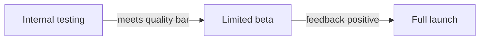

<!-- order: 17 -->
# AI Product Engineer: Hands-On Project Tutorials

This course is a series of hands-on projects. You learn each idea at the moment you need it, while building the thing.

**By the end of this course, you'll be able to:**
- Write a one-page AI product brief with a clear problem statement, target user, and success metric
- Build a working feature prototype and a multi-turn chatbot that call the Claude API
- Run lightweight user discovery and use the evidence to revise a feature's direction
- Design the full feature flow, including loading, error, and "AI might be wrong" states
- Write an evaluation plan with a test set, scoring rubric, and baseline score
- Plan a staged launch with clear launch criteria, monitoring, and rollback triggers

Follow the projects in order. Each one hands off a skill or artifact to the next.


## Before you start: set up your notebook

**Time: about 15 minutes**

This course runs in **Google Colab**, a free Jupyter notebook in your browser and the standard workspace for AI and data work. There's nothing to install.

1. Go to [colab.research.google.com](https://colab.research.google.com) and sign in with a Google account.
2. Give each project its own notebook: choose **File → New notebook**, then click the title at the top to rename it after the project.
3. Notebooks have two kinds of cells. **Code cells** run Python: type or paste code, then press **Shift + Enter**. **Text cells** hold your notes and written answers: choose **Insert → Text cell**.
4. Install libraries in a code cell with `%pip install ...`. The `%` form installs them into the notebook you're using.
5. Put each code block from a project in its own code cell, in order, and run them top to bottom. When a later step changes earlier code, edit that cell and run it again.
6. To use a file you downloaded, such as a CSV, drag it into the **Files** panel (the folder icon on the left). Files your code creates appear there too. Colab clears them when the session ends, so download anything you want to keep, or connect Google Drive from the same panel.

Prefer to work on your own computer? The same notebooks run in JupyterLab or in VS Code with the Jupyter extension.

**Your Claude API key.** Projects that call Claude need an API key from [console.anthropic.com](https://console.anthropic.com). API use is paid and billed by how much text you send and receive. The requests in this course are small, but set a low monthly spending limit in the console before you begin. Keep the key out of your code: in Colab, click the **key icon** in the left sidebar, add a secret named `ANTHROPIC_API_KEY`, and turn on notebook access. Then run this cell at the top of every notebook that calls Claude:

```python
import os
from google.colab import userdata
os.environ["ANTHROPIC_API_KEY"] = userdata.get("ANTHROPIC_API_KEY")
```

---

## Project 1 (Module 1): Write an AI Product Brief

**Time: about 1.5 hours**

**Goal:** Frame a real problem in product terms before touching any code, the habit that separates a useful AI feature from a novelty.

**Step 1: Create the project notebook.**
Create a new notebook for this project (**File → New notebook**) and name it `ai_product_brief_project`.

**Step 2: Identify a real problem worth solving.**
An **AI-suited problem** is one with a pattern to learn from data, ambiguity that rules-based code can't handle, and enough volume to be worth automating (e.g., "summarize long support tickets," not "add two numbers").

**Step 3: Define the user.**
Add a **text cell** headed `brief` and write your notes in it.
Write one sentence: who experiences this problem, and how often?

**Step 4: State the problem in one sentence.**
A good problem statement follows the pattern "[user] struggles to [task] because [reason], which causes [consequence]."

**Step 5: Propose the AI-powered solution.**
Write 2-3 sentences describing what the feature would do, in plain language (no implementation details yet).

**Step 6: Define what success looks like.**
A **success metric** is a measurable signal that the feature is working (e.g., "support ticket resolution time drops by 20%"), different from a **vanity metric** (e.g., "users saw the feature").

**Step 7: Note constraints and risks.**
List: cost limits, data availability, privacy concerns, and what happens if the AI gets it wrong.

**Step 8: Assemble the final brief.**
Combine Steps 3–7 into one page: Problem → User → Solution → Success Metric → Constraints/Risks.

### Final Project Structure

*If you worked in a notebook, these are the sections of your notebook (text and code cells), not separate files. Save or export them as files when you put the project in your portfolio.*

```text
ai_product_brief_project/
│
├── brief.md
```

### What You Learned
- ✅ Identifying AI-suited problems
- ✅ Defining a specific target user
- ✅ Writing a clear problem statement
- ✅ Separating success metrics from vanity metrics
- ✅ Naming constraints and risks upfront
- ✅ Assembling a one-page product brief

### Portfolio Project
**AI Feature Product Brief**: Identified a real user problem, defined a target user and success metric, and wrote a one-page product brief proposing an AI-powered solution.
**Skills:** Product Thinking, Problem Framing, Technical Writing, AI Product Strategy.

**Deliverable:** A one-page AI product brief covering problem, user, proposed solution, success metric, and risks.

### Quiz

1. What makes a problem well suited to AI?
2. Complete the problem statement pattern: "[user] struggles to [task] because..."
3. What is the difference between a success metric and a vanity metric?
4. Why list what happens if the AI gets it wrong in the brief?

*Answers: 1) It has a pattern to learn, ambiguity that fixed rules can't handle, and enough volume to be worth automating. 2) "...[reason], which causes [consequence]." 3) A success metric shows the feature is actually working, such as faster ticket resolution; a vanity metric looks good without proving value, such as "users saw the feature." 4) Planning for mistakes early shapes the design and shows whether the risk is acceptable before you build.*

```watch
{
 "scenes": [
  {
   "kind": "title",
   "art": "doc",
   "kicker": "Project 1 · Product brief",
   "title": "Frame the problem first",
   "beats": [
    {
     "say": "Welcome to A I Product Engineer: Hands-On Project Tutorials."
    },
    {
     "say": "Before touching any code, you'll frame a real problem in product terms. That habit separates a useful A I feature from a novelty."
    }
   ]
  },
  {
   "kind": "table",
   "kicker": "Step 2",
   "title": "Is it an AI-suited problem?",
   "columns": [
    "Problem",
    "Pattern",
    "Ambiguity",
    "Volume"
   ],
   "rows": [
    [
     "Summarize long tickets",
     "✓ learn from data",
     "✓ rules can't cope",
     "✓ many per day"
    ],
    [
     "Add two numbers",
     "✗ a fixed rule",
     "✗ none",
     "✗ no AI needed"
    ]
   ],
   "beats": [
    {
     "say": "Not every problem needs A I. Let's test two ideas against three questions."
    },
    {
     "say": "First, is there a pattern to learn from data? Support tickets, yes. Adding numbers is just a fixed rule.",
     "col": 1
    },
    {
     "say": "Second, is there ambiguity that rules-based code can't handle? Every ticket is worded differently, so yes.",
     "col": 2
    },
    {
     "say": "Third, is there enough volume to be worth automating? A support team gets many tickets a day.",
     "col": 3
    },
    {
     "say": "Summarizing long support tickets passes all three. That's an A I suited problem.",
     "hl": 0,
     "dim": true
    },
    {
     "say": "Adding two numbers fails them all. Plain code does it perfectly.",
     "hl": 1,
     "dim": true
    }
   ]
  },
  {
   "kind": "array",
   "kicker": "Steps 3 and 4",
   "title": "Fill in the problem statement",
   "values": [
    "[user]",
    "[task]",
    "[reason]",
    "[consequence]"
   ],
   "beats": [
    {
     "say": "In a text cell headed brief, you'll write your problem in one sentence, with four slots."
    },
    {
     "say": "First the user. Who has this problem, and how often? Say, support agents, every day.",
     "vals": [
      "Support agents",
      "[task]",
      "[reason]",
      "[consequence]"
     ],
     "hl": 0,
     "note": "[user] struggles to..."
    },
    {
     "say": "Then the task they struggle with: reading long tickets.",
     "vals": [
      "Support agents",
      "read long tickets",
      "[reason]",
      "[consequence]"
     ],
     "hl": 1,
     "ok": [
      0
     ],
     "note": "...struggles to [task]..."
    },
    {
     "say": "Then the reason: because the tickets are long.",
     "vals": [
      "Support agents",
      "read long tickets",
      "they're long",
      "[consequence]"
     ],
     "hl": 2,
     "ok": [
      0,
      1
     ],
     "note": "...because [reason]..."
    },
    {
     "say": "And the consequence: which causes slow resolution for customers.",
     "vals": [
      "Support agents",
      "read long tickets",
      "they're long",
      "slow resolution"
     ],
     "hl": 3,
     "ok": [
      0,
      1,
      2
     ],
     "note": "...which causes [consequence]."
    },
    {
     "say": "User, task, reason, consequence. One sentence anyone on the team can understand.",
     "vals": [
      "Support agents",
      "read long tickets",
      "they're long",
      "slow resolution"
     ],
     "ok": [
      0,
      1,
      2,
      3
     ],
     "note": "Then Step 5: describe the AI solution in 2-3 plain sentences"
    }
   ]
  },
  {
   "kind": "table",
   "kicker": "Step 6",
   "title": "Success metric or vanity metric?",
   "columns": [
    "Metric",
    "Kind",
    "Proves it works?"
   ],
   "rows": [
    [
     "Resolution time -20%",
     "Success metric",
     "Yes, measurable"
    ],
    [
     "Users saw the feature",
     "Vanity metric",
     "No, only looks good"
    ]
   ],
   "beats": [
    {
     "say": "Next, define what success looks like. Here are two ways to measure it."
    },
    {
     "say": "Support ticket resolution time drops by twenty percent. That's measurable, and it shows the feature really helps.",
     "hl": 0,
     "col": 2
    },
    {
     "say": "Users saw the feature. It sounds nice, but it proves nothing about value. That's a vanity metric.",
     "hl": 1,
     "col": 2
    },
    {
     "say": "Put the success metric in your brief.",
     "hl": 0,
     "dim": true,
     "sql": "Success metric = a measurable signal the feature is working"
    }
   ]
  },
  {
   "kind": "table",
   "kicker": "Step 7",
   "title": "Name the constraints and risks",
   "columns": [
    "Risk",
    "Question to answer"
   ],
   "rows": [
    [
     "Cost limits",
     "What can we spend?"
    ],
    [
     "Data availability",
     "Do we have the data?"
    ],
    [
     "Privacy",
     "Whose data is this?"
    ],
    [
     "AI gets it wrong",
     "What happens then?"
    ]
   ],
   "beats": [
    {
     "say": "Before you build, list your constraints and risks."
    },
    {
     "say": "Cost limits: A P I calls are paid, so how much can you spend?",
     "hl": 0
    },
    {
     "say": "Data availability: do you actually have the tickets to work with?",
     "hl": 1
    },
    {
     "say": "Privacy: tickets contain customer details, so whose data is this?",
     "hl": 2
    },
    {
     "say": "And what happens if the A I gets it wrong? A bad summary could send an agent the wrong way.",
     "hl": 3
    },
    {
     "say": "Planning for mistakes now shapes the design, and shows whether the risk is acceptable.",
     "hl": 3,
     "dim": true
    }
   ]
  },
  {
   "kind": "array",
   "kicker": "Step 8",
   "title": "Assemble the one-page brief",
   "values": [
    "Problem",
    "User",
    "Solution",
    "Success metric",
    "Constraints/risks"
   ],
   "beats": [
    {
     "say": "Finally, combine Steps 3 to 7 into one page, in this order."
    },
    {
     "say": "The problem statement leads.",
     "ok": [
      0
     ],
     "hl": 0
    },
    {
     "say": "Then the user who has it.",
     "ok": [
      0,
      1
     ],
     "hl": 1
    },
    {
     "say": "Then your proposed A I solution, in plain language.",
     "ok": [
      0,
      1,
      2
     ],
     "hl": 2
    },
    {
     "say": "Then the success metric.",
     "ok": [
      0,
      1,
      2,
      3
     ],
     "hl": 3
    },
    {
     "say": "And last, the constraints and risks. That's your one-page brief.",
     "ok": [
      0,
      1,
      2,
      3,
      4
     ],
     "note": "brief: one page, ready for Project 2"
    }
   ]
  },
  {
   "kind": "quiz",
   "art": "ask",
   "kicker": "Quick check",
   "title": "Why list what happens if the AI gets it wrong in the brief?",
   "options": [
    "It's a legal requirement for every brief",
    "Planning for mistakes early shapes the design and shows whether the risk is acceptable",
    "So you can blame the model later"
   ],
   "answer": 1,
   "good": "That's right. Planning for mistakes early shapes the design, and shows whether the risk is acceptable before you build.",
   "bad": "Not quite. Planning for mistakes early shapes the design, and shows whether the risk is acceptable before you build.",
   "beats": [
    {
     "say": "Quick check.",
     "show": 0
    },
    {
     "say": "Why list what happens if the A I gets it wrong in the brief?",
     "show": 0
    },
    {
     "say": "Tap your answer.",
     "show": 1
    }
   ]
  },
  {
   "kind": "list",
   "art": "proof",
   "kicker": "Checkpoint",
   "title": "You're done when",
   "items": [
    [
     "A one-page AI product brief",
     ""
    ],
    [
     "Problem, user, solution, metric, risks",
     ""
    ]
   ],
   "beats": [
    {
     "say": "That's Project 1.",
     "show": 0
    },
    {
     "say": "You're done when:",
     "show": 0
    },
    {
     "say": "you have a one-page A I product brief,",
     "show": 1
    },
    {
     "say": "covering problem, user, proposed solution, success metric and risks.",
     "show": 2
    },
    {
     "say": "Next, in Module 2, you'll turn your brief into a working prototype.",
     "show": 2
    }
   ]
  }
 ]
}
```

---

## Project 2 (Module 2): Build an AI-Powered Feature Prototype

**Time: about 2.5 hours**

**Goal:** Turn your Project 1 brief into a working piece of software for the first time.

**Step 1: Create the project notebook.**
Create a new notebook for this project (**File → New notebook**) and name it `ai_feature_prototype_project`.
Keep your Project 1 brief open in another tab for reference.

**Step 2: Get access to an LLM API.**
An **API key** is a secret credential that authenticates your requests to a service; treat it like a password. If you haven't yet, follow **Your Claude API key** in "Before you start", then run the API key cell at the top of this notebook.

**Step 3: Make your first API call.**
Add a **code cell**, paste in the code below, and run it with **Shift + Enter**.
```python
import os
import requests

response = requests.post(
    "https://api.anthropic.com/v1/messages",
    headers={
        "x-api-key": os.environ["ANTHROPIC_API_KEY"],
        "anthropic-version": "2023-06-01",
        "content-type": "application/json",
    },
    json={
        "model": "claude-sonnet-5-5",
        "max_tokens": 200,
        "messages": [{"role": "user", "content": (
            "Summarize this in one sentence: My order arrived two days late "
            "and the box was damaged, but the product itself works fine."
        )}]
    }
)
print(response.json())
```
**JSON** is the text format most APIs use to send and receive structured data, it's how your Python code and the AI service "speak" to each other.

**Step 4: Wire the API call to your Project 1 problem.**
Replace the placeholder prompt with real input related to your brief's problem (e.g., an actual support ticket if your feature summarizes tickets).

**Step 5: Add basic input handling.**
```python
def run_feature(user_input):
    prompt = f"Summarize this support ticket in one sentence:\n\n{user_input}"
    response = requests.post(
        "https://api.anthropic.com/v1/messages",
        headers={
            "x-api-key": os.environ["ANTHROPIC_API_KEY"],
            "anthropic-version": "2023-06-01",
            "content-type": "application/json",
        },
        json={
            "model": "claude-sonnet-5-5",
            "max_tokens": 200,
            "messages": [{"role": "user", "content": prompt}],
        },
    )
    response.raise_for_status()
    # The reply text is in the first content block.
    return response.json()["content"][0]["text"]

print(run_feature("I was charged twice for my subscription this month. Please refund one payment."))
```
Change the instruction in `prompt` to match your own brief.
Wrapping your API call in a function makes it reusable instead of a one-off script.

**Step 6: Test with 3–5 realistic examples.**
Run your function against several different real-world inputs, not just one.

**Step 7: Note what worked and what didn't.**
Add a **text cell** headed `prototype_notes` and write your notes in it.
Write down cases where the output was wrong, confusing, or unhelpful.

### Final Project Structure

*If you worked in a notebook, these are the sections of your notebook (text and code cells), not separate files. Save or export them as files when you put the project in your portfolio.*

```text
ai_feature_prototype_project/
│
├── brief.md
├── prototype.py
├── prototype_notes.md
```

### What You Learned
- ✅ Authenticating with an API key
- ✅ Making a real LLM API call
- ✅ Working with JSON requests and responses
- ✅ Wrapping API calls in reusable functions
- ✅ Testing across multiple realistic inputs
- ✅ Documenting early failure patterns

### Portfolio Project
**AI Feature Prototype**: Built a working prototype calling a production LLM API, tested against realistic inputs from a real user problem, and documented initial failure patterns.
**Skills:** API Integration, Python, LLM APIs, Prototyping, AI Product Development.

**Deliverable:** A working AI-powered feature prototype, tested against 3–5 realistic inputs.

### Quiz

1. Why should you never paste your API key into your code?
2. Where is the model's reply text in the API response?
3. Why wrap the API call in a run_feature function?
4. Why test with 3 to 5 different realistic inputs?

*Answers: 1) The key works like a password; anyone who sees the code could use it and run up charges. Store it as a secret or environment variable instead. 2) In the first content block: response.json()["content"][0]["text"]. 3) It makes the call reusable for any input instead of a one-off script. 4) One input can hide problems; several varied inputs reveal where the feature fails.*

```watch
{
 "scenes": [
  {
   "kind": "title",
   "art": "api",
   "kicker": "Project 2 · Feature prototype",
   "title": "Your first working AI feature",
   "beats": [
    {
     "say": "Welcome to Module 2."
    },
    {
     "say": "Now you turn your Project 1 brief into working software for the first time, by calling the Claude A P I."
    }
   ]
  },
  {
   "kind": "diagram",
   "kicker": "Step 2",
   "title": "Where your API key should travel",
   "nodes": [
    {
     "id": "code",
     "label": "Your notebook",
     "x": 60,
     "y": 30,
     "sub": "code cells",
     "art": "code"
    },
    {
     "id": "leak",
     "label": "Anyone reading",
     "x": 60,
     "y": 80,
     "sub": "a shared notebook",
     "art": "eye"
    },
    {
     "id": "secret",
     "label": "Colab secret",
     "x": 14,
     "y": 30,
     "sub": "key icon, left sidebar",
     "art": "key"
    },
    {
     "id": "env",
     "label": "Environment var",
     "x": 34,
     "y": 80,
     "sub": "os.environ",
     "art": "lock"
    },
    {
     "id": "api",
     "label": "Claude API",
     "x": 88,
     "y": 55,
     "sub": "api.anthropic.com",
     "art": "api"
    }
   ],
   "edges": [
    {
     "from": "code",
     "to": "leak"
    },
    {
     "from": "secret",
     "to": "env"
    },
    {
     "from": "env",
     "to": "code"
    },
    {
     "from": "code",
     "to": "api"
    }
   ],
   "beats": [
    {
     "say": "An A P I key is a secret credential that authenticates your requests. Treat it like a password.",
     "show": 1,
     "on": "code"
    },
    {
     "say": "If you paste it into your code, anyone who sees the notebook can copy it and run up charges.",
     "show": 2,
     "on": "leak",
     "send": {
      "from": "code",
      "to": "leak",
      "label": "key in the code"
     }
    },
    {
     "say": "Instead, store it as a Colab secret named anthropic A P I key.",
     "show": 3,
     "on": "secret"
    },
    {
     "say": "The cell at the top of the notebook loads it into an environment variable.",
     "show": 4,
     "on": "env",
     "send": {
      "from": "secret",
      "to": "env",
      "label": "userdata.get"
     }
    },
    {
     "say": "Your code reads it from there, never typing the key itself.",
     "show": 4,
     "on": "code",
     "send": {
      "from": "env",
      "to": "code",
      "label": "os.environ[...]"
     }
    },
    {
     "say": "And sends it to Claude in a request header called x A P I key.",
     "show": 5,
     "on": "api",
     "send": {
      "from": "code",
      "to": "api",
      "label": "x-api-key header"
     }
    }
   ]
  },
  {
   "kind": "walk",
   "kicker": "Steps 3 and 5",
   "title": "Trace one call through run_feature",
   "file": "run_feature",
   "code": "def run_feature(user_input):\n    prompt = (\"Summarize this support ticket \"\n              f\"in one sentence:\\n\\n{user_input}\")\n    response = requests.post(\n        \"https://api.anthropic.com/v1/messages\",\n        headers={...},  # key, version, content-type\n        json={\"model\": \"claude-sonnet-5-5\",\n              \"max_tokens\": 200,\n              \"messages\": [{\"role\": \"user\",\n                            \"content\": prompt}]})\n    response.raise_for_status()\n    return response.json()[\"content\"][0][\"text\"]\n\nprint(run_feature(\"I was charged twice...\"))",
   "beats": [
    {
     "say": "Your first call posts J S O N to the messages endpoint. Step 5 wraps it in a function, so it works for any input.",
     "line": 1
    },
    {
     "say": "Here we call it with a ticket: I was charged twice for my subscription this month.",
     "line": 14,
     "vars": {
      "user_input": "\"I was charged twice...\""
     }
    },
    {
     "say": "The function builds the prompt: the instruction, a blank line, then the ticket.",
     "line": [
      2,
      3
     ],
     "vars": {
      "prompt": "\"Summarize this support ticket in one sentence:\\n\\nI was charged twice...\""
     }
    },
    {
     "say": "It posts to the messages endpoint, with the model, a two hundred token limit, and one user message.",
     "line": [
      4,
      10
     ]
    },
    {
     "say": "J S O N is how your Python code and the A I service speak to each other.",
     "line": [
      7,
      10
     ]
    },
    {
     "say": "If the A P I sent back an error status, raise for status stops here with a clear error.",
     "line": 11
    },
    {
     "say": "Otherwise, it pulls out the reply text and returns it.",
     "line": 12,
     "vars": {
      "response": "200 OK"
     }
    },
    {
     "say": "And the print shows Claude's one-sentence summary.",
     "line": 14,
     "out": "(one-sentence summary of the double charge and the refund request)"
    }
   ]
  },
  {
   "kind": "table",
   "kicker": "Step 5",
   "title": "Find the reply inside the JSON",
   "columns": [
    "Key",
    "Value"
   ],
   "rows": [
    [
     "id",
     "msg_..."
    ],
    [
     "type",
     "message"
    ],
    [
     "role",
     "assistant"
    ],
    [
     "content",
     "[{type, text}]"
    ],
    [
     "stop_reason",
     "end_turn"
    ],
    [
     "usage",
     "{input_tokens, ...}"
    ]
   ],
   "beats": [
    {
     "say": "Here's what response dot J S O N gives you: a dictionary with several keys."
    },
    {
     "say": "Most are details, like the role and why the model stopped.",
     "hl": [
      2,
      4
     ]
    },
    {
     "say": "The reply lives under content, which is a list of blocks.",
     "hl": 3,
     "dim": true,
     "sql": "response.json()[\"content\"]"
    },
    {
     "say": "Take the first block, index zero.",
     "hl": 3,
     "dim": true,
     "sql": "response.json()[\"content\"][0]"
    },
    {
     "say": "And its text field is the summary itself.",
     "hl": 3,
     "dim": true,
     "col": 1,
     "sql": "response.json()[\"content\"][0][\"text\"]"
    }
   ]
  },
  {
   "kind": "table",
   "kicker": "Steps 4, 6 and 7",
   "title": "Test 3 to 5 real inputs, then take notes",
   "columns": [
    "Test input",
    "What to check",
    "prototype_notes"
   ],
   "rows": [
    [
     "Charged twice",
     "Mentions the refund?",
     "e.g. worked"
    ],
    [
     "Late, damaged box",
     "Product works fine?",
     "e.g. left this out"
    ],
    [
     "Logged out on tabs",
     "Clear and short?",
     "e.g. confusing"
    ],
    [
     "(your own ticket)",
     "Matches your brief?",
     "..."
    ]
   ],
   "beats": [
    {
     "say": "First, change the instruction in the prompt to match your own brief, and use real input, like an actual support ticket.",
     "hl": 3
    },
    {
     "say": "Then run your function on three to five different realistic inputs, not just one.",
     "col": 0
    },
    {
     "say": "For each one, decide what a good answer must include.",
     "col": 1
    },
    {
     "say": "In a text cell headed prototype notes, write down where the output was wrong, confusing or unhelpful.",
     "col": 2
    },
    {
     "say": "Imagine the damaged box summary forgot that the product works fine. One test alone would have hidden that.",
     "hl": 1,
     "dim": true
    }
   ]
  },
  {
   "kind": "quiz",
   "art": "ask",
   "kicker": "Quick check",
   "title": "Why test with 3 to 5 different realistic inputs?",
   "options": [
    "One input can hide problems; several varied inputs reveal where the feature fails",
    "The API needs at least three calls to warm up",
    "It lowers the cost per request"
   ],
   "answer": 0,
   "good": "That's right. One input can hide problems. Several varied inputs reveal where the feature fails.",
   "bad": "Not quite. One input can hide problems. Several varied inputs reveal where the feature fails.",
   "beats": [
    {
     "say": "Quick check.",
     "show": 0
    },
    {
     "say": "Why test with 3 to 5 different realistic inputs?",
     "show": 0
    },
    {
     "say": "Tap your answer.",
     "show": 1
    }
   ]
  },
  {
   "kind": "list",
   "art": "proof",
   "kicker": "Checkpoint",
   "title": "You're done when",
   "items": [
    [
     "A working AI feature prototype",
     ""
    ],
    [
     "Tested on 3 to 5 inputs, failures noted",
     ""
    ]
   ],
   "beats": [
    {
     "say": "That's Project 2.",
     "show": 0
    },
    {
     "say": "You're done when:",
     "show": 0
    },
    {
     "say": "you have a working A I feature prototype,",
     "show": 1
    },
    {
     "say": "tested against three to five realistic inputs, with the failures written down.",
     "show": 2
    },
    {
     "say": "Next, in Module 3, you'll extend it into a multi-turn chatbot.",
     "show": 2
    }
   ]
  }
 ]
}
```

---

## Project 3 (Module 3): Prototype a Chatbot Feature Using an LLM API

**Time: about 2.5 hours**

**Goal:** Extend your prototype into a conversational feature, the most common AI product pattern.

**Step 1: Create the project notebook.**
Create a new notebook for this project (**File → New notebook**) and name it `chatbot_prototype_project`. Run the API key cell from "Before you start" at the top.

**Step 2: Understand conversation history.**
LLM APIs are **stateless**: each call has no memory of previous ones. To simulate a "conversation," you resend the full **message history** with every request.

**Step 3: Build a message history list.**
Add a **code cell**, paste in the code below, and run it with **Shift + Enter**.
```python
import os
import requests

# Template: replace this system prompt with one for your own use case (Step 4).
SYSTEM_PROMPT = "You are a helpful assistant that answers customer questions about online orders."

history = []  # only "user" and "assistant" messages go here

def chat(user_message):
    history.append({"role": "user", "content": user_message})
    response = requests.post(
        "https://api.anthropic.com/v1/messages",
        headers={
            "x-api-key": os.environ["ANTHROPIC_API_KEY"],
            "anthropic-version": "2023-06-01",
            "content-type": "application/json",
        },
        json={
            "model": "claude-sonnet-5-5",
            "max_tokens": 300,
            "system": SYSTEM_PROMPT,   # the system prompt is a top-level field
            "messages": history,       # the full conversation so far
        },
    )
    response.raise_for_status()
    reply = response.json()["content"][0]["text"]
    history.append({"role": "assistant", "content": reply})
    return reply

print(chat("Hi! Where can I see my order status?"))
print(chat("And how long do refunds usually take?"))
```
A **system prompt** sets the AI's role and behavior before the conversation starts. In the Messages API it goes in the top-level `"system"` field, not inside the message history. To start a fresh conversation, run `history.clear()`.

**Step 4: Write a first version of your system prompt.**
Base it on your Project 1 brief: what should this assistant do, and what should it avoid?

**Step 5: Test a multi-turn conversation.**
Run 3–4 exchanges in a row, checking that the assistant's later replies make sense given earlier turns.

**Step 6: Add basic guardrails.**
A **guardrail** is a rule that keeps the AI within intended bounds (e.g., "refuse to answer off-topic questions").

**Step 7: Test edge cases.**
Try: an off-topic question, an ambiguous question, and an empty message. The API rejects an empty message with an error, so add a check at the top of `chat()` (for example, `if not user_message.strip(): return "Please type a message."`) instead of letting it crash.

### Final Project Structure

*If you worked in a notebook, these are the sections of your notebook (text and code cells), not separate files. Save or export them as files when you put the project in your portfolio.*

```text
chatbot_prototype_project/
│
├── chatbot.py
├── system_prompt.md
├── test_conversations.md
```

### What You Learned
- ✅ Why LLM APIs are stateless
- ✅ Building and maintaining message history
- ✅ Writing an effective system prompt
- ✅ Testing multi-turn conversations
- ✅ Adding basic guardrails
- ✅ Testing edge cases (off-topic, ambiguous, empty input)

### Portfolio Project
**AI Chatbot Feature Prototype**: Built a multi-turn conversational prototype using an LLM API, with a tailored system prompt, guardrails, and tested edge-case handling.
**Skills:** Conversational AI, Prompt Engineering, Python, LLM APIs, AI Product Development.

**Deliverable:** A working chatbot prototype tested across multi-turn conversations and edge cases.

### Quiz

1. What does it mean that LLM APIs are stateless?
2. Where does the system prompt go in a Messages API request?
3. After getting a reply, what must chat() do so the next turn makes sense?
4. What is a guardrail?

*Answers: 1) Each call has no memory of earlier calls, so you must resend the full conversation history every time. 2) In the top-level "system" field, not as a message inside the history list. 3) Append the reply to history as an "assistant" message. 4) A rule that keeps the AI within intended bounds, such as refusing off-topic questions.*

```watch
{
 "scenes": [
  {
   "kind": "title",
   "art": "chat",
   "kicker": "Project 3 · Chatbot prototype",
   "title": "Make it conversational",
   "beats": [
    {
     "say": "Welcome to Module 3."
    },
    {
     "say": "You'll extend your prototype into a conversational feature, the most common A I product pattern."
    }
   ]
  },
  {
   "kind": "diagram",
   "kicker": "Step 2",
   "title": "The API forgets everything between calls",
   "nodes": [
    {
     "id": "code",
     "label": "Your chat()",
     "x": 15,
     "y": 50,
     "sub": "in your notebook",
     "art": "code"
    },
    {
     "id": "api",
     "label": "Claude API",
     "x": 85,
     "y": 50,
     "sub": "no memory",
     "art": "api"
    }
   ],
   "edges": [
    {
     "from": "code",
     "to": "api"
    }
   ],
   "beats": [
    {
     "say": "Here's the key idea: L L M A P I s are stateless.",
     "show": 2
    },
    {
     "say": "Turn one. You ask: Hi! Where can I see my order status?",
     "on": "code",
     "send": {
      "from": "code",
      "to": "api",
      "label": "Order status?"
     }
    },
    {
     "say": "Claude answers.",
     "on": "api",
     "send": {
      "from": "api",
      "to": "code",
      "label": "reply 1"
     }
    },
    {
     "say": "Turn two. If you only send: and how long do refunds usually take?",
     "on": "code",
     "send": {
      "from": "code",
      "to": "api",
      "label": "And refunds?"
     }
    },
    {
     "say": "Claude has no memory of turn one, so the and has nothing to attach to.",
     "on": "api",
     "send": {
      "from": "api",
      "to": "code",
      "label": "lost context"
     }
    },
    {
     "say": "The fix: send the full message history with every request. Now it sees all three messages.",
     "on": "code",
     "send": {
      "from": "code",
      "to": "api",
      "label": "all 3 messages"
     }
    }
   ]
  },
  {
   "kind": "array",
   "kicker": "Step 3",
   "title": "Watch the history list grow",
   "values": [
    "history = []"
   ],
   "beats": [
    {
     "say": "The history list starts empty. Only user and assistant messages go in it.",
     "note": "SYSTEM_PROMPT is kept separately"
    },
    {
     "say": "Turn one: chat adds your question as a user message, then sends the list.",
     "vals": [
      "user: order status?"
     ],
     "hl": 0,
     "note": "sent: 1 message"
    },
    {
     "say": "When the reply comes back, it's appended as an assistant message.",
     "vals": [
      "user: order status?",
      "assistant: reply 1"
     ],
     "hl": 1,
     "ok": [
      0
     ]
    },
    {
     "say": "Turn two adds the refund question, and sends all three messages.",
     "vals": [
      "user: order status?",
      "assistant: reply 1",
      "user: refunds?"
     ],
     "hl": 2,
     "ok": [
      0,
      1
     ],
     "note": "sent: 3 messages"
    },
    {
     "say": "The second reply is appended too, ready for turn three.",
     "vals": [
      "user: order status?",
      "assistant: reply 1",
      "user: refunds?",
      "assistant: reply 2"
     ],
     "hl": 3,
     "ok": [
      0,
      1,
      2
     ],
     "note": "4 messages"
    },
    {
     "say": "To start a fresh conversation, run history dot clear.",
     "vals": [
      "history = []"
     ],
     "note": "history.clear()"
    }
   ]
  },
  {
   "kind": "walk",
   "kicker": "Steps 3, 4 and 7",
   "title": "Trace chat(), including the empty message",
   "file": "chat() · URL and headers shortened",
   "code": "def chat(user_message):\n    if not user_message.strip():\n        return \"Please type a message.\"\n    history.append({\"role\": \"user\",\n                    \"content\": user_message})\n    response = requests.post(URL, headers=HEADERS,\n        json={\"model\": \"claude-sonnet-5-5\",\n              \"max_tokens\": 300,\n              \"system\": SYSTEM_PROMPT,\n              \"messages\": history})\n    reply = response.json()[\"content\"][0][\"text\"]\n    history.append({\"role\": \"assistant\",\n                    \"content\": reply})\n    return reply",
   "beats": [
    {
     "say": "Here's chat, with the empty message check from Step 7 at the top. History starts empty.",
     "vars": {
      "history": "[]"
     }
    },
    {
     "say": "We call chat with: Hi! Where can I see my order status?",
     "line": 1,
     "vars": {
      "user_message": "\"Hi! Where can I see my order status?\""
     }
    },
    {
     "say": "The message isn't empty, so we carry on.",
     "line": 2
    },
    {
     "say": "It's appended to history as a user message.",
     "line": [
      4,
      5
     ],
     "vars": {
      "history": "[user]"
     }
    },
    {
     "say": "The request sends the system prompt in the top-level system field, and the history as messages.",
     "line": [
      6,
      10
     ]
    },
    {
     "say": "The system prompt sets the role: a helpful assistant for customer questions about online orders. Write yours from your brief.",
     "line": 9
    },
    {
     "say": "The reply comes back, and is appended as an assistant message, so the next turn makes sense.",
     "line": [
      11,
      13
     ],
     "vars": {
      "reply": "\"(answer about order status)\"",
      "history": "[user, assistant]"
     }
    },
    {
     "say": "Now someone sends an empty message.",
     "line": 1,
     "vars": {
      "user_message": "\"\""
     }
    },
    {
     "say": "Strip leaves nothing, so chat returns a friendly message, and never calls the A P I, which would reject it.",
     "line": [
      2,
      3
     ],
     "out": "Please type a message."
    },
    {
     "say": "History is untouched.",
     "line": 3,
     "vars": {
      "history": "[user, assistant]"
     }
    }
   ]
  },
  {
   "kind": "table",
   "kicker": "Steps 5 to 7",
   "title": "Test the turns and the edge cases",
   "columns": [
    "Test",
    "Example input",
    "What should happen"
   ],
   "rows": [
    [
     "Multi-turn",
     "And refunds?",
     "Uses earlier turns"
    ],
    [
     "Off-topic",
     "e.g. a poem request",
     "Guardrail declines"
    ],
    [
     "Ambiguous",
     "e.g. Where is it?",
     "Asks which order"
    ],
    [
     "Empty",
     "\"\"",
     "Please type a message."
    ]
   ],
   "beats": [
    {
     "say": "Now test it. First, run three or four exchanges in a row.",
     "hl": 0
    },
    {
     "say": "Later replies should make sense given earlier turns, like a follow-up about refunds.",
     "hl": 0,
     "col": 2
    },
    {
     "say": "Add a guardrail: a rule that keeps the A I within bounds, like refusing off-topic questions.",
     "sql": "Guardrail: refuse off-topic questions",
     "hl": 1
    },
    {
     "say": "So ask for something off-topic, and check the guardrail holds.",
     "hl": 1,
     "col": 2
    },
    {
     "say": "Try an ambiguous question. A good assistant asks which order you mean.",
     "hl": 2,
     "col": 2
    },
    {
     "say": "And an empty message gets the friendly reply, instead of a crash.",
     "hl": 3,
     "col": 2
    }
   ]
  },
  {
   "kind": "quiz",
   "art": "ask",
   "kicker": "Quick check",
   "title": "Where does the system prompt go in a Messages API request?",
   "options": [
    "As the first user message",
    "As an assistant message at the end of the history",
    "In the top-level system field"
   ],
   "answer": 2,
   "good": "That's right. It goes in the top-level system field, not as a message inside the history list.",
   "bad": "Not quite. It goes in the top-level system field, not as a message inside the history list.",
   "beats": [
    {
     "say": "Quick check.",
     "show": 0
    },
    {
     "say": "Where does the system prompt go in a Messages A P I request?",
     "show": 0
    },
    {
     "say": "Tap your answer.",
     "show": 1
    }
   ]
  },
  {
   "kind": "list",
   "art": "proof",
   "kicker": "Checkpoint",
   "title": "You're done when",
   "items": [
    [
     "A working chatbot prototype",
     ""
    ],
    [
     "Tested on multi-turn chats and edge cases",
     ""
    ]
   ],
   "beats": [
    {
     "say": "That's Project 3.",
     "show": 0
    },
    {
     "say": "You're done when:",
     "show": 0
    },
    {
     "say": "you have a working chatbot prototype,",
     "show": 1
    },
    {
     "say": "tested across multi-turn conversations and edge cases.",
     "show": 2
    },
    {
     "say": "Next, in Module 4, you'll step back and check the feature against real user needs.",
     "show": 2
    }
   ]
  }
 ]
}
```

---

## Project 4 (Module 4): Create a Feature Discovery Doc

**Time: about 1.5 hours**

**Goal:** Step back from building and validate the feature against real user needs before going further.

**Step 1: Create the project notebook.**
Create a new notebook for this project (**File → New notebook**) and name it `discovery_doc_project`.

**Step 2: Write 5 user interview questions.**
Good discovery questions ask about *past behavior* ("tell me about the last time you..."), not hypotheticals ("would you use a feature that...").

**Step 3: Conduct (or simulate) 3–5 short interviews.**
Add a **text cell** headed `interview_notes` and write your notes in it.
If you don't have real users available, simulate this by asking peers who fit your Project 1 target user, or by researching how people currently solve this problem.

**Step 4: Show your Project 3 prototype and get reactions.**
Ask: does this solve the problem? What's missing? What's confusing?

**Step 5: Identify patterns across interviews.**
A **discovery insight** is a pattern repeated across multiple people, not a single person's opinion.

**Step 6: Revisit your Project 1 problem statement.**
Update it if discovery revealed the real problem is different from what you assumed.

**Step 7: Write the discovery summary.**
Add a **text cell** headed `discovery_doc` and write your notes in it.
Structure: Who you talked to → What you asked → Key insights → What changes for the feature.

### Final Project Structure

*If you worked in a notebook, these are the sections of your notebook (text and code cells), not separate files. Save or export them as files when you put the project in your portfolio.*

```text
discovery_doc_project/
│
├── interview_notes.md
├── discovery_doc.md
```

### What You Learned
- ✅ Writing behavior-based interview questions
- ✅ Conducting lightweight user discovery
- ✅ Getting reactions to a working prototype
- ✅ Identifying patterns across multiple data points
- ✅ Revising a problem statement based on evidence
- ✅ Writing a discovery summary doc

### Portfolio Project
**AI Feature Discovery Research**: Conducted user interviews and prototype testing sessions, synthesized findings into key insights, and used them to validate or redirect an AI feature's direction.
**Skills:** User Research, Product Discovery, Qualitative Analysis, Technical Writing.

**Deliverable:** A discovery doc summarizing interview insights and any resulting changes to the feature direction.

### Quiz

1. Why ask "Tell me about the last time you..." instead of "Would you use a feature that..."?
2. What counts as a discovery insight?
3. What should you do if discovery shows the real problem differs from your brief?

*Answers: 1) Questions about past behavior reveal what people actually do; hypothetical questions invite guesses and polite yeses. 2) A pattern repeated across multiple people, not one person's opinion. 3) Update your problem statement to match the evidence.*

```watch
{
 "scenes": [
  {
   "kind": "title",
   "art": "persona",
   "kicker": "Project 4 · Discovery doc",
   "title": "Validate with real users",
   "beats": [
    {
     "say": "Welcome to Module 4."
    },
    {
     "say": "Before going further, step back from building, and validate the feature against real user needs."
    }
   ]
  },
  {
   "kind": "table",
   "kicker": "Step 2",
   "title": "Ask about the past, not the hypothetical",
   "columns": [
    "Question",
    "Type",
    "Keep?"
   ],
   "rows": [
    [
     "Last time you...?",
     "Past behaviour",
     "✓ Keep"
    ],
    [
     "Would you use...?",
     "Hypothetical",
     "✗ Rewrite"
    ],
    [
     "Your last long ticket?",
     "Past behaviour",
     "✓ Keep"
    ],
    [
     "Would summaries help?",
     "Hypothetical",
     "✗ Rewrite"
    ]
   ],
   "beats": [
    {
     "say": "Write five interview questions. Here's how to check each one."
    },
    {
     "say": "Tell me about the last time you did this. That asks about real past behaviour.",
     "hl": 0,
     "col": 1
    },
    {
     "say": "Would you use a feature that does this? That's hypothetical. It invites guesses and polite yeses.",
     "hl": 1,
     "col": 1
    },
    {
     "say": "So walk me through your last long ticket is a keeper.",
     "hl": 2,
     "col": 2
    },
    {
     "say": "And would summaries help you gets rewritten into a past behaviour question.",
     "hl": 3,
     "col": 2
    }
   ]
  },
  {
   "kind": "diagram",
   "kicker": "Steps 3 and 4",
   "title": "Interview, then show the prototype",
   "nodes": [
    {
     "id": "you",
     "label": "You",
     "x": 14,
     "y": 50,
     "sub": "the interviewer",
     "art": "mic"
    },
    {
     "id": "user",
     "label": "Target user",
     "x": 50,
     "y": 20,
     "sub": "3 to 5 people",
     "art": "persona"
    },
    {
     "id": "proto",
     "label": "Your prototype",
     "x": 86,
     "y": 50,
     "sub": "from Project 3",
     "art": "chat"
    },
    {
     "id": "notes",
     "label": "interview_notes",
     "x": 50,
     "y": 82,
     "sub": "a text cell",
     "art": "doc"
    }
   ],
   "edges": [
    {
     "from": "you",
     "to": "user"
    },
    {
     "from": "user",
     "to": "proto"
    },
    {
     "from": "you",
     "to": "notes"
    }
   ],
   "beats": [
    {
     "say": "Run three to five short interviews with people who fit your Project 1 target user.",
     "show": 2,
     "on": "user"
    },
    {
     "say": "No real users? Ask peers who fit, or research how people solve this today.",
     "show": 2,
     "on": "user"
    },
    {
     "say": "Ask your past behaviour questions.",
     "show": 2,
     "on": "you",
     "send": {
      "from": "you",
      "to": "user",
      "label": "Last time...?"
     }
    },
    {
     "say": "They answer with real stories.",
     "show": 2,
     "on": "user",
     "send": {
      "from": "user",
      "to": "you",
      "label": "a real story"
     }
    },
    {
     "say": "Then show them your Project 3 prototype.",
     "show": 3,
     "on": "proto",
     "send": {
      "from": "proto",
      "to": "user",
      "label": "try it"
     }
    },
    {
     "say": "Does it solve the problem? What's missing? What's confusing?",
     "show": 3,
     "on": "user",
     "send": {
      "from": "user",
      "to": "you",
      "label": "reactions"
     }
    },
    {
     "say": "Write it all down in a text cell headed interview notes.",
     "show": 4,
     "on": "notes",
     "send": {
      "from": "you",
      "to": "notes",
      "label": "notes"
     }
    }
   ]
  },
  {
   "kind": "table",
   "kicker": "Step 5",
   "title": "An insight is a pattern, not one opinion",
   "columns": [
    "Person",
    "Pain mentioned",
    "Prototype reaction"
   ],
   "rows": [
    [
     "1",
     "Skims long tickets",
     "Summary helpful"
    ],
    [
     "2",
     "Misses key details",
     "Wants order number"
    ],
    [
     "3",
     "Skims long tickets",
     "Wants order number"
    ],
    [
     "4",
     "Wants dark mode",
     "Summary helpful"
    ],
    [
     "5",
     "Misses key details",
     "Wants order number"
    ]
   ],
   "beats": [
    {
     "say": "Say your interview notes from five people look like this."
    },
    {
     "say": "Look down the reactions. Three different people asked for the order number in the summary.",
     "col": 2,
     "hl": [
      1,
      2,
      4
     ],
     "dim": true,
     "sql": "Pattern: 3 of 5 people"
    },
    {
     "say": "That's a discovery insight: a pattern repeated across multiple people.",
     "hl": [
      1,
      2,
      4
     ],
     "dim": true,
     "sql": "Insight: summaries must include the order number"
    },
    {
     "say": "Now dark mode. Only one person mentioned it.",
     "col": 1,
     "hl": 3,
     "dim": true,
     "sql": "1 of 5 people"
    },
    {
     "say": "That's one person's opinion, not an insight. Note it, but don't steer by it.",
     "hl": 3,
     "dim": true,
     "sql": "Opinion, not an insight"
    }
   ]
  },
  {
   "kind": "array",
   "kicker": "Step 6",
   "title": "Update the problem statement if the evidence says so",
   "values": [
    "Support agents",
    "read long tickets",
    "they're long",
    "slow resolution"
   ],
   "beats": [
    {
     "say": "Here's the problem statement from your Project 1 brief."
    },
    {
     "say": "You assumed the reason was simply that tickets are long.",
     "hl": 2,
     "note": "assumption"
    },
    {
     "say": "But two people said they miss key details, and three wanted the order number pulled out.",
     "hl": 2,
     "note": "evidence: the details are what's lost"
    },
    {
     "say": "So update the reason to match the evidence.",
     "vals": [
      "Support agents",
      "read long tickets",
      "key details hide",
      "slow resolution"
     ],
     "hl": 2,
     "note": "updated from discovery"
    },
    {
     "say": "Same user, same task, same consequence. A sharper reason, and a better feature.",
     "vals": [
      "Support agents",
      "read long tickets",
      "key details hide",
      "slow resolution"
     ],
     "ok": [
      0,
      1,
      2,
      3
     ]
    }
   ]
  },
  {
   "kind": "array",
   "kicker": "Step 7",
   "title": "Write the discovery doc",
   "values": [
    "Who you talked to",
    "What you asked",
    "Key insights",
    "What changes"
   ],
   "beats": [
    {
     "say": "Finally, write it up in a text cell headed discovery doc, with four parts."
    },
    {
     "say": "Who you talked to: five people who fit your target user.",
     "hl": 0,
     "ok": []
    },
    {
     "say": "What you asked: your five past behaviour questions.",
     "hl": 1,
     "ok": [
      0
     ]
    },
    {
     "say": "Key insights: the patterns, like wanting the order number.",
     "hl": 2,
     "ok": [
      0,
      1
     ]
    },
    {
     "say": "And what changes for the feature: summaries now always include it.",
     "hl": 3,
     "ok": [
      0,
      1,
      2
     ]
    },
    {
     "say": "That's your discovery doc.",
     "ok": [
      0,
      1,
      2,
      3
     ],
     "note": "discovery_doc"
    }
   ]
  },
  {
   "kind": "quiz",
   "art": "ask",
   "kicker": "Quick check",
   "title": "What counts as a discovery insight?",
   "options": [
    "The strongest opinion from your best interview",
    "Anything a user says they would pay for",
    "A pattern repeated across multiple people"
   ],
   "answer": 2,
   "good": "That's right. An insight is a pattern repeated across multiple people, not one person's opinion.",
   "bad": "Not quite. An insight is a pattern repeated across multiple people, not one person's opinion.",
   "beats": [
    {
     "say": "Quick check.",
     "show": 0
    },
    {
     "say": "What counts as a discovery insight?",
     "show": 0
    },
    {
     "say": "Tap your answer.",
     "show": 1
    }
   ]
  },
  {
   "kind": "list",
   "art": "proof",
   "kicker": "Checkpoint",
   "title": "You're done when",
   "items": [
    [
     "A discovery doc with interview insights",
     ""
    ],
    [
     "Changes to the feature direction noted",
     ""
    ]
   ],
   "beats": [
    {
     "say": "That's Project 4.",
     "show": 0
    },
    {
     "say": "You're done when:",
     "show": 0
    },
    {
     "say": "you have a discovery doc summarizing your interview insights,",
     "show": 1
    },
    {
     "say": "and any resulting changes to the feature direction.",
     "show": 2
    },
    {
     "say": "Next, in Module 5, you'll design the full feature flow.",
     "show": 2
    }
   ]
  }
 ]
}
```

---

## Project 5 (Module 5): Design and Prototype an AI Feature Flow

**Time: about 1.5 hours**

**Goal:** Design the full user-facing interaction, not just the AI logic, but what the person actually sees and does.

**Step 1: Create the project notebook.**
Create a new notebook for this project (**File → New notebook**) and name it `feature_flow_project`.

**Step 2: Map the happy path.**
The **happy path** is the ideal sequence of steps when everything goes right, user opens the feature, provides input, gets a good result.

**Step 3: Design the input step.**
Sketch (on paper or in a simple tool) how the user provides input to your Project 3 chatbot or Project 2 feature.

**Step 4: Design the loading/waiting state.**
**latency masking** is showing the user something (a message, an animation) while the AI processes, instead of a frozen screen.

**Step 5: Design the error state.**
Sketch what the user sees when the API fails, times out, or returns something unusable.

**Step 6: Design the "AI might be wrong" state.**
**uncertainty UX** communicates confidence level or invites correction (e.g., "Was this helpful? [Yes/No]") instead of presenting AI output as unquestionable fact.

**Step 7: Build a clickable or written walkthrough of the full flow.**
Combine Steps 2–6 into one sequence, either as simple mockup screens or a written step-by-step description.

### Final Project Structure

*If you worked in a notebook, these are the sections of your notebook (text and code cells), not separate files. Save or export them as files when you put the project in your portfolio.*

```text
feature_flow_project/
│
├── flow_diagram.png (or flow_diagram.md)
├── screens/ (if using mockups)
```

### What You Learned
- ✅ Mapping a feature's happy path
- ✅ Designing input collection for AI features
- ✅ Masking latency during AI processing
- ✅ Designing error states for AI failures
- ✅ Designing for AI uncertainty (not presenting output as infallible)
- ✅ Assembling a full end-to-end interaction flow

### Portfolio Project
**AI Feature UX Flow**: Designed a complete user interaction flow for an AI-powered feature, including input design, latency handling, error states, and uncertainty communication.
**Skills:** UX Design, AI Product Design, Prototyping, User-Centered Design.

**Deliverable:** A designed and prototyped end-to-end flow for the AI feature, covering the happy path, loading, error, and uncertainty states.

### Quiz

1. What is the happy path?
2. What is latency masking?
3. Why design a separate error state?
4. What does uncertainty UX do?

*Answers: 1) The ideal sequence of steps when everything goes right. 2) Showing the user something, such as a message or animation, while the AI works instead of a frozen screen. 3) API calls can fail, time out, or return unusable output, and users need a clear message and next step when that happens. 4) It signals that AI output may be wrong and invites correction, rather than presenting it as unquestionable fact.*

```watch
{
 "scenes": [
  {
   "kind": "title",
   "art": "cursor",
   "kicker": "Project 5 · Feature flow",
   "title": "Design what people see",
   "beats": [
    {
     "say": "Welcome to Module 5."
    },
    {
     "say": "Now you design the full user-facing interaction. Not just the A I logic, but what the person actually sees and does."
    }
   ]
  },
  {
   "kind": "diagram",
   "kicker": "Steps 2 and 3",
   "title": "Map the happy path",
   "nodes": [
    {
     "id": "open",
     "label": "Open feature",
     "x": 12,
     "y": 50,
     "sub": "user arrives",
     "art": "cursor"
    },
    {
     "id": "input",
     "label": "Provide input",
     "x": 50,
     "y": 25,
     "sub": "paste a ticket",
     "art": "form"
    },
    {
     "id": "result",
     "label": "Good result",
     "x": 88,
     "y": 50,
     "sub": "a clear summary",
     "art": "sparkle"
    }
   ],
   "edges": [
    {
     "from": "open",
     "to": "input"
    },
    {
     "from": "input",
     "to": "result"
    }
   ],
   "beats": [
    {
     "say": "Start with the happy path: the ideal sequence when everything goes right.",
     "show": 3
    },
    {
     "say": "The user opens the feature.",
     "show": 3,
     "on": "open"
    },
    {
     "say": "They provide input, like pasting a support ticket.",
     "show": 3,
     "on": "input",
     "send": {
      "from": "open",
      "to": "input",
      "label": "opens"
     }
    },
    {
     "say": "And they get a good result.",
     "show": 3,
     "on": "result",
     "send": {
      "from": "input",
      "to": "result",
      "label": "ticket text"
     }
    },
    {
     "say": "Now sketch that input step, on paper or in a simple tool. What box, what button, what hint text?",
     "show": 3,
     "on": "input"
    }
   ]
  },
  {
   "kind": "diagram",
   "kicker": "Steps 4 to 6",
   "title": "Design for when things don't go right",
   "nodes": [
    {
     "id": "input",
     "label": "Input",
     "x": 12,
     "y": 50,
     "sub": "user sends a ticket",
     "art": "form"
    },
    {
     "id": "load",
     "label": "Loading",
     "x": 40,
     "y": 50,
     "sub": "latency masking",
     "art": "stopwatch"
    },
    {
     "id": "result",
     "label": "Result",
     "x": 68,
     "y": 20,
     "sub": "the summary",
     "art": "sparkle"
    },
    {
     "id": "error",
     "label": "Error state",
     "x": 68,
     "y": 82,
     "sub": "fail or timeout",
     "art": "warning"
    },
    {
     "id": "fb",
     "label": "Helpful? Yes / No",
     "x": 90,
     "y": 50,
     "sub": "uncertainty UX",
     "art": "ask"
    }
   ],
   "edges": [
    {
     "from": "input",
     "to": "load"
    },
    {
     "from": "load",
     "to": "result"
    },
    {
     "from": "load",
     "to": "error"
    },
    {
     "from": "error",
     "to": "input"
    },
    {
     "from": "result",
     "to": "fb"
    }
   ],
   "beats": [
    {
     "say": "Between input and result, the A I takes a moment.",
     "show": 2,
     "on": "input",
     "send": {
      "from": "input",
      "to": "load",
      "label": "ticket text"
     }
    },
    {
     "say": "Latency masking means showing a message or animation while it works, instead of a frozen screen.",
     "show": 2,
     "on": "load"
    },
    {
     "say": "Sometimes the A P I fails, times out, or returns something unusable.",
     "show": 4,
     "on": "load",
     "send": {
      "from": "load",
      "to": "error",
      "label": "timeout"
     }
    },
    {
     "say": "Design an error state with a clear message, and a next step, like trying again.",
     "show": 4,
     "on": "error",
     "send": {
      "from": "error",
      "to": "input",
      "label": "try again"
     }
    },
    {
     "say": "When it works, the result appears.",
     "show": 4,
     "on": "result",
     "send": {
      "from": "load",
      "to": "result",
      "label": "summary"
     }
    },
    {
     "say": "But the A I might be wrong. Uncertainty U X invites correction, like asking was this helpful, yes or no.",
     "show": 5,
     "on": "fb",
     "send": {
      "from": "result",
      "to": "fb",
      "label": "Yes / No"
     }
    },
    {
     "say": "It never presents A I output as unquestionable fact.",
     "show": 5,
     "on": [
      "result",
      "fb"
     ]
    }
   ]
  },
  {
   "kind": "table",
   "kicker": "Steps 2 to 6",
   "title": "What the user sees in each state",
   "columns": [
    "State",
    "User sees",
    "Without it"
   ],
   "rows": [
    [
     "Happy path",
     "A good summary",
     "-"
    ],
    [
     "Loading",
     "e.g. Summarizing...",
     "A frozen screen"
    ],
    [
     "Error",
     "e.g. Try again",
     "A broken page"
    ],
    [
     "AI might be wrong",
     "Was this helpful?",
     "Output seen as fact"
    ]
   ],
   "beats": [
    {
     "say": "Let's put the four states side by side.",
     "col": 0
    },
    {
     "say": "On the happy path, the user simply sees a good summary.",
     "hl": 0
    },
    {
     "say": "While loading, a message like summarizing. Without it, the screen looks frozen.",
     "hl": 1
    },
    {
     "say": "On error, a clear message and a way to try again, not a broken page.",
     "hl": 2
    },
    {
     "say": "And for uncertainty, a was this helpful question, so the output isn't taken as fact.",
     "hl": 3
    }
   ]
  },
  {
   "kind": "array",
   "kicker": "Step 7",
   "title": "Walk through the full flow",
   "values": [
    "Open",
    "Input",
    "Loading",
    "Result",
    "Helpful?"
   ],
   "beats": [
    {
     "say": "Finally, combine every state into one walkthrough, as mockup screens or written steps."
    },
    {
     "say": "The user opens the feature.",
     "ptr": {
      "user": 0
     },
     "hl": 0
    },
    {
     "say": "Pastes in a ticket.",
     "ptr": {
      "user": 1
     },
     "hl": 1,
     "ok": [
      0
     ]
    },
    {
     "say": "Sees a loading message. Say the A P I times out here.",
     "ptr": {
      "user": 2
     },
     "hl": 2,
     "ok": [
      0,
      1
     ],
     "note": "timeout -> error state"
    },
    {
     "say": "The error state explains it, and sends them back to try again.",
     "ptr": {
      "user": 1
     },
     "hl": 1,
     "ok": [
      0
     ],
     "note": "error: 'Try again'"
    },
    {
     "say": "This time it works: the result appears.",
     "ptr": {
      "user": 3
     },
     "hl": 3,
     "ok": [
      0,
      1,
      2
     ]
    },
    {
     "say": "And they're asked, was this helpful? Happy path, loading, error and uncertainty, all in one flow.",
     "ptr": {
      "user": 4
     },
     "ok": [
      0,
      1,
      2,
      3,
      4
     ],
     "note": "full flow"
    }
   ]
  },
  {
   "kind": "quiz",
   "art": "ask",
   "kicker": "Quick check",
   "title": "What is latency masking?",
   "options": [
    "Hiding errors from the user",
    "Making the AI respond faster",
    "Showing the user something while the AI works, instead of a frozen screen"
   ],
   "answer": 2,
   "good": "That's right. Latency masking shows a message or animation while the A I works, instead of a frozen screen.",
   "bad": "Not quite. Latency masking shows a message or animation while the A I works, instead of a frozen screen.",
   "beats": [
    {
     "say": "Quick check.",
     "show": 0
    },
    {
     "say": "What is latency masking?",
     "show": 0
    },
    {
     "say": "Tap your answer.",
     "show": 1
    }
   ]
  },
  {
   "kind": "list",
   "art": "proof",
   "kicker": "Checkpoint",
   "title": "You're done when",
   "items": [
    [
     "A designed end-to-end flow",
     ""
    ],
    [
     "Happy path, loading, error, uncertainty",
     ""
    ]
   ],
   "beats": [
    {
     "say": "That's Project 5.",
     "show": 0
    },
    {
     "say": "You're done when:",
     "show": 0
    },
    {
     "say": "you have a designed end-to-end flow for the A I feature,",
     "show": 1
    },
    {
     "say": "covering the happy path, loading, error and uncertainty states.",
     "show": 2
    },
    {
     "say": "Next, in Module 6, you'll plan how to evaluate the feature.",
     "show": 2
    }
   ]
  }
 ]
}
```

---

## Project 6 (Module 6): Define an Evaluation Plan for the AI Feature

**Time: about 1.5 hours**

**Goal:** Decide, in advance, how you'll know if the feature is actually good, before it ships, not after complaints arrive.

**Step 1: Create the project notebook.**
Create a new notebook for this project (**File → New notebook**) and name it `evaluation_plan_project`.

**Step 2: Build a test set from your Project 2 notes.**
Add a **text cell** headed `test_cases` and write your notes in it.
Turn your documented failures and successes into a list of 10–15 concrete input/expected-output pairs.

**Step 3: Define a quality rubric.**
A **rubric** is a scoring guide (e.g., 1–5) for judging subjective AI output on specific dimensions like accuracy, tone, and helpfulness.

**Step 4: Score your Project 2/3 prototype against the test set.**
Run each test case through your prototype and score it using your rubric. First run the API key cell from "Before you start", then paste in and run your `run_feature` cell from Project 2 (Step 5). This cell runs every test case and prints the output next to what you expected:
```python
# Template: replace these examples with the 10-15 test cases from your test_cases cell.
test_cases = [
    {"input": "I was charged twice for my subscription this month. Please refund one payment.",
     "expected": "Mentions the double charge and the refund request."},
    {"input": "The app logs me out every time I switch to another tab.",
     "expected": "Mentions being logged out when switching tabs."},
]

outputs = []
for i, case in enumerate(test_cases, start=1):
    output = run_feature(case["input"])
    outputs.append(output)
    print(f"--- Test {i}\nInput: {case['input']}\nExpected: {case['expected']}\nGot: {output}\n")
```
Then type your rubric scores into a list, one per test case, and average them. That average is your **baseline score**:
```python
scores = [4, 5]  # Template: replace with your 1-5 rubric score for each test case, in order
print(f"Baseline score: {sum(scores) / len(scores):.1f} out of 5 across {len(scores)} test cases")
```

**Step 5: Distinguish quality metrics from business metrics.**
**quality metrics** measure whether the AI's output is good (accuracy, relevance); **business metrics** measure whether the feature achieves your Project 1 goal (ticket resolution time, user retention).

**Step 6: Design a feedback loop.**
A **feedback loop** is a mechanism (like a thumbs up/down button from Project 5) that captures real user signal after launch.

**Step 7: Write the evaluation plan.**
Add a **text cell** headed `evaluation_plan` and write your notes in it.
Structure: Test set → Rubric → Baseline scores → Quality vs. business metrics → Feedback loop plan.

### Final Project Structure

*If you worked in a notebook, these are the sections of your notebook (text and code cells), not separate files. Save or export them as files when you put the project in your portfolio.*

```text
evaluation_plan_project/
│
├── test_cases.md
├── rubric.md
├── baseline_scores.md
├── evaluation_plan.md
```

### What You Learned
- ✅ Building a test set from real observed failures
- ✅ Writing a scoring rubric for subjective AI output
- ✅ Establishing a baseline quality score
- ✅ Distinguishing quality metrics from business metrics
- ✅ Designing a post-launch feedback loop
- ✅ Assembling a full evaluation plan

### Portfolio Project
**AI Feature Evaluation Plan**: Built a test set and scoring rubric from observed prototype failures, established a baseline quality score, and designed a post-launch feedback loop.
**Skills:** AI Evaluation, Quality Assurance, Metrics Design, Analytical Thinking, AI Product Development.

**Deliverable:** A written evaluation plan with a test set, rubric, baseline scores, and feedback loop design.

### Quiz

1. Where should your test set come from?
2. What is a rubric used for?
3. What is the difference between quality metrics and business metrics?
4. Why measure a baseline score before launch?

*Answers: 1) From real observed successes and failures, such as your Project 2 notes, turned into concrete input and expected-output pairs. 2) Scoring subjective AI output consistently on dimensions such as accuracy, tone, and helpfulness. 3) Quality metrics judge whether the output is good; business metrics judge whether the feature reaches the product goal. 4) It gives you a reference point to compare later changes against and to set launch criteria.*

```watch
{
 "scenes": [
  {
   "kind": "title",
   "art": "test",
   "kicker": "Project 6 · Evaluation plan",
   "title": "Decide what good looks like",
   "beats": [
    {
     "say": "Welcome to Module 6."
    },
    {
     "say": "Decide in advance how you'll know the feature is actually good. Before it ships, not after complaints arrive."
    }
   ]
  },
  {
   "kind": "table",
   "kicker": "Step 2",
   "title": "Turn your notes into a test set",
   "columns": [
    "#",
    "Input",
    "Expected"
   ],
   "rows": [
    [
     "1",
     "Charged twice, refund",
     "Double charge + refund"
    ],
    [
     "2",
     "Logout on tab switch",
     "Mentions the logout"
    ],
    [
     "3-15",
     "(from your notes)",
     "(what good looks like)"
    ]
   ],
   "beats": [
    {
     "say": "In a text cell headed test cases, turn your Project 2 notes into concrete input and expected-output pairs."
    },
    {
     "say": "Test one: I was charged twice for my subscription. The summary should mention the double charge and the refund request.",
     "hl": 0
    },
    {
     "say": "Test two: the app logs me out every time I switch tabs. It should mention that.",
     "hl": 1
    },
    {
     "say": "Keep going until you have ten to fifteen, built from real observed successes and failures.",
     "hl": 2
    }
   ]
  },
  {
   "kind": "table",
   "kicker": "Step 3",
   "title": "A rubric makes scoring consistent",
   "columns": [
    "Dimension",
    "Scores 1 when...",
    "Scores 5 when..."
   ],
   "rows": [
    [
     "Accuracy",
     "facts are wrong",
     "every fact is right"
    ],
    [
     "Tone",
     "cold or confusing",
     "clear and calm"
    ],
    [
     "Helpfulness",
     "agent learns nothing",
     "agent can act at once"
    ]
   ],
   "beats": [
    {
     "say": "Judging A I output is subjective, so write a rubric: a scoring guide from one to five.",
     "sql": "score each output 1-5"
    },
    {
     "say": "Accuracy: are the facts in the summary right?",
     "hl": 0
    },
    {
     "say": "Tone: is it clear and calm?",
     "hl": 1
    },
    {
     "say": "Helpfulness: can the agent act on it straight away?",
     "hl": 2
    },
    {
     "say": "With anchors like these, two people scoring the same output should land close together.",
     "col": 2
    }
   ]
  },
  {
   "kind": "walk",
   "kicker": "Step 4",
   "title": "Run every case, then average the scores",
   "file": "evaluation",
   "code": "outputs = []\nfor i, case in enumerate(test_cases, start=1):\n    output = run_feature(case[\"input\"])\n    outputs.append(output)\n    print(f\"--- Test {i}\\nInput: {case['input']}\"\n          f\"\\nExpected: {case['expected']}\"\n          f\"\\nGot: {output}\\n\")\n\nscores = [4, 5]  # your 1-5 rubric scores\nprint(f\"Baseline score: \"\n      f\"{sum(scores) / len(scores):.1f} out of 5 \"\n      f\"across {len(scores)} test cases\")",
   "beats": [
    {
     "say": "First paste in your run feature cell. Then this loop runs every test case.",
     "line": 1,
     "vars": {
      "outputs": "[]"
     }
    },
    {
     "say": "Test one: the double charge ticket goes through run feature.",
     "line": [
      2,
      3
     ],
     "vars": {
      "i": 1,
      "output": "\"(summary 1)\""
     }
    },
    {
     "say": "The output is saved, and printed next to what you expected.",
     "line": [
      4,
      7
     ],
     "vars": {
      "outputs": "[summary 1]"
     },
     "out": [
      "--- Test 1",
      "Input: I was charged twice for my subscription this month. Please refund one payment.",
      "Expected: Mentions the double charge and the refund request.",
      "Got: (summary 1)",
      ""
     ]
    },
    {
     "say": "Test two: the logout ticket, the same way.",
     "line": [
      2,
      7
     ],
     "vars": {
      "i": 2,
      "output": "\"(summary 2)\"",
      "outputs": "[summary 1, summary 2]"
     },
     "out": [
      "--- Test 2",
      "Input: The app logs me out every time I switch to another tab.",
      "Expected: Mentions being logged out when switching tabs.",
      "Got: (summary 2)",
      ""
     ]
    },
    {
     "say": "Now you read each pair and score it with your rubric. Say four, and five.",
     "line": 9,
     "vars": {
      "scores": "[4, 5]"
     }
    },
    {
     "say": "Nine divided by two is four point five. That average is your baseline score.",
     "line": [
      10,
      12
     ],
     "out": "Baseline score: 4.5 out of 5 across 2 test cases"
    }
   ]
  },
  {
   "kind": "chart",
   "kicker": "Step 4",
   "title": "A baseline is a line you can beat",
   "xlabel": "test case",
   "ylabel": "rubric score",
   "points": [
    [
     5,
     72
    ],
    [
     15,
     90
    ],
    [
     25,
     54
    ],
    [
     35,
     72
    ],
    [
     45,
     36
    ],
    [
     55,
     90
    ],
    [
     65,
     72
    ],
    [
     75,
     54
    ],
    [
     85,
     90
    ],
    [
     95,
     72
    ]
   ],
   "beats": [
    {
     "say": "With a full test set, say ten cases, your scores might look like this."
    },
    {
     "say": "They average three point nine. That line is your baseline.",
     "line": [
      0,
      70.2
     ]
    },
    {
     "say": "The cases below four are the ones to fix first.",
     "line": [
      0,
      70.2
     ],
     "groups": [
      0,
      0,
      2,
      0,
      2,
      0,
      0,
      2,
      0,
      0
     ],
     "marks": [
      [
       45,
       36
      ]
     ]
    },
    {
     "say": "The lowest scored two. Your Project 2 notes probably flagged it already.",
     "line": [
      0,
      70.2
     ],
     "groups": [
      0,
      0,
      2,
      0,
      2,
      0,
      0,
      2,
      0,
      0
     ],
     "marks": [
      [
       45,
       36
      ]
     ]
    },
    {
     "say": "After any prompt change, rerun the set and compare against this line.",
     "line": [
      0,
      70.2
     ],
     "groups": [
      1,
      1,
      1,
      1,
      1,
      1,
      1,
      1,
      1,
      1
     ]
    }
   ]
  },
  {
   "kind": "table",
   "kicker": "Steps 5 and 6",
   "title": "Quality, business, and the feedback loop",
   "columns": [
    "Metric",
    "Kind",
    "Answers"
   ],
   "rows": [
    [
     "Accuracy",
     "Quality",
     "Is the output good?"
    ],
    [
     "Relevance",
     "Quality",
     "Is the output good?"
    ],
    [
     "Resolution time",
     "Business",
     "Did we hit the goal?"
    ],
    [
     "User retention",
     "Business",
     "Did we hit the goal?"
    ],
    [
     "Thumbs up / down",
     "Feedback loop",
     "Real user signal"
    ]
   ],
   "beats": [
    {
     "say": "Your plan needs two kinds of metric."
    },
    {
     "say": "Quality metrics, like accuracy and relevance, measure whether the A I's output is good.",
     "hl": [
      0,
      1
     ],
     "dim": true
    },
    {
     "say": "Business metrics, like ticket resolution time or retention, measure whether the feature reaches your Project 1 goal.",
     "hl": [
      2,
      3
     ],
     "dim": true
    },
    {
     "say": "Good output alone isn't enough. It has to move the business metric too.",
     "hl": [
      0,
      1,
      2,
      3
     ],
     "col": 1
    },
    {
     "say": "And a feedback loop, like the thumbs up or down from Project 5, captures real user signal after launch.",
     "hl": 4,
     "dim": true,
     "sql": "evaluation_plan: Test set -> Rubric -> Baseline -> Metrics -> Feedback loop"
    }
   ]
  },
  {
   "kind": "quiz",
   "art": "ask",
   "kicker": "Quick check",
   "title": "Why measure a baseline score before launch?",
   "options": [
    "It gives you a reference point to compare later changes and set launch criteria",
    "The API requires it",
    "It replaces the need for user feedback"
   ],
   "answer": 0,
   "good": "That's right. It gives you a reference point to compare later changes against, and to set launch criteria.",
   "bad": "Not quite. It gives you a reference point to compare later changes against, and to set launch criteria.",
   "beats": [
    {
     "say": "Quick check.",
     "show": 0
    },
    {
     "say": "Why measure a baseline score before launch?",
     "show": 0
    },
    {
     "say": "Tap your answer.",
     "show": 1
    }
   ]
  },
  {
   "kind": "list",
   "art": "proof",
   "kicker": "Checkpoint",
   "title": "You're done when",
   "items": [
    [
     "A written evaluation plan",
     ""
    ],
    [
     "Test set, rubric, baseline, feedback loop",
     ""
    ]
   ],
   "beats": [
    {
     "say": "That's Project 6.",
     "show": 0
    },
    {
     "say": "You're done when:",
     "show": 0
    },
    {
     "say": "you have a written evaluation plan,",
     "show": 1
    },
    {
     "say": "with a test set, rubric, baseline scores and feedback loop design.",
     "show": 2
    },
    {
     "say": "Next, in Module 7, you'll plan the launch.",
     "show": 2
    }
   ]
  }
 ]
}
```

---

## Project 7 (Module 7): Build a Launch Plan for the AI Feature

**Time: about 1.5 hours**

**Goal:** Package everything you've built into a plan for actually shipping the feature.

**Step 1: Create the project notebook.**
Create a new notebook for this project (**File → New notebook**) and name it `launch_plan_project`.

**Step 2: Define the launch scope.**
A **limited launch** (or beta) releases a feature to a small subset of users first, instead of everyone at once.

**Step 3: Set launch criteria.**
Using your Project 6 baseline scores, define the minimum quality bar the feature must hit before it launches even to a limited audience.

**Step 4: Plan the rollout stages.**
Roll the feature out in three stages, each gated by criteria before moving on:



**Step 5: Identify who needs to be involved.**
List roles: engineering (to build it), your Project 6 evaluation reviewer, and anyone who needs to sign off before wider release.

**Step 6: Plan post-launch monitoring.**
Reference your Project 6 feedback loop: what will you watch in the first week, and what would trigger a rollback?

**Step 7: Write the launch plan.**
Add a **text cell** headed `launch_plan` and write your notes in it.
Structure: Launch scope → Criteria to launch → Rollout stages → Stakeholders → Post-launch monitoring plan.

### Final Project Structure

*If you worked in a notebook, these are the sections of your notebook (text and code cells), not separate files. Save or export them as files when you put the project in your portfolio.*

```text
launch_plan_project/
│
├── launch_plan.md
```

### What You Learned
- ✅ Scoping a limited (beta) launch
- ✅ Setting measurable launch criteria
- ✅ Planning staged rollout
- ✅ Identifying required stakeholders
- ✅ Planning post-launch monitoring and rollback triggers
- ✅ Assembling a complete launch plan

### Portfolio Project
**AI Feature Launch Plan**: Defined launch criteria based on evaluation benchmarks, planned a staged rollout with stakeholder sign-offs, and designed post-launch monitoring with rollback triggers.
**Skills:** Product Launch Planning, Risk Management, Cross-Functional Coordination, AI Product Development.

**Deliverable:** A launch plan covering scope, criteria, rollout stages, stakeholders, and post-launch monitoring.

### Quiz

1. Why launch to a limited group first?
2. What gates moving from one rollout stage to the next?
3. What should a post-launch monitoring plan include?

*Answers: 1) Problems show up with fewer people affected, so you can fix them before a full launch. 2) Defined criteria, such as meeting the quality bar from your evaluation plan or getting positive beta feedback. 3) What you will watch in the first week and what would trigger a rollback.*

```watch
{
 "scenes": [
  {
   "kind": "title",
   "art": "rocket",
   "kicker": "Project 7 · Launch plan",
   "title": "Plan how it ships",
   "beats": [
    {
     "say": "Welcome to the last module."
    },
    {
     "say": "You'll package everything you've built into a plan for actually shipping the feature."
    }
   ]
  },
  {
   "kind": "table",
   "kicker": "Steps 2 and 3",
   "title": "Set the bar before anyone sees it",
   "columns": [
    "Launch criterion",
    "Bar",
    "Baseline"
   ],
   "rows": [
    [
     "Average rubric score",
     "e.g. at least 4.0",
     "4.5 ✓"
    ],
    [
     "Test cases scored",
     "e.g. all 10 to 15",
     "2 so far ✗"
    ]
   ],
   "beats": [
    {
     "say": "A limited launch, or beta, releases a feature to a small group first. Problems show up with fewer people affected."
    },
    {
     "say": "But even a limited launch needs a minimum quality bar, set from your Project 6 baseline.",
     "col": 1
    },
    {
     "say": "Say the bar is an average of at least four. The template baseline, four point five, clears it.",
     "hl": 0,
     "dim": true,
     "sql": "launch if average >= 4.0 across the full test set"
    },
    {
     "say": "But it only covers two test cases. Score the full set before you trust that number.",
     "hl": 1,
     "dim": true
    }
   ]
  },
  {
   "kind": "diagram",
   "kicker": "Step 4",
   "title": "Roll out in stages, each with a gate",
   "nodes": [
    {
     "id": "int",
     "label": "Internal testing",
     "x": 12,
     "y": 50,
     "sub": "your team",
     "art": "people"
    },
    {
     "id": "beta",
     "label": "Limited beta",
     "x": 50,
     "y": 25,
     "sub": "a small group",
     "art": "flask"
    },
    {
     "id": "full",
     "label": "Full launch",
     "x": 88,
     "y": 50,
     "sub": "everyone",
     "art": "rocket"
    }
   ],
   "edges": [
    {
     "from": "int",
     "to": "beta"
    },
    {
     "from": "beta",
     "to": "full"
    }
   ],
   "beats": [
    {
     "say": "Roll out in three stages, each gated by criteria before moving on.",
     "show": 3
    },
    {
     "say": "First, internal testing.",
     "show": 3,
     "on": "int"
    },
    {
     "say": "Once it meets the quality bar, it moves to a limited beta.",
     "show": 3,
     "on": "beta",
     "send": {
      "from": "int",
      "to": "beta",
      "label": "quality bar met"
     }
    },
    {
     "say": "When the beta feedback is positive, the full launch.",
     "show": 3,
     "on": "full",
     "send": {
      "from": "beta",
      "to": "full",
      "label": "beta feedback ✓"
     }
    },
    {
     "say": "Not a date on a calendar, and not whenever engineering is ready. The criteria decide.",
     "show": 3,
     "on": [
      "int",
      "beta",
      "full"
     ]
    }
   ]
  },
  {
   "kind": "diagram",
   "kicker": "Step 5",
   "title": "Who needs to be involved",
   "nodes": [
    {
     "id": "plan",
     "label": "Launch plan",
     "x": 50,
     "y": 50,
     "sub": "your notebook",
     "art": "doc"
    },
    {
     "id": "eng",
     "label": "Engineering",
     "x": 14,
     "y": 22,
     "sub": "builds it",
     "art": "code"
    },
    {
     "id": "rev",
     "label": "Eval reviewer",
     "x": 86,
     "y": 22,
     "sub": "your Project 6 plan",
     "art": "test"
    },
    {
     "id": "sign",
     "label": "Sign-off",
     "x": 50,
     "y": 85,
     "sub": "before wider release",
     "art": "checklist"
    }
   ],
   "edges": [
    {
     "from": "eng",
     "to": "plan"
    },
    {
     "from": "rev",
     "to": "plan"
    },
    {
     "from": "sign",
     "to": "plan"
    }
   ],
   "beats": [
    {
     "say": "List the roles your launch depends on.",
     "show": 1,
     "on": "plan"
    },
    {
     "say": "Engineering, to build it.",
     "show": 2,
     "on": "eng",
     "send": {
      "from": "eng",
      "to": "plan",
      "label": "builds it"
     }
    },
    {
     "say": "Your Project 6 evaluation reviewer, to check it against the test set.",
     "show": 3,
     "on": "rev",
     "send": {
      "from": "rev",
      "to": "plan",
      "label": "scores ✓"
     }
    },
    {
     "say": "And anyone who must sign off before a wider release.",
     "show": 4,
     "on": "sign",
     "send": {
      "from": "sign",
      "to": "plan",
      "label": "approved"
     }
    }
   ]
  },
  {
   "kind": "chart",
   "kicker": "Step 6",
   "title": "Watch the first week, with a rollback trigger",
   "xlabel": "day after launch",
   "ylabel": "% helpful",
   "points": [
    [
     10,
     82
    ],
    [
     23,
     80
    ],
    [
     36,
     78
    ],
    [
     49,
     81
    ],
    [
     62,
     74
    ],
    [
     75,
     55
    ],
    [
     88,
     50
    ]
   ],
   "beats": [
    {
     "say": "Monitoring builds on your Project 6 feedback loop. Say you watch the share of was this helpful, yes answers."
    },
    {
     "say": "Before launch, set a rollback trigger. Say, below sixty percent.",
     "line": [
      0,
      60
     ]
    },
    {
     "say": "Days one to five sit comfortably above it.",
     "line": [
      0,
      60
     ],
     "groups": [
      1,
      1,
      1,
      1,
      1,
      0,
      0
     ]
    },
    {
     "say": "On day six it drops to fifty five. The trigger fires.",
     "line": [
      0,
      60
     ],
     "groups": [
      1,
      1,
      1,
      1,
      1,
      2,
      0
     ],
     "marks": [
      [
       75,
       55
      ]
     ]
    },
    {
     "say": "So you roll back to the earlier stage, fix it, and roll forward again.",
     "line": [
      0,
      60
     ],
     "groups": [
      1,
      1,
      1,
      1,
      1,
      2,
      2
     ],
     "marks": [
      [
       75,
       55
      ]
     ]
    }
   ]
  },
  {
   "kind": "array",
   "kicker": "Step 7",
   "title": "Write the launch plan",
   "values": [
    "Scope",
    "Criteria",
    "Rollout stages",
    "Stakeholders",
    "Monitoring"
   ],
   "beats": [
    {
     "say": "Write it up in a text cell headed launch plan, in five parts."
    },
    {
     "say": "Launch scope: who gets it first.",
     "hl": 0
    },
    {
     "say": "Criteria to launch, from your baseline.",
     "hl": 1,
     "ok": [
      0
     ]
    },
    {
     "say": "Rollout stages, with their gates.",
     "hl": 2,
     "ok": [
      0,
      1
     ]
    },
    {
     "say": "Stakeholders.",
     "hl": 3,
     "ok": [
      0,
      1,
      2
     ]
    },
    {
     "say": "And the post-launch monitoring plan, with rollback triggers.",
     "hl": 4,
     "ok": [
      0,
      1,
      2,
      3
     ]
    },
    {
     "say": "That's your launch plan.",
     "ok": [
      0,
      1,
      2,
      3,
      4
     ],
     "note": "launch_plan"
    }
   ]
  },
  {
   "kind": "quiz",
   "art": "ask",
   "kicker": "Quick check",
   "title": "What gates moving from one rollout stage to the next?",
   "options": [
    "A fixed number of days passing",
    "Defined criteria, like meeting the quality bar or positive beta feedback",
    "Whenever engineering is ready"
   ],
   "answer": 1,
   "good": "That's right. Defined criteria gate each stage, such as meeting the quality bar from your evaluation plan, or positive beta feedback.",
   "bad": "Not quite. Defined criteria gate each stage, such as meeting the quality bar from your evaluation plan, or positive beta feedback.",
   "beats": [
    {
     "say": "Quick check.",
     "show": 0
    },
    {
     "say": "What gates moving from one rollout stage to the next?",
     "show": 0
    },
    {
     "say": "Tap your answer.",
     "show": 1
    }
   ]
  },
  {
   "kind": "list",
   "art": "proof",
   "kicker": "Checkpoint",
   "title": "You're done when",
   "items": [
    [
     "Scope, criteria and rollout stages",
     ""
    ],
    [
     "Stakeholders and monitoring",
     ""
    ]
   ],
   "beats": [
    {
     "say": "That's the final project.",
     "show": 0
    },
    {
     "say": "You're done when:",
     "show": 0
    },
    {
     "say": "you have a launch plan covering scope, criteria and rollout stages,",
     "show": 1
    },
    {
     "say": "plus stakeholders and post-launch monitoring with rollback triggers.",
     "show": 2
    },
    {
     "say": "You've finished A I Product Engineer. Well done.",
     "show": 2
    }
   ]
  }
 ]
}
```
