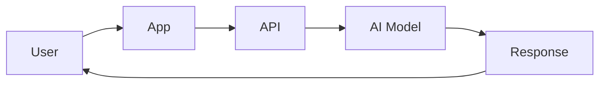
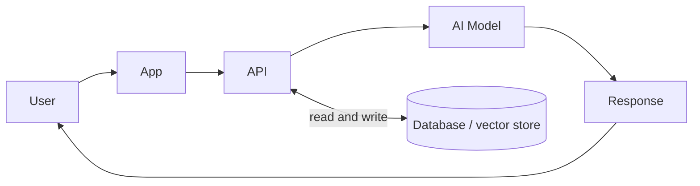
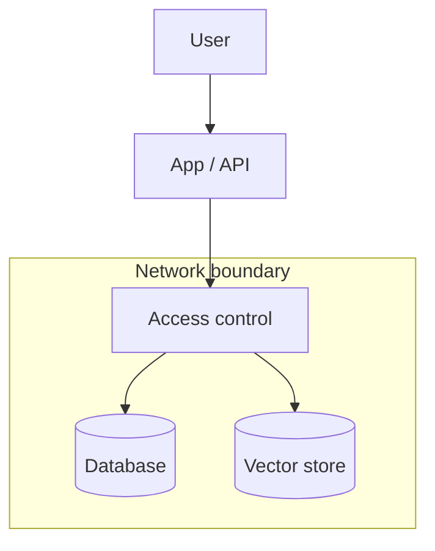

<!-- order: 21 -->
# AI Solutions Architect: Hands-On Project Tutorials

This course is a series of hands-on projects. You learn each idea at the moment you need it, while building the thing.

**By the end of this course, you'll be able to:**
- Turn a business problem into a solutions brief with measurable goals and constraints
- Draw a labeled system diagram showing request flow, data, and integrations
- Compare model options against set criteria and estimate their monthly cost
- Choose a reference architecture (simple API call, RAG, or agentic) and explain why
- Design the data, security, and access-control layer, and write a governance and risk plan
- Present a full architecture proposal to a mixed audience with a clear ask

Follow the projects in order. Each one hands off a skill or artifact to the next.


## Before you start: set up your notebook

**Time: about 15 minutes**

This course runs in **Google Colab**, a free Jupyter notebook in your browser and the standard workspace for AI and data work. There's nothing to install.

1. Go to [colab.research.google.com](https://colab.research.google.com) and sign in with a Google account.
2. Give each project its own notebook: choose **File → New notebook**, then click the title at the top to rename it after the project.
3. Notebooks have two kinds of cells. **Code cells** run Python: type or paste code, then press **Shift + Enter**. **Text cells** hold your notes and written answers: choose **Insert → Text cell**.
4. Install libraries in a code cell with `%pip install ...`. The `%` form installs them into the notebook you're using.
5. Put each code block from a project in its own code cell, in order, and run them top to bottom. When a later step changes earlier code, edit that cell and run it again.
6. To use a file you downloaded, such as a CSV, drag it into the **Files** panel (the folder icon on the left). Files your code creates appear there too. Colab clears them when the session ends, so download anything you want to keep, or connect Google Drive from the same panel.

Prefer to work on your own computer? The same notebooks run in JupyterLab or in VS Code with the Jupyter extension.

---

## Project 1 (Module 1): Write a Solutions Brief for a Business Problem

**Time: about 1.5 hours**

**Goal:** Translate a business problem into a technical direction, the first move a solutions architect makes, before any diagram or code.

**Step 1: Create the project notebook.**
Create a new notebook for this project (**File → New notebook**) and name it `solutions_brief_project`.

**Step 2: Pick a realistic business problem.**
Example: "Our support team is overwhelmed by repetitive questions and response times are hurting customer satisfaction scores."

**Step 3: Identify stakeholders.**
Add a **text cell** headed `brief` and write your notes in it.
A **stakeholder** is anyone with a say in whether the solution succeeds, here, likely support leadership, IT/security, and end customers.

**Step 4: State business goals, not technical ones.**
Write 2–3 measurable business goals (e.g., "reduce average response time by 30%"), not technical goals ("deploy an LLM").

**Step 5: Note constraints.**
List budget range, timeline, existing systems that must be integrated with, and any compliance requirements (e.g., data residency, industry regulations).

**Step 6: Propose a technical direction (not a full design yet).**
Write 2–3 sentences: broadly, is this a good fit for AI, and roughly what kind of solution (e.g., "a retrieval-augmented chatbot integrated with the existing ticketing system")?

**Step 7: Assemble the final brief.**
Combine Steps 3–6 into one page: Business Problem → Stakeholders → Goals → Constraints → Proposed Direction.

### Final Project Structure

*If you worked in a notebook, these are the sections of your notebook (text and code cells), not separate files. Save or export them as files when you put the project in your portfolio.*

```text
solutions_brief_project/
│
├── brief.md
```

### What You Learned
- ✅ Translating a business problem into a written brief
- ✅ Identifying stakeholders and their constraints
- ✅ Separating business goals from technical goals
- ✅ Documenting budget, timeline, and compliance constraints
- ✅ Proposing an initial technical direction
- ✅ Assembling a one-page solutions brief

### Portfolio Project
**AI Solutions Brief**: Translated a business problem into a structured solutions brief covering stakeholders, measurable goals, constraints, and a proposed technical direction.
**Skills:** Business Analysis, Stakeholder Management, Technical Writing, AI Solutions Architecture.

**Deliverable:** A one-page solutions brief covering the business problem, stakeholders, goals, constraints, and proposed direction.

### Quiz

1. Who counts as a stakeholder?
2. Why write business goals instead of technical goals in the brief?
3. Name two kinds of constraints a solutions brief should record.
4. How detailed should the proposed technical direction be at this stage?

*Answers: 1) Anyone with a say in whether the solution succeeds, such as support leadership, IT/security, and end customers. 2) Business goals, like cutting response time by 30%, define success; a technical goal like "deploy an LLM" is only a means and may not be needed. 3) Any two of: budget, timeline, existing systems to integrate with, and compliance requirements such as data residency. 4) Brief, two or three sentences on whether AI fits and roughly what kind of solution, not a full design.*

```watch
{
 "scenes": [
  {
   "kind": "title",
   "art": "doc",
   "kicker": "Project 1 · Solutions brief",
   "title": "Start with the problem",
   "beats": [
    {
     "say": "Welcome to A I Solutions Architect."
    },
    {
     "say": "Before any diagram or code, a solutions architect turns a business problem into a technical direction. That's your first project: a one-page solutions brief."
    }
   ]
  },
  {
   "kind": "quote",
   "art": "mess",
   "kicker": "Step 2",
   "title": "Pick a real problem",
   "quote": "Our support team is overwhelmed by repetitive questions, and response times are hurting customer satisfaction scores.",
   "beats": [
    {
     "say": "Start with a realistic business problem.",
     "show": 0
    },
    {
     "say": "For example: our support team is overwhelmed by repetitive questions, and response times are hurting customer satisfaction.",
     "show": 1
    }
   ]
  },
  {
   "kind": "diagram",
   "kicker": "Step 3",
   "title": "Who has a say in success?",
   "nodes": [
    {
     "id": "prob",
     "label": "Support problem",
     "x": 50,
     "y": 50,
     "sub": "slow, repetitive replies",
     "art": "mess"
    },
    {
     "id": "lead",
     "label": "Support leads",
     "x": 16,
     "y": 20,
     "sub": "own the team",
     "art": "people"
    },
    {
     "id": "it",
     "label": "IT and security",
     "x": 84,
     "y": 20,
     "sub": "own the systems",
     "art": "lock"
    },
    {
     "id": "cust",
     "label": "Customers",
     "x": 50,
     "y": 85,
     "sub": "feel the wait",
     "art": "persona"
    }
   ],
   "edges": [
    {
     "from": "lead",
     "to": "prob"
    },
    {
     "from": "it",
     "to": "prob"
    },
    {
     "from": "cust",
     "to": "prob"
    }
   ],
   "beats": [
    {
     "say": "In a text cell headed brief, start with the problem in the middle.",
     "show": 1,
     "on": "prob"
    },
    {
     "say": "A stakeholder is anyone with a say in whether the solution succeeds.",
     "show": 1
    },
    {
     "say": "Here, support leadership, who run the team.",
     "show": 2,
     "on": "lead"
    },
    {
     "say": "I T and security, who own the systems any solution must fit into.",
     "show": 3,
     "on": "it"
    },
    {
     "say": "And end customers, who feel the slow replies.",
     "show": 4,
     "on": "cust"
    }
   ]
  },
  {
   "kind": "table",
   "kicker": "Step 4",
   "title": "Keep goals about the business",
   "columns": [
    "Draft goal",
    "Kind",
    "Keep?"
   ],
   "rows": [
    [
     "Cut response time 30%",
     "Business",
     "Yes"
    ],
    [
     "Deploy an LLM",
     "Technical",
     "No"
    ],
    [
     "Fewer repeat tickets",
     "Business",
     "Yes"
    ],
    [
     "Add a vector database",
     "Technical",
     "No"
    ]
   ],
   "beats": [
    {
     "say": "Here are four draft goals. Let's sort them."
    },
    {
     "say": "Reduce average response time by thirty percent. That's a measurable business outcome.",
     "hl": 0,
     "col": 0
    },
    {
     "say": "Deploy an L L M is a technical goal. It's only a means, and it may not even be needed.",
     "hl": 1,
     "col": 1
    },
    {
     "say": "So keep two or three measurable business goals, and drop the technical ones.",
     "sql": "Keep: measurable business outcomes",
     "hl": [
      0,
      2
     ],
     "dim": true,
     "col": 2
    }
   ]
  },
  {
   "kind": "table",
   "kicker": "Steps 5 and 6",
   "title": "Constraints, then a direction",
   "columns": [
    "Constraint",
    "For example"
   ],
   "rows": [
    [
     "Budget",
     "A range"
    ],
    [
     "Timeline",
     "When it must be live"
    ],
    [
     "Existing systems",
     "Ticketing system"
    ],
    [
     "Compliance",
     "Data residency"
    ],
    [
     "Direction",
     "RAG bot + ticketing"
    ]
   ],
   "beats": [
    {
     "say": "Next, note your constraints, one row each."
    },
    {
     "say": "A budget range, and a timeline. These shape everything that follows.",
     "hl": [
      0,
      1
     ]
    },
    {
     "say": "The existing systems you must integrate with, like the ticketing system.",
     "hl": 2
    },
    {
     "say": "And compliance needs, like data residency or industry regulations.",
     "hl": 3
    },
    {
     "say": "Then propose a direction in two or three sentences, for example, a retrieval-augmented chatbot integrated with the existing ticketing system. Not a full design yet.",
     "hl": 4,
     "dim": true,
     "sql": "Direction: 2–3 sentences"
    }
   ]
  },
  {
   "kind": "array",
   "kicker": "Step 7",
   "title": "Assemble the one-page brief",
   "values": [
    "Problem",
    "Stakeholders",
    "Goals",
    "Constraints",
    "Direction"
   ],
   "beats": [
    {
     "say": "Finally, combine it all into one page, in this order."
    },
    {
     "say": "The business problem.",
     "ptr": {
      "now": 0
     },
     "hl": 0
    },
    {
     "say": "The stakeholders.",
     "ok": [
      0
     ],
     "ptr": {
      "now": 1
     },
     "hl": 1
    },
    {
     "say": "The goals.",
     "ok": [
      0,
      1
     ],
     "ptr": {
      "now": 2
     },
     "hl": 2
    },
    {
     "say": "The constraints.",
     "ok": [
      0,
      1,
      2
     ],
     "ptr": {
      "now": 3
     },
     "hl": 3
    },
    {
     "say": "And the proposed direction. That's your brief.",
     "ok": [
      0,
      1,
      2,
      3,
      4
     ],
     "note": "One page, five sections"
    }
   ]
  },
  {
   "kind": "quiz",
   "art": "ask",
   "kicker": "Quick check",
   "title": "Why write business goals instead of technical goals in the brief?",
   "options": [
    "Business goals define success; a technical goal is only a means and may not be needed",
    "Technical goals are too hard to measure",
    "Stakeholders can't read technical goals"
   ],
   "answer": 0,
   "good": "That's right. Business goals, like cutting response time by thirty percent, define success. A technical goal like deploy an L L M is only a means, and may not be needed.",
   "bad": "Not quite. Business goals, like cutting response time by thirty percent, define success. A technical goal like deploy an L L M is only a means, and may not be needed.",
   "beats": [
    {
     "say": "Quick check.",
     "show": 0
    },
    {
     "say": "Why write business goals instead of technical goals in the brief?",
     "show": 0
    },
    {
     "say": "Tap your answer.",
     "show": 1
    }
   ]
  },
  {
   "kind": "list",
   "art": "proof",
   "kicker": "Checkpoint",
   "title": "You're done when",
   "items": [
    [
     "A one-page solutions brief",
     ""
    ],
    [
     "Problem, stakeholders, goals, constraints, direction",
     ""
    ]
   ],
   "beats": [
    {
     "say": "That's Project 1.",
     "show": 0
    },
    {
     "say": "You're done when:",
     "show": 0
    },
    {
     "say": "you have a one-page solutions brief,",
     "show": 1
    },
    {
     "say": "covering the problem, stakeholders, goals, constraints and proposed direction.",
     "show": 2
    },
    {
     "say": "Next, in Module 2, a system diagram for your A I service.",
     "show": 2
    }
   ]
  }
 ]
}
```

---

## Project 2 (Module 2): Design a System Diagram for an AI Service

**Time: about 2 hours**

**Goal:** Visualize the service you're proposing, the first technical artifact that turns your Project 1 brief into something engineers can react to.

**Step 1: Create the project notebook.**
Create a new notebook for this project (**File → New notebook**) and name it `system_diagram_project`.

**Step 2: List the major components.**
Based on your Project 1 brief, list the pieces the system will need: user-facing app, API layer, AI model, data store, integration with existing systems.

**Step 3: Understand standard architecture diagram conventions.**
Boxes typically represent **components** (services, databases); arrows represent **data flow** or **requests**, usually labeled with direction and what's being sent.

**Step 4: The request flow.**
The core path a request takes:



**Step 5: Add the data layer.**
Now show where data lives and which component reads and writes it:



To draw your own version, use the free [diagrams.net](https://app.diagrams.net) in your browser, or paste the diagram code above into [mermaid.live](https://mermaid.live), edit it, and export it as a PNG.

**Step 6: Add integration points.**
Draw connections to any existing systems named in your Project 1 constraints (e.g., "existing ticketing system").

**Step 7: Label everything.**
Add labels to every arrow (what data/request is flowing) and every box (what the component does in one phrase).

**Step 8: Get a "can you read this cold" check.**
Show the diagram to someone unfamiliar with the project and ask them to explain back what they think it shows.

### Final Project Structure

*If you worked in a notebook, these are the sections of your notebook (text and code cells), not separate files. Save or export them as files when you put the project in your portfolio.*

```text
system_diagram_project/
│
├── system_diagram_v1.png
├── diagram_notes.md
```

### What You Learned
- ✅ Identifying major system components from a business brief
- ✅ Standard architecture diagram conventions
- ✅ Diagramming the request/response flow
- ✅ Representing the data layer visually
- ✅ Showing integration with existing systems
- ✅ Labeling for clarity and getting outside feedback

### Portfolio Project
**AI Service System Diagram**: Translated a solutions brief into a labeled system architecture diagram showing request flow, data layer, and integration points with existing infrastructure.
**Skills:** System Design, Architecture Diagramming, Technical Communication, AI Solutions Architecture.

**Deliverable:** A labeled system diagram for your proposed AI service, validated by an outside reader.

### Quiz

1. In an architecture diagram, what do boxes and arrows usually represent?
2. What does the data layer add to the basic request flow diagram?
3. Why label every arrow?
4. What is the point of the "read this cold" check?

*Answers: 1) Boxes are components such as services or databases; arrows are data flow or requests, labeled with what is sent. 2) It shows where data is stored and which component reads and writes it. 3) Unlabeled arrows leave readers guessing what data or request moves between components. 4) If someone new to the project can explain the diagram back correctly, it communicates clearly.*

```watch
{
 "scenes": [
  {
   "kind": "title",
   "art": "architecture",
   "kicker": "Project 2 · System diagram",
   "title": "Draw the service",
   "beats": [
    {
     "say": "Welcome to Module 2."
    },
    {
     "say": "Now you turn your brief into the first technical artifact engineers can react to: a labeled system diagram."
    }
   ]
  },
  {
   "kind": "table",
   "kicker": "Steps 2 and 3",
   "title": "Components, boxes and arrows",
   "columns": [
    "On the diagram",
    "Means"
   ],
   "rows": [
    [
     "Box",
     "A component"
    ],
    [
     "Arrow",
     "Data flow or a request"
    ],
    [
     "Arrow label",
     "What is being sent"
    ]
   ],
   "beats": [
    {
     "say": "From your brief, list the pieces you need: a user-facing app, an A P I layer, an A I model, a data store, and integrations."
    },
    {
     "say": "On the diagram, each one is a box: a component, like a service or a database.",
     "hl": 0
    },
    {
     "say": "Arrows show data flow or requests, with a direction.",
     "hl": 1
    },
    {
     "say": "And each arrow gets a label saying what's being sent.",
     "hl": 2
    }
   ]
  },
  {
   "kind": "diagram",
   "kicker": "Step 4",
   "title": "Follow one request",
   "nodes": [
    {
     "id": "user",
     "label": "User",
     "x": 12,
     "y": 50,
     "sub": "a customer",
     "art": "persona"
    },
    {
     "id": "app",
     "label": "App",
     "x": 36,
     "y": 16,
     "sub": "chat window",
     "art": "phone"
    },
    {
     "id": "api",
     "label": "API",
     "x": 66,
     "y": 16,
     "sub": "your service",
     "art": "server"
    },
    {
     "id": "model",
     "label": "AI Model",
     "x": 88,
     "y": 50,
     "sub": "writes the reply",
     "art": "neural"
    },
    {
     "id": "resp",
     "label": "Response",
     "x": 50,
     "y": 84,
     "sub": "back to the user",
     "art": "chat"
    }
   ],
   "edges": [
    {
     "from": "user",
     "to": "app"
    },
    {
     "from": "app",
     "to": "api"
    },
    {
     "from": "api",
     "to": "model"
    },
    {
     "from": "model",
     "to": "resp"
    },
    {
     "from": "resp",
     "to": "user"
    }
   ],
   "beats": [
    {
     "say": "Start with the core path a request takes. Five boxes.",
     "show": 5
    },
    {
     "say": "A customer types a question into the app.",
     "on": "user",
     "send": {
      "from": "user",
      "to": "app",
      "label": "question"
     }
    },
    {
     "say": "The app sends it to your A P I.",
     "on": "app",
     "send": {
      "from": "app",
      "to": "api",
      "label": "request"
     }
    },
    {
     "say": "The A P I passes it to the A I model.",
     "on": "api",
     "send": {
      "from": "api",
      "to": "model",
      "label": "prompt"
     }
    },
    {
     "say": "The model writes a response.",
     "on": "model",
     "send": {
      "from": "model",
      "to": "resp",
      "label": "answer"
     }
    },
    {
     "say": "And the response goes back to the user. One full loop.",
     "on": "resp",
     "send": {
      "from": "resp",
      "to": "user",
      "label": "reply"
     }
    }
   ]
  },
  {
   "kind": "diagram",
   "kicker": "Steps 5 and 6",
   "title": "Add data and an existing system",
   "nodes": [
    {
     "id": "user",
     "label": "User",
     "x": 10,
     "y": 50,
     "art": "persona"
    },
    {
     "id": "app",
     "label": "App",
     "x": 30,
     "y": 18,
     "art": "phone"
    },
    {
     "id": "api",
     "label": "API",
     "x": 52,
     "y": 50,
     "sub": "your service",
     "art": "server"
    },
    {
     "id": "model",
     "label": "AI Model",
     "x": 86,
     "y": 18,
     "art": "neural"
    },
    {
     "id": "db",
     "label": "Vector store",
     "x": 30,
     "y": 84,
     "sub": "help articles",
     "art": "database"
    },
    {
     "id": "tix",
     "label": "Ticketing",
     "x": 86,
     "y": 82,
     "sub": "existing system",
     "art": "plug"
    }
   ],
   "edges": [
    {
     "from": "user",
     "to": "app"
    },
    {
     "from": "app",
     "to": "api"
    },
    {
     "from": "api",
     "to": "model"
    },
    {
     "from": "api",
     "to": "db"
    },
    {
     "from": "api",
     "to": "tix"
    }
   ],
   "beats": [
    {
     "say": "Here's the request flow again, now with a data layer and an integration.",
     "show": 4
    },
    {
     "say": "Add where data lives: a database or vector store.",
     "show": 5,
     "on": "db"
    },
    {
     "say": "The A P I reads from it, to find relevant help articles.",
     "on": "api",
     "send": {
      "from": "api",
      "to": "db",
      "label": "search"
     }
    },
    {
     "say": "And it gets the matching documents back.",
     "on": "db",
     "send": {
      "from": "db",
      "to": "api",
      "label": "top articles"
     }
    },
    {
     "say": "Then connect the existing systems named in your constraints, like the ticketing system.",
     "show": 6,
     "on": "tix"
    },
    {
     "say": "When the bot can't help, the A P I opens a ticket there.",
     "on": "api",
     "send": {
      "from": "api",
      "to": "tix",
      "label": "new ticket"
     }
    }
   ]
  },
  {
   "kind": "table",
   "kicker": "Steps 7 and 8",
   "title": "Label every arrow, then test it cold",
   "columns": [
    "Arrow",
    "Label"
   ],
   "rows": [
    [
     "User → App",
     "Customer question"
    ],
    [
     "App → API",
     "Chat request"
    ],
    [
     "API ⇄ Vector store",
     "Search · top articles"
    ],
    [
     "API → Model",
     "Prompt + articles"
    ],
    [
     "API → Ticketing",
     "New ticket"
    ]
   ],
   "beats": [
    {
     "say": "Now label everything. Each arrow says what's flowing.",
     "col": 1
    },
    {
     "say": "The user sends a customer question. The app sends a chat request.",
     "hl": [
      0,
      1
     ]
    },
    {
     "say": "The A P I searches the vector store, and sends the prompt with the articles to the model.",
     "hl": [
      2,
      3
     ]
    },
    {
     "say": "Unlabeled arrows leave readers guessing. Give every box a one-phrase job too.",
     "hl": 4
    },
    {
     "say": "Then show it to someone new to the project. If they can explain it back, it communicates clearly.",
     "sql": "Read it cold: can a newcomer explain it back?"
    }
   ]
  },
  {
   "kind": "quiz",
   "art": "ask",
   "kicker": "Quick check",
   "title": "What does the data layer add to the basic request flow diagram?",
   "options": [
    "How fast each request is",
    "Which model is used",
    "Where data is stored, and which component reads and writes it"
   ],
   "answer": 2,
   "good": "That's right. The data layer shows where data is stored, and which component reads and writes it.",
   "bad": "Not quite. The data layer shows where data is stored, and which component reads and writes it.",
   "beats": [
    {
     "say": "Quick check.",
     "show": 0
    },
    {
     "say": "What does the data layer add to the basic request flow diagram?",
     "show": 0
    },
    {
     "say": "Tap your answer.",
     "show": 1
    }
   ]
  },
  {
   "kind": "list",
   "art": "proof",
   "kicker": "Checkpoint",
   "title": "You're done when",
   "items": [
    [
     "A labeled system diagram",
     ""
    ],
    [
     "Validated by an outside reader",
     ""
    ]
   ],
   "beats": [
    {
     "say": "That's Project 2.",
     "show": 0
    },
    {
     "say": "You're done when:",
     "show": 0
    },
    {
     "say": "you have a labeled system diagram for your proposed A I service,",
     "show": 1
    },
    {
     "say": "validated by an outside reader.",
     "show": 2
    },
    {
     "say": "Next, in Module 3, comparing model options.",
     "show": 2
    }
   ]
  }
 ]
}
```

---

## Project 3 (Module 3): Compare Model Options for a Given Use Case

**Time: about 1.5 hours**

**Goal:** Decide which AI approach actually fits the problem, replacing assumption with a documented comparison.

**Step 1: Create the project notebook.**
Create a new notebook for this project (**File → New notebook**) and name it `model_comparison_project`.

**Step 2: Define your evaluation criteria.**
Add a **text cell** headed `criteria` and write your notes in it.
Typical criteria include **accuracy/quality** for the task, **latency** (response speed), **cost per request**, **data privacy** (does data leave your infrastructure), and **ease of integration**.

**Step 3: Identify 2–4 candidate approaches.**
Examples: a general-purpose LLM API, a smaller open-weight model self-hosted, a fine-tuned specialized model, or a non-AI rules-based approach as a baseline.

**Step 4: Research each option against your criteria.**
Add a **text cell** headed `comparison_matrix` and write your notes in it.
Build a table: rows are your candidates, columns are your Step 2 criteria.

**Step 5: Understand the fine-tuning vs. prompting tradeoff.**
**prompting** (including RAG) adapts a general model's behavior at request time without changing its weights; **fine-tuning** further trains a model's weights on your specific data.

**Step 6: Estimate rough costs.**
For each candidate, estimate cost per 1,000 requests (API pricing) or infrastructure cost (self-hosted compute). LLM APIs charge per **token** (a token is roughly three quarters of an English word), with separate prices for input and output tokens, usually quoted per million tokens. Add a **code cell**, paste in the code below, and run it with **Shift + Enter**:
```python
# Template: the prices below are made-up examples. Replace them with the current
# published prices for the options you're comparing (US dollars per million tokens).
api_options = {
    "Large model API": {"input_per_mtok": 3.00, "output_per_mtok": 15.00},
    "Small model API": {"input_per_mtok": 0.80, "output_per_mtok": 4.00},
}
avg_input_tokens = 1500     # your prompt plus any retrieved documents, per request
avg_output_tokens = 300     # length of a typical answer
requests_per_month = 50_000

for name, price in api_options.items():
    per_request = (avg_input_tokens * price["input_per_mtok"]
                   + avg_output_tokens * price["output_per_mtok"]) / 1_000_000
    print(f"{name}: ${per_request * 1000:.2f} per 1,000 requests, "
          f"${per_request * requests_per_month:,.0f} per month")

# Self-hosted: you pay for the machine by the hour, whether or not anyone uses it.
gpu_cost_per_hour = 1.20    # Template: example price for one cloud GPU; replace with a real quote
hours_per_month = 730       # running all month
print(f"Self-hosted model: ${gpu_cost_per_hour * hours_per_month:,.0f} per month at any traffic level")
```
Change `requests_per_month` to 5,000 and to 500,000 and rerun. API cost grows with traffic, while self-hosted cost stays fixed, so the cheaper option depends on your volume.

**Step 7: Make and justify a recommendation.**
Add a **text cell** headed `recommendation` and write your notes in it.
State which option you'd recommend and why, referencing your matrix directly.

### Final Project Structure

*If you worked in a notebook, these are the sections of your notebook (text and code cells), not separate files. Save or export them as files when you put the project in your portfolio.*

```text
model_comparison_project/
│
├── criteria.md
├── comparison_matrix.md
├── recommendation.md
```

### What You Learned
- ✅ Defining evaluation criteria before comparing options
- ✅ Including a non-AI baseline in comparisons
- ✅ Building a structured comparison matrix
- ✅ The fine-tuning vs. prompting/RAG tradeoff
- ✅ Estimating rough cost per option
- ✅ Writing a justified recommendation

### Portfolio Project
**AI Model Selection Comparison**: Evaluated multiple AI approaches (including a non-AI baseline) against defined criteria, quality, latency, cost, privacy, integration, and produced a justified recommendation.
**Skills:** Technical Evaluation, Cost Analysis, Decision Documentation, AI Solutions Architecture.

**Deliverable:** A comparison matrix and written recommendation for the AI approach best suited to your use case.

### Quiz

1. Why define evaluation criteria before comparing options?
2. Why include a non-AI, rules-based approach in the comparison?
3. What is the difference between prompting (including RAG) and fine-tuning?
4. Name three common criteria for comparing model options.
5. Why can a self-hosted model be the more expensive choice at low traffic but the cheaper one at high traffic?

*Answers: 1) So every option is judged on the same factors and the choice isn't shaped by a favorite. 2) It is a baseline; if it solves the problem well enough, AI may not be worth the cost and risk. 3) Prompting adapts a general model at request time without changing its weights; fine-tuning trains the model's weights further on your data. 4) Any three of: accuracy/quality, latency, cost per request, data privacy, and ease of integration. 5) A self-hosted machine costs the same every hour whatever the traffic, while API cost grows with every request, so the API is cheaper at low volume and the fixed cost wins at high volume.*

```watch
{
 "scenes": [
  {
   "kind": "title",
   "art": "scales",
   "kicker": "Project 3 · Model options",
   "title": "Compare before you choose",
   "beats": [
    {
     "say": "Welcome to Module 3."
    },
    {
     "say": "Which A I approach actually fits the problem? Here you replace assumption with a documented comparison."
    }
   ]
  },
  {
   "kind": "table",
   "kicker": "Steps 2 to 4",
   "title": "The comparison matrix (example ratings)",
   "columns": [
    "Candidate",
    "Quality",
    "Cost",
    "Privacy"
   ],
   "rows": [
    [
     "LLM API",
     "High",
     "Per token",
     "Data leaves"
    ],
    [
     "Open-weight, self-host",
     "Varies",
     "Fixed per hour",
     "Stays in-house"
    ],
    [
     "Fine-tuned model",
     "Strong on your task",
     "Training + serving",
     "Depends on host"
    ],
    [
     "Rules-based baseline",
     "Fixed cases only",
     "Lowest",
     "Stays in-house"
    ]
   ],
   "beats": [
    {
     "say": "Define your criteria first, so every option is judged on the same factors.",
     "sql": "Criteria: quality · latency · cost · privacy · integration"
    },
    {
     "say": "Then put two to four candidates in the rows. These ratings are only examples.",
     "col": 0
    },
    {
     "say": "Read down one column at a time. Privacy: with an L L M A P I, your data leaves your infrastructure.",
     "col": 3,
     "hl": 0
    },
    {
     "say": "Self-hosting keeps it in-house.",
     "col": 3,
     "hl": 1
    },
    {
     "say": "And always include a non-A I, rules-based baseline. If it's good enough, A I may not be worth the cost and risk.",
     "hl": 3,
     "dim": true
    },
    {
     "say": "Latency and ease of integration get their own columns in your full matrix too."
    }
   ]
  },
  {
   "kind": "diagram",
   "kicker": "Step 5",
   "title": "Prompting versus fine-tuning",
   "nodes": [
    {
     "id": "data",
     "label": "Your data",
     "x": 12,
     "y": 50,
     "sub": "docs and examples",
     "art": "doc"
    },
    {
     "id": "prompt",
     "label": "Prompt + RAG",
     "x": 45,
     "y": 18,
     "sub": "built per request",
     "art": "chat"
    },
    {
     "id": "model",
     "label": "Model weights",
     "x": 80,
     "y": 50,
     "sub": "what it has learned",
     "art": "neural"
    },
    {
     "id": "ans",
     "label": "Answer",
     "x": 45,
     "y": 84,
     "art": "sparkle"
    }
   ],
   "edges": [
    {
     "from": "data",
     "to": "prompt"
    },
    {
     "from": "prompt",
     "to": "model"
    },
    {
     "from": "model",
     "to": "ans"
    },
    {
     "from": "data",
     "to": "model"
    }
   ],
   "beats": [
    {
     "say": "Two ways to adapt a general model to your problem.",
     "show": 4
    },
    {
     "say": "Prompting, including RAG, works at request time. Relevant data goes into the prompt.",
     "on": "prompt",
     "send": {
      "from": "data",
      "to": "prompt",
      "label": "retrieved docs"
     }
    },
    {
     "say": "The model reads the prompt and answers.",
     "on": "model",
     "send": {
      "from": "prompt",
      "to": "model",
      "label": "request"
     }
    },
    {
     "say": "Its weights never change.",
     "on": "model",
     "send": {
      "from": "model",
      "to": "ans",
      "label": "answer"
     }
    },
    {
     "say": "Fine-tuning is different: it further trains the model's weights on your data, before any request arrives.",
     "on": [
      "data",
      "model"
     ],
     "send": {
      "from": "data",
      "to": "model",
      "label": "training run"
     }
    }
   ]
  },
  {
   "kind": "walk",
   "kicker": "Step 6 · simplified",
   "title": "Estimate the monthly cost",
   "file": "model_comparison_project",
   "code": "api_options = {\n    \"Large model API\": (3.00, 15.00),\n    \"Small model API\": (0.80, 4.00),\n}  # ($ input, $ output) per million tokens\navg_input_tokens = 1500\navg_output_tokens = 300\nrequests_per_month = 50_000\nfor name, (inp, out) in api_options.items():\n    per_request = (avg_input_tokens * inp\n        + avg_output_tokens * out) / 1_000_000\n    monthly = per_request * requests_per_month\n    print(f\"{name}: ${monthly:,.0f} per month\")\nself_hosted = 1.20 * 730  # $ per GPU hour × hours\nprint(f\"Self-hosted: ${self_hosted:,.0f} per month\")",
   "beats": [
    {
     "say": "L L M A P Is charge per token, about three quarters of a word, with separate input and output prices per million tokens. These prices are made-up examples.",
     "line": [
      1,
      4
     ]
    },
    {
     "say": "Each request averages fifteen hundred input tokens and three hundred output tokens, fifty thousand times a month.",
     "line": [
      5,
      7
     ],
     "vars": {
      "avg_input_tokens": 1500,
      "avg_output_tokens": 300,
      "requests_per_month": "50,000"
     }
    },
    {
     "say": "First, the large model. Fifteen hundred times three dollars, plus three hundred times fifteen, over a million: nine tenths of a cent per request.",
     "line": [
      8,
      10
     ],
     "vars": {
      "name": "Large model API",
      "per_request": 0.009
     }
    },
    {
     "say": "Times fifty thousand requests: four hundred and fifty dollars a month.",
     "line": [
      11,
      12
     ],
     "vars": {
      "monthly": 450
     },
     "out": "Large model API: $450 per month"
    },
    {
     "say": "The small model costs a quarter of a cent per request, so one hundred and twenty dollars a month.",
     "line": [
      8,
      12
     ],
     "vars": {
      "name": "Small model API",
      "per_request": 0.0024,
      "monthly": 120
     },
     "out": "Small model API: $120 per month"
    },
    {
     "say": "A self-hosted G P U costs one dollar twenty an hour for seven hundred and thirty hours: eight hundred and seventy six dollars, whether anyone uses it or not.",
     "line": [
      13,
      14
     ],
     "vars": {
      "self_hosted": 876
     },
     "out": "Self-hosted: $876 per month"
    }
   ]
  },
  {
   "kind": "chart",
   "kicker": "Step 6",
   "title": "The cheaper option depends on volume",
   "points": [
    [
     1,
     0.8
    ],
    [
     10,
     8.0
    ],
    [
     20,
     16.0
    ],
    [
     40,
     32.0
    ],
    [
     60,
     48.0
    ],
    [
     80,
     64.0
    ],
    [
     100,
     80.0
    ],
    [
     1,
     58.4
    ],
    [
     10,
     58.4
    ],
    [
     20,
     58.4
    ],
    [
     40,
     58.4
    ],
    [
     60,
     58.4
    ],
    [
     80,
     58.4
    ],
    [
     100,
     58.4
    ]
   ],
   "xlabel": "requests per month (0 to 500k)",
   "ylabel": "monthly cost (0 to $1,500)",
   "beats": [
    {
     "say": "Now change the traffic. Across the bottom, zero to five hundred thousand requests a month.",
     "groups": [
      1,
      1,
      1,
      1,
      1,
      1,
      1,
      0,
      0,
      0,
      0,
      0,
      0,
      0
     ]
    },
    {
     "say": "The small model A P I grows with every request: twelve dollars at five thousand, twelve hundred at five hundred thousand.",
     "groups": [
      1,
      1,
      1,
      1,
      1,
      1,
      1,
      0,
      0,
      0,
      0,
      0,
      0,
      0
     ],
     "line": [
      0.8,
      0
     ]
    },
    {
     "say": "The self-hosted model stays at eight hundred and seventy six dollars, at any traffic level.",
     "groups": [
      1,
      1,
      1,
      1,
      1,
      1,
      1,
      2,
      2,
      2,
      2,
      2,
      2,
      2
     ],
     "line": [
      0,
      58.4
     ]
    },
    {
     "say": "The lines cross at about three hundred and sixty five thousand requests. Below that, the A P I is cheaper. Above it, self-hosting wins.",
     "groups": [
      1,
      1,
      1,
      1,
      1,
      1,
      1,
      2,
      2,
      2,
      2,
      2,
      2,
      2
     ],
     "marks": [
      [
       73,
       58.4
      ]
     ]
    },
    {
     "say": "The large model costs nearly four times as much per request, so it crosses much sooner, at under a hundred thousand.",
     "groups": [
      1,
      1,
      1,
      1,
      1,
      1,
      1,
      2,
      2,
      2,
      2,
      2,
      2,
      2
     ],
     "marks": [
      [
       73,
       58.4
      ]
     ]
    }
   ]
  },
  {
   "kind": "quote",
   "art": "pencil",
   "kicker": "Step 7",
   "title": "Recommend, and justify it",
   "quote": "Recommend one option, and justify it from your matrix.",
   "beats": [
    {
     "say": "Last, in a text cell headed recommendation, state which option you'd choose.",
     "show": 0
    },
    {
     "say": "And why, pointing directly at your matrix and your cost estimate.",
     "show": 1
    }
   ]
  },
  {
   "kind": "quiz",
   "art": "ask",
   "kicker": "Quick check",
   "title": "Why can a self-hosted model be cheaper only at high traffic?",
   "options": [
    "Self-hosted models get faster with more users",
    "Its cost is fixed every hour, while A P I cost grows with every request",
    "A P I prices rise at high volume"
   ],
   "answer": 1,
   "good": "That's right. A self-hosted machine costs the same every hour whatever the traffic, while A P I cost grows with every request. So the A P I wins at low volume, and the fixed cost wins at high volume.",
   "bad": "Not quite. A self-hosted machine costs the same every hour whatever the traffic, while A P I cost grows with every request. So the A P I wins at low volume, and the fixed cost wins at high volume.",
   "beats": [
    {
     "say": "Quick check.",
     "show": 0
    },
    {
     "say": "Why can a self-hosted model be cheaper only at high traffic?",
     "show": 0
    },
    {
     "say": "Tap your answer.",
     "show": 1
    }
   ]
  },
  {
   "kind": "list",
   "art": "proof",
   "kicker": "Checkpoint",
   "title": "You're done when",
   "items": [
    [
     "A comparison matrix with a baseline",
     ""
    ],
    [
     "A justified recommendation",
     ""
    ]
   ],
   "beats": [
    {
     "say": "That's Project 3.",
     "show": 0
    },
    {
     "say": "You're done when:",
     "show": 0
    },
    {
     "say": "you have a comparison matrix, including a non-A I baseline,",
     "show": 1
    },
    {
     "say": "and a written recommendation for the best-suited approach.",
     "show": 2
    },
    {
     "say": "Next, in Module 4, an end-to-end system architecture.",
     "show": 2
    }
   ]
  }
 ]
}
```

---

## Project 4 (Module 4): Design an End-to-End AI System Architecture

**Time: about 2 hours**

**Goal:** Expand your Project 2 diagram into a full system design, the central architecture document for the whole solution.

**Step 1: Create the project notebook.**
Create a new notebook for this project (**File → New notebook**) and name it `full_architecture_project`.
Copy in `system_diagram_v1.png` and `recommendation.md` from Projects 2 and 3.

**Step 2: Understand common reference architectures.**
A **RAG architecture** retrieves relevant data before generating a response; an **agentic architecture** lets the AI call tools/APIs to take actions; a **simple API-call architecture** just sends a prompt and returns a response.

**Step 3: Choose your architecture pattern.**
Based on Project 3's recommendation, decide which pattern (or combination) fits.

**Step 4: Expand the diagram with your chosen model.**
Update your Project 2 diagram to show your Project 3-selected model/approach specifically, not a generic "AI Model" box.

**Step 5: Add integration patterns.**
An **API gateway** manages external access to your service; a **message queue** handles asynchronous processing (useful if requests can take a while).

**Step 6: Address scalability.**
Note: what happens if traffic doubles? Where would this design bottleneck first?

**Step 7: Estimate rough costs for the full system.**
Combine your Project 3 model costs with rough infrastructure costs (hosting, storage, networking).

**Step 8: Write the architecture document.**
Add a **text cell** headed `architecture` and write your notes in it.
Structure: Pattern chosen and why → Full diagram → Components and their roles → Scalability notes → Rough cost estimate.

### Final Project Structure

*If you worked in a notebook, these are the sections of your notebook (text and code cells), not separate files. Save or export them as files when you put the project in your portfolio.*

```text
full_architecture_project/
│
├── architecture_diagram_v2.png
├── architecture.md
```

### What You Learned
- ✅ Common AI reference architecture patterns (RAG, agentic, simple API)
- ✅ Choosing a pattern based on a documented model comparison
- ✅ Adding integration patterns (API gateways, message queues)
- ✅ Identifying likely scalability bottlenecks
- ✅ Estimating full-system cost, not just model cost
- ✅ Writing a complete architecture document

### Portfolio Project
**End-to-End AI System Architecture**: Designed a complete AI system architecture using a chosen reference pattern (RAG/agentic/API), including integration design, scalability analysis, and full-system cost estimates.
**Skills:** System Architecture, Reference Architecture Patterns, Scalability Planning, Cost Estimation, AI Solutions Architecture.

**Deliverable:** A full architecture document and diagram, covering pattern choice, components, scalability, and cost.

### Quiz

1. How does a RAG architecture differ from a simple API-call architecture?
2. What does an agentic architecture let the AI do?
3. When is a message queue useful?
4. Why ask what happens if traffic doubles?

*Answers: 1) RAG retrieves relevant data before generating a response; a simple API call just sends a prompt and returns the reply. 2) Call tools or APIs to take actions, not just generate text. 3) When requests may take a while, so they can be processed asynchronously instead of making users wait. 4) It reveals where the design would bottleneck first, so you can plan for scale.*

```watch
{
 "scenes": [
  {
   "kind": "title",
   "art": "blueprint",
   "kicker": "Project 4 · Full architecture",
   "title": "Design the whole system",
   "beats": [
    {
     "say": "Welcome to Module 4."
    },
    {
     "say": "Now you expand your Project 2 diagram into a full system design: the central architecture document for the whole solution."
    }
   ]
  },
  {
   "kind": "table",
   "kicker": "Steps 2 and 3",
   "title": "Three reference architectures",
   "columns": [
    "Pattern",
    "How it works",
    "Good when"
   ],
   "rows": [
    [
     "Simple API call",
     "Prompt in, reply out",
     "The model alone knows"
    ],
    [
     "RAG",
     "Retrieve, then answer",
     "Answers need your docs"
    ],
    [
     "Agentic",
     "Calls tools to act",
     "It must take actions"
    ]
   ],
   "beats": [
    {
     "say": "There are three common patterns.",
     "col": 0
    },
    {
     "say": "A simple A P I call just sends a prompt and returns a response.",
     "hl": 0
    },
    {
     "say": "RAG retrieves relevant data before generating a response.",
     "hl": 1
    },
    {
     "say": "And agentic lets the A I call tools or A P Is to take actions.",
     "hl": 2
    },
    {
     "say": "Use your Project 3 recommendation to choose one, or a combination. Our support bot answers from help articles, so it's RAG.",
     "hl": 1,
     "dim": true,
     "sql": "Support bot → RAG"
    }
   ]
  },
  {
   "kind": "diagram",
   "kicker": "Steps 4 and 5",
   "title": "RAG, with your chosen model and a gateway",
   "nodes": [
    {
     "id": "user",
     "label": "User",
     "x": 10,
     "y": 50,
     "art": "persona"
    },
    {
     "id": "gw",
     "label": "API gateway",
     "x": 32,
     "y": 18,
     "sub": "external access",
     "art": "firewall"
    },
    {
     "id": "api",
     "label": "Chat service",
     "x": 56,
     "y": 50,
     "sub": "builds the prompt",
     "art": "server"
    },
    {
     "id": "vs",
     "label": "Vector store",
     "x": 32,
     "y": 84,
     "sub": "help articles",
     "art": "database"
    },
    {
     "id": "model",
     "label": "Small model API",
     "x": 88,
     "y": 50,
     "sub": "chosen in Project 3",
     "art": "neural"
    }
   ],
   "edges": [
    {
     "from": "user",
     "to": "gw"
    },
    {
     "from": "gw",
     "to": "api"
    },
    {
     "from": "api",
     "to": "vs"
    },
    {
     "from": "api",
     "to": "model"
    }
   ],
   "beats": [
    {
     "say": "Here's the support bot as a RAG design. Notice the model box names the actual model you chose, not a generic A I model.",
     "show": 5,
     "on": "model"
    },
    {
     "say": "Requests come in through an A P I gateway, which manages external access to your service.",
     "on": "gw",
     "send": {
      "from": "user",
      "to": "gw",
      "label": "question"
     }
    },
    {
     "say": "The gateway passes allowed requests to the chat service.",
     "on": "api",
     "send": {
      "from": "gw",
      "to": "api",
      "label": "question"
     }
    },
    {
     "say": "Retrieve: the service searches the vector store.",
     "on": "vs",
     "send": {
      "from": "api",
      "to": "vs",
      "label": "search"
     }
    },
    {
     "say": "And gets the most relevant articles back.",
     "on": "api",
     "send": {
      "from": "vs",
      "to": "api",
      "label": "top articles"
     }
    },
    {
     "say": "Then generate: the question and articles go to the model.",
     "on": "model",
     "send": {
      "from": "api",
      "to": "model",
      "label": "question + docs"
     }
    },
    {
     "say": "The answer travels back the same way.",
     "on": "user",
     "send": {
      "from": "gw",
      "to": "user",
      "label": "answer"
     }
    }
   ]
  },
  {
   "kind": "diagram",
   "kicker": "Step 5",
   "title": "A message queue for slow work",
   "nodes": [
    {
     "id": "user",
     "label": "User",
     "x": 10,
     "y": 50,
     "art": "persona"
    },
    {
     "id": "api",
     "label": "Chat service",
     "x": 38,
     "y": 50,
     "art": "server"
    },
    {
     "id": "q",
     "label": "Message queue",
     "x": 66,
     "y": 18,
     "sub": "jobs wait in line",
     "art": "stack"
    },
    {
     "id": "w",
     "label": "Worker",
     "x": 88,
     "y": 60,
     "sub": "does the slow part",
     "art": "gear"
    }
   ],
   "edges": [
    {
     "from": "user",
     "to": "api"
    },
    {
     "from": "api",
     "to": "q"
    },
    {
     "from": "q",
     "to": "w"
    }
   ],
   "beats": [
    {
     "say": "Some requests take a while, like summarizing a long ticket history.",
     "show": 4
    },
    {
     "say": "The user asks for one.",
     "on": "api",
     "send": {
      "from": "user",
      "to": "api",
      "label": "long request"
     }
    },
    {
     "say": "Instead of making them wait, the service drops a job on a message queue.",
     "on": "q",
     "send": {
      "from": "api",
      "to": "q",
      "label": "job"
     }
    },
    {
     "say": "And replies right away.",
     "on": "user",
     "send": {
      "from": "api",
      "to": "user",
      "label": "on its way"
     }
    },
    {
     "say": "A worker picks the job up when it's ready. That's asynchronous processing.",
     "on": "w",
     "send": {
      "from": "q",
      "to": "w",
      "label": "next job"
     }
    }
   ]
  },
  {
   "kind": "list",
   "art": "growth",
   "kicker": "Steps 6 and 7",
   "title": "Scale and cost",
   "items": [
    [
     "Traffic doubles?",
     "Find the first bottleneck"
    ],
    [
     "Full-system cost",
     "Model + hosting, storage, networking"
    ]
   ],
   "beats": [
    {
     "say": "Ask: what happens if traffic doubles? Where would this design bottleneck first?",
     "show": 1
    },
    {
     "say": "Then estimate the full-system cost.",
     "show": 2
    },
    {
     "say": "Your Project 3 model costs, plus hosting, storage and networking.",
     "show": 2
    }
   ]
  },
  {
   "kind": "array",
   "kicker": "Step 8",
   "title": "Write the architecture document",
   "values": [
    "Pattern + why",
    "Full diagram",
    "Components",
    "Scalability",
    "Rough cost"
   ],
   "beats": [
    {
     "say": "In a text cell headed architecture, write it up in this order."
    },
    {
     "say": "The pattern you chose, and why.",
     "hl": 0,
     "ptr": {
      "now": 0
     }
    },
    {
     "say": "The full diagram.",
     "ok": [
      0
     ],
     "hl": 1,
     "ptr": {
      "now": 1
     }
    },
    {
     "say": "Each component and its role.",
     "ok": [
      0,
      1
     ],
     "hl": 2,
     "ptr": {
      "now": 2
     }
    },
    {
     "say": "Scalability notes.",
     "ok": [
      0,
      1,
      2
     ],
     "hl": 3,
     "ptr": {
      "now": 3
     }
    },
    {
     "say": "And a rough cost estimate. That's your architecture document.",
     "ok": [
      0,
      1,
      2,
      3,
      4
     ],
     "note": "architecture.md"
    }
   ]
  },
  {
   "kind": "quiz",
   "art": "ask",
   "kicker": "Quick check",
   "title": "When is a message queue useful?",
   "options": [
    "When requests may take a while, so they can be processed asynchronously",
    "When you need to retrieve documents",
    "When the A I must call tools"
   ],
   "answer": 0,
   "good": "That's right. A message queue helps when requests may take a while, so they're processed asynchronously instead of making users wait.",
   "bad": "Not quite. A message queue helps when requests may take a while, so they're processed asynchronously instead of making users wait.",
   "beats": [
    {
     "say": "Quick check.",
     "show": 0
    },
    {
     "say": "When is a message queue useful?",
     "show": 0
    },
    {
     "say": "Tap your answer.",
     "show": 1
    }
   ]
  },
  {
   "kind": "list",
   "art": "proof",
   "kicker": "Checkpoint",
   "title": "You're done when",
   "items": [
    [
     "A full architecture document and diagram",
     ""
    ],
    [
     "Pattern, components, scalability, cost",
     ""
    ]
   ],
   "beats": [
    {
     "say": "That's Project 4.",
     "show": 0
    },
    {
     "say": "You're done when:",
     "show": 0
    },
    {
     "say": "you have a full architecture document and diagram,",
     "show": 1
    },
    {
     "say": "covering pattern choice, components, scalability and cost.",
     "show": 2
    },
    {
     "say": "Next, in Module 5, the data and infrastructure layer.",
     "show": 2
    }
   ]
  }
 ]
}
```

---

## Project 5 (Module 5): Design the Data and Infrastructure Layer for an AI System

**Time: about 2 hours**

**Goal:** Fill in how data will move and be secured, the layer underneath the architecture you designed in Project 4.

**Step 1: Create the project notebook.**
Create a new notebook for this project (**File → New notebook**) and name it `data_infra_layer_project`.

**Step 2: Design the data flow.**
Sketch: where does data enter the system, where is it stored, and where does it get deleted or archived?

**Step 3: Choose storage types.**
Match storage to data type: structured records → relational database; documents for retrieval → vector database; large files → object storage.

**Step 4: Design network security.**
**network segmentation** isolates different parts of a system so a breach in one area doesn't automatically expose everything; **encryption in transit** protects data moving between components, **encryption at rest** protects stored data.

**Step 5: Design access control.**
**least privilege** means each component or user only has the access it strictly needs, nothing more.

**Step 6: Address compliance requirements from Project 1.**
Revisit your Project 1 brief's constraints (e.g., data residency, industry regulations) and confirm your data layer design satisfies them.

**Step 7: The data and infrastructure layer.**
Storage sits behind a network boundary, reached only through an access-control point:



**Step 8: Write the data and infrastructure design doc.**
Add a **text cell** headed `data_infra_design` and write your notes in it.
Structure: Data flow → Storage choices → Network security → Access control → Compliance mapping.

### Final Project Structure

*If you worked in a notebook, these are the sections of your notebook (text and code cells), not separate files. Save or export them as files when you put the project in your portfolio.*

```text
data_infra_layer_project/
│
├── data_flow_diagram.png
├── data_infra_design.md
```

### What You Learned
- ✅ Designing end-to-end data flow, including deletion/archival
- ✅ Matching storage types to data types
- ✅ Network segmentation and encryption fundamentals
- ✅ Designing access control with least privilege
- ✅ Mapping design decisions to compliance requirements
- ✅ Producing a focused data and infrastructure design document

### Portfolio Project
**AI System Data & Infrastructure Design**: Designed the data flow, storage architecture, network security, and access control layer for an AI system, explicitly mapped to business compliance requirements.
**Skills:** Data Architecture, Cloud Security, Access Control, Compliance, AI Solutions Architecture.

**Deliverable:** A data and infrastructure design document and diagram, mapped to your Project 1 compliance constraints.

### Quiz

1. Which storage type fits documents used for retrieval?
2. What does network segmentation protect against?
3. What is the difference between encryption in transit and encryption at rest?
4. What does least privilege mean?

*Answers: 1) A vector database. 2) A breach in one part of the system automatically exposing everything else. 3) In transit protects data moving between components; at rest protects stored data. 4) Each user or component gets only the access it strictly needs, nothing more.*

```watch
{
 "scenes": [
  {
   "kind": "title",
   "art": "cloudlock",
   "kicker": "Project 5 · Data and infrastructure",
   "title": "Secure the layer underneath",
   "beats": [
    {
     "say": "Welcome to Module 5."
    },
    {
     "say": "Here you fill in how data moves and is secured, the layer underneath the architecture from Project 4."
    }
   ]
  },
  {
   "kind": "table",
   "kicker": "Steps 2 and 3",
   "title": "Match storage to the data",
   "columns": [
    "Data",
    "Example",
    "Store in"
   ],
   "rows": [
    [
     "Structured records",
     "Tickets, accounts",
     "Relational database"
    ],
    [
     "Docs for retrieval",
     "Help articles",
     "Vector database"
    ],
    [
     "Large files",
     "Attachments",
     "Object storage"
    ]
   ],
   "beats": [
    {
     "say": "First, sketch the data flow: where data enters, where it's stored, and where it's deleted or archived.",
     "sql": "Enters → stored → archived or deleted"
    },
    {
     "say": "Then match storage to the type of data.",
     "col": 2
    },
    {
     "say": "Structured records, like tickets, go in a relational database.",
     "hl": 0
    },
    {
     "say": "Documents for retrieval, like help articles, go in a vector database.",
     "hl": 1
    },
    {
     "say": "And large files, like attachments, go in object storage.",
     "hl": 2
    }
   ]
  },
  {
   "kind": "diagram",
   "kicker": "Steps 4 and 7",
   "title": "Storage sits behind a boundary",
   "nodes": [
    {
     "id": "user",
     "label": "User",
     "x": 10,
     "y": 50,
     "art": "persona"
    },
    {
     "id": "api",
     "label": "App / API",
     "x": 34,
     "y": 50,
     "art": "server"
    },
    {
     "id": "ac",
     "label": "Access control",
     "x": 60,
     "y": 50,
     "sub": "checks every request",
     "art": "lock"
    },
    {
     "id": "db",
     "label": "Database",
     "x": 88,
     "y": 20,
     "sub": "inside the boundary",
     "art": "database"
    },
    {
     "id": "vs",
     "label": "Vector store",
     "x": 88,
     "y": 80,
     "sub": "inside the boundary",
     "art": "database"
    }
   ],
   "edges": [
    {
     "from": "user",
     "to": "api"
    },
    {
     "from": "api",
     "to": "ac"
    },
    {
     "from": "ac",
     "to": "db"
    },
    {
     "from": "ac",
     "to": "vs"
    }
   ],
   "beats": [
    {
     "say": "Here's the layer. Storage sits inside a network boundary.",
     "show": 5,
     "on": [
      "db",
      "vs"
     ]
    },
    {
     "say": "The user reaches the app or A P I. The data in transit is encrypted.",
     "on": "api",
     "send": {
      "from": "user",
      "to": "api",
      "label": "encrypted"
     }
    },
    {
     "say": "Every request for data goes through one access-control point.",
     "on": "ac",
     "send": {
      "from": "api",
      "to": "ac",
      "label": "read articles"
     }
    },
    {
     "say": "It allows only what this caller needs: a read from the vector store.",
     "on": "vs",
     "send": {
      "from": "ac",
      "to": "vs",
      "label": "read allowed"
     }
    },
    {
     "say": "Network segmentation keeps the parts isolated, so a breach in one area doesn't automatically expose everything.",
     "on": [
      "db",
      "vs"
     ]
    },
    {
     "say": "And the stored data is encrypted at rest.",
     "on": "db"
    }
   ]
  },
  {
   "kind": "table",
   "kicker": "Step 5",
   "title": "Least privilege (example rules)",
   "columns": [
    "Who",
    "Database",
    "Vector store"
   ],
   "rows": [
    [
     "Chat service",
     "Read tickets",
     "Read"
    ],
    [
     "Article loader",
     "None",
     "Write"
    ],
    [
     "Support agent",
     "Read + write",
     "None"
    ]
   ],
   "beats": [
    {
     "say": "Least privilege means each component or user gets only the access it strictly needs.",
     "sql": "Grant only what each one needs"
    },
    {
     "say": "The chat service only reads. It never changes anything.",
     "hl": 0
    },
    {
     "say": "The job that loads help articles can write to the vector store, and has no database access at all.",
     "hl": 1
    },
    {
     "say": "Support agents work tickets in the database, but don't touch the vector store.",
     "hl": 2
    },
    {
     "say": "If one of them is compromised, the damage stops at its own row.",
     "hl": [
      0,
      1,
      2
     ],
     "col": 0
    }
   ]
  },
  {
   "kind": "table",
   "kicker": "Steps 6 and 8",
   "title": "Map the design to compliance",
   "columns": [
    "Project 1 constraint",
    "Design answer"
   ],
   "rows": [
    [
     "Data residency",
     "Store in-region"
    ],
    [
     "Personal data",
     "Encrypt at rest"
    ],
    [
     "Contain a breach",
     "Segmented network"
    ],
    [
     "Limit who sees data",
     "Least privilege"
    ]
   ],
   "beats": [
    {
     "say": "Revisit your Project 1 constraints, and confirm the design satisfies each one."
    },
    {
     "say": "Data residency? Keep storage in the required region.",
     "hl": 0
    },
    {
     "say": "Personal data? Encrypt it at rest, and in transit.",
     "hl": 1
    },
    {
     "say": "Then write the design doc: data flow, storage choices, network security, access control, and this compliance mapping.",
     "sql": "Data flow → Storage → Network → Access → Compliance",
     "hl": [
      0,
      1,
      2,
      3
     ]
    }
   ]
  },
  {
   "kind": "quiz",
   "art": "ask",
   "kicker": "Quick check",
   "title": "What does least privilege mean?",
   "options": [
    "Only admins can access data",
    "All data is encrypted at rest",
    "Each user or component gets only the access it strictly needs"
   ],
   "answer": 2,
   "good": "That's right. Least privilege means each user or component gets only the access it strictly needs, nothing more.",
   "bad": "Not quite. Least privilege means each user or component gets only the access it strictly needs, nothing more.",
   "beats": [
    {
     "say": "Quick check.",
     "show": 0
    },
    {
     "say": "What does least privilege mean?",
     "show": 0
    },
    {
     "say": "Tap your answer.",
     "show": 1
    }
   ]
  },
  {
   "kind": "list",
   "art": "proof",
   "kicker": "Checkpoint",
   "title": "You're done when",
   "items": [
    [
     "A data and infrastructure design doc",
     ""
    ],
    [
     "Mapped to your compliance constraints",
     ""
    ]
   ],
   "beats": [
    {
     "say": "That's Project 5.",
     "show": 0
    },
    {
     "say": "You're done when:",
     "show": 0
    },
    {
     "say": "you have a data and infrastructure design document and diagram,",
     "show": 1
    },
    {
     "say": "mapped to your Project 1 compliance constraints.",
     "show": 2
    },
    {
     "say": "Next, in Module 6, a governance and risk plan.",
     "show": 2
    }
   ]
  }
 ]
}
```

---

## Project 6 (Module 6): Write a Governance and Risk Plan

**Time: about 1.5 hours**

**Goal:** Address compliance and responsible-use concerns directly, the part of architecture that protects the organization, not just the system.

**Step 1: Create the project notebook.**
Create a new notebook for this project (**File → New notebook**) and name it `governance_risk_project`.

**Step 2: Identify risk categories.**
Common categories include **data privacy risk** (mishandled personal data), **model risk** (biased or incorrect outputs), **operational risk** (system downtime affecting the business), **reputational risk** (public-facing AI mistakes), and **regulatory risk** (breaking laws that apply to your system, such as data-protection rules or the EU AI Act).

**Step 3: Assess each risk for your specific system.**
Add a **text cell** headed `risk_assessment` and write your notes in it.
For each category, note: how likely is this risk here, and how severe would it be if it happened?

**Step 4: Design mitigations for the highest risks.**
For your top 2–3 risks, write a specific mitigation (e.g., "add a human review step for high-stakes outputs," "log and audit all model responses for 90 days").

**Step 5: Define an incident response plan.**
An **incident response plan** describes what happens when something goes wrong, who's notified, how fast, and what the rollback process is.

**Step 6: Address responsible AI principles.**
Note how your design considers fairness (does the system perform differently across user groups), transparency (do users know they're interacting with AI), and accountability (who's responsible if it goes wrong).

**Step 7: Write the governance and risk plan.**
Add a **text cell** headed `governance_risk_plan` and write your notes in it.
Structure: Risk categories and assessment → Mitigations for top risks → Incident response plan → Responsible AI considerations.

### Final Project Structure

*If you worked in a notebook, these are the sections of your notebook (text and code cells), not separate files. Save or export them as files when you put the project in your portfolio.*

```text
governance_risk_project/
│
├── risk_assessment.md
├── governance_risk_plan.md
```

### What You Learned
- ✅ Identifying risk categories relevant to AI systems
- ✅ Assessing likelihood and severity for a specific system
- ✅ Designing mitigations for high-priority risks
- ✅ Writing an incident response plan
- ✅ Addressing fairness, transparency, and accountability
- ✅ Producing a complete governance and risk plan

### Portfolio Project
**AI System Governance & Risk Plan**: Assessed data, model, operational, and reputational risks for a proposed AI system, designed mitigations, and wrote an incident response plan addressing responsible AI principles.
**Skills:** Risk Management, AI Governance, Responsible AI, Compliance, AI Solutions Architecture.

**Deliverable:** A governance and risk plan covering risk assessment, mitigations, incident response, and responsible AI considerations.

### Quiz

1. What two questions do you ask about each risk category?
2. Why write mitigations for the top risks first?
3. What should an incident response plan describe?
4. Name the three responsible AI principles covered in this project.

*Answers: 1) How likely the risk is for this system, and how severe it would be if it happened. 2) They matter most, and specific mitigations there give the biggest reduction in harm for the effort. 3) Who is notified when something goes wrong, how fast, and how to roll back. 4) Fairness, transparency, and accountability.*

```watch
{
 "scenes": [
  {
   "kind": "title",
   "art": "scales",
   "kicker": "Project 6 · Governance and risk",
   "title": "Protect the organization",
   "beats": [
    {
     "say": "Welcome to Module 6."
    },
    {
     "say": "This is the part of architecture that protects the organization, not just the system: compliance and responsible use."
    }
   ]
  },
  {
   "kind": "table",
   "kicker": "Steps 2 and 3",
   "title": "Score each risk (support bot example)",
   "columns": [
    "Risk",
    "Likely",
    "Severe",
    "Score"
   ],
   "rows": [
    [
     "Data privacy",
     "Medium (2)",
     "High (3)",
     "6"
    ],
    [
     "Model: wrong answers",
     "High (3)",
     "Medium (2)",
     "6"
    ],
    [
     "Operational: downtime",
     "Low (1)",
     "Medium (2)",
     "2"
    ],
    [
     "Reputational",
     "Medium (2)",
     "High (3)",
     "6"
    ],
    [
     "Regulatory",
     "Low (1)",
     "High (3)",
     "3"
    ]
   ],
   "beats": [
    {
     "say": "Five common risk categories: data privacy, model, operational, reputational, and regulatory, like the E U A I Act.",
     "col": 0
    },
    {
     "say": "In a text cell headed risk assessment, ask two questions for each. How likely is it here?",
     "col": 1
    },
    {
     "say": "And how severe would it be if it happened? These ratings are examples for a support bot.",
     "col": 2
    },
    {
     "say": "Multiply them to get a score.",
     "col": 3,
     "sql": "score = likely × severe (Low 1, Medium 2, High 3)"
    },
    {
     "say": "Three risks score six: data privacy, wrong answers, and reputational damage. Those are your top risks.",
     "hl": [
      0,
      1,
      3
     ],
     "dim": true,
     "col": 3
    }
   ]
  },
  {
   "kind": "table",
   "kicker": "Step 4",
   "title": "Specific mitigations for the top risks",
   "columns": [
    "Top risk",
    "Mitigation"
   ],
   "rows": [
    [
     "Model: wrong answers",
     "Human review step"
    ],
    [
     "Reputational",
     "Log + audit 90 days"
    ],
    [
     "Data privacy",
     "Least-privilege access"
    ]
   ],
   "beats": [
    {
     "say": "For your top two or three risks, write a specific mitigation."
    },
    {
     "say": "Wrong answers: add a human review step for high-stakes outputs.",
     "hl": 0
    },
    {
     "say": "Reputational: log and audit all model responses for ninety days, so you can find and fix mistakes.",
     "hl": 1
    },
    {
     "say": "Data privacy: the least-privilege access you designed in Project 5.",
     "hl": 2
    }
   ]
  },
  {
   "kind": "diagram",
   "kicker": "Step 5",
   "title": "When something goes wrong",
   "nodes": [
    {
     "id": "inc",
     "label": "Incident",
     "x": 12,
     "y": 50,
     "sub": "bot gives bad advice",
     "art": "warning"
    },
    {
     "id": "own",
     "label": "On-call owner",
     "x": 42,
     "y": 18,
     "sub": "notified first",
     "art": "bell"
    },
    {
     "id": "lead",
     "label": "Stakeholders",
     "x": 86,
     "y": 18,
     "sub": "support + IT leads",
     "art": "people"
    },
    {
     "id": "back",
     "label": "Rollback",
     "x": 64,
     "y": 82,
     "sub": "last good version",
     "art": "loop"
    }
   ],
   "edges": [
    {
     "from": "inc",
     "to": "own"
    },
    {
     "from": "own",
     "to": "lead"
    },
    {
     "from": "own",
     "to": "back"
    }
   ],
   "beats": [
    {
     "say": "An incident response plan describes what happens when something goes wrong.",
     "show": 1,
     "on": "inc"
    },
    {
     "say": "Who's notified, and how fast. Write the real time limit in your plan.",
     "show": 2,
     "on": "own",
     "send": {
      "from": "inc",
      "to": "own",
      "label": "alert"
     }
    },
    {
     "say": "The owner tells the stakeholders who need to know.",
     "show": 3,
     "on": "lead",
     "send": {
      "from": "own",
      "to": "lead",
      "label": "status update"
     }
    },
    {
     "say": "And the rollback process: how you return to the last version that worked.",
     "show": 4,
     "on": "back",
     "send": {
      "from": "own",
      "to": "back",
      "label": "roll back"
     }
    },
    {
     "say": "Decide all of this before launch, so nobody has to improvise when customers are already affected.",
     "on": [
      "inc",
      "own",
      "lead",
      "back"
     ]
    }
   ]
  },
  {
   "kind": "table",
   "kicker": "Step 6",
   "title": "Responsible AI: three questions",
   "columns": [
    "Principle",
    "Ask"
   ],
   "rows": [
    [
     "Fairness",
     "Equal across groups?"
    ],
    [
     "Transparency",
     "Users know it's AI?"
    ],
    [
     "Accountability",
     "Who is responsible?"
    ]
   ],
   "beats": [
    {
     "say": "Fairness: does the system perform differently across user groups?",
     "hl": 0
    },
    {
     "say": "Transparency: do users know they're talking to A I?",
     "hl": 1
    },
    {
     "say": "Accountability: who's responsible if it goes wrong?",
     "hl": 2
    },
    {
     "say": "Then write the plan: risks and assessment, mitigations, incident response, and these responsible A I notes.",
     "sql": "Risks → Mitigations → Incident response → Responsible AI"
    }
   ]
  },
  {
   "kind": "quiz",
   "art": "ask",
   "kicker": "Quick check",
   "title": "What should an incident response plan describe?",
   "options": [
    "The model's accuracy on a test set",
    "Who is notified when something goes wrong, how fast, and how to roll back",
    "The monthly cost of the system"
   ],
   "answer": 1,
   "good": "That's right. An incident response plan says who is notified when something goes wrong, how fast, and how to roll back.",
   "bad": "Not quite. An incident response plan says who is notified when something goes wrong, how fast, and how to roll back.",
   "beats": [
    {
     "say": "Quick check.",
     "show": 0
    },
    {
     "say": "What should an incident response plan describe?",
     "show": 0
    },
    {
     "say": "Tap your answer.",
     "show": 1
    }
   ]
  },
  {
   "kind": "list",
   "art": "proof",
   "kicker": "Checkpoint",
   "title": "You're done when",
   "items": [
    [
     "A governance and risk plan",
     ""
    ],
    [
     "Risks, mitigations, incidents, responsible AI",
     ""
    ]
   ],
   "beats": [
    {
     "say": "That's Project 6.",
     "show": 0
    },
    {
     "say": "You're done when:",
     "show": 0
    },
    {
     "say": "you have a governance and risk plan,",
     "show": 1
    },
    {
     "say": "covering risk assessment, mitigations, incident response and responsible A I.",
     "show": 2
    },
    {
     "say": "Next, in Module 7, presenting your full architecture proposal.",
     "show": 2
    }
   ]
  }
 ]
}
```

---

## Project 7 (Module 7): Present a Full Architecture Proposal

**Time: about 2 hours**

**Goal:** Package everything into a presentation for stakeholders, the skill that actually gets an architecture approved and built.

**Step 1: Create the project notebook.**
Create a new notebook for this project (**File → New notebook**) and name it `architecture_proposal_project`.
Copy in your final deliverables from Projects 1–6.

**Step 2: Identify your audience.**
Presenting to a mixed audience (some technical, some business) means leading with business impact, then offering technical depth for those who want it.

**Step 3: Structure the presentation.**
Add a **text cell** headed `presentation_outline` and write your notes in it.
Draft outline: Problem & Goals (Project 1) → Proposed Solution Overview → Architecture (Project 4) → Data & Security (Project 5) → Risks & Governance (Project 6) → Cost & Timeline → Ask/Next Steps.

**Step 4: Build slides or a written proposal document.**
For each outline section, create one slide (or one section if written) with your key diagram or point from the matching earlier project.

**Step 5: Prepare for objections.**
Add a **text cell** headed `anticipated_questions` and write your notes in it.
List 5 likely tough questions (e.g., "why not just use approach X," "what if the model gets it wrong") and write your answers.

**Step 6: Define a clear ask.**
State exactly what you need from this audience (budget approval, engineering resources, a pilot green light).

**Step 7: Practice presenting it out loud.**
Run through the full presentation once, timed, ideally to another person.

**Step 8: Deliver (or record) the presentation.**
Present live or record yourself presenting the full proposal, including handling at least one of your anticipated tough questions.

### Final Project Structure

*If you worked in a notebook, these are the sections of your notebook (text and code cells), not separate files. Save or export them as files when you put the project in your portfolio.*

```text
architecture_proposal_project/
│
├── presentation_outline.md
├── proposal_slides.pdf (or proposal_doc.md)
├── anticipated_questions.md
```

### What You Learned
- ✅ Structuring a proposal for a mixed technical/business audience
- ✅ Leading with business impact before technical detail
- ✅ Reusing validated prior work instead of creating from scratch
- ✅ Anticipating and preparing for tough questions
- ✅ Defining a clear, actionable ask
- ✅ Practicing and delivering a live technical proposal

### Portfolio Project
**AI Architecture Proposal Presentation**: Synthesized a full solutions architecture (business case, technical design, data/security, governance, and cost) into a stakeholder-ready presentation with a clear ask and prepared Q&A.
**Skills:** Executive Communication, Technical Presentation, Stakeholder Management, AI Solutions Architecture.

**Deliverable:** A complete architecture proposal presentation, delivered or recorded, including a prepared response to at least one tough question.

### Quiz

1. With a mixed technical and business audience, what should you lead with?
2. Why prepare answers to tough questions in advance?
3. What makes a good "ask" at the end of a proposal?

*Answers: 1) Business impact, then technical depth for those who want it. 2) So you can respond clearly to objections that could otherwise stall approval. 3) A specific request, such as budget approval, engineering resources, or a pilot green light.*

```watch
{
 "scenes": [
  {
   "kind": "title",
   "art": "presentation",
   "kicker": "Project 7 · The proposal",
   "title": "Get it approved",
   "beats": [
    {
     "say": "Welcome to the last module."
    },
    {
     "say": "Now you package everything into a presentation for stakeholders. This is the skill that actually gets an architecture approved and built."
    }
   ]
  },
  {
   "kind": "quote",
   "art": "people",
   "kicker": "Step 2",
   "title": "Know your audience",
   "quote": "Lead with business impact. Offer technical depth for those who want it.",
   "beats": [
    {
     "say": "With a mixed audience, some technical, some business, lead with business impact.",
     "show": 0
    },
    {
     "say": "Then offer technical depth for those who want it.",
     "show": 1
    }
   ]
  },
  {
   "kind": "array",
   "kicker": "Steps 3 and 4",
   "title": "Seven sections, built from your earlier work",
   "values": [
    "Problem",
    "Overview",
    "Architecture",
    "Data",
    "Risks",
    "Cost/time",
    "Ask"
   ],
   "beats": [
    {
     "say": "In a text cell headed presentation outline, draft seven sections. Each becomes one slide, reusing earlier work."
    },
    {
     "say": "Problem and goals, straight from your Project 1 brief.",
     "hl": 0,
     "ptr": {
      "slide": 0
     },
     "note": "from Project 1"
    },
    {
     "say": "A short overview of the proposed solution.",
     "ok": [
      0
     ],
     "hl": 1,
     "ptr": {
      "slide": 1
     }
    },
    {
     "say": "The architecture, from Project 4.",
     "ok": [
      0,
      1
     ],
     "hl": 2,
     "ptr": {
      "slide": 2
     },
     "note": "from Project 4"
    },
    {
     "say": "Data and security, from Project 5.",
     "ok": [
      0,
      1,
      2
     ],
     "hl": 3,
     "ptr": {
      "slide": 3
     },
     "note": "from Project 5"
    },
    {
     "say": "Risks and governance, from Project 6.",
     "ok": [
      0,
      1,
      2,
      3
     ],
     "hl": 4,
     "ptr": {
      "slide": 4
     },
     "note": "from Project 6"
    },
    {
     "say": "Cost and timeline. And last, your ask and next steps.",
     "ok": [
      0,
      1,
      2,
      3,
      4,
      5,
      6
     ],
     "note": "Business first, depth in the middle"
    }
   ]
  },
  {
   "kind": "table",
   "kicker": "Step 5",
   "title": "Five tough questions, ready answers",
   "columns": [
    "Tough question",
    "Answer from"
   ],
   "rows": [
    [
     "Why not approach X?",
     "Project 3 matrix"
    ],
    [
     "What if it's wrong?",
     "Project 6 mitigations"
    ],
    [
     "Is our data safe?",
     "Project 5 design"
    ],
    [
     "What will it cost?",
     "Projects 3 and 4"
    ],
    [
     "Will it scale?",
     "Project 4 scale notes"
    ]
   ],
   "beats": [
    {
     "say": "In a text cell headed anticipated questions, list five tough questions, and your answers."
    },
    {
     "say": "Why not just use approach X? Your Project 3 matrix already compared it.",
     "hl": 0
    },
    {
     "say": "What if the model gets it wrong? Point to your mitigations from Project 6.",
     "hl": 1
    },
    {
     "say": "The other three are examples. Each answer is something you already built.",
     "hl": [
      2,
      3,
      4
     ],
     "col": 1
    },
    {
     "say": "Prepared answers keep an objection from stalling approval.",
     "hl": [
      0,
      1,
      2,
      3,
      4
     ]
    }
   ]
  },
  {
   "kind": "table",
   "kicker": "Step 6",
   "title": "Make the ask clear",
   "columns": [
    "End with",
    "Clear ask?"
   ],
   "rows": [
    [
     "Any thoughts?",
     "No: nothing to decide"
    ],
    [
     "Approve the budget",
     "Yes"
    ],
    [
     "Assign engineers",
     "Yes"
    ],
    [
     "Green-light a pilot",
     "Yes"
    ]
   ],
   "beats": [
    {
     "say": "Finish by stating exactly what you need from this audience."
    },
    {
     "say": "Any thoughts is not an ask. Nobody knows what to decide.",
     "hl": 0
    },
    {
     "say": "Budget approval, engineering resources, or a green light for a pilot. Each is a specific request.",
     "hl": [
      1,
      2,
      3
     ],
     "dim": true
    },
    {
     "say": "Say it plainly on your last slide, so everyone leaves knowing what they agreed to.",
     "hl": [
      1,
      2,
      3
     ],
     "dim": true,
     "col": 1
    }
   ]
  },
  {
   "kind": "flow",
   "art": "mic",
   "kicker": "Steps 7 and 8",
   "title": "Practice, then deliver",
   "steps": [
    "Practice out loud, timed",
    "Present live or record",
    "Handle a tough question"
   ],
   "beats": [
    {
     "say": "Run through it once out loud, timed, ideally to another person.",
     "show": 1
    },
    {
     "say": "Then present it live, or record it.",
     "show": 2
    },
    {
     "say": "Including how you handle at least one of your tough questions.",
     "show": 3
    }
   ]
  },
  {
   "kind": "quiz",
   "art": "ask",
   "kicker": "Quick check",
   "title": "With a mixed technical and business audience, what should you lead with?",
   "options": [
    "Business impact, then technical depth for those who want it",
    "The full architecture diagram",
    "The risk register"
   ],
   "answer": 0,
   "good": "That's right. Lead with business impact, then offer technical depth for those who want it.",
   "bad": "Not quite. Lead with business impact, then offer technical depth for those who want it.",
   "beats": [
    {
     "say": "Quick check.",
     "show": 0
    },
    {
     "say": "With a mixed technical and business audience, what should you lead with?",
     "show": 0
    },
    {
     "say": "Tap your answer.",
     "show": 1
    }
   ]
  },
  {
   "kind": "list",
   "art": "proof",
   "kicker": "Checkpoint",
   "title": "You're done when",
   "items": [
    [
     "A complete proposal, delivered or recorded",
     ""
    ],
    [
     "A tough question handled",
     ""
    ]
   ],
   "beats": [
    {
     "say": "That's the final module.",
     "show": 0
    },
    {
     "say": "You're done when:",
     "show": 0
    },
    {
     "say": "you've delivered or recorded a complete architecture proposal,",
     "show": 1
    },
    {
     "say": "including a prepared answer to at least one tough question.",
     "show": 2
    },
    {
     "say": "You've finished A I Solutions Architect. Well done.",
     "show": 2
    }
   ]
  }
 ]
}
```
