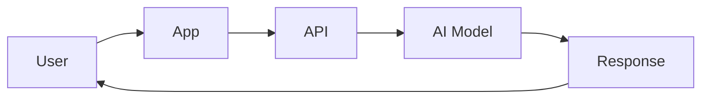
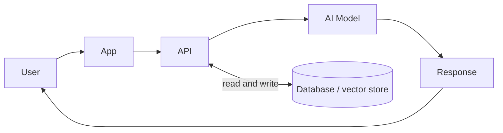
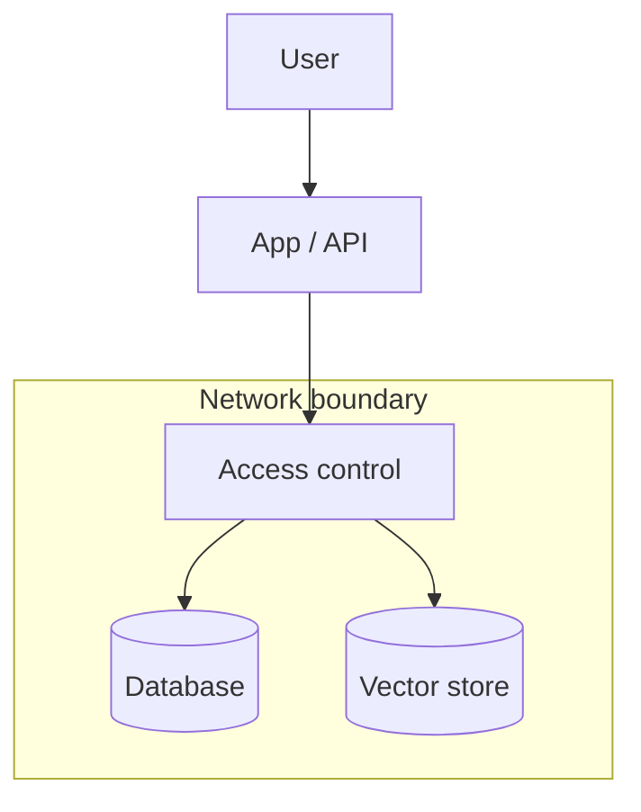

<!-- order: 19 -->
# AI Solutions Architect: Hands-On Project Tutorials

This course is a series of hands-on projects. You learn each idea at the moment you need it, while building the thing.

Follow the projects in order. Each one hands off a skill or artifact to the next.


## Before you start: set up your notebook

This course runs in **Google Colab**, a free Jupyter notebook in your browser and the standard workspace for AI and data work. There's nothing to install.

1. Go to [colab.research.google.com](https://colab.research.google.com) and sign in with a Google account.
2. Give each project its own notebook: choose **File → New notebook**, then click the title at the top to rename it after the project.
3. Notebooks have two kinds of cells. **Code cells** run Python: type or paste code, then press **Shift + Enter**. **Text cells** hold your notes and written answers: choose **Insert → Text cell**.
4. Install libraries in a code cell with `%pip install ...`. The `%` form installs them into the notebook you're using.
5. Put each code block from a project in its own code cell, in order, and run them top to bottom. When a later step changes earlier code, edit that cell and run it again.
6. To use a file you downloaded, such as a CSV, drag it into the **Files** panel (the folder icon on the left). Files your code creates appear there too. Colab clears them when the session ends, so download anything you want to keep, or connect Google Drive from the same panel.

Prefer to work on your own computer? The same notebooks run in JupyterLab or in VS Code with the Jupyter extension.

---

## Project 1 (Module 1): Write a Solutions Brief for a Business Problem

**Goal:** Translate a business problem into a technical direction, the first move a solutions architect makes, before any diagram or code.

**Step 1: Create the project notebook.**
Create a new notebook for this project (**File → New notebook**) and name it `solutions_brief_project`.

**Step 2: Pick a realistic business problem.**
Example: "Our support team is overwhelmed by repetitive questions and response times are hurting customer satisfaction scores."

**Step 3: Identify stakeholders.**
Add a **text cell** headed `brief` and write your notes in it.
A **stakeholder** is anyone with a say in whether the solution succeeds, here, likely support leadership, IT/security, and end customers.

**Step 4: State business goals, not technical ones.**
Write 2–3 measurable business goals (e.g., "reduce average response time by 30%"), not technical goals ("deploy an LLM").

**Step 5: Note constraints.**
List budget range, timeline, existing systems that must be integrated with, and any compliance requirements (e.g., data residency, industry regulations).

**Step 6: Propose a technical direction (not a full design yet).**
Write 2–3 sentences: broadly, is this a good fit for AI, and roughly what kind of solution (e.g., "a retrieval-augmented chatbot integrated with the existing ticketing system")?

**Step 7: Assemble the final brief.**
Combine Steps 3–6 into one page: Business Problem → Stakeholders → Goals → Constraints → Proposed Direction.

### Final Project Structure
```text
solutions_brief_project/
│
├── brief.md
```

### What You Learned
- ✅ Translating a business problem into a written brief
- ✅ Identifying stakeholders and their constraints
- ✅ Separating business goals from technical goals
- ✅ Documenting budget, timeline, and compliance constraints
- ✅ Proposing an initial technical direction
- ✅ Assembling a one-page solutions brief

### Portfolio Project
**AI Solutions Brief**: Translated a business problem into a structured solutions brief covering stakeholders, measurable goals, constraints, and a proposed technical direction.
**Skills:** Business Analysis, Stakeholder Management, Technical Writing, AI Solutions Architecture.

**Deliverable:** A one-page solutions brief covering the business problem, stakeholders, goals, constraints, and proposed direction.

### Quiz

1. Who counts as a stakeholder?
2. Why write business goals instead of technical goals in the brief?
3. Name two kinds of constraints a solutions brief should record.
4. How detailed should the proposed technical direction be at this stage?

*Answers: 1) Anyone with a say in whether the solution succeeds, such as support leadership, IT/security, and end customers. 2) Business goals, like cutting response time by 30%, define success; a technical goal like "deploy an LLM" is only a means and may not be needed. 3) Any two of: budget, timeline, existing systems to integrate with, and compliance requirements such as data residency. 4) Brief, two or three sentences on whether AI fits and roughly what kind of solution, not a full design.*

---

## Project 2 (Module 2): Design a System Diagram for an AI Service

**Goal:** Visualize the service you're proposing, the first technical artifact that turns your Project 1 brief into something engineers can react to.

**Step 1: Create the project notebook.**
Create a new notebook for this project (**File → New notebook**) and name it `system_diagram_project`.

**Step 2: List the major components.**
Based on your Project 1 brief, list the pieces the system will need: user-facing app, API layer, AI model, data store, integration with existing systems.

**Step 3: Understand standard architecture diagram conventions.**
Boxes typically represent **components** (services, databases); arrows represent **data flow** or **requests**, usually labeled with direction and what's being sent.

**Step 4: The request flow.**
The core path a request takes:



**Step 5: Add the data layer.**
Now show where data lives and which component reads and writes it:



**Step 6: Add integration points.**
Draw connections to any existing systems named in your Project 1 constraints (e.g., "existing ticketing system").

**Step 7: Label everything.**
Add labels to every arrow (what data/request is flowing) and every box (what the component does in one phrase).

**Step 8: Get a "can you read this cold" check.**
Show the diagram to someone unfamiliar with the project and ask them to explain back what they think it shows.

### Final Project Structure
```text
system_diagram_project/
│
├── system_diagram_v1.png
├── diagram_notes.md
```

### What You Learned
- ✅ Identifying major system components from a business brief
- ✅ Standard architecture diagram conventions
- ✅ Diagramming the request/response flow
- ✅ Representing the data layer visually
- ✅ Showing integration with existing systems
- ✅ Labeling for clarity and getting outside feedback

### Portfolio Project
**AI Service System Diagram**: Translated a solutions brief into a labeled system architecture diagram showing request flow, data layer, and integration points with existing infrastructure.
**Skills:** System Design, Architecture Diagramming, Technical Communication, AI Solutions Architecture.

**Deliverable:** A labeled system diagram for your proposed AI service, validated by an outside reader.

### Quiz

1. In an architecture diagram, what do boxes and arrows usually represent?
2. What does the data layer add to the basic request flow diagram?
3. Why label every arrow?
4. What is the point of the "read this cold" check?

*Answers: 1) Boxes are components such as services or databases; arrows are data flow or requests, labeled with what is sent. 2) It shows where data is stored and which component reads and writes it. 3) Unlabeled arrows leave readers guessing what data or request moves between components. 4) If someone new to the project can explain the diagram back correctly, it communicates clearly.*

---

## Project 3 (Module 3): Compare Model Options for a Given Use Case

**Goal:** Decide which AI approach actually fits the problem, replacing assumption with a documented comparison.

**Step 1: Create the project notebook.**
Create a new notebook for this project (**File → New notebook**) and name it `model_comparison_project`.

**Step 2: Define your evaluation criteria.**
Add a **text cell** headed `criteria` and write your notes in it.
Typical criteria include **accuracy/quality** for the task, **latency** (response speed), **cost per request**, **data privacy** (does data leave your infrastructure), and **ease of integration**.

**Step 3: Identify 2–4 candidate approaches.**
Examples: a general-purpose LLM API, a smaller open-weight model self-hosted, a fine-tuned specialized model, or a non-AI rules-based approach as a baseline.

**Step 4: Research each option against your criteria.**
Add a **text cell** headed `comparison_matrix` and write your notes in it.
Build a table: rows are your candidates, columns are your Step 2 criteria.

**Step 5: Understand the fine-tuning vs. prompting tradeoff.**
**prompting** (including RAG) adapts a general model's behavior at request time without changing its weights; **fine-tuning** further trains a model's weights on your specific data.

**Step 6: Estimate rough costs.**
For each candidate, estimate cost per 1,000 requests (API pricing) or infrastructure cost (self-hosted compute).

**Step 7: Make and justify a recommendation.**
Add a **text cell** headed `recommendation` and write your notes in it.
State which option you'd recommend and why, referencing your matrix directly.

### Final Project Structure
```text
model_comparison_project/
│
├── criteria.md
├── comparison_matrix.md
├── recommendation.md
```

### What You Learned
- ✅ Defining evaluation criteria before comparing options
- ✅ Including a non-AI baseline in comparisons
- ✅ Building a structured comparison matrix
- ✅ The fine-tuning vs. prompting/RAG tradeoff
- ✅ Estimating rough cost per option
- ✅ Writing a justified recommendation

### Portfolio Project
**AI Model Selection Comparison**: Evaluated multiple AI approaches (including a non-AI baseline) against defined criteria, quality, latency, cost, privacy, integration, and produced a justified recommendation.
**Skills:** Technical Evaluation, Cost Analysis, Decision Documentation, AI Solutions Architecture.

**Deliverable:** A comparison matrix and written recommendation for the AI approach best suited to your use case.

### Quiz

1. Why define evaluation criteria before comparing options?
2. Why include a non-AI, rules-based approach in the comparison?
3. What is the difference between prompting (including RAG) and fine-tuning?
4. Name three common criteria for comparing model options.

*Answers: 1) So every option is judged on the same factors and the choice isn't shaped by a favorite. 2) It is a baseline; if it solves the problem well enough, AI may not be worth the cost and risk. 3) Prompting adapts a general model at request time without changing its weights; fine-tuning trains the model's weights further on your data. 4) Any three of: accuracy/quality, latency, cost per request, data privacy, and ease of integration.*

---

## Project 4 (Module 4): Design an End-to-End AI System Architecture

**Goal:** Expand your Project 2 diagram into a full system design, the central architecture document for the whole solution.

**Step 1: Create the project notebook.**
Create a new notebook for this project (**File → New notebook**) and name it `full_architecture_project`.
Copy in `system_diagram_v1.png` and `recommendation.md` from Projects 2 and 3.

**Step 2: Understand common reference architectures.**
A **RAG architecture** retrieves relevant data before generating a response; an **agentic architecture** lets the AI call tools/APIs to take actions; a **simple API-call architecture** just sends a prompt and returns a response.

**Step 3: Choose your architecture pattern.**
Based on Project 3's recommendation, decide which pattern (or combination) fits.

**Step 4: Expand the diagram with your chosen model.**
Update your Project 2 diagram to show your Project 3-selected model/approach specifically, not a generic "AI Model" box.

**Step 5: Add integration patterns.**
An **API gateway** manages external access to your service; a **message queue** handles asynchronous processing (useful if requests can take a while).

**Step 6: Address scalability.**
Note: what happens if traffic doubles? Where would this design bottleneck first?

**Step 7: Estimate rough costs for the full system.**
Combine your Project 3 model costs with rough infrastructure costs (hosting, storage, networking).

**Step 8: Write the architecture document.**
Add a **text cell** headed `architecture` and write your notes in it.
Structure: Pattern chosen and why → Full diagram → Components and their roles → Scalability notes → Rough cost estimate.

### Final Project Structure
```text
full_architecture_project/
│
├── architecture_diagram_v2.png
├── architecture.md
```

### What You Learned
- ✅ Common AI reference architecture patterns (RAG, agentic, simple API)
- ✅ Choosing a pattern based on a documented model comparison
- ✅ Adding integration patterns (API gateways, message queues)
- ✅ Identifying likely scalability bottlenecks
- ✅ Estimating full-system cost, not just model cost
- ✅ Writing a complete architecture document

### Portfolio Project
**End-to-End AI System Architecture**: Designed a complete AI system architecture using a chosen reference pattern (RAG/agentic/API), including integration design, scalability analysis, and full-system cost estimates.
**Skills:** System Architecture, Reference Architecture Patterns, Scalability Planning, Cost Estimation, AI Solutions Architecture.

**Deliverable:** A full architecture document and diagram, covering pattern choice, components, scalability, and cost.

### Quiz

1. How does a RAG architecture differ from a simple API-call architecture?
2. What does an agentic architecture let the AI do?
3. When is a message queue useful?
4. Why ask what happens if traffic doubles?

*Answers: 1) RAG retrieves relevant data before generating a response; a simple API call just sends a prompt and returns the reply. 2) Call tools or APIs to take actions, not just generate text. 3) When requests may take a while, so they can be processed asynchronously instead of making users wait. 4) It reveals where the design would bottleneck first, so you can plan for scale.*

---

## Project 5 (Module 5): Design the Data and Infrastructure Layer for an AI System

**Goal:** Fill in how data will move and be secured, the layer underneath the architecture you designed in Project 4.

**Step 1: Create the project notebook.**
Create a new notebook for this project (**File → New notebook**) and name it `data_infra_layer_project`.

**Step 2: Design the data flow.**
Sketch: where does data enter the system, where is it stored, and where does it get deleted or archived?

**Step 3: Choose storage types.**
Match storage to data type: structured records → relational database; documents for retrieval → vector database; large files → object storage.

**Step 4: Design network security.**
**network segmentation** isolates different parts of a system so a breach in one area doesn't automatically expose everything; **encryption in transit** protects data moving between components, **encryption at rest** protects stored data.

**Step 5: Design access control.**
**least privilege** means each component or user only has the access it strictly needs, nothing more.

**Step 6: Address compliance requirements from Project 1.**
Revisit your Project 1 brief's constraints (e.g., data residency, industry regulations) and confirm your data layer design satisfies them.

**Step 7: The data and infrastructure layer.**
Storage sits behind a network boundary, reached only through an access-control point:



**Step 8: Write the data and infrastructure design doc.**
Add a **text cell** headed `data_infra_design` and write your notes in it.
Structure: Data flow → Storage choices → Network security → Access control → Compliance mapping.

### Final Project Structure
```text
data_infra_layer_project/
│
├── data_flow_diagram.png
├── data_infra_design.md
```

### What You Learned
- ✅ Designing end-to-end data flow, including deletion/archival
- ✅ Matching storage types to data types
- ✅ Network segmentation and encryption fundamentals
- ✅ Designing access control with least privilege
- ✅ Mapping design decisions to compliance requirements
- ✅ Producing a focused data and infrastructure design document

### Portfolio Project
**AI System Data & Infrastructure Design**: Designed the data flow, storage architecture, network security, and access control layer for an AI system, explicitly mapped to business compliance requirements.
**Skills:** Data Architecture, Cloud Security, Access Control, Compliance, AI Solutions Architecture.

**Deliverable:** A data and infrastructure design document and diagram, mapped to your Project 1 compliance constraints.

### Quiz

1. Which storage type fits documents used for retrieval?
2. What does network segmentation protect against?
3. What is the difference between encryption in transit and encryption at rest?
4. What does least privilege mean?

*Answers: 1) A vector database. 2) A breach in one part of the system automatically exposing everything else. 3) In transit protects data moving between components; at rest protects stored data. 4) Each user or component gets only the access it strictly needs, nothing more.*

---

## Project 6 (Module 6): Write a Governance and Risk Plan

**Goal:** Address compliance and responsible-use concerns directly, the part of architecture that protects the organization, not just the system.

**Step 1: Create the project notebook.**
Create a new notebook for this project (**File → New notebook**) and name it `governance_risk_project`.

**Step 2: Identify risk categories.**
Common categories include **data privacy risk** (mishandled personal data), **model risk** (biased or incorrect outputs), **operational risk** (system downtime affecting the business), and **reputational risk** (public-facing AI mistakes).

**Step 3: Assess each risk for your specific system.**
Add a **text cell** headed `risk_assessment` and write your notes in it.
For each category, note: how likely is this risk here, and how severe would it be if it happened?

**Step 4: Design mitigations for the highest risks.**
For your top 2–3 risks, write a specific mitigation (e.g., "add a human review step for high-stakes outputs," "log and audit all model responses for 90 days").

**Step 5: Define an incident response plan.**
An **incident response plan** describes what happens when something goes wrong, who's notified, how fast, and what the rollback process is.

**Step 6: Address responsible AI principles.**
Note how your design considers fairness (does the system perform differently across user groups), transparency (do users know they're interacting with AI), and accountability (who's responsible if it goes wrong).

**Step 7: Write the governance and risk plan.**
Add a **text cell** headed `governance_risk_plan` and write your notes in it.
Structure: Risk categories and assessment → Mitigations for top risks → Incident response plan → Responsible AI considerations.

### Final Project Structure
```text
governance_risk_project/
│
├── risk_assessment.md
├── governance_risk_plan.md
```

### What You Learned
- ✅ Identifying risk categories relevant to AI systems
- ✅ Assessing likelihood and severity for a specific system
- ✅ Designing mitigations for high-priority risks
- ✅ Writing an incident response plan
- ✅ Addressing fairness, transparency, and accountability
- ✅ Producing a complete governance and risk plan

### Portfolio Project
**AI System Governance & Risk Plan**: Assessed data, model, operational, and reputational risks for a proposed AI system, designed mitigations, and wrote an incident response plan addressing responsible AI principles.
**Skills:** Risk Management, AI Governance, Responsible AI, Compliance, AI Solutions Architecture.

**Deliverable:** A governance and risk plan covering risk assessment, mitigations, incident response, and responsible AI considerations.

### Quiz

1. What two questions do you ask about each risk category?
2. Why write mitigations for the top risks first?
3. What should an incident response plan describe?
4. Name the three responsible AI principles covered in this project.

*Answers: 1) How likely the risk is for this system, and how severe it would be if it happened. 2) They matter most, and specific mitigations there give the biggest reduction in harm for the effort. 3) Who is notified when something goes wrong, how fast, and how to roll back. 4) Fairness, transparency, and accountability.*

---

## Project 7 (Module 7): Present a Full Architecture Proposal

**Goal:** Package everything into a presentation for stakeholders, the skill that actually gets an architecture approved and built.

**Step 1: Create the project notebook.**
Create a new notebook for this project (**File → New notebook**) and name it `architecture_proposal_project`.
Copy in your final deliverables from Projects 1–6.

**Step 2: Identify your audience.**
Presenting to a mixed audience (some technical, some business) means leading with business impact, then offering technical depth for those who want it.

**Step 3: Structure the presentation.**
Add a **text cell** headed `presentation_outline` and write your notes in it.
Draft outline: Problem & Goals (Project 1) → Proposed Solution Overview → Architecture (Project 4) → Data & Security (Project 5) → Risks & Governance (Project 6) → Cost & Timeline → Ask/Next Steps.

**Step 4: Build slides or a written proposal document.**
For each outline section, create one slide (or one section if written) with your key diagram or point from the matching earlier project.

**Step 5: Prepare for objections.**
Add a **text cell** headed `anticipated_questions` and write your notes in it.
List 5 likely tough questions (e.g., "why not just use approach X," "what if the model gets it wrong") and write your answers.

**Step 6: Define a clear ask.**
State exactly what you need from this audience (budget approval, engineering resources, a pilot green light).

**Step 7: Practice presenting it out loud.**
Run through the full presentation once, timed, ideally to another person.

**Step 8: Deliver (or record) the presentation.**
Present live or record yourself presenting the full proposal, including handling at least one of your anticipated tough questions.

### Final Project Structure
```text
architecture_proposal_project/
│
├── presentation_outline.md
├── proposal_slides.pdf (or proposal_doc.md)
├── anticipated_questions.md
```

### What You Learned
- ✅ Structuring a proposal for a mixed technical/business audience
- ✅ Leading with business impact before technical detail
- ✅ Reusing validated prior work instead of creating from scratch
- ✅ Anticipating and preparing for tough questions
- ✅ Defining a clear, actionable ask
- ✅ Practicing and delivering a live technical proposal

### Portfolio Project
**AI Architecture Proposal Presentation**: Synthesized a full solutions architecture (business case, technical design, data/security, governance, and cost) into a stakeholder-ready presentation with a clear ask and prepared Q&A.
**Skills:** Executive Communication, Technical Presentation, Stakeholder Management, AI Solutions Architecture.

**Deliverable:** A complete architecture proposal presentation, delivered or recorded, including a prepared response to at least one tough question.

### Quiz

1. With a mixed technical and business audience, what should you lead with?
2. Why prepare answers to tough questions in advance?
3. What makes a good "ask" at the end of a proposal?

*Answers: 1) Business impact, then technical depth for those who want it. 2) So you can respond clearly to objections that could otherwise stall approval. 3) A specific request, such as budget approval, engineering resources, or a pilot green light.*
