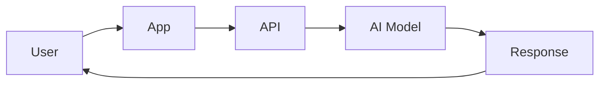
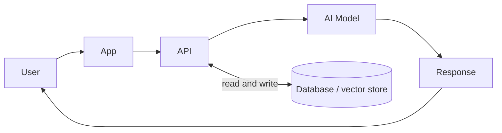
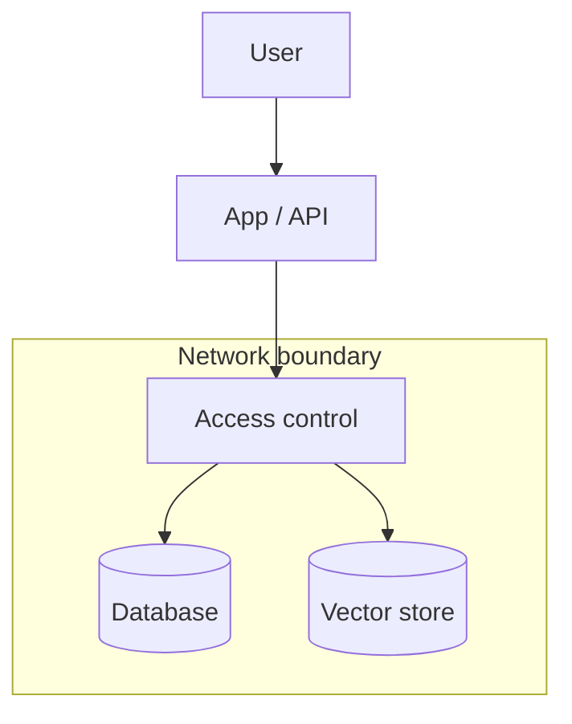

<!-- order: 21 -->
# AI Solutions Architect: Hands-On Project Tutorials

This course is a series of hands-on projects. You learn each idea at the moment you need it, while building the thing.

**By the end of this course, you'll be able to:**
- Turn a business problem into a solutions brief with measurable goals and constraints
- Draw a labeled system diagram showing request flow, data, and integrations
- Compare model options against set criteria and estimate their monthly cost
- Choose a reference architecture (simple API call, RAG, or agentic) and explain why
- Design the data, security, and access-control layer, and write a governance and risk plan
- Present a full architecture proposal to a mixed audience with a clear ask

Follow the projects in order. Each one hands off a skill or artifact to the next.


## Before you start: set up your notebook

**Time: about 15 minutes**

This course runs in **Google Colab**, a free Jupyter notebook in your browser and the standard workspace for AI and data work. There's nothing to install.

1. Go to [colab.research.google.com](https://colab.research.google.com) and sign in with a Google account.
2. Give each project its own notebook: choose **File → New notebook**, then click the title at the top to rename it after the project.
3. Notebooks have two kinds of cells. **Code cells** run Python: type or paste code, then press **Shift + Enter**. **Text cells** hold your notes and written answers: choose **Insert → Text cell**.
4. Install libraries in a code cell with `%pip install ...`. The `%` form installs them into the notebook you're using.
5. Put each code block from a project in its own code cell, in order, and run them top to bottom. When a later step changes earlier code, edit that cell and run it again.
6. To use a file you downloaded, such as a CSV, drag it into the **Files** panel (the folder icon on the left). Files your code creates appear there too. Colab clears them when the session ends, so download anything you want to keep, or connect Google Drive from the same panel.

Prefer to work on your own computer? The same notebooks run in JupyterLab or in VS Code with the Jupyter extension.

---

## Project 1 (Module 1): Write a Solutions Brief for a Business Problem

**Time: about 1.5 hours**

**Goal:** Translate a business problem into a technical direction, the first move a solutions architect makes, before any diagram or code.

**Step 1: Create the project notebook.**
Create a new notebook for this project (**File → New notebook**) and name it `solutions_brief_project`.

**Step 2: Pick a realistic business problem.**
Example: "Our support team is overwhelmed by repetitive questions and response times are hurting customer satisfaction scores."

**Step 3: Identify stakeholders.**
Add a **text cell** headed `brief` and write your notes in it.
A **stakeholder** is anyone with a say in whether the solution succeeds, here, likely support leadership, IT/security, and end customers.

**Step 4: State business goals, not technical ones.**
Write 2–3 measurable business goals (e.g., "reduce average response time by 30%"), not technical goals ("deploy an LLM").

**Step 5: Note constraints.**
List budget range, timeline, existing systems that must be integrated with, and any compliance requirements (e.g., data residency, industry regulations).

**Step 6: Propose a technical direction (not a full design yet).**
Write 2–3 sentences: broadly, is this a good fit for AI, and roughly what kind of solution (e.g., "a retrieval-augmented chatbot integrated with the existing ticketing system")?

**Step 7: Assemble the final brief.**
Combine Steps 3–6 into one page: Business Problem → Stakeholders → Goals → Constraints → Proposed Direction.

### Final Project Structure

*If you worked in a notebook, these are the sections of your notebook (text and code cells), not separate files. Save or export them as files when you put the project in your portfolio.*

```text
solutions_brief_project/
│
├── brief.md
```

### What You Learned
- ✅ Translating a business problem into a written brief
- ✅ Identifying stakeholders and their constraints
- ✅ Separating business goals from technical goals
- ✅ Documenting budget, timeline, and compliance constraints
- ✅ Proposing an initial technical direction
- ✅ Assembling a one-page solutions brief

### Portfolio Project
**AI Solutions Brief**: Translated a business problem into a structured solutions brief covering stakeholders, measurable goals, constraints, and a proposed technical direction.
**Skills:** Business Analysis, Stakeholder Management, Technical Writing, AI Solutions Architecture.

**Deliverable:** A one-page solutions brief covering the business problem, stakeholders, goals, constraints, and proposed direction.

### Quiz

1. Who counts as a stakeholder?
2. Why write business goals instead of technical goals in the brief?
3. Name two kinds of constraints a solutions brief should record.
4. How detailed should the proposed technical direction be at this stage?

*Answers: 1) Anyone with a say in whether the solution succeeds, such as support leadership, IT/security, and end customers. 2) Business goals, like cutting response time by 30%, define success; a technical goal like "deploy an LLM" is only a means and may not be needed. 3) Any two of: budget, timeline, existing systems to integrate with, and compliance requirements such as data residency. 4) Brief, two or three sentences on whether AI fits and roughly what kind of solution, not a full design.*

```watch
{
 "scenes": [
  {
   "kind": "title",
   "art": "doc",
   "kicker": "Project 1 · Solutions brief",
   "title": "Start with the problem",
   "beats": [
    {
     "say": "Welcome to A I Solutions Architect."
    },
    {
     "say": "Before any diagram or code, a solutions architect turns a business problem into a technical direction. That's your first project: a one-page solutions brief."
    }
   ]
  },
  {
   "kind": "quote",
   "art": "mess",
   "kicker": "Step 2",
   "title": "Pick a real problem",
   "quote": "Our support team is overwhelmed by repetitive questions, and response times are hurting customer satisfaction scores.",
   "beats": [
    {
     "say": "Start with a realistic business problem.",
     "show": 0
    },
    {
     "say": "For example: our support team is overwhelmed by repetitive questions, and response times are hurting customer satisfaction.",
     "show": 1
    }
   ]
  },
  {
   "kind": "list",
   "art": "people",
   "kicker": "Steps 3 and 4",
   "title": "Stakeholders and goals",
   "items": [
    [
     "Stakeholders",
     "Support leads · IT/security · customers"
    ],
    [
     "✓ Business goal",
     "Cut response time by 30%"
    ],
    [
     "✗ Technical goal",
     "\"Deploy an LLM\""
    ]
   ],
   "beats": [
    {
     "say": "In a text cell headed brief, note your stakeholders.",
     "show": 0
    },
    {
     "say": "A stakeholder is anyone with a say in whether the solution succeeds. Here, support leadership, I T and security, and end customers.",
     "show": 1
    },
    {
     "say": "Then write two or three measurable business goals, like reduce average response time by thirty percent.",
     "show": 2
    },
    {
     "say": "Not technical goals, like deploy an L L M. That's only a means, and may not be needed.",
     "show": 3
    }
   ]
  },
  {
   "kind": "list",
   "art": "lock",
   "kicker": "Steps 5 and 6",
   "title": "Constraints, then a direction",
   "items": [
    [
     "Budget & timeline",
     ""
    ],
    [
     "Existing systems",
     "What must be integrated"
    ],
    [
     "Compliance",
     "Data residency, regulations"
    ],
    [
     "Direction",
     "2–3 sentences, not a design"
    ]
   ],
   "beats": [
    {
     "say": "Next, note your constraints.",
     "show": 0
    },
    {
     "say": "Budget range and timeline.",
     "show": 1
    },
    {
     "say": "Existing systems you must integrate with.",
     "show": 2
    },
    {
     "say": "And compliance requirements, like data residency or industry regulations.",
     "show": 3
    },
    {
     "say": "Then propose a direction in two or three sentences: is A I a good fit, and roughly what kind of solution? Not a full design yet.",
     "show": 4
    }
   ]
  },
  {
   "kind": "flow",
   "art": "doc",
   "kicker": "Step 7",
   "title": "Assemble the brief",
   "steps": [
    "Business problem",
    "Stakeholders",
    "Goals",
    "Constraints",
    "Proposed direction"
   ],
   "beats": [
    {
     "say": "Finally, combine it all into one page, in this order.",
     "show": 0
    },
    {
     "say": "Business problem.",
     "show": 1
    },
    {
     "say": "Stakeholders.",
     "show": 2
    },
    {
     "say": "Goals.",
     "show": 3
    },
    {
     "say": "Constraints.",
     "show": 4
    },
    {
     "say": "And proposed direction.",
     "show": 5
    }
   ]
  },
  {
   "kind": "quiz",
   "art": "ask",
   "kicker": "Quick check",
   "title": "Why write business goals instead of technical goals in the brief?",
   "options": [
    "Business goals define success; a technical goal is only a means and may not be needed",
    "Technical goals are too hard to measure",
    "Stakeholders can't read technical goals"
   ],
   "answer": 0,
   "good": "That's right. Business goals, like cutting response time by thirty percent, define success. A technical goal like deploy an L L M is only a means, and may not be needed.",
   "bad": "Not quite. Business goals, like cutting response time by thirty percent, define success. A technical goal like deploy an L L M is only a means, and may not be needed.",
   "beats": [
    {
     "say": "Quick check.",
     "show": 0
    },
    {
     "say": "Why write business goals instead of technical goals in the brief?",
     "show": 0
    },
    {
     "say": "Tap your answer.",
     "show": 1
    }
   ]
  },
  {
   "kind": "list",
   "art": "proof",
   "kicker": "Checkpoint",
   "title": "You're done when",
   "items": [
    [
     "A one-page solutions brief",
     ""
    ],
    [
     "Problem, stakeholders, goals, constraints, direction",
     ""
    ]
   ],
   "beats": [
    {
     "say": "That's Project 1.",
     "show": 0
    },
    {
     "say": "You're done when:",
     "show": 0
    },
    {
     "say": "you have a one-page solutions brief,",
     "show": 1
    },
    {
     "say": "covering the problem, stakeholders, goals, constraints and proposed direction.",
     "show": 2
    },
    {
     "say": "Next, in Module 2, a system diagram for your A I service.",
     "show": 2
    }
   ]
  }
 ]
}
```

---

## Project 2 (Module 2): Design a System Diagram for an AI Service

**Time: about 2 hours**

**Goal:** Visualize the service you're proposing, the first technical artifact that turns your Project 1 brief into something engineers can react to.

**Step 1: Create the project notebook.**
Create a new notebook for this project (**File → New notebook**) and name it `system_diagram_project`.

**Step 2: List the major components.**
Based on your Project 1 brief, list the pieces the system will need: user-facing app, API layer, AI model, data store, integration with existing systems.

**Step 3: Understand standard architecture diagram conventions.**
Boxes typically represent **components** (services, databases); arrows represent **data flow** or **requests**, usually labeled with direction and what's being sent.

**Step 4: The request flow.**
The core path a request takes:



**Step 5: Add the data layer.**
Now show where data lives and which component reads and writes it:



To draw your own version, use the free [diagrams.net](https://app.diagrams.net) in your browser, or paste the diagram code above into [mermaid.live](https://mermaid.live), edit it, and export it as a PNG.

**Step 6: Add integration points.**
Draw connections to any existing systems named in your Project 1 constraints (e.g., "existing ticketing system").

**Step 7: Label everything.**
Add labels to every arrow (what data/request is flowing) and every box (what the component does in one phrase).

**Step 8: Get a "can you read this cold" check.**
Show the diagram to someone unfamiliar with the project and ask them to explain back what they think it shows.

### Final Project Structure

*If you worked in a notebook, these are the sections of your notebook (text and code cells), not separate files. Save or export them as files when you put the project in your portfolio.*

```text
system_diagram_project/
│
├── system_diagram_v1.png
├── diagram_notes.md
```

### What You Learned
- ✅ Identifying major system components from a business brief
- ✅ Standard architecture diagram conventions
- ✅ Diagramming the request/response flow
- ✅ Representing the data layer visually
- ✅ Showing integration with existing systems
- ✅ Labeling for clarity and getting outside feedback

### Portfolio Project
**AI Service System Diagram**: Translated a solutions brief into a labeled system architecture diagram showing request flow, data layer, and integration points with existing infrastructure.
**Skills:** System Design, Architecture Diagramming, Technical Communication, AI Solutions Architecture.

**Deliverable:** A labeled system diagram for your proposed AI service, validated by an outside reader.

### Quiz

1. In an architecture diagram, what do boxes and arrows usually represent?
2. What does the data layer add to the basic request flow diagram?
3. Why label every arrow?
4. What is the point of the "read this cold" check?

*Answers: 1) Boxes are components such as services or databases; arrows are data flow or requests, labeled with what is sent. 2) It shows where data is stored and which component reads and writes it. 3) Unlabeled arrows leave readers guessing what data or request moves between components. 4) If someone new to the project can explain the diagram back correctly, it communicates clearly.*

```watch
{
 "scenes": [
  {
   "kind": "title",
   "art": "architecture",
   "kicker": "Project 2 · System diagram",
   "title": "Draw the service",
   "beats": [
    {
     "say": "Welcome to Module 2."
    },
    {
     "say": "Now you turn your brief into the first technical artifact engineers can react to: a labeled system diagram."
    }
   ]
  },
  {
   "kind": "list",
   "art": "blocks",
   "kicker": "Steps 2 and 3",
   "title": "Components and conventions",
   "items": [
    [
     "Components",
     "App · API · AI model · data store · integrations"
    ],
    [
     "Boxes",
     "Services, databases"
    ],
    [
     "Arrows",
     "Data flow or requests, labeled"
    ]
   ],
   "beats": [
    {
     "say": "From your brief, list the pieces the system needs.",
     "show": 0
    },
    {
     "say": "A user-facing app, an A P I layer, an A I model, a data store, and integration with existing systems.",
     "show": 1
    },
    {
     "say": "In architecture diagrams, boxes are components, like services or databases.",
     "show": 2
    },
    {
     "say": "And arrows are data flow or requests, labeled with direction and what's being sent.",
     "show": 3
    }
   ]
  },
  {
   "kind": "flow",
   "art": "path",
   "kicker": "Step 4",
   "title": "The request flow",
   "steps": [
    "User",
    "App",
    "API",
    "AI Model",
    "Response → User"
   ],
   "beats": [
    {
     "say": "Start with the core path a request takes.",
     "show": 0
    },
    {
     "say": "The user.",
     "show": 1
    },
    {
     "say": "The app.",
     "show": 2
    },
    {
     "say": "The A P I.",
     "show": 3
    },
    {
     "say": "The A I model.",
     "show": 4
    },
    {
     "say": "And a response, back to the user.",
     "show": 5
    }
   ]
  },
  {
   "kind": "list",
   "art": "database",
   "kicker": "Steps 5 and 6",
   "title": "Add data and integrations",
   "items": [
    [
     "Data layer",
     "API ⇄ database / vector store"
    ],
    [
     "Integrations",
     "e.g. existing ticketing system"
    ],
    [
     "Tools",
     "diagrams.net or mermaid.live"
    ]
   ],
   "beats": [
    {
     "say": "Next, add the data layer: where data lives, and which component reads and writes it.",
     "show": 0
    },
    {
     "say": "Here, the A P I reads and writes a database or vector store.",
     "show": 1
    },
    {
     "say": "Then connect any existing systems named in your constraints, like an existing ticketing system.",
     "show": 2
    },
    {
     "say": "Draw it in diagrams dot net, or edit the Mermaid code at mermaid dot live and export a P N G.",
     "show": 3
    }
   ]
  },
  {
   "kind": "list",
   "art": "search",
   "kicker": "Steps 7 and 8",
   "title": "Label it, then test it cold",
   "items": [
    [
     "Label everything",
     "Every arrow, every box"
    ],
    [
     "Read it cold",
     "A newcomer explains it back"
    ]
   ],
   "beats": [
    {
     "say": "Label every arrow with what flows, and every box with what it does, in one phrase.",
     "show": 1
    },
    {
     "say": "Unlabeled arrows leave readers guessing.",
     "show": 1
    },
    {
     "say": "Then show it to someone unfamiliar with the project, and ask them to explain it back.",
     "show": 2
    },
    {
     "say": "If they can, your diagram communicates clearly.",
     "show": 2
    }
   ]
  },
  {
   "kind": "quiz",
   "art": "ask",
   "kicker": "Quick check",
   "title": "What does the data layer add to the basic request flow diagram?",
   "options": [
    "How fast each request is",
    "Which model is used",
    "Where data is stored, and which component reads and writes it"
   ],
   "answer": 2,
   "good": "That's right. The data layer shows where data is stored, and which component reads and writes it.",
   "bad": "Not quite. The data layer shows where data is stored, and which component reads and writes it.",
   "beats": [
    {
     "say": "Quick check.",
     "show": 0
    },
    {
     "say": "What does the data layer add to the basic request flow diagram?",
     "show": 0
    },
    {
     "say": "Tap your answer.",
     "show": 1
    }
   ]
  },
  {
   "kind": "list",
   "art": "proof",
   "kicker": "Checkpoint",
   "title": "You're done when",
   "items": [
    [
     "A labeled system diagram",
     ""
    ],
    [
     "Validated by an outside reader",
     ""
    ]
   ],
   "beats": [
    {
     "say": "That's Project 2.",
     "show": 0
    },
    {
     "say": "You're done when:",
     "show": 0
    },
    {
     "say": "you have a labeled system diagram for your proposed A I service,",
     "show": 1
    },
    {
     "say": "validated by an outside reader.",
     "show": 2
    },
    {
     "say": "Next, in Module 3, comparing model options.",
     "show": 2
    }
   ]
  }
 ]
}
```

---

## Project 3 (Module 3): Compare Model Options for a Given Use Case

**Time: about 1.5 hours**

**Goal:** Decide which AI approach actually fits the problem, replacing assumption with a documented comparison.

**Step 1: Create the project notebook.**
Create a new notebook for this project (**File → New notebook**) and name it `model_comparison_project`.

**Step 2: Define your evaluation criteria.**
Add a **text cell** headed `criteria` and write your notes in it.
Typical criteria include **accuracy/quality** for the task, **latency** (response speed), **cost per request**, **data privacy** (does data leave your infrastructure), and **ease of integration**.

**Step 3: Identify 2–4 candidate approaches.**
Examples: a general-purpose LLM API, a smaller open-weight model self-hosted, a fine-tuned specialized model, or a non-AI rules-based approach as a baseline.

**Step 4: Research each option against your criteria.**
Add a **text cell** headed `comparison_matrix` and write your notes in it.
Build a table: rows are your candidates, columns are your Step 2 criteria.

**Step 5: Understand the fine-tuning vs. prompting tradeoff.**
**prompting** (including RAG) adapts a general model's behavior at request time without changing its weights; **fine-tuning** further trains a model's weights on your specific data.

**Step 6: Estimate rough costs.**
For each candidate, estimate cost per 1,000 requests (API pricing) or infrastructure cost (self-hosted compute). LLM APIs charge per **token** (a token is roughly three quarters of an English word), with separate prices for input and output tokens, usually quoted per million tokens. Add a **code cell**, paste in the code below, and run it with **Shift + Enter**:
```python
# Template: the prices below are made-up examples. Replace them with the current
# published prices for the options you're comparing (US dollars per million tokens).
api_options = {
    "Large model API": {"input_per_mtok": 3.00, "output_per_mtok": 15.00},
    "Small model API": {"input_per_mtok": 0.80, "output_per_mtok": 4.00},
}
avg_input_tokens = 1500     # your prompt plus any retrieved documents, per request
avg_output_tokens = 300     # length of a typical answer
requests_per_month = 50_000

for name, price in api_options.items():
    per_request = (avg_input_tokens * price["input_per_mtok"]
                   + avg_output_tokens * price["output_per_mtok"]) / 1_000_000
    print(f"{name}: ${per_request * 1000:.2f} per 1,000 requests, "
          f"${per_request * requests_per_month:,.0f} per month")

# Self-hosted: you pay for the machine by the hour, whether or not anyone uses it.
gpu_cost_per_hour = 1.20    # Template: example price for one cloud GPU; replace with a real quote
hours_per_month = 730       # running all month
print(f"Self-hosted model: ${gpu_cost_per_hour * hours_per_month:,.0f} per month at any traffic level")
```
Change `requests_per_month` to 5,000 and to 500,000 and rerun. API cost grows with traffic, while self-hosted cost stays fixed, so the cheaper option depends on your volume.

**Step 7: Make and justify a recommendation.**
Add a **text cell** headed `recommendation` and write your notes in it.
State which option you'd recommend and why, referencing your matrix directly.

### Final Project Structure

*If you worked in a notebook, these are the sections of your notebook (text and code cells), not separate files. Save or export them as files when you put the project in your portfolio.*

```text
model_comparison_project/
│
├── criteria.md
├── comparison_matrix.md
├── recommendation.md
```

### What You Learned
- ✅ Defining evaluation criteria before comparing options
- ✅ Including a non-AI baseline in comparisons
- ✅ Building a structured comparison matrix
- ✅ The fine-tuning vs. prompting/RAG tradeoff
- ✅ Estimating rough cost per option
- ✅ Writing a justified recommendation

### Portfolio Project
**AI Model Selection Comparison**: Evaluated multiple AI approaches (including a non-AI baseline) against defined criteria, quality, latency, cost, privacy, integration, and produced a justified recommendation.
**Skills:** Technical Evaluation, Cost Analysis, Decision Documentation, AI Solutions Architecture.

**Deliverable:** A comparison matrix and written recommendation for the AI approach best suited to your use case.

### Quiz

1. Why define evaluation criteria before comparing options?
2. Why include a non-AI, rules-based approach in the comparison?
3. What is the difference between prompting (including RAG) and fine-tuning?
4. Name three common criteria for comparing model options.
5. Why can a self-hosted model be the more expensive choice at low traffic but the cheaper one at high traffic?

*Answers: 1) So every option is judged on the same factors and the choice isn't shaped by a favorite. 2) It is a baseline; if it solves the problem well enough, AI may not be worth the cost and risk. 3) Prompting adapts a general model at request time without changing its weights; fine-tuning trains the model's weights further on your data. 4) Any three of: accuracy/quality, latency, cost per request, data privacy, and ease of integration. 5) A self-hosted machine costs the same every hour whatever the traffic, while API cost grows with every request, so the API is cheaper at low volume and the fixed cost wins at high volume.*

```watch
{
 "scenes": [
  {
   "kind": "title",
   "art": "calc",
   "kicker": "Project 3 · Model options",
   "title": "Compare before you choose",
   "beats": [
    {
     "say": "Welcome to Module 3."
    },
    {
     "say": "Which A I approach actually fits the problem? Here you replace assumption with a documented comparison."
    }
   ]
  },
  {
   "kind": "list",
   "art": "target",
   "kicker": "Steps 2 and 3",
   "title": "Criteria first, then candidates",
   "items": [
    [
     "Criteria",
     "Quality · latency · cost · privacy · integration"
    ],
    [
     "LLM API / open-weight / fine-tuned",
     "AI candidates"
    ],
    [
     "Rules-based",
     "The non-AI baseline"
    ]
   ],
   "beats": [
    {
     "say": "Define your criteria first, so every option is judged on the same factors.",
     "show": 0
    },
    {
     "say": "Accuracy or quality. Latency. Cost per request. Data privacy. And ease of integration.",
     "show": 1
    },
    {
     "say": "Then pick two to four candidates: a general-purpose L L M A P I, a smaller open-weight model you host yourself, or a fine-tuned specialized model.",
     "show": 2
    },
    {
     "say": "And a non-A I, rules-based baseline. If it works well enough, A I may not be worth the cost and risk.",
     "show": 3
    }
   ]
  },
  {
   "kind": "list",
   "art": "fork",
   "kicker": "Steps 4 and 5",
   "title": "The matrix, and a key tradeoff",
   "items": [
    [
     "Matrix",
     "Rows: candidates · columns: criteria"
    ],
    [
     "Prompting / RAG",
     "Adapts at request time, weights unchanged"
    ],
    [
     "Fine-tuning",
     "Trains the weights on your data"
    ]
   ],
   "beats": [
    {
     "say": "In a text cell headed comparison matrix, build a table: candidates as rows, criteria as columns.",
     "show": 1
    },
    {
     "say": "Now, a key tradeoff.",
     "show": 1
    },
    {
     "say": "Prompting, including RAG, adapts a general model at request time, without changing its weights.",
     "show": 2
    },
    {
     "say": "Fine-tuning further trains the model's weights on your own data.",
     "show": 3
    }
   ]
  },
  {
   "kind": "code",
   "art": "calc",
   "kicker": "Step 6",
   "title": "Estimate the cost",
   "file": "model_comparison_project",
   "code": "avg_input_tokens = 1500\navg_output_tokens = 300\nrequests_per_month = 50_000\n\nfor name, price in api_options.items():\n    per_request = (avg_input_tokens * price[\"input_per_mtok\"]\n                   + avg_output_tokens * price[\"output_per_mtok\"]) / 1_000_000\n    print(f\"{name}: ${per_request * requests_per_month:,.0f} per month\")\n\ngpu_cost_per_hour = 1.20    # Template: replace with a real quote\nhours_per_month = 730\nprint(f\"Self-hosted: ${gpu_cost_per_hour * hours_per_month:,.0f} per month\")",
   "beats": [
    {
     "say": "L L M A P Is charge per token, roughly three quarters of an English word, with separate input and output prices per million tokens.",
     "show": 0
    },
    {
     "say": "This template multiplies average tokens by those prices. The prices are made-up examples; replace them with real ones.",
     "show": 1
    },
    {
     "say": "A self-hosted model costs the same every hour, whether or not anyone uses it.",
     "show": 1
    },
    {
     "say": "Rerun with five thousand, then five hundred thousand requests a month. The cheaper option depends on your volume.",
     "show": 1
    }
   ]
  },
  {
   "kind": "quote",
   "art": "pencil",
   "kicker": "Step 7",
   "title": "Recommend, and justify it",
   "quote": "Recommend one option, and justify it from your matrix.",
   "beats": [
    {
     "say": "Last, in a text cell headed recommendation, state which option you'd choose.",
     "show": 0
    },
    {
     "say": "And why, pointing directly at your matrix.",
     "show": 1
    }
   ]
  },
  {
   "kind": "quiz",
   "art": "ask",
   "kicker": "Quick check",
   "title": "Why can a self-hosted model be cheaper only at high traffic?",
   "options": [
    "Self-hosted models get faster with more users",
    "Its cost is fixed every hour, while A P I cost grows with every request",
    "A P I prices rise at high volume"
   ],
   "answer": 1,
   "good": "That's right. A self-hosted machine costs the same every hour whatever the traffic, while A P I cost grows with every request. So the A P I wins at low volume, and the fixed cost wins at high volume.",
   "bad": "Not quite. A self-hosted machine costs the same every hour whatever the traffic, while A P I cost grows with every request. So the A P I wins at low volume, and the fixed cost wins at high volume.",
   "beats": [
    {
     "say": "Quick check.",
     "show": 0
    },
    {
     "say": "Why can a self-hosted model be cheaper only at high traffic?",
     "show": 0
    },
    {
     "say": "Tap your answer.",
     "show": 1
    }
   ]
  },
  {
   "kind": "list",
   "art": "proof",
   "kicker": "Checkpoint",
   "title": "You're done when",
   "items": [
    [
     "A comparison matrix with a baseline",
     ""
    ],
    [
     "A justified recommendation",
     ""
    ]
   ],
   "beats": [
    {
     "say": "That's Project 3.",
     "show": 0
    },
    {
     "say": "You're done when:",
     "show": 0
    },
    {
     "say": "you have a comparison matrix, including a non-A I baseline,",
     "show": 1
    },
    {
     "say": "and a written recommendation for the best-suited approach.",
     "show": 2
    },
    {
     "say": "Next, in Module 4, an end-to-end system architecture.",
     "show": 2
    }
   ]
  }
 ]
}
```

---

## Project 4 (Module 4): Design an End-to-End AI System Architecture

**Time: about 2 hours**

**Goal:** Expand your Project 2 diagram into a full system design, the central architecture document for the whole solution.

**Step 1: Create the project notebook.**
Create a new notebook for this project (**File → New notebook**) and name it `full_architecture_project`.
Copy in `system_diagram_v1.png` and `recommendation.md` from Projects 2 and 3.

**Step 2: Understand common reference architectures.**
A **RAG architecture** retrieves relevant data before generating a response; an **agentic architecture** lets the AI call tools/APIs to take actions; a **simple API-call architecture** just sends a prompt and returns a response.

**Step 3: Choose your architecture pattern.**
Based on Project 3's recommendation, decide which pattern (or combination) fits.

**Step 4: Expand the diagram with your chosen model.**
Update your Project 2 diagram to show your Project 3-selected model/approach specifically, not a generic "AI Model" box.

**Step 5: Add integration patterns.**
An **API gateway** manages external access to your service; a **message queue** handles asynchronous processing (useful if requests can take a while).

**Step 6: Address scalability.**
Note: what happens if traffic doubles? Where would this design bottleneck first?

**Step 7: Estimate rough costs for the full system.**
Combine your Project 3 model costs with rough infrastructure costs (hosting, storage, networking).

**Step 8: Write the architecture document.**
Add a **text cell** headed `architecture` and write your notes in it.
Structure: Pattern chosen and why → Full diagram → Components and their roles → Scalability notes → Rough cost estimate.

### Final Project Structure

*If you worked in a notebook, these are the sections of your notebook (text and code cells), not separate files. Save or export them as files when you put the project in your portfolio.*

```text
full_architecture_project/
│
├── architecture_diagram_v2.png
├── architecture.md
```

### What You Learned
- ✅ Common AI reference architecture patterns (RAG, agentic, simple API)
- ✅ Choosing a pattern based on a documented model comparison
- ✅ Adding integration patterns (API gateways, message queues)
- ✅ Identifying likely scalability bottlenecks
- ✅ Estimating full-system cost, not just model cost
- ✅ Writing a complete architecture document

### Portfolio Project
**End-to-End AI System Architecture**: Designed a complete AI system architecture using a chosen reference pattern (RAG/agentic/API), including integration design, scalability analysis, and full-system cost estimates.
**Skills:** System Architecture, Reference Architecture Patterns, Scalability Planning, Cost Estimation, AI Solutions Architecture.

**Deliverable:** A full architecture document and diagram, covering pattern choice, components, scalability, and cost.

### Quiz

1. How does a RAG architecture differ from a simple API-call architecture?
2. What does an agentic architecture let the AI do?
3. When is a message queue useful?
4. Why ask what happens if traffic doubles?

*Answers: 1) RAG retrieves relevant data before generating a response; a simple API call just sends a prompt and returns the reply. 2) Call tools or APIs to take actions, not just generate text. 3) When requests may take a while, so they can be processed asynchronously instead of making users wait. 4) It reveals where the design would bottleneck first, so you can plan for scale.*

```watch
{
 "scenes": [
  {
   "kind": "title",
   "art": "architecture",
   "kicker": "Project 4 · Full architecture",
   "title": "Design the whole system",
   "beats": [
    {
     "say": "Welcome to Module 4."
    },
    {
     "say": "Now you expand your Project 2 diagram into a full system design: the central architecture document for the whole solution."
    }
   ]
  },
  {
   "kind": "list",
   "art": "layers",
   "kicker": "Step 2",
   "title": "Three reference architectures",
   "items": [
    [
     "Simple API call",
     "Prompt in, response out"
    ],
    [
     "RAG",
     "Retrieve, then generate"
    ],
    [
     "Agentic",
     "Calls tools to take actions"
    ]
   ],
   "beats": [
    {
     "say": "There are three common patterns.",
     "show": 0
    },
    {
     "say": "A simple A P I call just sends a prompt and returns a response.",
     "show": 1
    },
    {
     "say": "RAG retrieves relevant data before generating a response.",
     "show": 2
    },
    {
     "say": "And agentic lets the A I call tools or A P Is to take actions.",
     "show": 3
    },
    {
     "say": "Use your Project 3 recommendation to choose one, or a combination.",
     "show": 3
    }
   ]
  },
  {
   "kind": "list",
   "art": "api",
   "kicker": "Steps 4 and 5",
   "title": "Make it specific, add integration",
   "items": [
    [
     "Your chosen model",
     "Not a generic \"AI Model\" box"
    ],
    [
     "API gateway",
     "Manages external access"
    ],
    [
     "Message queue",
     "Async work for slow requests"
    ]
   ],
   "beats": [
    {
     "say": "Replace the generic A I model box with the model you actually chose.",
     "show": 1
    },
    {
     "say": "Then add integration patterns.",
     "show": 1
    },
    {
     "say": "An A P I gateway manages external access to your service.",
     "show": 2
    },
    {
     "say": "A message queue handles asynchronous processing, useful when requests can take a while.",
     "show": 3
    }
   ]
  },
  {
   "kind": "list",
   "art": "growth",
   "kicker": "Steps 6 and 7",
   "title": "Scale and cost",
   "items": [
    [
     "Traffic doubles?",
     "Find the first bottleneck"
    ],
    [
     "Full-system cost",
     "Model + hosting, storage, networking"
    ]
   ],
   "beats": [
    {
     "say": "Ask: what happens if traffic doubles? Where would this design bottleneck first?",
     "show": 1
    },
    {
     "say": "Then estimate the full-system cost.",
     "show": 2
    },
    {
     "say": "Your Project 3 model costs, plus hosting, storage and networking.",
     "show": 2
    }
   ]
  },
  {
   "kind": "flow",
   "art": "doc",
   "kicker": "Step 8",
   "title": "Write the architecture document",
   "steps": [
    "Pattern and why",
    "Full diagram",
    "Components and roles",
    "Scalability notes",
    "Rough cost"
   ],
   "beats": [
    {
     "say": "In a text cell headed architecture, write it up in this order.",
     "show": 0
    },
    {
     "say": "The pattern you chose and why.",
     "show": 1
    },
    {
     "say": "The full diagram.",
     "show": 2
    },
    {
     "say": "Components and their roles.",
     "show": 3
    },
    {
     "say": "Scalability notes.",
     "show": 4
    },
    {
     "say": "And a rough cost estimate.",
     "show": 5
    }
   ]
  },
  {
   "kind": "quiz",
   "art": "ask",
   "kicker": "Quick check",
   "title": "When is a message queue useful?",
   "options": [
    "When requests may take a while, so they can be processed asynchronously",
    "When you need to retrieve documents",
    "When the A I must call tools"
   ],
   "answer": 0,
   "good": "That's right. A message queue helps when requests may take a while, so they're processed asynchronously instead of making users wait.",
   "bad": "Not quite. A message queue helps when requests may take a while, so they're processed asynchronously instead of making users wait.",
   "beats": [
    {
     "say": "Quick check.",
     "show": 0
    },
    {
     "say": "When is a message queue useful?",
     "show": 0
    },
    {
     "say": "Tap your answer.",
     "show": 1
    }
   ]
  },
  {
   "kind": "list",
   "art": "proof",
   "kicker": "Checkpoint",
   "title": "You're done when",
   "items": [
    [
     "A full architecture document and diagram",
     ""
    ],
    [
     "Pattern, components, scalability, cost",
     ""
    ]
   ],
   "beats": [
    {
     "say": "That's Project 4.",
     "show": 0
    },
    {
     "say": "You're done when:",
     "show": 0
    },
    {
     "say": "you have a full architecture document and diagram,",
     "show": 1
    },
    {
     "say": "covering pattern choice, components, scalability and cost.",
     "show": 2
    },
    {
     "say": "Next, in Module 5, the data and infrastructure layer.",
     "show": 2
    }
   ]
  }
 ]
}
```

---

## Project 5 (Module 5): Design the Data and Infrastructure Layer for an AI System

**Time: about 2 hours**

**Goal:** Fill in how data will move and be secured, the layer underneath the architecture you designed in Project 4.

**Step 1: Create the project notebook.**
Create a new notebook for this project (**File → New notebook**) and name it `data_infra_layer_project`.

**Step 2: Design the data flow.**
Sketch: where does data enter the system, where is it stored, and where does it get deleted or archived?

**Step 3: Choose storage types.**
Match storage to data type: structured records → relational database; documents for retrieval → vector database; large files → object storage.

**Step 4: Design network security.**
**network segmentation** isolates different parts of a system so a breach in one area doesn't automatically expose everything; **encryption in transit** protects data moving between components, **encryption at rest** protects stored data.

**Step 5: Design access control.**
**least privilege** means each component or user only has the access it strictly needs, nothing more.

**Step 6: Address compliance requirements from Project 1.**
Revisit your Project 1 brief's constraints (e.g., data residency, industry regulations) and confirm your data layer design satisfies them.

**Step 7: The data and infrastructure layer.**
Storage sits behind a network boundary, reached only through an access-control point:



**Step 8: Write the data and infrastructure design doc.**
Add a **text cell** headed `data_infra_design` and write your notes in it.
Structure: Data flow → Storage choices → Network security → Access control → Compliance mapping.

### Final Project Structure

*If you worked in a notebook, these are the sections of your notebook (text and code cells), not separate files. Save or export them as files when you put the project in your portfolio.*

```text
data_infra_layer_project/
│
├── data_flow_diagram.png
├── data_infra_design.md
```

### What You Learned
- ✅ Designing end-to-end data flow, including deletion/archival
- ✅ Matching storage types to data types
- ✅ Network segmentation and encryption fundamentals
- ✅ Designing access control with least privilege
- ✅ Mapping design decisions to compliance requirements
- ✅ Producing a focused data and infrastructure design document

### Portfolio Project
**AI System Data & Infrastructure Design**: Designed the data flow, storage architecture, network security, and access control layer for an AI system, explicitly mapped to business compliance requirements.
**Skills:** Data Architecture, Cloud Security, Access Control, Compliance, AI Solutions Architecture.

**Deliverable:** A data and infrastructure design document and diagram, mapped to your Project 1 compliance constraints.

### Quiz

1. Which storage type fits documents used for retrieval?
2. What does network segmentation protect against?
3. What is the difference between encryption in transit and encryption at rest?
4. What does least privilege mean?

*Answers: 1) A vector database. 2) A breach in one part of the system automatically exposing everything else. 3) In transit protects data moving between components; at rest protects stored data. 4) Each user or component gets only the access it strictly needs, nothing more.*

```watch
{
 "scenes": [
  {
   "kind": "title",
   "art": "database",
   "kicker": "Project 5 · Data and infrastructure",
   "title": "Secure the layer underneath",
   "beats": [
    {
     "say": "Welcome to Module 5."
    },
    {
     "say": "Here you fill in how data moves and is secured, the layer underneath the architecture from Project 4."
    }
   ]
  },
  {
   "kind": "list",
   "art": "database",
   "kicker": "Steps 2 and 3",
   "title": "Data flow and storage",
   "items": [
    [
     "Structured records",
     "Relational database"
    ],
    [
     "Documents for retrieval",
     "Vector database"
    ],
    [
     "Large files",
     "Object storage"
    ]
   ],
   "beats": [
    {
     "say": "First, sketch the data flow: where data enters, where it's stored, and where it's deleted or archived.",
     "show": 0
    },
    {
     "say": "Then match storage to the type of data.",
     "show": 0
    },
    {
     "say": "Structured records go in a relational database.",
     "show": 1
    },
    {
     "say": "Documents for retrieval go in a vector database.",
     "show": 2
    },
    {
     "say": "And large files go in object storage.",
     "show": 3
    }
   ]
  },
  {
   "kind": "list",
   "art": "shield",
   "kicker": "Steps 4 and 5",
   "title": "Network security and access",
   "items": [
    [
     "Segmentation",
     "A breach stays contained"
    ],
    [
     "In transit",
     "Data moving between parts"
    ],
    [
     "At rest",
     "Stored data"
    ],
    [
     "Least privilege",
     "Only the access needed"
    ]
   ],
   "beats": [
    {
     "say": "Network segmentation isolates parts of the system, so a breach in one area doesn't expose everything.",
     "show": 1
    },
    {
     "say": "Encryption in transit protects data moving between components.",
     "show": 2
    },
    {
     "say": "Encryption at rest protects stored data.",
     "show": 3
    },
    {
     "say": "And least privilege means each component or user gets only the access it strictly needs.",
     "show": 4
    }
   ]
  },
  {
   "kind": "flow",
   "art": "lock",
   "kicker": "Step 7",
   "title": "Behind the boundary",
   "steps": [
    "User",
    "App / API",
    "Access control",
    "Database + vector store, inside the boundary"
   ],
   "beats": [
    {
     "say": "Here's the layer as a diagram.",
     "show": 0
    },
    {
     "say": "The user reaches the app or A P I.",
     "show": 1
    },
    {
     "say": "Every request to storage goes through access control.",
     "show": 2
    },
    {
     "say": "And the database and vector store sit inside a network boundary.",
     "show": 3
    }
   ]
  },
  {
   "kind": "quote",
   "art": "proof",
   "kicker": "Steps 6 and 8",
   "title": "Map it to compliance",
   "quote": "Data flow → Storage → Network security → Access control → Compliance mapping",
   "beats": [
    {
     "say": "Revisit your Project 1 constraints, like data residency, and confirm the design satisfies them.",
     "show": 0
    },
    {
     "say": "Then write the design doc: data flow, storage choices, network security, access control, and compliance mapping.",
     "show": 1
    }
   ]
  },
  {
   "kind": "quiz",
   "art": "ask",
   "kicker": "Quick check",
   "title": "What does least privilege mean?",
   "options": [
    "Only admins can access data",
    "All data is encrypted at rest",
    "Each user or component gets only the access it strictly needs"
   ],
   "answer": 2,
   "good": "That's right. Least privilege means each user or component gets only the access it strictly needs, nothing more.",
   "bad": "Not quite. Least privilege means each user or component gets only the access it strictly needs, nothing more.",
   "beats": [
    {
     "say": "Quick check.",
     "show": 0
    },
    {
     "say": "What does least privilege mean?",
     "show": 0
    },
    {
     "say": "Tap your answer.",
     "show": 1
    }
   ]
  },
  {
   "kind": "list",
   "art": "proof",
   "kicker": "Checkpoint",
   "title": "You're done when",
   "items": [
    [
     "A data and infrastructure design doc",
     ""
    ],
    [
     "Mapped to your compliance constraints",
     ""
    ]
   ],
   "beats": [
    {
     "say": "That's Project 5.",
     "show": 0
    },
    {
     "say": "You're done when:",
     "show": 0
    },
    {
     "say": "you have a data and infrastructure design document and diagram,",
     "show": 1
    },
    {
     "say": "mapped to your Project 1 compliance constraints.",
     "show": 2
    },
    {
     "say": "Next, in Module 6, a governance and risk plan.",
     "show": 2
    }
   ]
  }
 ]
}
```

---

## Project 6 (Module 6): Write a Governance and Risk Plan

**Time: about 1.5 hours**

**Goal:** Address compliance and responsible-use concerns directly, the part of architecture that protects the organization, not just the system.

**Step 1: Create the project notebook.**
Create a new notebook for this project (**File → New notebook**) and name it `governance_risk_project`.

**Step 2: Identify risk categories.**
Common categories include **data privacy risk** (mishandled personal data), **model risk** (biased or incorrect outputs), **operational risk** (system downtime affecting the business), **reputational risk** (public-facing AI mistakes), and **regulatory risk** (breaking laws that apply to your system, such as data-protection rules or the EU AI Act).

**Step 3: Assess each risk for your specific system.**
Add a **text cell** headed `risk_assessment` and write your notes in it.
For each category, note: how likely is this risk here, and how severe would it be if it happened?

**Step 4: Design mitigations for the highest risks.**
For your top 2–3 risks, write a specific mitigation (e.g., "add a human review step for high-stakes outputs," "log and audit all model responses for 90 days").

**Step 5: Define an incident response plan.**
An **incident response plan** describes what happens when something goes wrong, who's notified, how fast, and what the rollback process is.

**Step 6: Address responsible AI principles.**
Note how your design considers fairness (does the system perform differently across user groups), transparency (do users know they're interacting with AI), and accountability (who's responsible if it goes wrong).

**Step 7: Write the governance and risk plan.**
Add a **text cell** headed `governance_risk_plan` and write your notes in it.
Structure: Risk categories and assessment → Mitigations for top risks → Incident response plan → Responsible AI considerations.

### Final Project Structure

*If you worked in a notebook, these are the sections of your notebook (text and code cells), not separate files. Save or export them as files when you put the project in your portfolio.*

```text
governance_risk_project/
│
├── risk_assessment.md
├── governance_risk_plan.md
```

### What You Learned
- ✅ Identifying risk categories relevant to AI systems
- ✅ Assessing likelihood and severity for a specific system
- ✅ Designing mitigations for high-priority risks
- ✅ Writing an incident response plan
- ✅ Addressing fairness, transparency, and accountability
- ✅ Producing a complete governance and risk plan

### Portfolio Project
**AI System Governance & Risk Plan**: Assessed data, model, operational, and reputational risks for a proposed AI system, designed mitigations, and wrote an incident response plan addressing responsible AI principles.
**Skills:** Risk Management, AI Governance, Responsible AI, Compliance, AI Solutions Architecture.

**Deliverable:** A governance and risk plan covering risk assessment, mitigations, incident response, and responsible AI considerations.

### Quiz

1. What two questions do you ask about each risk category?
2. Why write mitigations for the top risks first?
3. What should an incident response plan describe?
4. Name the three responsible AI principles covered in this project.

*Answers: 1) How likely the risk is for this system, and how severe it would be if it happened. 2) They matter most, and specific mitigations there give the biggest reduction in harm for the effort. 3) Who is notified when something goes wrong, how fast, and how to roll back. 4) Fairness, transparency, and accountability.*

```watch
{
 "scenes": [
  {
   "kind": "title",
   "art": "warning",
   "kicker": "Project 6 · Governance and risk",
   "title": "Protect the organization",
   "beats": [
    {
     "say": "Welcome to Module 6."
    },
    {
     "say": "This is the part of architecture that protects the organization, not just the system: compliance and responsible use."
    }
   ]
  },
  {
   "kind": "list",
   "art": "warning",
   "kicker": "Step 2",
   "title": "Five risk categories",
   "items": [
    [
     "Data privacy",
     "Mishandled personal data"
    ],
    [
     "Model",
     "Biased or incorrect outputs"
    ],
    [
     "Operational",
     "Downtime"
    ],
    [
     "Reputational",
     "Public AI mistakes"
    ],
    [
     "Regulatory",
     "e.g. EU AI Act"
    ]
   ],
   "beats": [
    {
     "say": "Start with common risk categories.",
     "show": 0
    },
    {
     "say": "Data privacy risk: mishandled personal data.",
     "show": 1
    },
    {
     "say": "Model risk: biased or incorrect outputs.",
     "show": 2
    },
    {
     "say": "Operational risk: downtime that affects the business.",
     "show": 3
    },
    {
     "say": "Reputational risk: public-facing A I mistakes.",
     "show": 4
    },
    {
     "say": "And regulatory risk: breaking laws that apply, like data-protection rules or the E U A I Act.",
     "show": 5
    }
   ]
  },
  {
   "kind": "list",
   "art": "target",
   "kicker": "Steps 3 and 4",
   "title": "Assess, then mitigate",
   "items": [
    [
     "Assess",
     "Likelihood × severity"
    ],
    [
     "Mitigate the top 2–3",
     "Human review · log and audit 90 days"
    ]
   ],
   "beats": [
    {
     "say": "In a text cell headed risk assessment, ask two questions for each category.",
     "show": 0
    },
    {
     "say": "How likely is it here? And how severe would it be?",
     "show": 1
    },
    {
     "say": "Then write specific mitigations for your top two or three risks.",
     "show": 2
    },
    {
     "say": "Like: add a human review step for high-stakes outputs. Or log and audit all model responses for ninety days.",
     "show": 2
    }
   ]
  },
  {
   "kind": "list",
   "art": "stopwatch",
   "kicker": "Steps 5 and 6",
   "title": "When it goes wrong",
   "items": [
    [
     "Incident response",
     "Who's notified · how fast · rollback"
    ],
    [
     "Responsible AI",
     ""
    ],
    [
     "Fairness · Transparency · Accountability",
     ""
    ]
   ],
   "beats": [
    {
     "say": "An incident response plan describes what happens when something goes wrong.",
     "show": 0
    },
    {
     "say": "Who's notified, how fast, and how you roll back.",
     "show": 1
    },
    {
     "say": "Then cover responsible A I.",
     "show": 2
    },
    {
     "say": "Fairness: does it perform differently across user groups? Transparency: do users know it's A I? Accountability: who's responsible?",
     "show": 3
    }
   ]
  },
  {
   "kind": "quiz",
   "art": "ask",
   "kicker": "Quick check",
   "title": "What should an incident response plan describe?",
   "options": [
    "The model's accuracy on a test set",
    "Who is notified when something goes wrong, how fast, and how to roll back",
    "The monthly cost of the system"
   ],
   "answer": 1,
   "good": "That's right. An incident response plan says who is notified when something goes wrong, how fast, and how to roll back.",
   "bad": "Not quite. An incident response plan says who is notified when something goes wrong, how fast, and how to roll back.",
   "beats": [
    {
     "say": "Quick check.",
     "show": 0
    },
    {
     "say": "What should an incident response plan describe?",
     "show": 0
    },
    {
     "say": "Tap your answer.",
     "show": 1
    }
   ]
  },
  {
   "kind": "list",
   "art": "proof",
   "kicker": "Checkpoint",
   "title": "You're done when",
   "items": [
    [
     "A governance and risk plan",
     ""
    ],
    [
     "Risks, mitigations, incidents, responsible AI",
     ""
    ]
   ],
   "beats": [
    {
     "say": "That's Project 6.",
     "show": 0
    },
    {
     "say": "You're done when:",
     "show": 0
    },
    {
     "say": "you have a governance and risk plan,",
     "show": 1
    },
    {
     "say": "covering risk assessment, mitigations, incident response and responsible A I.",
     "show": 2
    },
    {
     "say": "Next, in Module 7, presenting your full architecture proposal.",
     "show": 2
    }
   ]
  }
 ]
}
```

---

## Project 7 (Module 7): Present a Full Architecture Proposal

**Time: about 2 hours**

**Goal:** Package everything into a presentation for stakeholders, the skill that actually gets an architecture approved and built.

**Step 1: Create the project notebook.**
Create a new notebook for this project (**File → New notebook**) and name it `architecture_proposal_project`.
Copy in your final deliverables from Projects 1–6.

**Step 2: Identify your audience.**
Presenting to a mixed audience (some technical, some business) means leading with business impact, then offering technical depth for those who want it.

**Step 3: Structure the presentation.**
Add a **text cell** headed `presentation_outline` and write your notes in it.
Draft outline: Problem & Goals (Project 1) → Proposed Solution Overview → Architecture (Project 4) → Data & Security (Project 5) → Risks & Governance (Project 6) → Cost & Timeline → Ask/Next Steps.

**Step 4: Build slides or a written proposal document.**
For each outline section, create one slide (or one section if written) with your key diagram or point from the matching earlier project.

**Step 5: Prepare for objections.**
Add a **text cell** headed `anticipated_questions` and write your notes in it.
List 5 likely tough questions (e.g., "why not just use approach X," "what if the model gets it wrong") and write your answers.

**Step 6: Define a clear ask.**
State exactly what you need from this audience (budget approval, engineering resources, a pilot green light).

**Step 7: Practice presenting it out loud.**
Run through the full presentation once, timed, ideally to another person.

**Step 8: Deliver (or record) the presentation.**
Present live or record yourself presenting the full proposal, including handling at least one of your anticipated tough questions.

### Final Project Structure

*If you worked in a notebook, these are the sections of your notebook (text and code cells), not separate files. Save or export them as files when you put the project in your portfolio.*

```text
architecture_proposal_project/
│
├── presentation_outline.md
├── proposal_slides.pdf (or proposal_doc.md)
├── anticipated_questions.md
```

### What You Learned
- ✅ Structuring a proposal for a mixed technical/business audience
- ✅ Leading with business impact before technical detail
- ✅ Reusing validated prior work instead of creating from scratch
- ✅ Anticipating and preparing for tough questions
- ✅ Defining a clear, actionable ask
- ✅ Practicing and delivering a live technical proposal

### Portfolio Project
**AI Architecture Proposal Presentation**: Synthesized a full solutions architecture (business case, technical design, data/security, governance, and cost) into a stakeholder-ready presentation with a clear ask and prepared Q&A.
**Skills:** Executive Communication, Technical Presentation, Stakeholder Management, AI Solutions Architecture.

**Deliverable:** A complete architecture proposal presentation, delivered or recorded, including a prepared response to at least one tough question.

### Quiz

1. With a mixed technical and business audience, what should you lead with?
2. Why prepare answers to tough questions in advance?
3. What makes a good "ask" at the end of a proposal?

*Answers: 1) Business impact, then technical depth for those who want it. 2) So you can respond clearly to objections that could otherwise stall approval. 3) A specific request, such as budget approval, engineering resources, or a pilot green light.*

```watch
{
 "scenes": [
  {
   "kind": "title",
   "art": "people",
   "kicker": "Project 7 · The proposal",
   "title": "Get it approved",
   "beats": [
    {
     "say": "Welcome to the last module."
    },
    {
     "say": "Now you package everything into a presentation for stakeholders. This is the skill that actually gets an architecture approved and built."
    }
   ]
  },
  {
   "kind": "quote",
   "art": "people",
   "kicker": "Step 2",
   "title": "Know your audience",
   "quote": "Lead with business impact. Offer technical depth for those who want it.",
   "beats": [
    {
     "say": "With a mixed audience, some technical, some business, lead with business impact.",
     "show": 0
    },
    {
     "say": "Then offer technical depth for those who want it.",
     "show": 1
    }
   ]
  },
  {
   "kind": "flow",
   "art": "path",
   "kicker": "Steps 3 and 4",
   "title": "Structure the presentation",
   "steps": [
    "Problem & goals → overview",
    "Architecture",
    "Data, security, risks",
    "Cost, timeline, ask"
   ],
   "beats": [
    {
     "say": "Outline it, reusing your earlier work, one slide or section each.",
     "show": 0
    },
    {
     "say": "Problem and goals, from Project 1, then a solution overview.",
     "show": 1
    },
    {
     "say": "The architecture, from Project 4.",
     "show": 2
    },
    {
     "say": "Data and security, from Project 5, then risks and governance, from Project 6.",
     "show": 3
    },
    {
     "say": "Cost and timeline. And finally, your ask and next steps.",
     "show": 4
    }
   ]
  },
  {
   "kind": "list",
   "art": "ask",
   "kicker": "Steps 5 and 6",
   "title": "Objections and the ask",
   "items": [
    [
     "5 tough questions",
     "\"Why not approach X?\" · \"What if it's wrong?\""
    ],
    [
     "A clear ask",
     "Budget · engineers · pilot green light"
    ]
   ],
   "beats": [
    {
     "say": "In a text cell headed anticipated questions, list five tough questions, and your answers.",
     "show": 1
    },
    {
     "say": "Like: why not just use approach X? Or: what if the model gets it wrong?",
     "show": 1
    },
    {
     "say": "Then define a clear ask: budget approval, engineering resources, or a pilot green light.",
     "show": 2
    }
   ]
  },
  {
   "kind": "flow",
   "art": "rocket",
   "kicker": "Steps 7 and 8",
   "title": "Practice, then deliver",
   "steps": [
    "Practice out loud, timed",
    "Present live or record",
    "Handle a tough question"
   ],
   "beats": [
    {
     "say": "Run through it once out loud, timed, ideally to another person.",
     "show": 1
    },
    {
     "say": "Then present it live, or record it.",
     "show": 2
    },
    {
     "say": "Including how you handle at least one of your tough questions.",
     "show": 3
    }
   ]
  },
  {
   "kind": "quiz",
   "art": "ask",
   "kicker": "Quick check",
   "title": "With a mixed technical and business audience, what should you lead with?",
   "options": [
    "Business impact, then technical depth for those who want it",
    "The full architecture diagram",
    "The risk register"
   ],
   "answer": 0,
   "good": "That's right. Lead with business impact, then offer technical depth for those who want it.",
   "bad": "Not quite. Lead with business impact, then offer technical depth for those who want it.",
   "beats": [
    {
     "say": "Quick check.",
     "show": 0
    },
    {
     "say": "With a mixed technical and business audience, what should you lead with?",
     "show": 0
    },
    {
     "say": "Tap your answer.",
     "show": 1
    }
   ]
  },
  {
   "kind": "list",
   "art": "proof",
   "kicker": "Checkpoint",
   "title": "You're done when",
   "items": [
    [
     "A complete proposal, delivered or recorded",
     ""
    ],
    [
     "A tough question handled",
     ""
    ]
   ],
   "beats": [
    {
     "say": "That's the final module.",
     "show": 0
    },
    {
     "say": "You're done when:",
     "show": 0
    },
    {
     "say": "you've delivered or recorded a complete architecture proposal,",
     "show": 1
    },
    {
     "say": "including a prepared answer to at least one tough question.",
     "show": 2
    },
    {
     "say": "You've finished A I Solutions Architect. Well done.",
     "show": 2
    }
   ]
  }
 ]
}
```
