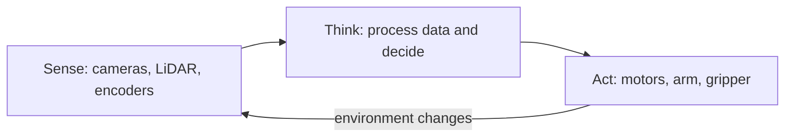

<!-- order: 24 -->
# Robotics AI Engineer: Hands-On Project Tutorials

This course is a series of hands-on projects. You learn each idea at the moment you need it, while building the thing. Projects use simulation so you can complete this course without owning physical robot hardware.

Follow the projects in order. Each one hands off a skill or artifact to the next.


## Before you start: set up your notebook

**Time: about 15 minutes**

This course runs in **Google Colab**, a free Jupyter notebook in your browser and the standard workspace for AI and data work. There's nothing to install.

1. Go to [colab.research.google.com](https://colab.research.google.com) and sign in with a Google account.
2. Give each project its own notebook: choose **File → New notebook**, then click the title at the top to rename it after the project.
3. Notebooks have two kinds of cells. **Code cells** run Python: type or paste code, then press **Shift + Enter**. **Text cells** hold your notes and written answers: choose **Insert → Text cell**.
4. Install libraries in a code cell with `%pip install ...`. The `%` form installs them into the notebook you're using.
5. Put each code block from a project in its own code cell, in order, and run them top to bottom. When a later step changes earlier code, edit that cell and run it again.
6. To use a file you downloaded, such as a CSV, drag it into the **Files** panel (the folder icon on the left). Files your code creates appear there too. Colab clears them when the session ends, so download anything you want to keep, or connect Google Drive from the same panel.

Prefer to work on your own computer? The same notebooks run in JupyterLab or in VS Code with the Jupyter extension.

---

## Project 1 (Module 1): Diagram the Components of a Robotic System

**Time: about 1.5 hours**

**Goal:** Before writing any code, learn to see a robot as a system of interacting parts, so every later project has a place to plug into.

**Step 1: Create the project notebook.**
Create a new notebook for this project (**File → New notebook**) and name it `robot_system_diagram_project`.

**Step 2: Define your example robot's task.**
Write one sentence: what does your robot do? Example: "A small wheeled robot that navigates a room and avoids obstacles."

**Step 3: Understand the sense-think-act loop.**
Robots operate on a repeating cycle, **sense** (gather data from sensors), **think** (process that data and decide what to do), **act** (command the actuators to move).

**Step 4: List your robot's sensors.**
A **sensor** is a device that measures something about the environment, a **camera** captures images, a **LiDAR** measures distance using laser pulses, an **IMU (inertial measurement unit)** measures orientation and acceleration.

**Step 5: List your robot's actuators.**
An **actuator** is anything that lets the robot physically act, motors driving wheels, a robotic arm's joints, or a gripper.

**Step 6: Identify the "think" component.**
Note: where does processing happen, an onboard computer, or a connection to a more powerful remote system?

**Step 7: The sense-think-act loop.**
Your robot repeats this cycle continuously: sensors feed perception, perception drives the decision, the decision commands the actuators, and the changed environment is sensed again.



**Step 8: Note one safety consideration.**
Write one sentence: what's the worst thing that could happen if this robot's "think" step made a bad decision, and what would prevent it?

### Final Project Structure
```text
robot_system_diagram_project/
│
├── robot_task.md
├── sense_think_act_diagram.png
```

### What You Learned
- ✅ The sense-think-act loop
- ✅ Common robotics sensors (camera, LiDAR, IMU) and what they measure
- ✅ Common actuators and their role
- ✅ Where processing/decision-making happens in a robotic system
- ✅ Diagramming a complete robotic system
- ✅ Baseline safety thinking for robotic systems

### Portfolio Project
**Robotic System Architecture Diagram**: Diagrammed a complete sense-think-act robotic system for a defined task, including sensor and actuator selection and a baseline safety consideration.
**Skills:** Systems Thinking, Robotics Fundamentals, Technical Documentation, Safety-Aware Design.

**Deliverable:** A sense-think-act diagram for your example robot, with sensors, actuators, and one documented safety consideration.

### Quiz

1. What happens in each stage of the sense-think-act loop?
2. What does a LiDAR measure, and what does an IMU measure?
3. What is an actuator? Give one example.
4. Why does the loop repeat continuously instead of running once?

*Answers: 1) Sense gathers data from sensors, think processes that data and decides what to do, and act commands the actuators to move. 2) A LiDAR measures distance using laser pulses; an IMU measures orientation and acceleration. 3) A part that lets the robot physically act, such as a wheel motor, an arm joint, or a gripper. 4) Acting changes the environment, so the robot must sense again to see the new situation before its next decision.*

---

## Project 2 (Module 2): Build a Simple Sensor-Data Processing Script

**Time: about 2 hours**

**Goal:** Get real (or simulated) sensor data flowing through code, the first hands-on contact with the "sense" part of your Project 1 loop.

**Step 1: Create the project notebook.**
Create a new notebook for this project (**File → New notebook**) and name it `sensor_processing_project`.
```python
%pip install numpy matplotlib
```

**Step 2: Simulate a basic distance sensor.**
Add a **code cell**, paste in the code below, and run it with **Shift + Enter**.
```python
import numpy as np

def simulate_distance_sensor(num_readings=100):
    true_distance = 2.0  # meters
    noise = np.random.normal(0, 0.05, num_readings)
    return true_distance + noise
```
Real sensors always have **noise**: small random variation around the true value, even when the actual measured thing isn't changing.

**Step 3: Visualize the raw readings.**
```python
import matplotlib.pyplot as plt
readings = simulate_distance_sensor()
plt.plot(readings)
plt.savefig("raw_readings.png")
```

**Step 4: Apply a moving average filter.**
```python
def moving_average(data, window=5):
    return np.convolve(data, np.ones(window)/window, mode="valid")
```
A **moving average filter** smooths noisy data by averaging each point with its nearby neighbors.

**Step 5: Compare raw vs. filtered data.**
```python
filtered = moving_average(readings)
plt.plot(readings, label="raw", alpha=0.5)
plt.plot(filtered, label="filtered")
plt.legend()
plt.savefig("filtered_comparison.png")
```

**Step 6: Simulate a sensor failure.**
```python
def simulate_sensor_with_dropout(num_readings=100, dropout_rate=0.1):
    readings = simulate_distance_sensor(num_readings)
    dropout_mask = np.random.random(num_readings) < dropout_rate
    readings[dropout_mask] = np.nan
    return readings

readings_with_gaps = simulate_sensor_with_dropout()
print("Missing readings:", np.isnan(readings_with_gaps).sum())
```
**sensor dropout** is when a sensor occasionally fails to produce a valid reading, represented here as `NaN` (not a number). A single `NaN` would make the moving average of every window it touches `NaN` too, so gaps must be handled before filtering.

**Step 7: Handle missing readings.**
```python
def handle_dropout(data):
    valid_indices = ~np.isnan(data)
    return np.interp(np.arange(len(data)), np.arange(len(data))[valid_indices], data[valid_indices])

repaired = handle_dropout(readings_with_gaps)
print("Missing after repair:", np.isnan(repaired).sum())
smoothed = moving_average(repaired)
```
**interpolation** estimates a missing value based on the values around it. `~` means "not", so `valid_indices` marks the readings that are not `NaN`.

**Step 8: Document filter parameter choices.**
Add a **text cell** headed `filtering_notes` and write your notes in it.
Note: what window size did you use for the moving average, and what tradeoff does a larger vs. smaller window involve?

### Final Project Structure
```text
sensor_processing_project/
│
├── sensor_processing.py
├── raw_readings.png
├── filtered_comparison.png
├── filtering_notes.md
```

### What You Learned
- ✅ Simulating realistic sensor noise
- ✅ Visualizing raw sensor data
- ✅ Applying a moving average filter
- ✅ Comparing raw vs. filtered signal quality
- ✅ Simulating and handling sensor dropout
- ✅ Interpolating missing sensor readings

### Portfolio Project
**Sensor Data Processing Pipeline**: Built a script simulating noisy and intermittent sensor data, applying moving-average filtering and interpolation to produce a clean, usable signal.
**Skills:** Signal Processing, NumPy, Python, Robotics Perception Fundamentals.

**Deliverable:** A sensor processing script with visualized raw vs. filtered data and documented dropout handling.

### Quiz

1. Why do real sensor readings vary even when the measured distance doesn't change?
2. How does a moving average filter smooth data, and what is the tradeoff of a larger window?
3. What is sensor dropout, and how does this project represent it?
4. Why repair missing readings before applying the moving average?

*Answers: 1) Sensors have noise, small random variation around the true value. 2) It replaces each point with the average of its neighbors; a larger window gives a smoother signal but reacts more slowly to real changes. 3) It is when a sensor occasionally fails to give a valid reading; the project marks those readings as `NaN`. 4) A single `NaN` makes the average of every window it touches `NaN`, so gaps must be filled first, here by interpolation.*

---

## Project 3 (Module 3): Implement a Coordinate Transformation Calculator

**Time: about 2 hours**

**Goal:** Build the math layer that perception and control both depend on, translating between different frames of reference.

**Step 1: Create the project notebook.**
Create a new notebook for this project (**File → New notebook**) and name it `coordinate_transform_project`.
```python
%pip install numpy
```

**Step 2: Understand coordinate frames.**
A **coordinate frame** is a reference point and set of axes that positions are measured relative to, e.g., the "world frame" (fixed to the room) vs. the "robot frame" (fixed to and moving with the robot).

**Step 3: Represent a 2D position and rotation.**
Add a **code cell**, paste in the code below, and run it with **Shift + Enter**.
```python
import numpy as np

def rotation_matrix(theta):
    return np.array([
        [np.cos(theta), -np.sin(theta)],
        [np.sin(theta),  np.cos(theta)]
    ])
```
A **rotation matrix** describes how to rotate a point by an angle `theta`, using basic trigonometry.

**Step 4: Transform a point from robot frame to world frame.**
```python
def robot_to_world(point_robot_frame, robot_position, robot_theta):
    R = rotation_matrix(robot_theta)
    return R @ point_robot_frame + robot_position
```
The `@` operator performs **matrix multiplication**; this combines rotation and translation (the `+ robot_position` shift) into one transformation.

**Step 5: Transform a point from world frame back to robot frame.**
```python
def world_to_robot(point_world_frame, robot_position, robot_theta):
    R = rotation_matrix(robot_theta)
    return R.T @ (point_world_frame - robot_position)
```
`R.T` (the **transpose**) reverses a rotation matrix's effect, a mathematical shortcut for "undoing" the rotation.

**Step 6: Test with a concrete example.**
```python
robot_position = np.array([5.0, 3.0])
robot_theta = np.pi / 2  # facing 90 degrees
point_in_robot_frame = np.array([2.0, 0.0])  # 2 meters "ahead"

world_point = robot_to_world(point_in_robot_frame, robot_position, robot_theta)
print("Point in world frame:", world_point)

back_to_robot = world_to_robot(world_point, robot_position, robot_theta)
print("Back to robot frame (should match original):", back_to_robot)
```

**Step 7: Visualize the transformation.**
```python
import matplotlib.pyplot as plt
plt.scatter(*robot_position, c="red", label="robot")
plt.scatter(*world_point, c="blue", label="detected point")
plt.legend()
plt.savefig("coordinate_transform.png")
```

**Step 8: Document the transform functions for reuse.**
Add a **text cell** headed `README` and write your notes in it.
Note function signatures and what each parameter means.

### Final Project Structure
```text
coordinate_transform_project/
│
├── transforms.py
├── coordinate_transform.png
├── README.md
```

### What You Learned
- ✅ Coordinate frames and why they matter in robotics
- ✅ Rotation matrices and basic trigonometry for robotics
- ✅ Transforming points from robot frame to world frame
- ✅ Transforming points back from world frame to robot frame
- ✅ Verifying transforms with round-trip testing
- ✅ Visualizing coordinate transformations

### Portfolio Project
**Coordinate Transformation Calculator**: Implemented and verified 2D coordinate frame transformations between robot and world reference frames using rotation matrices, with visualized results.
**Skills:** Linear Algebra, NumPy, Robotics Mathematics, Python.

**Deliverable:** A tested coordinate transformation module, with a visualized example and round-trip verification.

### Quiz

1. What is a coordinate frame? Give the two frames used in this project.
2. What two operations does `robot_to_world` combine?
3. How does `world_to_robot` undo the rotation?
4. How do you check that the two transform functions are correct?

*Answers: 1) A reference point and set of axes that positions are measured from; this project uses the world frame and the robot frame. 2) A rotation by the robot's heading (the rotation matrix) and a translation by the robot's position. 3) It subtracts the robot's position, then multiplies by the transpose of the rotation matrix, which reverses the rotation. 4) Do a round trip: convert a point to the world frame and back, and confirm you get the original point.*

---

## Project 4 (Module 4): Build an Object Detection Pipeline for a Robot Camera Feed

**Time: about 3 hours**

**Goal:** Give the robot the ability to "see", the "sense" component of your Project 1 loop, now actually working.

**Step 1: Create the project notebook.**
Create a new notebook for this project (**File → New notebook**) and name it `object_detection_project`.
```python
%pip install opencv-python numpy matplotlib
```

**Step 2: Load a test camera frame.**
Take a photo of a red object (a ball, cup, or sticky note) against a plain background, and upload it to the **Files** panel as `test_frame.jpg`. No photo handy? Run this cell first to draw a practice frame with a red square in it:
```python
import cv2
import numpy as np

practice = np.full((480, 640, 3), 200, dtype=np.uint8)             # light gray background
cv2.rectangle(practice, (300, 200), (360, 260), (0, 0, 255), -1)  # filled red square (BGR order)
cv2.imwrite("test_frame.jpg", practice)
```
Now load the frame. Add a **code cell**, paste in the code below, and run it with **Shift + Enter**.
```python
import cv2
import numpy as np

frame = cv2.imread("test_frame.jpg")
if frame is None:
    raise FileNotFoundError("Couldn't read test_frame.jpg. Check the file name in the Files panel.")
print("Frame shape:", frame.shape)
```
OpenCV represents images as **BGR** (blue-green-red, not RGB) numpy arrays by default. `cv2.imread` returns `None` instead of raising an error when it can't find a file, which is why the code checks.

**Step 3: Implement simple color-based object detection.**
```python
hsv = cv2.cvtColor(frame, cv2.COLOR_BGR2HSV)
lower_red = np.array([0, 120, 70])
upper_red = np.array([10, 255, 255])
mask = cv2.inRange(hsv, lower_red, upper_red)
```
**HSV (hue, saturation, value)** color space makes it easier to detect a specific color range than raw RGB, since hue isolates "color" from "brightness." In OpenCV, hue runs from 0 to 179, and red sits at both ends, so this range catches orange-ish reds; for deep reds, also try `[170, 120, 70]` to `[179, 255, 255]`.

**Step 4: Find the object's location using contours.**
```python
contours, _ = cv2.findContours(mask, cv2.RETR_EXTERNAL, cv2.CHAIN_APPROX_SIMPLE)
if contours:
    largest = max(contours, key=cv2.contourArea)
    x, y, w, h = cv2.boundingRect(largest)
    print(f"Object detected at ({x}, {y}), size {w}x{h}")
else:
    print("No red object found. Check the color range in Step 3.")
```
A **contour** is the outline of a connected region in the mask; a **bounding box** is the smallest rectangle containing it.

**Step 5: Estimate distance from apparent size.**
```python
def estimate_distance(pixel_width, known_object_width=0.1, focal_length=500):
    return (known_object_width * focal_length) / pixel_width

if contours:
    print(f"Estimated distance: {estimate_distance(w):.2f} m")
```
Objects appear smaller the farther away they are, given a known real-world size and the camera's focal length, you can estimate distance from apparent pixel size. Here `known_object_width` is the object's real width in meters (0.1 m = 10 cm) and `focal_length` is in pixels; 500 is a rough guess for a phone camera, so treat the result as an estimate until you calibrate it with an object at a measured distance.

**Step 6: Draw the detection on the frame for verification.**
```python
from IPython.display import Image, display

if contours:
    cv2.rectangle(frame, (x, y), (x + w, y + h), (0, 255, 0), 2)
    cv2.imwrite("annotated_frame.jpg", frame)
    display(Image("annotated_frame.jpg"))
```
The green box should sit tightly around the object.

**Step 7: Test across multiple frames with varying conditions.**
Wrap Steps 2–5 into one function so you can run it on any frame:
```python
def detect_red_object(image_path):
    """Return (x, y, w, h, distance_m) for the largest red object, or None."""
    image = cv2.imread(image_path)
    if image is None:
        raise FileNotFoundError(image_path)
    hsv_image = cv2.cvtColor(image, cv2.COLOR_BGR2HSV)
    red_mask = cv2.inRange(hsv_image, np.array([0, 120, 70]), np.array([10, 255, 255]))
    found, _ = cv2.findContours(red_mask, cv2.RETR_EXTERNAL, cv2.CHAIN_APPROX_SIMPLE)
    if not found:
        return None
    bx, by, bw, bh = cv2.boundingRect(max(found, key=cv2.contourArea))
    return bx, by, bw, bh, estimate_distance(bw)

print(detect_red_object("test_frame.jpg"))
```
Take 4–5 more photos: object close, far, partially occluded, and in different lighting. Upload them and run `detect_red_object` on each, noting where detection fails.

**Step 8: Apply your Project 2 filtering to detection results over time.**
A video is a series of frames, and each frame's distance estimate is a little noisy. This cell simulates 30 frames of a robot slowly approaching the object, then smooths the estimates with the Project 2 moving average:
```python
import matplotlib.pyplot as plt

def moving_average(data, window=5):  # from Project 2
    return np.convolve(data, np.ones(window) / window, mode="valid")

true_distances = np.linspace(2.0, 1.0, 30)                        # robot moves from 2 m to 1 m
measured = true_distances + np.random.normal(0, 0.08, len(true_distances))
smoothed = moving_average(measured)

plt.plot(measured, label="per-frame estimate", alpha=0.5)
plt.plot(range(4, len(measured)), smoothed, label="smoothed")      # window 5 starts at frame 4
plt.xlabel("Frame")
plt.ylabel("Distance (m)")
plt.legend()
plt.savefig("distance_smoothing.png")
```
With a real video, you'd fill `measured` with `detect_red_object(...)[4]` for each frame instead.

### Final Project Structure
```text
object_detection_project/
│
├── object_detection.py
├── test_frame.jpg
├── annotated_frame.jpg
```

### What You Learned
- ✅ Working with images in OpenCV (BGR color space)
- ✅ Color-based object detection using HSV
- ✅ Finding object locations via contours and bounding boxes
- ✅ Estimating distance from apparent object size
- ✅ Visually verifying detection results
- ✅ Testing detection robustness across varied conditions
- ✅ Smoothing noisy per-frame detections over time

### Portfolio Project
**Camera-Based Object Detection Pipeline**: Built a color-based object detection system using OpenCV, including bounding box localization, distance estimation, and temporal smoothing, tested across varied lighting and occlusion conditions.
**Skills:** Computer Vision, OpenCV, Python, Robotics Perception.

**Deliverable:** An object detection pipeline that locates and estimates distance to a target object, tested across multiple frames.

### Quiz

1. Why convert the image to HSV before looking for a red object?
2. What are a contour and a bounding box?
3. How does the project estimate distance from a single camera image, and why is the result only an estimate?
4. Why smooth distance estimates across video frames?

*Answers: 1) Hue separates color from brightness, so one hue range finds red objects in both bright and dim light more reliably than RGB values. 2) A contour is the outline of a connected region in the mask; a bounding box is the smallest rectangle that contains it. 3) It uses the object's known real width, the camera's focal length, and the object's width in pixels; the focal length is a guess until you calibrate it. 4) Each frame's estimate is noisy, and a moving average gives a steadier distance for the robot to act on.*

---

## Project 5 (Module 5): Simulate a Path-Planning Algorithm

**Time: about 3 hours**

**Goal:** Give the robot the ability to decide where to go, the "think" component of your Project 1 loop.

**Step 1: Create the project notebook.**
Create a new notebook for this project (**File → New notebook**) and name it `path_planning_project`.
```python
%pip install numpy matplotlib
```

**Step 2: Represent the environment as a grid.**
Add a **code cell**, paste in the code below, and run it with **Shift + Enter**.
```python
import numpy as np

grid = np.zeros((10, 10))
grid[3:7, 4] = 1  # obstacle wall
start = (0, 0)
goal = (9, 9)
```
A **grid map** represents the environment as cells, where `0` is free space and `1` is an obstacle.

**Step 3: Understand the A* search algorithm concept.**
**A\*** finds the shortest path by exploring the most promising nodes first, using a **heuristic** (an estimate of remaining distance to the goal) to guide the search efficiently.

**Step 4: Implement the heuristic function.**
```python
def heuristic(a, b):
    return abs(a[0] - b[0]) + abs(a[1] - b[1])
```
This is **Manhattan distance**: the sum of horizontal and vertical distance, appropriate for grid movement without diagonals.

**Step 5: Implement A* search.**
```python
import heapq

def astar(grid, start, goal):
    open_set = [(0, start)]
    came_from = {}
    g_score = {start: 0}

    while open_set:
        _, current = heapq.heappop(open_set)
        if current == goal:
            path = [current]
            while current in came_from:
                current = came_from[current]
                path.append(current)
            return path[::-1]

        for dx, dy in [(-1,0),(1,0),(0,-1),(0,1)]:
            neighbor = (current[0]+dx, current[1]+dy)
            if 0 <= neighbor[0] < grid.shape[0] and 0 <= neighbor[1] < grid.shape[1] and grid[neighbor] == 0:
                tentative_g = g_score[current] + 1
                if neighbor not in g_score or tentative_g < g_score[neighbor]:
                    g_score[neighbor] = tentative_g
                    f_score = tentative_g + heuristic(neighbor, goal)
                    heapq.heappush(open_set, (f_score, neighbor))
                    came_from[neighbor] = current
    return None
```
A **priority queue** (via `heapq`) always processes the most promising node next, based on combined actual-distance-so-far plus estimated-remaining-distance.

**Step 6: Run and visualize the path.**
```python
import matplotlib.pyplot as plt

def show_path(grid, path, filename):
    plt.figure()
    plt.imshow(grid, cmap="Greys")  # obstacles show as black
    if path:
        rows, cols = zip(*path)
        plt.plot(cols, rows, c="red")  # plot uses (x = column, y = row)
    plt.savefig(filename)
    plt.show()

path = astar(grid, start, goal)
print("Path length:", len(path) - 1, "moves")
show_path(grid, path, "planned_path.png")
```
Each cell is `(row, column)`, but a plot's x-axis is the column, which is why the plot call swaps them. The shortest path here is 18 moves, the Manhattan distance from corner to corner, because the wall doesn't block every shortest route.

**Step 7: Test with a more complex obstacle layout.**
```python
maze = np.zeros((10, 10))
maze[2, 0:8] = 1    # wall with a gap on the right
maze[5, 2:10] = 1   # wall with a gap on the left
maze[8, 0:8] = 1    # wall with a gap on the right

maze_path = astar(maze, start, goal)
print("Maze path length:", len(maze_path) - 1, "moves")
assert all(maze[cell] == 0 for cell in maze_path), "Path goes through an obstacle!"
show_path(maze, maze_path, "maze_path.png")
```
The path now has to zigzag through the gaps. The `assert` confirms no step of the path is inside an obstacle.

**Step 8: Test the "no valid path" case.**
```python
enclosed = np.zeros((10, 10))
enclosed[8, 8:10] = 1  # wall above the goal
enclosed[9, 8] = 1     # wall to the left of the goal

print("Result when the goal is unreachable:", astar(enclosed, start, goal))
```
The goal at `(9, 9)` is now walled in, so A* explores every reachable cell, runs out of options, and returns `None` instead of crashing or looping forever. Any code that uses the planner must check for `None` before moving.

### Final Project Structure
```text
path_planning_project/
│
├── path_planning.py
├── planned_path.png
```

### What You Learned
- ✅ Representing an environment as a grid map
- ✅ The A* search algorithm and heuristic-guided search
- ✅ Implementing A* with a priority queue
- ✅ Visualizing a planned path around obstacles
- ✅ Testing path planning against complex layouts
- ✅ Handling the unreachable-goal case gracefully

### Portfolio Project
**Grid-Based Path Planning with A\***: Implemented the A* search algorithm from scratch to plan obstacle-avoiding paths on a grid map, tested against simple and complex layouts including unreachable goals.
**Skills:** Algorithms, Python, Robotics Planning, Search Algorithms.

**Deliverable:** A working A* path planner, visualized on at least two different obstacle layouts, including an unreachable-goal test.

### Quiz

1. How does A* decide which cell to explore next?
2. Why is Manhattan distance a suitable heuristic on this grid?
3. What does a priority queue (`heapq`) do in A*?
4. What does `astar` return when the goal is unreachable, and what must code using it do?

*Answers: 1) It picks the cell with the lowest score, which is the distance traveled so far plus the heuristic's estimate of the distance left. 2) The robot moves only up, down, left, or right, so the sum of row and column differences never overestimates the remaining distance. 3) It always hands back the entry with the smallest score first, so the most promising cell is explored next. 4) It returns `None`; code using the planner must check for `None` and not move.*

---

## Project 6 (Module 6): Train a Simple RL Agent in a Simulated Environment

**Time: about 3.5 hours**

**Goal:** Let the robot learn behavior instead of following fixed rules, an alternative to Project 5's hand-coded planning.

**Step 1: Create the project notebook.**
Create a new notebook for this project (**File → New notebook**) and name it `rl_agent_project`.
```python
%pip install numpy gymnasium matplotlib
```

**Step 2: Understand the RL problem framing.**
An **agent** takes **actions** in an **environment**, receiving a **reward** signal after each action; the goal is to learn a **policy** (a strategy for choosing actions) that maximizes total reward over time.

**Step 3: Load a simple simulated environment.**
Add a **code cell**, paste in the code below, and run it with **Shift + Enter**.
```python
import gymnasium as gym
env = gym.make("FrozenLake-v1", is_slippery=False)
print("Actions:", env.action_space.n)
print("States:", env.observation_space.n)
```
**FrozenLake** is a simple grid environment where an agent must reach a goal while avoiding holes, a manageable environment for learning RL fundamentals.

**Step 4: Implement Q-learning.**
```python
import numpy as np

np.random.seed(0)          # repeatable random choices
env.action_space.seed(0)

q_table = np.zeros((env.observation_space.n, env.action_space.n))
learning_rate = 0.8
discount_factor = 0.95
episodes = 2000
epsilon = 1.0              # chance of a random action: start fully random...
min_epsilon = 0.05         # ...and never go below 5%
epsilon_decay = 0.995      # shrink epsilon a little after every episode
episode_rewards = []       # total reward of each training episode, for the learning curve

def choose_action(state, epsilon):
    if np.random.random() < epsilon:
        return env.action_space.sample()                       # explore
    best_actions = np.flatnonzero(q_table[state] == q_table[state].max())
    return int(np.random.choice(best_actions))                 # exploit, breaking ties randomly

for episode in range(episodes):
    state, _ = env.reset()
    done = False
    total_reward = 0
    while not done:
        action = choose_action(state, epsilon)
        next_state, reward, terminated, truncated, _ = env.step(action)
        done = terminated or truncated
        # Q-learning update; at a terminal state there is no future reward to add
        future = 0 if terminated else discount_factor * np.max(q_table[next_state])
        q_table[state, action] += learning_rate * (reward + future - q_table[state, action])
        state = next_state
        total_reward += reward
    episode_rewards.append(total_reward)
    epsilon = max(min_epsilon, epsilon * epsilon_decay)

print("Successful training episodes:", int(sum(episode_rewards)), "of", episodes)
```
**Q-learning** maintains a table of expected future reward for each state-action pair, updating it after every action based on the reward received. In FrozenLake the reward is 1 for reaching the goal and 0 otherwise, so each entry in `episode_rewards` is 1 (success) or 0 (fell in a hole or ran out of steps).

**Step 5: Understand exploration vs. exploitation.**
`choose_action` implements an **epsilon-greedy policy**: with probability `epsilon` it tries a random action (**exploration**) to discover potentially better strategies; otherwise it picks the best-known action (**exploitation**). At the start the Q-table is all zeros, so the agent knows nothing and `epsilon` starts at 1.0 (always explore). It shrinks after every episode, so the agent relies more on what it has learned. Breaking ties randomly matters too: if `np.argmax` always picked the first of several equal actions, an untrained agent would keep walking left into the wall and rarely find the goal.

**Step 6: Evaluate the trained agent.**
```python
successes = 0
for _ in range(100):
    state, _ = env.reset()
    done = False
    while not done:
        action = np.argmax(q_table[state])
        state, reward, terminated, truncated, _ = env.step(action)
        done = terminated or truncated
    if reward == 1:
        successes += 1
print(f"Success rate: {successes}%")  # out of 100 runs, so the count is the percentage
```
Evaluation always picks the best-known action (no random exploration), so it measures what the agent actually learned. With `is_slippery=False` the lake is predictable, so a well-trained agent should reach 100%.

**Step 7: Plot the learning curve.**
```python
import matplotlib.pyplot as plt

window = 50
success_rate_over_time = np.convolve(episode_rewards, np.ones(window) / window, mode="valid")

plt.plot(success_rate_over_time)
plt.xlabel("Training episode")
plt.ylabel(f"Success rate (average of last {window} episodes)")
plt.savefig("learning_curve.png")
```
Each raw reward is just 0 or 1, which makes a jagged plot, so this uses a moving average (the same idea as your Project 2 filter) to show the trend. The curve should start near 0 and rise as the agent learns. It stays a little below 1 because the agent still takes a random action at least 5% of the time during training.

**Step 8: Compare RL to your Project 5 A* planner.**
Add a **text cell** headed `rl_vs_astar_notes` and write your notes in it.
Write 3–4 sentences: when would you choose RL over A* planning, and vice versa?

### Final Project Structure
```text
rl_agent_project/
│
├── rl_agent.py
├── learning_curve.png
├── rl_vs_astar_notes.md
```

### What You Learned
- ✅ The agent/environment/reward/policy framing of RL
- ✅ Implementing Q-learning from scratch
- ✅ Epsilon-greedy exploration vs. exploitation
- ✅ Evaluating a trained policy separately from training
- ✅ Visualizing a learning curve
- ✅ Comparing RL and classical planning approaches

### Portfolio Project
**Reinforcement Learning Agent (Q-Learning)**: Implemented Q-learning from scratch to train an agent in a simulated grid environment, evaluated success rate post-training, and compared the approach against classical path planning.
**Skills:** Reinforcement Learning, Python, Gymnasium, Robotics AI.

**Deliverable:** A trained Q-learning agent with a plotted learning curve and evaluated success rate.

### Quiz

1. What are the agent, environment, reward, and policy in FrozenLake?
2. What does a Q-table store?
3. What is the epsilon-greedy policy, and why does epsilon shrink during training?
4. Why is the trained agent evaluated without random actions?
5. Why plot a moving average of episode rewards instead of the raw rewards?

*Answers: 1) The agent is the player choosing moves, the environment is the frozen lake grid, the reward is 1 for reaching the goal and 0 otherwise, and the policy is the agent's rule for choosing a move in each state. 2) The expected future reward for each state and action pair. 3) With probability epsilon the agent takes a random action, otherwise the best-known one; epsilon shrinks so the agent explores a lot when it knows nothing and relies more on what it has learned later. 4) So the result measures what the agent actually learned, not lucky or unlucky random moves. 5) Each raw reward is just 0 or 1, so the raw plot is jagged; the moving average shows the success-rate trend.*

---

## Project 7 (Module 7): Test a Robot Behavior in Simulation

**Time: about 3.5 hours**

**Goal:** Validate a robot behavior for safety and reliability, the discipline that separates "it worked once" from "it's ready to test on real hardware."

**Step 1: Create the project notebook.**
Create a new notebook for this project (**File → New notebook**) and name it `behavior_testing_project`.
```python
%pip install numpy
```
Then paste and run your Project 5 cells that define `heuristic` (Step 4) and `astar` (Step 5).

**Step 2: Choose a behavior to test.**
This project tests a navigation behavior built on your Project 5 A* planner: plan a path, then move along it one cell at a time. (You can later apply the same method to your Project 6 RL agent, or add Project 4's detection logic.)

**Step 3: Define success criteria.**
Add a **text cell** headed `test_plan` and write your notes in it.
Write specific, measurable pass/fail conditions. The code below uses two: "reaches the goal within 200 steps" and "never enters an obstacle cell."

**Step 4: Run repeated trials.**
Add a **code cell**, paste in the code below, and run it with **Shift + Enter**.
```python
import numpy as np

rng = np.random.default_rng(seed=1)  # repeatable randomness
MAX_STEPS = 200

def random_world(rng, size=10, obstacle_density=0.25):
    """Make a grid with random obstacles, plus a random free start and goal cell."""
    grid = (rng.random((size, size)) < obstacle_density).astype(int)
    free_cells = np.argwhere(grid == 0)
    i, j = rng.choice(len(free_cells), size=2, replace=False)
    start = tuple(int(v) for v in free_cells[i])
    goal = tuple(int(v) for v in free_cells[j])
    return grid, start, goal

def run_behavior(grid, start, goal, planner=astar):
    """Plan a path, then move along it, checking every move."""
    path = planner(grid, start, goal)
    if path is None:
        return {"success": False, "steps": 0, "reason": "no path found"}
    position = start
    for step, next_cell in enumerate(path[1:], start=1):
        if step > MAX_STEPS:
            return {"success": False, "steps": step, "reason": "timed out"}
        if abs(next_cell[0] - position[0]) + abs(next_cell[1] - position[1]) != 1:
            return {"success": False, "steps": step, "reason": "invalid move"}
        if grid[next_cell] == 1:
            return {"success": False, "steps": step, "reason": "collided"}
        position = next_cell
    if position != goal:
        return {"success": False, "steps": len(path) - 1, "reason": "stopped short of goal"}
    return {"success": True, "steps": len(path) - 1, "reason": "reached goal"}

results = []
for trial in range(20):
    grid, start, goal = random_world(rng)
    outcome = run_behavior(grid, start, goal)
    results.append({"trial": trial, "start": start, "goal": goal, **outcome})

for r in results:
    print(r)
```
Each trial builds a new random world, runs the behavior, and records whether it succeeded, how many steps it took, and why it ended. `**outcome` copies the outcome's keys into the result.

**Step 5: Randomize test conditions.**
Real environments vary, so test across more than one setting. This cell repeats the trials at three obstacle densities:
```python
def run_suite(num_trials=20, obstacle_density=0.25, behavior=run_behavior, seed=1):
    suite_rng = np.random.default_rng(seed)  # same seed gives the same worlds every time
    suite = []
    for trial in range(num_trials):
        grid, start, goal = random_world(suite_rng, obstacle_density=obstacle_density)
        suite.append({"trial": trial, "density": obstacle_density, **behavior(grid, start, goal)})
    return suite

results = []
for density in [0.1, 0.25, 0.35]:
    results += run_suite(obstacle_density=density)
print(len(results), "trials run")
```
Because `run_suite` uses a fixed `seed`, it builds the same worlds every time you call it, so you can compare different behaviors on identical tests.

**Step 6: Calculate success metrics.**
```python
from collections import Counter

def summarize(results):
    successes = [r for r in results if r["success"]]
    success_rate = len(successes) / len(results)
    avg_steps = sum(r["steps"] for r in successes) / len(successes) if successes else 0
    print(f"Success rate: {success_rate * 100:.0f}%, avg steps when successful: {avg_steps:.1f}")
    print("Outcomes:", Counter(r["reason"] for r in results))

summarize(results)
for density in [0.1, 0.25, 0.35]:
    print(f"Density {density}:", end=" ")
    summarize([r for r in results if r["density"] == density])
```
The `if successes else 0` guard avoids dividing by zero when no trial succeeds. With more obstacles, more goals are walled off, so expect more "no path found" outcomes.

**Step 7: Investigate every failure.**
Add a **text cell** headed `failure_analysis` and write your notes in it.
For each failed trial, note what specifically went wrong (no path, collided, timed out). To look at one, add `"grid": grid` to the dictionary that `run_suite` appends, rerun it, and print `r["grid"]` for the failed trial.

**Step 8: Add a safety check based on Project 1's consideration.**
A planner can have bugs. This safeguard checks the whole plan *before* the robot moves and stops safely if anything is wrong, instead of driving into an obstacle:
```python
def path_is_safe(grid, path, start, goal):
    if path is None or path[0] != start or path[-1] != goal:
        return False
    if len(path) - 1 > MAX_STEPS:
        return False
    for a, b in zip(path, path[1:]):
        if abs(a[0] - b[0]) + abs(a[1] - b[1]) != 1 or grid[b] == 1:
            return False
    return True

def safe_behavior(grid, start, goal, planner=astar):
    path = planner(grid, start, goal)
    if not path_is_safe(grid, path, start, goal):
        return {"success": False, "steps": 0, "reason": "safety stop"}
    return run_behavior(grid, start, goal, planner=lambda g, s, t: path)

def straight_line_planner(grid, start, goal):
    """A deliberately buggy planner: walks straight to the goal, ignoring obstacles."""
    path = [start]
    row, col = start
    while row != goal[0]:
        row += 1 if goal[0] > row else -1
        path.append((row, col))
    while col != goal[1]:
        col += 1 if goal[1] > col else -1
        path.append((row, col))
    return path

print("Buggy planner, no safeguard:")
summarize(run_suite(behavior=lambda g, s, t: run_behavior(g, s, t, planner=straight_line_planner)))
print("Buggy planner, with safeguard:")
summarize(run_suite(behavior=lambda g, s, t: safe_behavior(g, s, t, planner=straight_line_planner)))
print("A* with safeguard:")
summarize(run_suite(behavior=safe_behavior))
```
Without the safeguard, the buggy planner causes collisions. With it, on the same worlds, those cases become safety stops: the robot refuses to move on a bad plan. With A*, the safeguard should change nothing except turning "no path found" into a safety stop, which shows it doesn't get in the way of a correct planner. A `lambda` is a short, unnamed function, used here to pass a different planner into the same test suite.

### Final Project Structure
```text
behavior_testing_project/
│
├── test_plan.md
├── run_tests.py
├── failure_analysis.md
```

### What You Learned
- ✅ Defining measurable success criteria for a robot behavior
- ✅ Running repeated trials instead of single demo runs
- ✅ Randomizing test conditions to reveal hidden failures
- ✅ Calculating aggregate success metrics
- ✅ Categorizing and investigating failure types
- ✅ Implementing and testing a safety safeguard

### Portfolio Project
**Robot Behavior Test Suite**: Built a repeated-trial testing framework for a robot navigation behavior, with randomized conditions, aggregate success metrics, categorized failure analysis, and a tested safety safeguard.
**Skills:** Test Engineering, Robotics Safety, Python, Statistical Evaluation.

**Deliverable:** A test suite with success-rate metrics across randomized trials, failure analysis, and a verified safety safeguard.

### Quiz

1. Why run many randomized trials instead of one demo run?
2. Give two measurable success criteria used in this project.
3. Why does `run_suite` use a fixed seed?
4. What does the safety check do, and how did the test show it works?

*Answers: 1) One run can succeed by luck; many varied trials reveal how often the behavior fails and under which conditions. 2) Reaching the goal within 200 steps, and never entering an obstacle cell. 3) It builds the same worlds every time, so different behaviors can be compared on identical tests. 4) It checks the whole planned path before moving and stops safely if any step is invalid; with the buggy planner, every collision became a safety stop on the same worlds.*
