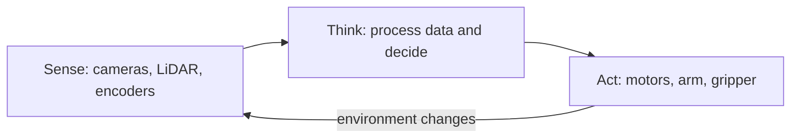

<!-- order: 24 -->
# Robotics AI Engineer: Hands-On Project Tutorials

This course is a series of hands-on projects. You learn each idea at the moment you need it, while building the thing. Projects use simulation so you can complete this course without owning physical robot hardware.

**By the end of this course, you'll be able to:**
- Diagram a robot as a sense-think-act system of sensors, decision-making, and actuators
- Filter noisy, gappy sensor data with a moving average and interpolation
- Convert points between robot and world coordinate frames and verify the result
- Detect a colored object in a camera image with OpenCV and estimate its distance
- Plan obstacle-avoiding paths with A* and train a Q-learning agent in a simulated environment
- Test a robot behavior over many randomized trials and add a safety check that stops bad plans
- Control a simulated robot with ROS 2: write a Python node that reads its pose, sends velocity commands, and follows a planned path

Follow the projects in order. Each one hands off a skill or artifact to the next.


## Before you start: set up your notebook

**Time: about 15 minutes**

This course runs in **Google Colab**, a free Jupyter notebook in your browser and the standard workspace for AI and data work. There's nothing to install.

1. Go to [colab.research.google.com](https://colab.research.google.com) and sign in with a Google account.
2. Give each project its own notebook: choose **File → New notebook**, then click the title at the top to rename it after the project.
3. Notebooks have two kinds of cells. **Code cells** run Python: type or paste code, then press **Shift + Enter**. **Text cells** hold your notes and written answers: choose **Insert → Text cell**.
4. Install libraries in a code cell with `%pip install ...`. The `%` form installs them into the notebook you're using.
5. Put each code block from a project in its own code cell, in order, and run them top to bottom. When a later step changes earlier code, edit that cell and run it again.
6. To use a file you downloaded, such as a CSV, drag it into the **Files** panel (the folder icon on the left). Files your code creates appear there too. Colab clears them when the session ends, so download anything you want to keep, or connect Google Drive from the same panel.

Prefer to work on your own computer? The same notebooks run in JupyterLab or in VS Code with the Jupyter extension.

Project 8 is the exception: it runs ROS 2 in Docker on your own computer (Windows, macOS, or Linux), not in Colab. Its **What you need** box lists the requirements, and you can read along if your computer can't run it.

---

## Project 1 (Module 1): Diagram the Components of a Robotic System

**Time: about 1.5 hours**

**Goal:** Before writing any code, learn to see a robot as a system of interacting parts, so every later project has a place to plug into.

**Step 1: Create the project notebook.**
Create a new notebook for this project (**File → New notebook**) and name it `robot_system_diagram_project`.

**Step 2: Define your example robot's task.**
Write one sentence: what does your robot do? Example: "A small wheeled robot that navigates a room and avoids obstacles."

**Step 3: Understand the sense-think-act loop.**
Robots operate on a repeating cycle, **sense** (gather data from sensors), **think** (process that data and decide what to do), **act** (command the actuators to move).

**Step 4: List your robot's sensors.**
A **sensor** is a device that measures something about the environment, a **camera** captures images, a **LiDAR** measures distance using laser pulses, an **IMU (inertial measurement unit)** measures orientation and acceleration.

**Step 5: List your robot's actuators.**
An **actuator** is anything that lets the robot physically act, motors driving wheels, a robotic arm's joints, or a gripper.

**Step 6: Identify the "think" component.**
Note: where does processing happen, an onboard computer, or a connection to a more powerful remote system?

**Step 7: The sense-think-act loop.**
Your robot repeats this cycle continuously: sensors feed perception, perception drives the decision, the decision commands the actuators, and the changed environment is sensed again.



On real robots, each part of this loop usually runs as a separate program (a **node**) that passes messages to the others through **ROS 2** (Robot Operating System 2), the standard open-source robotics framework. This course writes each part as plain Python so you can learn the ideas first, and in Project 8 you turn them into real ROS 2 nodes.

**Step 8: Note one safety consideration.**
Write one sentence: what's the worst thing that could happen if this robot's "think" step made a bad decision, and what would prevent it?

### Final Project Structure

```text
robot_system_diagram_project/
│
├── robot_task.md
├── sense_think_act_diagram.png
```

### What You Learned
- ✅ The sense-think-act loop
- ✅ Common robotics sensors (camera, LiDAR, IMU) and what they measure
- ✅ Common actuators and their role
- ✅ Where processing/decision-making happens in a robotic system
- ✅ Diagramming a complete robotic system
- ✅ Baseline safety thinking for robotic systems

### Portfolio Project
**Robotic System Architecture Diagram**: Diagrammed a complete sense-think-act robotic system for a defined task, including sensor and actuator selection and a baseline safety consideration.
**Skills:** Systems Thinking, Robotics Fundamentals, Technical Documentation, Safety-Aware Design.

**Deliverable:** A sense-think-act diagram for your example robot, with sensors, actuators, and one documented safety consideration.

### Quiz

1. What happens in each stage of the sense-think-act loop?
2. What does a LiDAR measure, and what does an IMU measure?
3. What is an actuator? Give one example.
4. Why does the loop repeat continuously instead of running once?

*Answers: 1) Sense gathers data from sensors, think processes that data and decides what to do, and act commands the actuators to move. 2) A LiDAR measures distance using laser pulses; an IMU measures orientation and acceleration. 3) A part that lets the robot physically act, such as a wheel motor, an arm joint, or a gripper. 4) Acting changes the environment, so the robot must sense again to see the new situation before its next decision.*

```watch
{
 "scenes": [
  {
   "kind": "title",
   "art": "loop",
   "kicker": "Project 1 · The robot as a system",
   "title": "Sense, think, act",
   "beats": [
    {
     "say": "Welcome to Robotics A I Engineer."
    },
    {
     "say": "Before writing any code, you'll learn to see a robot as a system of interacting parts, so every later project has a place to plug into."
    }
   ]
  },
  {
   "kind": "flow",
   "art": "loop",
   "kicker": "Concept",
   "title": "The sense-think-act loop",
   "steps": [
    "Sense: cameras, LiDAR, encoders",
    "Think: process and decide",
    "Act: motors, arm, gripper",
    "Environment changes → sense again"
   ],
   "beats": [
    {
     "say": "Robots run on a repeating cycle.",
     "show": 0
    },
    {
     "say": "Sense: gather data from sensors.",
     "show": 1
    },
    {
     "say": "Think: process that data and decide what to do.",
     "show": 2
    },
    {
     "say": "Act: command the actuators to move.",
     "show": 3
    },
    {
     "say": "Acting changes the environment, so the robot senses again, and the loop repeats.",
     "show": 4
    }
   ]
  },
  {
   "kind": "list",
   "art": "search",
   "kicker": "Concept",
   "title": "Sensors and actuators",
   "items": [
    [
     "Camera",
     "Captures images"
    ],
    [
     "LiDAR",
     "Distance, from laser pulses"
    ],
    [
     "IMU",
     "Orientation and acceleration"
    ],
    [
     "Actuators",
     "Motors, arm joints, gripper"
    ]
   ],
   "beats": [
    {
     "say": "A sensor measures something about the environment.",
     "show": 0
    },
    {
     "say": "A camera captures images.",
     "show": 1
    },
    {
     "say": "A lidar measures distance using laser pulses.",
     "show": 2
    },
    {
     "say": "An I M U, an inertial measurement unit, measures orientation and acceleration.",
     "show": 3
    },
    {
     "say": "An actuator is anything that lets the robot physically act, like wheel motors, arm joints, or a gripper.",
     "show": 4
    }
   ]
  },
  {
   "kind": "list",
   "art": "pencil",
   "kicker": "Lab",
   "title": "Diagram your own robot",
   "items": [
    [
     "Task",
     "One sentence"
    ],
    [
     "Sensors + actuators",
     "What it senses, how it moves"
    ],
    [
     "Think",
     "Onboard or remote?"
    ],
    [
     "Safety",
     "Worst case, and what prevents it"
    ]
   ],
   "beats": [
    {
     "say": "In your notebook, write one sentence for your robot's task. For example, a small wheeled robot that navigates a room and avoids obstacles.",
     "show": 1
    },
    {
     "say": "List its sensors, and its actuators.",
     "show": 2
    },
    {
     "say": "Note where the thinking happens: an onboard computer, or a more powerful remote system.",
     "show": 3
    },
    {
     "say": "And write one safety sentence: the worst a bad decision could cause, and what would prevent it.",
     "show": 4
    }
   ]
  },
  {
   "kind": "quote",
   "art": "architecture",
   "kicker": "Where you'd use this",
   "title": "Each part becomes a node",
   "quote": "Learn each part in plain Python first, then run it on ROS 2 in Project 8.",
   "beats": [
    {
     "say": "On real robots, each part of this loop usually runs as a separate program, called a node.",
     "show": 0
    },
    {
     "say": "Nodes pass messages through R O S 2, the standard open source robotics framework.",
     "show": 1
    },
    {
     "say": "This course writes each part as plain Python first. In Project 8, you turn them into real R O S 2 nodes.",
     "show": 1
    }
   ]
  },
  {
   "kind": "quiz",
   "art": "ask",
   "kicker": "Quick check",
   "title": "Why does the sense-think-act loop repeat instead of running once?",
   "options": [
    "Acting changes the environment, so the robot must sense the new situation",
    "Sensors need warming up before they're accurate",
    "The actuators can only move a little at a time"
   ],
   "answer": 0,
   "good": "That's right. Acting changes the environment, so the robot must sense again to see the new situation before its next decision.",
   "bad": "Not quite. Acting changes the environment, so the robot must sense again to see the new situation before its next decision.",
   "beats": [
    {
     "say": "Quick check.",
     "show": 0
    },
    {
     "say": "Why does the sense-think-act loop repeat instead of running once?",
     "show": 0
    },
    {
     "say": "Tap your answer.",
     "show": 1
    }
   ]
  },
  {
   "kind": "list",
   "art": "proof",
   "kicker": "Checkpoint",
   "title": "You're done when",
   "items": [
    [
     "A sense-think-act diagram",
     ""
    ],
    [
     "Sensors and actuators listed",
     ""
    ],
    [
     "One safety consideration",
     ""
    ]
   ],
   "beats": [
    {
     "say": "That's Project 1.",
     "show": 0
    },
    {
     "say": "You're done when:",
     "show": 0
    },
    {
     "say": "you have a sense-think-act diagram for your example robot,",
     "show": 1
    },
    {
     "say": "with its sensors and actuators,",
     "show": 2
    },
    {
     "say": "and one documented safety consideration.",
     "show": 3
    },
    {
     "say": "Next, in Module 2, you'll process noisy sensor data.",
     "show": 3
    }
   ]
  }
 ]
}
```

---

## Project 2 (Module 2): Build a Simple Sensor-Data Processing Script

**Time: about 2 hours**

**Goal:** Get real (or simulated) sensor data flowing through code, the first hands-on contact with the "sense" part of your Project 1 loop.

**Step 1: Create the project notebook.**
Create a new notebook for this project (**File → New notebook**) and name it `sensor_processing_project`.

```python
%pip install numpy matplotlib
```

**Step 2: Simulate a basic distance sensor.**
Add a **code cell**, paste in the code below, and run it with **Shift + Enter**.

```python
import numpy as np

def simulate_distance_sensor(num_readings=100):
    true_distance = 2.0  # meters
    noise = np.random.normal(0, 0.05, num_readings)
    return true_distance + noise
```

Real sensors always have **noise**: small random variation around the true value, even when the actual measured thing isn't changing.

**Step 3: Visualize the raw readings.**

```python
import matplotlib.pyplot as plt
readings = simulate_distance_sensor()
plt.plot(readings)
plt.savefig("raw_readings.png")
```

**Step 4: Apply a moving average filter.**

```python
def moving_average(data, window=5):
    return np.convolve(data, np.ones(window)/window, mode="valid")
```

A **moving average filter** smooths noisy data by averaging each point with its nearby neighbors.

**Step 5: Compare raw vs. filtered data.**

```python
filtered = moving_average(readings)
plt.plot(readings, label="raw", alpha=0.5)
plt.plot(filtered, label="filtered")
plt.legend()
plt.savefig("filtered_comparison.png")
```

**Step 6: Simulate a sensor failure.**

```python
def simulate_sensor_with_dropout(num_readings=100, dropout_rate=0.1):
    readings = simulate_distance_sensor(num_readings)
    dropout_mask = np.random.random(num_readings) < dropout_rate
    readings[dropout_mask] = np.nan
    return readings

readings_with_gaps = simulate_sensor_with_dropout()
print("Missing readings:", np.isnan(readings_with_gaps).sum())
```

**sensor dropout** is when a sensor occasionally fails to produce a valid reading, represented here as `NaN` (not a number). A single `NaN` would make the moving average of every window it touches `NaN` too, so gaps must be handled before filtering.

**Step 7: Handle missing readings.**

```python
def handle_dropout(data):
    valid_indices = ~np.isnan(data)
    return np.interp(np.arange(len(data)), np.arange(len(data))[valid_indices], data[valid_indices])

repaired = handle_dropout(readings_with_gaps)
print("Missing after repair:", np.isnan(repaired).sum())
smoothed = moving_average(repaired)
```

**interpolation** estimates a missing value based on the values around it. `~` means "not", so `valid_indices` marks the readings that are not `NaN`.

**Step 8: Document filter parameter choices.**
Add a **text cell** headed `filtering_notes` and write your notes in it.
Note: what window size did you use for the moving average, and what tradeoff does a larger vs. smaller window involve?

### Final Project Structure

```text
sensor_processing_project/
│
├── sensor_processing.py
├── raw_readings.png
├── filtered_comparison.png
├── filtering_notes.md
```

### What You Learned
- ✅ Simulating realistic sensor noise
- ✅ Visualizing raw sensor data
- ✅ Applying a moving average filter
- ✅ Comparing raw vs. filtered signal quality
- ✅ Simulating and handling sensor dropout
- ✅ Interpolating missing sensor readings

### Portfolio Project
**Sensor Data Processing Pipeline**: Built a script simulating noisy and intermittent sensor data, applying moving-average filtering and interpolation to produce a clean, usable signal.
**Skills:** Signal Processing, NumPy, Python, Robotics Perception Fundamentals.

**Deliverable:** A sensor processing script with visualized raw vs. filtered data and documented dropout handling.

### Quiz

1. Why do real sensor readings vary even when the measured distance doesn't change?
2. How does a moving average filter smooth data, and what is the tradeoff of a larger window?
3. What is sensor dropout, and how does this project represent it?
4. Why repair missing readings before applying the moving average?

*Answers: 1) Sensors have noise, small random variation around the true value. 2) It replaces each point with the average of its neighbors; a larger window gives a smoother signal but reacts more slowly to real changes. 3) It is when a sensor occasionally fails to give a valid reading; the project marks those readings as `NaN`. 4) A single `NaN` makes the average of every window it touches `NaN`, so gaps must be filled first, here by interpolation.*

```watch
{
 "scenes": [
  {
   "kind": "title",
   "art": "graph",
   "kicker": "Project 2 · Sensor data",
   "title": "Clean up noisy readings",
   "beats": [
    {
     "say": "Welcome to Project 2."
    },
    {
     "say": "Now you get sensor data flowing through code: your first hands-on contact with the sense part of the loop."
    }
   ]
  },
  {
   "kind": "code",
   "art": "code",
   "kicker": "Lab · Step 2",
   "title": "Simulate a noisy sensor",
   "file": "sensor_processing",
   "code": "import numpy as np\n\ndef simulate_distance_sensor(num_readings=100):\n    true_distance = 2.0  # meters\n    noise = np.random.normal(0, 0.05, num_readings)\n    return true_distance + noise",
   "beats": [
    {
     "say": "Start by simulating a distance sensor.",
     "show": 0
    },
    {
     "say": "The true distance is two meters, but each reading adds a little random noise.",
     "show": 1
    },
    {
     "say": "Real sensors always have noise: small random variation around the true value, even when nothing is changing.",
     "show": 1
    }
   ]
  },
  {
   "kind": "code",
   "art": "graph",
   "kicker": "Lab · Steps 4 and 5",
   "title": "A moving average filter",
   "file": "sensor_processing",
   "code": "def moving_average(data, window=5):\n    return np.convolve(data, np.ones(window)/window, mode=\"valid\")\n\nfiltered = moving_average(readings)\nplt.plot(readings, label=\"raw\", alpha=0.5)\nplt.plot(filtered, label=\"filtered\")",
   "beats": [
    {
     "say": "A moving average filter smooths noisy data by averaging each point with its nearby neighbors.",
     "show": 0
    },
    {
     "say": "Plot the raw and filtered readings together to compare them.",
     "show": 1
    },
    {
     "say": "A larger window gives a smoother signal, but reacts more slowly to real changes.",
     "show": 1
    }
   ]
  },
  {
   "kind": "list",
   "art": "warning",
   "kicker": "Lab · Step 6",
   "title": "When the sensor drops out",
   "items": [
    [
     "Dropout",
     "No valid reading → NaN"
    ],
    [
     "The problem",
     "One NaN spoils every window it touches"
    ]
   ],
   "beats": [
    {
     "say": "Sensors also fail now and then. That's called sensor dropout.",
     "show": 0
    },
    {
     "say": "Here, a failed reading is stored as N a N, which means not a number.",
     "show": 1
    },
    {
     "say": "One N a N makes the average of every window it touches N a N too.",
     "show": 2
    },
    {
     "say": "So gaps must be handled before filtering.",
     "show": 2
    }
   ]
  },
  {
   "kind": "code",
   "art": "pencil",
   "kicker": "Lab · Step 7",
   "title": "Fill the gaps first",
   "file": "sensor_processing",
   "code": "def handle_dropout(data):\n    valid_indices = ~np.isnan(data)\n    return np.interp(np.arange(len(data)), np.arange(len(data))[valid_indices], data[valid_indices])\n\nrepaired = handle_dropout(readings_with_gaps)\nprint(\"Missing after repair:\", np.isnan(repaired).sum())\nsmoothed = moving_average(repaired)",
   "beats": [
    {
     "say": "Interpolation estimates a missing value from the values around it.",
     "show": 0
    },
    {
     "say": "The tilde means not, so valid indices marks the readings that aren't N a N.",
     "show": 1
    },
    {
     "say": "Repair the gaps, check none are left, then smooth.",
     "show": 1
    }
   ]
  },
  {
   "kind": "quiz",
   "art": "ask",
   "kicker": "Quick check",
   "title": "Why repair missing readings before applying the moving average?",
   "options": [
    "Interpolation only works on smoothed data",
    "The moving average deletes missing readings",
    "One NaN makes every window it touches NaN"
   ],
   "answer": 2,
   "good": "That's right. A single NaN makes the average of every window it touches NaN, so gaps must be filled first, here by interpolation.",
   "bad": "Not quite. A single NaN makes the average of every window it touches NaN, so gaps must be filled first, here by interpolation.",
   "beats": [
    {
     "say": "Quick check.",
     "show": 0
    },
    {
     "say": "Why repair missing readings before applying the moving average?",
     "show": 0
    },
    {
     "say": "Tap your answer.",
     "show": 1
    }
   ]
  },
  {
   "kind": "list",
   "art": "proof",
   "kicker": "Checkpoint",
   "title": "You're done when",
   "items": [
    [
     "Raw vs. filtered data plotted",
     ""
    ],
    [
     "Dropout handling documented",
     ""
    ]
   ],
   "beats": [
    {
     "say": "That's Project 2.",
     "show": 0
    },
    {
     "say": "You're done when:",
     "show": 0
    },
    {
     "say": "you have a sensor processing script with raw versus filtered data plotted,",
     "show": 1
    },
    {
     "say": "and documented dropout handling.",
     "show": 2
    },
    {
     "say": "Next, in Module 3, coordinate transformations.",
     "show": 2
    }
   ]
  }
 ]
}
```

---

## Project 3 (Module 3): Implement a Coordinate Transformation Calculator

**Time: about 2 hours**

**Goal:** Build the math layer that perception and control both depend on, translating between different frames of reference.

**Step 1: Create the project notebook.**
Create a new notebook for this project (**File → New notebook**) and name it `coordinate_transform_project`.

```python
%pip install numpy
```

**Step 2: Understand coordinate frames.**
A **coordinate frame** is a reference point and set of axes that positions are measured relative to, e.g., the "world frame" (fixed to the room) vs. the "robot frame" (fixed to and moving with the robot).

**Step 3: Represent a 2D position and rotation.**
Add a **code cell**, paste in the code below, and run it with **Shift + Enter**.

```python
import numpy as np

def rotation_matrix(theta):
    return np.array([
        [np.cos(theta), -np.sin(theta)],
        [np.sin(theta),  np.cos(theta)]
    ])
```

A **rotation matrix** describes how to rotate a point by an angle `theta`, using basic trigonometry.

**Step 4: Transform a point from robot frame to world frame.**

```python
def robot_to_world(point_robot_frame, robot_position, robot_theta):
    R = rotation_matrix(robot_theta)
    return R @ point_robot_frame + robot_position
```

The `@` operator performs **matrix multiplication**; this combines rotation and translation (the `+ robot_position` shift) into one transformation.

**Step 5: Transform a point from world frame back to robot frame.**

```python
def world_to_robot(point_world_frame, robot_position, robot_theta):
    R = rotation_matrix(robot_theta)
    return R.T @ (point_world_frame - robot_position)
```

`R.T` (the **transpose**) reverses a rotation matrix's effect, a mathematical shortcut for "undoing" the rotation.

**Step 6: Test with a concrete example.**

```python
robot_position = np.array([5.0, 3.0])
robot_theta = np.pi / 2  # facing 90 degrees
point_in_robot_frame = np.array([2.0, 0.0])  # 2 meters "ahead"

world_point = robot_to_world(point_in_robot_frame, robot_position, robot_theta)
print("Point in world frame:", world_point)

back_to_robot = world_to_robot(world_point, robot_position, robot_theta)
print("Back to robot frame (should match original):", back_to_robot)
```

**Step 7: Visualize the transformation.**

```python
import matplotlib.pyplot as plt
plt.scatter(*robot_position, c="red", label="robot")
plt.scatter(*world_point, c="blue", label="detected point")
plt.legend()
plt.savefig("coordinate_transform.png")
```

**Step 8: Document the transform functions for reuse.**
Add a **text cell** headed `README` and write your notes in it.
Note function signatures and what each parameter means.

### Final Project Structure

```text
coordinate_transform_project/
│
├── transforms.py
├── coordinate_transform.png
├── README.md
```

### What You Learned
- ✅ Coordinate frames and why they matter in robotics
- ✅ Rotation matrices and basic trigonometry for robotics
- ✅ Transforming points from robot frame to world frame
- ✅ Transforming points back from world frame to robot frame
- ✅ Verifying transforms with round-trip testing
- ✅ Visualizing coordinate transformations

### Portfolio Project
**Coordinate Transformation Calculator**: Implemented and verified 2D coordinate frame transformations between robot and world reference frames using rotation matrices, with visualized results.
**Skills:** Linear Algebra, NumPy, Robotics Mathematics, Python.

**Deliverable:** A tested coordinate transformation module, with a visualized example and round-trip verification.

### Quiz

1. What is a coordinate frame? Give the two frames used in this project.
2. What two operations does `robot_to_world` combine?
3. How does `world_to_robot` undo the rotation?
4. How do you check that the two transform functions are correct?

*Answers: 1) A reference point and set of axes that positions are measured from; this project uses the world frame and the robot frame. 2) A rotation by the robot's heading (the rotation matrix) and a translation by the robot's position. 3) It subtracts the robot's position, then multiplies by the transpose of the rotation matrix, which reverses the rotation. 4) Do a round trip: convert a point to the world frame and back, and confirm you get the original point.*

```watch
{
 "scenes": [
  {
   "kind": "title",
   "art": "calc",
   "kicker": "Project 3 · Coordinate frames",
   "title": "Translate between frames",
   "beats": [
    {
     "say": "Welcome to Project 3."
    },
    {
     "say": "You'll build the math layer that perception and control both depend on: translating between different frames of reference."
    }
   ]
  },
  {
   "kind": "list",
   "art": "target",
   "kicker": "Concept",
   "title": "Two frames",
   "items": [
    [
     "World frame",
     "Fixed to the room"
    ],
    [
     "Robot frame",
     "Fixed to, and moving with, the robot"
    ]
   ],
   "beats": [
    {
     "say": "A coordinate frame is a reference point and a set of axes that positions are measured from.",
     "show": 0
    },
    {
     "say": "The world frame is fixed to the room.",
     "show": 1
    },
    {
     "say": "The robot frame is fixed to the robot, and moves with it.",
     "show": 2
    }
   ]
  },
  {
   "kind": "code",
   "art": "calc",
   "kicker": "Lab · Steps 3 and 4",
   "title": "Robot frame to world frame",
   "file": "transforms",
   "code": "def rotation_matrix(theta):\n    return np.array([\n        [np.cos(theta), -np.sin(theta)],\n        [np.sin(theta),  np.cos(theta)]\n    ])\n\ndef robot_to_world(point_robot_frame, robot_position, robot_theta):\n    R = rotation_matrix(robot_theta)\n    return R @ point_robot_frame + robot_position",
   "beats": [
    {
     "say": "A rotation matrix rotates a point by an angle, theta, using basic trigonometry.",
     "show": 0
    },
    {
     "say": "To go from robot frame to world frame, rotate by the robot's heading, then add the robot's position.",
     "show": 1
    },
    {
     "say": "The at sign performs matrix multiplication, combining rotation and translation in one step.",
     "show": 1
    }
   ]
  },
  {
   "kind": "code",
   "art": "loop",
   "kicker": "Lab · Step 5",
   "title": "And back again",
   "file": "transforms",
   "code": "def world_to_robot(point_world_frame, robot_position, robot_theta):\n    R = rotation_matrix(robot_theta)\n    return R.T @ (point_world_frame - robot_position)",
   "beats": [
    {
     "say": "Going back, subtract the robot's position first.",
     "show": 0
    },
    {
     "say": "Then multiply by R dot T, the transpose, which reverses the rotation.",
     "show": 1
    }
   ]
  },
  {
   "kind": "flow",
   "art": "proof",
   "kicker": "Lab · Step 6",
   "title": "Prove it with a round trip",
   "steps": [
    "Robot at (5, 3), facing 90°",
    "Point 2 m ahead → world frame",
    "Back to robot frame = original"
   ],
   "beats": [
    {
     "say": "Test with a concrete example.",
     "show": 0
    },
    {
     "say": "The robot sits at five, three, facing ninety degrees, and sees a point two meters ahead.",
     "show": 1
    },
    {
     "say": "Convert that point to the world frame.",
     "show": 2
    },
    {
     "say": "Then convert it back. It should match the original.",
     "show": 3
    }
   ]
  },
  {
   "kind": "quiz",
   "art": "ask",
   "kicker": "Quick check",
   "title": "How do you check that the two transform functions are correct?",
   "options": [
    "Plot the robot's position on a chart",
    "Convert a point to the world frame and back, and get the original",
    "Check the rotation matrix has four numbers"
   ],
   "answer": 1,
   "good": "That's right. Do a round trip: convert a point to the world frame and back, and confirm you get the original point.",
   "bad": "Not quite. Do a round trip: convert a point to the world frame and back, and confirm you get the original point.",
   "beats": [
    {
     "say": "Quick check.",
     "show": 0
    },
    {
     "say": "How do you check that the two transform functions are correct?",
     "show": 0
    },
    {
     "say": "Tap your answer.",
     "show": 1
    }
   ]
  },
  {
   "kind": "list",
   "art": "proof",
   "kicker": "Checkpoint",
   "title": "You're done when",
   "items": [
    [
     "A tested transform module",
     ""
    ],
    [
     "Visualized and round-trip verified",
     ""
    ]
   ],
   "beats": [
    {
     "say": "That's Project 3.",
     "show": 0
    },
    {
     "say": "You're done when:",
     "show": 0
    },
    {
     "say": "you have a tested coordinate transformation module,",
     "show": 1
    },
    {
     "say": "with a visualized example and round-trip verification.",
     "show": 2
    },
    {
     "say": "Next, in Module 4, object detection for a robot camera.",
     "show": 2
    }
   ]
  }
 ]
}
```

---

## Project 4 (Module 4): Build an Object Detection Pipeline for a Robot Camera Feed

**Time: about 3 hours**

**Goal:** Give the robot the ability to "see", the "sense" component of your Project 1 loop, now actually working.

**Step 1: Create the project notebook.**
Create a new notebook for this project (**File → New notebook**) and name it `object_detection_project`.

```python
%pip install opencv-python numpy matplotlib
```

**Step 2: Load a test camera frame.**
Take a photo of a red object (a ball, cup, or sticky note) against a plain background, and upload it to the **Files** panel as `test_frame.jpg`. No photo handy? Run this cell first to draw a practice frame with a red square in it:

```python
import cv2
import numpy as np

practice = np.full((480, 640, 3), 200, dtype=np.uint8)             # light gray background
cv2.rectangle(practice, (300, 200), (360, 260), (0, 0, 255), -1)  # filled red square (BGR order)
cv2.imwrite("test_frame.jpg", practice)
```

Now load the frame. Add a **code cell**, paste in the code below, and run it with **Shift + Enter**.

```python
import cv2
import numpy as np

frame = cv2.imread("test_frame.jpg")
if frame is None:
    raise FileNotFoundError("Couldn't read test_frame.jpg. Check the file name in the Files panel.")
print("Frame shape:", frame.shape)
```

OpenCV represents images as **BGR** (blue-green-red, not RGB) numpy arrays by default. `cv2.imread` returns `None` instead of raising an error when it can't find a file, which is why the code checks.

**Step 3: Implement simple color-based object detection.**

```python
hsv = cv2.cvtColor(frame, cv2.COLOR_BGR2HSV)
lower_red = np.array([0, 120, 70])
upper_red = np.array([10, 255, 255])
mask = cv2.inRange(hsv, lower_red, upper_red)
```

**HSV (hue, saturation, value)** color space makes it easier to detect a specific color range than raw RGB, since hue isolates "color" from "brightness." In OpenCV, hue runs from 0 to 179, and red sits at both ends, so this range catches orange-ish reds; for deep reds, also try `[170, 120, 70]` to `[179, 255, 255]`.

**Step 4: Find the object's location using contours.**

```python
contours, _ = cv2.findContours(mask, cv2.RETR_EXTERNAL, cv2.CHAIN_APPROX_SIMPLE)
if contours:
    largest = max(contours, key=cv2.contourArea)
    x, y, w, h = cv2.boundingRect(largest)
    print(f"Object detected at ({x}, {y}), size {w}x{h}")
else:
    print("No red object found. Check the color range in Step 3.")
```

A **contour** is the outline of a connected region in the mask; a **bounding box** is the smallest rectangle containing it.

**Step 5: Estimate distance from apparent size.**

```python
def estimate_distance(pixel_width, known_object_width=0.1, focal_length=500):
    return (known_object_width * focal_length) / pixel_width

if contours:
    print(f"Estimated distance: {estimate_distance(w):.2f} m")
```

Objects appear smaller the farther away they are, given a known real-world size and the camera's focal length, you can estimate distance from apparent pixel size. Here `known_object_width` is the object's real width in meters (0.1 m = 10 cm) and `focal_length` is in pixels; 500 is a rough guess for a phone camera, so treat the result as an estimate until you calibrate it with an object at a measured distance.

**Step 6: Draw the detection on the frame for verification.**

```python
from IPython.display import Image, display

if contours:
    cv2.rectangle(frame, (x, y), (x + w, y + h), (0, 255, 0), 2)
    cv2.imwrite("annotated_frame.jpg", frame)
    display(Image("annotated_frame.jpg"))
```

The green box should sit tightly around the object.

**Step 7: Test across multiple frames with varying conditions.**
Wrap Steps 2–5 into one function so you can run it on any frame:

```python
def detect_red_object(image_path):
    """Return (x, y, w, h, distance_m) for the largest red object, or None."""
    image = cv2.imread(image_path)
    if image is None:
        raise FileNotFoundError(image_path)
    hsv_image = cv2.cvtColor(image, cv2.COLOR_BGR2HSV)
    red_mask = cv2.inRange(hsv_image, np.array([0, 120, 70]), np.array([10, 255, 255]))
    found, _ = cv2.findContours(red_mask, cv2.RETR_EXTERNAL, cv2.CHAIN_APPROX_SIMPLE)
    if not found:
        return None
    bx, by, bw, bh = cv2.boundingRect(max(found, key=cv2.contourArea))
    return bx, by, bw, bh, estimate_distance(bw)

print(detect_red_object("test_frame.jpg"))
```

Take 4–5 more photos: object close, far, partially occluded, and in different lighting. Upload them and run `detect_red_object` on each, noting where detection fails.

**Step 8: Apply your Project 2 filtering to detection results over time.**
A video is a series of frames, and each frame's distance estimate is a little noisy. This cell simulates 30 frames of a robot slowly approaching the object, then smooths the estimates with the Project 2 moving average:

```python
import matplotlib.pyplot as plt

def moving_average(data, window=5):  # from Project 2
    return np.convolve(data, np.ones(window) / window, mode="valid")

true_distances = np.linspace(2.0, 1.0, 30)                        # robot moves from 2 m to 1 m
measured = true_distances + np.random.normal(0, 0.08, len(true_distances))
smoothed = moving_average(measured)

plt.plot(measured, label="per-frame estimate", alpha=0.5)
plt.plot(range(4, len(measured)), smoothed, label="smoothed")      # window 5 starts at frame 4
plt.xlabel("Frame")
plt.ylabel("Distance (m)")
plt.legend()
plt.savefig("distance_smoothing.png")
```

With a real video, you'd fill `measured` with `detect_red_object(...)[4]` for each frame instead.

### Final Project Structure

```text
object_detection_project/
│
├── object_detection.py
├── test_frame.jpg
├── annotated_frame.jpg
```

### What You Learned
- ✅ Working with images in OpenCV (BGR color space)
- ✅ Color-based object detection using HSV
- ✅ Finding object locations via contours and bounding boxes
- ✅ Estimating distance from apparent object size
- ✅ Visually verifying detection results
- ✅ Testing detection robustness across varied conditions
- ✅ Smoothing noisy per-frame detections over time

### Portfolio Project
**Camera-Based Object Detection Pipeline**: Built a color-based object detection system using OpenCV, including bounding box localization, distance estimation, and temporal smoothing, tested across varied lighting and occlusion conditions.
**Skills:** Computer Vision, OpenCV, Python, Robotics Perception.

**Deliverable:** An object detection pipeline that locates and estimates distance to a target object, tested across multiple frames.

### Quiz

1. Why convert the image to HSV before looking for a red object?
2. What are a contour and a bounding box?
3. How does the project estimate distance from a single camera image, and why is the result only an estimate?
4. Why smooth distance estimates across video frames?

*Answers: 1) Hue separates color from brightness, so one hue range finds red objects in both bright and dim light more reliably than RGB values. 2) A contour is the outline of a connected region in the mask; a bounding box is the smallest rectangle that contains it. 3) It uses the object's known real width, the camera's focal length, and the object's width in pixels; the focal length is a guess until you calibrate it. 4) Each frame's estimate is noisy, and a moving average gives a steadier distance for the robot to act on.*

```watch
{
 "scenes": [
  {
   "kind": "title",
   "art": "search",
   "kicker": "Project 4 · Object detection",
   "title": "Teach the robot to see",
   "beats": [
    {
     "say": "Welcome to Project 4."
    },
    {
     "say": "You'll give the robot the ability to see: the sense part of your loop, now actually working, with Open C V."
    }
   ]
  },
  {
   "kind": "code",
   "art": "palette",
   "kicker": "Lab · Step 3",
   "title": "Find red with HSV",
   "file": "object_detection",
   "code": "hsv = cv2.cvtColor(frame, cv2.COLOR_BGR2HSV)\nlower_red = np.array([0, 120, 70])\nupper_red = np.array([10, 255, 255])\nmask = cv2.inRange(hsv, lower_red, upper_red)",
   "beats": [
    {
     "say": "Open C V stores images as B G R, blue green red, not R G B.",
     "show": 0
    },
    {
     "say": "Convert the frame to H S V: hue, saturation, value. Hue separates color from brightness.",
     "show": 1
    },
    {
     "say": "Then in range builds a mask of the pixels inside a red range.",
     "show": 1
    }
   ]
  },
  {
   "kind": "code",
   "art": "target",
   "kicker": "Lab · Step 4",
   "title": "Contours and a bounding box",
   "file": "object_detection",
   "code": "contours, _ = cv2.findContours(mask, cv2.RETR_EXTERNAL, cv2.CHAIN_APPROX_SIMPLE)\nif contours:\n    largest = max(contours, key=cv2.contourArea)\n    x, y, w, h = cv2.boundingRect(largest)\n    print(f\"Object detected at ({x}, {y}), size {w}x{h}\")\nelse:\n    print(\"No red object found. Check the color range in Step 3.\")",
   "beats": [
    {
     "say": "A contour is the outline of a connected region in the mask.",
     "show": 0
    },
    {
     "say": "Take the largest one, and find its bounding box: the smallest rectangle that contains it.",
     "show": 1
    },
    {
     "say": "If nothing is found, check the color range.",
     "show": 1
    }
   ]
  },
  {
   "kind": "code",
   "art": "calc",
   "kicker": "Lab · Step 5",
   "title": "Distance from apparent size",
   "file": "object_detection",
   "code": "def estimate_distance(pixel_width, known_object_width=0.1, focal_length=500):\n    return (known_object_width * focal_length) / pixel_width",
   "beats": [
    {
     "say": "Objects look smaller the farther away they are.",
     "show": 0
    },
    {
     "say": "Given the object's real width, ten centimeters here, and the camera's focal length in pixels, you can estimate distance.",
     "show": 1
    },
    {
     "say": "Five hundred is a rough guess, so treat the result as an estimate until you calibrate it.",
     "show": 1
    }
   ]
  },
  {
   "kind": "flow",
   "art": "graph",
   "kicker": "Lab · Steps 6 to 8",
   "title": "Verify, test, smooth",
   "steps": [
    "Draw the box to verify",
    "Test varied photos",
    "Smooth across frames"
   ],
   "beats": [
    {
     "say": "Draw a green box on the frame. It should sit tightly around the object.",
     "show": 1
    },
    {
     "say": "Wrap the steps into one function, and test it on photos: close, far, partly hidden, and in different lighting.",
     "show": 2
    },
    {
     "say": "Each frame's distance is a little noisy, so smooth estimates over time with your Project 2 moving average.",
     "show": 3
    }
   ]
  },
  {
   "kind": "quiz",
   "art": "ask",
   "kicker": "Quick check",
   "title": "Why convert the image to HSV before looking for a red object?",
   "options": [
    "Hue separates color from brightness, so red is found in bright and dim light",
    "OpenCV can only read HSV images",
    "HSV images are smaller and faster to save"
   ],
   "answer": 0,
   "good": "That's right. Hue separates color from brightness, so one hue range finds red objects in both bright and dim light more reliably than R G B values.",
   "bad": "Not quite. Hue separates color from brightness, so one hue range finds red objects in both bright and dim light more reliably than R G B values.",
   "beats": [
    {
     "say": "Quick check.",
     "show": 0
    },
    {
     "say": "Why convert the image to HSV before looking for a red object?",
     "show": 0
    },
    {
     "say": "Tap your answer.",
     "show": 1
    }
   ]
  },
  {
   "kind": "list",
   "art": "proof",
   "kicker": "Checkpoint",
   "title": "You're done when",
   "items": [
    [
     "Locates a target and estimates distance",
     ""
    ],
    [
     "Tested across multiple frames",
     ""
    ]
   ],
   "beats": [
    {
     "say": "That's Project 4.",
     "show": 0
    },
    {
     "say": "You're done when:",
     "show": 0
    },
    {
     "say": "you have an object detection pipeline that locates a target and estimates its distance,",
     "show": 1
    },
    {
     "say": "tested across multiple frames.",
     "show": 2
    },
    {
     "say": "Next, in Module 5, path planning with A star.",
     "show": 2
    }
   ]
  }
 ]
}
```

---

## Project 5 (Module 5): Simulate a Path-Planning Algorithm

**Time: about 3 hours**

**Goal:** Give the robot the ability to decide where to go, the "think" component of your Project 1 loop.

**Step 1: Create the project notebook.**
Create a new notebook for this project (**File → New notebook**) and name it `path_planning_project`.

```python
%pip install numpy matplotlib
```

**Step 2: Represent the environment as a grid.**
Add a **code cell**, paste in the code below, and run it with **Shift + Enter**.

```python
import numpy as np

grid = np.zeros((10, 10))
grid[3:7, 4] = 1  # obstacle wall
start = (0, 0)
goal = (9, 9)
```

A **grid map** represents the environment as cells, where `0` is free space and `1` is an obstacle.

**Step 3: Understand the A* search algorithm concept.**
**A\*** finds the shortest path by exploring the most promising nodes first, using a **heuristic** (an estimate of remaining distance to the goal) to guide the search efficiently.

**Step 4: Implement the heuristic function.**

```python
def heuristic(a, b):
    return abs(a[0] - b[0]) + abs(a[1] - b[1])
```

This is **Manhattan distance**: the sum of horizontal and vertical distance, appropriate for grid movement without diagonals.

**Step 5: Implement A* search.**

```python
import heapq

def astar(grid, start, goal):
    open_set = [(0, start)]
    came_from = {}
    g_score = {start: 0}

    while open_set:
        _, current = heapq.heappop(open_set)
        if current == goal:
            path = [current]
            while current in came_from:
                current = came_from[current]
                path.append(current)
            return path[::-1]

        for dx, dy in [(-1,0),(1,0),(0,-1),(0,1)]:
            neighbor = (current[0]+dx, current[1]+dy)
            if 0 <= neighbor[0] < grid.shape[0] and 0 <= neighbor[1] < grid.shape[1] and grid[neighbor] == 0:
                tentative_g = g_score[current] + 1
                if neighbor not in g_score or tentative_g < g_score[neighbor]:
                    g_score[neighbor] = tentative_g
                    f_score = tentative_g + heuristic(neighbor, goal)
                    heapq.heappush(open_set, (f_score, neighbor))
                    came_from[neighbor] = current
    return None
```

A **priority queue** (via `heapq`) always processes the most promising node next, based on combined actual-distance-so-far plus estimated-remaining-distance.

**Step 6: Run and visualize the path.**

```python
import matplotlib.pyplot as plt

def show_path(grid, path, filename):
    plt.figure()
    plt.imshow(grid, cmap="Greys")  # obstacles show as black
    if path:
        rows, cols = zip(*path)
        plt.plot(cols, rows, c="red")  # plot uses (x = column, y = row)
    plt.savefig(filename)
    plt.show()

path = astar(grid, start, goal)
print("Path length:", len(path) - 1, "moves")
show_path(grid, path, "planned_path.png")
```

Each cell is `(row, column)`, but a plot's x-axis is the column, which is why the plot call swaps them. The shortest path here is 18 moves, the Manhattan distance from corner to corner, because the wall doesn't block every shortest route.

**Step 7: Test with a more complex obstacle layout.**

```python
maze = np.zeros((10, 10))
maze[2, 0:8] = 1    # wall with a gap on the right
maze[5, 2:10] = 1   # wall with a gap on the left
maze[8, 0:8] = 1    # wall with a gap on the right

maze_path = astar(maze, start, goal)
print("Maze path length:", len(maze_path) - 1, "moves")
assert all(maze[cell] == 0 for cell in maze_path), "Path goes through an obstacle!"
show_path(maze, maze_path, "maze_path.png")
```

The path now has to zigzag through the gaps. The `assert` confirms no step of the path is inside an obstacle.

**Step 8: Test the "no valid path" case.**

```python
enclosed = np.zeros((10, 10))
enclosed[8, 8:10] = 1  # wall above the goal
enclosed[9, 8] = 1     # wall to the left of the goal

print("Result when the goal is unreachable:", astar(enclosed, start, goal))
```

The goal at `(9, 9)` is now walled in, so A* explores every reachable cell, runs out of options, and returns `None` instead of crashing or looping forever. Any code that uses the planner must check for `None` before moving.

### Final Project Structure

```text
path_planning_project/
│
├── path_planning.py
├── planned_path.png
```

### What You Learned
- ✅ Representing an environment as a grid map
- ✅ The A* search algorithm and heuristic-guided search
- ✅ Implementing A* with a priority queue
- ✅ Visualizing a planned path around obstacles
- ✅ Testing path planning against complex layouts
- ✅ Handling the unreachable-goal case gracefully

### Portfolio Project
**Grid-Based Path Planning with A\***: Implemented the A* search algorithm from scratch to plan obstacle-avoiding paths on a grid map, tested against simple and complex layouts including unreachable goals.
**Skills:** Algorithms, Python, Robotics Planning, Search Algorithms.

**Deliverable:** A working A* path planner, visualized on at least two different obstacle layouts, including an unreachable-goal test.

### Quiz

1. How does A* decide which cell to explore next?
2. Why is Manhattan distance a suitable heuristic on this grid?
3. What does a priority queue (`heapq`) do in A*?
4. What does `astar` return when the goal is unreachable, and what must code using it do?

*Answers: 1) It picks the cell with the lowest score, which is the distance traveled so far plus the heuristic's estimate of the distance left. 2) The robot moves only up, down, left, or right, so the sum of row and column differences never overestimates the remaining distance. 3) It always hands back the entry with the smallest score first, so the most promising cell is explored next. 4) It returns `None`; code using the planner must check for `None` and not move.*

```watch
{
 "scenes": [
  {
   "kind": "title",
   "art": "path",
   "kicker": "Project 5 · Path planning",
   "title": "Decide where to go",
   "beats": [
    {
     "say": "Welcome to Project 5."
    },
    {
     "say": "Now the robot decides where to go: the think part of your loop."
    }
   ]
  },
  {
   "kind": "list",
   "art": "table",
   "kicker": "Concept",
   "title": "A grid and A star",
   "items": [
    [
     "Grid map",
     "0 = free, 1 = obstacle"
    ],
    [
     "A*",
     "Most promising cells first"
    ],
    [
     "Heuristic",
     "Estimate of distance left"
    ],
    [
     "Manhattan distance",
     "|rows| + |columns|"
    ]
   ],
   "beats": [
    {
     "say": "A grid map represents the environment as cells: zero is free space, one is an obstacle.",
     "show": 1
    },
    {
     "say": "A star finds the shortest path by exploring the most promising cells first.",
     "show": 2
    },
    {
     "say": "It's guided by a heuristic, an estimate of the distance left to the goal.",
     "show": 3
    },
    {
     "say": "Here that's Manhattan distance: the rows plus the columns between two cells, right for grid moves without diagonals.",
     "show": 4
    }
   ]
  },
  {
   "kind": "code",
   "art": "code",
   "kicker": "Lab · Step 5",
   "title": "The heart of A star",
   "file": "path_planning",
   "code": "for dx, dy in [(-1,0),(1,0),(0,-1),(0,1)]:\n    neighbor = (current[0]+dx, current[1]+dy)\n    if 0 <= neighbor[0] < grid.shape[0] and 0 <= neighbor[1] < grid.shape[1] and grid[neighbor] == 0:\n        tentative_g = g_score[current] + 1\n        if neighbor not in g_score or tentative_g < g_score[neighbor]:\n            g_score[neighbor] = tentative_g\n            f_score = tentative_g + heuristic(neighbor, goal)\n            heapq.heappush(open_set, (f_score, neighbor))\n            came_from[neighbor] = current",
   "beats": [
    {
     "say": "A priority queue, from heap q, always hands back the most promising cell next.",
     "show": 0
    },
    {
     "say": "Its score is the distance traveled so far, plus the heuristic's estimate of what's left.",
     "show": 1
    },
    {
     "say": "For each free neighbor, if this route is shorter, record it and push it onto the queue.",
     "show": 1
    }
   ]
  },
  {
   "kind": "big",
   "art": "path",
   "kicker": "Lab · Steps 6 and 7",
   "title": "18 moves, then a maze",
   "big": "18 moves",
   "sub": "then zigzag through a maze, checked by assert",
   "beats": [
    {
     "say": "On the first grid, the shortest path is eighteen moves, corner to corner, because the wall doesn't block every shortest route.",
     "show": 0
    },
    {
     "say": "Then try a maze. The path zigzags through the gaps, and an assert confirms no step is inside an obstacle.",
     "show": 1
    }
   ]
  },
  {
   "kind": "quote",
   "art": "warning",
   "kicker": "Lab · Step 8",
   "title": "When there's no way through",
   "quote": "Unreachable goal → astar returns None. Check before you move.",
   "beats": [
    {
     "say": "Finally, wall in the goal.",
     "show": 0
    },
    {
     "say": "A star explores every reachable cell, runs out of options, and returns None, instead of crashing or looping forever.",
     "show": 1
    },
    {
     "say": "Any code that uses the planner must check for None before moving.",
     "show": 1
    }
   ]
  },
  {
   "kind": "quiz",
   "art": "ask",
   "kicker": "Quick check",
   "title": "What does astar return when the goal is unreachable?",
   "options": [
    "An empty grid",
    "The shortest path to the nearest wall",
    "None, so calling code must check before moving"
   ],
   "answer": 2,
   "good": "That's right. It returns None, and code using the planner must check for None and not move.",
   "bad": "Not quite. It returns None, and code using the planner must check for None and not move.",
   "beats": [
    {
     "say": "Quick check.",
     "show": 0
    },
    {
     "say": "What does astar return when the goal is unreachable?",
     "show": 0
    },
    {
     "say": "Tap your answer.",
     "show": 1
    }
   ]
  },
  {
   "kind": "list",
   "art": "proof",
   "kicker": "Checkpoint",
   "title": "You're done when",
   "items": [
    [
     "A* shown on two layouts",
     ""
    ],
    [
     "An unreachable-goal test",
     ""
    ]
   ],
   "beats": [
    {
     "say": "That's Project 5.",
     "show": 0
    },
    {
     "say": "You're done when:",
     "show": 0
    },
    {
     "say": "you have a working A star planner, shown on at least two obstacle layouts,",
     "show": 1
    },
    {
     "say": "including an unreachable-goal test.",
     "show": 2
    },
    {
     "say": "Next, in Module 6, a robot that learns with reinforcement learning.",
     "show": 2
    }
   ]
  }
 ]
}
```

---

## Project 6 (Module 6): Train a Simple RL Agent in a Simulated Environment

**Time: about 3.5 hours**

**Goal:** Let the robot learn behavior instead of following fixed rules, an alternative to Project 5's hand-coded planning.

**Step 1: Create the project notebook.**
Create a new notebook for this project (**File → New notebook**) and name it `rl_agent_project`.

```python
%pip install numpy gymnasium matplotlib
```

**Step 2: Understand the RL problem framing.**
An **agent** takes **actions** in an **environment**, receiving a **reward** signal after each action; the goal is to learn a **policy** (a strategy for choosing actions) that maximizes total reward over time.

**Step 3: Load a simple simulated environment.**
Add a **code cell**, paste in the code below, and run it with **Shift + Enter**.

```python
import gymnasium as gym
env = gym.make("FrozenLake-v1", is_slippery=False)
print("Actions:", env.action_space.n)
print("States:", env.observation_space.n)
```

**FrozenLake** is a simple grid environment where an agent must reach a goal while avoiding holes, a manageable environment for learning RL fundamentals.

**Step 4: Implement Q-learning.**

```python
import numpy as np

np.random.seed(0)          # repeatable random choices
env.action_space.seed(0)

q_table = np.zeros((env.observation_space.n, env.action_space.n))
learning_rate = 0.8
discount_factor = 0.95
episodes = 2000
epsilon = 1.0              # chance of a random action: start fully random...
min_epsilon = 0.05         # ...and never go below 5%
epsilon_decay = 0.995      # shrink epsilon a little after every episode
episode_rewards = []       # total reward of each training episode, for the learning curve

def choose_action(state, epsilon):
    if np.random.random() < epsilon:
        return env.action_space.sample()                       # explore
    best_actions = np.flatnonzero(q_table[state] == q_table[state].max())
    return int(np.random.choice(best_actions))                 # exploit, breaking ties randomly

for episode in range(episodes):
    state, _ = env.reset()
    done = False
    total_reward = 0
    while not done:
        action = choose_action(state, epsilon)
        next_state, reward, terminated, truncated, _ = env.step(action)
        done = terminated or truncated
        # Q-learning update; at a terminal state there is no future reward to add
        future = 0 if terminated else discount_factor * np.max(q_table[next_state])
        q_table[state, action] += learning_rate * (reward + future - q_table[state, action])
        state = next_state
        total_reward += reward
    episode_rewards.append(total_reward)
    epsilon = max(min_epsilon, epsilon * epsilon_decay)

print("Successful training episodes:", int(sum(episode_rewards)), "of", episodes)
```

**Q-learning** maintains a table of expected future reward for each state-action pair, updating it after every action based on the reward received. In FrozenLake the reward is 1 for reaching the goal and 0 otherwise, so each entry in `episode_rewards` is 1 (success) or 0 (fell in a hole or ran out of steps).

**Step 5: Understand exploration vs. exploitation.**
`choose_action` implements an **epsilon-greedy policy**: with probability `epsilon` it tries a random action (**exploration**) to discover potentially better strategies; otherwise it picks the best-known action (**exploitation**). At the start the Q-table is all zeros, so the agent knows nothing and `epsilon` starts at 1.0 (always explore). It shrinks after every episode, so the agent relies more on what it has learned. Breaking ties randomly matters too: if `np.argmax` always picked the first of several equal actions, an untrained agent would keep walking left into the wall and rarely find the goal.

**Step 6: Evaluate the trained agent.**

```python
successes = 0
for _ in range(100):
    state, _ = env.reset()
    done = False
    while not done:
        action = np.argmax(q_table[state])
        state, reward, terminated, truncated, _ = env.step(action)
        done = terminated or truncated
    if reward == 1:
        successes += 1
print(f"Success rate: {successes}%")  # out of 100 runs, so the count is the percentage
```

Evaluation always picks the best-known action (no random exploration), so it measures what the agent actually learned. With `is_slippery=False` the lake is predictable, so a well-trained agent should reach 100%.

**Step 7: Plot the learning curve.**

```python
import matplotlib.pyplot as plt

window = 50
success_rate_over_time = np.convolve(episode_rewards, np.ones(window) / window, mode="valid")

plt.plot(success_rate_over_time)
plt.xlabel("Training episode")
plt.ylabel(f"Success rate (average of last {window} episodes)")
plt.savefig("learning_curve.png")
```

Each raw reward is just 0 or 1, which makes a jagged plot, so this uses a moving average (the same idea as your Project 2 filter) to show the trend. The curve should start near 0 and rise as the agent learns. It stays a little below 1 because the agent still takes a random action at least 5% of the time during training.

**Step 8: Compare RL to your Project 5 A* planner.**
Add a **text cell** headed `rl_vs_astar_notes` and write your notes in it.
Write 3–4 sentences: when would you choose RL over A* planning, and vice versa?

### Final Project Structure

```text
rl_agent_project/
│
├── rl_agent.py
├── learning_curve.png
├── rl_vs_astar_notes.md
```

### What You Learned
- ✅ The agent/environment/reward/policy framing of RL
- ✅ Implementing Q-learning from scratch
- ✅ Epsilon-greedy exploration vs. exploitation
- ✅ Evaluating a trained policy separately from training
- ✅ Visualizing a learning curve
- ✅ Comparing RL and classical planning approaches

### Portfolio Project
**Reinforcement Learning Agent (Q-Learning)**: Implemented Q-learning from scratch to train an agent in a simulated grid environment, evaluated success rate post-training, and compared the approach against classical path planning.
**Skills:** Reinforcement Learning, Python, Gymnasium, Robotics AI.

**Deliverable:** A trained Q-learning agent with a plotted learning curve and evaluated success rate.

### Quiz

1. What are the agent, environment, reward, and policy in FrozenLake?
2. What does a Q-table store?
3. What is the epsilon-greedy policy, and why does epsilon shrink during training?
4. Why is the trained agent evaluated without random actions?
5. Why plot a moving average of episode rewards instead of the raw rewards?

*Answers: 1) The agent is the player choosing moves, the environment is the frozen lake grid, the reward is 1 for reaching the goal and 0 otherwise, and the policy is the agent's rule for choosing a move in each state. 2) The expected future reward for each state and action pair. 3) With probability epsilon the agent takes a random action, otherwise the best-known one; epsilon shrinks so the agent explores a lot when it knows nothing and relies more on what it has learned later. 4) So the result measures what the agent actually learned, not lucky or unlucky random moves. 5) Each raw reward is just 0 or 1, so the raw plot is jagged; the moving average shows the success-rate trend.*

```watch
{
 "scenes": [
  {
   "kind": "title",
   "art": "growth",
   "kicker": "Project 6 · Reinforcement learning",
   "title": "Let the robot learn",
   "beats": [
    {
     "say": "Welcome to Project 6."
    },
    {
     "say": "Instead of following fixed rules, the robot learns its behavior: an alternative to Project 5's hand-coded planning."
    }
   ]
  },
  {
   "kind": "list",
   "art": "loop",
   "kicker": "Concept",
   "title": "The R L framing",
   "items": [
    [
     "Agent",
     "Takes actions"
    ],
    [
     "Reward",
     "1 for the goal, 0 otherwise"
    ],
    [
     "Policy",
     "Strategy for choosing actions"
    ]
   ],
   "beats": [
    {
     "say": "An agent takes actions in an environment.",
     "show": 1
    },
    {
     "say": "After each action, it gets a reward.",
     "show": 2
    },
    {
     "say": "The goal is to learn a policy, a strategy for choosing actions, that maximizes total reward over time.",
     "show": 3
    },
    {
     "say": "You'll use Frozen Lake from Gymnasium: reach the goal and avoid the holes. Reaching the goal scores one, anything else zero.",
     "show": 3
    }
   ]
  },
  {
   "kind": "code",
   "art": "table",
   "kicker": "Lab · Step 4",
   "title": "Q-learning",
   "file": "rl_agent",
   "code": "q_table = np.zeros((env.observation_space.n, env.action_space.n))\n\n# inside the training loop, after each action:\nfuture = 0 if terminated else discount_factor * np.max(q_table[next_state])\nq_table[state, action] += learning_rate * (reward + future - q_table[state, action])",
   "beats": [
    {
     "say": "Q-learning keeps a table of expected future reward for every state and action pair.",
     "show": 0
    },
    {
     "say": "After every action, it nudges that entry toward the reward received, plus the best future value.",
     "show": 1
    },
    {
     "say": "At a terminal state, there's no future reward to add.",
     "show": 1
    }
   ]
  },
  {
   "kind": "list",
   "art": "fork",
   "kicker": "Lab · Step 5",
   "title": "Explore or exploit",
   "items": [
    [
     "Explore",
     "Random action, chance = epsilon"
    ],
    [
     "Exploit",
     "Best-known action"
    ],
    [
     "Epsilon",
     "Starts at 1.0, shrinks to 0.05"
    ]
   ],
   "beats": [
    {
     "say": "Choosing an action is an epsilon greedy policy.",
     "show": 0
    },
    {
     "say": "With probability epsilon, try a random action. That's exploration.",
     "show": 1
    },
    {
     "say": "Otherwise, pick the best known action. That's exploitation.",
     "show": 2
    },
    {
     "say": "Epsilon starts at one, because the agent knows nothing, and shrinks after every episode, down to five percent.",
     "show": 3
    }
   ]
  },
  {
   "kind": "big",
   "art": "bars",
   "kicker": "Lab · Steps 6 and 7",
   "title": "Evaluate, then plot",
   "big": "100%",
   "sub": "success rate, with no random moves",
   "beats": [
    {
     "say": "Evaluate a hundred runs with no random moves, so you measure what the agent actually learned.",
     "show": 0
    },
    {
     "say": "On the non-slippery lake, a well-trained agent should reach a hundred percent.",
     "show": 1
    },
    {
     "say": "Then plot a moving average of rewards, your Project 2 idea again. The curve starts near zero and rises.",
     "show": 2
    }
   ]
  },
  {
   "kind": "quiz",
   "art": "ask",
   "kicker": "Quick check",
   "title": "Why is the trained agent evaluated without random actions?",
   "options": [
    "Random actions are illegal in FrozenLake",
    "So the result measures what it learned, not lucky or unlucky moves",
    "Evaluation is faster without them"
   ],
   "answer": 1,
   "good": "That's right. Without random actions, the result measures what the agent actually learned, not lucky or unlucky random moves.",
   "bad": "Not quite. Without random actions, the result measures what the agent actually learned, not lucky or unlucky random moves.",
   "beats": [
    {
     "say": "Quick check.",
     "show": 0
    },
    {
     "say": "Why is the trained agent evaluated without random actions?",
     "show": 0
    },
    {
     "say": "Tap your answer.",
     "show": 1
    }
   ]
  },
  {
   "kind": "list",
   "art": "proof",
   "kicker": "Checkpoint",
   "title": "You're done when",
   "items": [
    [
     "A trained Q-learning agent",
     ""
    ],
    [
     "Learning curve and success rate",
     ""
    ]
   ],
   "beats": [
    {
     "say": "That's Project 6.",
     "show": 0
    },
    {
     "say": "You're done when:",
     "show": 0
    },
    {
     "say": "you have a trained Q-learning agent,",
     "show": 1
    },
    {
     "say": "with a plotted learning curve and an evaluated success rate.",
     "show": 2
    },
    {
     "say": "Next, in Module 7, testing a robot behavior in simulation.",
     "show": 2
    }
   ]
  }
 ]
}
```

---

## Project 7 (Module 7): Test a Robot Behavior in Simulation

**Time: about 3.5 hours**

**Goal:** Validate a robot behavior for safety and reliability, the discipline that separates "it worked once" from "it's ready to test on real hardware."

**Step 1: Create the project notebook.**
Create a new notebook for this project (**File → New notebook**) and name it `behavior_testing_project`.

```python
%pip install numpy
```

Then paste and run your Project 5 cells that define `heuristic` (Step 4) and `astar` (Step 5).

**Step 2: Choose a behavior to test.**
This project tests a navigation behavior built on your Project 5 A* planner: plan a path, then move along it one cell at a time. (You can later apply the same method to your Project 6 RL agent, or add Project 4's detection logic.)

**Step 3: Define success criteria.**
Add a **text cell** headed `test_plan` and write your notes in it.
Write specific, measurable pass/fail conditions. The code below uses two: "reaches the goal within 200 steps" and "never enters an obstacle cell."

**Step 4: Run repeated trials.**
Add a **code cell**, paste in the code below, and run it with **Shift + Enter**.

```python
import numpy as np

rng = np.random.default_rng(seed=1)  # repeatable randomness
MAX_STEPS = 200

def random_world(rng, size=10, obstacle_density=0.25):
    """Make a grid with random obstacles, plus a random free start and goal cell."""
    grid = (rng.random((size, size)) < obstacle_density).astype(int)
    free_cells = np.argwhere(grid == 0)
    i, j = rng.choice(len(free_cells), size=2, replace=False)
    start = tuple(int(v) for v in free_cells[i])
    goal = tuple(int(v) for v in free_cells[j])
    return grid, start, goal

def run_behavior(grid, start, goal, planner=astar):
    """Plan a path, then move along it, checking every move."""
    path = planner(grid, start, goal)
    if path is None:
        return {"success": False, "steps": 0, "reason": "no path found"}
    position = start
    for step, next_cell in enumerate(path[1:], start=1):
        if step > MAX_STEPS:
            return {"success": False, "steps": step, "reason": "timed out"}
        if abs(next_cell[0] - position[0]) + abs(next_cell[1] - position[1]) != 1:
            return {"success": False, "steps": step, "reason": "invalid move"}
        if grid[next_cell] == 1:
            return {"success": False, "steps": step, "reason": "collided"}
        position = next_cell
    if position != goal:
        return {"success": False, "steps": len(path) - 1, "reason": "stopped short of goal"}
    return {"success": True, "steps": len(path) - 1, "reason": "reached goal"}

results = []
for trial in range(20):
    grid, start, goal = random_world(rng)
    outcome = run_behavior(grid, start, goal)
    results.append({"trial": trial, "start": start, "goal": goal, **outcome})

for r in results:
    print(r)
```

Each trial builds a new random world, runs the behavior, and records whether it succeeded, how many steps it took, and why it ended. `**outcome` copies the outcome's keys into the result.

**Step 5: Randomize test conditions.**
Real environments vary, so test across more than one setting. This cell repeats the trials at three obstacle densities:

```python
def run_suite(num_trials=20, obstacle_density=0.25, behavior=run_behavior, seed=1):
    suite_rng = np.random.default_rng(seed)  # same seed gives the same worlds every time
    suite = []
    for trial in range(num_trials):
        grid, start, goal = random_world(suite_rng, obstacle_density=obstacle_density)
        suite.append({"trial": trial, "density": obstacle_density, **behavior(grid, start, goal)})
    return suite

results = []
for density in [0.1, 0.25, 0.35]:
    results += run_suite(obstacle_density=density)
print(len(results), "trials run")
```

Because `run_suite` uses a fixed `seed`, it builds the same worlds every time you call it, so you can compare different behaviors on identical tests.

**Step 6: Calculate success metrics.**

```python
from collections import Counter

def summarize(results):
    successes = [r for r in results if r["success"]]
    success_rate = len(successes) / len(results)
    avg_steps = sum(r["steps"] for r in successes) / len(successes) if successes else 0
    print(f"Success rate: {success_rate * 100:.0f}%, avg steps when successful: {avg_steps:.1f}")
    print("Outcomes:", Counter(r["reason"] for r in results))

summarize(results)
for density in [0.1, 0.25, 0.35]:
    print(f"Density {density}:", end=" ")
    summarize([r for r in results if r["density"] == density])
```

The `if successes else 0` guard avoids dividing by zero when no trial succeeds. With more obstacles, more goals are walled off, so expect more "no path found" outcomes.

**Step 7: Investigate every failure.**
Add a **text cell** headed `failure_analysis` and write your notes in it.
For each failed trial, note what specifically went wrong (no path, collided, timed out). To look at one, add `"grid": grid` to the dictionary that `run_suite` appends, rerun it, and print `r["grid"]` for the failed trial.

**Step 8: Add a safety check based on Project 1's consideration.**
A planner can have bugs. This safeguard checks the whole plan *before* the robot moves and stops safely if anything is wrong, instead of driving into an obstacle:

```python
def path_is_safe(grid, path, start, goal):
    if path is None or path[0] != start or path[-1] != goal:
        return False
    if len(path) - 1 > MAX_STEPS:
        return False
    for a, b in zip(path, path[1:]):
        if abs(a[0] - b[0]) + abs(a[1] - b[1]) != 1 or grid[b] == 1:
            return False
    return True

def safe_behavior(grid, start, goal, planner=astar):
    path = planner(grid, start, goal)
    if not path_is_safe(grid, path, start, goal):
        return {"success": False, "steps": 0, "reason": "safety stop"}
    return run_behavior(grid, start, goal, planner=lambda g, s, t: path)

def straight_line_planner(grid, start, goal):
    """A deliberately buggy planner: walks straight to the goal, ignoring obstacles."""
    path = [start]
    row, col = start
    while row != goal[0]:
        row += 1 if goal[0] > row else -1
        path.append((row, col))
    while col != goal[1]:
        col += 1 if goal[1] > col else -1
        path.append((row, col))
    return path

print("Buggy planner, no safeguard:")
summarize(run_suite(behavior=lambda g, s, t: run_behavior(g, s, t, planner=straight_line_planner)))
print("Buggy planner, with safeguard:")
summarize(run_suite(behavior=lambda g, s, t: safe_behavior(g, s, t, planner=straight_line_planner)))
print("A* with safeguard:")
summarize(run_suite(behavior=safe_behavior))
```

Without the safeguard, the buggy planner causes collisions. With it, on the same worlds, those cases become safety stops: the robot refuses to move on a bad plan. With A*, the safeguard should change nothing except turning "no path found" into a safety stop, which shows it doesn't get in the way of a correct planner. A `lambda` is a short, unnamed function, used here to pass a different planner into the same test suite.

### Final Project Structure

```text
behavior_testing_project/
│
├── test_plan.md
├── run_tests.py
├── failure_analysis.md
```

### What You Learned
- ✅ Defining measurable success criteria for a robot behavior
- ✅ Running repeated trials instead of single demo runs
- ✅ Randomizing test conditions to reveal hidden failures
- ✅ Calculating aggregate success metrics
- ✅ Categorizing and investigating failure types
- ✅ Implementing and testing a safety safeguard

### Portfolio Project
**Robot Behavior Test Suite**: Built a repeated-trial testing framework for a robot navigation behavior, with randomized conditions, aggregate success metrics, categorized failure analysis, and a tested safety safeguard.
**Skills:** Test Engineering, Robotics Safety, Python, Statistical Evaluation.

**Deliverable:** A test suite with success-rate metrics across randomized trials, failure analysis, and a verified safety safeguard.

### Quiz

1. Why run many randomized trials instead of one demo run?
2. Give two measurable success criteria used in this project.
3. Why does `run_suite` use a fixed seed?
4. What does the safety check do, and how did the test show it works?

*Answers: 1) One run can succeed by luck; many varied trials reveal how often the behavior fails and under which conditions. 2) Reaching the goal within 200 steps, and never entering an obstacle cell. 3) It builds the same worlds every time, so different behaviors can be compared on identical tests. 4) It checks the whole planned path before moving and stops safely if any step is invalid; with the buggy planner, every collision became a safety stop on the same worlds.*

```watch
{
 "scenes": [
  {
   "kind": "title",
   "art": "test",
   "kicker": "Project 7 · Behavior testing",
   "title": "From worked once to ready",
   "beats": [
    {
     "say": "Welcome to Project 7."
    },
    {
     "say": "Here you validate a robot behavior for safety and reliability. That's what separates it worked once, from ready to test on real hardware."
    }
   ]
  },
  {
   "kind": "list",
   "art": "target",
   "kicker": "Lab · Steps 2 and 3",
   "title": "Measurable success criteria",
   "items": [
    [
     "Reaches the goal",
     "Within 200 steps"
    ],
    [
     "Never collides",
     "No obstacle cells, ever"
    ]
   ],
   "beats": [
    {
     "say": "The behavior: plan a path with your Project 5 A star planner, then move along it one cell at a time.",
     "show": 0
    },
    {
     "say": "Write specific pass or fail conditions.",
     "show": 0
    },
    {
     "say": "It reaches the goal within two hundred steps.",
     "show": 1
    },
    {
     "say": "And it never enters an obstacle cell.",
     "show": 2
    }
   ]
  },
  {
   "kind": "flow",
   "art": "loop",
   "kicker": "Lab · Steps 4 and 5",
   "title": "Many randomized trials",
   "steps": [
    "Random world",
    "Run the behavior",
    "Record outcome + reason",
    "Repeat at 3 densities"
   ],
   "beats": [
    {
     "say": "One run can succeed by luck. So run many.",
     "show": 0
    },
    {
     "say": "Each trial builds a random world, with a free start and goal.",
     "show": 1
    },
    {
     "say": "Run the behavior, and record success, steps, and why it ended.",
     "show": 2
    },
    {
     "say": "Repeat at three obstacle densities. A fixed seed rebuilds the same worlds, so you can compare behaviors on identical tests.",
     "show": 3
    }
   ]
  },
  {
   "kind": "code",
   "art": "shield",
   "kicker": "Lab · Step 8",
   "title": "A safety check before moving",
   "file": "run_tests",
   "code": "def path_is_safe(grid, path, start, goal):\n    if path is None or path[0] != start or path[-1] != goal:\n        return False\n    if len(path) - 1 > MAX_STEPS:\n        return False\n    for a, b in zip(path, path[1:]):\n        if abs(a[0] - b[0]) + abs(a[1] - b[1]) != 1 or grid[b] == 1:\n            return False\n    return True",
   "beats": [
    {
     "say": "A planner can have bugs. So check the whole plan before the robot moves.",
     "show": 0
    },
    {
     "say": "It must start and end in the right place, fit the step limit, and make only single, obstacle-free moves.",
     "show": 1
    },
    {
     "say": "If anything is wrong, stop safely.",
     "show": 1
    }
   ]
  },
  {
   "kind": "list",
   "art": "proof",
   "kicker": "Lab · Step 8",
   "title": "Prove the safeguard works",
   "items": [
    [
     "Buggy planner, no safeguard",
     "Collisions ✗"
    ],
    [
     "Buggy planner, safeguard",
     "Safety stops ✓"
    ],
    [
     "A*, safeguard",
     "Doesn't get in the way ✓"
    ]
   ],
   "beats": [
    {
     "say": "Then test it with a deliberately buggy planner that walks straight to the goal, ignoring obstacles.",
     "show": 0
    },
    {
     "say": "Without the safeguard, it collides.",
     "show": 1
    },
    {
     "say": "With it, on the same worlds, those cases become safety stops.",
     "show": 2
    },
    {
     "say": "And with A star, it changes nothing except turning no path found into a safety stop.",
     "show": 3
    }
   ]
  },
  {
   "kind": "quiz",
   "art": "ask",
   "kicker": "Quick check",
   "title": "Why run many randomized trials instead of one demo run?",
   "options": [
    "One run can succeed by luck; many varied trials show how often it fails",
    "Randomness makes the robot faster",
    "One run can't use the A* planner"
   ],
   "answer": 0,
   "good": "That's right. One run can succeed by luck. Many varied trials reveal how often the behavior fails, and under which conditions.",
   "bad": "Not quite. One run can succeed by luck. Many varied trials reveal how often the behavior fails, and under which conditions.",
   "beats": [
    {
     "say": "Quick check.",
     "show": 0
    },
    {
     "say": "Why run many randomized trials instead of one demo run?",
     "show": 0
    },
    {
     "say": "Tap your answer.",
     "show": 1
    }
   ]
  },
  {
   "kind": "list",
   "art": "proof",
   "kicker": "Checkpoint",
   "title": "You're done when",
   "items": [
    [
     "Success rates across randomized trials",
     ""
    ],
    [
     "A failure analysis",
     ""
    ],
    [
     "A verified safety safeguard",
     ""
    ]
   ],
   "beats": [
    {
     "say": "That's Project 7.",
     "show": 0
    },
    {
     "say": "You're done when:",
     "show": 0
    },
    {
     "say": "you have a test suite with success-rate metrics across randomized trials,",
     "show": 1
    },
    {
     "say": "a failure analysis,",
     "show": 2
    },
    {
     "say": "and a verified safety safeguard.",
     "show": 3
    },
    {
     "say": "Next, in Module 8, controlling a simulated robot with R O S 2.",
     "show": 3
    }
   ]
  }
 ]
}
```

---

## Project 8 (Module 8): Control a Simulated Robot with ROS 2

**Time: about 4 hours** (plus 10–20 minutes for the first download)

> **What you need:**
> - **Your own computer:** Windows 10/11 with **WSL 2** and **Docker Desktop**, macOS (Intel or Apple silicon) with **Docker Desktop**, or Linux with **Docker Engine**. Everything is free and open source except Docker Desktop, which is free for personal and education use.
> - **8 GB RAM** recommended (4 GB minimum) and about **3 GB of free disk** for the image.
> - A web browser. The robot's window shows up in a browser tab, so you don't need to install a separate display program.
> - This project **won't run in Google Colab or on a Chromebook**. Colab can't run Docker.
>
> **Can't run it?** Read along: follow each step, study the code and the expected output shown, and you can still learn the ideas and pass the quiz. The controller math and its tests in Steps 7–8 are plain Python, so you can run those in Colab.

**Goal:** Put your whole sense-think-act loop on a real robotics stack. You'll run **ROS 2**, write a Python node that reads a simulated robot's position and sends it velocity commands, then drive it along the path your Project 5 planner produced.

**Step 1: Install Docker and create the lab folder.**
**Docker** runs software in a **container**: a sealed-off mini Linux system with everything already installed. This means ROS 2 runs the same way on Windows, macOS, and Linux.
- **Windows:** install WSL 2 (open PowerShell as administrator and run `wsl --install`, then restart), then install Docker Desktop and turn on **Settings → Resources → WSL integration** for Ubuntu. Run every command in this project in the **Ubuntu** terminal, not PowerShell.
- **macOS:** install Docker Desktop and start it. Use the Terminal app.
- **Linux:** install Docker Engine from docs.docker.com and follow its "Linux post-installation steps" so you can run `docker` without `sudo`.

Check that Docker works, then create the lab folder:

```bash
docker run --rm hello-world
mkdir -p ~/ros2_lab/ros2_ws/src
cd ~/ros2_lab
```

You should see `Hello from Docker!`.

**Step 2: Write the Dockerfile and build the image.**
A **Dockerfile** is a recipe for building a container image. Paste this whole block into your terminal. It writes the file for you:

```bash
cat > Dockerfile <<'EOF'
# ROS 2 Jazzy + turtlesim + a virtual screen you view in your web browser
FROM ros:jazzy

RUN apt-get update && apt-get install -y --no-install-recommends \
        ros-jazzy-turtlesim \
        python3-pytest \
        xvfb x11vnc novnc websockify \
    && rm -rf /var/lib/apt/lists/*

# Load ROS 2 in every new terminal you open in the container
RUN echo "source /opt/ros/jazzy/setup.bash" >> /root/.bashrc

ENV DISPLAY=:1
WORKDIR /root/ros2_ws

# Start a virtual screen (Xvfb), share it over VNC (x11vnc), and serve it to the browser (noVNC)
CMD ["bash", "-c", "Xvfb :1 -screen 0 1280x800x24 & sleep 2; x11vnc -display :1 -forever -shared -nopw -quiet -rfbport 5900 & sleep 2; exec websockify --web /usr/share/novnc 6080 localhost:5900"]
EOF
docker build -t ros2-jazzy-lab .
```

The build ends with a line like `naming to docker.io/library/ros2-jazzy-lab`.

What this recipe does:
- `ros:jazzy` is the **official ROS 2 image** for **ROS 2 Jazzy Jalisco**, a long-term-support (LTS) release that is supported until May 2029. It runs Ubuntu 24.04 and has builds for both Intel/AMD and Apple silicon. It already includes the `ros2` command-line tools and the `colcon` build tool.
- `ros-jazzy-turtlesim` adds **turtlesim**, a tiny 2D robot simulator made for learning ROS 2. `python3-pytest` lets you run tests.
- **Why a browser screen?** Turtlesim opens a window, but a container has no screen. `Xvfb` creates a virtual screen inside the container, `x11vnc` shares it, and **noVNC** (`websockify` plus `/usr/share/novnc`) shows it in your browser. This works the same way on Windows, macOS, and Linux. Other options exist, such as WSLg on Windows, XQuartz on macOS, or X11 on Linux, but each one needs different setup. For a bigger desktop image with tools like RViz, you can use `osrf/ros:jazzy-desktop` instead, but it's a much larger download.
- To check what you got, open a terminal inside the container (Step 4) and run `printenv ROS_DISTRO` (prints `jazzy`) or `grep VERSION= /etc/os-release`. Newer ROS 2 releases exist, and their release dates and support periods are listed at docs.ros.org under "Distributions". This project uses Jazzy because it's the LTS release that most current tutorials and packages target.

**Step 3: Start the container and open the browser screen.**

```bash
docker run -d --name ros2lab \
  -p 127.0.0.1:6080:6080 \
  -v "$HOME/ros2_lab/ros2_ws":/root/ros2_ws \
  -e HOST_UID="$(id -u)" -e HOST_GID="$(id -g)" \
  ros2-jazzy-lab
```

- `-d` runs the container in the background, and `--name ros2lab` gives it a name to use in later commands.
- `-p 127.0.0.1:6080:6080` makes the browser screen available **only on your own computer**. The VNC screen has no password, so don't publish it to your network.
- `-v` shares your `~/ros2_lab/ros2_ws` folder with the container. Your code lives on your computer and survives when the container is deleted.
- `HOST_UID` and `HOST_GID` pass in your user ID so that, in Step 6, you can give yourself ownership of files the container creates.

Open **http://localhost:6080/vnc.html?autoconnect=true&resize=scale** in your browser. You should see a plain black screen. That's the empty virtual display, ready for the simulator.

**Step 4: Run turtlesim.**
Open a terminal **inside** the container. `docker exec` runs a command in a running container:

```bash
docker exec -it ros2lab bash
```

Your prompt changes to something like `root@3f2a...:/root/ros2_ws#`. Start the simulator:

```bash
ros2 run turtlesim turtlesim_node
```

You should see:

```text
[INFO] [...] [turtlesim]: Starting turtlesim with node name /turtlesim
[INFO] [...] [turtlesim]: Spawning turtle [turtle1] at x=[5.544445], y=[5.544445], theta=[0.000000]
```

A blue window with a turtle in the middle appears in the browser tab. The turtle's world is about 11 × 11 meters. (0, 0) is the bottom-left corner, and `theta` is the turtle's heading in radians, with 0 meaning it faces right.

**No turtle window in the browser?** Press **Ctrl+C**, then run `QT_QPA_PLATFORM=offscreen ros2 run turtlesim turtlesim_node` instead. Turtlesim then runs without any window. Everything else in this project still works, and you'll check where the turtle is with `ros2 topic echo` (Step 5) instead of watching it.

Leave turtlesim running. From here on, "open a new container terminal" means: open a new terminal window on your computer and run `docker exec -it ros2lab bash`.

**Step 5: Inspect nodes and topics.**
ROS 2 programs are **nodes**. Nodes talk by publishing **messages** on named **topics**, and any node can **subscribe** to a topic to receive them. Open a new container terminal:

```bash
ros2 node list
ros2 topic list
```

You should see:

```text
/turtlesim
```

```text
/parameter_events
/rosout
/turtle1/cmd_vel
/turtle1/color_sensor
/turtle1/pose
```

Turtlesim **publishes** the turtle's position on `/turtle1/pose` and **subscribes** to velocity commands on `/turtle1/cmd_vel`. Look at the position:

```bash
ros2 topic echo /turtle1/pose
```

```text
x: 5.544444561004639
y: 5.544444561004639
theta: 0.0
linear_velocity: 0.0
angular_velocity: 0.0
---
```

The messages scroll by about 60 times a second. Press **Ctrl+C** to stop. (`ros2 topic echo /turtle1/pose --once` prints just one.) Next, see what a velocity command looks like and send one:

```bash
ros2 topic info /turtle1/cmd_vel
ros2 interface show geometry_msgs/msg/Twist
ros2 topic pub --once /turtle1/cmd_vel geometry_msgs/msg/Twist "{linear: {x: 2.0}, angular: {z: 1.8}}"
```

`ros2 topic info` shows `Type: geometry_msgs/msg/Twist` with one subscription (turtlesim). A **Twist** message holds a `linear` and an `angular` velocity. For a ground robot, only `linear.x` (forward speed in m/s) and `angular.z` (turn rate in rad/s) matter. The turtle drives a curved line for about one second. Run `ros2 topic echo /turtle1/pose --once` again and the numbers have changed. You just closed the sense-act loop by hand. Next you'll write a node that does it automatically.

**Step 6: Create a Python package.**
ROS 2 code lives in **packages** inside a **workspace** (`/root/ros2_ws`, whose `src` folder holds your packages). In the container terminal:

```bash
cd /root/ros2_ws/src
ros2 pkg create --build-type ament_python --license Apache-2.0 \
  --dependencies rclpy geometry_msgs turtlesim launch launch_ros \
  turtle_controller
chown -R "$HOST_UID:$HOST_GID" /root/ros2_ws/src
```

`ament_python` means a pure-Python package, and `--dependencies` lists the packages yours uses. **rclpy** is the ROS 2 Python library. The `chown` line makes you the owner of the new files so you can edit them from your computer. (On Linux and WSL, files created inside the container otherwise belong to `root`.)

Open the `~/ros2_lab` folder in VS Code or any editor. On Windows, run `code ~/ros2_lab` from the Ubuntu terminal. You'll find `ros2_ws/src/turtle_controller/` containing `package.xml`, `setup.py`, `setup.cfg`, a `resource/` folder, a `test/` folder, and an empty Python package folder `turtle_controller/`. You'll add your code inside that inner folder.

**Step 7: Write the controller math.**
Create `ros2_ws/src/turtle_controller/turtle_controller/controller_math.py`. It has **no ROS imports**, so you can test it with plain Python:

```python
"""Controller math for the turtle. No ROS imports, so it is easy to test."""

import math


def wrap_angle(angle):
    """Return the same angle expressed between -pi and pi."""
    return math.atan2(math.sin(angle), math.cos(angle))


def clamp(value, limit):
    """Keep value between -limit and +limit."""
    return max(-limit, min(limit, value))


def compute_command(x, y, theta, goal_x, goal_y,
                    k_linear=1.5, k_angular=6.0,
                    max_linear=2.0, max_angular=4.0,
                    tolerance=0.1, turn_first_angle=0.5):
    """Return (linear_speed, angular_speed, arrived) to drive toward the goal."""
    dx = goal_x - x
    dy = goal_y - y
    distance = math.hypot(dx, dy)
    if distance < tolerance:
        return 0.0, 0.0, True

    heading_error = wrap_angle(math.atan2(dy, dx) - theta)
    angular = clamp(k_angular * heading_error, max_angular)
    linear = clamp(k_linear * distance, max_linear)
    if abs(heading_error) > turn_first_angle:
        linear = 0.0  # facing the wrong way: turn in place first
    return linear, angular, False


class WaypointFollower:
    """Drive to each (x, y) waypoint in order."""

    def __init__(self, waypoints, **gains):
        self.waypoints = list(waypoints)
        self.index = 0
        self.gains = gains

    @property
    def finished(self):
        return self.index >= len(self.waypoints)

    def update(self, x, y, theta):
        """Return (linear_speed, angular_speed) for the current pose."""
        while not self.finished:
            goal_x, goal_y = self.waypoints[self.index]
            linear, angular, arrived = compute_command(
                x, y, theta, goal_x, goal_y, **self.gains)
            if not arrived:
                return linear, angular
            self.index += 1  # reached this waypoint, move on to the next one
        return 0.0, 0.0


def simplify_path(cells):
    """Keep only the start, the corners, and the end of a grid path."""
    if len(cells) < 3:
        return list(cells)
    kept = [cells[0]]
    for before, here, after in zip(cells, cells[1:], cells[2:]):
        step_in = (here[0] - before[0], here[1] - before[1])
        step_out = (after[0] - here[0], after[1] - here[1])
        if step_in != step_out:
            kept.append(here)
    kept.append(cells[-1])
    return kept


def grid_path_to_waypoints(cells, num_rows=10, cell_size=1.0, margin=1.0):
    """Convert (row, col) grid cells to turtlesim (x, y) points in meters."""
    return [(margin + col * cell_size, margin + (num_rows - 1 - row) * cell_size)
            for row, col in cells]
```

This is a **proportional controller**. The command is proportional to the error, so the bigger the error, the stronger the correction.
- **Distance error:** how far away the goal is. Forward speed is `k_linear × distance`, so the turtle slows down smoothly as it gets close. It's capped at `max_linear` so it never drives too fast.
- **Heading error:** the angle between where the turtle faces and where the goal is. The turn rate is `k_angular × heading_error`. `wrap_angle` keeps the error between −π and π so the turtle always turns the short way. Without it, a 350° error would make the turtle spin almost all the way around instead of turning 10° the other way.
- If the goal is more than 0.5 rad (about 29°) off to the side, the turtle turns in place before it drives. The turtle "arrives" when it's within `tolerance` (0.1 m), because it never lands exactly on the point.
- `simplify_path` and `grid_path_to_waypoints` turn a Project 5 grid path into a few turtlesim points. Row 0 is the top of your Project 5 plot, so it gets the largest `y`.

**Step 8: Test the math with pytest.**
Create `ros2_ws/src/turtle_controller/test/test_controller_math.py`. The `simulate` helper moves a pretend turtle the same way turtlesim does, so you can check that the controller really reaches its goals without running ROS:

```python
import math

from turtle_controller.controller_math import (
    compute_command, grid_path_to_waypoints, simplify_path, WaypointFollower, wrap_angle)


def simulate(controller_step, x, y, theta, steps=2000, dt=0.05):
    """Move a pretend turtle the way turtlesim does, using the controller's commands."""
    for _ in range(steps):
        linear, angular, done = controller_step(x, y, theta)
        if done:
            break
        theta = wrap_angle(theta + angular * dt)
        x += linear * math.cos(theta) * dt
        y += linear * math.sin(theta) * dt
    return x, y


def test_wrap_angle_stays_between_minus_pi_and_pi():
    assert math.isclose(wrap_angle(3 * math.pi / 2), -math.pi / 2)
    assert math.isclose(wrap_angle(-3 * math.pi / 2), math.pi / 2)
    assert math.isclose(wrap_angle(0.5), 0.5)


def test_stops_when_at_goal():
    assert compute_command(5.0, 5.0, 0.0, 5.05, 5.0) == (0.0, 0.0, True)


def test_drives_straight_when_facing_goal():
    linear, angular, arrived = compute_command(0.0, 0.0, 0.0, 3.0, 0.0)
    assert linear == 2.0  # 1.5 * 3 m is capped at 2.0 m/s
    assert angular == 0.0
    assert not arrived


def test_turns_in_place_when_goal_is_behind():
    linear, angular, _ = compute_command(0.0, 0.0, 0.0, -3.0, 0.1)
    assert linear == 0.0
    assert abs(angular) == 4.0  # turning at the maximum rate


def test_turns_the_short_way():
    # Facing almost straight down (-170 degrees); goal is straight left (180 degrees).
    _, angular, _ = compute_command(0.0, 0.0, math.radians(-170), -3.0, 0.0)
    assert angular < 0  # a small clockwise turn, not a 350-degree counterclockwise one


def test_reaches_a_goal_in_simulation():
    def step(x, y, theta):
        return compute_command(x, y, theta, 8.0, 2.0)

    x, y = simulate(step, 5.54, 5.54, 0.0)
    assert math.hypot(8.0 - x, 2.0 - y) < 0.1


def test_simplify_path_keeps_corners_only():
    cells = [(0, 0), (0, 1), (0, 2), (1, 2), (2, 2)]
    assert simplify_path(cells) == [(0, 0), (0, 2), (2, 2)]


def test_grid_cells_become_turtlesim_points():
    # Row 0 is the top of the Project 5 plot, so it gets the largest y.
    assert grid_path_to_waypoints([(0, 0), (9, 9)]) == [(1.0, 10.0), (10.0, 1.0)]


def test_follows_all_waypoints_in_order():
    waypoints = [(2.0, 2.0), (8.0, 2.0), (8.0, 8.0)]
    follower = WaypointFollower(waypoints)
    visited = []

    def step(x, y, theta):
        before = follower.index
        linear, angular = follower.update(x, y, theta)
        if follower.index > before:
            visited.extend(waypoints[before:follower.index])
        return linear, angular, follower.finished

    x, y = simulate(step, 5.54, 5.54, 0.0, steps=5000)
    assert follower.finished
    assert visited == waypoints
    assert math.hypot(8.0 - x, 8.0 - y) < 0.1
```

Run it in the container terminal:

```bash
cd /root/ros2_ws/src/turtle_controller
python3 -m pytest test/test_controller_math.py -v
```

The last line should read `9 passed`. `python3 -m pytest` adds the current folder to Python's search path, which is how the test finds `turtle_controller`. Testing the math on its own is fast and catches mistakes before a robot ever moves. It's the same habit you built in Project 7.

**Step 9: Write the go-to-goal node.**
Create `ros2_ws/src/turtle_controller/turtle_controller/go_to_goal.py`:

```python
from geometry_msgs.msg import Twist
import rclpy
from rclpy.executors import ExternalShutdownException
from rclpy.node import Node
from turtle_controller.controller_math import compute_command
from turtlesim.msg import Pose


class GoToGoal(Node):

    def __init__(self):
        super().__init__('go_to_goal')
        self.goal_x = self.declare_parameter('goal_x', 8.0).value
        self.goal_y = self.declare_parameter('goal_y', 2.0).value
        self.pose = None
        self.arrived = False

        # 10 is the QoS history depth: keep up to 10 messages if the reader falls behind
        self.cmd_pub = self.create_publisher(Twist, '/turtle1/cmd_vel', 10)
        self.create_subscription(Pose, '/turtle1/pose', self.on_pose, 10)
        self.create_timer(0.05, self.control_step)  # run the controller 20 times a second
        self.get_logger().info(f'Driving to ({self.goal_x:.2f}, {self.goal_y:.2f})')

    def on_pose(self, msg):
        self.pose = msg  # remember the latest pose; the timer uses it

    def control_step(self):
        if self.pose is None:
            return  # no pose received yet
        linear, angular, arrived = compute_command(
            self.pose.x, self.pose.y, self.pose.theta, self.goal_x, self.goal_y)
        cmd = Twist()
        cmd.linear.x = linear
        cmd.angular.z = angular
        self.cmd_pub.publish(cmd)
        if arrived and not self.arrived:
            self.get_logger().info(f'Arrived at ({self.pose.x:.2f}, {self.pose.y:.2f})')
        self.arrived = arrived


def main(args=None):
    rclpy.init(args=args)
    node = GoToGoal()
    try:
        rclpy.spin(node)
    except (KeyboardInterrupt, ExternalShutdownException):
        pass
    finally:
        node.destroy_node()
        rclpy.try_shutdown()


if __name__ == '__main__':
    main()
```

How it works:
- `create_subscription(Pose, '/turtle1/pose', self.on_pose, 10)` calls `on_pose` every time a new pose arrives. That's the **sense** step.
- `create_publisher(Twist, '/turtle1/cmd_vel', 10)` creates the channel for velocity commands. That's the **act** step.
- `create_timer(0.05, self.control_step)` runs the **think** step 20 times a second. It takes the latest pose, runs your Step 7 controller, and publishes a Twist.
- The `10` is the **QoS (quality of service) depth**, the number of messages that can be queued if a node falls behind.
- `declare_parameter` makes the goal a **parameter** you can change from the command line without editing code.
- `rclpy.init` starts ROS 2, `rclpy.spin` keeps the node running and calls your callbacks, and pressing Ctrl+C ends `spin`. Then `destroy_node` and `try_shutdown` clean up.

**Step 10: Register the nodes in setup.py.**
`ros2 run` finds Python nodes through **entry points** in `setup.py`. Replace the contents of `ros2_ws/src/turtle_controller/setup.py` with:

```python
from glob import glob

from setuptools import find_packages, setup

package_name = 'turtle_controller'

setup(
    name=package_name,
    version='0.0.0',
    packages=find_packages(exclude=['test']),
    data_files=[
        ('share/ament_index/resource_index/packages',
            ['resource/' + package_name]),
        ('share/' + package_name, ['package.xml']),
        ('share/' + package_name + '/launch', glob('launch/*.launch.py')),
    ],
    install_requires=['setuptools'],
    zip_safe=True,
    maintainer='root',
    maintainer_email='root@todo.todo',
    description='Drive the turtlesim turtle to a goal and along waypoints',
    license='Apache-2.0',
    extras_require={
        'test': [
            'pytest',
        ],
    },
    entry_points={
        'console_scripts': [
            'go_to_goal = turtle_controller.go_to_goal:main',
            'waypoint_follower = turtle_controller.waypoint_follower:main',
        ],
    },
)
```

Compared with the generated file, three things changed. `'go_to_goal = turtle_controller.go_to_goal:main'` means "the command `go_to_goal` runs the `main` function in `turtle_controller/go_to_goal.py`". The `waypoint_follower` line points to the file you'll write in Step 12. The `launch` line installs the launch file from Step 13. You set all three now so you only edit this file once.

**Step 11: Build, source, and run.**
In a container terminal:

```bash
cd /root/ros2_ws
colcon build
source install/setup.bash
ros2 run turtle_controller go_to_goal
```

`colcon build` should end with `Summary: 1 package finished`. If you see a yellow warning from setuptools, you can ignore it. `colcon` builds every package in `src/` and puts the results in `install/`. Then `source install/setup.bash` tells this terminal where to find them. **Run the `source` line in every new terminal and after every build.** In the browser, the turtle turns toward (8, 2), drives there, and stops. The terminal shows:

```text
[INFO] [...] [go_to_goal]: Driving to (8.00, 2.00)
[INFO] [...] [go_to_goal]: Arrived at (7.95, 2.08)
```

Your arrival numbers will be slightly different, but always within 0.1 m of the goal. Using the headless turtlesim? In another container terminal, run `ros2 topic echo /turtle1/pose --once` and check that `x` is close to 8 and `y` is close to 2.

Press **Ctrl+C**, then pick another goal:

```bash
ros2 run turtle_controller go_to_goal --ros-args -p goal_x:=2.0 -p goal_y:=9.0
```

Type the values with a decimal point (`2.0`, not `2`). The parameters were declared as decimal numbers, so ROS 2 rejects a whole number with an "expecting type DOUBLE" error. To put the turtle back in the middle and erase its trail, run `ros2 service call /reset std_srvs/srv/Empty`.

**Step 12: Follow the waypoints from your Project 5 planner.**
A planner gives a path, and a controller follows it. Connect the two: create `ros2_ws/src/turtle_controller/turtle_controller/waypoint_follower.py`:

```python
from geometry_msgs.msg import Twist
import rclpy
from rclpy.executors import ExternalShutdownException
from rclpy.node import Node
from turtle_controller.controller_math import (
    grid_path_to_waypoints, simplify_path, WaypointFollower)
from turtlesim.msg import Pose

# Output of Project 5, Step 7: print(maze_path). Paste your own path here to change the route.
PLANNED_PATH = [
    (0, 0), (0, 1), (0, 2), (0, 3), (0, 4), (0, 5), (0, 6), (0, 7), (0, 8),
    (1, 8), (2, 8), (3, 8), (4, 8), (4, 7), (4, 6), (4, 5), (4, 4), (4, 3),
    (4, 2), (4, 1), (5, 1), (6, 1), (6, 2), (6, 3), (6, 4), (6, 5), (6, 6),
    (6, 7), (6, 8), (6, 9), (7, 9), (8, 9), (9, 9),
]


class WaypointFollowerNode(Node):

    def __init__(self):
        super().__init__('waypoint_follower')
        waypoints = grid_path_to_waypoints(simplify_path(PLANNED_PATH))
        self.follower = WaypointFollower(waypoints)
        self.pose = None
        self.reported = 0  # how many reached waypoints we have logged

        self.cmd_pub = self.create_publisher(Twist, '/turtle1/cmd_vel', 10)
        self.create_subscription(Pose, '/turtle1/pose', self.on_pose, 10)
        self.create_timer(0.05, self.control_step)
        self.get_logger().info(f'Following {len(waypoints)} waypoints: {waypoints}')

    def on_pose(self, msg):
        self.pose = msg

    def control_step(self):
        if self.pose is None:
            return
        linear, angular = self.follower.update(self.pose.x, self.pose.y, self.pose.theta)
        cmd = Twist()
        cmd.linear.x = linear
        cmd.angular.z = angular
        self.cmd_pub.publish(cmd)

        while self.reported < self.follower.index:
            x, y = self.follower.waypoints[self.reported]
            self.reported += 1
            self.get_logger().info(f'Reached waypoint {self.reported}: ({x:.1f}, {y:.1f})')
            if self.reported == len(self.follower.waypoints):
                self.get_logger().info('All waypoints reached')


def main(args=None):
    rclpy.init(args=args)
    node = WaypointFollowerNode()
    try:
        rclpy.spin(node)
    except (KeyboardInterrupt, ExternalShutdownException):
        pass
    finally:
        node.destroy_node()
        rclpy.try_shutdown()


if __name__ == '__main__':
    main()
```

`PLANNED_PATH` is the maze path that your Project 5 A* planner printed (33 cells, 32 moves). `simplify_path` keeps only the 7 corner cells, and `grid_path_to_waypoints` places each grid cell 1 m apart inside the turtle's 11 m world. The node is the same as `go_to_goal`, except it uses `WaypointFollower` to move to the next point each time it arrives. Rebuild and run:

```bash
cd /root/ros2_ws
colcon build
source install/setup.bash
ros2 run turtle_controller waypoint_follower
```

The turtle first drives from the center to the start of the path, then draws the zigzag through your maze's gaps (about 30 seconds):

```text
[INFO] [...] [waypoint_follower]: Following 7 waypoints: [(1.0, 10.0), (9.0, 10.0), (9.0, 6.0), (2.0, 6.0), (2.0, 4.0), (10.0, 4.0), (10.0, 1.0)]
[INFO] [...] [waypoint_follower]: Reached waypoint 1: (1.0, 10.0)
...
[INFO] [...] [waypoint_follower]: Reached waypoint 7: (10.0, 1.0)
[INFO] [...] [waypoint_follower]: All waypoints reached
```

Press **Ctrl+C** when it's done. Want a different route? Rerun your Project 5 notebook with your own maze, `print(maze_path)`, paste the result over `PLANNED_PATH`, and rebuild. On a real robot, you would also run your Project 7 safety check on the path before driving it.

**Step 13: Start everything with one launch file.**
Opening a terminal for each node gets tedious. A **launch file** starts several nodes with one command. First press **Ctrl+C** in the terminal that's running turtlesim, so you don't end up with two simulators. Then create `ros2_ws/src/turtle_controller/launch/turtle_waypoints.launch.py` (make the `launch` folder):

```python
from launch import LaunchDescription
from launch_ros.actions import Node


def generate_launch_description():
    return LaunchDescription([
        Node(package='turtlesim', executable='turtlesim_node'),
        Node(package='turtle_controller', executable='waypoint_follower', output='screen'),
    ])
```

ROS 2 calls `generate_launch_description()` and starts each `Node` in the list. `output='screen'` shows the follower's log messages in your terminal. Your `setup.py` from Step 10 already installs files that match `launch/*.launch.py`, so rebuild and launch:

```bash
cd /root/ros2_ws
colcon build
source install/setup.bash
ros2 launch turtle_controller turtle_waypoints.launch.py
```

You should see `process started` lines for `turtlesim_node-1` and `waypoint_follower-2`, a fresh turtle in the browser tab, and then the same "Reached waypoint" messages as in Step 12. Pressing **Ctrl+C** once stops both nodes. (Headless? Run `export QT_QPA_PLATFORM=offscreen` before `ros2 launch`.)

**Step 14: Next step, 3D physics with Gazebo.**
Turtlesim has no physics: the turtle can't slip, tip, or bump into things. **Gazebo** is the open-source 3D robot simulator used with ROS 2, and **Gazebo Harmonic** is the version paired with Jazzy (install the `ros-jazzy-ros-gz` packages). The ideas carry over directly. A simulated wheeled robot in Gazebo also listens for `Twist` messages on a `cmd_vel` topic. A bridge node (`ros_gz_bridge`) connects Gazebo topics to ROS 2 topics. The main change is that the robot's position comes from **odometry** (`nav_msgs/msg/Odometry`), which stores heading as a quaternion instead of a single `theta`. Gazebo needs more memory and works best with a graphics card, so it's a good next project once this one is working.

**Step 15: Clean up.**
Press **Ctrl+C** in any terminal that's still running a node. In one container terminal, give yourself ownership of the build files (so you can delete them later without `sudo`), then leave the container:

```bash
chown -R "$HOST_UID:$HOST_GID" /root/ros2_ws
exit
```

Type `exit` in any other container terminals too. Then, in a terminal on your computer, stop and remove the container:

```bash
docker stop ros2lab
docker rm ros2lab
docker ps -a
```

`docker ps -a` should no longer list `ros2lab`. Your code stays in `~/ros2_lab`. To start again later, rerun the Step 3 `docker run` command. To also free the disk space the images use, run:

```bash
docker image rm ros2-jazzy-lab ros:jazzy
```

If you don't want to keep your code, delete the folder with `rm -rf ~/ros2_lab`.

### Final Project Structure

```text
ros2_lab/
│
├── Dockerfile
└── ros2_ws/
    ├── src/
    │   └── turtle_controller/
    │       ├── package.xml
    │       ├── setup.py
    │       ├── setup.cfg
    │       ├── resource/
    │       │   └── turtle_controller
    │       ├── launch/
    │       │   └── turtle_waypoints.launch.py
    │       ├── turtle_controller/
    │       │   ├── __init__.py
    │       │   ├── controller_math.py
    │       │   ├── go_to_goal.py
    │       │   └── waypoint_follower.py
    │       └── test/
    │           ├── test_controller_math.py
    │           ├── test_copyright.py
    │           ├── test_flake8.py
    │           └── test_pep257.py
    ├── build/
    ├── install/
    └── log/
```

`build/`, `install/`, and `log/` are created by `colcon build`. The three extra test files in `test/` were generated by `ros2 pkg create`.

### What You Learned
- ✅ Running ROS 2 Jazzy in Docker, with a simulator window shown in your browser
- ✅ Inspecting a running ROS 2 system with `ros2 node list`, `ros2 topic list`, and `ros2 topic echo`
- ✅ Creating an `ament_python` package and registering nodes as entry points in `setup.py`
- ✅ Writing an rclpy node with a subscriber, a publisher, and a timer
- ✅ Steering a robot to a goal with a proportional controller
- ✅ Testing controller math with pytest, separately from ROS
- ✅ Following a planner's path as a list of waypoints
- ✅ Starting several nodes with a Python launch file

### Portfolio Project
**ROS 2 Waypoint-Following Robot Controller**: Built a ROS 2 Jazzy Python package that subscribes to a simulated robot's pose, publishes velocity commands from a unit-tested proportional controller, and follows waypoints produced by an A* path planner, all started from one launch file in a Docker-based setup.
**Skills:** ROS 2, rclpy, Robot Control, Docker, Python, Unit Testing.

**Deliverable:** A `turtle_controller` package that drives the turtlesim turtle along your Project 5 path from a single `ros2 launch` command, with passing controller tests.

### Quiz

1. In this project, which topic does your node subscribe to, which topic does it publish to, and what message type does it publish?
2. How does the proportional controller choose the turtle's forward speed and turn rate?
3. Why does the controller wrap the heading error to between minus pi and pi?
4. After `colcon build`, why must you run `source install/setup.bash` before `ros2 run`?
5. How does the waypoint follower use the output of the Project 5 planner?

*Answers: 1) It subscribes to `/turtle1/pose` to get the turtle's position and heading, and it publishes `geometry_msgs/msg/Twist` velocity commands on `/turtle1/cmd_vel`. 2) Each command is proportional to its error: forward speed is a gain times the distance to the goal, and turn rate is a gain times the heading error, both capped at a maximum. 3) So the turtle always turns the short way; without wrapping, an error just past a half turn would make it spin almost all the way around. 4) Sourcing tells that terminal where the newly built package and its nodes are installed; without it, ROS 2 can't find them. 5) It reduces the A* grid path to its corner cells, converts each cell to an x and y position in meters, and drives to each point in order, moving on when the turtle is within the tolerance.*

```watch
{
 "scenes": [
  {
   "kind": "title",
   "art": "rocket",
   "kicker": "Project 8 · ROS 2",
   "title": "The whole loop, on a real stack",
   "beats": [
    {
     "say": "Welcome to the final project."
    },
    {
     "say": "You'll run R O S 2, write a Python node that reads a simulated robot's position and sends it velocity commands, then drive it along your Project 5 path."
    },
    {
     "say": "This one runs in Docker on your own computer, not in Colab. If you can't run it, read along."
    }
   ]
  },
  {
   "kind": "flow",
   "art": "container",
   "kicker": "Lab · Steps 1 to 4",
   "title": "R O S 2 in Docker",
   "steps": [
    "Install Docker",
    "Build ros2-jazzy-lab",
    "docker run, open the browser screen",
    "ros2 run turtlesim"
   ],
   "beats": [
    {
     "say": "Docker runs software in a container, a sealed-off mini Linux system, so R O S 2 runs the same on Windows, mac O S and Linux.",
     "show": 0
    },
    {
     "say": "Build an image from the official R O S 2 Jazzy image, plus turtlesim, a tiny 2 D robot simulator.",
     "show": 1
    },
    {
     "say": "Start the container. Its screen appears in your browser, only on your own computer.",
     "show": 2
    },
    {
     "say": "Open a terminal inside it, and run turtlesim. A turtle appears in the browser tab.",
     "show": 3
    }
   ]
  },
  {
   "kind": "list",
   "art": "chain",
   "kicker": "Lab · Step 5",
   "title": "Nodes and topics",
   "items": [
    [
     "/turtle1/pose",
     "Turtlesim publishes position"
    ],
    [
     "/turtle1/cmd_vel",
     "Turtlesim listens for commands"
    ],
    [
     "Twist",
     "linear.x and angular.z"
    ]
   ],
   "beats": [
    {
     "say": "R O S 2 programs are nodes. They publish messages on named topics, and any node can subscribe.",
     "show": 0
    },
    {
     "say": "Turtlesim publishes the turtle's position on the pose topic.",
     "show": 1
    },
    {
     "say": "And it subscribes to velocity commands on the cmd vel topic.",
     "show": 2
    },
    {
     "say": "A Twist message holds the velocities. For a ground robot, only forward speed and turn rate matter.",
     "show": 3
    }
   ]
  },
  {
   "kind": "code",
   "art": "calc",
   "kicker": "Lab · Step 7",
   "title": "A proportional controller",
   "file": "controller_math.py",
   "code": "heading_error = wrap_angle(math.atan2(dy, dx) - theta)\nangular = clamp(k_angular * heading_error, max_angular)\nlinear = clamp(k_linear * distance, max_linear)\nif abs(heading_error) > turn_first_angle:\n    linear = 0.0  # facing the wrong way: turn in place first\nreturn linear, angular, False",
   "beats": [
    {
     "say": "The controller math has no R O S imports, so you can test it with plain Python, and pytest.",
     "show": 0
    },
    {
     "say": "Turn rate is a gain times the heading error. Wrapping keeps the error between minus pi and pi, so the turtle always turns the short way.",
     "show": 1
    },
    {
     "say": "Forward speed is a gain times the distance, capped. If the goal is far off to the side, turn in place first.",
     "show": 1
    }
   ]
  },
  {
   "kind": "code",
   "art": "loop",
   "kicker": "Lab · Step 9",
   "title": "The go-to-goal node",
   "file": "go_to_goal.py",
   "code": "self.cmd_pub = self.create_publisher(Twist, '/turtle1/cmd_vel', 10)\nself.create_subscription(Pose, '/turtle1/pose', self.on_pose, 10)\nself.create_timer(0.05, self.control_step)  # 20 times a second",
   "beats": [
    {
     "say": "The node puts the loop together.",
     "show": 0
    },
    {
     "say": "The subscription remembers each new pose. That's sense.",
     "show": 1
    },
    {
     "say": "A timer runs the controller twenty times a second. That's think.",
     "show": 1
    },
    {
     "say": "And the publisher sends a Twist command. That's act.",
     "show": 1
    }
   ]
  },
  {
   "kind": "flow",
   "art": "path",
   "kicker": "Lab · Steps 10 to 13",
   "title": "Build, run, follow, launch",
   "steps": [
    "Entry points in setup.py",
    "colcon build + source",
    "Follow the Project 5 path",
    "ros2 launch"
   ],
   "beats": [
    {
     "say": "Register the nodes in setup dot py.",
     "show": 1
    },
    {
     "say": "Build with colcon, then source the install setup file in every new terminal and after every build.",
     "show": 2
    },
    {
     "say": "The waypoint follower reduces your Project 5 maze path to its corners, and the turtle draws the zigzag.",
     "show": 3
    },
    {
     "say": "And one launch file starts turtlesim and the follower together.",
     "show": 4
    }
   ]
  },
  {
   "kind": "quiz",
   "art": "ask",
   "kicker": "Quick check",
   "title": "Why must you run source install/setup.bash after colcon build?",
   "options": [
    "It deletes the old build files",
    "It starts the turtlesim window",
    "It tells that terminal where the newly built nodes are installed"
   ],
   "answer": 2,
   "good": "That's right. Sourcing tells that terminal where the newly built package and its nodes are installed. Without it, R O S 2 can't find them.",
   "bad": "Not quite. Sourcing tells that terminal where the newly built package and its nodes are installed. Without it, R O S 2 can't find them.",
   "beats": [
    {
     "say": "Quick check.",
     "show": 0
    },
    {
     "say": "Why must you run source install/setup.bash after colcon build?",
     "show": 0
    },
    {
     "say": "Tap your answer.",
     "show": 1
    }
   ]
  },
  {
   "kind": "list",
   "art": "proof",
   "kicker": "Checkpoint",
   "title": "You're done when",
   "items": [
    [
     "One launch command drives the Project 5 path",
     ""
    ],
    [
     "Controller tests pass",
     ""
    ]
   ],
   "beats": [
    {
     "say": "That's the final project.",
     "show": 0
    },
    {
     "say": "You're done when:",
     "show": 0
    },
    {
     "say": "a turtle controller package drives the turtle along your Project 5 path from a single launch command,",
     "show": 1
    },
    {
     "say": "and your controller tests pass.",
     "show": 2
    },
    {
     "say": "You've finished Robotics A I Engineer. Well done.",
     "show": 2
    }
   ]
  }
 ]
}
```
