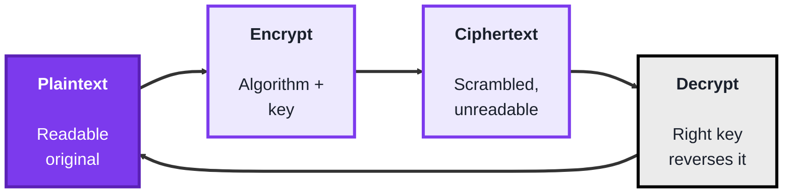
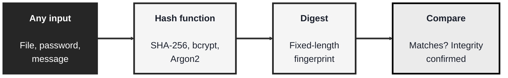
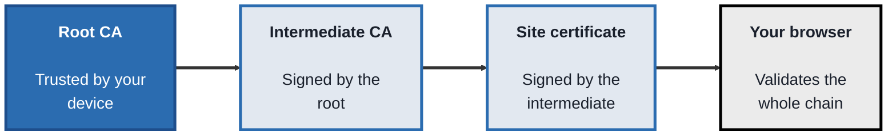

<!-- order: 4 -->
## Module 4: Cryptography

**Time: about 5 hours** (roughly 2 hours for encryption, 1.5 hours each for hashing and certificates).

**By the end of this module, you'll be able to:**
- Encrypt and decrypt a file with AES, and an RSA key pair, using OpenSSL
- Compare symmetric, asymmetric, and hybrid encryption, and explain how TLS 1.3 combines them
- Hash strings and files with SHA-256, show the avalanche effect, and explain why passwords need salted, slow hashes like bcrypt or Argon2
- Read a real site's certificate chain, issuer, and expiry, and explain how a chain of trust works

**Tools needed for this module:** a terminal and **OpenSSL**, which is already installed on most macOS and Linux systems (and available for Windows). You'll also use built-in hashing utilities like `sha256sum` and `md5sum` (on macOS these are `shasum -a 256` and `md5`). No programming is required, though a language of your choice is handy if you want to experiment further. All labs work on files you create yourself, plus reading the public certificate a website sends to every visitor, so they are completely legal.

### Topic 4.1: Encryption

Time: about 2 hours

#### Concept

**Encryption** transforms readable **plaintext** into scrambled **ciphertext** using an algorithm and a **key**, so that only someone holding the right key can reverse it. It's the tool that keeps data confidential in transit and at rest. There are two families. **Symmetric** encryption uses the same key to lock and unlock, it's fast, but both sides must somehow share that key secretly. **Asymmetric** encryption uses a matched **public/private key pair**, what one key encrypts, only the other can decrypt, which elegantly solves the key-sharing problem. In the real world the two are combined.

- **Plaintext** is the readable original, **ciphertext** is the scrambled result
- A **key** is the secret value that controls the transformation, security depends on the key staying secret, not the algorithm staying secret
- **Symmetric encryption** (for example **AES**) uses one shared key, it's fast and ideal for bulk data, but distributing the key safely is the hard part
- **Asymmetric encryption** (for example **RSA**) uses a public key (shareable) and a private key (kept secret), solving key distribution at the cost of speed
- **Hybrid** systems (like **TLS**) use public-key cryptography to agree a shared session key, then switch to fast symmetric encryption for the actual data. In modern TLS 1.3 this is a key *agreement* (ephemeral Diffie-Hellman, usually the elliptic-curve version, ECDHE): both sides compute the same session key without it ever being sent, and the server's certificate key is used to *sign* the exchange so you know who you're talking to, not to encrypt the session key

#### Structure at a Glance


- Symmetric is fast but has a key-distribution problem, asymmetric solves distribution but is slow, hybrid encryption uses each for what it's best at, which is exactly why HTTPS is both secure and fast
- A cryptosystem's strength should rest on the secrecy of the **key**, not the secrecy of the algorithm, this is Kerckhoffs's principle, and it's why real-world algorithms like AES and RSA are public and heavily reviewed

#### Where you'd actually use this

Protecting data in transit (HTTPS, VPNs), encrypting data at rest (disk and database encryption), securing backups, and any situation where confidential information must be unreadable to anyone without the key. Understanding symmetric versus asymmetric is the basis for reasoning about TLS, VPNs, and secure messaging.

#### Lab

1. **Symmetrically encrypt a file** with AES using OpenSSL:
```bash
echo "secret message" > secret.txt
openssl enc -aes-256-cbc -pbkdf2 -salt -in secret.txt -out secret.enc
```
2. **Decrypt it** to confirm you get the original back (you'll be asked for the same password):
```bash
openssl enc -d -aes-256-cbc -pbkdf2 -in secret.enc -out decrypted.txt
cat decrypted.txt
```
3. **Generate an asymmetric key pair** (RSA):
```bash
openssl genrsa -out private.pem 2048
openssl rsa -in private.pem -pubout -out public.pem
```
4. **Encrypt a message with the public key**, then decrypt it with the private key, showing the pair in action:
```bash
openssl pkeyutl -encrypt -pubin -inkey public.pem -in secret.txt -out rsa.enc
openssl pkeyutl -decrypt -inkey private.pem -in rsa.enc -out rsa.dec
cat rsa.dec
```
5. **Explain to yourself** which of the two approaches you'd use for a 5 GB backup file and why (hint: think about speed).

```lab
{
 "type": "sort",
 "title": "Symmetric, asymmetric, or hybrid?",
 "prompt": "Match each situation to the kind of encryption it describes.",
 "buckets": [
  "Symmetric",
  "Asymmetric",
  "Hybrid"
 ],
 "items": [
  {
   "text": "A laptop's disk is encrypted with AES using one secret key.",
   "bucket": "Symmetric",
   "why": "One shared key, fast, ideal for bulk data."
  },
  {
   "text": "Anyone can encrypt a message with your public key, but only your private key can open it.",
   "bucket": "Asymmetric",
   "why": "A public and private key pair solves sharing the key safely."
  },
  {
   "text": "Your browser uses public-key cryptography to agree a session key, then encrypts the page with that key.",
   "bucket": "Hybrid",
   "why": "That's how TLS works: public-key cryptography to agree a session key, then fast symmetric encryption."
  },
  {
   "text": "Two offices share one secret key and must find a safe way to hand it over.",
   "bucket": "Symmetric",
   "why": "Distributing the shared key safely is symmetric encryption's hard part."
  },
  {
   "text": "RSA keys protect an email so only the recipient can read it.",
   "bucket": "Asymmetric",
   "why": "RSA is the classic asymmetric algorithm."
  }
 ]
}
```

#### Checkpoint
You have encrypted and decrypted a file with symmetric AES, generated an RSA key pair, and used the public and private keys to encrypt and decrypt a message, and you can explain the tradeoffs between symmetric and asymmetric encryption and why hybrid systems exist.

#### Quiz
1. What is the difference between plaintext and ciphertext?
2. What is the core difference between symmetric and asymmetric encryption?
3. What problem does asymmetric encryption solve that symmetric encryption struggles with?
4. Why do real-world systems like TLS combine both types (hybrid encryption)?
5. What does Kerckhoffs's principle say a cryptosystem's security should depend on?

*Answers: 1) Plaintext is the readable original data; ciphertext is the scrambled, unreadable output of encrypting it. 2) Symmetric encryption uses the same key to encrypt and decrypt, while asymmetric encryption uses a matched public/private key pair where one key encrypts and only the other decrypts. 3) Key distribution, sharing a secret key safely; asymmetric encryption lets you share a public key openly while keeping the private key secret. 4) Asymmetric encryption is slow but solves key distribution, and symmetric is fast but needs a shared key; hybrid uses public-key cryptography to agree a shared symmetric session key (in TLS 1.3, an ECDHE key agreement), then symmetric encryption for the bulk data, getting both security and speed. 5) The secrecy of the key, not the secrecy of the algorithm; the algorithm can be public and still be secure.*

---

### Topic 4.2: Hashing

Time: about 1.5 hours

#### Concept

**Hashing** runs any input through a **one-way** function to produce a fixed-length **digest**, a kind of fingerprint. Crucially, you cannot reverse a hash back into the original input, which is exactly why it's different from encryption. The same input always produces the same hash, but changing even one character produces a completely different one (the **avalanche effect**). Hashing is used to verify **integrity** (has this file been tampered with?) and to store passwords safely (you store the hash, never the password itself). For passwords specifically, a plain hash isn't enough, you add a **salt** and use a deliberately slow algorithm.

- Hashing is **one-way** and **irreversible**, you can't compute the input from the digest
- The **digest** is fixed-length regardless of input size, and **deterministic**, the same input always hashes to the same value
- The **avalanche effect** means a tiny change in input produces a completely different digest
- **Collision resistance** means it's computationally hard to find two different inputs with the same hash, this is why MD5 and SHA-1 are now considered broken for security use
- For passwords you add a **salt** (a unique random value per password) and use slow, purpose-built hashes like **bcrypt** or **Argon2**, which defeat precomputed "rainbow table" attacks and make brute-forcing expensive

#### Structure at a Glance


- Encryption is two-way (you decrypt it), hashing is one-way (you can't), confusing the two is a common and dangerous mistake, you encrypt data you need to read back, you hash data you only need to verify
- Choose the hash for the job: SHA-256 for file integrity, and a slow salted hash like bcrypt or Argon2 for passwords, never a fast general-purpose hash for password storage

#### Where you'd actually use this

Verifying that a downloaded file wasn't altered (checksum matching), storing user passwords safely, detecting whether a file has changed (file-integrity monitoring, which ties into security monitoring), and underpinning digital signatures. Hashing is everywhere data integrity or password safety matters.

#### Lab

1. **Hash a short string** and look at the fixed-length digest:
```bash
echo -n "hello" | sha256sum
```
(On macOS: `echo -n "hello" | shasum -a 256`.)

2. **Change one character and re-hash**, to see the avalanche effect first-hand:
```bash
echo -n "Hello" | sha256sum
```
Compare the two digests, they should look completely unrelated.

3. **Create a file, hash it,** and record its digest:
```bash
echo "my original text" > somefile.txt
sha256sum somefile.txt
```
4. **Modify the file slightly, re-hash it**, and confirm the digest changed, this is how integrity checks catch tampering.
5. **Reason about passwords**: explain to yourself why you'd store `bcrypt(salt + password)` rather than `sha256(password)`, referring to salting and slow hashing.

```lab
{
 "type": "hash",
 "title": "Watch a hash change",
 "inputs": [
  "transfer $100 to Ada",
  "transfer $900 to Ada"
 ],
 "prompt": "These two messages differ by one character. Compare their SHA-256 hashes, then try your own text."
}
```

#### Checkpoint
You can hash strings and files, you've seen the avalanche effect by changing a single character, and you can explain why hashing is one-way, how it differs from encryption, and why passwords need salting and slow algorithms.

#### Quiz
1. What makes hashing different from encryption?
2. What is the avalanche effect?
3. What does "collision resistance" mean, and why are MD5 and SHA-1 considered unsafe for security use?
4. Why is a plain SHA-256 hash not good enough for storing passwords?
5. What is a salt, and what attack does it defend against?

*Answers: 1) Hashing is one-way and irreversible, you cannot recover the input from the digest, whereas encryption is two-way and can be reversed with the key. 2) A tiny change in the input produces a completely different output digest. 3) Collision resistance means it's computationally hard to find two different inputs that produce the same hash; MD5 and SHA-1 are unsafe because practical collisions have been found. 4) SHA-256 is fast and unsalted by default, so identical passwords hash identically and attackers can use precomputed rainbow tables and brute-force at high speed; passwords need a salt and a slow algorithm like bcrypt or Argon2. 5) A salt is a unique random value added to each password before hashing; it defends against rainbow-table (precomputed hash) attacks by ensuring identical passwords hash differently.*

---

### Topic 4.3: Certificates

Time: about 1.5 hours

#### Concept

A digital **certificate** solves a trust problem: when your browser receives a public key claiming to belong to `example.com`, how does it know that's true and not an imposter's key? A certificate binds a public key to an identity, and that binding is vouched for by a trusted **Certificate Authority (CA)**. Your device already trusts a set of root CAs, and through a **chain of trust** that trust extends to the site's certificate. This machinery, collectively called **PKI** (public key infrastructure), is what makes HTTPS trustworthy and not just encrypted.

- A **certificate** binds a public key to an identity (such as a domain name), in the standard **X.509** format
- A **Certificate Authority (CA)** is a trusted third party that verifies identity and signs certificates
- The **chain of trust** runs from a **root CA** (trusted by your device) to an **intermediate CA** to the site's **leaf certificate**, each link signing the next
- **PKI** is the whole system of CAs, keys, policies, and procedures that makes this trust work at scale
- Certificates have an **expiry** date and can be **revoked** early if a key is compromised. The main revocation mechanism today is the **CRL** (certificate revocation list, a signed list of revoked certificates that the CA publishes). An older live-lookup method, **OCSP**, is being phased out, for example Let's Encrypt ended its OCSP service in 2025. Certificate lifetimes are also getting shorter across the industry, so a stolen key is useful for less time, which is why sites now renew certificates automatically (for example with the ACME protocol)

#### Structure at a Glance


- If any link in the chain is untrusted, expired, or revoked, the browser shows a certificate warning, this is the mechanism behind those "your connection is not private" pages
- Certificates only prove identity and enable trusted key exchange, the actual data encryption is done by TLS using session keys from a key exchange that the certificate authenticates, this is why certificates and encryption are related but distinct

#### Where you'd actually use this

Setting up HTTPS on a website, diagnosing certificate errors and expiry, understanding why a site is flagged as insecure, configuring internal CAs for a private network, and reasoning about how TLS establishes trust. Certificates are the trust layer under nearly all secure web communication.

#### Lab

1. **Fetch and inspect a real site's certificate chain** with OpenSSL:
```bash
openssl s_client -connect example.com:443 -showcerts
```
(Press Ctrl+C or type `Q` to exit once you've seen the output.)

2. **View the leaf certificate's details** in a readable form:
```bash
echo | openssl s_client -connect example.com:443 2>/dev/null | openssl x509 -text -noout
```
3. **Find the issuer and validity dates** in that output, note who signed the certificate and when it expires.
4. **Inspect the same certificate in your browser** by clicking the padlock, and confirm you can see the same chain (root, intermediate, leaf).
5. **Explain what would happen** if the certificate's expiry date had already passed, and why the browser would react that way.

#### Checkpoint
You can retrieve and read a site's certificate chain, identify its issuer and expiry, and view the chain in a browser, and you can explain what a Certificate Authority does, what the chain of trust is, and how certificates relate to (but differ from) encryption.

#### Quiz
1. What does a digital certificate bind together, and why is that needed?
2. What is the role of a Certificate Authority?
3. Describe the chain of trust from root to site.
4. What is PKI?
5. Name two reasons a browser might reject a certificate.

*Answers: 1) It binds a public key to an identity (such as a domain name); this is needed so a client can trust that a public key really belongs to the party it claims to, rather than an imposter. 2) A trusted third party that verifies an identity and signs its certificate, so others can trust the binding. 3) A root CA (trusted by the device) signs an intermediate CA, which signs the site's leaf certificate; the browser validates each link back to the trusted root. 4) Public key infrastructure, the overall system of CAs, keys, policies, and procedures that manages certificates and trust at scale. 5) For example: the certificate has expired, it's been revoked, the chain doesn't lead to a trusted root, or the name doesn't match the site (any two).*

```watch
{
 "scenes": [
  {
   "kind": "title",
   "art": "lock",
   "kicker": "Module 4 · Cryptography",
   "title": "Secrets, fingerprints, trust",
   "beats": [
    {
     "say": "Welcome to Cryptography."
    },
    {
     "say": "Three topics: encryption keeps data secret, hashing proves it hasn't changed, and certificates prove who you're talking to."
    },
    {
     "say": "All you need is a terminal and Open S S L, working on files you create yourself."
    }
   ]
  },
  {
   "kind": "list",
   "art": "key",
   "kicker": "Topic 4.1 · Encryption",
   "title": "Two families of keys",
   "items": [
    [
     "Symmetric · AES",
     "One key · fast · hard to share"
    ],
    [
     "Asymmetric · RSA",
     "Public + private · solves sharing · slow"
    ],
    [
     "Hybrid · TLS",
     "Agree a key, then go symmetric"
    ]
   ],
   "beats": [
    {
     "say": "Encryption turns readable plaintext into scrambled ciphertext, using an algorithm and a key.",
     "show": 0
    },
    {
     "say": "Symmetric encryption, like A E S, uses one shared key. It's fast and ideal for bulk data, but sharing that key safely is the hard part.",
     "show": 1
    },
    {
     "say": "Asymmetric encryption, like R S A, uses a key pair. The public key can be shared, the private key stays secret. It solves key distribution, but it's slow.",
     "show": 2
    },
    {
     "say": "Hybrid systems, like T L S, use public-key cryptography to agree a session key, then switch to fast symmetric encryption for the data.",
     "show": 3
    }
   ]
  },
  {
   "kind": "quote",
   "art": "merge",
   "kicker": "Topic 4.1 · Principles",
   "title": "The key is the secret",
   "quote": "Security rests on the secrecy of the key, not the secrecy of the algorithm.",
   "beats": [
    {
     "say": "In T L S one point three, both sides compute the same session key through an ephemeral Diffie-Hellman key agreement, without it ever being sent. The server's certificate key signs the exchange, so you know who you're talking to.",
     "show": 0
    },
    {
     "say": "And Kerckhoffs's principle: security should rest on the secrecy of the key, not the algorithm. That's why A E S and R S A are public and heavily reviewed.",
     "show": 1
    }
   ]
  },
  {
   "kind": "code",
   "art": "terminal",
   "kicker": "Topic 4.1 · Lab",
   "title": "Both kinds, by hand",
   "file": "terminal",
   "code": "openssl enc -aes-256-cbc -pbkdf2 -salt -in secret.txt -out secret.enc\nopenssl enc -d -aes-256-cbc -pbkdf2 -in secret.enc -out decrypted.txt\n\nopenssl genrsa -out private.pem 2048\nopenssl rsa -in private.pem -pubout -out public.pem\nopenssl pkeyutl -encrypt -pubin -inkey public.pem -in secret.txt -out rsa.enc\nopenssl pkeyutl -decrypt -inkey private.pem -in rsa.enc -out rsa.dec",
   "beats": [
    {
     "say": "In the lab, encrypt a file with A E S two fifty six, then decrypt it with the same password.",
     "show": 0
    },
    {
     "say": "Next, generate an R S A key pair. Encrypt with the public key, and only the private key can decrypt.",
     "show": 1
    },
    {
     "say": "Then ask yourself which you'd use for a five gigabyte backup, and why. Think about speed.",
     "show": 1
    }
   ]
  },
  {
   "kind": "list",
   "art": "hash",
   "kicker": "Topic 4.2 · Hashing",
   "title": "A one-way fingerprint",
   "items": [
    [
     "One-way",
     "No way back to the input"
    ],
    [
     "Deterministic",
     "Same input, same digest"
    ],
    [
     "Avalanche",
     "Tiny change, new digest"
    ],
    [
     "Collision-resistant",
     "MD5, SHA-1 are broken"
    ]
   ],
   "beats": [
    {
     "say": "Hashing runs any input through a one-way function, producing a fixed-length digest. You can't reverse it.",
     "show": 0
    },
    {
     "say": "It's deterministic: the same input always gives the same hash.",
     "show": 1
    },
    {
     "say": "The avalanche effect: change one character, and the digest is completely different.",
     "show": 2
    },
    {
     "say": "Collision resistance means two inputs with the same hash are hard to find. Practical collisions have been found for M D five and S H A one, so they're broken for security use.",
     "show": 3
    },
    {
     "say": "Remember: encryption is two-way, for data you need to read back. Hashing is one-way, for data you only need to verify.",
     "show": 4
    }
   ]
  },
  {
   "kind": "code",
   "art": "fingerprint",
   "kicker": "Topic 4.2 · Lab",
   "title": "Watch the avalanche",
   "file": "terminal",
   "code": "echo -n \"hello\" | sha256sum\necho -n \"Hello\" | sha256sum\n\necho \"my original text\" > somefile.txt\nsha256sum somefile.txt",
   "beats": [
    {
     "say": "Hash hello with S H A two fifty six. Then hash it again with a capital H.",
     "show": 0
    },
    {
     "say": "The two digests look completely unrelated.",
     "show": 1
    },
    {
     "say": "Then hash a file, change it slightly, and hash it again. A changed digest is how integrity checks catch tampering.",
     "show": 1
    }
   ]
  },
  {
   "kind": "list",
   "art": "password",
   "kicker": "Topic 4.2 · Passwords",
   "title": "Salted and slow",
   "items": [
    [
     "sha256(password)",
     "Fast, unsalted ✗"
    ],
    [
     "Salt",
     "Unique random value per password ✓"
    ],
    [
     "bcrypt / Argon2",
     "Slow on purpose ✓"
    ]
   ],
   "beats": [
    {
     "say": "For passwords, a plain fast hash isn't enough.",
     "show": 0
    },
    {
     "say": "S H A two fifty six of the password alone is fast and unsalted. Identical passwords hash identically, so rainbow tables and fast brute force work.",
     "show": 1
    },
    {
     "say": "Instead add a salt, a unique random value per password, so identical passwords hash differently.",
     "show": 2
    },
    {
     "say": "And use a deliberately slow hash, like bcrypt or Argon2, to make brute forcing expensive.",
     "show": 3
    }
   ]
  },
  {
   "kind": "flow",
   "art": "chain",
   "kicker": "Topic 4.3 · Certificates",
   "title": "The chain of trust",
   "steps": [
    "Root CA, trusted by your device",
    "Intermediate CA",
    "Site certificate",
    "Browser validates the chain"
   ],
   "beats": [
    {
     "say": "A certificate binds a public key to an identity, like a domain name, so you know the key isn't an imposter's.",
     "show": 0
    },
    {
     "say": "Your device already trusts a set of root certificate authorities.",
     "show": 1
    },
    {
     "say": "A root signs an intermediate.",
     "show": 2
    },
    {
     "say": "The intermediate signs the site's leaf certificate.",
     "show": 3
    },
    {
     "say": "And your browser validates the whole chain. If any link is untrusted, expired or revoked, you get a certificate warning.",
     "show": 4
    }
   ]
  },
  {
   "kind": "code",
   "art": "idcard",
   "kicker": "Topic 4.3 · Lab",
   "title": "Read a real certificate",
   "file": "terminal",
   "code": "openssl s_client -connect example.com:443 -showcerts\n\necho | openssl s_client -connect example.com:443 2>/dev/null \\\n  | openssl x509 -text -noout",
   "beats": [
    {
     "say": "Fetch a real site's certificate chain with Open S S L s client.",
     "show": 0
    },
    {
     "say": "Then print the leaf certificate in readable form, and find who issued it and when it expires.",
     "show": 1
    },
    {
     "say": "Check the same chain from your browser's padlock. And remember: certificates prove identity. T L S session keys do the actual encrypting.",
     "show": 1
    }
   ]
  },
  {
   "kind": "quiz",
   "art": "ask",
   "kicker": "Quick check",
   "title": "Why isn't a plain SHA-256 hash good enough for storing passwords?",
   "options": [
    "It's fast and unsalted, so identical passwords match and brute force is quick",
    "It can be decrypted with the right key",
    "Its digest length changes with the password"
   ],
   "answer": 0,
   "good": "That's right. S H A two fifty six is fast and unsalted, so rainbow tables and brute force work. Passwords need a salt and a slow hash like bcrypt or Argon2.",
   "bad": "Not quite. S H A two fifty six is fast and unsalted, so rainbow tables and brute force work. Passwords need a salt and a slow hash like bcrypt or Argon2.",
   "beats": [
    {
     "say": "Quick check.",
     "show": 0
    },
    {
     "say": "Why isn't a plain SHA-256 hash good enough for storing passwords?",
     "show": 0
    },
    {
     "say": "Tap your answer.",
     "show": 1
    }
   ]
  },
  {
   "kind": "list",
   "art": "proof",
   "kicker": "Checkpoint",
   "title": "You're done when",
   "items": [
    [
     "AES encrypt and decrypt",
     ""
    ],
    [
     "RSA key pair in action",
     ""
    ],
    [
     "Hashes and the avalanche effect",
     ""
    ],
    [
     "A real certificate chain read",
     ""
    ],
    [
     "Encryption vs hashing, and trust",
     ""
    ]
   ],
   "beats": [
    {
     "say": "That's Module 4.",
     "show": 0
    },
    {
     "say": "You're done when:",
     "show": 0
    },
    {
     "say": "you've encrypted and decrypted a file with A E S,",
     "show": 1
    },
    {
     "say": "you've used an R S A key pair to encrypt and decrypt a message,",
     "show": 2
    },
    {
     "say": "you've hashed strings and files and seen the avalanche effect,",
     "show": 3
    },
    {
     "say": "you've read a real certificate chain, its issuer and expiry,",
     "show": 4
    },
    {
     "say": "and you can explain two-way encryption, one-way hashing, and how certificates build trust.",
     "show": 5
    },
    {
     "say": "Next, in Module 5, identity and access management.",
     "show": 5
    }
   ]
  }
 ]
}
```

---

## Module 4 Completion Checklist
- [ ] Encrypted and decrypted a file with symmetric AES using OpenSSL
- [ ] Generated an RSA key pair and used the public/private keys to encrypt and decrypt a message
- [ ] Hashed strings and files, and observed the avalanche effect from a one-character change
- [ ] Can explain why passwords need salting and slow hashes, not a plain fast hash
- [ ] Retrieved and read a real certificate chain, identifying its issuer and expiry
- [ ] Can explain the difference between encryption (two-way) and hashing (one-way), and how certificates establish trust
