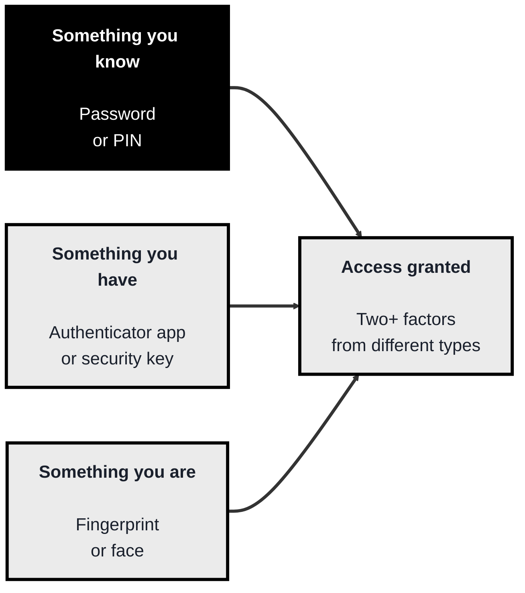
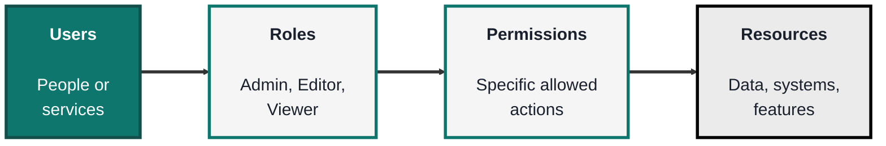
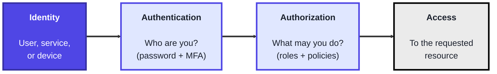

<!-- order: 5 -->
## Module 5: Identity and Access Management

**Time: about 5 hours** (roughly 1.5 hours for MFA, 1.5 hours for RBAC, 2 hours for IAM).

**By the end of this module, you'll be able to:**
- Set up TOTP-based MFA on an account you own, and compare SMS, TOTP, and phishing-resistant passkeys or security keys
- Design a role-based access model that applies least privilege and separation of duties
- Read a cloud IAM policy, spot the statement that breaks least privilege, and rewrite it
- Explain the difference between authentication and authorization, and why the joiner/mover/leaver lifecycle is a security control

**Tools needed for this module:** an **authenticator app** on your phone (such as any TOTP app) for the MFA topic, a test account you own to enable MFA on, and optionally a free-tier cloud account (AWS, Azure, or GCP) to practice real IAM. Cloud accounts are for learners 18+ or working with a parent/guardian, a payment card may be required to create one, and you should set a budget alert straight away; if you don't have one, the IAM lab gives you a sample policy to analyse instead. A terminal is useful but not required. Never practice on accounts or systems that aren't yours.

### Topic 5.1: MFA

Time: about 1.5 hours

#### Concept

**Multi-Factor Authentication (MFA)** requires you to prove your identity with two or more **factors** drawn from different categories, so that stealing any single one isn't enough to get in. The three categories are something you **know** (a password or PIN), something you **have** (a phone or hardware token), and something you **are** (a fingerprint or face). A stolen password is useless to an attacker who can't also produce your second factor. This single control blocks the large majority of account-takeover attacks, which is why it's one of the highest-value defences an organisation can deploy.

- The three **factor categories** are knowledge (something you know), possession (something you have), and inherence (something you are)
- **TOTP** (time-based one-time password) apps generate a rotating 6-digit code, a "have" factor that's far stronger than SMS
- **Hardware security keys** and **passkeys**, both built on **FIDO2/WebAuthn**, are the strongest common options because they're **phishing-resistant**, they cryptographically verify the real site. A **passkey** is a FIDO2 credential stored on your phone, laptop, or password manager and unlocked with your fingerprint, face, or device PIN, so many sites now let you use one instead of a password plus code
- **SMS one-time codes** are better than nothing but the weakest form, vulnerable to SIM-swapping and interception
- MFA's value is that it **defeats stolen-password attacks**, the credential alone no longer grants access
- The US government's digital identity guideline, **NIST SP 800-63B-4** (2025), reflects this ranking: it treats SMS and phone-call codes as a "restricted" option, and requires services that need MFA to offer at least one phishing-resistant option. For passwords it drops forced complexity rules and routine expiry, and asks instead for length (at least 15 characters when a password is the only factor) plus checks against lists of breached passwords

#### Structure at a Glance


- The factors must come from **different categories**, two passwords is not MFA, because a single theft (a phishing page) could capture both, the whole point is that a different kind of factor is hard to steal in the same way
- Not all MFA is equal, SMS can be intercepted or SIM-swapped, TOTP is much stronger, and hardware security keys and passkeys are phishing-resistant, so the choice of second factor materially changes how much protection you get

#### Where you'd actually use this

Protecting every account that matters: email, cloud consoles, admin panels, banking, and code repositories. In an organisation, enforcing MFA (especially phishing-resistant MFA for administrators) is one of the first and most impactful security policies to put in place.

#### Lab

> Do this on a test account you own, so you can safely enable and, if needed, disable MFA.

1. **Choose an account you control** that supports MFA, and open its security settings.
2. **Enable TOTP-based MFA**, which will display a QR code representing a shared secret.
3. **Scan the QR code with an authenticator app**, which then begins generating rotating 6-digit codes.
4. **Enter the current code to confirm setup**, and save any backup/recovery codes somewhere safe.
5. **Compare the options**: write down, for your account, whether it also supports a passkey or a hardware security key, and explain why that would be stronger than the TOTP you just set up.
6. **See why the password alone isn't enough**: MFA exists because passwords are often weak, reused, or stolen. Use the widget below to test how quickly a common-looking password like `sunshine1` could be cracked, then try a long passphrase. Even a strong password can be phished, which is why the second factor matters. (Don't type a password you really use.)

```lab
{
 "type": "password",
 "title": "How long would it take to crack?",
 "start": "sunshine1"
}
```

#### Checkpoint
You have enabled TOTP-based MFA on an account you own, verified it with a code from an authenticator app, and saved recovery codes, and you can explain the three factor categories and why phishing-resistant MFA is stronger than SMS.

#### Quiz
1. What are the three categories of authentication factors?
2. Why is using two passwords not considered true multi-factor authentication?
3. Why is SMS-based MFA considered the weakest common option?
4. What makes hardware security keys and passkeys (FIDO2/WebAuthn) phishing-resistant?
5. What class of attack does MFA primarily defend against?

*Answers: 1) Something you know (knowledge), something you have (possession), and something you are (inherence). 2) Because both factors come from the same category (knowledge), so a single attack such as a phishing page could capture both at once; true MFA requires factors from different categories. 3) SMS codes can be intercepted or stolen through SIM-swapping and other attacks on the phone network, unlike app-based or hardware factors. 4) They cryptographically verify the identity of the real site during login (the credential only works for the site it was created for), so a fake phishing site can't relay or reuse the authentication. 5) Account takeover using stolen or guessed passwords, the password alone is no longer enough to log in.*

---

### Topic 5.2: RBAC

Time: about 1.5 hours

#### Concept

**Role-Based Access Control (RBAC)** assigns permissions to named **roles**, and gives users access by placing them into roles, rather than granting permissions to each user one by one. A user isn't given "read the database" directly, they're assigned the "Analyst" role, and that role carries the permission. This scales cleanly, enforces **least privilege**, and makes audits simple: to see what someone can do, you look at their roles, and to change access for a whole class of people, you change one role instead of many accounts.

- A **role** is a named bundle of permissions tied to a job function (for example "Editor" or "Administrator")
- Users get access through **user-to-role assignment**, they inherit whatever their roles permit
- A **permission** is a specific allowed action on a specific resource (for example "delete a post")
- **Least privilege** means each role grants only what its function genuinely needs, and no more
- **Separation of duties** splits sensitive actions across different roles so no single person can abuse a whole process (for example, one role requests a payment, another approves it)

#### Structure at a Glance


- The power of RBAC is the layer of indirection, because permissions attach to roles rather than to individuals, onboarding, offboarding, and audits become "which role?" questions instead of tedious per-user permission edits
- RBAC naturally supports least privilege and separation of duties, but only if roles are designed tightly, an over-broad "does everything" role quietly defeats the whole point

#### Where you'd actually use this

Structuring access in any application or cloud environment, defining who can read versus edit versus administer, meeting compliance requirements around access control, and making joiner/mover/leaver processes manageable. RBAC is the default model for organising permissions at scale.

#### Lab

1. **Pick a scenario**, for example a simple blog platform with these needs: some people write posts, some approve and publish them, some only read.
2. **Design three roles** (for example Author, Editor, Viewer) and, in a small table, list the exact permissions each role gets.
3. **Apply least privilege**: for each permission, ask whether that role truly needs it, and remove anything that fails the test.
4. **Add a separation-of-duties rule**: ensure no single role can both write and publish its own post, and note why that matters.
5. **Assign sample users to roles** and, for two of them, write out exactly what they can and cannot do, purely from their role assignments. (If you have a cloud free tier, implement one of these roles in its IAM as a bonus. Same rules as the IAM lab: 18+ or with a parent/guardian, and set a budget alert.)

#### Checkpoint
You have designed a role-permission model for a scenario, applied least privilege, added a separation-of-duties constraint, and mapped users to roles, and you can explain how RBAC simplifies audits and offboarding compared with per-user permissions.

#### Quiz
1. In RBAC, how do users get their permissions?
2. Why does attaching permissions to roles (instead of directly to users) make audits and offboarding easier?
3. What is the principle of least privilege in the context of a role?
4. What is separation of duties, and give an example.
5. How can a poorly designed role undermine the benefits of RBAC?

*Answers: 1) Indirectly, users are assigned to roles, and they inherit whatever permissions those roles carry. 2) Because access is defined per role, so you check or change one role rather than editing permissions on many individual accounts; to offboard someone you just remove their roles. 3) A role should grant only the permissions its job function genuinely needs, and nothing more. 4) Splitting a sensitive process across different roles so no single person controls all of it, for example one role requests a payment and a different role approves it. 5) An over-broad role that grants far more than needed (or a catch-all "admin everything" role) violates least privilege and gives users excessive access, defeating the control RBAC is meant to provide.*

---

### Topic 5.3: IAM

Time: about 2 hours

#### Concept

**Identity and Access Management (IAM)** is the overall discipline of managing digital **identities** and controlling what each one can access, across its entire lifecycle. It brings together everything in this module: proving who someone is (**authentication**, where MFA lives), deciding what they may do (**authorization**, where RBAC lives), and managing accounts from creation to deletion. In the cloud, IAM services are the control plane for the entire environment, every action is an identity asking to do something, and IAM decides yes or no.

- An **identity** is the digital representation of a user, a service, or a device
- **Authentication** proves who you are, **authorization** decides what you're allowed to do, these are distinct steps and confusing them causes real security bugs
- **SSO (single sign-on)** lets one authenticated identity access many services without logging in separately to each
- The **identity lifecycle** covers provisioning (joiner), changing access (mover), and removing access (leaver), stale accounts that outlive their owner's need are a common breach vector
- **Cloud IAM** services (AWS IAM, Microsoft Entra ID, Google Cloud IAM) are the control plane that ties identities to permissions across everything you run

#### Structure at a Glance


- Authentication and authorization are separate gates, first you prove who you are, then the system decides what that identity may do, MFA strengthens the first gate and RBAC governs the second
- The identity lifecycle is where a lot of real risk hides, accounts that are created but never properly removed (a departed employee, an unused service account) are frequent footholds for attackers, so deprovisioning matters as much as provisioning

#### Where you'd actually use this

Managing user and service access in a cloud environment, implementing single sign-on across an organisation's apps, running joiner/mover/leaver processes, auditing who has access to what, and enforcing least privilege at the identity level. IAM is the backbone of access control in every modern organisation.

#### Lab

> **Before you start:** this lab uses a cloud free-tier account you own (AWS, Azure, or GCP). It is for learners **18+ or working with a parent/guardian**. A **payment card may be required** to create a cloud account, so **set a budget alert** (for example at $1) as soon as the account exists, and delete what you create when you finish. Only ever work in your own account. **No account?** Skip to the "No-account version" below, which covers the same ideas with a sample policy.

1. **Create a new identity** (an IAM user or equivalent) with no permissions attached, representing a "joiner."
2. **Attach a scoped permission set** (a policy or role) that grants only what a specific job needs, applying least privilege from Topic 5.2.
3. **Turn on MFA** for that identity, tying together authentication (5.1) and this topic.
4. **Test the boundaries**: confirm the identity can do what its role allows and is denied something outside it, this is authorization in action.
5. **Deprovision it**: remove the identity's access as if they'd left, and note why prompt deprovisioning is a security control, not just housekeeping.

**No-account version.** Read this sample AWS IAM policy, written for a "Report Analyst" who should only read monthly reports from one storage bucket:

```json
{
  "Version": "2012-10-17",
  "Statement": [
    {
      "Sid": "ReadReports",
      "Effect": "Allow",
      "Action": ["s3:GetObject"],
      "Resource": "arn:aws:s3:::example-reports-bucket/monthly/*"
    },
    {
      "Sid": "ListReportsFolder",
      "Effect": "Allow",
      "Action": ["s3:ListBucket"],
      "Resource": "arn:aws:s3:::example-reports-bucket",
      "Condition": {"StringLike": {"s3:prefix": ["monthly/*"]}}
    },
    {
      "Sid": "TooBroad",
      "Effect": "Allow",
      "Action": ["s3:*"],
      "Resource": "*"
    }
  ]
}
```

Then answer, in writing:
1. What do the first two statements allow? (Reading and listing files in the `monthly/` folder of one bucket.)
2. Which statement breaks least privilege, and what could this analyst do because of it? (`TooBroad` allows every storage action, including deleting, on every bucket in the account.)
3. Rewrite the policy with that statement removed. Would the analyst be denied if they tried to delete a report? (Yes: anything not explicitly allowed is denied by default.)
4. Where would MFA fit for this identity, and what should happen to this policy when the analyst leaves the company? (Require MFA at sign-in; remove the user and its access promptly when they leave.)

#### Checkpoint
You have created an identity, granted it least-privilege authorization, enabled MFA, tested that authorization limits it correctly, and deprovisioned it, and you can explain the difference between authentication and authorization and why the identity lifecycle matters.

#### Quiz
1. What is the difference between authentication and authorization?
2. What is an "identity" in IAM, and what kinds of things can have one?
3. What does SSO provide, and what's one benefit of it?
4. What are the three stages of the identity lifecycle, and why does the "leaver" stage matter for security?
5. In a cloud environment, why is IAM described as the "control plane"?

*Answers: 1) Authentication proves who you are (verifying identity, for example with a password plus MFA); authorization decides what you're allowed to do once authenticated (for example via roles and policies). 2) An identity is the digital representation of an entity that can request access, it can belong to a user, a service, or a device. 3) Single sign-on lets one authenticated identity access many services without logging in separately to each; benefits include convenience and centralised control over access. 4) Provisioning (joiner), modifying access (mover), and deprovisioning (leaver); the leaver stage matters because accounts left active after someone no longer needs them are a common way attackers gain a foothold. 5) Because in the cloud every action is an identity requesting to do something, and IAM decides whether to allow it, so it governs access to essentially everything you run.*

```watch
{
 "scenes": [
  {
   "kind": "title",
   "art": "idcard",
   "kicker": "Module 5 · Identity and access management",
   "title": "Who you are, what you may do",
   "beats": [
    {
     "say": "Welcome to Identity and Access Management."
    },
    {
     "say": "Three topics: M F A proves who you are, R B A C decides what you may do, and I A M manages identities from creation to removal."
    },
    {
     "say": "Only ever practise on accounts you own."
    }
   ]
  },
  {
   "kind": "diagram",
   "kicker": "Topic 5.1 · MFA",
   "title": "Two factors, two different kinds",
   "nodes": [
    {
     "id": "know",
     "label": "Something you know",
     "x": 14,
     "y": 18,
     "sub": "password or PIN",
     "art": "password"
    },
    {
     "id": "have",
     "label": "Something you have",
     "x": 14,
     "y": 50,
     "sub": "authenticator app",
     "art": "phone"
    },
    {
     "id": "are",
     "label": "Something you are",
     "x": 14,
     "y": 82,
     "sub": "fingerprint or face",
     "art": "fingerprint"
    },
    {
     "id": "gate",
     "label": "Login check",
     "x": 55,
     "y": 50,
     "sub": "two+ factor types",
     "art": "lock"
    },
    {
     "id": "in",
     "label": "Access granted",
     "x": 88,
     "y": 50,
     "sub": "your account",
     "art": "shield"
    }
   ],
   "edges": [
    {
     "from": "know",
     "to": "gate"
    },
    {
     "from": "have",
     "to": "gate"
    },
    {
     "from": "are",
     "to": "gate"
    },
    {
     "from": "gate",
     "to": "in"
    }
   ],
   "beats": [
    {
     "say": "Something you know, like a password or PIN.",
     "show": 1,
     "on": "know"
    },
    {
     "say": "Something you have, like a phone.",
     "show": 2,
     "on": "have"
    },
    {
     "say": "Something you are, like a fingerprint.",
     "show": 3,
     "on": "are"
    },
    {
     "say": "M F A asks for two or more, from different kinds.",
     "show": 4,
     "on": "gate"
    },
    {
     "say": "You type your password. One factor.",
     "show": 4,
     "on": "know",
     "send": {
      "from": "know",
      "to": "gate",
      "label": "password"
     }
    },
    {
     "say": "Then a code from your authenticator app. A different kind.",
     "show": 4,
     "on": "have",
     "send": {
      "from": "have",
      "to": "gate",
      "label": "6-digit code"
     }
    },
    {
     "say": "Both check out, so you're in.",
     "show": 5,
     "on": "in",
     "send": {
      "from": "gate",
      "to": "in",
      "label": "access granted"
     }
    },
    {
     "say": "A stolen password alone now gets nobody in. Two passwords wouldn't count: one phishing page could capture both.",
     "show": 5,
     "on": "know"
    }
   ]
  },
  {
   "kind": "table",
   "kicker": "Topic 5.1 · Not all MFA is equal",
   "title": "Which second factor?",
   "columns": [
    "Second factor",
    "Built on",
    "Verdict"
   ],
   "rows": [
    [
     "SMS code",
     "phone network",
     "Weakest: SIM swap"
    ],
    [
     "TOTP app",
     "shared secret + clock",
     "Much stronger"
    ],
    [
     "Passkey",
     "FIDO2 / WebAuthn",
     "Phishing-resistant"
    ],
    [
     "Security key",
     "FIDO2 / WebAuthn",
     "Phishing-resistant"
    ]
   ],
   "beats": [
    {
     "say": "Not all second factors are equal."
    },
    {
     "say": "S M S codes are the weakest. They can be intercepted, or stolen by SIM swapping.",
     "hl": 0,
     "dim": true
    },
    {
     "say": "T O T P apps make a rotating six digit code. Far stronger.",
     "hl": 1,
     "dim": true
    },
    {
     "say": "Passkeys and security keys, built on FIDO two, verify the real site, so a fake one can't reuse the login.",
     "hl": [
      2,
      3
     ],
     "dim": true
    },
    {
     "say": "N I S T's 2025 guideline agrees: S M S is restricted, and a phishing resistant option must be offered.",
     "sql": "NIST SP 800-63B-4: SMS = restricted",
     "hl": [
      2,
      3
     ],
     "dim": true
    },
    {
     "say": "In the lab, you turn on T O T P on a test account you own, and save your recovery codes.",
     "sql": "Lab: enable TOTP, scan QR, confirm, save recovery codes",
     "hl": 1,
     "dim": true
    }
   ]
  },
  {
   "kind": "diagram",
   "kicker": "Topic 5.2 · RBAC",
   "title": "Permissions belong to roles",
   "nodes": [
    {
     "id": "ana",
     "label": "Ana",
     "x": 12,
     "y": 22,
     "sub": "user",
     "art": "persona"
    },
    {
     "id": "sam",
     "label": "Sam",
     "x": 12,
     "y": 78,
     "sub": "user",
     "art": "persona"
    },
    {
     "id": "editor",
     "label": "Editor role",
     "x": 40,
     "y": 50,
     "sub": "a job function",
     "art": "idcard"
    },
    {
     "id": "perm",
     "label": "Publish a post",
     "x": 66,
     "y": 50,
     "sub": "a permission",
     "art": "key"
    },
    {
     "id": "posts",
     "label": "Blog posts",
     "x": 90,
     "y": 50,
     "sub": "the resource",
     "art": "doc"
    }
   ],
   "edges": [
    {
     "from": "ana",
     "to": "editor"
    },
    {
     "from": "sam",
     "to": "editor"
    },
    {
     "from": "editor",
     "to": "perm"
    },
    {
     "from": "perm",
     "to": "posts"
    }
   ],
   "beats": [
    {
     "say": "R B A C never gives permissions to people one by one. Here are two users.",
     "show": 2
    },
    {
     "say": "Ana is assigned the Editor role.",
     "show": 3,
     "on": "ana",
     "send": {
      "from": "ana",
      "to": "editor",
      "label": "assigned"
     }
    },
    {
     "say": "So is Sam.",
     "show": 3,
     "on": "sam",
     "send": {
      "from": "sam",
      "to": "editor",
      "label": "assigned"
     }
    },
    {
     "say": "The role carries a permission: publish a post.",
     "show": 4,
     "on": "editor",
     "send": {
      "from": "editor",
      "to": "perm",
      "label": "carries"
     }
    },
    {
     "say": "A specific action, on a specific resource.",
     "show": 5,
     "on": "perm",
     "send": {
      "from": "perm",
      "to": "posts",
      "label": "publish"
     }
    },
    {
     "say": "To audit Ana, just look at her roles.",
     "show": 5,
     "on": [
      "ana",
      "editor"
     ]
    },
    {
     "say": "When Sam leaves, remove his role. One change.",
     "show": 5,
     "on": "sam"
    }
   ]
  },
  {
   "kind": "table",
   "kicker": "Topic 5.2 · Lab",
   "title": "Design the blog's roles",
   "columns": [
    "Permission",
    "Author",
    "Editor",
    "Viewer"
   ],
   "rows": [
    [
     "Read posts",
     "yes",
     "yes",
     "yes"
    ],
    [
     "Write a post",
     "yes",
     "no",
     "no"
    ],
    [
     "Approve and publish",
     "no",
     "yes",
     "no"
    ]
   ],
   "beats": [
    {
     "say": "In the lab, you design roles for a blog."
    },
    {
     "say": "Authors read and write posts.",
     "col": 1
    },
    {
     "say": "Editors read, approve and publish.",
     "col": 2
    },
    {
     "say": "Viewers only read. Least privilege: only what each job needs.",
     "col": 3
    },
    {
     "say": "Separation of duties: no role can both write and publish.",
     "sql": "Rule: no role has both Write and Publish",
     "hl": [
      1,
      2
     ]
    },
    {
     "say": "Writing and publishing never share a column, so the rule holds.",
     "hl": [
      1,
      2
     ],
     "dim": true
    },
    {
     "say": "An over-broad, does everything role would defeat the point.",
     "hl": [
      1,
      2
     ],
     "dim": true
    }
   ]
  },
  {
   "kind": "diagram",
   "kicker": "Topic 5.3 · IAM",
   "title": "Two separate gates",
   "nodes": [
    {
     "id": "id",
     "label": "Identity",
     "x": 10,
     "y": 30,
     "sub": "user, service, device",
     "art": "idcard"
    },
    {
     "id": "authn",
     "label": "Authentication",
     "x": 37,
     "y": 70,
     "sub": "Who are you?",
     "art": "fingerprint"
    },
    {
     "id": "authz",
     "label": "Authorization",
     "x": 63,
     "y": 30,
     "sub": "What may you do?",
     "art": "checklist"
    },
    {
     "id": "res",
     "label": "Resource",
     "x": 90,
     "y": 70,
     "sub": "reports bucket",
     "art": "database"
    }
   ],
   "edges": [
    {
     "from": "id",
     "to": "authn"
    },
    {
     "from": "authn",
     "to": "authz"
    },
    {
     "from": "authz",
     "to": "res"
    }
   ],
   "beats": [
    {
     "say": "An identity is a user, a service or a device.",
     "show": 1,
     "on": "id"
    },
    {
     "say": "Gate one, authentication, proves who you are. M F A lives here.",
     "show": 2,
     "on": "authn",
     "send": {
      "from": "id",
      "to": "authn",
      "label": "password + MFA"
     }
    },
    {
     "say": "Gate two, authorization, decides what you may do, using roles and policies.",
     "show": 3,
     "on": "authz",
     "send": {
      "from": "authn",
      "to": "authz",
      "label": "analyst: read"
     }
    },
    {
     "say": "Reading a report is allowed.",
     "show": 4,
     "on": "res",
     "send": {
      "from": "authz",
      "to": "res",
      "label": "allowed"
     }
    },
    {
     "say": "The same, fully authenticated analyst asks to delete one. Authorization says no.",
     "show": 4,
     "on": "authz",
     "send": {
      "from": "authn",
      "to": "authz",
      "label": "delete?"
     }
    },
    {
     "say": "Different gates. Mixing them up causes real bugs.",
     "show": 4,
     "on": [
      "authn",
      "authz"
     ]
    },
    {
     "say": "In the cloud, every action passes these gates, so I A M is the control plane.",
     "show": 4
    }
   ]
  },
  {
   "kind": "walk",
   "kicker": "Topic 5.3 · Lab",
   "title": "Who can delete a report?",
   "file": "report-analyst-policy.json",
   "code": "{\"Sid\": \"ReadReports\", \"Effect\": \"Allow\",\n \"Action\": [\"s3:GetObject\"],\n \"Resource\":\n  \"arn:aws:s3:::example-reports-bucket/monthly/*\"},\n{\"Sid\": \"ListReportsFolder\", \"Effect\": \"Allow\",\n \"Action\": [\"s3:ListBucket\"],\n \"Resource\": \"arn:aws:s3:::example-reports-bucket\",\n \"Condition\": {\"StringLike\":\n   {\"s3:prefix\": [\"monthly/*\"]}}},\n{\"Sid\": \"TooBroad\", \"Effect\": \"Allow\",\n \"Action\": [\"s3:*\"],\n \"Resource\": \"*\"}",
   "beats": [
    {
     "say": "No cloud account? This sample policy is for an analyst who should only read monthly reports.",
     "line": [
      1,
      12
     ]
    },
    {
     "say": "A request to read a monthly report.",
     "vars": {
      "request": "s3:GetObject",
      "on": "monthly/ report"
     }
    },
    {
     "say": "Statement one allows it.",
     "line": [
      1,
      4
     ],
     "out": "GetObject monthly/... -> Allow (ReadReports)"
    },
    {
     "say": "Listing the monthly folder matches statement two.",
     "line": [
      5,
      9
     ],
     "vars": {
      "request": "s3:ListBucket",
      "on": "prefix monthly/"
     },
     "out": "ListBucket monthly/ -> Allow (ListReportsFolder)"
    },
    {
     "say": "Now a delete. Neither statement allows that.",
     "line": [
      1,
      9
     ],
     "vars": {
      "request": "s3:DeleteObject",
      "on": "monthly/ report"
     }
    },
    {
     "say": "But too broad allows every storage action, on every bucket. The delete goes through.",
     "line": [
      10,
      12
     ],
     "out": "DeleteObject -> Allow (TooBroad)  !!"
    },
    {
     "say": "Remove it, and the delete is denied: anything not explicitly allowed is denied by default.",
     "line": [
      1,
      9
     ],
     "out": "TooBroad removed: DeleteObject -> Deny (default)"
    },
    {
     "say": "Require M F A, and remove access when the analyst leaves.",
     "line": [
      1,
      9
     ]
    }
   ]
  },
  {
   "kind": "array",
   "kicker": "Topic 5.3 · Lab",
   "title": "One identity, joiner to leaver",
   "values": [
    "Create identity",
    "Scoped policy",
    "Turn on MFA",
    "Test limits",
    "Deprovision"
   ],
   "beats": [
    {
     "say": "With a free tier account, you walk one identity through its lifecycle.",
     "ptr": {
      "step": 0
     }
    },
    {
     "say": "Joiner: create it with no permissions.",
     "ptr": {
      "step": 0
     },
     "hl": 0,
     "note": "Joiner: starts with nothing"
    },
    {
     "say": "Attach only what one job needs.",
     "ptr": {
      "step": 1
     },
     "ok": [
      0
     ],
     "hl": 1,
     "note": "Authorization, least privilege"
    },
    {
     "say": "Turn on M F A.",
     "ptr": {
      "step": 2
     },
     "ok": [
      0,
      1
     ],
     "hl": 2,
     "note": "Authentication: second factor"
    },
    {
     "say": "Test it: allowed inside its role, denied outside.",
     "ptr": {
      "step": 3
     },
     "ok": [
      0,
      1,
      2
     ],
     "hl": 3,
     "note": "Allowed inside the role, denied outside"
    },
    {
     "say": "If the job changes, update access. That's the mover stage.",
     "ptr": {
      "step": 1
     },
     "ok": [
      0,
      2,
      3
     ],
     "hl": 1,
     "note": "Mover: change access with the job"
    },
    {
     "say": "Then leaver: remove access promptly. Forgotten accounts are a common foothold for attackers.",
     "ptr": {
      "step": 4
     },
     "ok": [
      0,
      1,
      2,
      3,
      4
     ],
     "note": "Leaver: remove access promptly"
    }
   ]
  },
  {
   "kind": "quiz",
   "art": "ask",
   "kicker": "Quick check",
   "title": "What's the difference between authentication and authorization?",
   "options": [
    "They're two names for the same check",
    "Authorization proves who you are, authentication decides what you may do",
    "Authentication proves who you are, authorization decides what you may do"
   ],
   "answer": 2,
   "good": "That's right. Authentication proves who you are, for example a password plus M F A. Authorization then decides what that identity may do, through roles and policies.",
   "bad": "Not quite. Authentication proves who you are, for example a password plus M F A. Authorization then decides what that identity may do, through roles and policies.",
   "beats": [
    {
     "say": "Quick check.",
     "show": 0
    },
    {
     "say": "What's the difference between authentication and authorization?",
     "show": 0
    },
    {
     "say": "Tap your answer.",
     "show": 1
    }
   ]
  },
  {
   "kind": "list",
   "art": "proof",
   "kicker": "Checkpoint",
   "title": "You're done when",
   "items": [
    [
     "TOTP enabled and verified",
     ""
    ],
    [
     "Factors, and why passkeys beat SMS",
     ""
    ],
    [
     "Roles with least privilege and separation",
     ""
    ],
    [
     "Scoped access, then deprovisioned",
     ""
    ],
    [
     "AuthN vs AuthZ, and the lifecycle",
     ""
    ]
   ],
   "beats": [
    {
     "say": "That's Module 5.",
     "show": 0
    },
    {
     "say": "You're done when:",
     "show": 0
    },
    {
     "say": "you've enabled T O T P on an account you own and verified it,",
     "show": 1
    },
    {
     "say": "you can explain the three factor categories, and why phishing resistant M F A beats S M S,",
     "show": 2
    },
    {
     "say": "you've designed roles with least privilege and separation of duties,",
     "show": 3
    },
    {
     "say": "you've granted an identity scoped access, and deprovisioned it,",
     "show": 4
    },
    {
     "say": "and you can explain authentication versus authorization, and why the identity lifecycle is a security control.",
     "show": 5
    },
    {
     "say": "Next, in Module 6, cloud security.",
     "show": 5
    }
   ]
  }
 ]
}
```

---

## Module 5 Completion Checklist
- [ ] Enabled TOTP-based MFA on an account you own and verified it with an authenticator app
- [ ] Can explain the three factor categories and why phishing-resistant MFA beats SMS
- [ ] Designed a role-permission model with least privilege and a separation-of-duties rule
- [ ] Created an identity, granted it scoped authorization, enabled MFA, and deprovisioned it
- [ ] Can explain the difference between authentication and authorization
- [ ] Can explain why the identity lifecycle (joiner/mover/leaver) is a security control, not just admin
