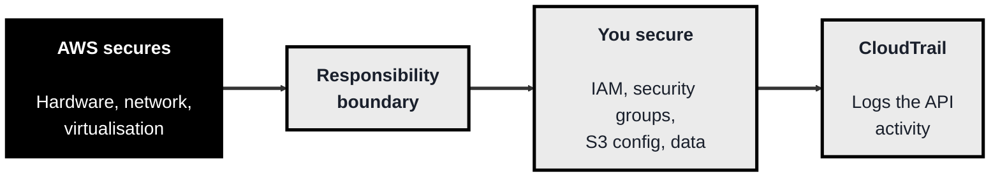
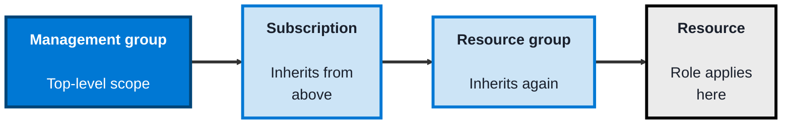
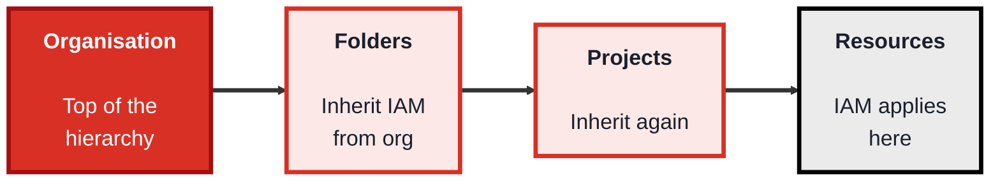

<!-- order: 6 -->
## Module 6: Cloud Security

**Time: about 6 hours** (roughly 2 hours per provider).

**By the end of this module, you'll be able to:**
- Explain the shared responsibility model and sort security tasks into provider versus customer
- Review AWS IAM, S3 public-access settings, security groups, and CloudTrail for common misconfigurations
- Review Azure RBAC role assignments, scopes, and NSG rules, and explain how assignments inherit
- Review GCP IAM bindings, service accounts, and VPC firewall rules, and replace broad basic roles with narrower ones
- Write a clear finding (risk plus fix) for a cloud misconfiguration

**Tools needed for this module:** ideally a **free-tier account** for the provider you're studying (AWS, Azure, or GCP) and its web console, plus optionally the provider's command-line tool. Everything here is designed to be observe-and-inspect rather than build-and-spend, so stay within the free tier and only ever work in accounts you own. Cloud accounts are for learners 18+ or working with a parent/guardian; a payment card may be required to sign up, so set a budget alert first. Every lab also has a no-account version with sample configurations to review, which is also useful when your new account is still empty. The one idea that runs through all three topics is the **shared responsibility model**: the provider secures the cloud itself, and you secure what you put in it.

### Topic 6.1: AWS

Time: about 2 hours

#### Concept

**Amazon Web Services (AWS)** is the largest cloud provider, and its security rests on the **shared responsibility model**: AWS secures the underlying infrastructure (data centres, hardware, the virtualisation layer), while you are responsible for securing your data, your access controls, and your configuration. Most real-world AWS breaches come not from AWS failing, but from customers misconfiguring their side, an overly open storage bucket, an over-privileged access key, a firewall rule left wide open. The core building blocks you configure are IAM, security groups, storage settings, and audit logging.

- The **shared responsibility model** divides security: AWS secures *of* the cloud, you secure *in* the cloud
- **IAM** controls identities and fine-grained permissions, following least privilege and using **roles** for services rather than long-lived keys
- **Security groups** are stateful virtual firewalls attached to instances, controlling inbound and outbound traffic by port and source (this reuses your Module 1 knowledge)
- **S3 bucket** configuration is a classic risk area, a bucket accidentally set to public has caused many well-known data leaks, so "block public access" settings matter
- **CloudTrail** records API activity across the account. Its **event history** is always on and shows the last 90 days of management events, but for long-term logging you need to create a **trail**, which saves the records to an S3 bucket you control

#### Structure at a Glance


- The single most important AWS security mindset is knowing which side of the responsibility boundary a given control sits on, patching the hypervisor is AWS's job, but locking down your bucket and your IAM is entirely yours
- Prefer IAM **roles** over long-lived access keys for anything running in AWS, roles hand out short-lived credentials automatically, so there's no static key to leak

#### Where you'd actually use this

Securing infrastructure hosted on AWS: reviewing IAM permissions for over-privilege, confirming storage buckets aren't public, tightening security-group rules, and making sure a CloudTrail trail exists so you keep a long-term audit trail. This is everyday work for anyone defending an AWS environment.

#### Lab

> Observe-only steps in a free-tier account you own, nothing here should incur cost.

> **Before you start:** cloud accounts are for learners **18+ or working with a parent/guardian**. A **payment card may be required** to create a cloud account, so **set a budget alert** (for example at $1) as soon as the account exists, and only ever work in an account you own. **No account, or is your new account empty?** A brand-new account has almost nothing to inspect, so use the sample configuration under "No-account version" below. Reviewing it teaches the same skills.

1. **Open the IAM console** and review the users and roles, note which have broad permissions and ask whether they need them.
2. **Inspect an S3 bucket's public-access settings**, confirm "Block all public access" is on for a bucket that shouldn't be public.
3. **Look at a security group's inbound rules**, identify any rule allowing traffic from `0.0.0.0/0` (anywhere) and reason about whether that's appropriate.
4. **Open CloudTrail's event history** to see recent API activity (this is always on and keeps 90 days). Then open **Trails** and check whether a trail exists. If none does, the account has no long-term log, which is itself a finding.
5. **Write one finding**: pick the weakest configuration you saw and describe the risk and the fix, in the mini-report style from Module 3.

**No-account version.** Review these three sample settings from a fictional company account and write a finding for each.

An IAM policy attached to a developer:

```json
{
  "Version": "2012-10-17",
  "Statement": [
    {"Effect": "Allow", "Action": "*", "Resource": "*"}
  ]
}
```

A bucket policy on `example-customer-uploads`:

```json
{
  "Version": "2012-10-17",
  "Statement": [
    {
      "Effect": "Allow",
      "Principal": "*",
      "Action": "s3:GetObject",
      "Resource": "arn:aws:s3:::example-customer-uploads/*"
    }
  ]
}
```

A security group's inbound rules:

| Type | Protocol | Port | Source |
|---|---|---|---|
| SSH | TCP | 22 | 0.0.0.0/0 |
| HTTPS | TCP | 443 | 0.0.0.0/0 |
| MySQL | TCP | 3306 | 0.0.0.0/0 |

Hints: the IAM policy gives the developer full admin over everything (fix: grant only the services they need). `"Principal": "*"` makes every customer upload readable by anyone on the internet (fix: remove the statement and turn on Block Public Access). SSH and the database are open to the whole internet (fix: limit SSH to your own IP or use a managed access service, and allow 3306 only from the app server). HTTPS open to everyone is normal for a public website.

#### Checkpoint
You can navigate AWS IAM, S3 public-access settings, security-group rules, and CloudTrail, and you can explain the shared responsibility model and identify which security tasks are yours versus AWS's.

#### Quiz
1. What does the shared responsibility model say AWS is responsible for, versus the customer?
2. Why are misconfigured S3 buckets such a common source of breaches?
3. What is a security group, and what does it control?
4. Why are IAM roles generally preferred over long-lived access keys?
5. What does CloudTrail provide, and why does it matter for security?

*Answers: 1) AWS is responsible for security *of* the cloud, the physical infrastructure, hardware, network, and virtualisation layer; the customer is responsible for security *in* the cloud, their data, access controls (IAM), and configuration. 2) Because access settings are the customer's responsibility, and a bucket accidentally set to public exposes its contents to anyone; this configuration mistake has caused many well-known data leaks. 3) A stateful virtual firewall attached to instances that controls inbound and outbound traffic by port, protocol, and source. 4) Roles provide short-lived, automatically-rotated credentials, so there's no static key sitting around to be leaked or stolen. 5) CloudTrail records API activity across the account (event history keeps 90 days; a trail stores logs long-term), giving an audit trail that is essential for investigating what happened during and after an incident.*

---

### Topic 6.2: Azure

Time: about 2 hours

#### Concept

**Microsoft Azure** puts **identity** at the centre of its security model through **Microsoft Entra ID** (formerly Azure Active Directory), the identity backbone shared with Microsoft 365. Access to Azure resources is governed by **Azure RBAC**, where you assign roles at different **scopes** in a hierarchy, and traffic is filtered by **Network Security Groups**. Azure also provides **Microsoft Defender for Cloud** to continuously assess your posture and give you a **secure score**, and **Key Vault** to store secrets safely. The same shared responsibility model applies.

- **Microsoft Entra ID** is the identity and access backbone for Azure and Microsoft 365, this is where users, groups, and sign-in (including MFA and conditional access) live
- **Azure RBAC** assigns roles at scopes across the hierarchy, management group, subscription, resource group, and individual resource, with assignments inheriting downward
- **Network Security Groups (NSGs)** filter inbound and outbound traffic to Azure resources by rules, much like security groups elsewhere
- **Microsoft Defender for Cloud** provides posture management: it surfaces recommendations and a **secure score** that measures how well-configured your environment is
- **Key Vault** is managed storage for secrets, keys, and certificates, so applications don't hard-code credentials

#### Structure at a Glance


- Azure RBAC assignments **inherit down** the hierarchy, so a role granted at the subscription level applies to every resource group and resource beneath it, which is powerful but means broad assignments have broad reach, assign at the narrowest scope that works
- Because identity is the perimeter in Azure, securing Entra ID (strong MFA, conditional access, limited privileged roles) is the highest-leverage thing you can do, more than any single network control

#### Where you'd actually use this

Securing workloads in Azure or a Microsoft 365 organisation: managing identities and sign-in policies in Entra ID, assigning least-privilege RBAC roles at the right scope, filtering traffic with NSGs, raising your secure score with Defender for Cloud, and keeping secrets in Key Vault. This is the core of Azure defensive work.

#### Lab

> Observe-only in a free/trial account you own.

> **Before you start:** cloud accounts are for learners **18+ or working with a parent/guardian**. A **payment card may be required** to create a cloud account, so **set a budget alert** (for example at $1) as soon as the account exists, and only ever work in an account you own. **No account, or is your new account empty?** A brand-new account has almost nothing to inspect, so use the sample configuration under "No-account version" below. Reviewing it teaches the same skills.

1. **Open Microsoft Entra ID** and review the users and groups, and check whether MFA is enforced.
2. **Examine a role assignment** on a resource group, note the role, the scope, and who holds it, and consider whether the scope is as narrow as it could be.
3. **Look at a Network Security Group's rules**, and identify any rule that allows broad inbound access.
4. **Open Microsoft Defender for Cloud** and read your secure score plus its top recommendations.
5. **Write one finding** based on a recommendation or an over-broad role assignment, describing the risk and the fix.

**No-account version.** Review these sample settings from a fictional subscription and write a finding for each.

Role assignments:

| Who | Role | Scope |
|---|---|---|
| intern@example.com | Owner | Subscription "Production" |
| reporting-app (managed identity) | Storage Blob Data Reader | Storage account "reports" |
| helpdesk group | Virtual Machine Contributor | Resource group "test-vms" |

Network Security Group inbound rules (lower priority number is checked first):

| Priority | Name | Port | Source | Action |
|---|---|---|---|---|
| 100 | Allow-RDP | 3389 | Any | Allow |
| 200 | Allow-HTTPS | 443 | Any | Allow |
| 4096 | Deny-All | Any | Any | Deny |

Hints: an intern with Owner on the whole production subscription can change or delete everything in it (fix: a narrow role on just the resource group they work in). The reporting app's assignment is a good example of least privilege at a narrow scope. Remote Desktop (3389) open to "Any" is a top target for password-guessing attacks (fix: restrict the source or use Azure Bastion).

#### Checkpoint
You can navigate Entra ID, an Azure RBAC role assignment and its scope, an NSG's rules, and Defender for Cloud's secure score, and you can explain how RBAC inheritance works and why identity is central to Azure security.

#### Quiz
1. What is Microsoft Entra ID, and what role does it play in Azure security?
2. What are the scope levels at which Azure RBAC roles can be assigned?
3. What does it mean that Azure RBAC assignments "inherit," and why should you assign at a narrow scope?
4. What does Microsoft Defender for Cloud's secure score tell you?
5. What is Key Vault used for, and what problem does it solve?

*Answers: 1) Microsoft Entra ID (formerly Azure AD) is the identity and access backbone for Azure and Microsoft 365, managing users, groups, and sign-in including MFA; it's central because identity is effectively the security perimeter in Azure. 2) Management group, subscription, resource group, and individual resource. 3) A role assigned at a higher scope applies to everything beneath it in the hierarchy; you assign at the narrowest scope that works so access doesn't extend further than intended. 4) A measure of how well-configured your environment is against security best practices, along with recommendations to improve it. 5) Managed storage for secrets, keys, and certificates; it solves the problem of applications hard-coding credentials by keeping them in a secure, access-controlled store.*

---

### Topic 6.3: GCP

Time: about 2 hours

#### Concept

**Google Cloud Platform (GCP)** organises everything into a **resource hierarchy**, Organisation at the top, then Folders, then Projects, then the resources themselves, and **IAM policies** applied at any level **inherit** downward. Access is granted by binding an identity to a **role** on a resource, following least privilege. GCP leans heavily on **service accounts** as identities for workloads (as opposed to human users), filters traffic with **VPC firewall rules**, and gives you **Security Command Center** for centralised visibility into misconfigurations and threats. The shared responsibility model applies here too.

- The **resource hierarchy** runs Organisation → Folders → Projects → Resources, and IAM policies inherit from each level down to the ones below
- **IAM roles** come in three kinds: **basic** (broad, legacy: Owner/Editor/Viewer, which older docs call "primitive" roles), **predefined** (curated for specific services), and **custom** (you define exactly the permissions), predefined and custom support least privilege far better than basic roles
- **Service accounts** are identities for applications and workloads rather than people, and securing them (and their keys) is a major GCP concern
- **VPC firewall rules** control traffic within your Google Cloud network by protocol, port, and source/target
- **Security Command Center** is the central place to see misconfigurations, vulnerabilities, and threats across your projects

#### Structure at a Glance


- IAM inheritance means a broad grant high in the hierarchy (say, at the Organisation) reaches everything below it, so, as with Azure, you grant at the lowest level that does the job
- Service accounts are a distinctive GCP risk, because they're powerful non-human identities, a leaked service-account key can be as damaging as a leaked admin password, so their keys deserve the same care as any credential

#### Where you'd actually use this

Securing workloads on Google Cloud: reviewing IAM bindings for over-privilege, replacing broad basic roles with predefined or custom ones, locking down service accounts and their keys, tightening VPC firewall rules, and monitoring findings in Security Command Center. This is the core of GCP defensive work.

#### Lab

> Observe-only in a free-tier account you own.

> **Before you start:** cloud accounts are for learners **18+ or working with a parent/guardian**. A **payment card may be required** to create a cloud account, so **set a budget alert** (for example at $1) as soon as the account exists, and only ever work in an account you own. **No account, or is your new account empty?** A brand-new account has almost nothing to inspect, so use the sample configuration under "No-account version" below. Reviewing it teaches the same skills.

1. **Open IAM for a project** and review the principals and the roles bound to them, noting any use of the broad basic roles (Owner/Editor/Viewer).
2. **Inspect a service account**, see what it's used for and whether it has more permissions than it needs.
3. **Look at the VPC firewall rules**, and identify any rule allowing broad inbound access (`0.0.0.0/0`).
4. **Open Security Command Center** (where available on your tier) and review any findings it reports.
5. **Write one finding**: choose the weakest configuration, likely an over-broad basic role or an over-permissioned service account, and describe the risk and the fix.

**No-account version.** Review this sample IAM policy for a fictional project, plus its firewall rules, and write a finding for each problem.

```json
{
  "bindings": [
    {
      "role": "roles/editor",
      "members": ["serviceAccount:web-app@example-project.iam.gserviceaccount.com"]
    },
    {
      "role": "roles/storage.objectViewer",
      "members": ["serviceAccount:report-job@example-project.iam.gserviceaccount.com"]
    },
    {
      "role": "roles/owner",
      "members": ["user:former-contractor@example.com"]
    }
  ]
}
```

| Name | Direction | Ports | Source ranges | Action |
|---|---|---|---|---|
| allow-ssh-all | Ingress | tcp:22 | 0.0.0.0/0 | Allow |
| allow-internal | Ingress | all | 10.128.0.0/9 | Allow |

Hints: the web app's service account has the broad basic Editor role, so a bug in the app could change almost anything in the project (fix: a predefined role for just what it uses). The report job is a good least-privilege example. A former contractor still holds Owner, a failed "leaver" step (fix: remove them now). SSH open to the whole internet should be limited to known IP ranges or Identity-Aware Proxy.

#### Checkpoint
You can navigate GCP's resource hierarchy and IAM bindings, inspect a service account, review VPC firewall rules, and read Security Command Center findings, and you can explain IAM inheritance and why service accounts need special care.

#### Quiz
1. What are the levels of the GCP resource hierarchy, from top to bottom?
2. What are the three kinds of IAM roles in GCP, and which support least privilege best?
3. What is a service account, and how does it differ from a normal user identity?
4. What does it mean that GCP IAM policies "inherit," and what's the practical advice that follows?
5. Why is a leaked service-account key so dangerous?

*Answers: 1) Organisation, Folders, Projects, and Resources. 2) Basic (broad legacy roles: Owner/Editor/Viewer), predefined (curated per service), and custom (you define exact permissions); predefined and custom roles support least privilege far better than basic roles. 3) A service account is an identity for an application or workload rather than a human user; it lets software authenticate and act with its own permissions. 4) A policy applied at a higher level of the hierarchy applies to everything beneath it; the practical advice is to grant access at the lowest level that meets the need so it doesn't spread further than intended. 5) Service accounts are powerful non-human identities, so a leaked key can give an attacker whatever access that account holds, potentially as damaging as a leaked administrator password.*

```watch
{
 "scenes": [
  {
   "kind": "title",
   "art": "cloudlock",
   "kicker": "Module 6 · Cloud security",
   "title": "Secure what you put in the cloud",
   "beats": [
    {
     "say": "Welcome to Module 6, cloud security."
    },
    {
     "say": "You'll review A W S, Azure and Google Cloud for the misconfigurations behind most breaches."
    },
    {
     "say": "It's all observe and inspect, in an account you own, or with the samples."
    }
   ]
  },
  {
   "kind": "table",
   "kicker": "Concept",
   "title": "The shared responsibility model",
   "columns": [
    "Security task",
    "Who owns it"
   ],
   "rows": [
    [
     "Data centre hardware",
     "Provider"
    ],
    [
     "Physical network",
     "Provider"
    ],
    [
     "Hypervisor patching",
     "Provider"
    ],
    [
     "IAM permissions",
     "You"
    ],
    [
     "Firewall rules",
     "You"
    ],
    [
     "Bucket public access",
     "You"
    ],
    [
     "Your data",
     "You"
    ]
   ],
   "beats": [
    {
     "say": "One idea runs through it all: shared responsibility."
    },
    {
     "say": "The provider secures the cloud itself.",
     "sql": "Provider: security OF the cloud",
     "hl": [
      0,
      1,
      2
     ],
     "dim": true
    },
    {
     "say": "You secure what you put in it.",
     "sql": "You: security IN the cloud",
     "hl": [
      3,
      4,
      5,
      6
     ],
     "dim": true
    },
    {
     "say": "Most breaches come from this side: customer misconfiguration.",
     "hl": [
      3,
      4,
      5
     ],
     "dim": true
    },
    {
     "say": "So always ask: whose side is this on?",
     "col": 1
    }
   ]
  },
  {
   "kind": "diagram",
   "kicker": "Topic 6.1 · AWS",
   "title": "The pieces you configure",
   "nodes": [
    {
     "id": "net",
     "label": "Internet",
     "x": 10,
     "y": 50,
     "sub": "anyone",
     "art": "globe"
    },
    {
     "id": "sg",
     "label": "Security group",
     "x": 36,
     "y": 22,
     "sub": "stateful firewall",
     "art": "firewall"
    },
    {
     "id": "role",
     "label": "IAM role",
     "x": 36,
     "y": 80,
     "sub": "short-lived creds",
     "art": "key"
    },
    {
     "id": "app",
     "label": "Your instance",
     "x": 62,
     "y": 50,
     "sub": "your app",
     "art": "server"
    },
    {
     "id": "s3",
     "label": "S3 bucket",
     "x": 90,
     "y": 22,
     "sub": "block public access",
     "art": "database"
    },
    {
     "id": "trail",
     "label": "CloudTrail",
     "x": 90,
     "y": 80,
     "sub": "logs API activity",
     "art": "pulse"
    }
   ],
   "edges": [
    {
     "from": "net",
     "to": "sg"
    },
    {
     "from": "sg",
     "to": "app"
    },
    {
     "from": "role",
     "to": "app"
    },
    {
     "from": "app",
     "to": "s3"
    },
    {
     "from": "app",
     "to": "trail"
    }
   ],
   "beats": [
    {
     "say": "On A W S, four building blocks surround your instance.",
     "show": 4,
     "on": "app"
    },
    {
     "say": "Internet traffic meets a security group, a stateful firewall on port and source.",
     "show": 4,
     "on": "sg",
     "send": {
      "from": "net",
      "to": "sg",
      "label": "port 443"
     }
    },
    {
     "say": "Allowed traffic gets through.",
     "show": 4,
     "on": "app",
     "send": {
      "from": "sg",
      "to": "app",
      "label": "allowed"
     }
    },
    {
     "say": "An I A M role gives it short-lived credentials. No static key to leak.",
     "show": 4,
     "on": "role",
     "send": {
      "from": "role",
      "to": "app",
      "label": "temp creds"
     }
    },
    {
     "say": "It reads an S 3 bucket. Public buckets have caused many leaks, so block public access.",
     "show": 5,
     "on": "s3",
     "send": {
      "from": "app",
      "to": "s3",
      "label": "GetObject"
     }
    },
    {
     "say": "CloudTrail logs that A P I call. History keeps ninety days; long-term needs a trail.",
     "show": 6,
     "on": "trail",
     "send": {
      "from": "app",
      "to": "trail",
      "label": "API call logged"
     }
    }
   ]
  },
  {
   "kind": "walk",
   "kicker": "Lab · No-account version",
   "title": "Who can read this bucket?",
   "file": "bucket-policy.json",
   "code": "{\n  \"Version\": \"2012-10-17\",\n  \"Statement\": [\n    {\n      \"Effect\": \"Allow\",\n      \"Principal\": \"*\",\n      \"Action\": \"s3:GetObject\",\n      \"Resource\":\n        \"arn:aws:s3:::example-customer-uploads/*\"\n    }\n  ]\n}",
   "beats": [
    {
     "say": "Here's the sample bucket policy, on customer uploads.",
     "line": [
      1,
      12
     ]
    },
    {
     "say": "A request from someone not logged in at all.",
     "vars": {
      "who": "anyone, no login",
      "action": "s3:GetObject"
     }
    },
    {
     "say": "Principal star means anyone, so they match.",
     "line": [
      5,
      6
     ]
    },
    {
     "say": "Get object matches too.",
     "line": 7
    },
    {
     "say": "And so does every object in the bucket.",
     "line": [
      8,
      9
     ],
     "out": "GetObject by anyone -> Allow"
    },
    {
     "say": "Every upload is readable by anyone on the internet.",
     "line": 6,
     "out": "Finding: all customer uploads are public"
    },
    {
     "say": "Fix: remove the statement and turn on Block Public Access. Now they're denied.",
     "line": [
      4,
      10
     ],
     "vars": {
      "who": "anyone, no login",
      "action": "s3:GetObject"
     },
     "out": "Fixed: GetObject by anyone -> Access Denied"
    }
   ]
  },
  {
   "kind": "table",
   "kicker": "Lab · AWS findings",
   "title": "Risk and fix for each sample",
   "columns": [
    "Sample setting",
    "Risk",
    "Fix"
   ],
   "rows": [
    [
     "IAM: Action * on *",
     "Full admin",
     "Only needed services"
    ],
    [
     "Bucket: Principal *",
     "Uploads are public",
     "Block Public Access"
    ],
    [
     "SSH 22 from anywhere",
     "Open to internet",
     "Your IP only"
    ],
    [
     "MySQL 3306 anywhere",
     "Database exposed",
     "App server only"
    ],
    [
     "HTTPS 443 anywhere",
     "Normal for a site",
     "Keep"
    ],
    [
     "No CloudTrail trail",
     "No long-term log",
     "Create a trail"
    ]
   ],
   "beats": [
    {
     "say": "Each finding is a risk plus a fix."
    },
    {
     "say": "A developer policy allowing every action everywhere is full admin. Grant only needed services.",
     "hl": 0,
     "dim": true
    },
    {
     "say": "The bucket you just traced: block public access.",
     "hl": 1,
     "dim": true
    },
    {
     "say": "In security groups, zero dot zero dot zero dot zero slash zero means anywhere.",
     "sql": "Source 0.0.0.0/0 = anywhere on the internet",
     "hl": [
      2,
      3,
      4
     ],
     "dim": true
    },
    {
     "say": "S S H and My S Q L are open to everyone. Limit S S H to your I P, and the database to the app server.",
     "hl": [
      2,
      3
     ],
     "dim": true
    },
    {
     "say": "H T T P S for everyone is normal for a website.",
     "hl": 4,
     "dim": true
    },
    {
     "say": "And no CloudTrail trail is itself a finding.",
     "hl": 5,
     "dim": true
    }
   ]
  },
  {
   "kind": "diagram",
   "kicker": "Topic 6.2 · Azure",
   "title": "Roles inherit downward",
   "nodes": [
    {
     "id": "mg",
     "label": "Management group",
     "x": 10,
     "y": 25,
     "sub": "top-level scope",
     "art": "tree"
    },
    {
     "id": "sub",
     "label": "Subscription",
     "x": 36,
     "y": 72,
     "sub": "Production",
     "art": "cloud"
    },
    {
     "id": "rg",
     "label": "Resource group",
     "x": 63,
     "y": 25,
     "sub": "one team's work",
     "art": "boxes"
    },
    {
     "id": "res",
     "label": "Resource",
     "x": 90,
     "y": 72,
     "sub": "a storage account",
     "art": "database"
    }
   ],
   "edges": [
    {
     "from": "mg",
     "to": "sub"
    },
    {
     "from": "sub",
     "to": "rg"
    },
    {
     "from": "rg",
     "to": "res"
    }
   ],
   "beats": [
    {
     "say": "On Azure, identity is the perimeter, managed in Microsoft Entra I D.",
     "show": 0
    },
    {
     "say": "Roles are assigned at four scopes: management group,",
     "show": 1,
     "on": "mg"
    },
    {
     "say": "then a subscription,",
     "show": 2,
     "on": "sub"
    },
    {
     "say": "a resource group,",
     "show": 3,
     "on": "rg"
    },
    {
     "say": "and resource.",
     "show": 4,
     "on": "res"
    },
    {
     "say": "In the sample, an intern is Owner of Production.",
     "show": 4,
     "on": "sub"
    },
    {
     "say": "That inherits down to every resource group,",
     "show": 4,
     "on": "rg",
     "send": {
      "from": "sub",
      "to": "rg",
      "label": "Owner"
     }
    },
    {
     "say": "and every resource. They can delete everything.",
     "show": 4,
     "on": "res",
     "send": {
      "from": "rg",
      "to": "res",
      "label": "Owner"
     }
    },
    {
     "say": "Fix: a narrow role on just their resource group.",
     "show": 4,
     "on": "rg"
    },
    {
     "say": "The reporting app gets it right: a reader role on one storage account.",
     "show": 4,
     "on": "res"
    }
   ]
  },
  {
   "kind": "table",
   "kicker": "Lab · Azure NSG",
   "title": "Lowest priority number is checked first",
   "columns": [
    "Priority",
    "Name",
    "Port",
    "Action"
   ],
   "rows": [
    [
     "100",
     "Allow-RDP",
     "3389",
     "Allow"
    ],
    [
     "200",
     "Allow-HTTPS",
     "443",
     "Allow"
    ],
    [
     "4096",
     "Deny-All",
     "Any",
     "Deny"
    ]
   ],
   "beats": [
    {
     "say": "Network Security Groups check numbered rules, lowest first.",
     "sql": "Lowest number first · every source is Any"
    },
    {
     "say": "Port four four three arrives. Rule one hundred doesn't match.",
     "sql": "Incoming: port 443 from the internet",
     "hl": 0,
     "dim": true
    },
    {
     "say": "Rule two hundred does. Allowed, which is normal.",
     "hl": 1,
     "dim": true
    },
    {
     "say": "Port twenty two falls through to Deny All.",
     "sql": "Incoming: port 22 from the internet",
     "hl": 2,
     "dim": true
    },
    {
     "say": "But Remote Desktop, port thirty three eighty nine, is allowed from anywhere. A top password guessing target.",
     "sql": "Incoming: port 3389 from the internet",
     "hl": 0,
     "dim": true
    },
    {
     "say": "Fix: restrict the source, or use Azure Bastion.",
     "hl": 0,
     "dim": true
    },
    {
     "say": "Defender for Cloud's secure score flags issues like this.",
     "hl": 0
    }
   ]
  },
  {
   "kind": "table",
   "kicker": "Topic 6.3 · GCP",
   "title": "Review the sample project",
   "columns": [
    "Who or rule",
    "Grants",
    "Finding"
   ],
   "rows": [
    [
     "web-app (service acct)",
     "roles/editor",
     "Basic role: too broad"
    ],
    [
     "report-job (svc acct)",
     "storage.objectViewer",
     "Least privilege"
    ],
    [
     "former-contractor",
     "roles/owner",
     "Failed leaver step"
    ],
    [
     "allow-ssh-all",
     "tcp:22 0.0.0.0/0",
     "Limit to IAP/ranges"
    ],
    [
     "allow-internal",
     "all, 10.128.0.0/9",
     "Internal range only"
    ]
   ],
   "beats": [
    {
     "say": "Google Cloud policies inherit down its hierarchy too. Grant at the lowest level.",
     "sql": "Organisation > Folders > Projects > Resources"
    },
    {
     "say": "Basic roles are broad. Predefined and custom roles are far tighter.",
     "sql": "Basic (broad) | Predefined | Custom"
    },
    {
     "say": "The web app has basic Editor, so a bug could change almost anything. Use a predefined role.",
     "hl": 0,
     "dim": true
    },
    {
     "say": "The report job is good least privilege.",
     "hl": 1,
     "dim": true
    },
    {
     "say": "A former contractor is still Owner: a failed leaver step. Remove them now.",
     "hl": 2,
     "dim": true
    },
    {
     "say": "Limit S S H to known I P ranges, or Identity-Aware Proxy.",
     "hl": 3,
     "dim": true
    },
    {
     "say": "Service account keys need care: a leaked one can be as bad as an admin password.",
     "hl": [
      0,
      1
     ],
     "dim": true
    }
   ]
  },
  {
   "kind": "quiz",
   "art": "ask",
   "kicker": "Quick check",
   "title": "Why are IAM roles generally preferred over long-lived access keys?",
   "options": [
    "Roles hand out short-lived, automatically rotated credentials, so there's no static key to leak",
    "Roles are cheaper than access keys",
    "Access keys only work in the web console"
   ],
   "answer": 0,
   "good": "That's right. Roles provide short-lived credentials automatically, so there's no static key sitting around to be leaked or stolen.",
   "bad": "Not quite. Roles provide short-lived credentials automatically, so there's no static key sitting around to be leaked or stolen.",
   "beats": [
    {
     "say": "Quick check.",
     "show": 0
    },
    {
     "say": "Why are I A M roles generally preferred over long-lived access keys?",
     "show": 0
    },
    {
     "say": "Tap your answer.",
     "show": 1
    }
   ]
  },
  {
   "kind": "list",
   "art": "proof",
   "kicker": "Checkpoint",
   "title": "You're done when",
   "items": [
    [
     "You can explain shared responsibility",
     ""
    ],
    [
     "AWS reviewed, finding written",
     ""
    ],
    [
     "Azure reviewed",
     ""
    ],
    [
     "GCP reviewed",
     ""
    ],
    [
     "You can explain inheritance",
     ""
    ],
    [
     "One misconfiguration per provider",
     ""
    ]
   ],
   "beats": [
    {
     "say": "That's Module 6.",
     "show": 0
    },
    {
     "say": "You're done when:",
     "show": 0
    },
    {
     "say": "you can explain the shared responsibility model,",
     "show": 1
    },
    {
     "say": "you've reviewed A W S I A M, S 3, security groups and CloudTrail, and written a finding,",
     "show": 2
    },
    {
     "say": "you've reviewed Entra I D, an R B A C assignment, an N S G and the secure score,",
     "show": 3
    },
    {
     "say": "you've reviewed G C P I A M, a service account, firewall rules and Security Command Center,",
     "show": 4
    },
    {
     "say": "you can explain inheritance, and why you assign at the narrowest scope,",
     "show": 5
    },
    {
     "say": "and you can name one common misconfiguration per provider, and its fix.",
     "show": 6
    },
    {
     "say": "Next, in Module 7, security monitoring.",
     "show": 6
    }
   ]
  }
 ]
}
```

---

## Module 6 Completion Checklist
- [ ] Can explain the shared responsibility model and sort security tasks into provider versus customer
- [ ] Reviewed AWS IAM, S3 public-access settings, security groups, and CloudTrail, and wrote a finding
- [ ] Reviewed Azure Entra ID, an RBAC assignment and its scope, an NSG, and the Defender secure score
- [ ] Reviewed GCP IAM bindings, a service account, VPC firewall rules, and Security Command Center
- [ ] Can explain RBAC/IAM inheritance in Azure and GCP and why you assign at the narrowest scope
- [ ] Can name, for each provider, one common misconfiguration and how to fix it
