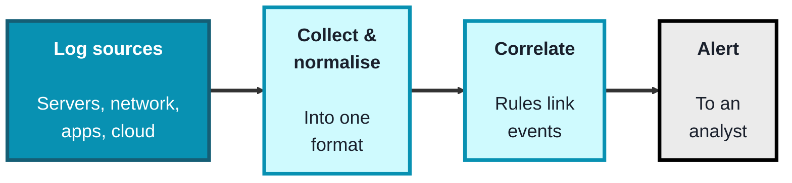
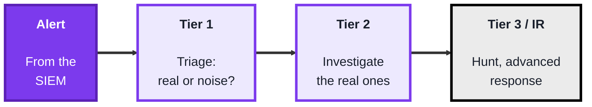
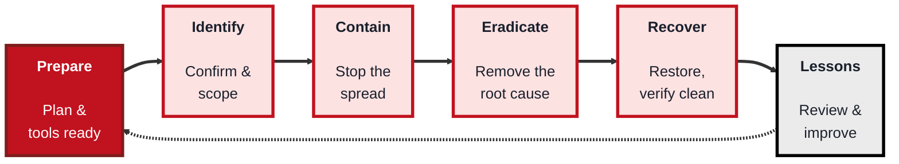

<!-- order: 7 -->
## Module 7: Security Monitoring

**Time: about 5 hours** (roughly 2 hours for SIEM, 1.5 hours each for SOC and incident response).

**By the end of this module, you'll be able to:**
- Search and count events in an authentication log with `grep`, `awk`, `sort`, and `uniq`, as a hand-built SIEM correlation
- Write a correlation rule in words and spot a brute-force attack that ended in a successful login
- Triage alerts by severity, decide when to escalate, and write a short SOC playbook
- Walk a confirmed incident through the six incident-response phases, and relate them to NIST SP 800-61 Rev. 3 and NIST CSF 2.0

**Tools needed for this module:** a terminal with basic text tools (`grep`, `awk`, `sort`, `uniq`), which are already on any Linux or macOS system (and available on Windows via WSL or PowerShell equivalents), and a sample log file to work with. The SIEM lab gives you a ready-made sample `auth.log` to save and analyse, because your own machine's log may be empty or missing. Only ever analyse logs from systems you own or are authorized to monitor. Optionally, a free security-monitoring platform (such as a free tier of a SIEM) if you want to see the real thing. The three topics here build on one another: a SIEM produces the alerts, a SOC triages them, and incident response handles the ones that turn out to be real.

### Topic 7.1: SIEM

Time: about 2 hours

#### Concept

A **SIEM** (Security Information and Event Management) system is the central nervous system of security monitoring. On its own, a single log line means little, but a SIEM **aggregates** logs from across the whole environment, servers, network gear, applications, cloud, **normalises** their different formats into a common structure, and then **correlates** events to spot patterns no single log would reveal. When a pattern matches a rule, it raises an **alert** for a human to investigate. This is how "one failed login" (ignorable) becomes "500 failed logins from one IP followed by a success" (an alert worth acting on).

- **Log aggregation** pulls logs from many different sources into one searchable place
- **Normalisation** parses those varied formats into a common structure, so a login event looks the same whether it came from Linux, Windows, or a firewall
- **Correlation rules** are the logic that links multiple events into a meaningful signal (for example, many failures then a success from the same source)
- **Alerts** are raised when a rule matches, and are prioritised by severity so analysts focus on what matters
- **Dashboards** visualise activity for monitoring trends and investigating incidents

#### Structure at a Glance


- The real power of a SIEM is **correlation across sources**, an event that's innocent in isolation becomes suspicious when combined with others, which is exactly what a lone log file can't show you
- A SIEM is only as good as its **rules and tuning**, too few rules and you miss attacks, too many noisy ones and analysts drown in false positives and start ignoring alerts (alert fatigue), so tuning is continuous work

#### Where you'd actually use this

Centralised monitoring in any organisation with more than a handful of systems: detecting brute-force attempts, spotting unusual logins, meeting compliance logging requirements, and giving analysts one place to search during an investigation. The SIEM is where detection happens.

#### Lab

> This mini-SIEM exercise uses command-line tools on a log file. Use the sample below: your own `/var/log/auth.log` may be empty (a home machine rarely gets SSH logins) or may not exist at all, because recent Ubuntu and Debian versions can keep these records only in the systemd journal. Only analyse logs from systems you own or are authorized to monitor. The IP addresses in the sample come from ranges reserved for documentation, so they don't belong to anyone real.

**Get the sample log.** Copy the block below into a plain-text file named `auth.log` in your working folder (use any text editor, or run `cat > auth.log`, paste, press Enter, then press Ctrl+D). It's a fictional server, `web01`, over one night:

```text
Oct  5 02:58:11 web01 sshd[2104]: Accepted publickey for alex from 192.0.2.10 port 50122 ssh2: ED25519 SHA256:k3Yx9pQe1sVd8nT0aB2cLmZr4wF6hJ7uXo5gP1iRtE8
Oct  5 02:58:11 web01 sshd[2107]: pam_unix(sshd:session): session opened for user alex(uid=1000) by (uid=0)
Oct  5 03:02:40 web01 sshd[2110]: Failed password for invalid user admin from 198.51.100.23 port 41822 ssh2
Oct  5 03:02:44 web01 sshd[2113]: Failed password for invalid user test from 198.51.100.23 port 41830 ssh2
Oct  5 03:02:49 web01 sshd[2116]: Failed password for invalid user oracle from 198.51.100.23 port 41836 ssh2
Oct  5 03:02:53 web01 sshd[2119]: Failed password for invalid user ubuntu from 198.51.100.23 port 41840 ssh2
Oct  5 03:02:58 web01 sshd[2122]: Failed password for invalid user pi from 198.51.100.23 port 41848 ssh2
Oct  5 03:14:02 web01 sshd[2125]: Failed password for root from 203.0.113.45 port 52310 ssh2
Oct  5 03:14:05 web01 sshd[2128]: Failed password for root from 203.0.113.45 port 52316 ssh2
Oct  5 03:14:09 web01 sshd[2131]: Failed password for root from 203.0.113.45 port 52322 ssh2
Oct  5 03:14:12 web01 sshd[2134]: Failed password for deploy from 203.0.113.45 port 52328 ssh2
Oct  5 03:14:16 web01 sshd[2137]: Failed password for deploy from 203.0.113.45 port 52334 ssh2
Oct  5 03:14:19 web01 sshd[2140]: Failed password for root from 203.0.113.45 port 52340 ssh2
Oct  5 03:14:23 web01 sshd[2143]: Failed password for deploy from 203.0.113.45 port 52346 ssh2
Oct  5 03:14:26 web01 sshd[2146]: Failed password for root from 203.0.113.45 port 52352 ssh2
Oct  5 03:14:30 web01 sshd[2149]: Failed password for deploy from 203.0.113.45 port 52358 ssh2
Oct  5 03:14:33 web01 sshd[2152]: Failed password for deploy from 203.0.113.45 port 52364 ssh2
Oct  5 03:14:37 web01 sshd[2155]: Failed password for root from 203.0.113.45 port 52370 ssh2
Oct  5 03:14:40 web01 sshd[2158]: Failed password for deploy from 203.0.113.45 port 52376 ssh2
Oct  5 03:14:44 web01 sshd[2161]: Failed password for deploy from 203.0.113.45 port 52382 ssh2
Oct  5 03:14:47 web01 sshd[2164]: Failed password for deploy from 203.0.113.45 port 52388 ssh2
Oct  5 03:14:51 web01 sshd[2167]: Accepted password for deploy from 203.0.113.45 port 52398 ssh2
Oct  5 03:14:51 web01 sshd[2170]: pam_unix(sshd:session): session opened for user deploy(uid=1001) by (uid=0)
Oct  5 03:15:20 web01 sudo:   deploy : TTY=pts/1 ; PWD=/home/deploy ; USER=root ; COMMAND=/usr/bin/cat /etc/shadow
Oct  5 03:40:07 web01 sshd[2173]: Failed password for alex from 192.0.2.10 port 50544 ssh2
Oct  5 03:40:12 web01 sshd[2176]: Accepted password for alex from 192.0.2.10 port 50544 ssh2
Oct  5 03:52:30 web01 sshd[2179]: Received disconnect from 203.0.113.45 port 52398:11: disconnected by user
Oct  5 03:52:30 web01 sshd[2182]: pam_unix(sshd:session): session closed for user deploy
```

**Optional, your own logs:** if your Linux machine runs an SSH server, you can export its SSH log from the journal and analyse that too:
```bash
sudo journalctl -u ssh --no-pager > my-ssh.log
```
(The service is called `ssh` on Ubuntu/Debian and `sshd` on Fedora/RHEL, so use `-u sshd` there.) Then run the commands below on `my-ssh.log` instead of `auth.log`. If it's empty, nobody has tried to log in, so stick with the sample.

1. **Aggregate and search** a log for failed authentication events, the raw material of a brute-force alert:
```bash
grep "Failed password" auth.log
```
2. **Count failures by source IP** to find who's failing the most, this is a simple correlation by hand:
```bash
grep "Failed password" auth.log | awk '{print $(NF-3)}' | sort | uniq -c | sort -rn
```
3. **Define a correlation rule in words**: for example, "more than 10 failed logins from one IP within a short window is an alert."
4. **Check whether any IP crosses your threshold**, and if so, treat it as a raised alert.
5. **Note the follow-up signal**: search for a successful login from any IP that also had many failures, that combination is what makes a real correlation rule valuable:
```bash
grep "Accepted" auth.log
```
In the sample, you should find that `203.0.113.45` failed 14 times and then logged in as `deploy`, and about 30 seconds later `deploy` used `sudo` to read `/etc/shadow` (the file of password hashes). `198.51.100.23` tried 5 usernames that don't exist and gave up, and `192.0.2.10` is the normal user `alex` mistyping a password once.

#### Checkpoint
You have aggregated and searched a log, counted failures by source, defined a correlation rule, and identified whether any source crosses it, and you can explain what aggregation, normalisation, and correlation each contribute, and why tuning matters.

#### Quiz
1. What do the letters SIEM stand for, and what is a SIEM's core job?
2. What is normalisation, and why is it needed?
3. What is a correlation rule, and give an example.
4. Why is correlation across multiple sources more powerful than looking at one log?
5. What is alert fatigue, and how does poor tuning cause it?

*Answers: 1) Security Information and Event Management; its core job is to aggregate logs from across the environment, correlate events, and raise alerts on suspicious patterns. 2) Normalisation parses logs from different sources into a common structure; it's needed so events from different systems (Linux, Windows, firewalls) can be compared and correlated consistently. 3) Logic that links multiple events into a meaningful signal, for example "many failed logins followed by a success from the same source IP." 4) Because an event that looks harmless in one log can be revealed as part of an attack when combined with events from other sources, a pattern no single log shows. 5) Alert fatigue is when analysts are overwhelmed by too many alerts (especially false positives) and start ignoring them; poor tuning that generates excessive noisy alerts causes it, risking real threats being missed.*

---

### Topic 7.2: SOC

Time: about 1.5 hours

#### Concept

A **SOC** (Security Operations Center) is the team and function responsible for monitoring, detecting, investigating, and responding to security events, often around the clock. If the SIEM is the alarm system, the SOC is the people who answer the alarms. It's usually structured in **tiers** so that routine alerts are triaged quickly while complex ones escalate to deeper expertise. The SOC lives or dies by good **triage** (separating real threats from noise) and clear **escalation**, and it measures itself on how fast it detects and responds.

- SOC analysts are organised in **tiers**: **Tier 1** monitors and triages incoming alerts, **Tier 2** investigates the ones that look real, and **Tier 3** handles advanced analysis and proactive **threat hunting**
- **Alert triage** is the core Tier 1 skill: deciding quickly whether an alert is a true threat, a false positive, or needs escalation, and how urgent it is
- **Escalation** passes an incident up a tier (or to incident response) when it exceeds the current tier's scope
- **Playbooks** are predefined, repeatable response procedures for common alert types, so analysts act consistently and fast
- The SOC tracks **metrics** like **MTTD** (mean time to detect) and **MTTR** (mean time to respond), lower is better

#### Structure at a Glance


- The tiered structure exists so expensive expertise isn't spent on routine noise, Tier 1 filters the flood so Tier 2 and Tier 3 can focus on genuine, complex threats
- Playbooks turn individual skill into consistent, fast, repeatable response, without them, the same alert might be handled brilliantly by one analyst and mishandled by another, so they're central to a reliable SOC

#### Where you'd actually use this

Any organisation large enough to need continuous monitoring, whether an in-house SOC or an outsourced (managed) one. SOC work is where alerts become decisions: triage the flood, investigate what's real, escalate what's serious, and do it fast and consistently.

#### Lab

> This is a triage exercise, building directly on the alert you produced in Topic 7.1.

1. **Take your set of findings** from the mini-SIEM lab (failed logins by IP, and any success following failures).
2. **Triage each one**: label it true positive, false positive, or needs-more-info, and assign a severity (low/medium/high) with a one-line reason.
3. **Decide escalation**: for the highest-severity item, state whether Tier 1 should handle it or escalate to Tier 2, and why.
4. **Write a short playbook** for "many failed logins followed by a success from one IP": list three concrete steps an analyst should take, in order.
5. **Reflect on metrics**: describe how you'd measure MTTD and MTTR for this alert type, and why speed matters.

#### Checkpoint
You have triaged a set of alerts with severity and reasoning, made an escalation decision, and written a short playbook, and you can explain the SOC tier structure, the role of triage and escalation, and what MTTD and MTTR measure.

#### Quiz
1. What is a SOC, and how does it relate to a SIEM?
2. What do the three SOC tiers typically do?
3. What is alert triage, and why is it the core Tier 1 skill?
4. What is a playbook, and why does a SOC rely on them?
5. What do MTTD and MTTR measure, and why does a SOC care about them?

*Answers: 1) A Security Operations Center is the team and function that monitors, detects, investigates, and responds to security events; it acts on the alerts a SIEM produces (the SIEM is the alarm, the SOC answers it). 2) Tier 1 monitors and triages incoming alerts, Tier 2 investigates the ones that look real, and Tier 3 does advanced analysis and proactive threat hunting. 3) Deciding quickly whether an alert is a true threat, a false positive, or needs escalation, and how urgent it is; it's core because it filters the flood of alerts so deeper resources focus on real threats. 4) A predefined, repeatable response procedure for a common alert type; SOCs rely on them for consistent, fast, reliable handling regardless of which analyst responds. 5) MTTD is mean time to detect and MTTR is mean time to respond; the SOC cares because faster detection and response limit the damage an attacker can do.*

---

### Topic 7.3: Incident Response

Time: about 1.5 hours

#### Concept

**Incident Response (IR)** is the structured process for handling a confirmed security incident so as to limit damage, remove the threat, recover safely, and learn from it. When triage confirms an alert is a real incident, IR takes over with a defined lifecycle rather than improvisation, because under pressure, a clear process is what prevents mistakes like destroying evidence or reinfecting a "cleaned" system. The widely used SANS model has six phases, often remembered as **PICERL**. The other major reference is the US government's **NIST SP 800-61 Rev. 3** (2025), which organises incident response around the six functions of the NIST Cybersecurity Framework (NIST CSF 2.0) (Govern, Identify, Protect, Detect, Respond, Recover) and treats IR as part of everyday risk management rather than a separate checklist. Both teach the same core ideas, so this topic uses the six SANS phases because they're easy to walk through step by step.

- **Preparation** is the work done in advance: the IR plan, tools, contacts, and training, so the team isn't inventing a response mid-crisis
- **Identification** confirms an incident is real and determines its scope (often where the SOC's triage hands off)
- **Containment** limits the spread, short-term (quickly isolating affected systems) and long-term (temporary fixes that let business continue safely)
- **Eradication** removes the root cause, malware, a compromised account, the exploited vulnerability
- **Recovery** safely restores systems to normal and confirms they're clean before returning them to service, and **Lessons Learned** reviews the incident afterward to improve defences and the plan itself

#### Structure at a Glance


- The phases are ordered for a reason, containing before you eradicate stops the bleeding first, and verifying clean before recovery stops you from restoring a system that's still compromised, skipping ahead is how incidents get worse
- **Lessons Learned loops back to Preparation**, every incident is a chance to improve the plan, the detection rules, and the defences, a SOC and IR team that doesn't feed lessons back keeps fighting the same fires

#### Where you'd actually use this

The moment a real incident is confirmed: a ransomware outbreak, a compromised account, a data breach, or a successful intrusion. IR is the difference between a contained, well-documented event and a chaotic, damaging one, and the lessons-learned phase is how an organisation's defences actually improve over time.

#### Lab

> This is a tabletop exercise, no real systems are touched. Use the confirmed incident from Topics 7.1 and 7.2 (a brute-force attack from one IP that ended in a successful login).

1. **Write the scenario in one line**: what was detected, and why it's a confirmed incident.
2. **Walk the six phases**, writing one concrete action for each: how you'd have prepared, how you identified and scoped it, how you'd contain it, how you'd eradicate the cause, how you'd recover, and one lesson learned.
3. **For containment**, decide a short-term action (for example isolating or blocking) and note how you'd preserve evidence while doing it.
4. **For eradication**, state the root cause you'd remove and how you'd confirm it's gone.
5. **For lessons learned**, write one change, a new detection rule, a policy, an MFA requirement, that would prevent or catch this faster next time, and show how it loops back to Preparation.

#### Checkpoint
You have walked a confirmed incident through all six IR phases with a concrete action for each, made a containment decision that preserves evidence, and produced a lesson that feeds back into preparation, and you can explain why the phase order matters.

#### Quiz
1. What are the six phases of the SANS incident-response lifecycle (PICERL)?
2. Why does containment come before eradication?
3. What is the difference between short-term and long-term containment?
4. Why must you verify a system is clean before the recovery phase returns it to service?
5. Why is the Lessons Learned phase important, and where does it lead?

*Answers: 1) Preparation, Identification, Containment, Eradication, Recovery, and Lessons Learned. 2) Because containment stops the threat from spreading and doing more damage first; eradicating the root cause takes longer, so you limit the bleeding before removing the cause. 3) Short-term containment is quick action to isolate affected systems and stop immediate spread; long-term containment applies temporary fixes that let the business keep operating safely while a full fix is prepared. 4) Because restoring a system that is still compromised would simply reintroduce the threat, undoing the response and potentially reinfecting the environment. 5) It reviews the incident to improve defences, detection, and the response plan itself; it loops back to the Preparation phase so the organisation is better prepared for the next incident.*

```watch
{
 "scenes": [
  {
   "kind": "title",
   "art": "eye",
   "kicker": "Module 7 · Security monitoring",
   "title": "Detect, triage, respond",
   "beats": [
    {
     "say": "Welcome to Module 7, security monitoring."
    },
    {
     "say": "Three topics that build on each other: a S I E M produces the alerts, a S O C triages them, and incident response handles the ones that turn out to be real."
    },
    {
     "say": "Only ever analyse logs from systems you own, or are authorized to monitor."
    }
   ]
  },
  {
   "kind": "diagram",
   "kicker": "Topic 7.1 · SIEM",
   "title": "From scattered logs to one alert",
   "nodes": [
    {
     "id": "srv",
     "label": "Linux server",
     "x": 12,
     "y": 25,
     "sub": "sshd · auth.log",
     "art": "server"
    },
    {
     "id": "fw",
     "label": "Firewall",
     "x": 12,
     "y": 75,
     "sub": "network gear",
     "art": "firewall"
    },
    {
     "id": "norm",
     "label": "Normalise",
     "x": 40,
     "y": 50,
     "sub": "one common format",
     "art": "gear"
    },
    {
     "id": "cor",
     "label": "Correlate",
     "x": 66,
     "y": 50,
     "sub": "rules link events",
     "art": "graph"
    },
    {
     "id": "an",
     "label": "Analyst",
     "x": 90,
     "y": 50,
     "sub": "gets the alert",
     "art": "bell"
    }
   ],
   "edges": [
    {
     "from": "srv",
     "to": "norm"
    },
    {
     "from": "fw",
     "to": "norm"
    },
    {
     "from": "norm",
     "to": "cor"
    },
    {
     "from": "cor",
     "to": "an"
    }
   ],
   "beats": [
    {
     "say": "A S I E M, Security Information and Event Management, first aggregates logs from across the environment.",
     "show": 3,
     "on": "srv",
     "send": {
      "from": "srv",
      "to": "norm",
      "label": "Failed password"
     }
    },
    {
     "say": "Each source has its own format.",
     "show": 3,
     "on": "fw",
     "send": {
      "from": "fw",
      "to": "norm",
      "label": "firewall log"
     }
    },
    {
     "say": "Normalisation parses them into one structure, so a login looks the same wherever it came from.",
     "show": 3,
     "on": "norm"
    },
    {
     "say": "Correlation rules link events into a signal, like many failures, then a success, from one source.",
     "show": 4,
     "on": "cor",
     "send": {
      "from": "norm",
      "to": "cor",
      "label": "user, IP, result"
     }
    },
    {
     "say": "When a rule matches, an alert goes to an analyst, prioritised by severity.",
     "show": 5,
     "on": "an",
     "send": {
      "from": "cor",
      "to": "an",
      "label": "ALERT · high"
     }
    }
   ]
  },
  {
   "kind": "walk",
   "kicker": "Lab · Steps 1 to 5",
   "title": "A mini SIEM by hand",
   "file": "terminal",
   "code": "grep \"Failed password\" auth.log\n\ngrep \"Failed password\" auth.log \\\n  | awk '{print $(NF-3)}' \\\n  | sort | uniq -c | sort -rn\n\ngrep \"Accepted\" auth.log",
   "beats": [
    {
     "say": "In the lab, you search a sample auth dot log: one night on a fictional server."
    },
    {
     "say": "Grep finds every failed password line. There are twenty.",
     "line": 1,
     "vars": {
      "failed lines": 20
     },
     "out": [
      "03:02:40 … Failed password for invalid user admin from 198.51.100.23 …",
      "… 20 lines in all"
     ]
    },
    {
     "say": "Awk counts fields from the end of each line. N F minus three is the source address.",
     "line": [
      3,
      4
     ],
     "vars": {
      "failed lines": 20,
      "$(NF-3)": "203.0.113.45"
     }
    },
    {
     "say": "Sort and unique dash c count failures per address, biggest first. That's correlation by hand.",
     "line": 5,
     "vars": {
      "failed lines": 20
     },
     "out": [
      "     14 203.0.113.45",
      "      5 198.51.100.23",
      "      1 192.0.2.10"
     ]
    },
    {
     "say": "Our rule: more than ten failures from one address is an alert. Only fourteen crosses it.",
     "line": 5,
     "vars": {
      "failed lines": 20,
      "rule": "> 10 per IP",
      "alert": "203.0.113.45"
     }
    },
    {
     "say": "Then search for successful logins. That same address got in, as deploy.",
     "line": 7,
     "vars": {
      "failed lines": 20,
      "rule": "> 10 per IP",
      "alert": "203.0.113.45"
     },
     "out": "03:14:51 … Accepted password for deploy from 203.0.113.45 …"
    }
   ]
  },
  {
   "kind": "table",
   "kicker": "Concept · Correlation",
   "title": "Failures, then a success, from one source",
   "columns": [
    "time",
    "user",
    "source IP",
    "result"
   ],
   "rows": [
    [
     "02:58:11",
     "alex",
     "192.0.2.10",
     "accepted (key)"
    ],
    [
     "03:02:40",
     "admin (invalid)",
     "198.51.100.23",
     "failed"
    ],
    [
     "03:14:02",
     "root",
     "203.0.113.45",
     "failed"
    ],
    [
     "03:14:47",
     "deploy",
     "203.0.113.45",
     "failed"
    ],
    [
     "03:14:51",
     "deploy",
     "203.0.113.45",
     "accepted"
    ],
    [
     "03:40:07",
     "alex",
     "192.0.2.10",
     "failed"
    ],
    [
     "03:40:12",
     "alex",
     "192.0.2.10",
     "accepted"
    ]
   ],
   "beats": [
    {
     "say": "Normalised, every event has the same four fields. Here are seven from that night."
    },
    {
     "say": "The rule: from one source, more than ten failures, then a success.",
     "sql": "per source IP: failed > 10, THEN accepted",
     "col": 2
    },
    {
     "say": "The address ending in forty five matches: two of its fourteen failures, then a login.",
     "hl": [
      2,
      3,
      4
     ],
     "dim": true,
     "col": 2
    },
    {
     "say": "Thirty seconds later, deploy used sudo to read the file of password hashes.",
     "hl": 4,
     "dim": true,
     "col": 1
    },
    {
     "say": "Alex also failed, then got in. But only once: a typo.",
     "hl": [
      5,
      6
     ],
     "dim": true
    },
    {
     "say": "Alert on a single failure and that typo fires too. Noisy rules cause alert fatigue, so tuning never stops.",
     "hl": [
      5,
      6
     ],
     "dim": true,
     "sql": "per source IP: failed >= 1  (too noisy)"
    }
   ]
  },
  {
   "kind": "diagram",
   "kicker": "Topic 7.2 · SOC",
   "title": "Who answers the alarm",
   "nodes": [
    {
     "id": "siem",
     "label": "SIEM",
     "x": 10,
     "y": 50,
     "sub": "the alarm",
     "art": "bell"
    },
    {
     "id": "t1",
     "label": "Tier 1",
     "x": 37,
     "y": 25,
     "sub": "triage",
     "art": "funnel"
    },
    {
     "id": "t2",
     "label": "Tier 2",
     "x": 63,
     "y": 75,
     "sub": "investigate",
     "art": "search"
    },
    {
     "id": "t3",
     "label": "Tier 3 / IR",
     "x": 90,
     "y": 50,
     "sub": "hunt, respond",
     "art": "radar"
    }
   ],
   "edges": [
    {
     "from": "siem",
     "to": "t1"
    },
    {
     "from": "t1",
     "to": "t2"
    },
    {
     "from": "t2",
     "to": "t3"
    }
   ],
   "beats": [
    {
     "say": "If the S I E M is the alarm, the S O C, the Security Operations Center, is the people who answer it.",
     "show": 2,
     "on": "t1",
     "send": {
      "from": "siem",
      "to": "t1",
      "label": "3 findings"
     }
    },
    {
     "say": "Tier 1 triages each finding: true positive, false positive, or needs more info, with a severity. Alex's typo is a false positive, closed here.",
     "show": 2,
     "on": "t1"
    },
    {
     "say": "The login after fourteen failures is high severity, beyond Tier 1, so it's escalated.",
     "show": 3,
     "on": "t2",
     "send": {
      "from": "t1",
      "to": "t2",
      "label": "escalate: High"
     }
    },
    {
     "say": "Tier 2 investigates and confirms a real incident. Tier 3 handles advanced response and threat hunting.",
     "show": 4,
     "on": "t3",
     "send": {
      "from": "t2",
      "to": "t3",
      "label": "confirmed"
     }
    },
    {
     "say": "Playbooks keep each step consistent, whoever is on shift. And M T T D and M T T R, mean time to detect and to respond, should keep falling.",
     "show": 4,
     "on": [
      "t1",
      "t2"
     ]
    }
   ]
  },
  {
   "kind": "array",
   "kicker": "Topic 7.3 · Incident response",
   "title": "Walk the brute-force incident through six phases",
   "values": [
    "Prepare",
    "Identify",
    "Contain",
    "Eradicate",
    "Recover",
    "Lessons"
   ],
   "beats": [
    {
     "say": "Incident response handles the confirmed incident with a process, not improvisation: six SANS phases."
    },
    {
     "say": "Preparation: the plan, tools and contacts, ready in advance.",
     "hl": 0,
     "ptr": {
      "phase": 0
     },
     "note": "Plan, tools, contacts ready"
    },
    {
     "say": "Identification confirms and scopes it: deploy was taken over, and the hash file was read.",
     "ok": [
      0
     ],
     "hl": 1,
     "ptr": {
      "phase": 1
     },
     "note": "deploy compromised · hashes read"
    },
    {
     "say": "Containment comes first, to stop the bleeding: block the address, disable deploy, and save the logs as evidence.",
     "ok": [
      0,
      1
     ],
     "hl": 2,
     "ptr": {
      "phase": 2
     },
     "note": "Block IP, disable deploy · save logs"
    },
    {
     "say": "Eradication removes the root cause, the guessed password, and confirms it's gone.",
     "ok": [
      0,
      1,
      2
     ],
     "hl": 3,
     "ptr": {
      "phase": 3
     },
     "note": "Reset credentials · confirm gone"
    },
    {
     "say": "Recovery restores the server only once it's verified clean.",
     "ok": [
      0,
      1,
      2,
      3
     ],
     "hl": 4,
     "ptr": {
      "phase": 4
     },
     "note": "Verify clean, then restore"
    },
    {
     "say": "Lessons learned: one change, like requiring M F A, that loops back into preparation.",
     "ok": [
      0,
      1,
      2,
      3,
      4
     ],
     "hl": 5,
     "ptr": {
      "phase": 5
     },
     "note": "e.g. require MFA → Preparation"
    },
    {
     "say": "NIST S P eight hundred sixty one, revision three, teaches the same ideas through the six functions of NIST C S F two point oh.",
     "ok": [
      1,
      2,
      3,
      4,
      5
     ],
     "hl": 0,
     "ptr": {
      "phase": 0
     },
     "note": "Lessons → Preparation"
    }
   ]
  },
  {
   "kind": "quiz",
   "art": "ask",
   "kicker": "Quick check",
   "title": "Why does containment come before eradication?",
   "options": [
    "Eradication is optional for small incidents",
    "Containment is cheaper, so it's done first",
    "It stops the threat spreading first, since removing the root cause takes longer"
   ],
   "answer": 2,
   "good": "That's right. Containment limits the damage first. Eradicating the root cause takes longer, so you stop the bleeding before removing the cause.",
   "bad": "Not quite. Containment limits the damage first. Eradicating the root cause takes longer, so you stop the bleeding before removing the cause.",
   "beats": [
    {
     "say": "Quick check.",
     "show": 0
    },
    {
     "say": "Why does containment come before eradication?",
     "show": 0
    },
    {
     "say": "Tap your answer.",
     "show": 1
    }
   ]
  },
  {
   "kind": "list",
   "art": "proof",
   "kicker": "Checkpoint",
   "title": "You're done when",
   "items": [
    [
     "Mini-SIEM done",
     ""
    ],
    [
     "Alerts triaged, escalation decided",
     ""
    ],
    [
     "Playbook written",
     ""
    ],
    [
     "Six phases walked",
     ""
    ],
    [
     "SIEM, SOC and IR fit together",
     ""
    ],
    [
     "Phase order and the feedback loop",
     ""
    ]
   ],
   "beats": [
    {
     "say": "That's Module 7.",
     "show": 0
    },
    {
     "say": "You're done when:",
     "show": 0
    },
    {
     "say": "you've searched a log, counted failures by source and defined a correlation rule,",
     "show": 1
    },
    {
     "say": "you've triaged alerts with severity and made an escalation decision,",
     "show": 2
    },
    {
     "say": "you've written a short playbook,",
     "show": 3
    },
    {
     "say": "you've walked a confirmed incident through all six phases,",
     "show": 4
    },
    {
     "say": "you can explain how S I E M, S O C and incident response fit together,",
     "show": 5
    },
    {
     "say": "and you can explain why phase order matters, and how lessons feed back into preparation.",
     "show": 6
    },
    {
     "say": "Next, in Module 8, secure coding.",
     "show": 6
    }
   ]
  }
 ]
}
```

---

## Module 7 Completion Checklist
- [ ] Aggregated and searched a log, counted failures by source, and defined a correlation rule (mini-SIEM)
- [ ] Triaged a set of alerts with severity and reasoning, and made an escalation decision
- [ ] Wrote a short playbook for a common alert type
- [ ] Walked a confirmed incident through all six IR phases with a concrete action for each
- [ ] Can explain how SIEM, SOC, and incident response fit together (detect, triage, respond)
- [ ] Can explain why IR phase order matters and how Lessons Learned feeds back into Preparation
