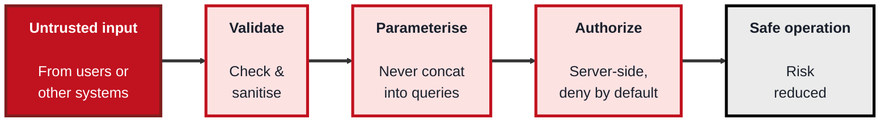
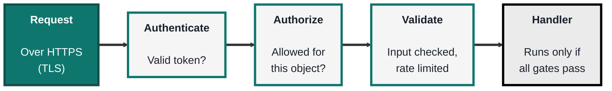

<!-- order: 8 -->
## Module 8: Secure Coding

**Time: about 5 hours** (roughly 2 hours for the OWASP Top 10, 3 hours for secure APIs).

**Tools needed for this module:** a code editor and a language runtime you're comfortable with (Node.js or Python are convenient for the examples), a terminal, and `curl` from Module 1 for testing endpoints. Optionally, a deliberately-vulnerable practice app like **OWASP Juice Shop** run locally, and a dependency scanner such as `npm audit`. As always, only test applications you own or that are built for training.

### Topic 8.1: OWASP Top 10

Time: about 2 hours

#### Concept

The **OWASP Top 10** is the industry-standard awareness list of the most critical security risks facing web applications, published by the **Open Worldwide Application Security Project** and updated every few years. The current edition is the **OWASP Top 10:2025**, released in November 2025 (full details at owasp.org/Top10/2025). It isn't a complete checklist of everything, it's the short list of what most commonly and seriously goes wrong, and it gives developers and testers a shared vocabulary and a starting point for building and reviewing secure software. The list is worth knowing by category, and worth understanding defensively: for each risk, the goal is to know how to prevent it, not how to exploit it.

The 2025 list, in rank order:

| Rank | Risk |
|---|---|
| A01 | Broken Access Control |
| A02 | Security Misconfiguration |
| A03 | Software Supply Chain Failures |
| A04 | Cryptographic Failures |
| A05 | Injection |
| A06 | Insecure Design |
| A07 | Authentication Failures |
| A08 | Software or Data Integrity Failures |
| A09 | Security Logging and Alerting Failures |
| A10 | Mishandling of Exceptional Conditions |

The five you'll meet most often in code review:

- **A01 Broken Access Control** (still number one in 2025) is when users can act outside their intended permissions, the defence is server-side authorization checks on every request and deny-by-default
- **A02 Security Misconfiguration** covers insecure defaults, unnecessary features left on, and verbose error messages that leak internals, the defence is hardening and minimising the configuration
- **A03 Software Supply Chain Failures** (new in 2025, it widens the older "Vulnerable and Outdated Components" item) covers everything your software is built from and with: libraries, build tools, CI/CD pipelines, and the places you download them from. A compromised or vulnerable package becomes your vulnerability. The defences are: keep a **Software Bill of Materials (SBOM)**, a list of every component and version you ship; **pin dependency versions** with a lockfile and **verify** them (checksums, registry signatures) instead of pulling whatever is newest; use **signed builds** so you can prove an artifact came from your pipeline unchanged; and keep scanning and patching components
- **A04 Cryptographic Failures** cover weak or missing protection of sensitive data, the defence ties back to Module 4: strong algorithms, proper key handling, encryption in transit and at rest
- **A05 Injection** (such as SQL injection) happens when untrusted input is interpreted as a command or query, the defence is parameterised queries and strict input validation, never building queries by string concatenation

#### Structure at a Glance


- A recurring theme across the Top 10 is **never trust input and always check authorization server-side**, the client can be manipulated, so every security decision has to be enforced on the server where the attacker can't reach it
- The Top 10 is an **awareness baseline, not a finish line**, clearing it is the minimum, not proof an app is secure, real security also needs secure design, testing, and defence in depth

#### Where you'd actually use this

Building web applications, reviewing code and pull requests for security issues, guiding a security assessment, and training developers. The Top 10 is the common reference point for "what should we make sure we didn't get wrong?" in nearly every web project.

#### Lab

> A code-review-and-fix exercise. No attacking required, the point is to recognise and repair the flaws.

1. **Study this vulnerable pattern** (building a query by concatenation, an injection risk):
```javascript
// Vulnerable: user input concatenated straight into the query
const q = "SELECT * FROM users WHERE name = '" + userInput + "'";
```
2. **Rewrite it safely** using a parameterised query, so input can never be treated as SQL:
```javascript
// Safe: input is passed as a parameter, not part of the query text
const q = "SELECT * FROM users WHERE name = ?";
db.query(q, [userInput]);
```
3. **Study this broken-access-control pattern** (trusting the client to say who it is):
```javascript
// Vulnerable: trusts a client-supplied role
if (request.body.role === "admin") { deleteUser(); }
```
4. **Rewrite it safely** with a server-side authorization check that doesn't trust client input:
```javascript
// Safe: authorization decided server-side from the authenticated session
if (session.user.isAdmin) { deleteUser(); }
```
5. **Check your software supply chain** in a Node.js project you own (one with a `package-lock.json`; npm 10 or newer). Scan for components with known flaws, verify the registry signatures of what you installed, and generate an SBOM:
```bash
npm audit
npm audit signatures
npm sbom --sbom-format cyclonedx > sbom.json
```
Open `sbom.json` and find one of your direct dependencies and its exact version. The lockfile pins those versions; the SBOM records them.

#### Checkpoint
You can recognise and fix an injection flaw (parameterisation) and a broken-access-control flaw (server-side authorization), you've scanned and verified your dependencies and produced an SBOM, and you can explain the recurring principle that input is never trusted and authorization is always enforced server-side.

#### Quiz
1. What is the OWASP Top 10, who publishes it, and which edition is current?
2. What causes injection, and what is the main defence against it?
3. What is broken access control, and how do you defend against it?
4. What does A03 Software Supply Chain Failures cover, and name two defences against it.
5. Why is the OWASP Top 10 described as a baseline rather than a complete guarantee of security?

*Answers: 1) An industry-standard awareness list of the most critical web application security risks, published by the Open Worldwide Application Security Project (OWASP); the current edition is the OWASP Top 10:2025, released in November 2025. 2) Injection happens when untrusted input is interpreted as part of a command or query; the main defence is parameterised queries plus strict input validation, never concatenating input into queries. 3) Broken access control (A01, still number one) is when users can act outside their intended permissions; you defend against it with server-side authorization checks on every request and a deny-by-default posture. 4) Risks in everything your software is built from and with, such as vulnerable or compromised libraries, build tools, and pipelines; defences include keeping an SBOM, pinning and verifying dependencies, signed builds, and scanning and patching components (any two). 5) Because it covers only the most common and critical risks, not everything; clearing it is the minimum bar, and real security also requires secure design, testing, and defence in depth.*

---

### Topic 8.2: Secure APIs

Time: about 3 hours

#### Concept

**APIs** are the interfaces that let applications and services talk to each other, and because they expose functionality and data directly, they're one of the biggest attack surfaces in modern software (OWASP maintains a separate API Security Top 10 for exactly this reason). A secure API treats every request as untrusted and puts it through a series of gates: prove who you are (**authentication**), prove you're allowed to do this specific thing (**authorization**), validate the input, limit the rate, and always travel over encrypted transport. The single most common API flaw is failing to check that the caller is authorized for the *specific object* they're requesting.

- **Authentication** verifies the caller, using established mechanisms like **OAuth 2.0** tokens or API keys, never a home-grown scheme, and never trusting the client to assert its own identity
- **Authorization on every request** must check both function-level and **object-level** permissions, broken object-level authorization (asking for record 124 when you're only entitled to 123) is the top API risk
- **Input validation** checks and sanitises all incoming data server-side, since APIs receive input from clients you don't control
- **Rate limiting** caps how many requests a caller can make, blunting brute-force, credential-stuffing, and abuse
- **Transport security** means always using HTTPS/TLS (Modules 1 and 4), so tokens and data are never sent in the clear

#### Structure at a Glance


- The gates are ordered and every request passes through all of them, a request that authenticates successfully still has to prove it's authorized for the specific object it asked for, which is exactly the check that's most often missed
- Secure APIs also fail safely: return generic errors that don't leak internal details, and log requests for monitoring (Module 7), so an attack on the API is both hard to succeed at and easy to detect

#### Where you'd actually use this

Designing and reviewing any API that backs a web or mobile app, a public developer API, or service-to-service communication in a system. As applications increasingly become collections of APIs, securing them well is one of the most important secure-coding skills.

#### Lab

> You'll run a tiny API on your own computer and test every gate with `curl`. Nothing leaves your machine. Needs Python 3.12+.

1. **Picture the insecure version first**: an endpoint `/api/records/<id>` that returns any record to anyone. List what's missing: authentication, object-level authorization, input validation, rate limiting, and TLS.
2. **Install Flask** in a terminal:
```bash
pip install flask
```
(If pip refuses with an "externally-managed-environment" error, which is common on recent Linux and Homebrew Python, first create and activate a virtual environment: `python3 -m venv .venv` then `source .venv/bin/activate`, or `.venv\Scripts\activate` on Windows, and run the install again.)
3. **Save this as `api.py`**. It's the same endpoint with the gates added; each gate is commented. The two demo users get random tokens every time the server starts, so no credential is written in the code.
```python
# api.py: a tiny records API with every security gate, for local practice only
import re
import secrets
import time
from collections import defaultdict, deque

from flask import Flask, jsonify, request

app = Flask(__name__)

# Two demo users. Their tokens are random and new every time the server starts,
# so no credential is ever written in the code.
TOKENS = {
    secrets.token_urlsafe(16): "alice",
    secrets.token_urlsafe(16): "bob",
}

RECORDS = {
    123: {"id": 123, "owner": "alice", "note": "Alice's private note"},
    124: {"id": 124, "owner": "bob", "note": "Bob's private note"},
}

RATE_LIMIT = 5    # requests allowed...
RATE_WINDOW = 10  # ...per this many seconds, per caller
recent_requests = defaultdict(deque)


def is_rate_limited(caller):
    now = time.monotonic()
    times = recent_requests[caller]
    while times and now - times[0] > RATE_WINDOW:
        times.popleft()
    if len(times) >= RATE_LIMIT:
        return True
    times.append(now)
    return False


def current_user():
    header = request.headers.get("Authorization", "")
    if not header.startswith("Bearer "):
        return None
    return TOKENS.get(header.removeprefix("Bearer "))


@app.get("/api/records/<record_id>")
def get_record(record_id):
    # Gate 1: rate limit each caller (by IP address)
    if is_rate_limited(request.remote_addr):
        return jsonify(error="Too many requests"), 429

    # Gate 2: authentication (who are you?)
    user = current_user()
    if user is None:
        return jsonify(error="Authentication required"), 401

    # Gate 3: input validation (IDs are digits only)
    if not re.fullmatch(r"\d{1,9}", record_id):
        return jsonify(error="Invalid record ID"), 400

    record = RECORDS.get(int(record_id))
    if record is None:
        return jsonify(error="Not found"), 404

    # Gate 4: object-level authorization (is THIS record yours?)
    if record["owner"] != user:
        return jsonify(error="Forbidden"), 403

    return jsonify(record), 200


if __name__ == "__main__":
    for token, name in TOKENS.items():
        print(f"Token for {name}: {token}")
    # Local practice only: plain HTTP on your own machine.
    # In production this must sit behind HTTPS (TLS).
    app.run(host="127.0.0.1", port=8000)
```
4. **Start it** with `python api.py`. It prints a token for alice and one for bob; leave this terminal running and open a second one. (On Windows PowerShell, type `curl.exe` instead of `curl` in the next steps.)
5. **Test authentication**: call the endpoint with no token. You should get `401`.
```bash
curl -i http://127.0.0.1:8000/api/records/123
```
6. **Test object-level authorization**: paste alice's token in place of `ALICE_TOKEN`. Record 123 is hers, so you get `200` and the note; record 124 is bob's, so you get `403`. This is the check that's most often missing in real APIs.
```bash
curl -i -H "Authorization: Bearer ALICE_TOKEN" http://127.0.0.1:8000/api/records/123
curl -i -H "Authorization: Bearer ALICE_TOKEN" http://127.0.0.1:8000/api/records/124
```
7. **Test input validation**: request `/api/records/abc` with alice's token and confirm you get `400`.
8. **Test the rate limit**: wait 10 seconds, then run the step 5 command six times quickly. The sixth call returns `429 Too Many Requests`.
9. **Note the missing gate**: this server uses plain HTTP because it only listens on your own computer. Write one sentence on why a real deployment must serve it over HTTPS (hint: what would an eavesdropper see in the `Authorization` header?).

#### Checkpoint
You can identify the security gates a request should pass (transport, authentication, object-level authorization, validation, rate limiting), you've run an endpoint that has them and watched each one return its status code (401, 403, 400, 429), and you can explain why broken object-level authorization is the top API risk.

#### Quiz
1. Why are APIs considered such a large attack surface?
2. What is the difference between authentication and authorization for an API request?
3. What is broken object-level authorization, and why is it so common?
4. What does rate limiting protect against?
5. Name two things beyond authentication that a secure API request should pass through.

*Answers: 1) Because APIs expose application functionality and data directly to callers, so flaws in them give attackers direct access; they receive input from clients the provider doesn't control. 2) Authentication verifies who the caller is (a valid token), while authorization decides whether that authenticated caller is allowed to perform this specific action on this specific object. 3) It's when an API authenticates a user but fails to check they're entitled to the specific object requested (for example returning record 124 to a user only entitled to 123); it's common because developers often check identity but forget the per-object permission check. 4) Brute-force attempts, credential stuffing, and general abuse, by capping how many requests a caller can make. 5) For example: object-level and function-level authorization, input validation, rate limiting, and transport security (HTTPS/TLS), any two.*

---

## Module 8 Completion Checklist
- [ ] Recognised and fixed an injection flaw using a parameterised query
- [ ] Recognised and fixed a broken-access-control flaw using a server-side authorization check
- [ ] Can name the OWASP Top 10:2025 categories and explain the new Software Supply Chain Failures item
- [ ] Ran a dependency scan, verified registry signatures, and generated an SBOM
- [ ] Ran a local API with transport, authentication, object-level authorization, validation, and rate limiting gates explained
- [ ] Tested that unauthenticated, unauthorized, invalid, and too-frequent requests are each rejected
- [ ] Can explain the recurring principle: never trust input, and always enforce authorization server-side and per object
