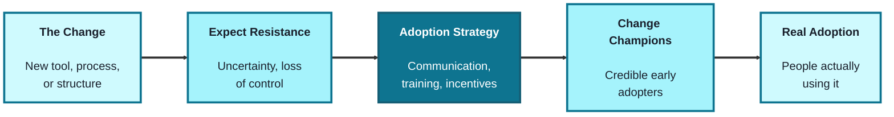
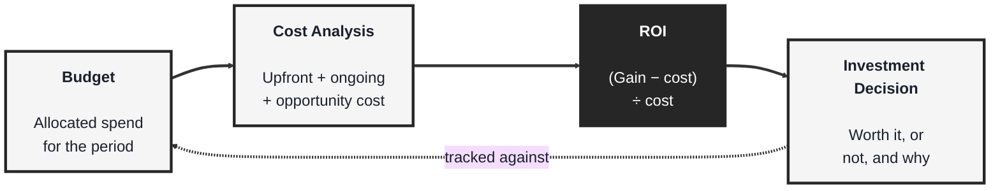
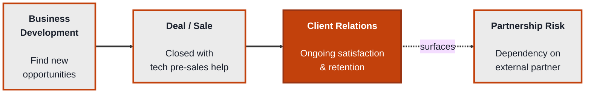
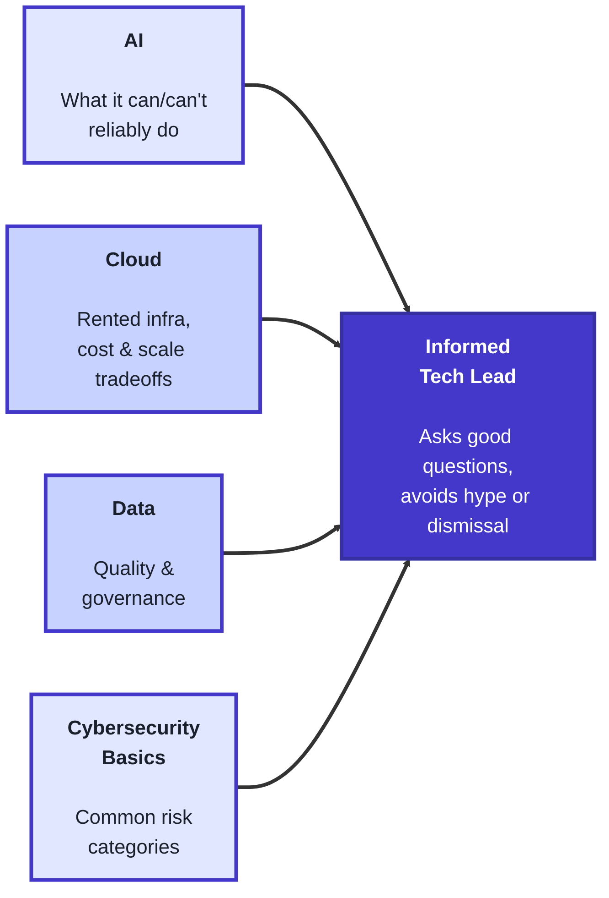

<!-- order: 3 -->
## Module 3: Change Management, Financial Literacy, Sales & Partnerships, and Technology Awareness

Time: about 8 hours

**By the end of this module, you'll be able to:**
- Plan a change rollout: likely resistance, an adoption strategy, a change champion, and a follow-up check
- Run a cost analysis (upfront, ongoing, opportunity cost) and calculate ROI as (gain − cost) ÷ cost
- Classify a cost as CapEx or OpEx and set up a monthly check that catches overspending early
- Write an honest pre-sales answer and name a partnership dependency risk with a mitigation
- Assess an AI proposal for wrong answers, data handling, pre-launch testing, and cost per use
- Explain the core tradeoffs of cloud, data quality and governance, and common cybersecurity risks well enough to ask specialists good questions

**Purpose of this module:** Cover the remaining breadth a tech lead needs outside pure engineering: leading people through change, speaking the language of money, understanding how the business grows externally, and staying fluent enough in emerging technology to make informed calls without being a specialist in all of it.

**Tools needed for this module:** No software installation required. A spreadsheet tool (Excel, Google Sheets) is useful for the Financial Literacy lab, and any note-taking tool works for the rest.

### Topic 3.1: Change Management

#### Concept

Any meaningful technical change, a new tool, a new process, a reorg, a platform migration, fails or succeeds based on how people adopt it, not just on whether it was built correctly. Change management is the discipline of planning for that human side deliberately, rather than assuming a good solution will simply be adopted because it's good.

- **Organizational change** is a shift that affects how people work, not just what tool they use, new processes, new reporting lines, or new expectations, which is why it needs more deliberate handling than a typical technical rollout
- **Resistance to change** is a normal, expected reaction, not a sign of a bad team, usually driven by uncertainty, perceived loss of control, or past changes that were poorly handled
- **Adoption strategies** are the deliberate tactics used to get people actually using a change, communication, training, incentives, and visible leadership support, rather than just announcing the change once and moving on
- **Change champions** are early, credible adopters embedded in the team who model the new behavior and answer peer questions, often more persuasive than the same message coming from leadership alone

#### Structure at a Glance


- A change announced once and never reinforced tends to quietly fade back to the old way of working; adoption needs to be checked on, not just launched
- Treating resistance as something to plan for in advance, rather than a surprise to react to after the fact, is what separates a change that sticks from one that gets rolled back six months later

#### Where you'd actually use this

Rolling out a new development workflow and planning for the team members who'll quietly keep using the old one, migrating a platform and identifying a credible senior engineer to champion it instead of relying only on a leadership announcement, or recognizing that pushback on a new process is normal friction to work through rather than a sign the change was a mistake.

#### Lab

**If you don't manage anyone yet:** use your She Model Tech project team, or the short case in Module 1 (Amara, Jordan and Priya's volunteer team building a sign-up page for a community coding workshop). A good change to plan for in that case: requiring that every change Jordan ships is tested and reviewed by a second person before it goes live, after last week's bug reached users.

1. **Pick a real or upcoming organizational change** on your team (a new tool, process, or structural shift).
2. **List the likely sources of resistance** to it, 3-4 specific reasons people might push back, tied to uncertainty, control, or past experience, not just "people don't like change."
3. **Draft an adoption strategy** for that change: one sentence each for communication, training, and incentive (what makes adopting it worth the friction).
4. **Identify one potential change champion** on the team, someone credible who could model the new behavior early, and write one sentence on why they'd be effective in that role.
5. **Plan one check-in** after the initial rollout (a week or a month later) specifically to see whether adoption is holding or quietly reverting.

#### Checkpoint
You have a list of specific resistance sources, a one-sentence adoption strategy across communication/training/incentive, one named change champion with reasoning, and one scheduled adoption check-in.

#### Quiz
1. Why does a technically good solution sometimes fail to be adopted?
2. What is organizational change, and how is it different from a typical technical rollout?
3. Why should resistance to change be treated as normal rather than a sign of a bad team?
4. What are adoption strategies, and name two examples.
5. What is a change champion, and why can they be more persuasive than leadership alone?

*Answers: 1) Adoption depends on how people respond to the change, not just on whether the solution itself was built correctly; without deliberate change management, a good solution can still go unused. 2) A shift that affects how people work, not just what tool they use, such as new processes or reporting lines, which needs more deliberate handling than a typical technical rollout. 3) Resistance is usually driven by normal reactions like uncertainty, perceived loss of control, or past changes that were poorly handled, not by the team being bad at their jobs. 4) Deliberate tactics used to get people actually using a change; examples include communication, training, incentives, and visible leadership support. 5) A credible early adopter embedded in the team who models the new behavior and answers peer questions; they're often more persuasive than leadership because the message comes from a peer rather than from above.*

---

### Topic 3.2: Financial Literacy

#### Concept

Technical decisions have financial consequences, and financial constraints shape technical decisions right back, which is why a tech lead needs enough fluency to have a real conversation about money, not necessarily to build the budget themselves, but to understand it well enough to make a credible case and not be talked past in a finance conversation.

- **Budgeting** is planning how much money is allocated to a team or project over a period, and tracking actual spend against that plan so overages are caught early rather than at year-end
- **ROI (Return on Investment)** is a way of expressing whether a cost is worth it, used to compare different possible investments against each other. The formula is **ROI = (gain − cost) ÷ cost**, usually shown as a percentage. Worked example: a tool costs $10,000 a year and saves the team 200 hours a year, valued at $75 an hour, so the gain is 200 × $75 = $15,000. ROI = ($15,000 − $10,000) ÷ $10,000 = 0.5, or **50%**. A positive ROI means the gain is bigger than the cost; 0% means you only broke even
- **Cost analysis** is breaking down what something actually costs, not just the sticker price, but ongoing costs like maintenance, support, and opportunity cost (what you can't do because you chose this instead)
- **CapEx vs. OpEx** is a useful distinction: capital expenditure (a large upfront cost, like buying hardware) versus operating expenditure (an ongoing recurring cost, like a subscription), and the two are often treated differently in a company's finances even for a similar underlying need

#### Structure at a Glance


- A cost analysis that only counts the sticker price will consistently underestimate the real cost of a decision; maintenance and opportunity cost are easy to leave out and often add up to more than the upfront number
- ROI is only as credible as the estimate behind it; a rough, honestly-labeled estimate is more useful in a real conversation than a precise-looking number built on shaky assumptions

#### Where you'd actually use this

Explaining to finance why a tool that looks more expensive upfront is actually cheaper once ongoing maintenance is counted, making the case for a new platform investment using a rough but honest ROI estimate instead of vague enthusiasm, or catching partway through the year that a project is tracking over budget in time to actually do something about it.

#### Lab

1. **Pick a real or hypothetical technology investment** (a new tool, a platform migration, additional infrastructure).
2. **Run a cost analysis**: list the upfront cost, at least one ongoing cost (maintenance, support, subscription), and one opportunity cost (what you'd have to give up or delay to afford this).
3. **Estimate a rough ROI** for the same investment: your best estimate of the value gained (time saved, revenue enabled, risk avoided) and the total cost from step 2, then calculate ROI = (gain − cost) ÷ cost. Label your assumptions clearly, precision isn't the point, an honest, defensible estimate is.
4. **Classify the investment as CapEx or OpEx** (or a mix), and note whether that classification changes how easy it is to get approved.
5. **Set up a simple budget-tracking check**: if you had this in a real budget, what would you check monthly to catch an overage early rather than at year-end?

#### Checkpoint
You have a cost analysis covering upfront, ongoing, and opportunity cost, a rough labeled ROI estimate, a CapEx/OpEx classification, and one concrete monthly check you'd use to catch a budget overage early.

#### Quiz
1. Why does a tech lead need financial literacy even if they aren't the one building the budget?
2. What is ROI, and what is it used for?
3. What does a cost analysis include beyond the sticker price?
4. What is the difference between CapEx and OpEx?
5. Why does budgeting need ongoing tracking rather than just an initial plan?

*Answers: 1) So they can have a credible conversation about money, understand financial constraints, and make a strong case for technical investments rather than being talked past in a finance conversation. 2) A way of expressing whether a cost is worth it, calculated as (gain − cost) ÷ cost; it's used to compare different possible investments against each other. 3) Ongoing costs like maintenance and support, and opportunity cost, what you can't do because you chose this option instead. 4) CapEx is a large upfront cost, like buying hardware; OpEx is an ongoing recurring cost, like a subscription; the two are often treated differently in a company's finances even for a similar underlying need. 5) So overages are caught early, during the period, rather than discovered only at year-end when it's too late to adjust.*

---

### Topic 3.3: Sales & Partnerships

#### Concept

Even in a purely internal engineering role, understanding how the business grows externally, through new customers, new deals, and new partners, helps a tech lead make better calls about what to prioritize and why certain "urgent" requests exist in the first place. This isn't about becoming a salesperson; it's about understanding enough of that world to be a better internal partner to the people who are.

- **Business development** is the work of identifying and pursuing new opportunities for growth, new markets, new partnerships, new revenue streams, distinct from sales, which focuses on closing specific deals
- **Client relations** is the ongoing management of a relationship with a customer or partner after the initial deal, keeping them satisfied, informed, and retained, not just winning them once
- **Technical pre-sales support** is when engineering or leadership gets pulled into a sales conversation to explain feasibility, answer technical questions, or reassure a prospective client, a common way technology and sales intersect
- **Partnership dependency risk** is the risk that comes from relying on an external partner (a vendor, an API, an integration) for something critical, worth naming explicitly rather than discovering when the partner changes terms or goes down

#### Structure at a Glance


- A deal closed with an unrealistic technical promise made during pre-sales becomes engineering's problem the moment it's signed, which is exactly why technical input during the sales conversation matters
- Partnership dependency risk is easiest to manage when it's named before a partner becomes critical, not after an outage or a contract renegotiation reveals how exposed you are

#### Where you'd actually use this

Getting pulled into a sales call to confirm a feature is technically feasible before a deal is promised to a client, recognizing that a key customer's escalation is really a client-relations issue needing a different response than a normal bug report, or flagging that a critical integration depends entirely on one external vendor before that dependency becomes a crisis.

#### Lab

1. **Identify one real or hypothetical business development opportunity** relevant to your organization (a new market, a new partnership, a new revenue stream) and write 2-3 sentences on what technical capability it would require.
2. **Role-play or draft a technical pre-sales moment**: a prospective client asks whether your product can do X; write the honest, technically accurate answer you'd give, resisting the urge to over-promise.
3. **Pick one real client or customer relationship** (internal or external) and note one thing you'd do to maintain it proactively, before there's a problem, rather than only reacting to complaints.
4. **List one external partner, vendor, or API** your team currently depends on for something important, and name the specific risk if that partnership changed or failed.
5. **Write one mitigation** for that partnership dependency risk (a fallback, a contract term to watch, a monitoring alert), even a partial one.

#### Checkpoint
You have one business development opportunity mapped to a technical capability, one honest pre-sales answer drafted, one proactive client-relations action, and one named partnership dependency risk with a mitigation.

#### Quiz
1. Why does understanding sales and partnerships matter for a tech lead, even in a purely internal role?
2. What is the difference between business development and sales?
3. What is client relations, and how is it different from just winning a deal once?
4. What is technical pre-sales support, and why does it matter?
5. What is partnership dependency risk, and why is it better to name it explicitly in advance?

*Answers: 1) It helps them prioritize better and understand why certain "urgent" requests exist, and makes them a better internal partner to the people focused on growth. 2) Business development identifies and pursues new opportunities for growth, like new markets or partnerships; sales focuses on closing specific deals. 3) The ongoing management of a relationship with a customer or partner after the initial deal, keeping them satisfied, informed, and retained, rather than only winning them once. 4) When engineering or leadership gets pulled into a sales conversation to explain feasibility or answer technical questions; it matters because an unrealistic promise made during pre-sales becomes engineering's problem the moment the deal is signed. 5) The risk of relying on an external partner for something critical; naming it in advance lets you plan a mitigation, rather than discovering the exposure only after an outage or a contract renegotiation.*

---

### Topic 3.4: Technology Awareness

#### Concept

A tech lead doesn't need to be a hands-on expert in every emerging technology, but does need enough working literacy to ask good questions, spot real risk, and avoid being either dismissive of something genuinely useful or oversold on something that's mostly hype. This topic covers baseline awareness across four areas that come up constantly in leadership conversations: AI, cloud, data, and cybersecurity.

- **AI** here means having a working sense of what modern AI systems, especially large language models (LLMs) like ChatGPT, Claude, or Gemini, can and can't reliably do, enough to evaluate a proposed AI feature honestly rather than assuming it's either magic or a gimmick. Four practical rules for 2026:
  - **AI can be confidently wrong.** LLMs sometimes produce answers that sound certain but are false, such as an invented statistic, a citation that doesn't exist, or code that calls a function that isn't real. This is called a **hallucination**. Treat AI output as a draft: check facts, test code, and have a person review anything that goes to users or decision-makers
  - **Don't paste confidential or personal data into AI tools unless your organization has approved that tool for that data.** Customer records, passwords, unreleased plans, and other people's personal details can end up stored or seen outside your control. Ask "is this tool approved for this kind of data?" before pasting
  - **Test an AI feature on real examples before launch.** Collect 20-50 real inputs (with any personal details removed), run them through the feature, and have someone check each output. Count how many were right, wrong, or harmful. A good demo on three hand-picked examples proves very little
  - **AI features cost money every time they're used.** Most AI services charge per request (usually by the amount of text in and out), so a feature that's cheap in testing can become expensive with thousands of users. Estimate cost per use × expected uses per month before committing
- **Cloud** means renting servers, storage, and services from a provider (such as AWS, Google Cloud, or Azure) instead of buying your own hardware. You gain fast setup and easy scaling; you give up some control and take on an ongoing monthly bill that grows with usage
- **Data** covers how your organization collects, stores, and uses data. Two questions matter as much as having the data at all: is it accurate and up to date (**quality**), and who owns it and who is allowed to see it (**governance**)
- **Cybersecurity basics** means knowing the common risks well enough to ask your security team good questions: phishing emails, weak access control (shared passwords, no two-factor sign-in, too many people with admin rights), unpatched software, and third-party risk (a vendor you depend on gets breached)

#### Structure at a Glance


- These four areas overlap constantly in practice, an AI feature depends on cloud infrastructure, needs good-quality data, and introduces its own cybersecurity considerations, so awareness in one area alone isn't enough
- The goal here is calibrated confidence, being able to say honestly "this is realistic" or "this is overstated," not becoming a specialist in any one of the four

#### Where you'd actually use this

Pushing back constructively when a proposed AI feature is being oversold as a guaranteed fix, asking whether a new system's cost and scaling assumptions actually hold up before committing to a cloud architecture, questioning who really owns and can access a sensitive dataset before a new use case is approved, or asking a security team pointed questions about third-party risk instead of assuming a vendor's "we take security seriously" is sufficient.

#### Lab

1. **Pick one AI-related claim or proposal** you've encountered (real or hypothetical, for example "we'll add an AI chatbot to answer questions about our community workshops") and write an honest one-paragraph assessment that answers four questions: What happens when it gives a confident wrong answer, and who checks its output? What data would it see, and is the tool approved for that data? Which 20-50 real examples would you test it on before launch, and what share must it get right? Roughly what would it cost per use, and per month at your expected usage?
2. **Describe one system your organization uses or could use** in terms of cloud tradeoffs: what you gain (scalability, lower upfront cost) and what you give up (control, ongoing cost, vendor dependency).
3. **Pick one dataset you're aware of** and answer: who owns it, who can access it, and is there a known data-quality issue with it? If you don't know the answers, that's itself worth noting.
4. **List three common cybersecurity risk categories** (e.g. phishing, weak access control, unpatched software, third-party risk) and, for one of them, write one question you'd ask your security team to check your organization's exposure.
5. **Pick one place where two of these four areas intersect** in something your team actually works on (e.g. an AI feature that depends on cloud infrastructure and a specific dataset) and note the one cross-cutting risk that's easy to miss if you only look at one area at a time.

#### Checkpoint
You have one honest AI-claim assessment covering wrong answers, data, pre-launch testing, and cost, one cloud tradeoff description, one data-ownership/quality check, three named cybersecurity risk categories with one real question for your security team, and one identified cross-area intersection with its associated risk.

#### Quiz
1. Why does a tech lead need technology awareness across AI, cloud, data, and cybersecurity without being a specialist in any of them?
2. What does "AI awareness" mean in this context?
3. What is the core tradeoff of using cloud infrastructure instead of owning physical hardware?
4. Why do data quality and governance matter as much as simply having the data?
5. What does "cybersecurity basics" mean for a tech lead, as opposed to a security specialist?

*Answers: 1) So they can ask good questions, spot real risk, and avoid being either dismissive of something genuinely useful or oversold on something that's mostly hype, since these four areas come up constantly in leadership conversations. 2) Knowing what modern AI can and can't reliably do: it can give confident wrong answers, called hallucinations, so output must be checked, confidential or personal data shouldn't go into unapproved tools, features should be tested on real examples before launch, and each use costs money. 3) You gain fast setup and easy scaling with no hardware to buy, but give up some control and take on an ongoing bill that grows with usage. 4) Because having data alone isn't useful if it's poor quality or if ownership and access aren't clear; both matter for the data to be trustworthy and usable. 5) Understanding common risk categories like phishing, weak access control, unpatched software, and third-party risk well enough to ask the right questions of a security team, not to perform the security work directly.*

```watch
{
 "scenes": [
  {
   "kind": "title",
   "art": "growth",
   "kicker": "Module 3 · The breadth of a tech lead",
   "title": "Change, money, growth and tech",
   "beats": [
    {
     "say": "Welcome to Module 3."
    },
    {
     "say": "It covers the breadth a tech lead needs outside pure engineering: leading people through change, speaking the language of money, understanding how the business grows, and staying fluent in emerging technology."
    }
   ]
  },
  {
   "kind": "diagram",
   "kicker": "Topic 3.1 · Change management",
   "title": "Plan a rollout that sticks",
   "nodes": [
    {
     "id": "chg",
     "label": "New rule",
     "sub": "tested + 2nd reviewer",
     "x": 10,
     "y": 50,
     "art": "checklist"
    },
    {
     "id": "res",
     "label": "Resistance",
     "sub": "normal, so plan for it",
     "x": 32,
     "y": 16,
     "art": "warning"
    },
    {
     "id": "plan",
     "label": "Adoption plan",
     "sub": "talk · train · incentive",
     "x": 66,
     "y": 16,
     "art": "megaphone"
    },
    {
     "id": "champ",
     "label": "Champion",
     "sub": "Amara goes first",
     "x": 90,
     "y": 50,
     "art": "star"
    },
    {
     "id": "adopt",
     "label": "Real adoption",
     "sub": "people actually use it",
     "x": 66,
     "y": 84,
     "art": "people"
    },
    {
     "id": "check",
     "label": "Check-in",
     "sub": "two weeks later",
     "x": 32,
     "y": 84,
     "art": "calendar"
    }
   ],
   "edges": [
    {
     "from": "chg",
     "to": "res"
    },
    {
     "from": "res",
     "to": "plan"
    },
    {
     "from": "plan",
     "to": "champ"
    },
    {
     "from": "champ",
     "to": "adopt"
    },
    {
     "from": "adopt",
     "to": "check"
    },
    {
     "from": "check",
     "to": "plan"
    }
   ],
   "beats": [
    {
     "say": "A change succeeds or fails on adoption. Take the Module 1 case.",
     "show": 0
    },
    {
     "say": "After last week's bug reached users, a new rule: every change Jordan ships is tested, and reviewed by a second person.",
     "show": 1,
     "on": "chg"
    },
    {
     "say": "Expect resistance. It's a normal reaction, not a sign of a bad team.",
     "show": 2,
     "on": "res",
     "send": {
      "from": "chg",
      "to": "res",
      "label": "new rule"
     }
    },
    {
     "say": "Get specific. It'll slow me down: control. Who reviews, how fast: uncertainty. The last process faded: past experience.",
     "on": "res"
    },
    {
     "say": "Answer them with an adoption plan. Explain why, train on the review checklist, and offer an incentive: fewer emergency fixes.",
     "show": 3,
     "on": "plan",
     "send": {
      "from": "res",
      "to": "plan",
      "label": "3 concerns"
     }
    },
    {
     "say": "Recruit a champion. Amara is reliable and credible, so she goes first and answers peer questions.",
     "show": 4,
     "on": "champ",
     "send": {
      "from": "plan",
      "to": "champ",
      "label": "goes first"
     }
    },
    {
     "say": "A peer's example often persuades more than an announcement from the lead.",
     "show": 5,
     "on": "adopt",
     "send": {
      "from": "champ",
      "to": "adopt",
      "label": "peer example"
     }
    },
    {
     "say": "Two weeks later, check in. Is every change still being reviewed?",
     "show": 6,
     "on": "check",
     "send": {
      "from": "adopt",
      "to": "check",
      "label": "still reviewing?"
     }
    },
    {
     "say": "If it's quietly slipping back, adjust the plan. A change announced once tends to fade.",
     "on": "plan",
     "send": {
      "from": "check",
      "to": "plan",
      "label": "slipping: adjust"
     }
    }
   ]
  },
  {
   "kind": "table",
   "kicker": "Topic 3.2 · Financial literacy",
   "title": "ROI, then the real cost",
   "columns": [
    "Line",
    "Working",
    "Amount"
   ],
   "rows": [
    [
     "Tool subscription",
     "per year",
     "$10,000"
    ],
    [
     "Gain: hours saved",
     "200 h × $75",
     "$15,000"
    ],
    [
     "ROI, sticker price",
     "(15k − 10k) ÷ 10k",
     "50%"
    ],
    [
     "Setup time",
     "40 h × $75",
     "$3,000"
    ],
    [
     "True cost, year one",
     "10k + 3k",
     "$13,000"
    ],
    [
     "ROI, true cost",
     "(15k − 13k) ÷ 13k",
     "≈ 15%"
    ],
    [
     "Opportunity cost",
     "40 h off the roadmap",
     "label it"
    ]
   ],
   "beats": [
    {
     "say": "R O I says whether a cost is worth it: gain minus cost, divided by cost.",
     "sql": "ROI = (gain − cost) ÷ cost"
    },
    {
     "say": "The course example. A tool costs ten thousand dollars a year.",
     "hl": 0,
     "dim": true,
     "col": 2
    },
    {
     "say": "It saves two hundred hours a year, valued at seventy five dollars an hour. That's a gain of fifteen thousand.",
     "hl": 1,
     "dim": true,
     "col": 1
    },
    {
     "say": "Fifteen thousand minus ten thousand, divided by ten thousand. That's fifty percent.",
     "hl": 2,
     "dim": true,
     "col": 1
    },
    {
     "say": "But that's only the sticker price. Say setup takes forty hours of the team's time: three thousand dollars, up front.",
     "hl": 3,
     "dim": true,
     "sql": "Cost analysis: upfront + ongoing + opportunity cost"
    },
    {
     "say": "So the true first year cost is thirteen thousand.",
     "hl": 4,
     "dim": true,
     "col": 2
    },
    {
     "say": "Fifteen thousand minus thirteen, divided by thirteen. About fifteen percent. Still positive, but a very different story.",
     "hl": 5,
     "dim": true,
     "col": 2
    },
    {
     "say": "And opportunity cost: those forty hours weren't spent on the roadmap. Name it, even without a number.",
     "hl": 6,
     "dim": true
    },
    {
     "say": "Label every assumption. An honest rough estimate beats a precise looking one on shaky ground.",
     "hl": [
      2,
      5
     ],
     "sql": "Assumptions: 200 h saved · $75/h · 40 h setup"
    }
   ]
  },
  {
   "kind": "chart",
   "kicker": "Topic 3.2 · Financial literacy",
   "title": "CapEx or OpEx? Total cost over time",
   "xlabel": "months 0 → 60",
   "ylabel": "total spent, $0 → $30k",
   "points": [
    [
     0,
     40
    ],
    [
     20,
     50
    ],
    [
     40,
     60
    ],
    [
     60,
     70
    ],
    [
     80,
     80
    ],
    [
     100,
     90
    ],
    [
     0,
     0
    ],
    [
     20,
     20
    ],
    [
     40,
     40
    ],
    [
     60,
     60
    ],
    [
     80,
     80
    ],
    [
     100,
     100
    ]
   ],
   "beats": [
    {
     "say": "The same need, two ways to pay. Here's the total spent on each, over five years.",
     "groups": [
      0,
      0,
      0,
      0,
      0,
      0,
      0,
      0,
      0,
      0,
      0,
      0
     ]
    },
    {
     "say": "Buy your own server: twelve thousand dollars up front. That's capital expenditure, cap ex.",
     "groups": [
      1,
      0,
      0,
      0,
      0,
      0,
      0,
      0,
      0,
      0,
      0,
      0
     ],
     "marks": [
      [
       0,
       40
      ]
     ]
    },
    {
     "say": "Then two hundred and fifty dollars a month to maintain it, so the line keeps climbing slowly.",
     "groups": [
      1,
      1,
      1,
      1,
      1,
      1,
      0,
      0,
      0,
      0,
      0,
      0
     ],
     "line": [
      0.5,
      40
     ]
    },
    {
     "say": "Or rent it from a cloud provider: five hundred dollars a month, nothing up front. That's operating expenditure, op ex.",
     "groups": [
      1,
      1,
      1,
      1,
      1,
      1,
      2,
      2,
      2,
      2,
      2,
      2
     ],
     "line": [
      1,
      0
     ]
    },
    {
     "say": "The lines cross at month forty eight, where each has cost twenty four thousand dollars.",
     "groups": [
      1,
      1,
      1,
      1,
      1,
      1,
      2,
      2,
      2,
      2,
      2,
      2
     ],
     "marks": [
      [
       80,
       80
      ]
     ]
    },
    {
     "say": "Before that, cloud is cheaper. After it, owning wins, if usage stays flat.",
     "groups": [
      1,
      1,
      1,
      1,
      1,
      1,
      2,
      2,
      2,
      2,
      2,
      2
     ],
     "marks": [
      [
       80,
       80
      ]
     ]
    },
    {
     "say": "Cloud trades some control for speed and scaling, and its bill grows with usage.",
     "groups": [
      1,
      1,
      1,
      1,
      1,
      1,
      2,
      2,
      2,
      2,
      2,
      2
     ],
     "marks": [
      [
       80,
       80
      ]
     ]
    }
   ]
  },
  {
   "kind": "table",
   "kicker": "Topic 3.2 · Financial literacy",
   "title": "Catch the overage in March, not December",
   "columns": [
    "Month",
    "Plan",
    "Actual",
    "Running ±"
   ],
   "rows": [
    [
     "Jan",
     "$500",
     "$475",
     "−$25"
    ],
    [
     "Feb",
     "$500",
     "$500",
     "−$25"
    ],
    [
     "Mar",
     "$500",
     "$650",
     "+$125"
    ],
    [
     "Apr",
     "$500",
     "$725",
     "+$350"
    ]
   ],
   "beats": [
    {
     "say": "Now track that cloud bill. The budget is six thousand dollars a year: five hundred a month.",
     "col": 1,
     "sql": "Budget: $6,000 a year = $500 a month"
    },
    {
     "say": "The monthly check: compare actual with plan, and flag any month more than ten percent over.",
     "sql": "Monthly check: flag if Actual > Plan + 10% ($550)"
    },
    {
     "say": "January: four hundred seventy five. Twenty five under.",
     "hl": 0,
     "dim": true,
     "col": 3
    },
    {
     "say": "February: exactly on plan. Still twenty five under in total.",
     "hl": 1,
     "dim": true,
     "col": 3
    },
    {
     "say": "March: six hundred fifty. That's a hundred fifty over, thirty percent. Flag it.",
     "hl": 2,
     "dim": true,
     "col": 2,
     "sql": "Mar: $650 > $550 → flag (+30%)"
    },
    {
     "say": "Usage grew, so the bill grew. You've caught it with nine months left.",
     "hl": 2,
     "dim": true
    },
    {
     "say": "April confirms the trend: two hundred twenty five over, three hundred fifty in total.",
     "hl": 3,
     "dim": true,
     "col": 3
    },
    {
     "say": "If April's pace held for the other eight months, you'd end the year about two thousand one hundred fifty over.",
     "hl": 3,
     "dim": true,
     "sql": "$350 + 8 × $225 = $2,150 over by December"
    }
   ]
  },
  {
   "kind": "diagram",
   "kicker": "Topic 3.3 · Sales and partnerships",
   "title": "How the business grows",
   "nodes": [
    {
     "id": "bd",
     "label": "Business dev",
     "sub": "a new opportunity",
     "x": 10,
     "y": 50,
     "art": "compass"
    },
    {
     "id": "pre",
     "label": "Pre-sales",
     "sub": "an honest answer",
     "x": 34,
     "y": 18,
     "art": "chat"
    },
    {
     "id": "deal",
     "label": "Deal",
     "sub": "a promise we can keep",
     "x": 64,
     "y": 18,
     "art": "doc"
    },
    {
     "id": "rel",
     "label": "Client relations",
     "sub": "satisfied, retained",
     "x": 90,
     "y": 50,
     "art": "people"
    },
    {
     "id": "vendor",
     "label": "Payment vendor",
     "sub": "dependency risk",
     "x": 64,
     "y": 84,
     "art": "plug"
    },
    {
     "id": "mit",
     "label": "Mitigation",
     "sub": "alert + fallback",
     "x": 34,
     "y": 84,
     "art": "shield"
    }
   ],
   "edges": [
    {
     "from": "bd",
     "to": "pre"
    },
    {
     "from": "pre",
     "to": "deal"
    },
    {
     "from": "deal",
     "to": "rel"
    },
    {
     "from": "rel",
     "to": "vendor"
    },
    {
     "from": "vendor",
     "to": "mit"
    }
   ],
   "beats": [
    {
     "say": "You don't need to be a salesperson, just a good partner to the people who are.",
     "show": 0
    },
    {
     "say": "Business development finds new opportunities. Say two other community groups want to run their events on your sign-up page.",
     "show": 1,
     "on": "bd"
    },
    {
     "say": "Their organiser asks: can it handle five hundred sign-ups at once? That's technical pre-sales.",
     "show": 2,
     "on": "pre",
     "send": {
      "from": "bd",
      "to": "pre",
      "label": "500 at once?"
     }
    },
    {
     "say": "The honest answer: we've tested two hundred. We'll load test five hundred before we promise it.",
     "on": "pre"
    },
    {
     "say": "Sales closes the deal on a promise engineering can keep. An over-promise becomes engineering's problem once it's signed.",
     "show": 3,
     "on": "deal",
     "send": {
      "from": "pre",
      "to": "deal",
      "label": "honest promise"
     }
    },
    {
     "say": "Client relations keeps them after the deal. Book a monthly check-in, before there's a complaint.",
     "show": 4,
     "on": "rel",
     "send": {
      "from": "deal",
      "to": "rel",
      "label": "signed"
     }
    },
    {
     "say": "Serving them surfaces a dependency: every payment runs through one external vendor.",
     "show": 5,
     "on": "vendor",
     "send": {
      "from": "rel",
      "to": "vendor",
      "label": "surfaces"
     }
    },
    {
     "say": "If that vendor changes its terms, or goes down, checkout stops for everyone.",
     "on": "vendor"
    },
    {
     "say": "So name the risk now, with a mitigation: an alert on failed payments, and bank transfer as a fallback.",
     "show": 6,
     "on": "mit",
     "send": {
      "from": "vendor",
      "to": "mit",
      "label": "plan B"
     }
    }
   ]
  },
  {
   "kind": "table",
   "kicker": "Topic 3.4 · Technology awareness",
   "title": "Assess an AI proposal",
   "columns": [
    "Rule",
    "Risk here",
    "Plan"
   ],
   "rows": [
    [
     "Confidently wrong",
     "Invents a start time",
     "Link the event page"
    ],
    [
     "Approved data only",
     "Sign-up list pasted in",
     "Public FAQ text only"
    ],
    [
     "Test before launch",
     "Demo used 3 questions",
     "40 real questions"
    ],
    [
     "Cost per use",
     "$0.002 per answer",
     "≈ $6 a month"
    ]
   ],
   "beats": [
    {
     "say": "The proposal: we'll add an A I chatbot to answer questions about our community workshops. Run the four checks.",
     "sql": "Proposal: an AI chatbot for workshop questions"
    },
    {
     "say": "One. A I can be confidently wrong, like inventing a start time: a hallucination. So answers link to the event page, and a person reviews them.",
     "hl": 0,
     "dim": true
    },
    {
     "say": "Two. Don't paste the sign-up list in. Give it public F A Q text only, unless the tool is approved for personal data.",
     "hl": 1,
     "dim": true
    },
    {
     "say": "Three. A demo on three hand picked questions proves little. Test forty real ones, with names removed.",
     "hl": 2,
     "dim": true
    },
    {
     "say": "Thirty one right, seven wrong, two harmful. Thirty one out of forty is seventy seven and a half percent.",
     "hl": 2,
     "dim": true,
     "col": 2,
     "sql": "40 tested: 31 right · 7 wrong · 2 harmful\n31 ÷ 40 = 77.5%"
    },
    {
     "say": "Against a ninety percent bar, it's not ready. Fix the failures and test again.",
     "hl": 2,
     "dim": true,
     "sql": "Target 90% (36 of 40) → 77.5% is not ready"
    },
    {
     "say": "Four. It costs money every time. A fifth of a cent per answer, times three thousand questions a month, is about six dollars.",
     "hl": 3,
     "dim": true,
     "col": 2,
     "sql": "$0.002 × 3,000 per month = $6 a month"
    },
    {
     "say": "Cheap here. But re-estimate before thousands of users arrive.",
     "hl": 3,
     "dim": true
    }
   ]
  },
  {
   "kind": "diagram",
   "kicker": "Topic 3.4 · Technology awareness",
   "title": "Where the four areas meet",
   "nodes": [
    {
     "id": "bot",
     "label": "Workshop chatbot",
     "sub": "the AI feature",
     "x": 50,
     "y": 50,
     "art": "robot"
    },
    {
     "id": "cloud",
     "label": "Cloud",
     "sub": "rented, billed per use",
     "x": 14,
     "y": 20,
     "art": "cloud"
    },
    {
     "id": "data",
     "label": "Data",
     "sub": "quality · who can see it",
     "x": 86,
     "y": 20,
     "art": "database"
    },
    {
     "id": "sec",
     "label": "Security",
     "sub": "vendor = third party",
     "x": 14,
     "y": 80,
     "art": "lock"
    },
    {
     "id": "risk",
     "label": "Cross-area risk",
     "sub": "personal data leaks",
     "x": 86,
     "y": 80,
     "art": "warning"
    }
   ],
   "edges": [
    {
     "from": "cloud",
     "to": "bot"
    },
    {
     "from": "data",
     "to": "bot"
    },
    {
     "from": "sec",
     "to": "bot"
    },
    {
     "from": "bot",
     "to": "risk"
    }
   ],
   "beats": [
    {
     "say": "These areas overlap constantly. Take the same chatbot.",
     "show": 1,
     "on": "bot"
    },
    {
     "say": "Cloud: it runs on a rented service. Fast to set up and scale, but less control, and a bill that grows with use.",
     "show": 2,
     "on": "cloud",
     "send": {
      "from": "cloud",
      "to": "bot",
      "label": "hosted model"
     }
    },
    {
     "say": "Data: is the F A Q accurate and up to date? That's quality. Who owns it, and who may see it? That's governance.",
     "show": 3,
     "on": "data",
     "send": {
      "from": "data",
      "to": "bot",
      "label": "FAQ, dates"
     }
    },
    {
     "say": "Security: phishing, weak access, unpatched software, and third-party risk. The chatbot vendor is a third party.",
     "show": 4,
     "on": "sec",
     "send": {
      "from": "sec",
      "to": "bot",
      "label": "vendor access"
     }
    },
    {
     "say": "Now the risk that's easy to miss. Attendees type their emails into the chat, so personal data reaches a vendor nobody approved for it.",
     "show": 5,
     "on": "risk",
     "send": {
      "from": "bot",
      "to": "risk",
      "label": "personal data"
     }
    },
    {
     "say": "Look at one area at a time, and you'd miss it. Aim for calibrated confidence, not specialism.",
     "on": [
      "cloud",
      "data",
      "sec",
      "risk"
     ]
    }
   ]
  },
  {
   "kind": "quiz",
   "art": "ask",
   "kicker": "Quick check",
   "title": "How do you calculate R O I?",
   "options": [
    "Gain divided by cost",
    "Cost minus gain",
    "Gain minus cost, divided by cost"
   ],
   "answer": 2,
   "good": "That's right. R O I is gain minus cost, divided by cost, usually shown as a percentage. It's used to compare investments.",
   "bad": "Not quite. R O I is gain minus cost, divided by cost, usually shown as a percentage. It's used to compare investments.",
   "beats": [
    {
     "say": "Quick check.",
     "show": 0
    },
    {
     "say": "How do you calculate R O I?",
     "show": 0
    },
    {
     "say": "Tap your answer.",
     "show": 1
    }
   ]
  },
  {
   "kind": "list",
   "art": "proof",
   "kicker": "Checkpoint",
   "title": "You're done when",
   "items": [
    [
     "Resistance, adoption plan, champion, check-in",
     ""
    ],
    [
     "Cost analysis + labelled ROI",
     ""
    ],
    [
     "CapEx/OpEx + monthly check",
     ""
    ],
    [
     "Honest pre-sales answer + risk mitigation",
     ""
    ],
    [
     "AI, cloud and data assessments",
     ""
    ],
    [
     "Three security risks + one intersection",
     ""
    ]
   ],
   "beats": [
    {
     "say": "That's Module 3.",
     "show": 0
    },
    {
     "say": "You're done when:",
     "show": 0
    },
    {
     "say": "you've planned for resistance, with an adoption strategy, a change champion and a follow-up check-in,",
     "show": 1
    },
    {
     "say": "you've run a cost analysis and a rough, labelled R O I estimate,",
     "show": 2
    },
    {
     "say": "you've classified it as cap ex or op ex, with a monthly budget check,",
     "show": 3
    },
    {
     "say": "you've drafted an honest pre-sales answer and a partnership risk with a mitigation,",
     "show": 4
    },
    {
     "say": "you've assessed an A I claim, a cloud trade-off, and a dataset's ownership and quality,",
     "show": 5
    },
    {
     "say": "and you've named three security risks and one cross-area risk.",
     "show": 6
    },
    {
     "say": "Next, in Module 4, technical writing.",
     "show": 6
    }
   ]
  }
 ]
}
```

---

## Module 3 Completion Checklist
- [ ] Listed specific resistance sources and drafted an adoption strategy with a named change champion
- [ ] Scheduled a post-rollout check-in to confirm adoption is holding
- [ ] Run a cost analysis (upfront, ongoing, opportunity cost) and a rough labeled ROI estimate for a real investment
- [ ] Classified an investment as CapEx or OpEx and set up a monthly budget-tracking check
- [ ] Mapped a business development opportunity to a technical capability and drafted an honest pre-sales answer
- [ ] Identified a partnership dependency risk with a mitigation
- [ ] Written an honest assessment of an AI claim, a cloud tradeoff description, and a data ownership/quality check
- [ ] Named three cybersecurity risk categories and identified one cross-area risk intersection
