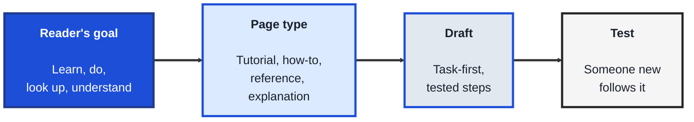
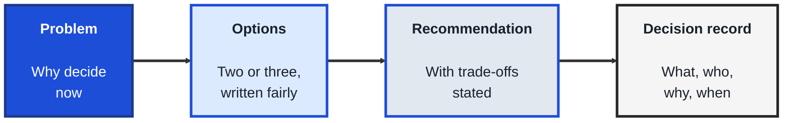
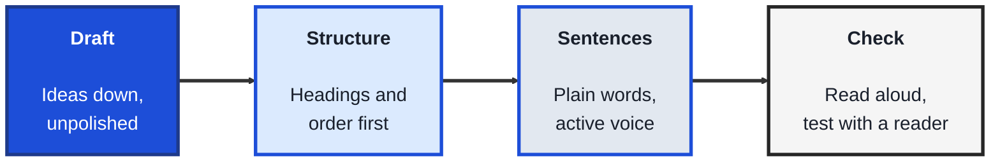

<!-- order: 4 -->
## Module 4: Technical Writing

Time: about 6 hours

**By the end of this module, you'll be able to:**
- Choose the right page type (tutorial, how-to, reference, explanation) for a reader's goal
- Write a how-to guide and a GitHub README, and revise them after watching someone follow them
- Write a decision document with fairly described options and a clear ask, plus a matching decision record
- Take meeting notes that capture only decisions and owned, dated action items
- Edit a page in passes (structure, then sentences) using plain language, active voice, and front-loading

**Purpose of this module:** Write documentation, decisions, and updates that people can actually use. Technical writers, project coordinators, and tech leads spend much of their week writing, and clear writing is often the fastest way a non-coder makes a technical team faster.

**Tools needed for this module:** A document tool (Google Docs, Notion, or any word processor) and a free [GitHub](https://github.com) account for the README lab. No coding required.

### Topic 4.1: Writing Documentation

#### Concept

Documentation is how a team's knowledge outlives any one person. Good documentation starts from the reader's task, not the writer's knowledge: someone arrives with a goal (install this, fix that, understand why), and the page exists to get them there. Different goals need different kinds of page, and mixing them is the most common reason documentation feels hard to use.

- A **tutorial** teaches a beginner by walking them through a complete, working example from start to finish
- A **how-to guide** gives the steps to complete one specific task, for a reader who already knows the basics
- A **reference** page lists facts to look up, such as settings, commands, or fields, organised for scanning rather than reading
- An **explanation** covers the why: background, design choices, and trade-offs
- A **README** is the front door of a project: what it is, who it's for, how to start, and where to get help

#### Structure at a Glance


- Before writing, name the reader and their goal in one sentence; if you can't, the page will wander
- Every set of steps should be tested by following it exactly, ideally by someone who didn't write it

#### Where you'd actually use this

A new team member spends two days getting a project running because setup lives in old chat messages. You write a README with a tested how-to for setup, and the next person is running it within an hour.

#### Lab

1. **Pick a real tool or process** you know well, such as submitting expenses, setting up an app, or running a meeting template.
2. **Write one sentence** naming the reader and the goal: "A new team member who needs to…"
3. **Write a how-to guide** for it: a short title that states the task, one line on prerequisites, then numbered steps, each starting with a verb.
4. **Create a GitHub repository** (on github.com, choose **New repository** and tick **Add a README file**), then edit `README.md` in the browser with the pencil icon and write four sections, each under a `## ` heading: what this is, who it's for, how to get started, and where to get help. Commit the change and check how it renders on the repository page.
5. **Have someone follow your how-to** without your help, and note every place they paused, asked a question, or went wrong. Revise those steps.

```lab
{
 "type": "sort",
 "title": "Which kind of page does the reader need?",
 "prompt": "Match each reader's goal to the page type that serves it.",
 "buckets": [
  "Tutorial",
  "How-to guide",
  "Reference",
  "Explanation"
 ],
 "items": [
  {
   "text": "\"I'm new. Walk me through building my first report from start to finish.\"",
   "bucket": "Tutorial",
   "why": "A beginner learning through a complete example."
  },
  {
   "text": "\"I know the tool. How do I reset a user's password?\"",
   "bucket": "How-to guide",
   "why": "One specific task for someone who knows the basics."
  },
  {
   "text": "\"What does the timeout setting accept?\"",
   "bucket": "Reference",
   "why": "A fact to look up."
  },
  {
   "text": "\"Why did we choose this vendor over the others?\"",
   "bucket": "Explanation",
   "why": "Background and reasons."
  }
 ]
}
```

#### Checkpoint
You have a tested how-to guide revised from a real reader's attempt, and a README with all four sections.

#### Quiz
1. What are the four kinds of documentation page, and what goal does each serve?
2. What should a README cover?
3. Why should documentation start from the reader's task?
4. What is the best way to check a set of steps?
5. Why does mixing page types make documentation harder to use?

*Answers: 1) Tutorials teach a beginner through a complete example; how-to guides complete one task; reference pages hold facts to look up; explanations cover the why. 2) What the project is, who it's for, how to get started, and where to get help. 3) Readers arrive with a goal, and the page exists to get them there, not to record everything the writer knows. 4) Have someone who didn't write them follow the steps exactly and note where they struggle. 5) A reader looking for one quick task has to dig through background, and a learner gets a list of facts instead of guidance.*

---

### Topic 4.2: Writing for Decisions

#### Concept

Teams make expensive decisions: which tool to buy, how to design a feature, whether to delay a launch. Written decision documents make those choices clearer, fairer, and easier to revisit, because everyone reviews the same options and reasons instead of whoever spoke last in a meeting.

- A **decision document** (also called a proposal or design doc) states the problem, the options, the criteria used to compare them, a recommendation, and the trade-offs
- A **decision record** is a short, dated note of what was decided, by whom, and why, kept so future readers don't reopen settled questions
- **Meeting notes** that matter capture decisions and action items (who does what, by when), not a transcript
- Writing **options fairly**, including the ones you don't recommend, builds trust and exposes weak reasoning
- A clear **ask** tells readers exactly what you need from them and by when: approval, feedback, or awareness

#### Structure at a Glance


- Put the recommendation and the ask near the top; busy readers may read only the first paragraph
- A decision without a written record tends to be re-argued within months

#### Where you'd actually use this

Your team keeps debating which project-tracking tool to adopt. A two-page decision document compares three tools against agreed criteria, gets approval in one review, and its decision record answers the question when a new manager asks six months later.

#### Lab

1. **Choose a real decision** your team, club, or organisation faces, or recently faced.
2. **Write a one-page decision document** with five headings: problem, options (at least two), criteria, recommendation, and the ask.
3. **Describe each option fairly**, including one real advantage of every option you don't recommend.
4. **Write the decision record** as if the decision was made: date, decision, decision-maker, and the main reasons, in under 150 words.
5. **Take notes at a real meeting** that record only decisions and action items, each action with an owner and a date.

#### Checkpoint
You have a decision document with fairly described options and a clear ask, a matching decision record, and one set of decision-focused meeting notes.

#### Quiz
1. What sections should a decision document include?
2. What is a decision record, and why keep one?
3. What should meeting notes capture?
4. Why describe options you don't recommend fairly?
5. Where should the recommendation and the ask go, and why?

*Answers: 1) The problem, the options, the criteria, a recommendation with trade-offs, and the ask. 2) A short, dated note of what was decided, by whom, and why; it stops settled questions being reopened. 3) Decisions and action items, each with an owner and a date. 4) It builds trust and exposes weak reasoning, and readers can check you've considered alternatives. 5) Near the top, because many readers only read the opening.*

---

### Topic 4.3: Editing for Clarity

#### Concept

First drafts are for getting ideas down; editing is where writing becomes useful. Clear technical writing uses plain words, short sentences, and a structure the reader can scan. Editing is a skill in its own right, and teams value people who can turn a confusing page into a clear one.

- **Plain language** uses the simplest word that is still accurate, and explains a technical term the first time it appears
- **Active voice** names who does what ("the system sends an email") instead of hiding it ("an email is sent")
- **Front-loading** puts the main point first in every section, paragraph, and sentence
- **Scannable structure** uses descriptive headings, short paragraphs, and numbered lists for steps
- A **style guide** records a team's choices (spelling, capitalisation, tone) so documents read consistently

#### Structure at a Glance


- Edit in passes: structure first, then paragraphs, then sentences; fixing commas on a page that needs reorganising wastes time
- Reading a draft aloud is one of the fastest ways to find sentences that are too long or unclear

#### Where you'd actually use this

An incident report is accurate but a wall of text, and managers miss the key risk. Rewritten with the impact in the first line, clear headings, and short paragraphs, it's read and acted on the same day.

#### Lab

1. **Find a real page** that's hard to read: product documentation, a policy, or an old document of your own.
2. **Edit the structure first:** write the page's main point in one sentence, put it at the top, and add descriptive headings.
3. **Edit the sentences:** replace jargon with plain words, turn passive sentences into active ones, and split any sentence over 25 words.
4. **Read the result aloud** and fix anything you stumble over.
5. **Write a five-rule style guide** for your team, based on the problems you fixed.

#### Checkpoint
You have a before-and-after version of a real page, edited in passes, and a five-rule style guide drawn from what you fixed.

#### Quiz
1. What is plain language?
2. Rewrite "The report was reviewed" in active voice.
3. What does front-loading mean?
4. Why edit in passes, starting with structure?
5. What is a style guide for?

*Answers: 1) Using the simplest accurate words, and explaining technical terms when they first appear. 2) For example, "The manager reviewed the report": the sentence names who did it. 3) Putting the main point first in each section, paragraph, and sentence. 4) Structure problems affect the whole page, so fixing sentences first can waste effort on text that later moves or disappears. 5) Recording a team's writing choices so every document reads consistently.*

```watch
{
 "scenes": [
  {
   "kind": "title",
   "art": "pencil",
   "kicker": "Module 4 · Technical writing",
   "title": "Writing people can use",
   "beats": [
    {
     "say": "Welcome to Module 4."
    },
    {
     "say": "Tech leads and coordinators spend much of their week writing, and clear writing is often the fastest way a non-coder makes a technical team faster."
    }
   ]
  },
  {
   "kind": "table",
   "kicker": "Topic 4.1 · Documentation",
   "title": "Start from the reader's goal",
   "columns": [
    "Reader asks",
    "Page type",
    "Serves"
   ],
   "rows": [
    [
     "I'm new: teach me",
     "Tutorial",
     "Learn by full example"
    ],
    [
     "Reset a password?",
     "How-to guide",
     "Do one task"
    ],
    [
     "Timeout accepts what?",
     "Reference",
     "Look up a fact"
    ],
    [
     "Why this vendor?",
     "Explanation",
     "Understand the why"
    ]
   ],
   "beats": [
    {
     "say": "Documentation starts from the reader's task. Here are four readers with different goals.",
     "col": 0
    },
    {
     "say": "A beginner wants a complete, working example. That's a tutorial.",
     "hl": 0,
     "dim": true,
     "col": 1
    },
    {
     "say": "Someone who knows the tool wants to reset a password. A how-to guide: steps for one task.",
     "hl": 1,
     "dim": true,
     "col": 1
    },
    {
     "say": "What does the timeout setting accept? A fact to look up: a reference page.",
     "hl": 2,
     "dim": true,
     "col": 1
    },
    {
     "say": "Why did we choose this vendor? An explanation: background and trade-offs.",
     "hl": 3,
     "dim": true,
     "col": 1
    },
    {
     "say": "One page, one goal. Mixing them is the most common reason documentation feels hard to use.",
     "sql": "One reader goal → one page type"
    }
   ]
  },
  {
   "kind": "diagram",
   "kicker": "Topic 4.1 · Documentation",
   "title": "Write it, then test it",
   "nodes": [
    {
     "id": "goal",
     "label": "Reader's goal",
     "sub": "one sentence",
     "x": 12,
     "y": 30,
     "art": "persona"
    },
    {
     "id": "type",
     "label": "Page type",
     "sub": "how-to guide",
     "x": 40,
     "y": 30,
     "art": "book"
    },
    {
     "id": "draft",
     "label": "Draft",
     "sub": "task-first steps",
     "x": 68,
     "y": 30,
     "art": "pencil"
    },
    {
     "id": "test",
     "label": "Test",
     "sub": "someone new follows it",
     "x": 86,
     "y": 76,
     "art": "people"
    }
   ],
   "edges": [
    {
     "from": "goal",
     "to": "type"
    },
    {
     "from": "type",
     "to": "draft"
    },
    {
     "from": "draft",
     "to": "test"
    },
    {
     "from": "test",
     "to": "draft"
    }
   ],
   "beats": [
    {
     "say": "First, name the reader and their goal in one sentence: a new team member who needs to submit expenses.",
     "show": 1,
     "on": "goal"
    },
    {
     "say": "That goal picks the page type. One specific task means a how-to guide.",
     "show": 2,
     "on": "type",
     "send": {
      "from": "goal",
      "to": "type",
      "label": "do one task"
     }
    },
    {
     "say": "Draft it task first: a title that states the task, one line of prerequisites, then numbered steps that each start with a verb.",
     "show": 3,
     "on": "draft",
     "send": {
      "from": "type",
      "to": "draft",
      "label": "title + steps"
     }
    },
    {
     "say": "Then someone who didn't write it follows it exactly, without your help.",
     "show": 4,
     "on": "test",
     "send": {
      "from": "draft",
      "to": "test",
      "label": "first try"
     }
    },
    {
     "say": "Every place they pause or go wrong, you revise.",
     "on": "draft",
     "send": {
      "from": "test",
      "to": "draft",
      "label": "pauses found"
     }
    }
   ]
  },
  {
   "kind": "walk",
   "kicker": "Lab · README",
   "title": "A README, section by section",
   "file": "README.md",
   "code": "# Expense Report Template\n\n## What this is\nA shared sheet that totals your receipts.\n\n## Who it's for\nTeam members claiming travel or supplies.\n\n## How to get started\n1. Copy the template to your Drive.\n2. Add one row per receipt.\n\n## Where to get help\nAsk in the #finance channel.",
   "beats": [
    {
     "say": "A read me is a project's front door. On GitHub, edit read me dot m d in the browser.",
     "line": 1
    },
    {
     "say": "Section one, under its own heading: what this is.",
     "line": [
      3,
      4
     ],
     "out": "✓ What this is"
    },
    {
     "say": "Section two: who it's for.",
     "line": [
      6,
      7
     ],
     "out": "✓ Who it's for"
    },
    {
     "say": "Section three: how to get started, as numbered steps that start with a verb.",
     "line": [
      9,
      11
     ],
     "out": "✓ How to get started"
    },
    {
     "say": "And section four: where to get help.",
     "line": [
      13,
      14
     ],
     "out": "✓ Where to get help"
    },
    {
     "say": "Commit the change, and check how the headings render on the repository page.",
     "out": "Committed · rendered on the repo page"
    }
   ]
  },
  {
   "kind": "table",
   "kicker": "Topic 4.2 · Writing for decisions",
   "title": "Options, written fairly",
   "columns": [
    "Option",
    "Real advantage",
    "Trade-off"
   ],
   "rows": [
    [
     "Tool A",
     "Cheapest",
     "Few integrations"
    ],
    [
     "Tool B",
     "Team already knows it",
     "Basic reporting"
    ],
    [
     "Tool C",
     "Best reporting",
     "Highest cost"
    ]
   ],
   "beats": [
    {
     "say": "Your team keeps debating which project tracking tool to adopt. A decision document settles it.",
     "sql": "Problem: we track work in three places,\nand keep re-arguing which tool to use."
    },
    {
     "say": "First the problem, then the options. Here are three made-up tools.",
     "sql": "Problem: we track work in three places,\nand keep re-arguing which tool to use.",
     "col": 0
    },
    {
     "say": "Give each one a real advantage, even the ones you don't recommend.",
     "col": 1
    },
    {
     "say": "And name each trade-off. Fair options build trust.",
     "col": 2
    },
    {
     "say": "Compare them on the criteria you agreed, then recommend one, with its trade-off stated.",
     "sql": "Criteria: cost · learning curve · reporting\nRecommendation: Tool B (trade-off: basic reporting)",
     "hl": 1,
     "dim": true
    },
    {
     "say": "Then the ask: what you need, by when. Put both near the top; busy readers may stop after one paragraph.",
     "sql": "Ask: approve Tool B by Friday",
     "hl": 1,
     "dim": true
    }
   ]
  },
  {
   "kind": "table",
   "kicker": "Topic 4.2 · Writing for decisions",
   "title": "Notes that record decisions",
   "columns": [
    "Raw note",
    "Keep?",
    "Why"
   ],
   "rows": [
    [
     "Sam said C looks slow",
     "Drop",
     "Chatter, not decision"
    ],
    [
     "Adopt Tool B",
     "Keep",
     "A decision"
    ],
    [
     "Someone will train us",
     "Fix",
     "No owner, no date"
    ],
    [
     "Ana trains team, 6 Nov",
     "Keep",
     "Owner + date"
    ]
   ],
   "beats": [
    {
     "say": "Useful meeting notes aren't a transcript. Let's filter four raw notes."
    },
    {
     "say": "Sam said Tool C looks slow. That's chatter, not a decision. Drop it.",
     "hl": 0,
     "dim": true,
     "col": 1
    },
    {
     "say": "Adopt Tool B. That's a decision. Keep it.",
     "hl": 1,
     "dim": true,
     "col": 1
    },
    {
     "say": "Someone will train us. An action, but with no owner and no date, it won't happen. Fix it.",
     "hl": 2,
     "dim": true,
     "col": 2
    },
    {
     "say": "Fixed: Ana trains the team by the sixth of November. An owner, and a date.",
     "hl": 3,
     "dim": true,
     "col": 2
    },
    {
     "say": "Then a decision record: dated, what was decided, by whom, and why. Without one, decisions get re-argued.",
     "sql": "Decision record · 3 Oct\nAdopt Tool B · decided by the team lead\nWhy: team already knows it, lowest switching cost",
     "hl": [
      1,
      3
     ],
     "dim": true
    }
   ]
  },
  {
   "kind": "array",
   "kicker": "Topic 4.3 · Editing for clarity",
   "title": "Edit in passes: structure first",
   "values": [
    "Timeline",
    "Background",
    "Root cause",
    "Impact",
    "Next steps"
   ],
   "beats": [
    {
     "say": "Here's an incident report draft. Accurate, but its sections run in the order things happened.",
     "note": "Draft order"
    },
    {
     "say": "The key point, the impact, is buried fourth. Managers will miss it.",
     "hl": 3,
     "ptr": {
      "main point": 3
     },
     "note": "Main point buried"
    },
    {
     "say": "Structure pass: front-load. Write the main point in one sentence, and move it to the top.",
     "vals": [
      "Impact",
      "Root cause",
      "Next steps",
      "Timeline",
      "Background"
     ],
     "hl": 0,
     "ptr": {
      "main point": 0
     },
     "note": "Structure pass: main point first"
    },
    {
     "say": "The background section adds nothing the reader needs, so it goes.",
     "vals": [
      "Impact",
      "Root cause",
      "Next steps",
      "Timeline",
      "Background"
     ],
     "ok": [
      0,
      1,
      2,
      3
     ],
     "gone": 4,
     "note": "Structure pass: cut what the reader doesn't need"
    },
    {
     "say": "Polish its commas first, and that effort is wasted. So structure comes before sentences.",
     "gone": 4,
     "note": "Then paragraphs, then sentences"
    }
   ]
  },
  {
   "kind": "table",
   "kicker": "Topic 4.3 · Editing for clarity",
   "title": "One sentence, edited pass by pass",
   "columns": [
    "Pass",
    "What changed",
    "Words"
   ],
   "rows": [
    [
     "Draft",
     "—",
     "33"
    ],
    [
     "Active voice",
     "The team does it",
     "25"
    ],
    [
     "Plain words",
     "Cut 'utilisation of'",
     "22"
    ],
    [
     "Front-load",
     "Impact first, split",
     "8 + 12"
    ]
   ],
   "beats": [
    {
     "say": "Now the sentence pass. Here's the opening sentence of that report: thirty three words, in one breath.",
     "sql": "Following an investigation that was carried out by the team, it was\ndetermined that the utilisation of an expired certificate caused the\noutage, which meant customers could not log in for two hours.",
     "hl": 0,
     "dim": true
    },
    {
     "say": "Active voice names who does what. It was determined becomes: the team investigated and found.",
     "sql": "The team investigated and found that the utilisation of an expired\ncertificate caused the outage, which meant customers could not log in\nfor two hours.",
     "hl": 1,
     "dim": true,
     "col": 1
    },
    {
     "say": "Plain language uses the simplest accurate words. The utilisation of adds nothing, so it goes.",
     "sql": "The team investigated and found that an expired certificate\ncaused the outage, which meant customers could not log in for two hours.",
     "hl": 2,
     "dim": true,
     "col": 1
    },
    {
     "say": "Front-load: the impact on customers comes first, as its own short sentence.",
     "sql": "Customers could not log in for two hours.\nThe team investigated and found that an expired certificate\ncaused the outage.",
     "hl": 3,
     "dim": true,
     "col": 1
    },
    {
     "say": "From thirty three words to two sentences of eight and twelve. Read it aloud: no stumbles.",
     "sql": "Customers could not log in for two hours.\nThe team investigated and found that an expired certificate\ncaused the outage.",
     "hl": [
      0,
      3
     ],
     "dim": true,
     "col": 2
    },
    {
     "say": "Turn what you fixed into a five-rule style guide, so your team's pages read consistently.",
     "sql": "Style guide: active voice · plain words · main point first\n· split sentences over 25 words · read it aloud"
    }
   ]
  },
  {
   "kind": "quiz",
   "art": "ask",
   "kicker": "Quick check",
   "title": "Why edit in passes, starting with structure?",
   "options": [
    "Headings matter more than sentences",
    "Fixing sentences first can waste effort on text that later moves or disappears",
    "A style guide requires it"
   ],
   "answer": 1,
   "good": "That's right. Structure problems affect the whole page, so polishing sentences first can waste effort on text that later moves or disappears.",
   "bad": "Not quite. Structure problems affect the whole page, so polishing sentences first can waste effort on text that later moves or disappears.",
   "beats": [
    {
     "say": "Quick check.",
     "show": 0
    },
    {
     "say": "Why edit in passes, starting with structure?",
     "show": 0
    },
    {
     "say": "Tap your answer.",
     "show": 1
    }
   ]
  },
  {
   "kind": "list",
   "art": "proof",
   "kicker": "Checkpoint",
   "title": "You're done when",
   "items": [
    [
     "A tested, revised how-to guide",
     ""
    ],
    [
     "A README with four sections",
     ""
    ],
    [
     "A decision document with a clear ask",
     ""
    ],
    [
     "A decision record + meeting notes",
     ""
    ],
    [
     "A page edited in passes + style guide",
     ""
    ]
   ],
   "beats": [
    {
     "say": "That's Module 4.",
     "show": 0
    },
    {
     "say": "You're done when:",
     "show": 0
    },
    {
     "say": "you've written a how-to guide and revised it after watching someone follow it,",
     "show": 1
    },
    {
     "say": "you've written a read me with all four sections,",
     "show": 2
    },
    {
     "say": "you've written a decision document with fair options and a clear ask,",
     "show": 3
    },
    {
     "say": "you've written a decision record and decision-focused meeting notes,",
     "show": 4
    },
    {
     "say": "and you've edited a real page in passes and written a five-rule style guide.",
     "show": 5
    },
    {
     "say": "Next, in Module 5, research for tech teams.",
     "show": 5
    }
   ]
  }
 ]
}
```

---

## Module 4 Completion Checklist
- [ ] Written a how-to guide and revised it after watching someone follow it
- [ ] Written a README with all four sections
- [ ] Written a decision document with fairly described options and a clear ask
- [ ] Written a decision record and decision-focused meeting notes
- [ ] Edited a real page in passes and written a five-rule style guide
