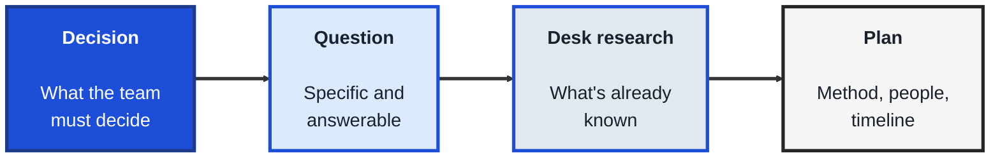
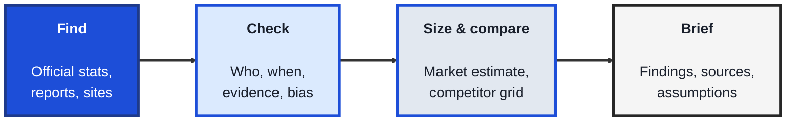
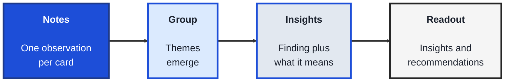

<!-- order: 5 -->
## Module 5: Research for Tech Teams

Time: about 6.5 hours

**By the end of this module, you'll be able to:**
- Write a research question that is specific, answerable, and tied to a decision
- Write a one-page research plan
- Find sources and judge their credibility (who, when, evidence, bias), and cite them properly
- Make a simple top-down and bottom-up market sizing estimate with stated assumptions
- Compare competitors in a grid and write a one-page desk-research brief
- Use affinity mapping to turn notes into evidence-backed insights and recommendations, and share them in a one-page readout

**Purpose of this module:** Find reliable answers to the questions teams make decisions on: what users need, what competitors do, and whether a change worked. Research roles, product coordinators, and analysts all need these skills, and none of them require code.

**Tools needed for this module:** A web browser, a document tool, and a spreadsheet (Google Sheets or Excel). No coding required.

This module focuses on desk research for business decisions. For interviews and surveys, take the User Research course in the Product / Project Owner (TechPO) track, which covers them in depth.

### Topic 5.1: Framing Research Questions

#### Concept

Good research starts with a good question. "What do users think?" produces a pile of opinions; "Why do new users stop before finishing sign-up?" produces answers a team can act on. Framing the question well, and checking what's already known, saves weeks of collecting the wrong information.

- A **research question** is specific, answerable, and tied to a decision the team needs to make
- **Desk research** (also called secondary research) reviews what already exists: reports, analytics, support tickets, competitor sites, and past studies
- **Primary research** collects new information directly, through interviews, surveys, or observation (covered in the TechPO track's User Research course)
- **Qualitative** research explores why and how, with words and observations; **quantitative** research measures how many and how much, with numbers
- A **research plan** records the question, the decision it informs, the method, who you'll learn from, and the timeline

#### Structure at a Glance


- If no decision depends on the answer, the research is probably not worth doing yet
- Desk research first often answers part of the question for free, and sharpens the rest; Topic 5.2 shows how to do it well

#### Where you'd actually use this

A team plans to redesign onboarding because "users find it confusing". Framing the real question, where exactly do new users drop off and why, and checking analytics first shows most leave at one identity-check step, so research focuses there.

#### Lab

1. **Name a real decision** a team or organisation you know needs to make.
2. **Write three research questions** for it, then rewrite each until it's specific, answerable, and tied to the decision. Keep the strongest one.
3. **Do 30 minutes of desk research:** collect at least three existing sources on the question, noting what each tells you and how reliable it is.
4. **Choose a method** (qualitative, quantitative, or both) and write one sentence on why it fits the question.
5. **Write a one-page research plan** covering the question, the decision, the method, who you'll learn from, and the timeline.

#### Checkpoint
You have a sharpened research question tied to a real decision, notes from three existing sources, and a one-page research plan.

#### Quiz
1. What makes a good research question?
2. What is desk research, and why do it first?
3. What is the difference between qualitative and quantitative research?
4. What goes into a research plan?
5. Why tie research to a decision?

*Answers: 1) It's specific, answerable, and tied to a decision the team needs to make. 2) Reviewing information that already exists; it often answers part of the question for free and sharpens the rest. 3) Qualitative explores why and how through words and observation; quantitative measures how many and how much with numbers. 4) The question, the decision it informs, the method, who you'll learn from, and the timeline. 5) So the findings change what the team does, rather than producing interesting facts nobody uses.*

---

### Topic 5.2: Desk Research: Markets, Competitors and Sources

#### Concept

Many business decisions (enter a new city, launch a program, pick a partner, price a service) can be answered largely by **desk research**: finding, checking, and combining information that already exists. It's fast, cheap, and the research non-technical team members do most often. The skill is knowing where to look, how much to trust what you find, and how to turn scattered facts into a clear, honest estimate.

**Secondary vs primary research.** Secondary (desk) research uses information someone else already collected. Primary research collects new information yourself, mainly through interviews and surveys. Do secondary research first: it tells you what's already known and which gaps are worth the time of primary research. Interviews and surveys are covered in depth in the Product / Project Owner (TechPO) track's "User Research" course, so this topic focuses on desk research.

- A **primary source** is original evidence: an official dataset, a survey's raw results, an organisation's own annual report, a law or policy document. A **secondary source** describes or interprets primary sources: news articles, blog posts, summaries, and many industry reports. When a secondary source quotes a number, try to find the primary source it came from
- **Official statistics** come from government agencies (for example, a national statistics office such as the US Census Bureau or the UK Office for National Statistics, or a labour statistics agency). They're usually the most reliable starting point for population, income, education, and employment figures
- **Reports** from universities, nonprofits, industry bodies, and companies are useful, but check who paid for them and why
- A **credibility check** asks four questions of every source: **Who** wrote it, and are they in a position to know? **When** was it published, and is it still current? **Evidence**: does it show where its numbers come from? **Bias**: is the author selling something or arguing for a position?
- **Citing sources** means recording, for every fact you use, the author or organisation, the title, the year, a link, and the date you accessed it, so anyone can check your work

**Market sizing** estimates how many people (or how much money) a decision involves. There are two main approaches, and doing both is a good cross-check:

- **Top-down** starts with a big published number (such as a city's population) and narrows it with percentages until you reach your target group
- **Bottom-up** starts from things you can count or control (partners, events, staff capacity) and multiplies up
- Every estimate rests on **assumptions**. Write each one down, say where it came from, and mark which ones are guesses. A sizing with hidden assumptions can't be checked or improved

**Worked example (all numbers are illustrative, not real data).** A nonprofit is deciding whether to launch a free tech mentoring program in a new city and wants to know roughly how many mentees it could serve in year one.

Top-down:

| Step | Assumption | Source (in a real brief) | Result |
|---|---|---|---|
| City population | 600,000 people | Official statistics | 600,000 |
| Share aged 18 to 34 | 25% | Official statistics | 150,000 |
| Share interested in a tech career | 10% | Guess: check against a report | 15,000 |
| Share who would join a free program in year one | 2% | Guess: based on similar programs | about 300 |

Bottom-up:

| Step | Assumption | Source (in a real brief) | Result |
|---|---|---|---|
| Partner colleges and bootcamps | 4 partners | Conversations with partners | 4 |
| Info sessions per partner per year | 4 sessions | Our plan | 16 sessions |
| Attendees per session | 40 people | Past events in our current city | 640 people reached |
| Share who sign up | 25% | Past events in our current city | 160 sign-ups |
| Mentor capacity | 30 mentors, 3 mentees each | Our volunteer pipeline | 90 places |

The two estimates (about 300 and about 160) are in the same rough range, which is reassuring. But the bottom-up view reveals the real limit: with 90 mentor places, **mentor recruitment**, not mentee demand, decides how big year one can be. That's the kind of insight a sizing is for. Notice that the final numbers are only as good as the guesses: a brief should say so plainly.

**Competitor analysis** looks at who already serves the same people. A **comparison grid** puts competitors in rows and the same questions in columns, so differences are easy to see. The example below uses made-up organisations:

| Option | Key features | Pricing model | Audience | Strengths | Weaknesses |
|---|---|---|---|---|---|
| Local tech meetup group | Monthly talks, networking | Free, sponsor-funded | Working developers | Strong local network | Little structured support for beginners |
| National online mentoring platform | 1:1 video mentoring, matching | Monthly subscription | Career changers | Large mentor pool | Cost; no in-person community |
| University career centre | Career advice, job fairs | Free to enrolled students | Current students | Trusted, well-resourced | Not open to non-students |

- Include **indirect** competitors and alternatives (doing nothing, YouTube, a friend who works in tech), not just organisations that look like you
- The goal is to find a **gap**: in this grid, nobody offers free, structured, in-person mentoring open to non-students

#### Structure at a Glance


- A number without a source and a date is an opinion; treat it that way until you can trace it
- When desk research can't answer something (for example, why people drop out of programs), that's your cue for primary research

#### Where you'd actually use this

A board asks whether to open a second chapter in a nearby city. In two days, a program coordinator pulls official population figures, two sector reports, and the websites of four local organisations, then writes a one-page brief: an estimated demand range with its assumptions, a competitor grid showing an unmet need for evening sessions, and a clear list of what still needs checking. The board approves a small pilot instead of a full launch.

#### Lab

Scenario: a nonprofit (similar to a community tech-learning organisation such as She Model Tech) is deciding whether to launch a free mentoring program for people starting tech careers in a new city. Pick a real city you can research.

1. **Write the decision and question** at the top of a document, for example "Should we launch a mentoring program in [city] next year? How many people might we serve, and who already serves them?"
2. **Find at least five sources**, including at least one official statistics source and at least one report. For each, note whether it's primary or secondary and run the credibility check (who, when, evidence, bias) in one line.
3. **Do a top-down and a bottom-up estimate** in a spreadsheet, with one row per assumption, the source for each, and a clear "guess" label on any assumption you couldn't source. Write one sentence comparing the two results.
4. **Build a competitor grid** of at least three existing options (including one indirect alternative) with columns for key features, pricing model, audience, strengths, and weaknesses. Name one gap.
5. **Write a one-page desk-research brief** with: the decision and question; three to five key findings; your sizing range; the competitor grid (or its summary); a "stated assumptions" list; a "still unknown" list (questions that need primary research); and a source list with author or organisation, title, year, link, and date accessed.

```lab
{
 "type": "sort",
 "title": "Primary or secondary source?",
 "prompt": "Sort each source by whether it is original evidence or someone describing other evidence.",
 "buckets": [
  "Primary source",
  "Secondary source"
 ],
 "items": [
  {
   "text": "A national statistics office's population table for the city",
   "bucket": "Primary source",
   "why": "The agency collected the data itself."
  },
  {
   "text": "A news article quoting that population figure",
   "bucket": "Secondary source",
   "why": "It reports someone else's data; trace it back to the table."
  },
  {
   "text": "A local nonprofit's own annual report on how many people it served",
   "bucket": "Primary source",
   "why": "Original figures from the organisation, though it may present itself favourably."
  },
  {
   "text": "A blog post summarising several industry reports",
   "bucket": "Secondary source",
   "why": "It interprets other sources; check the originals before relying on it."
  },
  {
   "text": "A competitor's pricing page",
   "bucket": "Primary source",
   "why": "Direct evidence of what they charge today; note the date you checked it."
  }
 ]
}
```

#### Checkpoint
You have a one-page desk-research brief for the mentoring scenario with a credibility-checked source list, a top-down and bottom-up estimate with stated assumptions, a competitor grid, and a list of questions that still need primary research.

#### Quiz
1. What is the difference between secondary and primary research, and why do secondary research first?
2. What four questions make up a simple credibility check for a source?
3. What is the difference between a top-down and a bottom-up market sizing estimate?
4. Why must every assumption in a sizing estimate be written down and sourced or labelled as a guess?
5. What does a competitor comparison grid help you find?

*Answers: 1) Secondary research uses information others already collected, primary research collects new information such as interviews and surveys; secondary comes first because it is cheaper and shows which gaps are worth primary research. 2) Who wrote it, when it was published, what evidence it shows, and whether the author has a bias or something to sell. 3) Top-down starts from a large published number and narrows it with percentages; bottom-up starts from things you can count or control and multiplies up. 4) So others can check and improve the estimate, and so decision-makers know which parts are facts and which are guesses. 5) How existing options differ on the same criteria, and where there is a gap that is not being served.*

---

### Topic 5.3: Synthesising and Sharing Findings

#### Concept

Raw notes aren't findings. Synthesis turns what you heard and measured into a small number of clear insights, backed by evidence, that a team can act on. Sharing them well matters as much as finding them: research nobody reads changes nothing.

- **Affinity mapping** groups individual observations (one per sticky note or card) into themes, so patterns emerge from the data
- An **insight** is a finding plus what it means, such as "Users skip the tutorial because they want to try the product first, so key tips should appear in context"
- **Evidence** such as quotes and numbers should support every insight, with how many participants it applies to
- A **recommendation** turns an insight into a suggested action the team can take
- A **research readout** shares the question, the method, three to five insights, and recommendations, in that order

#### Structure at a Glance


- Report how many people each finding applies to; "4 of 6 participants" is more honest than "users"
- Keep the readout short; link the full notes for anyone who wants detail

#### Where you'd actually use this

After eight interviews, affinity mapping shows three clear themes. The readout leads with the biggest one, backed by quotes from five participants, and the team changes its next sprint plan the same week.

#### Lab

1. **Write each observation** from your Topic 5.1 sources and Topic 5.2 desk-research brief on its own card or sticky note (a free online whiteboard works too). If you've run interviews or surveys in the TechPO User Research course, add those notes too.
2. **Group the cards into themes** without deciding the themes in advance, then name each group.
3. **Write three insights** in the form "finding, so implication", each supported by evidence: a cited source, a number, or a quote, with how many sources (or participants) it rests on. Where an insight depends on a guessed assumption, say so and label it as something to check with primary research.
4. **Turn each insight into one recommendation** the team could act on.
5. **Create a one-page readout** with the question, the method, your three insights with evidence, and your recommendations.

#### Checkpoint
You have themes built from your own research notes, three evidence-backed insights with recommendations, and a one-page readout.

#### Quiz
1. What is affinity mapping?
2. What is the difference between a finding and an insight?
3. Why include the number of participants with each finding?
4. What does a research readout contain, and in what order?
5. Why keep the readout short?

*Answers: 1) Grouping individual observations into themes so patterns emerge from the data. 2) A finding is what you observed; an insight adds what it means for the team. 3) It shows how widespread the finding is, which is more honest than generalising to all users. 4) The question, the method, three to five insights, and recommendations, in that order. 5) Short readouts get read and acted on; full notes can be linked for detail.*

```watch
{
 "scenes": [
  {
   "kind": "title",
   "art": "search",
   "kicker": "Module 5 · Research for tech teams",
   "title": "Find answers you can trust",
   "beats": [
    {
     "say": "Welcome to Module 5."
    },
    {
     "say": "This module is about desk research for business decisions: what users need, what competitors do, and whether a change worked. No code required."
    }
   ]
  },
  {
   "kind": "table",
   "kicker": "Topic 5.1 · Framing questions",
   "title": "Sharpen the question",
   "columns": [
    "Question",
    "Specific",
    "Answerable",
    "Tied to decision"
   ],
   "rows": [
    [
     "What do users think?",
     "✗",
     "✗",
     "✗"
    ],
    [
     "Onboarding confusing?",
     "✗",
     "Partly",
     "✓"
    ],
    [
     "Where's the drop-off?",
     "✓",
     "✓",
     "✓"
    ],
    [
     "Why quit at that step?",
     "✓",
     "✓",
     "✓"
    ]
   ],
   "beats": [
    {
     "say": "Good research starts with a decision. This team is about to redesign onboarding.",
     "sql": "Decision: redesign onboarding?"
    },
    {
     "say": "What do users think? That produces a pile of opinions. It fails all three tests.",
     "hl": 0,
     "dim": true
    },
    {
     "say": "Is onboarding confusing? Tied to the decision, but vague. Confusing where?",
     "hl": 1,
     "dim": true,
     "col": 1
    },
    {
     "say": "Sharper: where exactly do new users drop off? Desk research first: the analytics already answer it, for free.",
     "sql": "Decision: redesign onboarding?\nDesk research · analytics: most leave at the identity-check step",
     "hl": 2,
     "dim": true,
     "col": 3
    },
    {
     "say": "That sharpens the rest: why do they quit at that step? Specific, answerable, and tied to the decision.",
     "hl": 3,
     "dim": true,
     "col": 3
    },
    {
     "say": "Where, and how many, is quantitative. Why is qualitative. Write the question, decision, method, people and timeline into a one-page plan.",
     "sql": "Plan: question · decision · method · who · timeline",
     "hl": [
      2,
      3
     ],
     "dim": true
    }
   ]
  },
  {
   "kind": "table",
   "kicker": "Topic 5.2 · Desk research",
   "title": "Check every source",
   "columns": [
    "Source",
    "Type",
    "Credibility note"
   ],
   "rows": [
    [
     "Stats office table",
     "Primary",
     "Who: collected it"
    ],
    [
     "News article quote",
     "Secondary",
     "Evidence: trace it"
    ],
    [
     "Nonprofit report",
     "Primary",
     "Bias: may flatter"
    ],
    [
     "Blog summary",
     "Secondary",
     "Check the originals"
    ],
    [
     "Competitor pricing",
     "Primary",
     "When: date you checked"
    ]
   ],
   "beats": [
    {
     "say": "A nonprofit is deciding whether to launch a free mentoring program in a new city. Here are five sources it found.",
     "col": 0
    },
    {
     "say": "Primary sources are original evidence. Secondary sources describe someone else's.",
     "col": 1
    },
    {
     "say": "Every source gets four questions: who, when, evidence, and bias.",
     "sql": "Who? · When? · Evidence? · Bias?",
     "col": 2
    },
    {
     "say": "Who: the statistics office collected the population figures itself, so it's in a position to know.",
     "hl": 0,
     "dim": true,
     "col": 2
    },
    {
     "say": "Evidence: a news article quoting that figure is secondary. Trace the number back to the table.",
     "hl": [
      1,
      0
     ],
     "dim": true,
     "col": 2
    },
    {
     "say": "Bias: a nonprofit's own report is original, but may present itself favourably.",
     "hl": 2,
     "dim": true,
     "col": 2
    },
    {
     "say": "When: a pricing page changes, so note the date you checked it.",
     "hl": 4,
     "dim": true,
     "col": 2
    },
    {
     "say": "Cite every fact with author, title, year, link, and date accessed. A number without a source and a date is an opinion.",
     "sql": "Cite: author · title · year · link · date accessed"
    }
   ]
  },
  {
   "kind": "table",
   "kicker": "Worked example · Top-down",
   "title": "Narrow a big number",
   "columns": [
    "Step",
    "Assumption",
    "Result"
   ],
   "rows": [
    [
     "City population",
     "600,000 (stats)",
     "600,000"
    ],
    [
     "Aged 18 to 34",
     "25% (stats)",
     "150,000"
    ],
    [
     "Interested in tech",
     "10% (guess)",
     "15,000"
    ],
    [
     "Join in year one",
     "2% (guess)",
     "about 300"
    ]
   ],
   "beats": [
    {
     "say": "How many mentees could year one serve? These numbers are illustrative, not real data.",
     "sql": "Illustrative numbers only"
    },
    {
     "say": "Top-down starts with a big published number: a city of six hundred thousand.",
     "hl": 0,
     "dim": true,
     "col": 2,
     "sql": "600,000 people"
    },
    {
     "say": "Official statistics say twenty five percent are aged eighteen to thirty four: a hundred and fifty thousand.",
     "hl": 1,
     "dim": true,
     "col": 2,
     "sql": "600,000 × 25% = 150,000"
    },
    {
     "say": "Ten percent interested in a tech career: fifteen thousand. That's a guess, so label it.",
     "hl": 2,
     "dim": true,
     "col": 1,
     "sql": "150,000 × 10% = 15,000"
    },
    {
     "say": "Two percent join a free program in year one: about three hundred. Another guess.",
     "hl": 3,
     "dim": true,
     "col": 1,
     "sql": "15,000 × 2% = 300"
    },
    {
     "say": "Two of four assumptions are guesses. The result is only as good as they are, and the brief should say so.",
     "hl": [
      2,
      3
     ],
     "dim": true,
     "col": 1,
     "sql": "Top-down ≈ 300 · rests on 2 guesses"
    }
   ]
  },
  {
   "kind": "array",
   "kicker": "Worked example · Bottom-up",
   "title": "Multiply up from what you control",
   "values": [
    "4 partners",
    "16 sessions",
    "640 reached",
    "160 sign-ups",
    "90 places"
   ],
   "beats": [
    {
     "say": "Bottom-up starts from things you can count. Four partner colleges and bootcamps.",
     "hl": 0,
     "ptr": {
      "step": 0
     },
     "note": "Source: conversations with partners"
    },
    {
     "say": "Four info sessions per partner per year: sixteen sessions.",
     "hl": 1,
     "ptr": {
      "step": 1
     },
     "ok": [
      0
     ],
     "note": "4 × 4 = 16"
    },
    {
     "say": "Forty people per session, from past events: six hundred and forty reached.",
     "hl": 2,
     "ptr": {
      "step": 2
     },
     "ok": [
      0,
      1
     ],
     "note": "16 × 40 = 640"
    },
    {
     "say": "Twenty five percent sign up: a hundred and sixty.",
     "hl": 3,
     "ptr": {
      "step": 3
     },
     "ok": [
      0,
      1,
      2
     ],
     "note": "640 × 25% = 160"
    },
    {
     "say": "But thirty mentors with three mentees each gives only ninety places.",
     "hl": 4,
     "ptr": {
      "step": 4
     },
     "ok": [
      0,
      1,
      2,
      3
     ],
     "note": "30 × 3 = 90"
    },
    {
     "say": "Three hundred top-down, a hundred and sixty bottom-up: the same rough range, which is reassuring.",
     "hl": 3,
     "note": "Top-down ≈ 300 · bottom-up 160"
    },
    {
     "say": "And the real limit shows up: mentor recruitment, not mentee demand, decides how big year one can be.",
     "hl": 4,
     "ptr": {
      "limit": 4
     },
     "note": "90 places → recruit mentors first"
    }
   ]
  },
  {
   "kind": "table",
   "kicker": "Topic 5.2 · Desk research",
   "title": "The competitor grid: find the gap",
   "columns": [
    "Option",
    "Pricing",
    "Audience",
    "Weakness"
   ],
   "rows": [
    [
     "Local meetup",
     "Free, sponsor-funded",
     "Working developers",
     "Little beginner help"
    ],
    [
     "Online platform",
     "Monthly subscription",
     "Career changers",
     "Cost; not in person"
    ],
    [
     "University centre",
     "Free to students",
     "Current students",
     "Students only"
    ],
    [
     "YouTube / a friend",
     "Free",
     "Anyone",
     "No structure"
    ]
   ],
   "beats": [
    {
     "say": "A competitor grid puts options in rows, and the same questions in columns. These organisations are made up."
    },
    {
     "say": "Include indirect alternatives too, like YouTube, or a friend who works in tech.",
     "hl": 3,
     "dim": true
    },
    {
     "say": "Now look for the gap. Which options are free? Three of them.",
     "sql": "Free?",
     "hl": [
      0,
      2,
      3
     ],
     "dim": true,
     "col": 1
    },
    {
     "say": "Which of those are open to non-students? The university centre drops out.",
     "sql": "Free? → open to non-students?",
     "hl": [
      0,
      3
     ],
     "dim": true,
     "col": 2
    },
    {
     "say": "Do either give beginners structured, in-person mentoring? The meetup offers little beginner support, and YouTube has no structure.",
     "sql": "Free? → open to non-students? → structured mentoring?",
     "hl": [
      0,
      3
     ],
     "dim": true,
     "col": 3
    },
    {
     "say": "So nobody offers free, structured, in-person mentoring open to non-students. That's the gap.",
     "sql": "Gap: free · structured · in person · open to non-students"
    }
   ]
  },
  {
   "kind": "chart",
   "kicker": "Topic 5.3 · Synthesis",
   "title": "Affinity mapping: let themes emerge",
   "xlabel": "",
   "ylabel": "",
   "points": [
    [
     15,
     75
    ],
    [
     25,
     85
    ],
    [
     20,
     62
    ],
    [
     30,
     72
    ],
    [
     70,
     82
    ],
    [
     80,
     72
    ],
    [
     74,
     64
    ],
    [
     45,
     25
    ],
    [
     58,
     20
    ]
   ],
   "beats": [
    {
     "say": "Raw notes aren't findings. Write each observation from your sources on its own card: nine cards from six sources.",
     "groups": [
      0,
      0,
      0,
      0,
      0,
      0,
      0,
      0,
      0
     ]
    },
    {
     "say": "Group them without deciding the themes in advance. Four cards say daytime sessions don't fit working adults.",
     "groups": [
      1,
      1,
      1,
      1,
      0,
      0,
      0,
      0,
      0
     ]
    },
    {
     "say": "Three cards say cost keeps people away.",
     "groups": [
      1,
      1,
      1,
      1,
      2,
      2,
      2,
      0,
      0
     ]
    },
    {
     "say": "Two cards say people want to meet in person.",
     "groups": [
      1,
      1,
      1,
      1,
      2,
      2,
      2,
      3,
      3
     ]
    },
    {
     "say": "Then name each group. Three themes, and their sizes already hint at which matters most.",
     "groups": [
      1,
      1,
      1,
      1,
      2,
      2,
      2,
      3,
      3
     ]
    }
   ]
  },
  {
   "kind": "table",
   "kicker": "Topic 5.3 · Synthesis",
   "title": "From themes to a readout",
   "columns": [
    "Theme",
    "Evidence",
    "Recommendation"
   ],
   "rows": [
    [
     "Daytime doesn't fit",
     "4 of 6 sources",
     "Run evening sessions"
    ],
    [
     "Cost keeps people out",
     "3 of 6 sources",
     "Keep it free"
    ],
    [
     "Want in person",
     "2 of 6 sources",
     "Check: interviews"
    ]
   ],
   "beats": [
    {
     "say": "Each theme becomes an insight: a finding, plus what it means.",
     "col": 0
    },
    {
     "say": "Working adults can't attend daytime sessions, so schedule evenings first.",
     "sql": "Insight: working adults can't attend daytime sessions,\nso schedule evenings first.",
     "hl": 0,
     "dim": true
    },
    {
     "say": "Back every insight with evidence, and say how many it rests on. Four of six sources is more honest than everyone.",
     "hl": 0,
     "dim": true,
     "col": 1
    },
    {
     "say": "Turn each insight into one recommendation the team can act on.",
     "col": 2
    },
    {
     "say": "The in-person theme rests on only two sources, so label it as something to check with primary research.",
     "hl": 2,
     "dim": true,
     "col": 2
    },
    {
     "say": "Then share a short readout: the question, the method, your insights, and recommendations, in that order. Link the full notes.",
     "sql": "Readout: question → method → insights → recommendations"
    }
   ]
  },
  {
   "kind": "quiz",
   "art": "ask",
   "kicker": "Quick check",
   "title": "What's the difference between a top-down and a bottom-up market sizing estimate?",
   "options": [
    "Top-down narrows a big published number with percentages; bottom-up multiplies up from things you can count",
    "Top-down uses guesses; bottom-up uses only facts",
    "They're two names for the same method"
   ],
   "answer": 0,
   "good": "That's right. Top-down starts from a large published number and narrows it; bottom-up starts from things you can count or control and multiplies up.",
   "bad": "Not quite. Top-down starts from a large published number and narrows it; bottom-up starts from things you can count or control and multiplies up.",
   "beats": [
    {
     "say": "Quick check.",
     "show": 0
    },
    {
     "say": "What's the difference between a top-down and a bottom-up market sizing estimate?",
     "show": 0
    },
    {
     "say": "Tap your answer.",
     "show": 1
    }
   ]
  },
  {
   "kind": "list",
   "art": "proof",
   "kicker": "Checkpoint",
   "title": "You're done when",
   "items": [
    [
     "A research plan tied to a decision",
     ""
    ],
    [
     "Desk research from three or more sources",
     ""
    ],
    [
     "Sources checked and cited",
     ""
    ],
    [
     "Top-down + bottom-up sizing",
     ""
    ],
    [
     "Competitor grid + one-page brief",
     ""
    ],
    [
     "Three insights in a readout",
     ""
    ]
   ],
   "beats": [
    {
     "say": "That's Module 5.",
     "show": 0
    },
    {
     "say": "You're done when:",
     "show": 0
    },
    {
     "say": "you've written a research plan with a question tied to a real decision,",
     "show": 1
    },
    {
     "say": "you've done desk research with at least three sources,",
     "show": 2
    },
    {
     "say": "you've credibility-checked and properly cited your sources,",
     "show": 3
    },
    {
     "say": "you've made top-down and bottom-up estimates with stated assumptions,",
     "show": 4
    },
    {
     "say": "you've built a competitor grid and a one-page desk research brief,",
     "show": 5
    },
    {
     "say": "and you've shared three evidence-backed insights in a one-page readout.",
     "show": 6
    },
    {
     "say": "Next, in Module 6, communication and delivery.",
     "show": 6
    }
   ]
  }
 ]
}
```

---

## Module 5 Completion Checklist
- [ ] Written a research plan with a question tied to a real decision
- [ ] Completed desk research using at least three sources
- [ ] Checked sources for credibility (who, when, evidence, bias) and cited them with author, title, year, link, and date accessed
- [ ] Made a top-down and a bottom-up market sizing estimate with stated assumptions
- [ ] Built a competitor comparison grid and written a one-page desk-research brief
- [ ] Synthesised findings into three evidence-backed insights and shared a one-page readout
