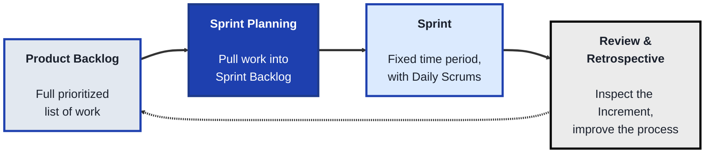
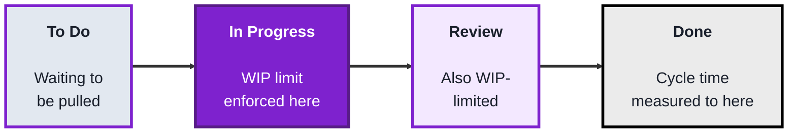
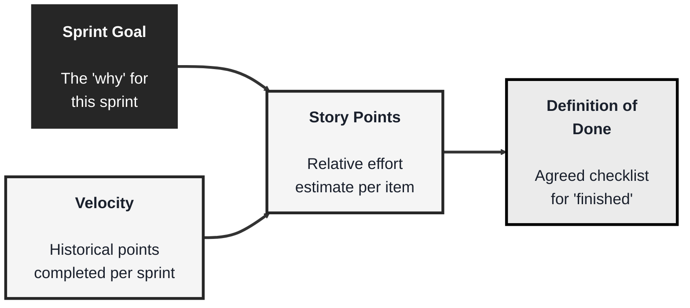

<!-- order: 4 -->
## Module: Agile (TechPO: Product & Project Management)

Time: about 6 hours

**By the end of this module, you'll be able to:**
- Name the Scrum accountabilities, events, and artifacts from the 2020 Scrum Guide and explain what each is for
- Run a mock Sprint: build a Product and Sprint Backlog, write a Sprint Goal, and hold a review and retrospective
- Set up a Kanban board with WIP limits and calculate a rough cycle time
- Estimate backlog items in story points and select a Sprint's worth of work against a velocity
- Write a Definition of Done and explain the problem it prevents
- Compare Scrum's fixed Sprints with Kanban's continuous flow and say when each fits better

**Purpose:** Run product work in short, predictable cycles using Scrum, Kanban, and Sprint Planning.

**Tools needed for this module:** A web browser and a free account with a board tool such as [Trello](https://trello.com) or [Jira](https://www.atlassian.com/software/jira) (Jira's free tier is closer to what real Scrum/Kanban teams use, but Trello works fine for the exercises in this module). No coding environment or installs are required.

### Topic 1: Scrum

#### Concept

**Scrum** is a lightweight Agile framework built around fixed-length iterations called **Sprints**. It defines three **accountabilities**, five **events**, and three **artifacts** that give a team a predictable rhythm for planning, building, and inspecting work. This module follows the official [2020 Scrum Guide](https://scrumguides.org/scrum-guide.html), so you'll see its current terms (older material may say "roles," "ceremonies," "Development Team," or "Daily Standup").

- A **Sprint** is a fixed time period (one month or less, commonly one or two weeks) with a single **Sprint Goal**. Sprints don't change length mid-stream; consistency is part of the point
- The three **accountabilities** are the **Product Owner** (maximizes the value of the product and orders the Product Backlog), the **Scrum Master** (helps the team use Scrum well and removes blockers), and the **Developers** (the people who build each Increment)
- There are **five events**: the **Sprint** itself, which contains the other four: **Sprint Planning** (decide why, what, and how for this Sprint), the **Daily Scrum** (a 15-minute daily check on progress toward the Sprint Goal), the **Sprint Review** (inspect the outcome with stakeholders and adapt), and the **Sprint Retrospective** (improve how the team works)
- There are **three artifacts**, each with a **commitment**:
  - **Product Backlog** (the ordered list of everything that could be built), committed to the **Product Goal** (the long-term objective for the product)
  - **Sprint Backlog** (the Sprint Goal, the items chosen for this Sprint, and a plan to deliver them), committed to the **Sprint Goal**
  - **Increment** (a usable, finished piece of work that adds to everything built before), committed to the **Definition of Done**

#### Structure at a Glance


- The team commits to the **Sprint Goal**, not to a fixed list of tasks. During the Sprint, scope may be clarified and renegotiated with the Product Owner as more is learned, as long as no changes are made that would endanger the Sprint Goal. This stability is what lets a team actually finish something valuable; constantly adding unrelated work mid-sprint undermines the whole framework
- The **Sprint Review** is a working session, not just a demo. The Scrum Team and stakeholders inspect what was done, discuss progress toward the Product Goal, and agree on what to do next, which often updates the Product Backlog
- The Scrum Master accountability is often misunderstood as a manager, its actual job is closer to a facilitator, removing obstacles and protecting the team's process, not assigning tasks or directing the work itself

#### Where you'd actually use this

Software teams building a product incrementally, where stakeholders want regular, predictable checkpoints to see progress and adjust priorities, especially when work can be broken into pieces small enough to complete within a one- or two-week window.

#### Lab

1. **Create a free account** on Trello or Jira and set up three lists/columns, "Product Backlog," "Sprint Backlog," and "Done."
2. **Write 8 to 10 small backlog items** for a hypothetical product (reuse the plant-care app idea from earlier modules, or pick your own), and place them all in the Product Backlog column.
3. **Run a mock Sprint Planning session**: pick 3 to 4 items you could realistically finish in one week, and move only those into the Sprint Backlog column.
   Write a one-sentence **Sprint Goal** at the top of the Sprint Backlog that explains why these items matter together.
4. **Simulate three Daily Scrums** by writing one sentence each day (for three days) about progress toward the Sprint Goal, what you'll do next, and any blocker, even if the "work" is just planning.
5. **Hold a mock Sprint Review and Retrospective**: write two sentences on what was finished, how it moves the product toward its Product Goal, and what you'd change in the Product Backlog as a result; then write one thing you'd change about how the team works next Sprint.

```lab
{
 "type": "sort",
 "title": "Accountability, event, or artifact?",
 "prompt": "Sort each Scrum term into the right group.",
 "buckets": [
  "Accountability",
  "Event",
  "Artifact"
 ],
 "items": [
  {
   "text": "Product Owner",
   "bucket": "Accountability",
   "why": "Maximizes product value and orders the Product Backlog."
  },
  {
   "text": "Scrum Master",
   "bucket": "Accountability",
   "why": "Helps the team use Scrum well and removes blockers."
  },
  {
   "text": "Daily Scrum",
   "bucket": "Event",
   "why": "A 15-minute daily check on progress toward the Sprint Goal."
  },
  {
   "text": "Sprint Review",
   "bucket": "Event",
   "why": "A working session with stakeholders to inspect the Increment and progress toward the Product Goal."
  },
  {
   "text": "Product Backlog",
   "bucket": "Artifact",
   "why": "The ordered list of everything that could be built; its commitment is the Product Goal."
  },
  {
   "text": "Sprint Backlog",
   "bucket": "Artifact",
   "why": "The Sprint Goal, the items chosen for this Sprint, and the plan to deliver them."
  },
  {
   "text": "Sprint Planning",
   "bucket": "Event",
   "why": "Deciding why, what, and how the team will work this Sprint."
  },
  {
   "text": "Increment",
   "bucket": "Artifact",
   "why": "A usable piece of finished work; its commitment is the Definition of Done."
  }
 ]
}
```

#### Checkpoint
You have a Product Backlog, a Sprint Backlog with a Sprint Goal pulled from it during a mock planning session, three days of simulated Daily Scrum notes, and a mock review and retrospective summary.

#### Quiz
1. What are the three accountabilities in Scrum, and what does each one do?
2. What is the difference between the Product Backlog and the Sprint Backlog?
3. Name the five Scrum events.
4. What does the team commit to during a Sprint, and can the scope change?
5. What is a common misconception about the Scrum Master accountability?

*Answers: 1) The Product Owner maximizes product value and orders the Product Backlog, the Scrum Master helps the team use Scrum well and removes blockers, and the Developers build each Increment. 2) The Product Backlog is the ordered list of everything that could be built (committed to the Product Goal); the Sprint Backlog is the Sprint Goal, the items chosen for this Sprint, and the plan to deliver them. 3) The Sprint itself, plus the four events inside it: Sprint Planning, the Daily Scrum, the Sprint Review, and the Sprint Retrospective. 4) The team commits to the Sprint Goal, not a fixed list; scope can be clarified and renegotiated with the Product Owner as long as the Sprint Goal isn't endangered. 5) That it is a management position, when it is actually closer to a facilitator, focused on removing obstacles and protecting the process rather than assigning tasks or directing the work.*

---

### Topic 2: Kanban

#### Concept

**Kanban** is a more flexible Agile approach built around visualizing work as it flows through stages on a board, with an emphasis on limiting how much is in progress at once, rather than working in fixed-length sprints like Scrum. Where Scrum plans in batches, Kanban is a continuous flow, new work can be pulled in as soon as capacity frees up, not just at the start of a new sprint.

- A **Kanban board** visualizes work as cards moving through columns representing stages (commonly "To Do," "In Progress," "Done")
- **WIP limits** (Work In Progress limits) cap how many cards are allowed in a given column at once, forcing the team to finish existing work before starting new work, rather than starting everything at once and finishing nothing
- **Pull-based flow** means new work is pulled into a column only when there's room under its WIP limit, rather than being pushed in by a manager's schedule
- **Cycle time** measures how long a card takes to move from start to finish, a key Kanban metric for understanding whether flow is actually improving over time

#### Structure at a Glance


- WIP limits feel counterintuitive to beginners, it seems like starting more work should mean finishing more work, but without a limit, everything ends up half-finished, and nothing actually ships, this is Kanban's central insight
- Unlike Scrum, Kanban has no required accountabilities or fixed events, which makes it more adaptable for ongoing support or maintenance work where the flow of incoming tasks is unpredictable, but also means it provides less built-in structure for teams that need one

#### Where you'd actually use this

Ongoing support or maintenance work, bug triage, or any team whose incoming work is unpredictable and doesn't fit neatly into fixed sprint-length batches, where visualizing flow and limiting work-in-progress matters more than planning in advance.

#### Lab

1. **Create a Kanban board** with four columns: "To Do," "In Progress," "Review," "Done."
2. **Set a WIP limit** of 2 on both "In Progress" and "Review." In Jira, you can set column limits in the board settings. Trello doesn't have built-in WIP limits; either add a WIP-limit Power-Up or simply write "(max 2)" in the list name and enforce it yourself.
3. **Add 6 to 8 small tasks** to "To Do" (reuse tasks from Topic 1's backlog, or invent new ones), and pull only up to the WIP limit into "In Progress."
4. **Simulate moving cards through the board** over a few rounds, moving a card to "Review" only when a slot opens up, and to "Done" only after review, respecting the WIP limits the entire time even if it means leaving cards waiting in "To Do."
5. **Note the "start" and "finish" time** (even just a rough timestamp) for two or three cards as they move across the board, and calculate a rough cycle time for each.

#### Checkpoint
You have a Kanban board with enforced WIP limits, cards that moved through it while respecting those limits, and a rough cycle time calculated for at least two cards.

#### Quiz
1. What is a WIP limit, and what problem is it meant to solve?
2. What is the key structural difference between Kanban and Scrum in terms of timing?
3. What does "pull-based flow" mean?
4. What is "cycle time," and why is it a useful metric?
5. Why might Kanban suit ongoing support work better than Scrum?

*Answers: 1) A cap on how many cards are allowed in a column at once, it solves the problem of a team starting too much work at once and finishing very little of it. 2) Kanban is a continuous flow with no fixed-length iterations, Scrum plans and commits to work in fixed-length sprints. 3) New work is pulled into a column only when there's room under its WIP limit, rather than being pushed in on a fixed schedule. 4) How long a card takes to move from start to finish, it's useful because it shows whether a team's flow is actually improving or getting worse over time. 5) Because incoming support work is unpredictable and doesn't fit neatly into fixed sprint-length batches, Kanban's continuous flow adapts to that better than Scrum's batch planning.*

---

### Topic 3: Sprint Planning

#### Concept

**Sprint Planning** is the Scrum event where a team decides exactly what work will be pulled into the upcoming sprint, turning a long, loosely prioritized backlog into a small, concrete, and realistic commitment. Done well, it balances ambition (getting real value delivered) against honesty about how much a team can actually finish.

- **Note:** story points and velocity are common add-on practices many Scrum teams use, but they are **not** part of the Scrum Guide. Scrum only requires that the team forecasts what it can do; how it estimates is up to the team.
- **Story points** are a relative unit of effort or complexity (not time) used to estimate backlog items, commonly using a scale like 1, 2, 3, 5, 8, 13, so a "5" is meant to be roughly five times harder than a "1," not five hours of work
- **Velocity** is how many story points a team has historically completed per sprint, used to estimate how much new work is realistic to commit to
- A **Sprint Goal** is a single, short sentence describing the overall purpose of the Sprint, giving the team's individual tasks a shared "why" beyond just a checklist. It is the team's commitment for the Sprint
- **Definition of Done** (the commitment for the Increment) is the team's agreed checklist for when a piece of work is actually finished (tested, reviewed, deployed), not just "looks complete," this prevents ambiguity about whether something is truly ready

#### Structure at a Glance


- Story points being relative (not time-based) is a common point of confusion for beginners, the goal is comparing items to each other, not predicting exact hours, that's precisely why velocity (points completed historically) becomes a useful planning tool over time
- Skipping a clear Definition of Done is a common cause of disputes mid-sprint, disagreements about "is this actually finished" almost always trace back to that checklist never being agreed on up front

#### Where you'd actually use this

Any Scrum team preparing to start a new sprint, deciding what's realistic to commit to based on past velocity, and making sure everyone shares the same understanding of the sprint's purpose and what "done" actually means for the work being pulled in.

#### Lab

1. **Reuse the backlog** from Topic 1's Product Backlog.
2. **Assign story points** to each backlog item using a 1, 2, 3, 5, 8 scale, based on relative complexity compared to the other items, not estimated hours.
3. **Assume a velocity** of 10 points per sprint (a made-up but realistic number for a small team), and select only enough items from the backlog to add up to roughly that total.
4. **Write a one-sentence sprint goal** that ties the selected items together around a shared purpose (for example, "Get new users through onboarding without confusion").
5. **Write a short Definition of Done** (3 to 5 checklist items, like "tested," "reviewed by another team member," "deployed to staging") that would apply to every item in this sprint.

#### Checkpoint
You have a sprint's worth of backlog items estimated in story points, selected to roughly match an assumed velocity, tied together with a sprint goal, and paired with a written Definition of Done.

#### Quiz
1. What do story points measure, and what do they deliberately not measure?
2. What is "velocity," and how is it used in planning?
3. What is a sprint goal, and why does it matter beyond just a list of tasks?
4. What is a "Definition of Done," and what problem does it prevent?
5. Why might a team's assumed velocity change over time?

*Answers: 1) They measure relative effort or complexity, they deliberately don't measure estimated time or hours. 2) How many story points a team has historically completed per sprint, it's used to estimate how much new work is realistic to commit to in an upcoming sprint. 3) A single, short sentence describing the sprint's overall purpose, it matters because it gives the team's individual tasks a shared "why" beyond just a checklist of unrelated items. 4) The team's agreed checklist for when work is actually finished, it prevents disputes and ambiguity about whether something is truly ready versus just looking complete. 5) Because velocity is based on historical performance, it can shift as the team's size, skill, or the nature of the work itself changes over time.*

```watch
{
 "scenes": [
  {
   "kind": "title",
   "art": "loop",
   "kicker": "Module · Agile",
   "title": "Short, predictable cycles",
   "beats": [
    {
     "say": "Welcome to the Agile module."
    },
    {
     "say": "You'll run product work in short, predictable cycles, using Scrum, Kanban and Sprint Planning."
    },
    {
     "say": "All you need is a browser and a free board tool, like Trello or Jira."
    }
   ]
  },
  {
   "kind": "list",
   "art": "people",
   "kicker": "Topic 1 · Scrum",
   "title": "Three accountabilities",
   "items": [
    [
     "Product Owner",
     "Maximises value · orders the backlog"
    ],
    [
     "Scrum Master",
     "Facilitates · removes blockers"
    ],
    [
     "Developers",
     "Build each Increment"
    ]
   ],
   "beats": [
    {
     "say": "Scrum is a lightweight Agile framework built around fixed-length iterations called Sprints. One month or less, commonly one or two weeks.",
     "show": 0
    },
    {
     "say": "This module follows the official twenty twenty Scrum Guide, which has three accountabilities.",
     "show": 0
    },
    {
     "say": "The Product Owner maximises the value of the product, and orders the Product Backlog.",
     "show": 1
    },
    {
     "say": "The Scrum Master helps the team use Scrum well, and removes blockers. A facilitator, not a manager who assigns tasks.",
     "show": 2
    },
    {
     "say": "And the Developers build each Increment.",
     "show": 3
    }
   ]
  },
  {
   "kind": "flow",
   "art": "stopwatch",
   "kicker": "Topic 1 · Scrum",
   "title": "Five events",
   "steps": [
    "Sprint Planning",
    "Daily Scrum (15 min)",
    "Sprint Review",
    "Sprint Retrospective"
   ],
   "beats": [
    {
     "say": "There are five events. The Sprint itself contains the other four.",
     "show": 0
    },
    {
     "say": "Sprint Planning decides why, what and how for this Sprint.",
     "show": 1
    },
    {
     "say": "The Daily Scrum is a fifteen minute daily check on progress toward the Sprint Goal.",
     "show": 2
    },
    {
     "say": "The Sprint Review is a working session, not just a demo. The team and stakeholders inspect what was done, and agree what to do next.",
     "show": 3
    },
    {
     "say": "And the Retrospective improves how the team works.",
     "show": 4
    }
   ]
  },
  {
   "kind": "list",
   "art": "layers",
   "kicker": "Topic 1 · Scrum",
   "title": "Three artifacts, three commitments",
   "items": [
    [
     "Product Backlog",
     "→ Product Goal"
    ],
    [
     "Sprint Backlog",
     "→ Sprint Goal"
    ],
    [
     "Increment",
     "→ Definition of Done"
    ]
   ],
   "beats": [
    {
     "say": "There are three artifacts, each with a commitment.",
     "show": 0
    },
    {
     "say": "The Product Backlog, the ordered list of everything that could be built, is committed to the Product Goal.",
     "show": 1
    },
    {
     "say": "The Sprint Backlog, the goal, chosen items and plan for this Sprint, is committed to the Sprint Goal.",
     "show": 2
    },
    {
     "say": "And the Increment, a usable finished piece of work, is committed to the Definition of Done.",
     "show": 3
    },
    {
     "say": "The team commits to the Sprint Goal, not a fixed list. Scope can be renegotiated, as long as the goal isn't endangered.",
     "show": 3
    }
   ]
  },
  {
   "kind": "flow",
   "art": "pencil",
   "kicker": "Topic 1 · Lab",
   "title": "Run a mock Sprint",
   "steps": [
    "Backlog: 8 to 10 items",
    "Plan: 3 to 4 items + Sprint Goal",
    "3 Daily Scrum notes",
    "Review + retrospective"
   ],
   "beats": [
    {
     "say": "In the lab, you run a mock Sprint on a Trello or Jira board.",
     "show": 0
    },
    {
     "say": "Write eight to ten small backlog items, for the plant care app or your own idea.",
     "show": 1
    },
    {
     "say": "Plan the Sprint: move three or four items you could finish in a week, and write a one sentence Sprint Goal.",
     "show": 2
    },
    {
     "say": "Write three days of Daily Scrum notes.",
     "show": 3
    },
    {
     "say": "Then a mock review and retrospective.",
     "show": 4
    }
   ]
  },
  {
   "kind": "list",
   "art": "boxes",
   "kicker": "Topic 2 · Kanban",
   "title": "Continuous flow",
   "items": [
    [
     "Kanban board",
     "Cards flow through columns"
    ],
    [
     "WIP limits",
     "Cap cards per column"
    ],
    [
     "Pull-based flow",
     "Pull only when there's room"
    ],
    [
     "Cycle time",
     "Start to finish, per card"
    ]
   ],
   "beats": [
    {
     "say": "Kanban is more flexible. No fixed sprints: work flows continuously across a board.",
     "show": 0
    },
    {
     "say": "Cards move through columns, like To Do, In Progress and Done.",
     "show": 1
    },
    {
     "say": "Work in progress limits, or W I P limits, cap how many cards a column can hold.",
     "show": 2
    },
    {
     "say": "New work is pulled in only when there's room under the limit, not pushed in on a schedule.",
     "show": 3
    },
    {
     "say": "And cycle time measures how long a card takes from start to finish.",
     "show": 4
    }
   ]
  },
  {
   "kind": "quote",
   "art": "warning",
   "kicker": "Topic 2 · Kanban",
   "title": "Start less, finish more",
   "quote": "Without a WIP limit, everything is half-finished and nothing ships.",
   "beats": [
    {
     "say": "W I P limits feel backwards at first. Surely starting more means finishing more?",
     "show": 0
    },
    {
     "say": "But without a limit, everything ends up half finished, and nothing ships. That's Kanban's central insight.",
     "show": 1
    },
    {
     "say": "In the lab, set a limit of two on In Progress and Review, move cards through respecting it, and time two or three cards.",
     "show": 1
    }
   ]
  },
  {
   "kind": "list",
   "art": "calc",
   "kicker": "Topic 3 · Sprint Planning",
   "title": "Estimate, then commit",
   "items": [
    [
     "Story points",
     "Relative effort, not hours"
    ],
    [
     "Velocity",
     "Points finished per Sprint"
    ],
    [
     "Lab",
     "Pick ~10 points of work"
    ]
   ],
   "beats": [
    {
     "say": "Sprint Planning turns a long backlog into a small, realistic commitment.",
     "show": 0
    },
    {
     "say": "Story points are relative effort, not time. A five is roughly five times harder than a one, not five hours.",
     "show": 1
    },
    {
     "say": "Velocity is how many points the team has historically finished per Sprint.",
     "show": 2
    },
    {
     "say": "Both are common add-ons, but not part of the Scrum Guide. Scrum only asks the team to forecast.",
     "show": 2
    },
    {
     "say": "In the lab, point your backlog on a one, two, three, five, eight scale, and assume a velocity of ten points.",
     "show": 3
    }
   ]
  },
  {
   "kind": "list",
   "art": "proof",
   "kicker": "Topic 3 · Sprint Planning",
   "title": "Goal and Definition of Done",
   "items": [
    [
     "Sprint Goal",
     "The shared why"
    ],
    [
     "Definition of Done",
     "✓ tested · ✓ reviewed · ✓ deployed to staging"
    ]
   ],
   "beats": [
    {
     "say": "Tie the chosen items together with a one sentence Sprint Goal, like: get new users through onboarding without confusion.",
     "show": 1
    },
    {
     "say": "Then write a Definition of Done: three to five checks, like tested, reviewed by another team member, deployed to staging.",
     "show": 2
    },
    {
     "say": "Arguments about whether something is really finished almost always trace back to that checklist never being agreed up front.",
     "show": 2
    }
   ]
  },
  {
   "kind": "quiz",
   "art": "ask",
   "kicker": "Quick check",
   "title": "Why might Kanban suit ongoing support work better than Scrum?",
   "options": [
    "Support work arrives unpredictably, and continuous flow adapts to that",
    "Kanban requires a Scrum Master",
    "Support work always fits into two-week batches"
   ],
   "answer": 0,
   "good": "That's right. Incoming support work is unpredictable and doesn't fit neatly into fixed sprint batches, so Kanban's continuous flow adapts better.",
   "bad": "Not quite. Incoming support work is unpredictable and doesn't fit neatly into fixed sprint batches, so Kanban's continuous flow adapts better.",
   "beats": [
    {
     "say": "Quick check.",
     "show": 0
    },
    {
     "say": "Why might Kanban suit ongoing support work better than Scrum?",
     "show": 0
    },
    {
     "say": "Tap your answer.",
     "show": 1
    }
   ]
  },
  {
   "kind": "list",
   "art": "proof",
   "kicker": "Checkpoint",
   "title": "You're done when",
   "items": [
    [
     "Mock Sprint run end to end",
     ""
    ],
    [
     "Kanban board with WIP limits and cycle times",
     ""
    ],
    [
     "Sprint planned with goal and Definition of Done",
     ""
    ],
    [
     "Scrum vs Kanban explained",
     ""
    ],
    [
     "Why WIP limits and DoD matter",
     ""
    ]
   ],
   "beats": [
    {
     "say": "That's the Agile module.",
     "show": 0
    },
    {
     "say": "You're done when:",
     "show": 0
    },
    {
     "say": "you've built a Product and Sprint Backlog, three Daily Scrums, and a review and retrospective,",
     "show": 1
    },
    {
     "say": "you've built a Kanban board with W I P limits, and timed at least two cards,",
     "show": 2
    },
    {
     "say": "you've pointed a backlog, matched it to a velocity, and written a Sprint Goal and Definition of Done,",
     "show": 3
    },
    {
     "say": "you can explain fixed Sprints versus continuous flow,",
     "show": 4
    },
    {
     "say": "and you can explain the problem W I P limits and a Definition of Done each prevent.",
     "show": 5
    },
    {
     "say": "You've finished Agile. Well done.",
     "show": 5
    }
   ]
  }
 ]
}
```

---

## Module Completion Checklist
- [ ] Built a Product and Sprint Backlog, simulated three days of Daily Scrums, and written a mock review and retrospective summary
- [ ] Built a Kanban board with enforced WIP limits and calculated a rough cycle time for at least two cards
- [ ] Estimated a backlog in story points, selected work to match an assumed velocity, and written a sprint goal and Definition of Done
- [ ] Can explain the key structural difference between Scrum's fixed sprints and Kanban's continuous flow
- [ ] Can explain why WIP limits and a clear Definition of Done each prevent a specific, common team problem
