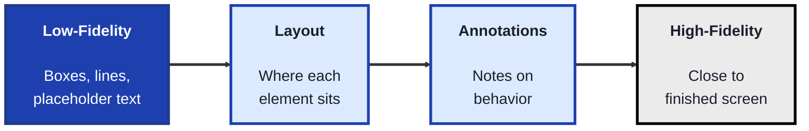
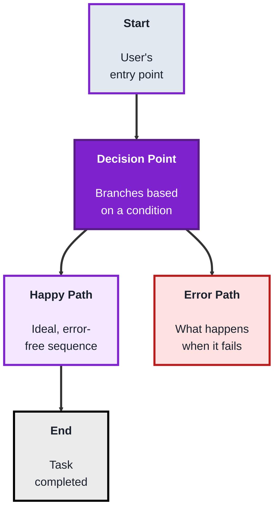
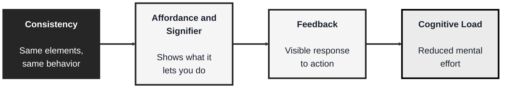

<!-- order: 3 -->
## Module: Product Design (TechPO: Product & Project Management)

Time: about 6 hours

**By the end of this module, you'll be able to:**
- Build a low-fidelity wireframe in Figma with annotations, and compare two layout options
- Map a user flow with a start, end, decision point, error path, and likely drop-off point
- Review a design against consistency, feedback, affordances and signifiers, and cognitive load
- Explain the difference between an affordance and a signifier, with an example
- Explain why staying low-fidelity early leads to better structural feedback

**Purpose:** Learn to sketch screens as wireframes, map the paths users take through a product, and check a design against core UX principles before anything is built.

**Tools needed for this module:** A web browser and a free account with a design tool such as [Figma](https://www.figma.com) (the free Starter plan is enough for these exercises at the time of writing; check current limits on Figma's pricing page). No coding environment or installs are required.

### Topic 1: Wireframes

#### Concept

A **wireframe** is a low-detail, structural sketch of a screen, showing what's on it and roughly where, without colors, fonts, or finished visuals. Its whole purpose is speed: wireframes let a team test layout and structure cheaply, before investing time in visual design that would be expensive to throw away.

- **Fidelity** describes how polished or detailed a design is, **low-fidelity** wireframes use boxes, lines, and placeholder text, **high-fidelity** wireframes (sometimes called mockups) look close to a finished screen
- A **layout** is the arrangement of elements on a screen, wireframes exist specifically to test layout decisions before any visual styling is applied on top of them
- **Placeholder content** (like "Lorem ipsum" text or gray boxes for images) stands in for real content that isn't ready yet, keeping focus on structure rather than specific wording or imagery
- **Annotations** are short notes added to a wireframe explaining behavior that isn't visually obvious (like "this button opens a modal"), bridging the gap between a static image and how the screen actually works

#### Structure at a Glance


- Beginners often jump straight to high-fidelity, colorful designs, but skipping low-fidelity wireframes means structural problems (like a confusing layout) get discovered only after time was already spent on visual polish that now has to be redone
- Feedback on a low-fidelity wireframe tends to focus on structure ("should this button be higher up?"), feedback on a high-fidelity mockup tends to focus on visuals ("I don't like this color"), even when structural feedback is what's actually needed, this is a reason to deliberately stay low-fidelity longer than feels natural

#### Where you'd actually use this

Testing whether a screen's layout makes sense before any visual design work begins, quickly exploring multiple layout options side by side, or getting early stakeholder feedback focused on structure rather than aesthetics.

#### Lab

1. **Create a free Figma account** and start a new file.
2. **Pick a single screen** from a product idea used in earlier modules (for example, the plant-care app's reminder screen).
3. **Sketch a low-fidelity wireframe** of that screen using only gray boxes, simple lines, and placeholder text, no colors, real images, or custom fonts.
4. **Add 3 to 4 annotations** to the wireframe explaining behavior that isn't visually obvious (for example, "tapping this box expands the plant's care instructions").
5. **Create a second version of the same wireframe** with a meaningfully different layout, and write two sentences comparing the tradeoffs of each version.

#### Checkpoint
You have a low-fidelity wireframe with annotations explaining its behavior, plus a second layout variation with a written comparison of the tradeoffs.

#### Quiz
1. What is the difference between low-fidelity and high-fidelity wireframes?
2. Why does wireframing exist as a separate, earlier step instead of designing in full color from the start?
3. What is "placeholder content," and why is it used?
4. What is an "annotation," and what problem does it solve?
5. Why might feedback differ between a low-fidelity and a high-fidelity version of the same screen?

*Answers: 1) Low-fidelity wireframes use boxes, lines, and placeholder text, high-fidelity wireframes (or mockups) look close to a finished screen with real visual styling. 2) Because wireframes let a team test layout and structure cheaply, before investing time in visual design that would be expensive to redo if the underlying structure turns out to be wrong. 3) Placeholder content (like gray boxes or Lorem ipsum text) stands in for real content that isn't ready yet, keeping focus on structure rather than specific wording or imagery. 4) A short note explaining behavior that isn't visually obvious, like what a button does when tapped, it solves the problem of a static image not being able to show interactivity on its own. 5) Because low-fidelity feedback tends to focus on structure, while high-fidelity feedback tends to focus on visuals like color, even when structural feedback is what's actually still needed.*

---

### Topic 2: User Flows

#### Concept

A **user flow** maps the sequence of steps a user takes to complete a specific task within a product, showing screens, decisions, and paths as a connected diagram rather than a single static screen. Where a wireframe answers "what's on this screen," a user flow answers "how does someone get from here to their goal, and what could go wrong along the way."

- A **start point** and **end point** define the boundaries of a flow, a flow should represent one specific, complete task from a clear beginning to a clear, successful end
- A **decision point** is a branch in the flow where the path differs based on a condition (like "is the user logged in?"), mapping these prevents a design from silently assuming everyone follows the same, "happy path"
- The **happy path** is the ideal, most common sequence a user takes with no errors or detours, an **edge case** or **error path** covers what happens when something goes wrong (a failed login, an empty search result)
- A **drop-off point** is a step in the flow where users commonly abandon the task, mapping the whole flow (not just the happy path) is what makes drop-off points visible and fixable

#### Structure at a Glance


- Mapping only the happy path is a common beginner mistake, real users hit errors, change their minds, and take unexpected paths constantly, a flow that ignores this ends up describing an idealized product that doesn't match reality
- A user flow deliberately leaves out visual detail (that's what wireframes and high-fidelity designs are for), mixing the two together makes a flow diagram harder to read and update as the design changes

#### Where you'd actually use this

Planning a multi-step process like account signup or checkout before designing individual screens, identifying where users are likely to get confused or give up, or aligning a team on exactly how a feature is supposed to work end to end.

#### Lab

1. **Pick a specific task** within your product idea that spans more than one screen (for example, "set a watering reminder for a new plant").
2. **Identify the clear start and end points** for that task, and list every screen or step involved along the happy path.
3. **Draw the happy path** as a simple flow diagram (boxes connected by arrows) using Figma or a simple diagramming tool.
4. **Add at least one decision point and one error path** to the flow, for example, "plant name already exists" branching to an error message instead of continuing forward.
5. **Identify one likely drop-off point** in the flow, and write one or two sentences suggesting a design change that might reduce it.

#### Checkpoint
You have a user flow diagram with a clear start and end, at least one decision point with a mapped error path, and a written note identifying a likely drop-off point and a possible fix.

#### Quiz
1. What is the difference between what a wireframe shows and what a user flow shows?
2. What is a "decision point," and why is mapping it important?
3. What is the difference between the happy path and an error path?
4. What is a "drop-off point," and why does mapping the full flow (not just the happy path) help find it?
5. Why is it a mistake to mix detailed visual design into a user flow diagram?

*Answers: 1) A wireframe shows what's on a single screen, a user flow shows the sequence of steps and screens a user takes to complete a specific task. 2) A branch in the flow where the path differs based on a condition, mapping it is important because it prevents a design from silently assuming everyone follows the same single path. 3) The happy path is the ideal, most common sequence with no errors, an error path covers what happens when something goes wrong, like a failed login or empty search result. 4) A step where users commonly abandon the task, mapping the full flow (including error paths and decision points) makes these visible, since a happy-path-only flow hides exactly where things actually go wrong. 5) Because a user flow is meant to focus on sequence and structure, mixing in visual detail makes the diagram harder to read and more work to update as the design itself changes.*

---

### Topic 3: UX Principles

#### Concept

**UX (User Experience) principles** are general, reusable guidelines that make a product easier and more pleasant to use, drawn from decades of observed patterns in how people actually perceive and interact with interfaces. They're not rigid rules to apply blindly, but defaults that require a deliberate reason to break.

- **Consistency** means similar elements look and behave the same way throughout a product, inconsistency forces users to relearn things that should already feel familiar
- **Feedback** means the product clearly responds to a user's action (a button visibly pressing, a loading spinner, a confirmation message), without it, users are left unsure whether anything happened at all
- **Affordance and signifier** are two related ideas from designer Don Norman. An **affordance** is what an element actually lets you do: a button can be pressed, a text field can be typed into. A **signifier** is the visible cue that tells users that action is possible: a raised look or shadow on the button, a blinking cursor in the field. A design that removes signifiers (flat, ambiguous elements) can leave users unsure what's even interactive, even though the affordance is still there
- **Cognitive load** is the mental effort required to use an interface, reducing unnecessary choices, steps, or information at any one moment is one of the most reliable ways to make a product feel easier to use

#### Structure at a Glance


- These principles work together more than separately, a button with a clear signifier but no feedback when clicked can still leave a user confused about whether their click actually registered
- Breaking a principle isn't automatically wrong, but it should be a deliberate, considered choice made for a specific reason, not an accident from not knowing the principle existed in the first place

#### Where you'd actually use this

Reviewing a wireframe or user flow (from Topics 1 and 2) for usability issues before it's built, explaining to a stakeholder why a specific design choice (like an unclear icon or missing loading state) is likely to confuse users, or evaluating a competitor's product to learn from what works and what doesn't.

#### Lab

1. **Return to the wireframe** built in Topic 1 (or the flow from Topic 2).
2. **Review it against consistency**: check that similar elements (like buttons or navigation) look and behave the same way everywhere they appear, and note one inconsistency to fix if you find one.
3. **Review it against feedback**: identify one user action in the design (like tapping a button) and describe exactly what visible feedback the user would see confirming it worked.
4. **Review it against affordance and signifiers**: pick one interactive element, write what it affords (what it lets the user do), then check whether it has a clear signifier (a visual cue showing it's interactive), revising it if it doesn't.
5. **Review it against cognitive load**: count how many choices or pieces of information are presented on the busiest screen, and suggest one specific way to reduce that number without losing important functionality.

#### Checkpoint
You have reviewed your own wireframe or flow against all four principles, consistency, feedback, affordance and signifiers, and cognitive load, with at least one specific, written improvement identified for each.

#### Quiz
1. What is "consistency" in UX, and why does inconsistency create extra work for users?
2. What is "feedback," and what happens to a user's experience without it?
3. What is the difference between an "affordance" and a "signifier"? Give an example.
4. What is "cognitive load," and what's one reliable way to reduce it?
5. Are UX principles meant to be followed without exception? Explain briefly.

*Answers: 1) Similar elements looking and behaving the same way throughout a product, inconsistency creates extra work because it forces users to relearn things that should already feel familiar from elsewhere in the product. 2) A clear response to a user's action, like a visible button press or a confirmation message, without it users are left unsure whether their action actually registered. 3) An affordance is what an element lets you do, for example a button can be pressed; a signifier is the visual cue that shows that action is possible, for example the button's raised look. 4) The mental effort required to use an interface, one reliable way to reduce it is cutting unnecessary choices, steps, or information presented at any one moment. 5) No, they're defaults that require a deliberate reason to break, not rigid rules, breaking one should be a considered choice made for a specific reason rather than an accident.*

```watch
{
 "scenes": [
  {
   "kind": "title",
   "art": "palette",
   "kicker": "Module · Product Design",
   "title": "Sketch it before you build it",
   "beats": [
    {
     "say": "Welcome to the Product Design module."
    },
    {
     "say": "You'll sketch screens as wireframes, map the paths users take, and check a design against core U X principles, before anything is built."
    },
    {
     "say": "All you need is a browser and a free Figma account."
    }
   ]
  },
  {
   "kind": "table",
   "kicker": "Topic 1 · Wireframes",
   "title": "Wireframe the reminder screen",
   "columns": [
    "Region",
    "Low-fi sketch",
    "Annotation"
   ],
   "rows": [
    [
     "Header",
     "[Plant name]",
     "—"
    ],
    [
     "Photo",
     "gray box",
     "—"
    ],
    [
     "Next watering",
     "Lorem ipsum",
     "—"
    ],
    [
     "Main button",
     "[ Water now ]",
     "—"
    ],
    [
     "Care tips",
     "gray bar",
     "—"
    ]
   ],
   "beats": [
    {
     "say": "Let's wireframe the plant care app's reminder screen: what's on it, and roughly where.",
     "col": 0
    },
    {
     "say": "Low fidelity means boxes, lines and placeholder text. No colours or fonts.",
     "sql": "Low fidelity: boxes · lines · placeholder text",
     "col": 1
    },
    {
     "say": "The photo is a gray box, the text is lorem ipsum. Placeholders keep the focus on structure.",
     "hl": [
      1,
      2
     ],
     "dim": true,
     "col": 1
    },
    {
     "say": "But a static sketch can't show what tapping does.",
     "hl": 4,
     "dim": true,
     "col": 2
    },
    {
     "say": "So we add annotations. Tapping care tips expands the care instructions.",
     "sql": "Care tips → \"tap to expand care instructions\"",
     "hl": 4,
     "col": 2
    },
    {
     "say": "Tapping water now resets the countdown.",
     "sql": "Water now → \"resets the next-watering countdown\"",
     "hl": 3,
     "col": 2
    }
   ]
  },
  {
   "kind": "table",
   "kicker": "Topic 1 · Wireframes",
   "title": "Two layouts, compared",
   "columns": [
    "",
    "A · List",
    "B · Cards"
   ],
   "rows": [
    [
     "Plants per screen",
     "About 6 rows",
     "1 big card"
    ],
    [
     "Next watering",
     "Small, per row",
     "Large, top of card"
    ],
    [
     "Photo",
     "Tiny thumbnail",
     "Large gray box"
    ],
    [
     "Best for",
     "Many plants",
     "A few plants"
    ]
   ],
   "beats": [
    {
     "say": "Next, a meaningfully different second layout."
    },
    {
     "say": "Layout A is a list of about six plants. Layout B gives each plant one big card.",
     "hl": 0,
     "dim": true
    },
    {
     "say": "In the list, the next watering is small text. On the card, it's large, at the top.",
     "hl": 1,
     "dim": true
    },
    {
     "say": "Trade-offs: the list suits many plants, but reminders are easier to miss.",
     "hl": 3,
     "dim": true,
     "col": 1
    },
    {
     "say": "Cards make reminders obvious, but mean more scrolling. Both were cheap to try.",
     "hl": 3,
     "dim": true,
     "col": 2
    }
   ]
  },
  {
   "kind": "diagram",
   "kicker": "Topic 1 · Wireframes",
   "title": "Stay low-fidelity longer",
   "nodes": [
    {
     "id": "lo",
     "label": "Low-fi wireframe",
     "sub": "boxes and lines",
     "x": 15,
     "y": 25,
     "art": "layout"
    },
    {
     "id": "team",
     "label": "Stakeholders",
     "sub": "give feedback",
     "x": 50,
     "y": 50,
     "art": "people"
    },
    {
     "id": "hi",
     "label": "High-fi mockup",
     "sub": "colours and fonts",
     "x": 15,
     "y": 78,
     "art": "palette"
    },
    {
     "id": "s",
     "label": "Structural",
     "sub": "is the layout right?",
     "x": 85,
     "y": 25,
     "art": "blueprint"
    },
    {
     "id": "v",
     "label": "Visual",
     "sub": "I don't like the colour",
     "x": 85,
     "y": 78,
     "art": "cross"
    }
   ],
   "edges": [
    {
     "from": "lo",
     "to": "team"
    },
    {
     "from": "hi",
     "to": "team"
    },
    {
     "from": "team",
     "to": "s"
    },
    {
     "from": "team",
     "to": "v"
    }
   ],
   "beats": [
    {
     "say": "Why not jump to a polished design? Compare the feedback.",
     "show": 2
    },
    {
     "say": "Show stakeholders the wireframe.",
     "show": 2,
     "on": "lo",
     "send": {
      "from": "lo",
      "to": "team",
      "label": "gray boxes"
     }
    },
    {
     "say": "The feedback is structural: should this button be higher up?",
     "show": 4,
     "on": "s",
     "send": {
      "from": "team",
      "to": "s",
      "label": "move button up?"
     }
    },
    {
     "say": "Show a high fidelity mockup instead.",
     "show": 4,
     "on": "hi",
     "send": {
      "from": "hi",
      "to": "team",
      "label": "full colour"
     }
    },
    {
     "say": "The feedback turns visual: I don't like this colour.",
     "show": 5,
     "on": "v",
     "send": {
      "from": "team",
      "to": "v",
      "label": "change colour"
     }
    },
    {
     "say": "And a layout problem found now means redoing the polish. Stay low fidelity longer.",
     "show": 5,
     "on": [
      "lo",
      "s"
     ]
    }
   ]
  },
  {
   "kind": "diagram",
   "kicker": "Topic 2 · User flows",
   "title": "Map the whole flow",
   "nodes": [
    {
     "id": "start",
     "label": "Start",
     "sub": "tap Add plant",
     "x": 10,
     "y": 25,
     "art": "cursor"
    },
    {
     "id": "name",
     "label": "Enter name",
     "sub": "e.g. Monstera",
     "x": 38,
     "y": 25,
     "art": "form"
    },
    {
     "id": "dec",
     "label": "Name exists?",
     "sub": "decision point",
     "x": 66,
     "y": 25,
     "art": "fork"
    },
    {
     "id": "err",
     "label": "Error message",
     "sub": "error path",
     "x": 38,
     "y": 78,
     "art": "warning"
    },
    {
     "id": "sched",
     "label": "Set schedule",
     "sub": "every 7 days",
     "x": 90,
     "y": 52,
     "art": "calendar"
    },
    {
     "id": "end",
     "label": "End",
     "sub": "reminder set",
     "x": 66,
     "y": 82,
     "art": "flag"
    }
   ],
   "edges": [
    {
     "from": "start",
     "to": "name"
    },
    {
     "from": "name",
     "to": "dec"
    },
    {
     "from": "dec",
     "to": "sched"
    },
    {
     "from": "sched",
     "to": "end"
    },
    {
     "from": "dec",
     "to": "err"
    },
    {
     "from": "err",
     "to": "name"
    }
   ],
   "beats": [
    {
     "say": "A user flow shows how someone reaches a goal. Task: set a watering reminder for a new plant.",
     "show": 0
    },
    {
     "say": "A clear start: the user taps add plant.",
     "show": 1,
     "on": "start"
    },
    {
     "say": "They type the plant's name.",
     "show": 2,
     "on": "name",
     "send": {
      "from": "start",
      "to": "name",
      "label": "new plant"
     }
    },
    {
     "say": "A decision point: does that name already exist?",
     "show": 3,
     "on": "dec",
     "send": {
      "from": "name",
      "to": "dec",
      "label": "Monstera"
     }
    },
    {
     "say": "If so, the error path shows a message.",
     "show": 4,
     "on": "err",
     "send": {
      "from": "dec",
      "to": "err",
      "label": "already exists"
     }
    },
    {
     "say": "And sends them back to try again.",
     "show": 4,
     "on": "name",
     "send": {
      "from": "err",
      "to": "name",
      "label": "try again"
     }
    },
    {
     "say": "On the happy path, they set a schedule.",
     "show": 5,
     "on": "sched",
     "send": {
      "from": "dec",
      "to": "sched",
      "label": "name is new"
     }
    },
    {
     "say": "And reach a clear end: reminder set.",
     "show": 6,
     "on": "end",
     "send": {
      "from": "sched",
      "to": "end",
      "label": "saved"
     }
    },
    {
     "say": "The likely drop-off point: hit that error loop twice, and users may give up.",
     "show": 6,
     "on": [
      "err",
      "name"
     ]
    },
    {
     "say": "A fix: suggest a free name, like Monstera two. The happy path alone would hide this.",
     "show": 6,
     "on": "err",
     "send": {
      "from": "err",
      "to": "name",
      "label": "Monstera 2?"
     }
    }
   ]
  },
  {
   "kind": "table",
   "kicker": "Topic 3 · UX principles",
   "title": "Review the screen, principle by principle",
   "columns": [
    "Principle",
    "What we found",
    "Fix"
   ],
   "rows": [
    [
     "Consistency",
     "2 button styles",
     "One style everywhere"
    ],
    [
     "Feedback",
     "Water now: no response",
     "Show \"Watered ✓\""
    ],
    [
     "Signifier",
     "Tips bar looks flat",
     "Add a ▸ arrow"
    ],
    [
     "Cognitive load",
     "9 choices on screen",
     "Keep 4, rest in More"
    ]
   ],
   "beats": [
    {
     "say": "U X principles are defaults: break one only on purpose. Let's review our screen against four.",
     "col": 0
    },
    {
     "say": "Consistency: two different button styles.",
     "hl": 0,
     "dim": true,
     "col": 1
    },
    {
     "say": "Fix: one style everywhere.",
     "hl": 0,
     "dim": true,
     "col": 2
    },
    {
     "say": "Feedback: tap water now, and nothing visibly happens.",
     "hl": 1,
     "dim": true,
     "col": 1
    },
    {
     "say": "Fix: show a confirmation.",
     "hl": 1,
     "dim": true,
     "col": 2
    },
    {
     "say": "Signifier: the tips bar looks like flat text.",
     "hl": 2,
     "dim": true,
     "col": 1
    },
    {
     "say": "Fix: add an arrow.",
     "hl": 2,
     "dim": true,
     "col": 2
    },
    {
     "say": "Cognitive load: nine choices at once.",
     "hl": 3,
     "dim": true,
     "col": 1
    },
    {
     "say": "Fix: keep four, tuck the rest into a More menu.",
     "hl": 3,
     "dim": true,
     "col": 2
    }
   ]
  },
  {
   "kind": "diagram",
   "kicker": "Topic 3 · UX principles",
   "title": "Affordance versus signifier",
   "nodes": [
    {
     "id": "user",
     "label": "User",
     "sub": "looking at the screen",
     "x": 12,
     "y": 50,
     "art": "persona"
    },
    {
     "id": "flat",
     "label": "Flat tips bar",
     "sub": "affords: tap",
     "x": 50,
     "y": 22,
     "art": "cross"
    },
    {
     "id": "arrow",
     "label": "Tips bar with ▸",
     "sub": "affords: tap + signifier",
     "x": 50,
     "y": 78,
     "art": "cursor"
    },
    {
     "id": "open",
     "label": "Tips expand",
     "sub": "feedback",
     "x": 88,
     "y": 78,
     "art": "book"
    }
   ],
   "edges": [
    {
     "from": "user",
     "to": "flat"
    },
    {
     "from": "user",
     "to": "arrow"
    },
    {
     "from": "arrow",
     "to": "open"
    }
   ],
   "beats": [
    {
     "say": "From designer Don Norman: an affordance is what an element lets you do.",
     "show": 1
    },
    {
     "say": "Our flat tips bar affords tapping.",
     "show": 2,
     "on": "flat"
    },
    {
     "say": "But nothing shows it, so users never tap.",
     "show": 2,
     "on": "flat",
     "send": {
      "from": "user",
      "to": "flat",
      "label": "tappable?"
     }
    },
    {
     "say": "A signifier is the visible cue. Add an arrow.",
     "show": 3,
     "on": "arrow"
    },
    {
     "say": "Now the user taps with confidence.",
     "show": 3,
     "on": "arrow",
     "send": {
      "from": "user",
      "to": "arrow",
      "label": "tap"
     }
    },
    {
     "say": "And the tips expand: feedback. The principles work together.",
     "show": 4,
     "on": "open",
     "send": {
      "from": "arrow",
      "to": "open",
      "label": "expanded"
     }
    }
   ]
  },
  {
   "kind": "array",
   "kicker": "Topic 3 · UX principles",
   "title": "Cut the choices on the busiest screen",
   "values": [
    "Water now",
    "Snooze",
    "Skip",
    "Edit",
    "Share",
    "Tips",
    "Photo",
    "History",
    "Delete"
   ],
   "beats": [
    {
     "say": "Cognitive load is mental effort. Count the choices on the busiest screen.",
     "note": "Busiest screen: 9 choices at once"
    },
    {
     "say": "Nine buttons, all competing.",
     "hl": [
      0,
      1,
      2,
      3,
      4,
      5,
      6,
      7,
      8
     ],
     "note": "9 choices"
    },
    {
     "say": "This screen is for watering, so water now and snooze stay.",
     "ok": [
      0,
      1
     ],
     "note": "Main task: watering"
    },
    {
     "say": "Tips and edit stay too.",
     "ok": [
      0,
      1,
      3,
      5
     ],
     "note": "Keep 4"
    },
    {
     "say": "The other five move into a More menu.",
     "ok": [
      0,
      1,
      3,
      5
     ],
     "gone": [
      2,
      4,
      6,
      7,
      8
     ],
     "note": "5 moved into a More menu"
    },
    {
     "say": "Nine down to four, and no features lost.",
     "ok": [
      0,
      1,
      3,
      5
     ],
     "gone": [
      2,
      4,
      6,
      7,
      8
     ],
     "note": "9 → 4 choices · same features"
    }
   ]
  },
  {
   "kind": "quiz",
   "art": "ask",
   "kicker": "Quick check",
   "title": "What's the difference between what a wireframe shows and what a user flow shows?",
   "options": [
    "A wireframe shows colours; a user flow shows fonts",
    "A wireframe shows one screen; a user flow shows the steps to complete a task",
    "They show the same thing at different sizes"
   ],
   "answer": 1,
   "good": "That's right. A wireframe shows what's on a single screen. A user flow shows the sequence of steps and screens a user takes to complete a task.",
   "bad": "Not quite. A wireframe shows what's on a single screen. A user flow shows the sequence of steps and screens a user takes to complete a task.",
   "beats": [
    {
     "say": "Quick check.",
     "show": 0
    },
    {
     "say": "What's the difference between what a wireframe shows and what a user flow shows?",
     "show": 0
    },
    {
     "say": "Tap your answer.",
     "show": 1
    }
   ]
  },
  {
   "kind": "list",
   "art": "proof",
   "kicker": "Checkpoint",
   "title": "You're done when",
   "items": [
    [
     "Annotated wireframe + second layout",
     ""
    ],
    [
     "User flow with error path and drop-off",
     ""
    ],
    [
     "Reviewed against four UX principles",
     ""
    ],
    [
     "Wireframe vs flow vs principle",
     ""
    ],
    [
     "Why error paths matter",
     ""
    ]
   ],
   "beats": [
    {
     "say": "That's the Product Design module.",
     "show": 0
    },
    {
     "say": "You're done when:",
     "show": 0
    },
    {
     "say": "you've built an annotated low fidelity wireframe, and a second layout with trade-offs compared,",
     "show": 1
    },
    {
     "say": "you've mapped a user flow with a start, end, decision point, error path and drop-off point,",
     "show": 2
    },
    {
     "say": "you've reviewed a design against all four U X principles, with an improvement for each,",
     "show": 3
    },
    {
     "say": "you can explain what a wireframe, a user flow and a U X principle each address,",
     "show": 4
    },
    {
     "say": "and you can explain why error paths matter as much as the happy path.",
     "show": 5
    },
    {
     "say": "You've finished Product Design. Well done.",
     "show": 5
    }
   ]
  }
 ]
}
```

---

## Module Completion Checklist
- [ ] Built a low-fidelity wireframe with annotations and a second layout variation with tradeoffs compared
- [ ] Mapped a user flow with a clear start, end, a decision point, an error path, and an identified drop-off point
- [ ] Reviewed a wireframe or flow against all four UX principles with a specific improvement identified for each
- [ ] Can explain the difference between what a wireframe, a user flow, and a UX principle each address
- [ ] Can explain why mapping error paths and edge cases matters as much as mapping the happy path

**Next:** Agile
