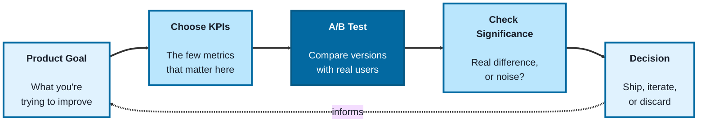
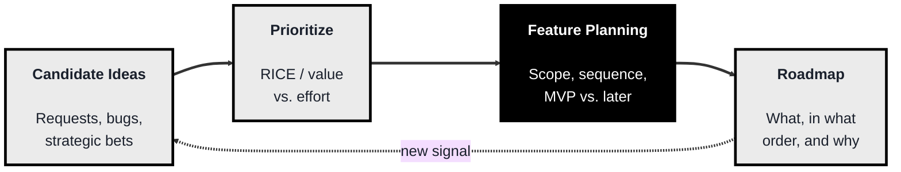
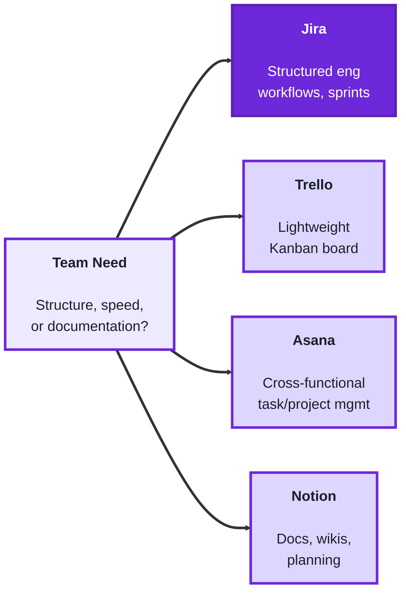

<!-- order: 6 -->
## Module: Analytics, Roadmapping & Collaboration (TechPO: Product & Project Management)

Time: about 7 hours

**By the end of this module, you'll be able to:**
- Choose and justify 2 to 3 KPIs for a feature, and spot a metric that misleads without context
- Design an A/B test with a clear win condition, and explain why statistical significance matters
- Calculate RICE scores to rank a backlog, and scope the top idea into an MVP with explicit out-of-scope items
- Explain a roadmap decision to a stakeholder using your prioritization criteria
- Compare Jira, Trello, Asana, and Notion, and set up a working board in the tool that fits a given team

**Purpose of this module:** Learn to choose and read the metrics that show whether a product is working, prioritize a roadmap with a framework like RICE, and pick and set up the right collaboration tool for a team.

**Tools needed for this module:** A free account on at least one project/collaboration tool, Jira, Trello, Asana, or Notion, whichever your organization uses or you're most curious about. A spreadsheet tool (Excel, Google Sheets) is useful for the Analytics lab. No paid tools are required to complete this module.

### Topic 1: Analytics

#### Concept

You can't tell whether a product decision worked by opinion alone, you need numbers that reflect real user behavior, and you need to know which numbers actually matter for the question you're asking. Analytics for a product manager isn't about becoming a data scientist, it's about picking the right metric, reading it correctly, and knowing when a change is real versus noise.

- **KPIs (Key Performance Indicators)** are the small set of metrics that matter most for a specific goal, chosen deliberately so the team isn't drowning in every number that's technically measurable
- **Product metrics** cover the broader set of numbers that describe how a product is actually used, activation, retention, engagement, churn, each answering a different question about user behavior
- **A/B testing** is running two (or more) versions of something at the same time with different users, then comparing results, so a change can be attributed to the change itself rather than to unrelated factors like seasonality
- **Statistical significance** is a check on whether a result in an A/B test is a real difference or could plausibly be random noise, important because a small sample size can produce a result that looks meaningful but isn't

#### Structure at a Glance


- Picking too many KPIs is the same as picking none, if everything is a priority metric, nothing gets acted on when it moves
- A/B test results that aren't checked for significance are a common source of false confidence, a team can ship a "winning" variant that was actually a coin flip

#### Where you'd actually use this

Deciding which two or three metrics actually indicate whether a new onboarding flow is working, instead of tracking twenty vanity numbers, running an A/B test on a pricing page change and correctly holding off shipping until the result is statistically significant, or noticing that a metric like weekly active users looks great while retention is quietly declining underneath it.

#### Lab

1. **Pick a real or hypothetical product feature** (existing or planned) and choose 2-3 KPIs that would actually tell you if it's succeeding, and write one sentence justifying each choice.
2. **List which broader product metrics** (activation, retention, engagement, churn) are relevant to that same feature, and note which one you'd worry about most if it started declining.
3. **Design a simple A/B test** for a real or hypothetical change (a button color, an onboarding step, a pricing tier): describe the two versions, what you'd measure, and what result would count as a win.
4. **Write one sentence on why you'd want to check statistical significance** before declaring a winner in that test, and roughly how you'd know if your sample size was too small to trust the result.
5. **Find one real dashboard or report** (from work, or a public example) and identify one metric on it that could be misleading on its own without a second metric next to it for context.

#### Checkpoint
You have 2-3 justified KPIs for a real feature, a list of relevant product metrics with one flagged as the most concerning if it declined, a designed A/B test with a defined win condition, and one identified example of a metric that's misleading without context.

#### Quiz
1. Why is picking too many KPIs functionally the same as picking none?
2. What is the difference between a KPI and a product metric, as described here?
3. What is A/B testing, and why does it help attribute a result to a specific change?
4. What is statistical significance, and why does it matter in an A/B test?
5. Give an example of a metric that could look good while a related metric is quietly getting worse.

*Answers: 1) If every metric is treated as a priority, none of them get acted on distinctly when they move, since there's no clear signal about what actually matters. 2) A KPI is one of the small set of metrics deliberately chosen as most important for a specific goal; product metrics are the broader set of numbers describing overall usage, like activation, retention, engagement, and churn. 3) Running two or more versions with different real users at the same time and comparing results, so the outcome can be attributed to the change itself rather than unrelated factors like seasonality. 4) A check on whether a test result reflects a real difference or could plausibly be random noise; it matters because a small sample size can produce a result that looks meaningful but isn't. 5) Weekly active users can look strong while retention is quietly declining underneath it, since the first counts activity broadly while the second reflects whether the same users are actually staying.*

---

### Topic 2: Roadmapping

#### Concept

A roadmap is a plan for what gets built, in what order, and why, and the hardest part isn't listing ideas, it's saying no to good ideas because something else matters more right now. Roadmapping is the discipline of making that tradeoff deliberately and defensibly, instead of building whatever was requested most recently or loudest.

- **Prioritization** is deciding what to work on first based on a consistent method (value, effort, urgency, strategic fit), rather than gut feel or whoever asked last
- **Prioritization frameworks** like RICE (Reach, Impact, Confidence, Effort) or a simple value-vs-effort matrix give a repeatable way to compare very different kinds of work against each other. The RICE score is **Reach × Impact × Confidence ÷ Effort**, where Confidence is a percentage converted to a decimal before you multiply (80% becomes 0.8). Worked example: a fix that reaches 6,000 users, with impact 1, 90% confidence, and 1 person-month of effort scores 6,000 × 1 × 0.9 ÷ 1 = **5,400**; a dark mode that reaches 4,000 users, with impact 0.5, 80% confidence, and 2 person-months scores 4,000 × 0.5 × 0.8 ÷ 2 = **800**, so the fix ranks higher
- **Feature planning** is breaking a prioritized idea down into something a team can actually build, scoping it, sequencing the pieces, and deciding what's in the first version versus a later one

**Recap: MVP.** Feature planning usually ends with an MVP (Minimum Viable Product): the smallest version that still delivers real value and can be learned from. The Product Fundamentals module (Topic 2: MVP) covers this in depth; here you just apply it when you scope your top-ranked idea.

#### Structure at a Glance


- A roadmap without a stated prioritization method quietly becomes "whoever asked most recently or loudest," even when nobody intends that

#### Where you'd actually use this

Explaining to a stakeholder why their feature request is ranked below another one, using a consistent framework rather than "we just decided," scoping a big idea down into a first shippable version instead of trying to build the whole vision at once, or defending a roadmap decision months later by pointing back to the criteria that produced it.

#### Lab

1. **List 5-6 real or plausible candidate features/ideas** for a product you know (or a hypothetical one).
2. **Score each one using a simple framework** (RICE, or a value-vs-effort 2x2), and rank them. If you use RICE, write Confidence as a percentage but convert it to a decimal in the formula (80% → 0.8). Write one sentence on which framework you chose and why.
3. **Pick your top-ranked idea and do feature planning on it**: scope out an MVP version, list what's explicitly out of scope for v1, and sequence 2-3 follow-on pieces for later.
4. **Write the one-sentence "why" you'd give a stakeholder** whose lower-ranked idea didn't make the cut, using the criteria from your framework, not just "we decided."
5. **Revisit your ranking after a hypothetical new signal** (a competitor launches something, a KPI from Topic 1 starts declining) and note whether and how the priority order would change.

```lab
{
 "type": "rice",
 "title": "Prioritise a real backlog with RICE",
 "prompt": "Four ideas for a study app. Change any number and watch the ranking update. Confidence is entered as a percentage; the score converts it to a decimal (80% → 0.8), so RICE score = Reach × Impact × (Confidence ÷ 100) ÷ Effort.",
 "items": [
  {
   "name": "Dark mode",
   "reach": 4000,
   "impact": 0.5,
   "confidence": 80,
   "effort": 2
  },
  {
   "name": "Offline flashcards",
   "reach": 1500,
   "impact": 2,
   "confidence": 50,
   "effort": 6
  },
  {
   "name": "Fix slow sign-up",
   "reach": 6000,
   "impact": 1,
   "confidence": 90,
   "effort": 1
  },
  {
   "name": "AI study coach",
   "reach": 3000,
   "impact": 3,
   "confidence": 30,
   "effort": 12
  }
 ],
 "note": "Notice how low confidence drags the exciting AI idea down, and how a small fix that reaches everyone can win."
}
```

#### Checkpoint
You have 5-6 scored and ranked ideas, an MVP scope with explicit out-of-scope items and a follow-on sequence, one stakeholder-facing justification tied to your framework, and one note on how a new signal would shift the ranking.

#### Quiz
1. What is the hardest part of roadmapping, according to this module?
2. What is prioritization, and why does it need a consistent method?
3. What does RICE stand for, and what is it used for?
4. What is feature planning, and what does it produce?
5. What is an MVP, and what makes a scoped-down feature actually "viable" rather than just small?

*Answers: 1) Saying no to good ideas because something else matters more right now, rather than simply listing ideas. 2) Deciding what to work on first based on value, effort, urgency, or strategic fit; it needs a consistent method so decisions aren't made by gut feel or by whoever asked last. 3) Reach, Impact, Confidence, Effort; it's a repeatable framework for comparing very different kinds of work against each other, scored as Reach × Impact × Confidence ÷ Effort with Confidence as a decimal, so 80% becomes 0.8. 4) Breaking a prioritized idea down into something a team can actually build; it produces a defined scope, a sequence of pieces, and a decision about what's in the first version versus later. 5) The smallest version of a feature that still delivers real value and can be learned from; it's "viable" only if it still delivers that real value; being small alone isn't enough.*

---

### Topic 3: Collaboration

#### Concept

Plans and priorities only matter if the team can actually see and act on them day to day, which is where collaboration tools come in. Jira, Trello, Asana, and Notion solve overlapping but slightly different problems, and knowing the differences helps you pick the right tool for a given team and use it well, rather than fighting the tool's natural shape.

- **Jira** is built for structured, engineering-heavy workflows, tickets, sprints, backlogs, and detailed workflow states, and is the most common choice on software teams that need that level of structure
- **Trello** is a lightweight, visual, card-based board (a direct Kanban implementation), well suited to simpler workflows or smaller teams that don't need Jira's depth of configuration
- **Asana** sits between the two, task- and project-oriented with more structure than Trello but less engineering-specific overhead than Jira, often used by cross-functional or less purely-technical teams
- **Notion** is a flexible workspace/wiki tool, strongest for documentation, planning docs, and knowledge management. It also has built-in Projects (task databases that can include sprints), so some small teams run their work there too, but many teams still pair it with Jira, Trello, or Asana for day-to-day tracking

#### Structure at a Glance


- These four aren't strict alternatives, and their features overlap more each year; a real team often runs Jira or Asana for active work tracking alongside Notion for the surrounding documentation and planning context
- Choosing a tool with more structure than a team actually needs (e.g. full Jira for a five-person team with a simple workflow) tends to create overhead that outweighs the benefit; matching tool to actual need matters more than picking the "best" tool in the abstract

#### Where you'd actually use this

Recommending Trello over Jira for a small, simple team that doesn't need custom workflow states, setting up an Asana project for a cross-functional launch involving both engineering and marketing, or maintaining a Notion space for product specs and decisions that lives alongside (not instead of) the team's Jira board for active sprint work.

#### Lab

1. **Pick one real or hypothetical team and workflow** (a small startup team, a large engineering org, a cross-functional launch team) and decide which of the four tools best fits it, with two sentences of reasoning based on the tool differences above.
2. **Sign up for (or open, if you already have access to) one of the four tools** and create one simple board or project for a real or sample piece of work: a few tasks, a couple of workflow stages (e.g. To Do / In Progress / Done).
3. **Add at least 3-4 real or sample tasks** to it, and move one through at least one status change to see how the workflow feels in practice.
4. **If you have access to a second tool**, do the same simple exercise there, and write 2-3 sentences comparing how each felt for the same basic task.
5. **Write one sentence on where Notion (or a similar wiki tool) would fit alongside** whichever tracking tool you chose, what documentation or planning content would live there instead of on the board itself.

#### Checkpoint
You have a tool recommendation with reasoning for a specific team, one working board/project with real tasks moved through at least one status change, and a note on where a documentation tool like Notion would fit alongside it.

#### Quiz
1. What kind of workflow is Jira built for, and what does that structure suit well?
2. How is Trello different from Jira?
3. Where does Asana typically sit relative to Trello and Jira?
4. What is Notion strongest at, and how do teams often use it alongside the other three?
5. Why can choosing a tool with more structure than a team needs create a problem?

*Answers: 1) Structured, engineering-heavy workflows with tickets, sprints, backlogs, and detailed workflow states; this suits software teams that need that level of structure. 2) Trello is a lightweight, visual, card-based Kanban board, well suited to simpler workflows or smaller teams that don't need Jira's depth of configuration. 3) Between the two, more structure than Trello but less engineering-specific overhead than Jira, often used by cross-functional or less purely-technical teams. 4) Documentation, planning docs, and knowledge management; it has built-in Projects with sprints that some small teams use, but many teams pair it with Jira, Trello, or Asana for day-to-day tracking. 5) It tends to create overhead, extra configuration and process, that outweighs the benefit, since the team didn't need that level of structure in the first place.*

```watch
{
 "scenes": [
  {
   "kind": "title",
   "art": "dashboard",
   "kicker": "Module · Analytics, Roadmapping & Collaboration",
   "title": "Measure, prioritise, coordinate",
   "beats": [
    {
     "say": "Welcome to Analytics, Roadmapping and Collaboration."
    },
    {
     "say": "You'll choose the metrics that show whether a product is working, prioritise a roadmap with a framework like RICE, and pick the right collaboration tool for a team."
    }
   ]
  },
  {
   "kind": "table",
   "kicker": "Topic 1 · Analytics",
   "title": "Two or three numbers that matter",
   "columns": [
    "Metric",
    "Kind",
    "Question it answers"
   ],
   "rows": [
    [
     "Onboarding completion",
     "KPI",
     "Do users finish it?"
    ],
    [
     "Activation",
     "KPI · product",
     "Reach first value?"
    ],
    [
     "Week-1 retention",
     "KPI · product",
     "Do they come back?"
    ],
    [
     "Engagement",
     "product",
     "How much they use it"
    ],
    [
     "Churn",
     "product",
     "Who leaves?"
    ],
    [
     "Total page views",
     "vanity",
     "Nothing to act on"
    ]
   ],
   "beats": [
    {
     "say": "Start with a goal. For a study app's new onboarding flow: more new users finish it, and stick around.",
     "sql": "Goal: more new users finish onboarding and stay"
    },
    {
     "say": "Here are six numbers you could track."
    },
    {
     "say": "Pick just three as K P Is, key performance indicators: completion, activation, and week one retention.",
     "hl": [
      0,
      1,
      2
     ],
     "dim": true,
     "col": 1
    },
    {
     "say": "Activation, retention, engagement and churn are the broader product metrics. Each answers a different question.",
     "hl": [
      1,
      2,
      3,
      4
     ],
     "dim": true,
     "col": 2
    },
    {
     "say": "Flag the one you'd worry about most. If week one retention falls, new users aren't staying.",
     "hl": 2,
     "dim": true
    },
    {
     "say": "Page views is a vanity number. It moves, but no decision follows.",
     "hl": 5,
     "dim": true
    },
    {
     "say": "Make all six a priority, and it's the same as picking none.",
     "hl": [
      0,
      1,
      2
     ]
    }
   ]
  },
  {
   "kind": "chart",
   "kicker": "Topic 1 · Analytics",
   "title": "Weekly actives up, retention down",
   "xlabel": "week 1 → 5",
   "ylabel": "WAU (hundreds) · retention %",
   "points": [
    [
     10,
     50
    ],
    [
     30,
     55
    ],
    [
     50,
     60
    ],
    [
     70,
     65
    ],
    [
     90,
     70
    ],
    [
     10,
     40
    ],
    [
     30,
     36
    ],
    [
     50,
     32
    ],
    [
     70,
     28
    ],
    [
     90,
     24
    ]
   ],
   "beats": [
    {
     "say": "Five weeks of the same study app's dashboard.",
     "groups": [
      0,
      0,
      0,
      0,
      0,
      0,
      0,
      0,
      0,
      0
     ]
    },
    {
     "say": "The top dots are weekly active users, in hundreds: five thousand, climbing to seven thousand.",
     "groups": [
      1,
      1,
      1,
      1,
      1,
      0,
      0,
      0,
      0,
      0
     ]
    },
    {
     "say": "Up forty percent. On its own, the dashboard looks great.",
     "groups": [
      1,
      1,
      1,
      1,
      1,
      0,
      0,
      0,
      0,
      0
     ],
     "line": [
      0.25,
      47.5
     ]
    },
    {
     "say": "Now add retention: the share of new users still active a week later.",
     "groups": [
      1,
      1,
      1,
      1,
      1,
      2,
      2,
      2,
      2,
      2
     ]
    },
    {
     "say": "It's quietly falling, from forty percent to twenty four.",
     "groups": [
      1,
      1,
      1,
      1,
      1,
      2,
      2,
      2,
      2,
      2
     ],
     "line": [
      -0.2,
      42
     ]
    },
    {
     "say": "A marketing push keeps adding new users, who count as active, while fewer of them stay. Never read weekly actives without retention beside it.",
     "marks": [
      [
       90,
       70
      ],
      [
       90,
       24
      ]
     ]
    }
   ]
  },
  {
   "kind": "table",
   "kicker": "Topic 1 · Analytics",
   "title": "A/B test: real win, or coin flip?",
   "columns": [
    "",
    "A · current",
    "B · new"
   ],
   "rows": [
    [
     "Onboarding",
     "4 steps",
     "3 steps"
    ],
    [
     "Pilot users",
     "20",
     "20"
    ],
    [
     "Pilot completed",
     "12 (60%)",
     "14 (70%)"
    ],
    [
     "Full-test users",
     "2,000",
     "2,000"
    ],
    [
     "Full completed",
     "1,200 (60%)",
     "1,400 (70%)"
    ]
   ],
   "beats": [
    {
     "say": "Test one change. Half of new users get the current four step onboarding, half get a new three step one, at the same time.",
     "hl": 0
    },
    {
     "say": "Same weeks, so things like seasonality hit both groups equally. Any difference comes from the change.",
     "hl": 0,
     "col": 2
    },
    {
     "say": "Write the win condition first: B's completion rate beats A's, and the gap is statistically significant.",
     "sql": "Win: B completion > A completion\nAND the gap is statistically significant"
    },
    {
     "say": "After two days, twenty users each. A: twelve finished, sixty percent. B: fourteen, seventy percent.",
     "hl": [
      1,
      2
     ],
     "dim": true
    },
    {
     "say": "Ten points better! But with only twenty per group, a gap that big shows up by pure chance about half the time.",
     "hl": [
      1,
      2
     ],
     "dim": true,
     "sql": "20 per group → gap could easily be noise → don't ship yet"
    },
    {
     "say": "So keep it running. Two thousand users each, and still sixty versus seventy percent.",
     "hl": [
      3,
      4
     ],
     "dim": true
    },
    {
     "say": "With two thousand per group, a ten point gap is very unlikely to be noise. It's significant, so ship B.",
     "hl": [
      3,
      4
     ],
     "dim": true,
     "col": 2,
     "sql": "2,000 per group → significant → ship B"
    }
   ]
  },
  {
   "kind": "table",
   "kicker": "Topic 2 · Roadmapping",
   "title": "Scoring a backlog with RICE",
   "columns": [
    "Idea",
    "Reach × Impact × Conf",
    "÷ Effort",
    "RICE"
   ],
   "rows": [
    [
     "Dark mode",
     "4,000 × 0.5 × 0.8",
     "÷ 2",
     "800"
    ],
    [
     "Offline flashcards",
     "1,500 × 2 × 0.5",
     "÷ 6",
     "250"
    ],
    [
     "Fix slow sign-up",
     "6,000 × 1 × 0.9",
     "÷ 1",
     "5,400"
    ],
    [
     "AI study coach",
     "3,000 × 3 × 0.3",
     "÷ 12",
     "225"
    ]
   ],
   "beats": [
    {
     "say": "Four ideas for the study app, and only room for one right now. Saying no is the hard part."
    },
    {
     "say": "RICE scores each one: reach, times impact, times confidence, divided by effort in person months.",
     "sql": "RICE = Reach × Impact × Confidence ÷ Effort\nConfidence as a decimal: 80% → 0.8"
    },
    {
     "say": "Dark mode: four thousand users, times a half, times zero point eight, is sixteen hundred. Divided by two months: eight hundred.",
     "hl": 0,
     "col": 3
    },
    {
     "say": "Offline flashcards: fifteen hundred, times two, times a half, is fifteen hundred. Over six months: two hundred and fifty.",
     "hl": 1,
     "col": 3
    },
    {
     "say": "Fixing slow sign up reaches six thousand, impact one, ninety percent, in one month: five thousand four hundred.",
     "hl": 2,
     "col": 3
    },
    {
     "say": "The A I study coach has big impact, but thirty percent confidence and twelve months of effort. Just two hundred and twenty five.",
     "hl": 3,
     "col": 2
    },
    {
     "say": "Low confidence drags the exciting idea down, and a small fix that reaches everyone wins.",
     "hl": 2,
     "dim": true,
     "col": 3
    }
   ]
  },
  {
   "kind": "array",
   "kicker": "Topic 2 · Roadmapping",
   "title": "Rank it, defend it, revisit it",
   "values": [
    "Sign-up 5,400",
    "Dark mode 800",
    "Offline 250",
    "AI coach 225"
   ],
   "beats": [
    {
     "say": "Sort by score, and that's the roadmap order.",
     "ptr": {
      "next": 0
     },
     "note": "Highest RICE first"
    },
    {
     "say": "The sign up fix goes first. Its M V P: cut the form to three fields. Social login is explicitly out of scope.",
     "ok": [
      0
     ],
     "note": "MVP: 3-field form · out of scope: social login"
    },
    {
     "say": "A stakeholder asks why dark mode waits. The answer uses the criteria, not we just decided.",
     "ok": [
      0
     ],
     "hl": [
      1
     ],
     "note": "Dark mode: 4,000 users, half impact, 2 months"
    },
    {
     "say": "Dark mode reaches fewer users, with half the impact, for twice the effort. Eight hundred against five thousand four hundred.",
     "ok": [
      0
     ],
     "hl": [
      1
     ],
     "note": "800 vs 5,400"
    },
    {
     "say": "Then a new signal. A competitor launches offline study, and a survey says four and a half thousand users want it.",
     "ok": [
      0
     ],
     "hl": [
      2
     ],
     "note": "New signal: reach 4,500 · confidence 80%"
    },
    {
     "say": "Re-score: forty five hundred, times two, times zero point eight, over six. Twelve hundred.",
     "vals": [
      "Sign-up 5,400",
      "Dark mode 800",
      "Offline 1,200",
      "AI coach 225"
     ],
     "ok": [
      0
     ],
     "hl": [
      2
     ],
     "note": "4,500 × 2 × 0.8 ÷ 6 = 1,200"
    },
    {
     "say": "Offline flashcards now passes dark mode, into second place. Same method, new inputs, a defensible new order.",
     "vals": [
      "Sign-up 5,400",
      "Offline 1,200",
      "Dark mode 800",
      "AI coach 225"
     ],
     "ok": [
      0
     ],
     "hl": [
      1
     ],
     "note": "New order · same criteria"
    }
   ]
  },
  {
   "kind": "table",
   "kicker": "Topic 3 · Collaboration",
   "title": "Match the tool to the team",
   "columns": [
    "Team",
    "Needs",
    "Best fit"
   ],
   "rows": [
    [
     "5-person startup",
     "Simple, quick setup",
     "Trello"
    ],
    [
     "Large eng org",
     "Sprints, strict states",
     "Jira"
    ],
    [
     "Eng + marketing launch",
     "Cross-team tasks",
     "Asana"
    ],
    [
     "Any of the above",
     "Specs, decisions, wiki",
     "Notion, alongside"
    ]
   ],
   "beats": [
    {
     "say": "Plans only matter if the team can see and act on them. Start from what each team actually needs.",
     "col": 1
    },
    {
     "say": "A five person startup with a simple flow: Trello, a lightweight visual Kanban board.",
     "hl": 0,
     "dim": true,
     "col": 2
    },
    {
     "say": "A large engineering org running sprints, with detailed workflow states: Jira.",
     "hl": 1,
     "dim": true,
     "col": 2
    },
    {
     "say": "Engineering and marketing launching together: Asana, more structure than Trello, less engineering overhead than Jira.",
     "hl": 2,
     "dim": true,
     "col": 2
    },
    {
     "say": "And for specs, decisions and planning docs: Notion, usually alongside one of the others.",
     "hl": 3,
     "dim": true,
     "col": 2
    },
    {
     "say": "Full Jira for the five person startup? The overhead outweighs the benefit.",
     "hl": [
      0,
      1
     ],
     "sql": "Match the tool to the need,\nnot the \"best\" tool in the abstract"
    }
   ]
  },
  {
   "kind": "diagram",
   "kicker": "Topic 3 · Collaboration",
   "title": "A working board, plus the docs",
   "nodes": [
    {
     "id": "spec",
     "label": "Notion · MVP spec",
     "sub": "why · in/out of scope",
     "x": 14,
     "y": 25,
     "art": "book"
    },
    {
     "id": "todo",
     "label": "To Do",
     "sub": "3 tasks",
     "x": 30,
     "y": 72,
     "art": "kanban"
    },
    {
     "id": "doing",
     "label": "In Progress",
     "sub": "being built",
     "x": 58,
     "y": 72,
     "art": "laptop"
    },
    {
     "id": "done",
     "label": "Done",
     "sub": "shipped",
     "x": 86,
     "y": 72,
     "art": "flag"
    }
   ],
   "edges": [
    {
     "from": "spec",
     "to": "todo"
    },
    {
     "from": "todo",
     "to": "doing"
    },
    {
     "from": "doing",
     "to": "done"
    }
   ],
   "beats": [
    {
     "say": "The startup builds the sign up fix. The M V P spec lives in Notion.",
     "show": 1,
     "on": "spec"
    },
    {
     "say": "Their Trello board gets three tasks from it: cut the form, speed up the email check, and time each sign up.",
     "show": 2,
     "on": "todo",
     "send": {
      "from": "spec",
      "to": "todo",
      "label": "3 tasks"
     }
    },
    {
     "say": "Someone starts cutting the form. The card moves to In Progress.",
     "show": 3,
     "on": "doing",
     "send": {
      "from": "todo",
      "to": "doing",
      "label": "Cut form"
     }
    },
    {
     "say": "When it's finished, it moves to Done. A status change the whole team can see.",
     "show": 4,
     "on": "done",
     "send": {
      "from": "doing",
      "to": "done",
      "label": "Cut form"
     }
    },
    {
     "say": "The why stays in Notion: RICE scores, and the out of scope list, linked from the card instead of crammed onto the board.",
     "show": 4,
     "on": "spec"
    }
   ]
  },
  {
   "kind": "quiz",
   "art": "ask",
   "kicker": "Quick check",
   "title": "Why does statistical significance matter in an A/B test?",
   "options": [
    "A small sample can produce a result that looks real but is just noise",
    "It makes the test run faster",
    "It decides which version users see"
   ],
   "answer": 0,
   "good": "That's right. Significance checks whether a difference is real or could plausibly be random noise, because a small sample can look meaningful but isn't.",
   "bad": "Not quite. Significance checks whether a difference is real or could plausibly be random noise, because a small sample can look meaningful but isn't.",
   "beats": [
    {
     "say": "Quick check.",
     "show": 0
    },
    {
     "say": "Why does statistical significance matter in an A/B test?",
     "show": 0
    },
    {
     "say": "Tap your answer.",
     "show": 1
    }
   ]
  },
  {
   "kind": "list",
   "art": "proof",
   "kicker": "Checkpoint",
   "title": "You're done when",
   "items": [
    [
     "KPIs and product metrics justified",
     ""
    ],
    [
     "A/B test with a win condition",
     ""
    ],
    [
     "5 to 6 ideas ranked",
     ""
    ],
    [
     "MVP scoped",
     ""
    ],
    [
     "Tool chosen for a team",
     ""
    ],
    [
     "Working board in use",
     ""
    ],
    [
     "Where Notion fits",
     ""
    ]
   ],
   "beats": [
    {
     "say": "That's this module.",
     "show": 0
    },
    {
     "say": "You're done when:",
     "show": 0
    },
    {
     "say": "you've chosen and justified two or three K P Is and the relevant product metrics,",
     "show": 1
    },
    {
     "say": "you've designed an A B test with a win condition, and considered significance,",
     "show": 2
    },
    {
     "say": "you've scored and ranked five or six ideas with a framework,",
     "show": 3
    },
    {
     "say": "you've scoped an M V P with out of scope items and follow-ons,",
     "show": 4
    },
    {
     "say": "you've chosen and justified a collaboration tool for a team,",
     "show": 5
    },
    {
     "say": "you've built a working board, with a task moved through a status change,",
     "show": 6
    },
    {
     "say": "and you've noted where a documentation tool like Notion fits alongside it.",
     "show": 7
    },
    {
     "say": "You've finished Analytics, Roadmapping and Collaboration. Well done.",
     "show": 7
    }
   ]
  }
 ]
}
```

---

## Module Completion Checklist
- [ ] Chosen and justified 2-3 KPIs and relevant product metrics for a real feature
- [ ] Designed an A/B test with a defined win condition and considered statistical significance
- [ ] Scored and ranked 5-6 candidate ideas using a prioritization framework
- [ ] Scoped an MVP with explicit out-of-scope items and a follow-on sequence
- [ ] Chosen and justified a collaboration tool (Jira, Trello, Asana, or Notion) for a specific team
- [ ] Created a working board/project with real tasks moved through at least one status change
- [ ] Noted where a documentation tool like Notion would fit alongside the chosen tracking tool

**Next:** you've finished the TechPO track.
