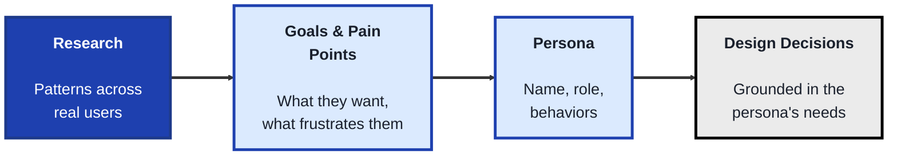
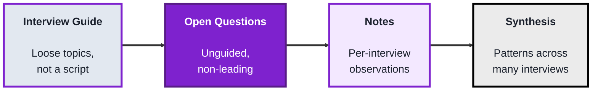
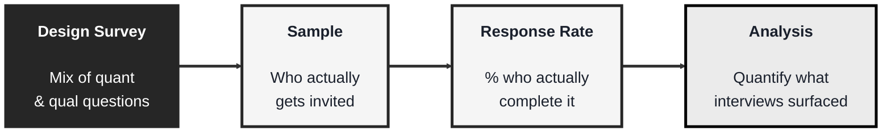

<!-- order: 2 -->
## Module: User Research (TechPO: Product & Project Management)

Time: about 6 hours

**By the end of this module, you'll be able to:**
- Draft primary and secondary proto-personas from clearly labeled assumptions
- Write an interview guide of open, non-leading questions about past behavior, and run a practice interview
- Synthesize interview notes and compare them against your persona assumptions
- Build and pilot a short survey that measures how common a pattern is, checked for response bias
- Explain when to use interviews (depth) versus surveys (breadth), and why a biased sample can't be fixed with more responses

**Purpose:** Learn who your users are and what they need by building personas, running interviews, and designing surveys.

**Tools needed for this module:** A web browser, a free account with a document tool such as [Google Docs](https://docs.google.com) or [Notion](https://www.notion.so), and a free account with a survey tool like [Google Forms](https://forms.google.com) or [Typeform](https://www.typeform.com). No coding environment or installs are required.

This is the in-depth home for interviews and surveys on She Model Tech; the TechLeads track's Research for Tech Teams module covers desk research (sources, market sizing, and competitor analysis) and links here for interviews and surveys.

### Topic 1: Personas

#### Concept

A **persona** is a fictional but research-based representation of a type of user, built to keep real user needs in mind during design and product decisions, rather than designing for an imagined "everyone" or, worse, for yourself. A good persona is grounded in patterns actually observed across real users, not a single person or a guess.

- A **persona** typically includes a name, role, goals, frustrations (pain points), and relevant behaviors, enough detail to make decisions concrete, without so much that it becomes a distraction
- A **primary persona** represents the most important user segment a product is designed for, a **secondary persona** represents a smaller but still relevant segment worth considering
- **Pain points** are the specific frustrations or obstacles a persona experiences related to the problem the product addresses, these often directly suggest what the product needs to solve
- A persona should be built from **research patterns**, not assumptions. Without one, teams talk about a vague "the user," which Alan Cooper called the **elastic user**: a fuzzy figure that stretches to fit whatever each person on the team wants to build. A clear persona stops that stretching
- A **proto-persona** is a draft persona built from the team's assumptions before research is done. It's a useful starting point, as long as it's clearly labeled as assumptions and checked against real research later

#### Structure at a Glance


- A persona is only as useful as the research behind it, a detailed-looking persona built purely from assumption can feel convincing while quietly leading a team astray
- Personas should be revisited as new research comes in, a persona based on early, limited research can go stale as a product's actual user base grows or shifts

#### Where you'd actually use this

Prioritizing which features matter most by checking them against a primary persona's actual goals, resolving a disagreement about who a product is really for, or onboarding a new team member quickly to who the product serves and why.

#### Lab

1. **Think of a product idea** (reuse the plant-care app from earlier modules, or invent your own).
2. **Write down 3 to 5 realistic assumptions** about who would use it (age range, context, motivation), labeling them clearly as assumptions, not confirmed research.
3. **Draft a primary proto-persona** in a shared doc (a proto-persona is built from assumptions, so label it that way), including a name, role, one or two goals, and two or three pain points, based on those assumptions.
4. **Draft a secondary proto-persona** representing a different, smaller user segment for the same product, and note in one sentence how their needs differ from the primary persona's.
5. **Write one sentence identifying what real research** (which you'll do in Topics 2 and 3) would be needed to confirm or correct each proto-persona, rather than relying on assumption alone.

#### Checkpoint
You have a primary and secondary proto-persona for a product idea, clearly built from labeled assumptions, along with a note on what real research would be needed to validate them.

#### Quiz
1. What is a persona, and what should it be based on?
2. What's the difference between a primary and secondary persona?
3. What are "pain points," and why are they useful in a persona?
4. What is an "elastic user," and why is it a problem?
5. Why should personas be revisited over time rather than treated as permanent?

*Answers: 1) A fictional but research-based representation of a type of user, it should be based on patterns actually observed across real users, not a single person or a guess. 2) A primary persona represents the most important user segment a product is designed for, a secondary persona represents a smaller but still relevant segment. 3) The specific frustrations or obstacles a persona experiences related to the problem, they're useful because they often directly suggest what the product needs to solve. 4) Alan Cooper's term for a vague "user" with no clear definition, which stretches to fit whatever each team member wants to build; it's a problem because every decision can be justified, so no one is really designing for a specific person. 5) Because a persona based on early, limited research can go stale as a product's actual user base grows or shifts over time.*

---

### Topic 2: Interviews

#### Concept

A **user interview** is a one-on-one conversation designed to understand a person's real behaviors, needs, and frustrations, in their own words, rather than asking them to predict what they'd want in a hypothetical future. Good interviews rely heavily on how questions are asked, small wording choices can lead someone toward the answer you wanted to hear instead of the truth.

- An **open-ended question** invites a real, unguided answer ("Walk me through the last time you tried to do X"), a **closed-ended question** only allows a narrow response ("Do you like X?"), interviews should lean heavily on the former
- A **leading question** subtly suggests the "right" answer ("Don't you think this feature would be helpful?"), leading questions produce biased, unreliable data even when the interviewee answers honestly
- An **interview guide** is a loose list of planned questions and topics, used as a reference rather than a rigid script, so the conversation can follow genuinely interesting threads as they come up
- **Synthesis** is the process of reviewing notes across multiple interviews afterward to find recurring patterns, a single interview's anecdote is a data point, a pattern across several interviews is a finding

#### Structure at a Glance


- Asking someone to predict their own future behavior ("Would you use a feature like this?") is notoriously unreliable, people are often wrong about their own future actions, past behavior ("Tell me about the last time...") is a much stronger signal
- A single compelling interview quote can feel like strong evidence, but treating one person's anecdote as a confirmed finding, without checking for the same pattern elsewhere, is a common and costly research mistake

#### Where you'd actually use this

Understanding why users struggle with a specific part of a product, validating (or invalidating) an assumption baked into a persona, or gathering the raw material needed to write an accurate problem statement before starting to design a solution.

#### Lab

1. **Write an interview guide** of 6 to 8 open-ended questions about a real behavior related to your product idea (for example, for a plant-care app: "Tell me about the last time you forgot to water a plant, what happened?").
2. **Review your questions** and rewrite any that are accidentally closed-ended or leading, checking each one against the definitions above.
3. **Conduct a real practice interview** with a friend, family member, or classmate (5-10 minutes is enough), asking your revised questions and taking notes on their actual answers, not just their opinions.
4. **Write a short synthesis note** after the interview, summarizing what you learned in your own words, separate from your original assumptions in Topic 1's persona draft.
5. **Compare the interview's findings to your Topic 1 persona**, and note in one or two sentences whether the interview confirmed, contradicted, or added something new to your assumptions.

#### Checkpoint
You have a reviewed, non-leading interview guide, notes and a synthesis from one real practice interview, and a written comparison against your earlier persona assumptions.

#### Quiz
1. What is the difference between an open-ended and a closed-ended question?
2. What is a "leading question," and why is it a problem even if the person answers honestly?
3. Why is asking about past behavior generally more reliable than asking someone to predict future behavior?
4. What is an "interview guide," and why is it described as loose rather than a rigid script?
5. What is "synthesis," and why does a single interview's anecdote need it before becoming a finding?

*Answers: 1) An open-ended question invites a real, unguided answer, a closed-ended question only allows a narrow response, interviews should lean heavily on open-ended questions. 2) A question that subtly suggests the "right" answer, it's a problem because it produces biased, unreliable data even when the person is being completely honest in their response. 3) Because people are often wrong about predicting their own future actions, while describing something they've actually already done is a much stronger, more concrete signal. 4) A loose list of planned questions and topics used as a reference, it's kept loose rather than rigid so the conversation can follow genuinely interesting threads as they naturally come up. 5) Reviewing notes across multiple interviews to find recurring patterns, it's needed because one person's anecdote is just a single data point, a pattern seen across several interviews is what actually counts as a finding.*

---

### Topic 3: Surveys

#### Concept

A **survey** collects structured responses from a larger number of people than interviews realistically allow, trading the depth of a one-on-one conversation for breadth and, when well designed, the ability to measure how common a pattern actually is. Surveys are best used to quantify something interviews already surfaced qualitatively, not usually to discover something completely unexpected.

- **Quantitative data** is numeric or categorical (ratings, multiple choice, yes/no), easy to analyze at scale, **qualitative data** is open-text or descriptive, richer but harder to analyze in bulk, most surveys mix both
- A **sample** is the group of people who actually respond, a **biased sample** (like only surveying existing power users about a beginner feature) produces misleading results even with a large number of responses
- **Response bias** describes ways the survey itself skews answers, leading question wording, too few answer options, or even question order can all shift results without respondents noticing
- A **response rate** is the percentage of people invited who actually completed the survey, a low response rate is a warning sign about how representative the results really are

#### Structure at a Glance


- Beginners sometimes reach for a survey first, hoping to discover new insights, but surveys are generally better at confirming and measuring the size of a pattern that interviews already surfaced, since respondents can only answer the specific questions asked
- A large number of responses doesn't fix a biased sample, one thousand responses from the wrong group of people is still less useful than one hundred responses from the right group

#### Where you'd actually use this

Measuring how widespread a pain point uncovered in interviews actually is across the broader user base, prioritizing between several candidate features by asking a larger group to rank or rate them, or tracking a metric like satisfaction over time.

#### Lab

1. **Reuse the synthesis note** from Topic 2's interview, and pick one specific pattern or pain point it surfaced.
2. **Build a short survey** (5 to 7 questions) in Google Forms or Typeform designed to measure how common that pattern is, mixing quantitative questions (multiple choice, rating scale) with one open-ended question at the end.
3. **Review your own questions for response bias**, rewriting any that are leading, or that offer too few or unbalanced answer options.
4. **Define your intended sample** in one or two sentences, describing who you'd actually want to invite to respond, and one reason why inviting the wrong group would bias your results.
5. **Run a pilot test with 3 to 5 people** (classmates, friends, colleagues). This is a clarity check, not real research: ask them to tell you about any question that was confusing, any missing answer option, and how long it took. Revise the survey based on their feedback. Don't treat their answers as results; 3 to 5 people is far too few to measure how common a pattern is. Write one sentence on what you would need (who, and roughly how many) for the real launch.

#### Checkpoint
You have a short survey built to measure a pattern surfaced by interviews, reviewed for response bias, piloted with 3 to 5 people for clarity, and paired with a defined intended sample for the real launch.

#### Quiz
1. What is the difference between quantitative and qualitative survey data?
2. What is a "biased sample," and why doesn't a larger number of responses fix it?
3. Name two things that can cause response bias in a survey.
4. What is a "response rate," and why does a low one matter?
5. Why are surveys generally better at confirming a pattern than discovering a new one?

*Answers: 1) Quantitative data is numeric or categorical (ratings, multiple choice), easy to analyze at scale, qualitative data is open-text or descriptive, richer but harder to analyze in bulk. 2) A sample that doesn't represent the group you actually care about, a larger number of responses doesn't fix it because all those extra responses are still coming from the wrong group of people. 3) Leading question wording, too few or unbalanced answer options, or question order (any two are valid). 4) The percentage of invited people who actually completed the survey, a low response rate matters because it raises doubt about how representative the results really are of the broader group. 5) Because respondents can only answer the specific questions asked, a survey can measure how common something already known is, but it can't surface something completely unexpected the way an open-ended interview conversation can.*

```watch
{
 "scenes": [
  {
   "kind": "title",
   "art": "people",
   "kicker": "Module · User Research",
   "title": "Learn who you're building for",
   "beats": [
    {
     "say": "Welcome to the User Research module."
    },
    {
     "say": "You'll learn who your users are and what they need, by building personas, running interviews, and designing surveys."
    },
    {
     "say": "All you need is a doc tool, and a survey tool like Google Forms or Typeform."
    }
   ]
  },
  {
   "kind": "table",
   "kicker": "Topic 1 · Personas",
   "title": "Draft a proto-persona",
   "columns": [
    "",
    "Primary",
    "Secondary"
   ],
   "rows": [
    [
     "Name",
     "Maya",
     "Sam"
    ],
    [
     "Who",
     "Busy renter, 3 plants",
     "Collector, 40 plants"
    ],
    [
     "Goal",
     "Keep plants alive",
     "Track every plant"
    ],
    [
     "Pain point",
     "Forgets to water",
     "Schedules all differ"
    ],
    [
     "Pain point",
     "Unsure about light",
     "Spreadsheet is a chore"
    ],
    [
     "Based on",
     "ASSUMPTIONS",
     "ASSUMPTIONS"
    ]
   ],
   "beats": [
    {
     "say": "A persona is a fictional, research based picture of a type of user. Let's draft one for the plant care app."
    },
    {
     "say": "With no research yet, we start from assumptions, clearly labelled.",
     "sql": "Assumptions, not research:\nbusy 25 to 35s · rent · few plants · want a green home",
     "hl": 5
    },
    {
     "say": "The primary proto-persona: Maya, a busy renter who wants to keep her three plants alive.",
     "hl": [
      0,
      1,
      2
     ],
     "dim": true,
     "col": 1
    },
    {
     "say": "Her pain points: she forgets to water, and she's unsure about light.",
     "hl": [
      3,
      4
     ],
     "dim": true,
     "col": 1
    },
    {
     "say": "A secondary persona is a smaller segment: Sam, who tracks forty plants on different schedules.",
     "hl": [
      1,
      2,
      3,
      4
     ],
     "dim": true,
     "col": 2
    },
    {
     "say": "Both are guesses, so we note what research must confirm.",
     "sql": "Research needed: do people really forget to water?\nDo collectors outgrow spreadsheets?",
     "hl": 5,
     "col": 1
    }
   ]
  },
  {
   "kind": "array",
   "kicker": "Topic 1 · Personas",
   "title": "The elastic user stretches",
   "values": [
    "Water reminders",
    "Light guide",
    "Plant ID by photo",
    "Social feed",
    "Pot shop",
    "Dark mode"
   ],
   "beats": [
    {
     "say": "Here are six feature ideas from the team.",
     "note": "Six ideas from the team"
    },
    {
     "say": "For a vague user, every one fits. Alan Cooper called this the elastic user: it stretches to fit whatever each person wants.",
     "hl": [
      0,
      1,
      2,
      3,
      4,
      5
     ],
     "note": "\"The user\" would want all of these"
    },
    {
     "say": "Check each against Maya instead. She forgets to water, so reminders stay.",
     "ok": [
      0
     ],
     "note": "Maya: forgets to water"
    },
    {
     "say": "She's unsure about light, so the light guide stays too.",
     "ok": [
      0,
      1
     ],
     "note": "Maya: unsure about light"
    },
    {
     "say": "The rest don't touch her pain points, so they drop.",
     "ok": [
      0,
      1
     ],
     "gone": [
      2,
      3,
      4,
      5
     ],
     "note": "A clear persona stops the stretching"
    },
    {
     "say": "But Maya is only as good as the research behind her. So, next, interviews.",
     "ok": [
      0,
      1
     ],
     "gone": [
      2,
      3,
      4,
      5
     ],
     "note": "Revisit as research comes in"
    }
   ]
  },
  {
   "kind": "table",
   "kicker": "Topic 2 · Interviews",
   "title": "Fix the interview guide",
   "columns": [
    "Draft question",
    "Problem",
    "Verdict"
   ],
   "rows": [
    [
     "Do you use plant apps?",
     "Closed: yes or no",
     "Rewrite"
    ],
    [
     "Isn't watering a pain?",
     "Leading",
     "Rewrite"
    ],
    [
     "Would you use alerts?",
     "Predicts the future",
     "Rewrite"
    ],
    [
     "Tell me about a time…",
     "Open, past behavior",
     "Keep"
    ]
   ],
   "beats": [
    {
     "say": "An interview guide is a loose list of questions, not a script. Let's review a first draft."
    },
    {
     "say": "Do you use plant apps? Closed. It only allows yes or no.",
     "hl": 0,
     "dim": true,
     "col": 1
    },
    {
     "say": "Open it up, so they answer in their own words.",
     "hl": 0,
     "dim": true,
     "sql": "→ \"Walk me through how you look after your plants.\""
    },
    {
     "say": "Isn't watering a pain? Leading. It suggests the answer, and biases even an honest person.",
     "hl": 1,
     "dim": true,
     "col": 1,
     "sql": "→ \"How do you keep track of watering?\""
    },
    {
     "say": "Would you use alerts? A prediction, and people often get their own future wrong.",
     "hl": 2,
     "dim": true,
     "col": 1,
     "sql": "✗ asks for a guess about the future"
    },
    {
     "say": "Ask about the past instead, like the last question, which we keep.",
     "hl": [
      2,
      3
     ],
     "dim": true,
     "col": 2,
     "sql": "→ \"Tell me about the last time you forgot\nto water a plant. What happened?\""
    }
   ]
  },
  {
   "kind": "table",
   "kicker": "Topic 2 · Interviews",
   "title": "Synthesis: from notes to findings",
   "columns": [
    "Who",
    "Note",
    "Theme"
   ],
   "rows": [
    [
     "P1",
     "Forgot on a trip",
     "Forgetting"
    ],
    [
     "P2",
     "Overwatered a fern",
     "How much water"
    ],
    [
     "P3",
     "Forgot during exams",
     "Forgetting"
    ],
    [
     "P4",
     "Wants to buy pots here",
     "One-off"
    ],
    [
     "P5",
     "Forgot after moving",
     "Forgetting"
    ]
   ],
   "beats": [
    {
     "say": "Say we ran five interviews. Here's one note from each.",
     "col": 1
    },
    {
     "say": "One person wants to buy pots. Vivid, but one anecdote is just a data point.",
     "hl": 3,
     "dim": true
    },
    {
     "say": "Synthesis tags each note with a theme, and looks across all of them.",
     "col": 2
    },
    {
     "say": "Three of five forgot to water. A pattern across interviews: that's a finding.",
     "hl": [
      0,
      2,
      4
     ],
     "dim": true,
     "col": 2,
     "sql": "Forgetting: 3 of 5 → finding"
    },
    {
     "say": "Now compare with Maya. Forgetting is confirmed.",
     "hl": [
      0,
      2,
      4
     ],
     "dim": true,
     "sql": "vs Maya: forgets to water → confirmed"
    },
    {
     "say": "How much water is new, and nobody mentioned light. So the persona gets updated.",
     "hl": 1,
     "dim": true,
     "sql": "vs Maya: forgets to water → confirmed\nhow much water → new · light → not heard"
    }
   ]
  },
  {
   "kind": "table",
   "kicker": "Topic 3 · Surveys",
   "title": "Check the survey for bias",
   "columns": [
    "Question",
    "Type",
    "Bias check"
   ],
   "rows": [
    [
     "How many plants?",
     "Quant: number",
     "OK"
    ],
    [
     "Forgot, past month?",
     "Quant: 0, 1-2, 3+",
     "OK"
    ],
    [
     "How bad is forgetting?",
     "Quant: rating",
     "Leading"
    ],
    [
     "Reminders: good/great?",
     "Quant: 2 options",
     "Unbalanced"
    ],
    [
     "Anything else?",
     "Qual: open text",
     "OK, goes last"
    ]
   ],
   "beats": [
    {
     "say": "A survey measures how common that pattern is: breadth, not depth.",
     "sql": "Measure: how many plant owners forget to water?"
    },
    {
     "say": "Most questions are quantitative: numbers and choices, easy to count.",
     "col": 1,
     "hl": [
      0,
      1,
      2,
      3
     ],
     "dim": true
    },
    {
     "say": "One open, qualitative question goes last: richer, but harder to analyse.",
     "col": 1,
     "hl": 4,
     "dim": true
    },
    {
     "say": "Now check for response bias. How bad is forgetting? That's leading.",
     "col": 2,
     "hl": 2,
     "dim": true,
     "sql": "→ \"How much does forgetting affect your plants?\""
    },
    {
     "say": "Good or great? Too few options, and unbalanced.",
     "col": 2,
     "hl": 3,
     "dim": true,
     "sql": "→ Very poor · Poor · Neutral · Good · Very good"
    },
    {
     "say": "Then pilot with three to five people: a clarity check, not results.",
     "sql": "Pilot, 4 people: anything confusing? missing option? how long?"
    }
   ]
  },
  {
   "kind": "diagram",
   "kicker": "Topic 3 · Surveys",
   "title": "From invite to answer",
   "nodes": [
    {
     "id": "intv",
     "label": "Interviews",
     "sub": "3 of 5 forget",
     "x": 12,
     "y": 30,
     "art": "mic"
    },
    {
     "id": "form",
     "label": "Survey",
     "sub": "5 questions",
     "x": 40,
     "y": 30,
     "art": "form"
    },
    {
     "id": "smp",
     "label": "Sample",
     "sub": "plant owners, all levels",
     "x": 68,
     "y": 30,
     "art": "people"
    },
    {
     "id": "rate",
     "label": "Response rate",
     "sub": "% who complete",
     "x": 88,
     "y": 72,
     "art": "funnel"
    },
    {
     "id": "ana",
     "label": "Analysis",
     "sub": "how common is it?",
     "x": 50,
     "y": 78,
     "art": "bars"
    }
   ],
   "edges": [
    {
     "from": "intv",
     "to": "form"
    },
    {
     "from": "form",
     "to": "smp"
    },
    {
     "from": "smp",
     "to": "rate"
    },
    {
     "from": "rate",
     "to": "ana"
    }
   ],
   "beats": [
    {
     "say": "Now the survey turns a finding into a number.",
     "show": 5
    },
    {
     "say": "The interviews hand it one pattern: forgetting to water.",
     "on": "form",
     "send": {
      "from": "intv",
      "to": "form",
      "label": "pattern: forget"
     }
    },
    {
     "say": "The sample is who you invite: four hundred plant owners, at every level.",
     "on": "smp",
     "send": {
      "from": "form",
      "to": "smp",
      "label": "400 invited"
     }
    },
    {
     "say": "One hundred complete it: a twenty five percent response rate.",
     "on": "rate",
     "send": {
      "from": "smp",
      "to": "rate",
      "label": "100 complete"
     }
    },
    {
     "say": "A low rate is a warning about how representative results are.",
     "on": "rate"
    },
    {
     "say": "Sixty of them forgot to water last month. Sixty percent: it's common.",
     "on": "ana",
     "send": {
      "from": "rate",
      "to": "ana",
      "label": "60 of 100 forget"
     }
    }
   ]
  },
  {
   "kind": "chart",
   "kicker": "Topic 3 · Surveys",
   "title": "More answers won't fix a biased sample",
   "xlabel": "responses (0 → 1,000)",
   "ylabel": "% who say they forget",
   "points": [
    [
     10,
     60
    ],
    [
     10,
     18
    ],
    [
     25,
     15
    ],
    [
     50,
     16
    ],
    [
     100,
     15
    ]
   ],
   "beats": [
    {
     "say": "Now imagine a second survey, sent only to expert power users."
    },
    {
     "say": "Our right sample of one hundred said sixty percent.",
     "groups": [
      1,
      0,
      0,
      0,
      0
     ],
     "line": [
      0,
      60
     ]
    },
    {
     "say": "A hundred power users say about eighteen percent.",
     "groups": [
      1,
      2,
      0,
      0,
      0
     ]
    },
    {
     "say": "Collect more, up to a thousand. The answer barely moves.",
     "groups": [
      1,
      2,
      2,
      2,
      2
     ]
    },
    {
     "say": "It settles near fifteen percent. More answers just repeat the bias.",
     "groups": [
      1,
      2,
      2,
      2,
      2
     ],
     "marks": [
      [
       100,
       15
      ]
     ]
    },
    {
     "say": "A thousand from the wrong group are worth less than a hundred from the right one.",
     "groups": [
      1,
      2,
      2,
      2,
      2
     ],
     "marks": [
      [
       10,
       60
      ]
     ]
    }
   ]
  },
  {
   "kind": "quiz",
   "art": "ask",
   "kicker": "Quick check",
   "title": "Why is asking about past behaviour more reliable than asking someone to predict the future?",
   "options": [
    "Past questions are shorter",
    "People enjoy talking about the past more",
    "People are often wrong about what they'll do, but describing what they did is concrete"
   ],
   "answer": 2,
   "good": "That's right. People are often wrong about their own future actions, while describing something they've already done is a much stronger signal.",
   "bad": "Not quite. People are often wrong about their own future actions, while describing something they've already done is a much stronger signal.",
   "beats": [
    {
     "say": "Quick check.",
     "show": 0
    },
    {
     "say": "Why is asking about past behaviour more reliable than asking someone to predict the future?",
     "show": 0
    },
    {
     "say": "Tap your answer.",
     "show": 1
    }
   ]
  },
  {
   "kind": "list",
   "art": "proof",
   "kicker": "Checkpoint",
   "title": "You're done when",
   "items": [
    [
     "Proto-personas from labelled assumptions",
     ""
    ],
    [
     "Practice interview synthesised",
     ""
    ],
    [
     "Survey piloted, sample defined",
     ""
    ],
    [
     "Why past behaviour beats predictions",
     ""
    ],
    [
     "Depth versus breadth",
     ""
    ]
   ],
   "beats": [
    {
     "say": "That's the User Research module.",
     "show": 0
    },
    {
     "say": "You're done when:",
     "show": 0
    },
    {
     "say": "you've drafted primary and secondary proto-personas from labelled assumptions,",
     "show": 1
    },
    {
     "say": "you've written a non leading guide, run a practice interview, and synthesised it against your personas,",
     "show": 2
    },
    {
     "say": "you've built and piloted a short survey, with a defined sample for the real launch,",
     "show": 3
    },
    {
     "say": "you can explain why past behaviour questions beat predictions,",
     "show": 4
    },
    {
     "say": "and you can explain why interviews give depth and surveys give breadth.",
     "show": 5
    },
    {
     "say": "You've finished User Research. Well done.",
     "show": 5
    }
   ]
  }
 ]
}
```

---

## Module Completion Checklist
- [ ] Drafted a primary and secondary proto-persona from labeled assumptions, noting what research is needed to validate them
- [ ] Written and reviewed a non-leading interview guide, conducted a practice interview, and synthesized its findings against the personas
- [ ] Built, reviewed, and pilot-tested a short survey to measure a pattern from the interview, with a defined sample for the real launch
- [ ] Can explain why past-behavior questions are more reliable than asking someone to predict future behavior
- [ ] Can explain why interviews and surveys serve different purposes (depth versus breadth) rather than being interchangeable

**Next:** Product Design
