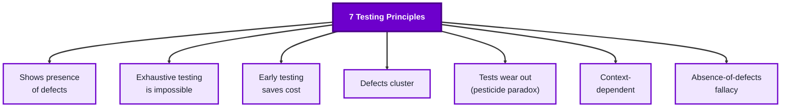

<!-- order: 2 -->
## Module 1: QA Fundamentals

**Time: about 5 hours** (1 hour for the SDLC, 2 hours each for the STLC and testing principles).

**By the end of this module, you'll be able to:**
- Name the six SDLC phases in order and identify QA work that happens before the Testing phase
- Write a short test plan, two structured test cases with test data, and exit criteria for one requirement
- Explain the seven testing principles and apply them to real decisions about what and how much to test
- Report a clean test run honestly, without claiming the software is bug-free

This module follows the ISTQB CTFL v4.0 syllabus topics; it doesn't give certification.

### Topic 1.1: SDLC (Software Development Life Cycle)

*Time: about 1 hour*

#### Concept

The **Software Development Life Cycle (SDLC)** is the sequence of phases a piece of software moves through, from the idea for it to its retirement. QA doesn't sit outside this cycle, it's built into every phase of it. Understanding the SDLC first matters because it tells you *when* testing-related activities are supposed to happen, and what a tester's job looks like at each stage, long before "run the tests" is even possible.

- **Requirements** - deciding what the software should do
- **Design** - deciding how it will do it (architecture, UI, data flow)
- **Development** - writing the actual code
- **Testing** - verifying the code does what the requirements said
- **Deployment** - releasing the software to real users
- **Maintenance** - fixing issues and adding small improvements after release

#### Structure at a Glance


```mermaid
%%{init: {'theme':'base', 'themeVariables': {'fontSize':'22px', 'primaryTextColor':'#1a202c', 'primaryBorderColor':'#1e4e8c', 'lineColor':'#333333'}, 'flowchart': {'nodeSpacing': 70, 'rankSpacing': 90, 'padding': 20}}}%%
flowchart LR
    R["<b>Requirements</b><br/><br/>What should it do?"]
    D["<b>Design</b><br/><br/>How will it work?"]
    DEV["<b>Development</b><br/><br/>Build the code"]
    T["<b>Testing</b><br/><br/>Verify it matches<br/>requirements"]
    DEP["<b>Deployment</b><br/><br/>Release to users"]
    M["<b>Maintenance</b><br/><br/>Fix and improve"]

    R ==> D ==> DEV ==> T ==> DEP ==> M

    style R fill:#2b6cb0,color:#fff,stroke:#1e4e8c,stroke-width:4px
    style D fill:#e2e8f0,color:#1a202c,stroke:#2b6cb0,stroke-width:4px
    style DEV fill:#e2e8f0,color:#1a202c,stroke:#2b6cb0,stroke-width:4px
    style T fill:#EBEBEB,color:#1a202c,stroke:#000000,stroke-width:4px
    style DEP fill:#e2e8f0,color:#1a202c,stroke:#2b6cb0,stroke-width:4px
    style M fill:#e2e8f0,color:#1a202c,stroke:#2b6cb0,stroke-width:4px
    linkStyle default stroke-width:4px,stroke:#333333
```

- Each phase produces something the next phase depends on (requirements produce a spec, design produces an architecture, and so on)
- A **model** (Waterfall, Agile, V-Model) is a specific way of arranging and repeating these phases, they all contain the same core phases, just structured differently
- QA activities exist in *every* phase, not just the "Testing" box, reviewing requirements for testability, reviewing designs for edge cases, is QA work too

#### Where you'd actually use this

Any time you join a project and need to figure out where things currently stand, are requirements still being written, is a build ready for test, has it already shipped, understanding the SDLC lets you correctly place yourself and know what's expected of you right now.

#### Lab

1. **Pick a small app you use daily** (a to-do list app, a food delivery app, anything).
2. **Write one plausible requirement** for a feature it has (for example, "Users can mark a task as complete").
3. **Walk that single requirement through all six SDLC phases** in your own words: what would design look like for it, what would development involve, what would you test, how might it be deployed, what maintenance might it need six months later.
4. **Identify one QA activity you could do *before* the Testing phase even starts** (for example, reviewing the requirement itself for ambiguity).

```lab
{
 "type": "order",
 "title": "Put the SDLC phases in order",
 "prompt": "Use the arrows to arrange the six phases from first to last, then check.",
 "items": [
  "Requirements",
  "Design",
  "Development",
  "Testing",
  "Deployment",
  "Maintenance"
 ],
 "explain": "Requirements say what to build, Design decides how, Development builds it, Testing checks it, Deployment releases it, and Maintenance keeps it working."
}
```

#### Checkpoint
You can name all six SDLC phases in order, explain what each phase hands off to the next, and describe one QA activity that happens outside the "Testing" phase itself.

#### Quiz
1. What are the six phases of the SDLC, in order?
2. What does the Design phase produce that Development depends on?
3. Is testing something that only happens during the "Testing" phase? Why or why not?
4. What is a "model" (like Waterfall or Agile) in the context of the SDLC?
5. Why does a QA professional need to understand the SDLC before doing any hands-on testing?

*Answers: 1) Requirements, Design, Development, Testing, Deployment, Maintenance. 2) An architecture or design specification, decisions about how the software will work, that developers then build against. 3) No, QA activities like reviewing requirements or designs happen throughout the cycle; the "Testing" phase is just where the most concentrated, formal testing activity occurs. 4) A specific way of arranging and repeating the core SDLC phases (in sequence, in short repeating cycles, in parallel with development, etc.), different models, same underlying phases. 5) It tells you when testing-related activities are supposed to happen and what's expected of you at each stage, so you know how to contribute correctly at any point in a project.*

---

### Topic 1.2: STLC (Software Testing Life Cycle)

*Time: about 2 hours*

#### Concept

The **Software Testing Life Cycle (STLC)** is the sequence of testing activities that runs *alongside* the SDLC. It doesn't wait for the SDLC's Testing phase: Requirement Analysis starts while the requirements are being written, planning and test case writing happen during design and development, and execution peaks once there's a build to test. Where the SDLC describes the whole project, the STLC describes testing's own work, step by step, from figuring out what needs testing to formally closing testing out.

- **Requirement Analysis** - understanding what needs to be tested, from a testing point of view
- **Test Planning** - deciding scope, approach, resources, and schedule for testing
- **Test Case Development** - writing the actual test cases and test data
- **Environment Setup** - preparing the systems, data, and configuration tests will run against
- **Test Execution** - actually running the tests and logging results
- **Test Closure** - evaluating results, reporting, and documenting lessons learned

#### Structure at a Glance


```mermaid
%%{init: {'theme':'base', 'themeVariables': {'fontSize':'22px', 'primaryTextColor':'#1a202c', 'primaryBorderColor':'#c93a00', 'lineColor':'#333333'}, 'flowchart': {'nodeSpacing': 70, 'rankSpacing': 90, 'padding': 20}}}%%
flowchart LR
    RA["<b>Requirement<br/>Analysis</b><br/><br/>What needs testing?"]
    TP["<b>Test Planning</b><br/><br/>Scope, approach,<br/>schedule"]
    TCD["<b>Test Case<br/>Development</b><br/><br/>Write test cases<br/>and test data"]
    ES["<b>Environment<br/>Setup</b><br/><br/>Prepare systems<br/>and data"]
    TE["<b>Test Execution</b><br/><br/>Run tests,<br/>log results"]
    TC["<b>Test Closure</b><br/><br/>Report and<br/>document"]

    RA ==> TP ==> TCD ==> ES ==> TE ==> TC

    style RA fill:#ff4a00,color:#fff,stroke:#c93a00,stroke-width:4px
    style TP fill:#e2e8f0,color:#1a202c,stroke:#ff4a00,stroke-width:4px
    style TCD fill:#e2e8f0,color:#1a202c,stroke:#ff4a00,stroke-width:4px
    style ES fill:#e2e8f0,color:#1a202c,stroke:#ff4a00,stroke-width:4px
    style TE fill:#EBEBEB,color:#1a202c,stroke:#000000,stroke-width:4px
    style TC fill:#e2e8f0,color:#1a202c,stroke:#ff4a00,stroke-width:4px
    linkStyle default stroke-width:4px,stroke:#333333
```

- Each STLC phase has its own **entry criteria** (what must be true before it can start) and **exit criteria** (what must be true before it's considered done)
- A **test case** is a specific, repeatable check of one behavior, with five parts: an ID/title, preconditions, numbered steps, test data, and an expected result
- **Test data** is the actual values fed into a test case (a valid email, an invalid password, an empty field) to make it concrete rather than theoretical
- Test Execution isn't just "run it once", it includes logging defects, re-running failed cases after fixes, and tracking status until the exit criteria are met
- The ISTQB CTFL v4.0 syllabus names this work slightly differently, as the test process: test planning, test monitoring and control, test analysis, test design, test implementation, test execution, and test completion. It's the same work; the six STLC phases above are the names many teams use day to day

#### Where you'd actually use this

Any time a feature or build is handed to QA and you need a repeatable, defensible process for testing it, rather than testing on gut feeling. It's also what lets you answer, precisely, "did we test enough, and how do we know?"

#### Lab

1. **Take the requirement from the SDLC lab** ("Users can mark a task as complete").
2. **Write a one-paragraph Test Plan** for it: what will you test (marking complete, unmarking, marking an already-completed task again), what won't you test (things out of scope), and what order you'll test in.
3. **Write two full test cases** for it, each with: a title, preconditions, numbered steps, test data, and an expected result.
4. **Define exit criteria** for this mini test cycle (for example, "all written test cases executed at least once, no open critical defects").

```lab
{
 "type": "order",
 "title": "Put the STLC phases in order",
 "prompt": "These are the testing steps that run alongside the SDLC. Arrange them from first to last.",
 "items": [
  "Requirement Analysis",
  "Test Planning",
  "Test Case Development",
  "Environment Setup",
  "Test Execution",
  "Test Closure"
 ],
 "explain": "You work out what to test, plan how, write the test cases, prepare the environment, run the tests, then close out with a report."
}
```

#### Checkpoint
You have a short test plan, two properly structured test cases with real test data, and a written exit criterion, and you can explain how each maps to a specific STLC phase.

#### Quiz
1. What are the six phases of the STLC, in order?
2. What is the difference between "entry criteria" and "exit criteria" for a phase?
3. What five things should a well-written test case include?
4. What is "test data," and why does a test case need it to be concrete rather than theoretical?
5. Is running each test case exactly once enough to consider Test Execution complete? Why or why not?

*Answers: 1) Requirement Analysis, Test Planning, Test Case Development, Environment Setup, Test Execution, Test Closure. 2) Entry criteria are the conditions that must be true before a phase can begin; exit criteria are the conditions that must be true before it can be considered finished. 3) An ID/title, preconditions, numbered steps, test data, and an expected result. 4) Test data is the actual values used in a test case (a specific input); without it, a test case is just a description of an idea rather than something repeatable and checkable. 5) No, Test Execution also includes logging any defects found and re-running failed cases after fixes, until the exit criteria (like "no open critical defects") are actually met.*

---

### Topic 1.3: Testing Principles

*Time: about 2 hours*

#### Concept

**Testing principles** are the small set of hard-won truths about testing itself that hold true no matter what software you're testing or what tool you're using. They exist because testing has real limits, you can never test everything, a bug-free test run doesn't mean bug-free software, and knowing these limits up front keeps you from over-promising or testing the wrong things.

- **Testing shows the presence of defects, not their absence** - passing tests reduce risk, they don't prove a system is perfect
- **Exhaustive testing is impossible** - you can't test every input and every path; you have to choose, based on risk
- **Early testing saves time and cost** - the earlier a defect is found (ideally during Requirements or Design), the cheaper it is to fix
- **Defects cluster** - a small number of modules usually contain most of the defects; testing effort should focus there
- **Tests wear out** (often called the *pesticide paradox*) - running the same tests repeatedly eventually stops finding new bugs, because they keep checking the same paths; tests need to be reviewed and updated
- **Testing is context-dependent** - a banking app and a game are tested differently, because "quality" means different things for each
- **Absence-of-defects fallacy** (also called the *absence-of-errors fallacy*) - a system that's technically bug-free can still fail if it doesn't meet the user's actual needs

#### Structure at a Glance


- These aren't rules to memorize for their own sake, each one changes a real decision: how much to test, where to focus, when to update old tests, and how to phrase a test summary honestly

#### Where you'd actually use this

Any time you need to explain testing decisions to someone else, why you're not testing every possible input (exhaustive testing is impossible), why a "clean" test run doesn't mean "ship it with zero risk" (shows presence, not absence, of defects), or why last release's test suite needs updating (pesticide paradox).

#### Lab

1. **Take the "mark a task complete" feature again.**
2. **Apply the exhaustive testing principle:** list five realistic inputs/scenarios you'd test (not fifty), and briefly justify why you picked those five over others.
3. **Apply the defect clustering principle:** guess which part of this feature is most likely to have bugs (for example, the "already completed" edge case) and explain why you think testing effort should lean there.
4. **Write one honest, principle-aligned sentence** you could say to a product manager after a clean test run, one that reflects "shows presence, not absence, of defects" rather than overpromising.

```lab
{
 "type": "sort",
 "title": "Which principle is this?",
 "prompt": "Match each situation to the testing principle it shows.",
 "buckets": [
  "Exhaustive testing is impossible",
  "Early testing saves cost",
  "Defects cluster",
  "Tests wear out (pesticide paradox)"
 ],
 "items": [
  {
   "text": "Last release, the checkout module had 30 bugs and the settings page had 2.",
   "bucket": "Defects cluster",
   "why": "Most defects sit in a small number of modules, so testing effort should focus there."
  },
  {
   "text": "The same 200 regression tests have passed for a year, but users keep finding new bugs.",
   "bucket": "Tests wear out (pesticide paradox)",
   "why": "Tests that never change stop finding new bugs; they need reviewing and updating."
  },
  {
   "text": "A reviewer spots a contradiction in the requirements before any code is written.",
   "bucket": "Early testing saves cost",
   "why": "Fixing it now costs a conversation; fixing it after release costs rework."
  },
  {
   "text": "A text field accepts up to 500 characters, so there are far too many possible inputs to try.",
   "bucket": "Exhaustive testing is impossible",
   "why": "You can't test everything, so you choose inputs based on risk."
  },
  {
   "text": "The team rewrites old test cases to cover new features and edge cases.",
   "bucket": "Tests wear out (pesticide paradox)",
   "why": "Refreshing tests is the cure for the pesticide paradox."
  },
  {
   "text": "Most bugs found this month came from the payments service.",
   "bucket": "Defects cluster",
   "why": "Another sign that defects concentrate in a few areas."
  }
 ]
}
```

#### Checkpoint
You can name and briefly explain all seven testing principles, and you've applied at least two of them to a concrete testing decision rather than just reciting them.

#### Quiz
1. What does "testing shows the presence of defects, not their absence" actually mean for how you report test results?
2. Why is exhaustive testing considered impossible in practice?
3. What is the "pesticide paradox," and what should you do about it?
4. What does "defects cluster" suggest about how you should allocate testing effort?
5. Give an example of the "absence-of-defects fallacy": a system with zero known bugs that could still be considered a failure.

*Answers: 1) A passing test run means the tests that were run found no defects, it doesn't prove the software has no defects at all, so results should be reported as "no defects found in this scope," not "the software is bug-free." 2) The number of possible inputs and paths through most software is effectively infinite, so testing every combination isn't feasible; testers must choose a representative, risk-based subset instead. 3) The pesticide paradox (ISTQB CTFL v4.0 calls it "tests wear out") is the pattern where running the same tests repeatedly stops catching new bugs, because those tests keep checking the same paths while new defects sit elsewhere; the fix is to periodically review and update test cases. 4) It suggests focusing testing effort on the modules or areas historically most prone to defects, rather than spreading effort evenly across all areas regardless of risk. 5) An app that has zero crashes or logged bugs but is so confusing that users can't complete their intended task, it's technically defect-free but still fails to meet the user's actual need.*

```watch
{
 "scenes": [
  {
   "kind": "title",
   "art": "test",
   "kicker": "Module 1 · QA Fundamentals",
   "title": "When, what, and how much to test",
   "beats": [
    {
     "say": "Welcome to Module 1, Q A Fundamentals."
    },
    {
     "say": "You'll learn how software gets built, how testing is planned alongside it, and the principles that decide what to test."
    },
    {
     "say": "No tools needed. It follows the I S T Q B foundation syllabus topics, but it doesn't give certification."
    }
   ]
  },
  {
   "kind": "list",
   "art": "path",
   "kicker": "Topic 1.1 · Concept",
   "title": "The six SDLC phases",
   "items": [
    [
     "Requirements",
     "What should it do?"
    ],
    [
     "Design",
     "How will it work?"
    ],
    [
     "Development",
     "Build the code"
    ],
    [
     "Testing",
     "Verify against requirements"
    ],
    [
     "Deployment",
     "Release to users"
    ],
    [
     "Maintenance",
     "Fix and improve"
    ]
   ],
   "beats": [
    {
     "say": "The Software Development Life Cycle, or S D L C, is the sequence of phases software moves through, from idea to retirement.",
     "show": 0
    },
    {
     "say": "Requirements: deciding what the software should do.",
     "show": 1
    },
    {
     "say": "Design: deciding how it will do it.",
     "show": 2
    },
    {
     "say": "Development: writing the code.",
     "show": 3
    },
    {
     "say": "Testing: verifying the code does what the requirements said.",
     "show": 4
    },
    {
     "say": "Deployment: releasing it to real users.",
     "show": 5
    },
    {
     "say": "And Maintenance: fixing issues and adding small improvements after release.",
     "show": 6
    },
    {
     "say": "Each phase hands something to the next. Requirements produce a spec, design produces an architecture.",
     "show": 6
    }
   ]
  },
  {
   "kind": "quote",
   "art": "search",
   "kicker": "Topic 1.1 · Structure",
   "title": "QA lives in every phase",
   "quote": "Reviewing a requirement for ambiguity is QA work, before any code exists.",
   "beats": [
    {
     "say": "A model, like Waterfall, Agile or the V Model, is just a way of arranging and repeating these same phases.",
     "show": 0
    },
    {
     "say": "And Q A isn't only the Testing box.",
     "show": 1
    },
    {
     "say": "Reviewing requirements for testability, or designs for edge cases, is Q A work too. In the lab, you walk one requirement, like users can mark a task as complete, through all six phases, and find one Q A activity before testing starts.",
     "show": 1
    }
   ]
  },
  {
   "kind": "list",
   "art": "layers",
   "kicker": "Topic 1.2 · Concept",
   "title": "The STLC runs alongside",
   "items": [
    [
     "Requirement Analysis",
     "What needs testing?"
    ],
    [
     "Test Planning",
     "Scope, approach, schedule"
    ],
    [
     "Test Case Development",
     "Cases and test data"
    ],
    [
     "Environment Setup",
     "Systems and data"
    ],
    [
     "Test Execution",
     "Run, log, re-run"
    ],
    [
     "Test Closure",
     "Report and document"
    ]
   ],
   "beats": [
    {
     "say": "The Software Testing Life Cycle, or S T L C, is testing's own sequence of activities. It runs alongside the S D L C, not after it.",
     "show": 0
    },
    {
     "say": "Requirement analysis: what needs testing?",
     "show": 1
    },
    {
     "say": "Test planning: scope, approach, resources and schedule.",
     "show": 2
    },
    {
     "say": "Test case development: writing test cases and test data.",
     "show": 3
    },
    {
     "say": "Environment setup: preparing systems and data.",
     "show": 4
    },
    {
     "say": "Test execution: running tests, logging results, and re-running failed cases after fixes.",
     "show": 5
    },
    {
     "say": "And test closure: reporting and lessons learned. Each phase has entry criteria to start, and exit criteria to finish.",
     "show": 6
    }
   ]
  },
  {
   "kind": "list",
   "art": "doc",
   "kicker": "Topic 1.2 · Structure",
   "title": "Five parts of a test case",
   "items": [
    [
     "ID / title",
     ""
    ],
    [
     "Preconditions",
     ""
    ],
    [
     "Numbered steps",
     ""
    ],
    [
     "Test data",
     "Real values, not ideas"
    ],
    [
     "Expected result",
     ""
    ]
   ],
   "beats": [
    {
     "say": "A test case is a specific, repeatable check of one behaviour. It has five parts.",
     "show": 0
    },
    {
     "say": "An I D and title.",
     "show": 1
    },
    {
     "say": "Preconditions.",
     "show": 2
    },
    {
     "say": "Numbered steps.",
     "show": 3
    },
    {
     "say": "Test data: the actual values you feed in, like a valid email or an empty field, so it's concrete, not theoretical.",
     "show": 4
    },
    {
     "say": "And an expected result.",
     "show": 5
    }
   ]
  },
  {
   "kind": "flow",
   "art": "pencil",
   "kicker": "Topic 1.2 · Lab",
   "title": "Plan one requirement",
   "steps": [
    "One-paragraph test plan",
    "Two full test cases",
    "Exit criteria"
   ],
   "beats": [
    {
     "say": "In the lab, take the mark a task as complete requirement.",
     "show": 0
    },
    {
     "say": "Write a one paragraph test plan: what you'll test, what's out of scope, and in what order.",
     "show": 1
    },
    {
     "say": "Write two full test cases, each with all five parts.",
     "show": 2
    },
    {
     "say": "Then define exit criteria, like all test cases executed at least once, and no open critical defects.",
     "show": 3
    }
   ]
  },
  {
   "kind": "list",
   "art": "bulb",
   "kicker": "Topic 1.3 · Concept",
   "title": "Seven testing principles, part one",
   "items": [
    [
     "Shows presence, not absence",
     "Passing ≠ perfect"
    ],
    [
     "Exhaustive testing is impossible",
     "Choose by risk"
    ],
    [
     "Early testing saves cost",
     "Fix it in requirements"
    ],
    [
     "Defects cluster",
     "Focus effort there"
    ]
   ],
   "beats": [
    {
     "say": "Testing principles are hard-won truths that hold whatever you test, and whatever tool you use.",
     "show": 0
    },
    {
     "say": "Testing shows the presence of defects, not their absence.",
     "show": 1
    },
    {
     "say": "Exhaustive testing is impossible, so you choose based on risk.",
     "show": 2
    },
    {
     "say": "Early testing saves time and cost. A defect found in requirements is cheapest to fix.",
     "show": 3
    },
    {
     "say": "And defects cluster. A few modules usually hold most of the bugs, so focus there.",
     "show": 4
    }
   ]
  },
  {
   "kind": "list",
   "art": "warning",
   "kicker": "Topic 1.3 · Concept",
   "title": "Seven testing principles, part two",
   "items": [
    [
     "Tests wear out",
     "Pesticide paradox · refresh them"
    ],
    [
     "Context-dependent",
     "Bank ≠ game"
    ],
    [
     "Absence-of-defects fallacy",
     "Bug-free can still fail users"
    ]
   ],
   "beats": [
    {
     "say": "Three more.",
     "show": 0
    },
    {
     "say": "Tests wear out, often called the pesticide paradox. The same tests stop finding new bugs, so review and update them.",
     "show": 1
    },
    {
     "say": "Testing is context dependent. A banking app and a game are tested differently.",
     "show": 2
    },
    {
     "say": "And the absence of defects fallacy. A bug-free system can still fail if it doesn't meet users' real needs.",
     "show": 3
    }
   ]
  },
  {
   "kind": "quote",
   "art": "ask",
   "kicker": "Topic 1.3 · Lab",
   "title": "Report a clean run honestly",
   "quote": "No defects found in this scope. Not: the software is bug-free.",
   "beats": [
    {
     "say": "In the lab, pick five realistic inputs instead of fifty, and say where bugs are most likely to cluster.",
     "show": 0
    },
    {
     "say": "Then write one honest sentence for a product manager after a clean test run.",
     "show": 1
    },
    {
     "say": "Not, the software is bug-free. Instead: no defects found in this scope.",
     "show": 1
    }
   ]
  },
  {
   "kind": "quiz",
   "art": "ask",
   "kicker": "Quick check",
   "title": "What is the pesticide paradox, and what should you do about it?",
   "options": [
    "Running the same tests stops finding new bugs, so review and update them",
    "Testing too early wastes money, so wait for a build",
    "Bugs spread between modules, so test everything equally"
   ],
   "answer": 0,
   "good": "That's right. Running the same tests repeatedly keeps checking the same paths, so they stop finding new bugs. Periodically review and update your test cases.",
   "bad": "Not quite. Running the same tests repeatedly keeps checking the same paths, so they stop finding new bugs. Periodically review and update your test cases.",
   "beats": [
    {
     "say": "Quick check.",
     "show": 0
    },
    {
     "say": "What is the pesticide paradox, and what should you do about it?",
     "show": 0
    },
    {
     "say": "Tap your answer.",
     "show": 1
    }
   ]
  },
  {
   "kind": "list",
   "art": "proof",
   "kicker": "Checkpoint",
   "title": "You're done when",
   "items": [
    [
     "SDLC phases and QA outside Testing",
     ""
    ],
    [
     "Test plan and two test cases",
     ""
    ],
    [
     "Exit criteria defined",
     ""
    ],
    [
     "Two principles applied",
     ""
    ],
    [
     "SDLC, STLC and principles connected",
     ""
    ]
   ],
   "beats": [
    {
     "say": "That's Module 1.",
     "show": 0
    },
    {
     "say": "You're done when:",
     "show": 0
    },
    {
     "say": "you've named the six S D L C phases in order, and a Q A activity outside the Testing phase,",
     "show": 1
    },
    {
     "say": "you've written a short test plan and two structured test cases mapped to S T L C phases,",
     "show": 2
    },
    {
     "say": "you've defined exit criteria for a test cycle,",
     "show": 3
    },
    {
     "say": "you've applied at least two testing principles to a real scenario,",
     "show": 4
    },
    {
     "say": "and you can explain how the S D L C, the S T L C and the principles relate.",
     "show": 5
    },
    {
     "say": "Next, in Module 2, manual testing.",
     "show": 5
    }
   ]
  }
 ]
}
```

---

## Module 1 Completion Checklist
- [ ] Named all six SDLC phases in order and identified a QA activity outside the Testing phase
- [ ] Written a short test plan and two structured test cases mapped to STLC phases
- [ ] Defined exit criteria for a test cycle
- [ ] Named and applied at least two of the seven testing principles to a concrete scenario
- [ ] Can explain, in plain language, how the SDLC, the STLC, and testing principles relate to each other (SDLC = the whole project's life, STLC = testing's own life cycle running alongside it, principles = the ground rules that shape decisions in both)
