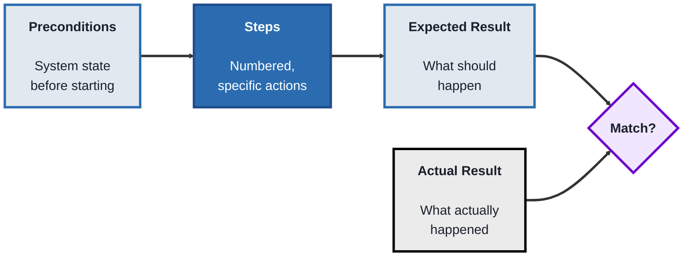
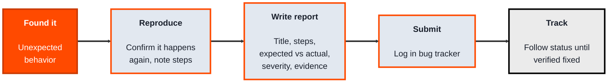
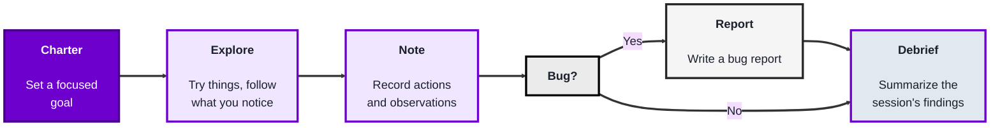

<!-- order: 3 -->
## Module 2: Manual Testing

**Time: about 6 hours** (roughly 2 hours per topic).

**By the end of this module, you'll be able to:**
- Write test cases with an ID, preconditions, numbered steps, test data, and an expected result, and run them against a real practice site
- Write a bug report a developer can act on, with steps, expected vs. actual result, severity, priority, environment, and evidence
- Explain the difference between severity and priority with examples
- Plan and run a timeboxed exploratory session from a charter, keep notes, and write a debrief

**Tools needed for this module:** a web browser. The labs use two free practice sites built for testers to practise on, [The Internet](https://the-internet.herokuapp.com) and [Sauce Demo](https://www.saucedemo.com). Use them only through the normal web pages, as any visitor would; no scanning or load tools.

### Topic 2.1: Test Cases

*Time: about 2 hours*

#### Concept

A **test case** is a specific, repeatable procedure, one set of preconditions, steps, inputs, and an expected result, that checks a single piece of behavior. Manual testing runs on test cases the way automation runs on scripts, they're the actual unit of testing work, and writing them well is what separates "I clicked around and it seemed fine" from a defensible, repeatable check.

- A **test case ID** and **title** identify the case and what it checks
- **Preconditions** describe the state the system must be in before the case starts (logged in, a specific record already exists, and so on)
- **Steps** are the exact, numbered actions to perform, written specifically enough that someone else could follow them without guessing
- **Test data** is the exact input values the steps use (a specific username, password, or search term), so every run uses the same inputs
- **Expected result** is what should happen if the behavior is correct, stated precisely enough to compare against the **actual result** after running it
- A **test suite** is a group of related test cases, usually covering one feature or module

#### Structure at a Glance


- A test **passes** if the actual result matches the expected result, and **fails** if it doesn't
- Test cases should be written *before* execution, ideally during the STLC's Test Case Development phase, not improvised while testing
- Good test cases are specific enough that two different people running the same case would get the same actual result

#### Where you'd actually use this

Any feature that needs to be checked more than once, by more than one person, over time, a login form, a checkout flow, a settings page. Well-written test cases turn "did we test this" into something you can point to and hand off to someone else entirely.

#### Lab

1. **Open the practice login form** at https://the-internet.herokuapp.com/login. The page itself shows the valid test username and password.
2. **Write three test cases** for it before you touch the form: one for a valid login, one for an invalid password, and one for an empty username field. Each should have an ID, title, preconditions, numbered steps, test data, and an expected result.
3. **Run each test case** exactly as written, and record the actual result (copy any message the page shows word for word).
4. **Mark each as Pass or Fail**, and for any fail, write one sentence describing the discrepancy between expected and actual. If a step was too vague to follow exactly, rewrite it; that's the most common test-case weakness.

#### Checkpoint
You have three properly structured test cases with real test data, "executed" with a recorded actual result, and a pass/fail verdict for each.

#### Quiz
1. What five things does a well-written test case typically include?
2. What is the difference between "expected result" and "actual result"?
3. Why should test cases usually be written before execution, rather than improvised during it?
4. What is a "test suite"?
5. What makes a test case "specific enough," in terms of two different people running it?

*Answers: 1) An ID/title, preconditions, numbered steps, test data, and an expected result. 2) Expected result is what should happen if the behavior is correct, decided in advance; actual result is what actually happened when the case was run. 3) Writing them in advance forces clarity about what's being checked and keeps testing repeatable and defensible, rather than ad hoc and dependent on memory. 4) A group of related test cases, usually covering one feature or module. 5) Two different people following the same steps with the same test data should arrive at the same actual result, no guessing or personal interpretation required.*

---

### Topic 2.2: Bug Reporting

*Time: about 2 hours*

#### Concept

**Bug reporting** is turning "something's wrong" into a written report clear enough that a developer can reproduce the problem, understand its impact, and fix it, without needing to ask the tester what they meant. A vague bug report ("the button doesn't work") wastes more time than it saves; a good one is often the difference between a same-day fix and a week of back-and-forth.

- **Title** - a short, specific summary of the problem
- **Steps to reproduce** - the exact numbered actions that trigger the bug
- **Expected result** - what should have happened
- **Actual result** - what actually happened instead
- **Severity** - how bad the impact is (crashes the app vs. a typo)
- **Priority** - how soon it needs fixing (urgent for the next release vs. can wait)
- **Environment** - browser, OS, device, app version, anything that could affect reproducibility

Plus, wherever possible, **evidence**: screenshots, screen recordings, or logs that back up the report.

#### Structure at a Glance


- **Severity** and **priority** are independent, a severe bug (crashes the app) might affect only a rare edge case (lower priority), while a minor bug (a wrong label) on the homepage might need fixing sooner (higher priority) just because everyone sees it
- Always try to reproduce a bug at least twice before reporting it, a report that turns out to be non-reproducible damages trust in future reports

#### Where you'd actually use this

Any time testing (manual or exploratory) turns up unexpected behavior, an error message on a valid input, a broken layout on mobile, a crash on a specific action, and it needs to reach a developer as something actionable rather than a vague complaint.

#### Lab

1. **Imagine you find this bug:** on a shopping cart page, clicking "Remove Item" removes the item from the list but the total price doesn't update.
2. **Write a full bug report** for it: title, numbered steps to reproduce, expected result, actual result, a severity, a priority, and the environment (make one up: browser, OS, app version).
3. **Justify your severity and priority choices** in one sentence each, explaining why they might differ from each other.
4. **Rewrite the same bug as a vague, low-quality report** ("cart is broken") so you can see side by side what information the good version added.
5. **Now report a real bug.** Sauce Demo has a test account with deliberate bugs: go to https://www.saucedemo.com, log in as `problem_user` (the password is listed on the login page), and use the shop as a customer would (browse, sort, add to cart, check out). Write a full bug report for one real problem you find, including a screenshot as evidence.

```lab
{
 "type": "sort",
 "title": "Severity or priority?",
 "prompt": "Severity is how bad the impact is; priority is how soon it needs fixing. Place each bug.",
 "buckets": [
  "High severity, high priority",
  "High severity, low priority",
  "Low severity, high priority",
  "Low severity, low priority"
 ],
 "items": [
  {
   "text": "Checkout fails for every user.",
   "bucket": "High severity, high priority",
   "why": "It breaks a core feature for everyone, so it's both serious and urgent."
  },
  {
   "text": "The app crashes, but only on an obsolete browser version almost nobody uses.",
   "bucket": "High severity, low priority",
   "why": "A crash is severe, but it affects very few people."
  },
  {
   "text": "The company name is misspelled on the homepage.",
   "bucket": "Low severity, high priority",
   "why": "Nothing breaks, but everyone sees it, so it should be fixed soon."
  },
  {
   "text": "A tooltip on a rarely used admin screen has the wrong punctuation.",
   "bucket": "Low severity, low priority",
   "why": "Minor and rarely seen, so it can wait."
  }
 ]
}
```

#### Checkpoint
You have one complete, well-structured bug report with all required fields, a justified severity and priority, and a contrasting vague version that makes clear why the details matter.

#### Quiz
1. What seven pieces of information does a good bug report typically include?
2. What is the difference between severity and priority?
3. Why should you try to reproduce a bug more than once before submitting a report?
4. Give an example of a bug that could be high severity but low priority.
5. Why does "the button doesn't work" fail as a bug report title or description?

*Answers: 1) Title, steps to reproduce, expected result, actual result, severity, priority, and environment (plus evidence where possible). 2) Severity is how bad the impact of the bug is; priority is how soon it needs to be fixed, they don't always move together. 3) To confirm it's a real, consistent problem and not a one-off fluke, and to make sure the steps you write actually and reliably trigger it. 4) A crash that only happens on an obsolete browser version almost nobody uses, severe when it happens, but low priority because it affects very few users. 5) It gives no steps to reproduce, no expected versus actual result, and no context, a developer can't act on it without going back to ask what "doesn't work" even means.*

---

### Topic 2.3: Exploratory Testing

*Time: about 2 hours*

#### Concept

**Exploratory testing** is simultaneously learning the software and testing it, without a pre-written script, guided by what you discover as you go rather than by test cases written in advance. It's not "just clicking around", it's structured, intentional investigation aimed at areas a written test case might not have anticipated.

- A **test charter** is a short, written goal for an exploratory session (for example, "explore the checkout flow's handling of invalid coupon codes for 30 minutes")
- **Session-based testing** is running exploratory testing in timeboxed sessions, each with its own charter, so the work stays focused and its results stay reportable
- Notes taken *during* exploration (what you tried, what you noticed, anything odd) turn a loose investigation into something you can report on afterward
- Exploratory testing complements scripted testing, it's especially good at finding the unexpected bugs a test case, written before anyone had seen the actual behavior, wouldn't have thought to check

#### Structure at a Glance


- A charter keeps a session from turning into unfocused wandering, it's exploratory, not random
- The debrief at the end is what makes exploratory testing reportable work rather than an untracked black box, what was covered, what was found, what wasn't gotten to

#### Where you'd actually use this

New features with no existing test cases yet, areas that keep producing bugs even after scripted tests pass, or any time you suspect a written test case missed something because it was written before anyone had actually used the real feature.

#### Lab

1. **Write a test charter** for one area of Sauce Demo (https://www.saucedemo.com), for example: "Explore the checkout flow as `problem_user` for 25 minutes, focusing on form fields and the order summary." (You can compare against `standard_user`, which should behave correctly.)
2. **Run the session** with a timer, trying at least five different things you wouldn't find in a typical scripted test case (rapid actions, unusual orders, going back midway, empty or very long field values, and so on).
3. **Take notes as you go**, one line per thing you tried and what happened.
4. **Write a short debrief**: what you covered, anything odd you noticed (a real bug or something you'd flag for a written test case), and what you'd explore next if you had more time.

#### Checkpoint
You have a written charter, a session log of at least five explored actions with notes, and a debrief summarizing coverage and findings.

#### Quiz
1. What is a "test charter," and why does an exploratory session need one?
2. How is exploratory testing different from just clicking around without a plan?
3. What is "session-based testing"?
4. Why are notes taken during the session important, rather than just remembering afterward?
5. What kind of bugs is exploratory testing especially good at finding, compared to scripted test cases?

*Answers: 1) A short, written goal for the session; it needs one so the exploration stays focused on a specific area or question rather than turning into unfocused wandering. 2) It's guided by an intentional charter and produces recorded notes and a debrief, it's structured investigation with a reportable outcome, not aimless clicking. 3) Running exploratory testing in timeboxed sessions, each with its own charter, so the work stays focused and its results stay reportable. 4) Notes capture exactly what was tried and observed in the moment; relying on memory afterward risks losing details needed to reproduce anything unusual that was found. 5) Unexpected bugs in areas or interaction patterns that no one anticipated when writing test cases in advance, since exploratory testing reacts to what the software actually does rather than what it was expected to do.*

```watch
{
 "scenes": [
  {
   "kind": "title",
   "art": "pencil",
   "kicker": "Module 2 · Manual Testing",
   "title": "Checks a person can repeat",
   "beats": [
    {
     "say": "Welcome to Module 2, Manual Testing."
    },
    {
     "say": "You'll write test cases, report bugs a developer can act on, and run exploratory sessions."
    },
    {
     "say": "All you need is a browser, and two free practice sites built for testers: The Internet, and Sauce Demo. Use them only through their normal pages."
    }
   ]
  },
  {
   "kind": "list",
   "art": "doc",
   "kicker": "Topic 2.1 · Concept",
   "title": "Anatomy of a test case",
   "items": [
    [
     "ID and title",
     "What it checks"
    ],
    [
     "Preconditions",
     "State before starting"
    ],
    [
     "Steps",
     "Numbered, specific"
    ],
    [
     "Test data",
     "Actual values"
    ],
    [
     "Expected result",
     "Precise enough to compare"
    ]
   ],
   "beats": [
    {
     "say": "A test case is a specific, repeatable procedure that checks one piece of behaviour.",
     "show": 0
    },
    {
     "say": "An I D and title say what it checks.",
     "show": 1
    },
    {
     "say": "Preconditions describe the state before you start, like being logged in.",
     "show": 2
    },
    {
     "say": "Steps are exact and numbered, so someone else could follow them without guessing.",
     "show": 3
    },
    {
     "say": "Test data gives the actual values.",
     "show": 4
    },
    {
     "say": "And the expected result is precise enough to compare with what actually happens. A group of related cases is a test suite.",
     "show": 5
    }
   ]
  },
  {
   "kind": "flow",
   "art": "target",
   "kicker": "Topic 2.1 · Structure",
   "title": "Expected versus actual",
   "steps": [
    "Expected: decided in advance",
    "Actual: what happened",
    "Match? Pass. Otherwise, fail"
   ],
   "beats": [
    {
     "say": "Run the steps, then compare.",
     "show": 0
    },
    {
     "say": "The expected result is decided in advance.",
     "show": 1
    },
    {
     "say": "The actual result is what really happened.",
     "show": 2
    },
    {
     "say": "If they match, the test passes. If not, it fails. Two people running the same case should get the same actual result.",
     "show": 3
    }
   ]
  },
  {
   "kind": "flow",
   "art": "browser",
   "kicker": "Topic 2.1 · Lab",
   "title": "Test a practice login form",
   "steps": [
    "Write 3 test cases first",
    "Run them as written",
    "Pass or fail, fix vague steps"
   ],
   "beats": [
    {
     "say": "Open the practice login page on The Internet. It shows the valid test username and password.",
     "show": 0
    },
    {
     "say": "Before touching the form, write three test cases: a valid login, an invalid password, and an empty username.",
     "show": 1
    },
    {
     "say": "Run each exactly as written, and copy any message word for word.",
     "show": 2
    },
    {
     "say": "Mark each pass or fail. If a step was too vague to follow, rewrite it. That's the most common weakness.",
     "show": 3
    }
   ]
  },
  {
   "kind": "list",
   "art": "warning",
   "kicker": "Topic 2.2 · Concept",
   "title": "A bug report a developer can act on",
   "items": [
    [
     "Title",
     "Short, specific"
    ],
    [
     "Steps to reproduce",
     "Exact, numbered"
    ],
    [
     "Expected vs. actual",
     ""
    ],
    [
     "Severity + priority",
     ""
    ],
    [
     "Environment",
     "Browser, OS, device, version"
    ],
    [
     "Evidence",
     "Screenshots, logs"
    ]
   ],
   "beats": [
    {
     "say": "A good bug report lets a developer reproduce, understand and fix the problem without asking what you meant.",
     "show": 0
    },
    {
     "say": "A short, specific title.",
     "show": 1
    },
    {
     "say": "Exact steps to reproduce.",
     "show": 2
    },
    {
     "say": "Expected versus actual result.",
     "show": 3
    },
    {
     "say": "Severity and priority.",
     "show": 4
    },
    {
     "say": "The environment: browser, operating system, device, app version.",
     "show": 5
    },
    {
     "say": "And evidence, like screenshots or logs. Reproduce a bug at least twice before you report it.",
     "show": 6
    }
   ]
  },
  {
   "kind": "list",
   "art": "bars",
   "kicker": "Topic 2.2 · Structure",
   "title": "Severity is not priority",
   "items": [
    [
     "Checkout fails for everyone",
     "High sev · high pri"
    ],
    [
     "Crash on an obsolete browser",
     "High sev · low pri"
    ],
    [
     "Homepage typo in company name",
     "Low sev · high pri"
    ],
    [
     "Admin tooltip punctuation",
     "Low sev · low pri"
    ]
   ],
   "beats": [
    {
     "say": "Severity is how bad the impact is. Priority is how soon it needs fixing. They're independent.",
     "show": 0
    },
    {
     "say": "Checkout fails for every user: high severity, high priority.",
     "show": 1
    },
    {
     "say": "A crash on an obsolete browser almost nobody uses: high severity, low priority.",
     "show": 2
    },
    {
     "say": "The company name misspelled on the homepage: low severity, but high priority, because everyone sees it.",
     "show": 3
    },
    {
     "say": "A wrong punctuation mark on a rarely used admin tooltip: low and low.",
     "show": 4
    }
   ]
  },
  {
   "kind": "flow",
   "art": "search",
   "kicker": "Topic 2.2 · Lab",
   "title": "Report a real bug",
   "steps": [
    "Full report: cart total bug",
    "Vague version to compare",
    "Real bug on Sauce Demo"
   ],
   "beats": [
    {
     "say": "Imagine removing a cart item doesn't update the total. Write a full report, and justify its severity and priority.",
     "show": 1
    },
    {
     "say": "Then rewrite it as a vague report, cart is broken, and compare what the good version adds.",
     "show": 2
    },
    {
     "say": "Finally, log in to Sauce Demo as problem user, shop like a customer, and report one real bug with a screenshot.",
     "show": 3
    }
   ]
  },
  {
   "kind": "list",
   "art": "path",
   "kicker": "Topic 2.3 · Concept",
   "title": "Exploratory, not random",
   "items": [
    [
     "Charter",
     "A focused goal"
    ],
    [
     "Timeboxed session",
     "One charter each"
    ],
    [
     "Notes",
     "As you go"
    ],
    [
     "Debrief",
     "Covered, found, not reached"
    ]
   ],
   "beats": [
    {
     "say": "Exploratory testing is learning the software and testing it at the same time, guided by what you discover.",
     "show": 0
    },
    {
     "say": "A test charter is a short written goal, like explore the checkout's handling of invalid coupons for thirty minutes.",
     "show": 1
    },
    {
     "say": "Session-based testing runs it in timeboxed sessions, each with its own charter.",
     "show": 2
    },
    {
     "say": "Notes taken during the session record what you tried and noticed.",
     "show": 3
    },
    {
     "say": "And a debrief summarises what was covered, what was found, and what wasn't reached.",
     "show": 4
    }
   ]
  },
  {
   "kind": "flow",
   "art": "stopwatch",
   "kicker": "Topic 2.3 · Lab",
   "title": "Run a session",
   "steps": [
    "Charter",
    "Timed session, 5+ tries",
    "Notes as you go",
    "Debrief"
   ],
   "beats": [
    {
     "say": "Write a charter for one area of Sauce Demo, like checkout as problem user for twenty five minutes. Compare with standard user, which should behave correctly.",
     "show": 1
    },
    {
     "say": "Run it with a timer, trying at least five things a script wouldn't: rapid actions, going back midway, empty or very long values.",
     "show": 2
    },
    {
     "say": "Write one line of notes per thing you tried.",
     "show": 3
    },
    {
     "say": "Then a short debrief: what you covered, what looked odd, and what you'd explore next.",
     "show": 4
    }
   ]
  },
  {
   "kind": "quiz",
   "art": "ask",
   "kicker": "Quick check",
   "title": "Which bug is high severity but low priority?",
   "options": [
    "Checkout fails for every user",
    "The company name is misspelled on the homepage",
    "A crash on an obsolete browser version almost nobody uses"
   ],
   "answer": 2,
   "good": "That's right. A crash is severe when it happens, but it affects very few users, so it can wait.",
   "bad": "Not quite. A crash is severe when it happens, but it affects very few users, so it can wait.",
   "beats": [
    {
     "say": "Quick check.",
     "show": 0
    },
    {
     "say": "Which bug is high severity but low priority?",
     "show": 0
    },
    {
     "say": "Tap your answer.",
     "show": 1
    }
   ]
  },
  {
   "kind": "list",
   "art": "proof",
   "kicker": "Checkpoint",
   "title": "You're done when",
   "items": [
    [
     "Three test cases with verdicts",
     ""
    ],
    [
     "A complete bug report",
     ""
    ],
    [
     "Good report vs. vague report",
     ""
    ],
    [
     "An exploratory session, debriefed",
     ""
    ],
    [
     "Exploratory + scripted together",
     ""
    ]
   ],
   "beats": [
    {
     "say": "That's Module 2.",
     "show": 0
    },
    {
     "say": "You're done when:",
     "show": 0
    },
    {
     "say": "you've written three structured test cases with recorded pass or fail verdicts,",
     "show": 1
    },
    {
     "say": "you've written a complete bug report with every field,",
     "show": 2
    },
    {
     "say": "you can explain why its details beat a vague report,",
     "show": 3
    },
    {
     "say": "you've run a timeboxed exploratory session with a charter, notes and a debrief,",
     "show": 4
    },
    {
     "say": "and you can explain how exploratory and scripted testing complement each other.",
     "show": 5
    },
    {
     "say": "Next, in Module 3, automation testing.",
     "show": 5
    }
   ]
  }
 ]
}
```

---

## Module 2 Completion Checklist
- [ ] Written three properly structured test cases with test data and recorded pass/fail verdicts
- [ ] Written a complete bug report with title, steps, expected/actual result, severity, priority, and environment
- [ ] Compared a good bug report against a vague one and can explain why the details matter
- [ ] Written a test charter and run a timeboxed exploratory session with notes and a debrief
- [ ] Can explain how exploratory testing and scripted test cases complement each other rather than compete
