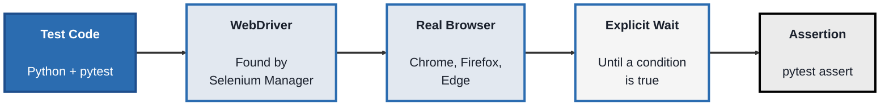
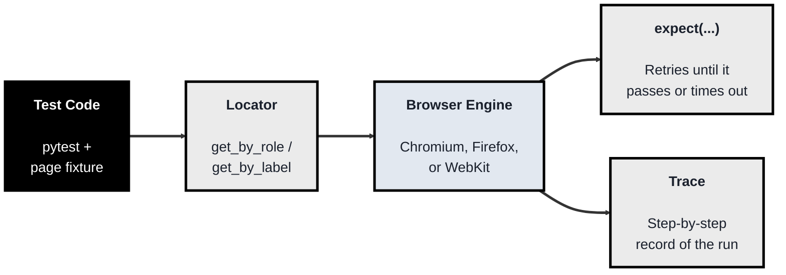
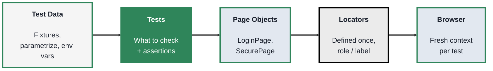

<!-- order: 4 -->
## Module 3: Automation Testing

**Time: about 7 hours** (2 hours for Selenium, 2.5 hours for Playwright, 2.5 hours for writing maintainable tests).

**By the end of this module, you'll be able to:**
- Write and run a Selenium test in Python that logs in to a practice site, using explicit waits instead of fixed sleeps
- Write and run Playwright tests with pytest, using role and label locators and web-first assertions, in headed and headless mode
- Record a Playwright trace and use it to find out why a test failed
- Organise tests with the Page Object pattern, keep each test independent, and avoid the common causes of flaky tests
- Decide what to automate and what to keep manual, and explain when a team would pick Selenium, Playwright, or Cypress

**Tools needed for this module:** [Python](https://www.python.org/downloads/) 3.12 or newer, a terminal, and a code editor like VS Code. Selenium needs Google Chrome installed (Selenium Manager, built into Selenium since 4.6, downloads the matching driver for you). Playwright downloads its own browsers. The labs use the free practice site [The Internet](https://the-internet.herokuapp.com), the same one from Module 2, which is built for testers to practise on. Only automate the pages named in the labs, and don't run tests against it in a loop or at high volume.

**Set up one project folder for the whole module.** Open a terminal and run:
```bash
mkdir automation-labs
cd automation-labs
python3 -m venv .venv
source .venv/bin/activate
pip install selenium pytest pytest-playwright
playwright install chromium
```
On Windows, activate the environment with `.venv\Scripts\activate` and use `python` instead of `python3`. On Linux, if Playwright says system libraries are missing, run `playwright install --with-deps chromium` instead. Activate the environment again each time you open a new terminal.

### Topic 3.1: Selenium

*Time: about 2 hours*

#### Concept

**Selenium** is the oldest and most widely used browser automation tool. Your test code sends commands to a **WebDriver**, a small program matched to each browser (ChromeDriver for Chrome, GeckoDriver for Firefox), and the driver turns those commands into real clicks, typing, and navigation in a real browser. Selenium supports many languages (Java, Python, C#, JavaScript, Ruby), which is a big reason so many established QA teams still use it.

- A **WebDriver** is the bridge between your test code and the browser. Since Selenium 4.6, **Selenium Manager** finds or downloads the right driver automatically, so you no longer download drivers by hand
- A **locator** finds an element on the page, for example `By.ID`, `By.CSS_SELECTOR`, or `By.XPATH`, so a command can act on it
- A **command** tells the browser what to do with an element: `click()`, `send_keys()`, or read its `.text`
- An **assertion** checks the result. Selenium has no test runner or assertions of its own, so it's paired with a framework such as pytest (Python), JUnit, or TestNG (Java)
- An **explicit wait** (`WebDriverWait` with an expected condition) pauses until a specific thing is true, such as "this element is visible", up to a time limit. This is how you handle pages that change after loading

#### Structure at a Glance


- Selenium acts immediately: if an element hasn't appeared yet, `find_element` fails. Explicit waits are your job, and missing ones are the most common cause of flaky Selenium tests
- Never fix timing problems with `time.sleep(5)`. A fixed sleep is too long on a fast day (slow suite) and too short on a slow day (failing test). Wait for the condition you actually need

#### Where you'd actually use this

Organisations with a large existing Selenium suite, teams that write tests in Java or C# alongside their app code, or projects that need to run tests on many browser and operating system combinations through Selenium Grid or a cloud browser service.

#### Lab

1. **Use the project folder from the module setup** (with the virtual environment active).
2. **Create a file named `test_selenium_login.py`** with two tests: a login test, and a test for a page that shows its content about 5 seconds after you click a button.
```python
import pytest
from selenium import webdriver
from selenium.webdriver.common.by import By
from selenium.webdriver.support import expected_conditions as EC
from selenium.webdriver.support.ui import WebDriverWait

BASE_URL = "https://the-internet.herokuapp.com"


@pytest.fixture
def driver():
    # Selenium Manager finds or downloads the right ChromeDriver for you.
    driver = webdriver.Chrome()
    yield driver
    driver.quit()  # always runs, even if the test fails


def test_valid_login_shows_secure_area(driver):
    driver.get(f"{BASE_URL}/login")
    driver.find_element(By.ID, "username").send_keys("tomsmith")
    driver.find_element(By.ID, "password").send_keys("SuperSecretPassword!")
    driver.find_element(By.CSS_SELECTOR, "button[type='submit']").click()

    # Wait for the result instead of sleeping.
    flash = WebDriverWait(driver, 10).until(
        EC.visibility_of_element_located((By.ID, "flash"))
    )
    assert "You logged into a secure area!" in flash.text
    assert driver.current_url.endswith("/secure")


def test_dynamic_content_with_explicit_wait(driver):
    driver.get(f"{BASE_URL}/dynamic_loading/2")
    driver.find_element(By.CSS_SELECTOR, "#start button").click()

    # "Hello World!" only appears after about 5 seconds.
    finish = WebDriverWait(driver, 10).until(
        EC.visibility_of_element_located((By.ID, "finish"))
    )
    assert finish.text == "Hello World!"
```
3. **Run the tests:**
```bash
pytest test_selenium_login.py -v
```
A Chrome window opens for each test, and both tests pass. The first run can take longer while Selenium Manager downloads the driver.
4. **See why the wait matters.** In the second test, replace the `WebDriverWait(...)` call with `finish = driver.find_element(By.ID, "finish")` and run it again. It fails with `NoSuchElementException`, because the element doesn't exist yet when Selenium looks. Put the wait back.
5. **Run without a visible window (headless).** Change the fixture's first line to:
```python
    options = webdriver.ChromeOptions()
    options.add_argument("--headless=new")
    driver = webdriver.Chrome(options=options)
```
Run the tests again. They pass without opening a window, which is how they usually run in a CI pipeline (Module 8).

#### Checkpoint
You have two passing Selenium tests that log in and handle content that appears late, using explicit waits and no fixed sleeps, and you can explain what the WebDriver and Selenium Manager each do.

#### Quiz
1. What is a WebDriver, and what does Selenium Manager do for you?
2. What is a locator? Name two strategies Selenium offers for building one.
3. Selenium has no assertion library of its own. What did you pair it with in this lab?
4. Why is an explicit wait better than `time.sleep(5)`?
5. Why might a large, established QA team still choose Selenium over a newer tool?

*Answers: 1) A WebDriver is the browser-specific program that turns Selenium's commands into real actions in the browser; Selenium Manager finds or downloads the matching driver automatically, so you don't install it by hand. 2) A locator tells Selenium how to find an element on the page; strategies include ID, CSS selector, and XPath. 3) pytest, which runs the tests and provides plain `assert` checks and fixtures for setup and cleanup. 4) An explicit wait continues as soon as the condition is true and only fails after a time limit, while a fixed sleep always wastes time when the page is fast and still fails when the page is slower than expected. 5) It supports many languages and browsers, it's a long-established standard, and the team may already have a large suite built on it that would be costly to rewrite.*

---

### Topic 3.2: Playwright

*Time: about 2.5 hours*

#### Concept

**Playwright** is a newer browser automation tool from Microsoft. It drives Chromium, Firefox, and WebKit (the engine behind Safari), and it supports Python, JavaScript/TypeScript, Java, and C#. In this module you'll use it from Python with the **pytest-playwright** plugin, which gives each test a fresh browser page through a `page` fixture.

- **User-facing locators** find elements the way a person (or a screen reader) sees them: `page.get_by_role("button", name="Login")` finds a button by its visible name, and `page.get_by_label("Username")` finds the input that a label describes. These keep working when classes or layout change. When nothing user-facing fits, a stable ID such as `page.locator("#flash")` is fine
- **Auto-waiting** means actions like `click()` and `fill()` wait until the element is visible, enabled, and ready before acting, so you don't write waits for every step
- **Web-first assertions** such as `expect(locator).to_have_text(...)` or `expect(page).to_have_url(...)` keep re-checking until they pass or time out (5 seconds by default). A plain `assert` checks only once
- **Tracing** records each step of a test (actions, screenshots, network calls, console messages) into a `trace.zip` file you can open in the Trace Viewer after the run
- **Headless vs headed:** tests run headless (no window) by default; add `--headed` to watch them

#### Structure at a Glance


- Each test gets its own **browser context**, a fresh, isolated session with no cookies or storage left over from other tests. This makes independent tests the default
- Locators are looked up again every time you use them, so you rarely see the "stale element" errors common in Selenium

#### Where you'd actually use this

New test projects that want reliable tests with little setup, teams that need to cover Safari's engine (WebKit) as well as Chrome and Firefox, and any team that wants built-in debugging through traces when a test fails in CI.

#### Lab

1. **Use the same project folder** (with the virtual environment active). The module setup already installed `pytest-playwright` and Chromium.
2. **Create a file named `test_playwright_login.py`:**
```python
import re

from playwright.sync_api import Page, expect

BASE_URL = "https://the-internet.herokuapp.com"


def test_valid_login_shows_secure_area(page: Page):
    page.goto(f"{BASE_URL}/login")
    page.get_by_label("Username").fill("tomsmith")
    page.get_by_label("Password").fill("SuperSecretPassword!")
    page.get_by_role("button", name="Login").click()

    expect(page).to_have_url(re.compile(r".*/secure$"))
    expect(page.locator("#flash")).to_contain_text("You logged into a secure area!")
    expect(page.get_by_role("link", name="Logout")).to_be_visible()


def test_wrong_password_shows_error(page: Page):
    page.goto(f"{BASE_URL}/login")
    page.get_by_label("Username").fill("tomsmith")
    page.get_by_label("Password").fill("wrongpassword")
    page.get_by_role("button", name="Login").click()

    expect(page.locator("#flash")).to_contain_text("Your password is invalid!")


def test_dynamic_content_appears(page: Page):
    page.goto(f"{BASE_URL}/dynamic_loading/2")
    page.get_by_role("button", name="Start").click()

    # No manual wait: expect() keeps checking. The content takes about
    # 5 seconds, so allow up to 10 instead of the default 5.
    expect(page.get_by_role("heading", name="Hello World!")).to_be_visible(timeout=10_000)
```
3. **Run the tests headless (the default):**
```bash
pytest test_playwright_login.py -v
```
4. **Watch them run in a visible browser,** slowed down so you can follow each step:
```bash
pytest test_playwright_login.py --headed --slowmo 500
```
5. **Break a test and read its trace.** In `test_wrong_password_shows_error`, change the expected text to `"Your password is wrong!"`. Run with tracing kept for failed tests:
```bash
pytest test_playwright_login.py --tracing retain-on-failure
```
The test fails after about 5 seconds of retrying. Open the trace it saved (the exact folder name is printed under `test-results/`):
```bash
playwright show-trace test-results/<folder-name>/trace.zip
```
In the Trace Viewer, click through the steps, look at the screenshot before and after the click, and find the real message the page showed. Then fix the expected text.
6. **Optional, another engine:** run `playwright install firefox`, then `pytest test_playwright_login.py --browser firefox`.

#### Checkpoint
You have three passing Playwright tests that use role and label locators and `expect()` assertions, you've run them headless and headed, and you've used a trace to explain why a test failed.

#### Quiz
1. Why is `page.get_by_role("button", name="Login")` usually a better locator than a long CSS path like `div.row > form > button.radius`?
2. What is the difference between `expect(locator).to_have_text(...)` and a plain `assert` on the element's text?
3. In the dynamic loading test, why did you pass a longer timeout to `to_be_visible`?
4. What does a Playwright trace record, and when is it most useful?
5. How do you run the same Playwright tests headless and then headed?

*Answers: 1) It finds the element the way a user sees it, by its role and visible name, so it keeps working when classes or page layout change, while a long CSS path breaks with small markup changes. 2) The `expect` assertion keeps re-checking until the text matches or the timeout runs out, so it handles pages that update after a moment; a plain assert checks once and fails if the page isn't ready yet. 3) The content takes about 5 seconds to appear, which is the same as the default assertion timeout, so a longer limit stops the test failing on a slow day. 4) It records each action with screenshots, network requests, and console messages; it's most useful for working out why a test failed, especially one that failed in CI where you couldn't watch it. 5) Run `pytest` as normal for headless, since that's the default, and add `--headed` (optionally with `--slowmo`) to watch the browser.*

---

### Topic 3.3: Writing Maintainable Automated Tests

*Time: about 2.5 hours*

#### Concept

Writing one test that passes is the easy part. The hard part is a suite of hundreds of tests that still passes next month, fails only when something is really broken, and is cheap to update when the app changes. A few habits make the difference.

- **The Page Object pattern** puts each page's locators and actions in one class (for example `LoginPage` with a `login()` method). Tests call those methods instead of repeating locators. When the page changes, you fix one class, not fifty tests. Keep assertions in the tests, so each test shows clearly what it checks
- **Independent tests** set up everything they need and never rely on another test running first. You should be able to run any single test on its own, or the suite in any order, and get the same result
- **Test data** should be clear and controlled: give each test its own data (or use data that's reset between runs), and keep credentials out of the code. Read real ones from environment variables or your CI tool's secrets. `pytest.mark.parametrize` runs one test with several data rows
- **Avoiding flaky tests:** wait for conditions (`expect`, explicit waits), never fixed sleeps like `time.sleep()` or `page.wait_for_timeout()`; use stable locators (role, label, or a dedicated `data-testid` the developers agree to keep); don't depend on live third-party services you don't control
- **What to automate:** stable, repeated, high-value checks, such as login, checkout, and anything in the regression suite (Module 8). **Keep manual:** exploratory testing, judging look and feel or usability, one-off checks, and features that are still changing every day

#### Structure at a Glance


- Tests say *what* is being checked ("an invalid username shows an error"); page objects know *how* to do it on this particular page
- If a locator appears in more than one test file, it probably belongs in a page object

**Choosing a tool.** Pick **Selenium** when the team already has a Selenium suite, writes tests in Java or C#, or needs Selenium Grid or a cloud service with a very wide range of browsers. Pick **Playwright** for most new projects: it has auto-waiting, web-first assertions, tracing, and Chromium, Firefox, and WebKit built in, in several languages. **Cypress** is a third popular tool you'll see in job descriptions and existing projects. It runs your tests inside the browser alongside the app, which gives it a very good visual runner for debugging, but tests are written only in JavaScript or TypeScript, and its WebKit support is still experimental. It suits front-end teams who already work in JavaScript. The habits in this topic (page objects, independent tests, no fixed sleeps, stable locators) apply to all three.

#### Lab

You'll rebuild the Playwright login tests from Topic 3.2 using page objects, shared configuration, and data-driven tests.

1. **Create this structure inside your project folder:**
```text
automation-labs/
  pytest.ini
  pages/
    __init__.py
    login_page.py
    secure_page.py
  tests/
    test_login.py
```
`pages/__init__.py` is an empty file; it tells Python that `pages` is a package.
2. **Add `pytest.ini`.** It sets the site address once, so tests use short paths like `/login`, and it lets tests import from `pages`:
```ini
[pytest]
base_url = https://the-internet.herokuapp.com
pythonpath = .
testpaths = tests
```
3. **Write the page objects.** `pages/login_page.py`:
```python
from playwright.sync_api import Page


class LoginPage:
    PATH = "/login"

    def __init__(self, page: Page):
        self.page = page
        self.username_input = page.get_by_label("Username")
        self.password_input = page.get_by_label("Password")
        self.login_button = page.get_by_role("button", name="Login")
        self.flash_message = page.locator("#flash")

    def open(self):
        self.page.goto(self.PATH)

    def login(self, username: str, password: str):
        self.username_input.fill(username)
        self.password_input.fill(password)
        self.login_button.click()
```
`pages/secure_page.py`:
```python
from playwright.sync_api import Page


class SecurePage:
    def __init__(self, page: Page):
        self.page = page
        self.heading = page.get_by_role("heading", name="Secure Area")
        self.flash_message = page.locator("#flash")
        self.logout_link = page.get_by_role("link", name="Logout")

    def logout(self):
        self.logout_link.click()
```
4. **Write the tests.** `tests/test_login.py`:
```python
import os

import pytest
from playwright.sync_api import Page, expect

from pages.login_page import LoginPage
from pages.secure_page import SecurePage

# Demo credentials published on the practice site. For a real app,
# set TEST_USERNAME and TEST_PASSWORD as environment variables instead.
USERNAME = os.environ.get("TEST_USERNAME", "tomsmith")
PASSWORD = os.environ.get("TEST_PASSWORD", "SuperSecretPassword!")


@pytest.fixture
def login_page(page: Page) -> LoginPage:
    login = LoginPage(page)
    login.open()
    return login


def test_valid_login_reaches_secure_area(login_page: LoginPage, page: Page):
    login_page.login(USERNAME, PASSWORD)

    secure = SecurePage(page)
    expect(secure.heading).to_be_visible()
    expect(secure.flash_message).to_contain_text("You logged into a secure area!")


def test_logout_returns_to_login_page(login_page: LoginPage, page: Page):
    # This test logs in by itself; it doesn't rely on the test above.
    login_page.login(USERNAME, PASSWORD)
    SecurePage(page).logout()

    expect(login_page.flash_message).to_contain_text("You logged out of the secure area!")


@pytest.mark.parametrize(
    "username, password, expected_message",
    [
        ("wronguser", PASSWORD, "Your username is invalid!"),
        (USERNAME, "wrongpassword", "Your password is invalid!"),
        ("", "", "Your username is invalid!"),
    ],
)
def test_invalid_login_shows_error(
    login_page: LoginPage, username: str, password: str, expected_message: str
):
    login_page.login(username, password)

    expect(login_page.flash_message).to_contain_text(expected_message)
```
5. **Run the suite** from the project folder:
```bash
pytest -v
```
You should see 5 passing tests: the parametrized test runs once per data row. (Because `testpaths = tests`, plain `pytest` now runs only the `tests` folder; run the Topic 3.1 and 3.2 files by name if you need them.)
6. **Check independence.** Run one test on its own and confirm it still passes:
```bash
pytest -v -k logout
```
7. **Simulate a page change.** Pretend the developers renamed the button to "Sign in": change `name="Login"` to `name="Sign in"` in `login_page.py` only, run `pytest`, and see every test fail at the same place. Change it back, and notice that the fix was one line in one file.
8. **Decide what to automate.** For the login page, write a short list in a text file with two columns: checks worth automating (for example, valid login, each error message, logout) and checks to keep manual (for example, whether the error message is easy to read, how the page looks on a small screen). Add one sentence explaining each choice.

#### Checkpoint
You have a 5-test Playwright suite organised with page objects, shared settings in `pytest.ini`, and data-driven tests; any single test passes on its own; and you've written down which login checks you'd automate and which you'd keep manual, with reasons.

#### Quiz
1. What problem does the Page Object pattern solve, and where should assertions go?
2. What does it mean for tests to be independent, and how can you check it?
3. Name two common causes of flaky UI tests and how to avoid each.
4. Give one kind of check that's worth automating and one that's better kept manual, with a reason for each.
5. When might a team choose Cypress instead of Playwright or Selenium?

*Answers: 1) It keeps each page's locators and actions in one class, so a change to the page is fixed in one place instead of in every test; assertions stay in the tests so each test shows clearly what it checks. 2) Each test sets up what it needs and doesn't rely on another test running first; you can check by running a single test on its own or running the suite in a different order and getting the same results. 3) Fixed sleeps, avoided by waiting for a condition with `expect` or an explicit wait; and brittle locators such as long CSS or XPath paths, avoided by using role, label, or test ID locators (shared test data and unreliable outside services are other common causes). 4) Automate a stable check that runs often, like valid login in the regression suite, because a machine repeats it quickly and the same way every time; keep judging usability or look and feel manual, because it needs human judgement a script can't give. 5) When it's a front-end team already working in JavaScript or TypeScript that values Cypress's in-browser visual runner for debugging, and doesn't need Python, Java, or strong WebKit coverage.*

```watch
{
 "scenes": [
  {
   "kind": "title",
   "art": "gear",
   "kicker": "Module 3 · Automation Testing",
   "title": "Turn repeatable checks into code",
   "beats": [
    {
     "say": "Welcome to Module 3, Automation Testing."
    },
    {
     "say": "You'll drive a real browser from Python with Selenium and Playwright, and keep the suite reliable."
    },
    {
     "say": "You need Python, a code editor, and one project folder with Selenium, pie test and Playwright installed."
    }
   ]
  },
  {
   "kind": "diagram",
   "kicker": "Topic 3.1 · Concept",
   "title": "How Selenium drives a real browser",
   "nodes": [
    {
     "id": "test",
     "label": "Test code",
     "x": 12,
     "y": 25,
     "sub": "Python + pytest",
     "art": "code"
    },
    {
     "id": "wd",
     "label": "WebDriver",
     "x": 46,
     "y": 25,
     "sub": "via Selenium Manager",
     "art": "plug"
    },
    {
     "id": "br",
     "label": "Real browser",
     "x": 84,
     "y": 25,
     "sub": "Chrome, Firefox, Edge",
     "art": "browser"
    },
    {
     "id": "wait",
     "label": "Explicit wait",
     "x": 84,
     "y": 78,
     "sub": "until a condition",
     "art": "stopwatch"
    },
    {
     "id": "as",
     "label": "Assertion",
     "x": 46,
     "y": 78,
     "sub": "pytest assert",
     "art": "checklist"
    }
   ],
   "edges": [
    {
     "from": "test",
     "to": "wd"
    },
    {
     "from": "wd",
     "to": "br"
    },
    {
     "from": "br",
     "to": "wait"
    },
    {
     "from": "wait",
     "to": "as"
    }
   ],
   "beats": [
    {
     "say": "Selenium starts with your test code.",
     "show": 1,
     "on": "test"
    },
    {
     "say": "It sends a command, like click, to a WebDriver, which Selenium Manager finds for you.",
     "show": 2,
     "on": "wd",
     "send": {
      "from": "test",
      "to": "wd",
      "label": "click()"
     }
    },
    {
     "say": "The driver makes a real click in a real browser.",
     "show": 3,
     "on": "br",
     "send": {
      "from": "wd",
      "to": "br",
      "label": "real click"
     }
    },
    {
     "say": "Selenium acts immediately, so an explicit wait pauses until a condition is true.",
     "show": 4,
     "on": "wait",
     "send": {
      "from": "br",
      "to": "wait",
      "label": "#flash visible?"
     }
    },
    {
     "say": "Then pie test asserts the result. Selenium has no assertions of its own.",
     "show": 5,
     "on": "as",
     "send": {
      "from": "wait",
      "to": "as",
      "label": "flash.text"
     }
    }
   ]
  },
  {
   "kind": "walk",
   "kicker": "Topic 3.1 · Lab",
   "title": "Wait for the condition, not the clock",
   "file": "test_selenium_login.py",
   "code": "def test_dynamic_content_with_explicit_wait(driver):\n    driver.get(f\"{BASE_URL}/dynamic_loading/2\")\n    driver.find_element(\n        By.CSS_SELECTOR, \"#start button\"\n    ).click()\n\n    # Appears after about 5 seconds.\n    finish = WebDriverWait(driver, 10).until(\n        EC.visibility_of_element_located(\n            (By.ID, \"finish\"))\n    )\n    assert finish.text == \"Hello World!\"",
   "beats": [
    {
     "say": "The lab's second test. The fixture has opened Chrome.",
     "line": 1,
     "vars": {
      "driver": "Chrome"
     }
    },
    {
     "say": "It opens the dynamic loading page.",
     "line": 2,
     "vars": {
      "driver": "Chrome",
      "page": "/dynamic_loading/2"
     }
    },
    {
     "say": "It clicks Start. A loading bar appears.",
     "line": [
      3,
      4,
      5
     ],
     "vars": {
      "driver": "Chrome",
      "page": "/dynamic_loading/2",
      "waited": "0 s"
     }
    },
    {
     "say": "The wait keeps checking for the finish element, for up to ten seconds.",
     "line": [
      8,
      9,
      10,
      11
     ],
     "vars": {
      "driver": "Chrome",
      "page": "/dynamic_loading/2",
      "waited": "2 s",
      "finish": "not there yet"
     }
    },
    {
     "say": "After about five seconds, Hello World appears, and the wait returns at once.",
     "line": [
      8,
      9,
      10,
      11
     ],
     "vars": {
      "driver": "Chrome",
      "page": "/dynamic_loading/2",
      "waited": "5 s",
      "finish": "Hello World!"
     }
    },
    {
     "say": "The assertion checks the text. Passed.",
     "line": 12,
     "vars": {
      "driver": "Chrome",
      "page": "/dynamic_loading/2",
      "waited": "5 s",
      "finish": "Hello World!"
     },
     "out": "PASSED"
    },
    {
     "say": "Without the wait, Selenium looks too early. No such element.",
     "line": [
      8,
      9,
      10,
      11
     ],
     "vars": {
      "driver": "Chrome",
      "page": "/dynamic_loading/2",
      "waited": "0 s",
      "finish": "missing"
     },
     "out": "FAILED: NoSuchElementException"
    },
    {
     "say": "Put the wait back. In headless mode, it passes with no window, the way C I runs it.",
     "line": 1,
     "vars": {
      "driver": "Chrome, headless"
     },
     "out": "PASSED"
    }
   ]
  },
  {
   "kind": "chart",
   "kicker": "Topic 3.1 · Why not sleep?",
   "title": "A fixed sleep is wrong on both kinds of day",
   "points": [
    [
     15,
     15
    ],
    [
     25,
     25
    ],
    [
     40,
     40
    ],
    [
     45,
     45
    ],
    [
     60,
     60
    ],
    [
     75,
     75
    ]
   ],
   "xlabel": "when the content appears",
   "ylabel": "when the test moves on",
   "beats": [
    {
     "say": "Six runs of one page: some fast, some slow."
    },
    {
     "say": "A five second sleep always waits five seconds.",
     "line": [
      0,
      50
     ]
    },
    {
     "say": "On fast days, that's wasted time.",
     "line": [
      0,
      50
     ],
     "groups": [
      1,
      1,
      1,
      1,
      0,
      0
     ]
    },
    {
     "say": "On slow days, it looks too early and fails.",
     "line": [
      0,
      50
     ],
     "groups": [
      1,
      1,
      1,
      1,
      2,
      2
     ],
     "marks": [
      [
       60,
       50
      ],
      [
       75,
       50
      ]
     ]
    },
    {
     "say": "An explicit wait moves on the moment the condition is true, every time.",
     "line": [
      1,
      0
     ],
     "groups": [
      3,
      3,
      3,
      3,
      3,
      3
     ],
     "marks": []
    }
   ]
  },
  {
   "kind": "walk",
   "kicker": "Topic 3.2 · Lab",
   "title": "Playwright: find it like a user, expect until it's true",
   "file": "test_playwright_login.py",
   "code": "def test_wrong_password_shows_error(page: Page):\n    page.goto(f\"{BASE_URL}/login\")\n    page.get_by_label(\"Username\").fill(\"tomsmith\")\n    page.get_by_label(\"Password\").fill(\n        \"wrongpassword\")\n    page.get_by_role(\"button\", name=\"Login\").click()\n\n    expect(page.locator(\"#flash\")).to_contain_text(\n        \"Your password is invalid!\")",
   "beats": [
    {
     "say": "Now Playwright. Each test gets a fresh, isolated browser context, and opens the login page.",
     "line": [
      1,
      2
     ],
     "vars": {
      "page": "/login"
     },
     "out": "$ pytest test_playwright_login.py -v"
    },
    {
     "say": "Get by label finds the input its label describes. Fill waits until it's ready.",
     "line": 3,
     "vars": {
      "page": "/login",
      "Username": "tomsmith"
     }
    },
    {
     "say": "A wrong password, on purpose.",
     "line": [
      4,
      5
     ],
     "vars": {
      "page": "/login",
      "Username": "tomsmith",
      "Password": "wrongpassword"
     }
    },
    {
     "say": "Get by role finds the button by its visible name, like a user would.",
     "line": 6,
     "vars": {
      "page": "/login",
      "Username": "tomsmith",
      "Password": "wrongpassword"
     }
    },
    {
     "say": "Expect keeps re-checking the message until it matches, for up to five seconds.",
     "line": [
      8,
      9
     ],
     "vars": {
      "page": "/login",
      "#flash": "Your password is invalid!"
     },
     "out": "PASSED"
    },
    {
     "say": "Now expect the wrong text, with tracing on. It retries for five seconds, then fails.",
     "line": 9,
     "vars": {
      "expected": "Your password is wrong!",
      "#flash": "not matching, retrying"
     },
     "out": [
      "$ pytest --tracing retain-on-failure",
      "FAILED"
     ]
    },
    {
     "say": "Open the trace, step through the screenshots, and read the real message.",
     "line": 9,
     "vars": {
      "expected": "Your password is wrong!",
      "page showed": "Your password is invalid!"
     },
     "out": "$ playwright show-trace …/trace.zip"
    },
    {
     "say": "Tests run headless by default. Add dash dash headed to watch.",
     "line": 1,
     "out": "$ pytest --headed --slowmo 500"
    }
   ]
  },
  {
   "kind": "diagram",
   "kicker": "Topic 3.3 · Page objects",
   "title": "Fix the page in one place, not in every test",
   "nodes": [
    {
     "id": "t1",
     "label": "Valid login test",
     "x": 12,
     "y": 18,
     "art": "test"
    },
    {
     "id": "t2",
     "label": "Logout test",
     "x": 12,
     "y": 50,
     "art": "test"
    },
    {
     "id": "t3",
     "label": "Invalid login ×3",
     "x": 12,
     "y": 82,
     "sub": "parametrized",
     "art": "test"
    },
    {
     "id": "po",
     "label": "LoginPage",
     "x": 52,
     "y": 50,
     "sub": "pages/login_page.py",
     "art": "blueprint"
    },
    {
     "id": "br",
     "label": "Browser",
     "x": 88,
     "y": 50,
     "sub": "fresh context",
     "art": "browser"
    }
   ],
   "edges": [
    {
     "from": "t1",
     "to": "po"
    },
    {
     "from": "t2",
     "to": "po"
    },
    {
     "from": "t3",
     "to": "po"
    },
    {
     "from": "po",
     "to": "br"
    }
   ],
   "beats": [
    {
     "say": "The lab suite has three test functions, each logging in by itself.",
     "show": 3,
     "on": [
      "t1",
      "t2",
      "t3"
     ]
    },
    {
     "say": "None repeats a locator. They all call login on the Login Page object.",
     "show": 4,
     "on": "po",
     "send": {
      "from": "t1",
      "to": "po",
      "label": "login(user, pwd)"
     }
    },
    {
     "say": "Only the page object knows how: fill, fill, click.",
     "show": 5,
     "on": "po",
     "send": {
      "from": "po",
      "to": "br",
      "label": "fill · click"
     }
    },
    {
     "say": "The tests keep the assertions.",
     "show": 5,
     "on": [
      "t1",
      "t2",
      "t3"
     ],
     "send": {
      "from": "po",
      "to": "t2",
      "label": "flash message"
     }
    },
    {
     "say": "Rename the button to Sign in, and every test fails at the same step.",
     "show": 5,
     "on": [
      "t1",
      "t2",
      "t3",
      "po"
     ],
     "send": {
      "from": "po",
      "to": "br",
      "label": "name=\"Sign in\""
     }
    },
    {
     "say": "The fix is one line, in one file.",
     "show": 5,
     "on": "po",
     "send": {
      "from": "po",
      "to": "br",
      "label": "name=\"Login\""
     }
    }
   ]
  },
  {
   "kind": "table",
   "kicker": "Topic 3.3 · Lab",
   "title": "Five passing tests, each on its own",
   "columns": [
    "Test",
    "username",
    "password",
    "Expects"
   ],
   "rows": [
    [
     "valid login",
     "tomsmith",
     "correct",
     "Secure Area"
    ],
    [
     "logout",
     "tomsmith",
     "correct",
     "logged out msg"
    ],
    [
     "invalid [1]",
     "wronguser",
     "correct",
     "username invalid"
    ],
    [
     "invalid [2]",
     "tomsmith",
     "wrongpassword",
     "password invalid"
    ],
    [
     "invalid [3]",
     "(empty)",
     "(empty)",
     "username invalid"
    ]
   ],
   "beats": [
    {
     "say": "Pie test dot ini sets the site address once. Then run pie test.",
     "sql": "$ pytest -v"
    },
    {
     "say": "Valid login checks the Secure Area heading.",
     "hl": 0,
     "dim": true
    },
    {
     "say": "Logout logs in by itself. It never relies on the test above.",
     "hl": 1,
     "dim": true
    },
    {
     "say": "Parametrize runs the invalid login test once per data row: three tests.",
     "hl": [
      2,
      3,
      4
     ],
     "dim": true,
     "col": 1,
     "sql": "@pytest.mark.parametrize(\n  \"username, password, expected_message\", [...])"
    },
    {
     "say": "Five passing tests. Real credentials would come from environment variables.",
     "hl": [
      0,
      1,
      2,
      3,
      4
     ],
     "col": 2,
     "sql": "$ pytest -v\n5 passed"
    },
    {
     "say": "Run one alone, and it still passes.",
     "hl": 1,
     "dim": true,
     "sql": "$ pytest -v -k logout\n1 passed, 4 deselected"
    }
   ]
  },
  {
   "kind": "table",
   "kicker": "Topic 3.3 · Choosing",
   "title": "What to automate, and with which tool",
   "columns": [
    "Check or situation",
    "Decision"
   ],
   "rows": [
    [
     "Valid login",
     "Automate"
    ],
    [
     "Each error message",
     "Automate"
    ],
    [
     "Is the error readable?",
     "Keep manual"
    ],
    [
     "Look on a small screen",
     "Keep manual"
    ],
    [
     "Big Java suite already",
     "Selenium"
    ],
    [
     "Most new projects",
     "Playwright"
    ],
    [
     "Front-end JS/TS team",
     "Cypress"
    ]
   ],
   "beats": [
    {
     "say": "Finally, decide what to automate."
    },
    {
     "say": "Automate stable, repeated checks. A machine runs them the same way every time.",
     "hl": [
      0,
      1
     ],
     "dim": true,
     "col": 1
    },
    {
     "say": "Keep readability and look and feel manual. They need human judgement.",
     "hl": [
      2,
      3
     ],
     "dim": true,
     "col": 1
    },
    {
     "say": "Selenium suits an existing Selenium suite, Java or C sharp tests, or Selenium Grid.",
     "hl": 4,
     "dim": true
    },
    {
     "say": "Playwright, for most new projects.",
     "hl": 5,
     "dim": true
    },
    {
     "say": "Cypress, for front-end teams in JavaScript or TypeScript. Its WebKit support is still experimental.",
     "hl": 6,
     "dim": true
    },
    {
     "say": "The habits are the same for all three.",
     "col": 0
    }
   ]
  },
  {
   "kind": "quiz",
   "art": "ask",
   "kicker": "Quick check",
   "title": "Why is an explicit wait better than time.sleep(5)?",
   "options": [
    "It makes the browser load pages faster",
    "It continues as soon as the condition is true, and only fails after a time limit",
    "Selenium can't run sleep commands"
   ],
   "answer": 1,
   "good": "That's right. A wait moves on as soon as the condition is true. A fixed sleep wastes time on a fast page and still fails on a slow one.",
   "bad": "Not quite. A wait moves on as soon as the condition is true. A fixed sleep wastes time on a fast page and still fails on a slow one.",
   "beats": [
    {
     "say": "Quick check.",
     "show": 0
    },
    {
     "say": "Why is an explicit wait better than a fixed sleep of five seconds?",
     "show": 0
    },
    {
     "say": "Tap your answer.",
     "show": 1
    }
   ]
  },
  {
   "kind": "list",
   "art": "proof",
   "kicker": "Checkpoint",
   "title": "You're done when",
   "items": [
    [
     "Selenium test with an explicit wait",
     ""
    ],
    [
     "Playwright tests, headless and headed",
     ""
    ],
    [
     "Debugged with a trace",
     ""
    ],
    [
     "Page object suite, independent tests",
     ""
    ],
    [
     "Automate vs. manual list",
     ""
    ],
    [
     "Choosing a tool",
     ""
    ]
   ],
   "beats": [
    {
     "say": "That's Module 3.",
     "show": 0
    },
    {
     "say": "You're done when:",
     "show": 0
    },
    {
     "say": "you've run a Selenium login test with an explicit wait, not a fixed sleep,",
     "show": 1
    },
    {
     "say": "you've run Playwright tests with role and label locators, headless and headed,",
     "show": 2
    },
    {
     "say": "you've used a trace to find why a test failed,",
     "show": 3
    },
    {
     "say": "you've built a page object suite where every test passes on its own,",
     "show": 4
    },
    {
     "say": "you've listed which login checks to automate and which to keep manual,",
     "show": 5
    },
    {
     "say": "and you can explain when to pick Selenium, Playwright or Cypress.",
     "show": 6
    },
    {
     "say": "Next, in Module 4, A P I testing.",
     "show": 6
    }
   ]
  }
 ]
}
```

---

## Module 3 Completion Checklist
- [ ] Written and run a Selenium test in Python that logs in and uses an explicit wait instead of a fixed sleep
- [ ] Written and run Playwright tests with role and label locators and `expect()` assertions, both headless and headed
- [ ] Used a Playwright trace to find out why a test failed
- [ ] Built a small suite with the Page Object pattern, shared settings in `pytest.ini`, and a parametrized data-driven test, where every test passes on its own
- [ ] Written a list of login checks to automate and to keep manual, with a reason for each
- [ ] Can explain when a team would pick Selenium, Playwright, or Cypress
