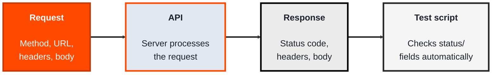
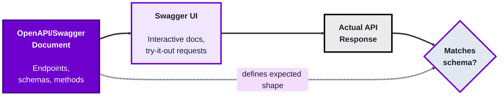
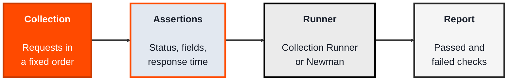

<!-- order: 5 -->
## Module 4: API Testing

**Time: about 7 hours** (2 hours each for Postman and Swagger, 3 hours for automated suites).

**By the end of this module, you'll be able to:**
- Send API requests in Postman and write test scripts that check status codes, fields, and response time
- Read an OpenAPI (Swagger) schema and compare a live response against it
- Build a collection with positive and negative tests and chain requests with a collection variable
- Run the same collection from the terminal with Newman, ready for a CI/CD pipeline

**Tools needed for this module:** [Postman](https://www.postman.com) (the desktop app or web app on its free tier), [Node.js](https://nodejs.org) for running collections from the terminal with Newman in Topic 4.3, and access to a public test API (the labs use a free one, no account needed for that part).

### Topic 4.1: Postman

*Time: about 2 hours*

#### Concept

**Postman** is a tool for sending requests directly to an API and inspecting exactly what comes back, without needing a UI or front-end code in between. Where UI testing checks what a user sees, API testing checks the actual contract between systems, the request, the response, the status code, the data shape, directly and much faster.

- A **request** specifies a method (GET, POST, PUT, DELETE), a URL, headers, and sometimes a body (the data being sent)
- A **response** comes back with a **status code** (200, 404, 500...), headers, and a body, usually JSON
- A **collection** is a saved, organized group of requests, so a whole set of API calls can be re-run together rather than rebuilt from scratch
- **Environment variables** let you swap values (like a base URL or an API key) across many requests at once, instead of editing each request individually when something changes
- **Tests** in Postman are small scripts (in JavaScript) that run after a response comes back, checking things like status code or specific field values automatically

#### Structure at a Glance


- A saved collection with test scripts on each request can be run automatically as a whole, turning manual API exploration into a repeatable regression check
- Because there's no UI in the loop, API tests in Postman run and report results far faster than an equivalent browser-based test

#### Where you'd actually use this

Verifying a backend endpoint works correctly before the front-end that will call it even exists, checking that an API still behaves correctly after a change (regression), or diagnosing whether a bug lives in the API itself or in how the UI is using it.

#### Lab

1. **Open Postman and create a new request.** Set the method to GET and the URL to a free test API: `https://jsonplaceholder.typicode.com/users/1`
2. **Send the request** and inspect the response: note the status code and look at the JSON body's fields (name, email, address, and so on).
3. **Add a test script** on the request (in Postman's "Tests" or "Post-response" tab):
```javascript
pm.test("Status code is 200", function () {
    pm.response.to.have.status(200);
});

pm.test("Response has an email field", function () {
    const body = pm.response.json();
    pm.expect(body).to.have.property("email");
});
```
4. **Send the request again** and check the "Test Results" tab to confirm both tests pass.
5. **Save the request into a new collection**, then try changing the URL to an ID that doesn't exist (`/users/999`) to see how the status code and test results change.

#### Checkpoint
You have a saved Postman request with two passing automated tests checking both the status code and a specific response field, and you've seen how the results change against an invalid ID.

#### Quiz
1. What four parts can make up an API request in Postman?
2. What three things does an API response typically include?
3. What is a "collection," and why is it useful beyond a single request?
4. What do environment variables let you do across many requests at once?
5. What language are Postman's test scripts written in, and what do they check?

*Answers: 1) A method (GET, POST, PUT, DELETE), a URL, headers, and sometimes a body. 2) A status code, headers, and a body (usually JSON). 3) A saved, organized group of related requests; it's useful because the whole set can be re-run together as a repeatable check, rather than rebuilding each request from scratch every time. 4) Swap values, like a base URL or an API key, across many requests at once, instead of editing each request individually when something changes. 5) JavaScript; they check things like the status code or specific field values in the response, automatically, after it comes back.*

---

### Topic 4.2: Swagger

*Time: about 2 hours*

#### Concept

**Swagger** (now largely known as the **OpenAPI Specification**, with Swagger referring to the tools built around it) is a standard way of describing an API, its endpoints, methods, parameters, and expected responses, in a structured document (usually YAML or JSON) that both humans and tools can read. For testers, it matters because it's often the single source of truth for what an API is *supposed* to do, before you ever send a real request to check what it *actually* does.

- An **OpenAPI/Swagger document** describes every endpoint: its path, HTTP method, parameters, request body shape, and possible responses
- **Swagger UI** renders that document as an interactive web page, letting you read the API's documentation and send real test requests directly from the browser
- A **schema** within the document defines the exact shape of expected data (which fields exist, their types, which are required), this is what you compare an actual response against
- Because the document is structured data, not just prose, tools (including Postman) can import it directly and auto-generate a full set of requests to test against

#### Structure at a Glance


- Testing against a Swagger/OpenAPI document isn't just reading docs, it's actively comparing what the API promises against what it actually returns, a mismatch is itself a bug (either the API or the documentation is wrong)
- Because the spec is machine-readable, contract-testing tools can validate every real response against the schema automatically, rather than a person checking field-by-field

#### Where you'd actually use this

Any API-first project (common with microservices) where front-end and back-end teams work from the same specification before either side is fully built, or any time you need to confirm an API's actual behavior hasn't drifted from what its documentation promises.

#### Lab

1. **Find a public Swagger UI to explore.** Petstore, the standard OpenAPI example, is publicly hosted at `https://petstore3.swagger.io`; open it and look at the listed endpoints (for example, `GET /pet/{petId}`).
2. **Read one endpoint's documented schema** for its response: which fields are listed, which are marked required, and what type each one is (string, integer, and so on).
3. **Use Swagger UI's "Try it out" feature** on that endpoint: enter a sample ID (try `1` to `10`; the demo data is shared and reset now and then, so if you get a 404, try another), execute it, and view the real response it sends back.
4. **Compare the real response against the documented schema** field by field: does every documented field appear, do the types match, is anything undocumented showing up.
5. **Write down one mismatch or confirmation** from that comparison, either "the real response matched the schema exactly" or a specific discrepancy you noticed.

#### Checkpoint
You've read a real endpoint's documented schema, executed a live "Try it out" request against it, and compared the actual response to the schema field by field with a written conclusion.

#### Quiz
1. What is an OpenAPI/Swagger document, and what does it describe?
2. What does Swagger UI let you do beyond just reading documentation?
3. What is a "schema," in the context of an API response?
4. Why is a mismatch between an API's actual response and its documented schema itself considered a bug?
5. Why does it matter that an OpenAPI document is structured data rather than plain prose documentation?

*Answers: 1) A structured document (YAML or JSON) describing an API's endpoints, methods, parameters, and expected responses; it acts as a readable specification for both humans and tools. 2) Send real, live requests directly to the API from an interactive web page ("Try it out"), not just read static descriptions of what it should do. 3) The exact expected shape of a piece of data, which fields exist, their types, and which are required, used as the standard to compare an actual response against. 4) Because either the API is behaving incorrectly or the documentation is wrong, either way something is out of sync with what was promised, and that's exactly the kind of discrepancy testing exists to catch. 5) Because it's structured data, tools can read it programmatically to auto-generate requests or automatically validate real responses against its schemas, something plain prose documentation can't be used for directly.*

---

### Topic 4.3: Automated API Test Suites

*Time: about 3 hours*

#### Concept

Clicking **Send** on requests one at a time is exploration. Real API testing means a **suite**: a collection where every request carries its own checks, runs in a fixed order, and can be run again with one command, by you, by a teammate, or by a pipeline. Postman's **Collection Runner** runs a whole collection inside the app, and **Newman** is Postman's command-line runner, which runs the same exported collection outside the app.

- An **assertion** is a single check inside a test script, such as "the status code is 200" or "the `name` field equals Leanne Graham"
- **Positive tests** confirm the API does the right thing with valid input; **negative tests** confirm it fails safely with invalid input, such as a missing field or an ID that doesn't exist
- **Chaining** passes a value from one response into a later request (for example, saving a user's `id` into a collection variable and using it in the next request's URL)
- A **response-time assertion** fails the test when the API is slower than an agreed limit, catching performance slips early
- **Newman** runs an exported collection from the terminal and prints a pass/fail summary, which is what makes API tests runnable in CI/CD (Module 8). Postman's own **Postman CLI** (`postman collection run`) is an alternative that does the same job; this module uses Newman because it installs with one npm command

#### Structure at a Glance


- A good suite mixes positive and negative tests; an API that returns the right data but also accepts nonsense input has only been half tested
- Keeping base URLs and keys in environment variables means the same suite can run against a test server today and a staging server tomorrow

#### Where you'd actually use this

A developer changes how user records are returned. Instead of someone clicking through twenty requests by hand, the suite runs in under a minute and flags that the `email` field has disappeared from the response, before the change reaches the mobile app that depends on it.

#### Lab

1. **Create a collection** in Postman called `Users API` and set an environment variable `baseUrl` to `https://jsonplaceholder.typicode.com`.
2. **Add a GET request** to `{{baseUrl}}/users/1` with these tests in the **Tests** (or **Scripts → Post-response**) tab:
   ```javascript
   pm.test("Status is 200", () => pm.response.to.have.status(200));
   pm.test("Returns user 1", () => pm.expect(pm.response.json().id).to.eql(1));
   pm.test("Name is present", () => pm.expect(pm.response.json().name).to.be.a("string"));
   pm.test("Responds within 1 second", () => pm.expect(pm.response.responseTime).to.be.below(1000));
   ```
3. **Add a negative test:** a GET request to `{{baseUrl}}/users/999` that asserts the status is `404`.
4. **Chain two requests.** Add a GET request to `{{baseUrl}}/users` (it returns a list of users). In its **Post-response** script, save the first user's `id` into a collection variable:
   ```javascript
   pm.test("Status is 200", () => pm.response.to.have.status(200));
   pm.collectionVariables.set("userId", pm.response.json()[0].id);
   ```
   Then add a second GET request, placed after the first in the collection, to `{{baseUrl}}/users/{{userId}}`, with a test that checks it returned the same user:
   ```javascript
   pm.test("Returns the chained user", () => {
       pm.expect(pm.response.json().id).to.eql(Number(pm.collectionVariables.get("userId")));
   });
   ```
   Variables are filled in only in fields like the URL, headers, and body, not in a request's name or notes, so put `{{userId}}` in the URL. (Use GET here because JSONPlaceholder only pretends to save a POST: it always returns `id` 101, and that record can't be fetched afterwards.)
5. **Run the whole collection** with the **Collection Runner** and read the summary. Then export the collection and environment as JSON, and run them from a terminal with Newman:
   ```bash
   npm install -g newman
   newman run users-api.postman_collection.json -e test.postman_environment.json
   ```
   Use your own exported file names if they differ. The exported collection file includes the `userId` collection variable, so the chained requests work in Newman too.

#### Checkpoint
You have a saved collection with positive, negative, and response-time assertions, it passes in the Collection Runner, and the same collection runs from the terminal with Newman.

#### Quiz
1. What is the difference between exploring an API by hand and running an API test suite?
2. What is a negative test? Give an example.
3. What does chaining requests mean?
4. Why add a response-time assertion?
5. Why does Newman matter for CI/CD?

*Answers: 1) Exploring sends requests one at a time and relies on you to read the results; a suite runs a fixed set of requests with built-in checks, the same way every time, and reports pass or fail. 2) A test that confirms the API fails safely on bad input, such as requesting a user that doesn't exist and expecting a 404. 3) Passing a value from one response, like a user's ID, into a later request, usually by saving it to a collection or environment variable and using it in the next request's URL. 4) To catch the API getting slower than an agreed limit, not just returning wrong data. 5) It runs a collection from the command line without the Postman app, so a pipeline can run the suite automatically on every change.*

```watch
{
 "scenes": [
  {
   "kind": "title",
   "art": "api",
   "kicker": "Module 4 · API Testing",
   "title": "Test the contract behind the app",
   "beats": [
    {
     "say": "Welcome to Module 4, A P I Testing."
    },
    {
     "say": "U I testing checks what a user sees. A P I testing checks the contract between systems directly: the request, the response, the status code and the data shape."
    },
    {
     "say": "You'll use Postman, Swagger, and Newman, which needs Node J S."
    }
   ]
  },
  {
   "kind": "diagram",
   "kicker": "Topic 4.1 · Postman",
   "title": "Request, response, test",
   "nodes": [
    {
     "id": "pm",
     "label": "Postman",
     "x": 12,
     "y": 50,
     "sub": "your request",
     "art": "laptop"
    },
    {
     "id": "api",
     "label": "JSONPlaceholder",
     "x": 52,
     "y": 22,
     "sub": "free test API",
     "art": "server"
    },
    {
     "id": "tests",
     "label": "Test script",
     "x": 52,
     "y": 80,
     "sub": "JavaScript",
     "art": "test"
    }
   ],
   "edges": [
    {
     "from": "pm",
     "to": "api"
    },
    {
     "from": "pm",
     "to": "tests"
    }
   ],
   "beats": [
    {
     "say": "Postman sends a request straight to an A P I: a method, a U R L, headers, and sometimes a body.",
     "show": 2,
     "on": "pm",
     "send": {
      "from": "pm",
      "to": "api",
      "label": "GET /users/1"
     }
    },
    {
     "say": "Back comes a status code, headers, and a J S O N body.",
     "show": 2,
     "on": "api",
     "send": {
      "from": "api",
      "to": "pm",
      "label": "200 · JSON"
     }
    },
    {
     "say": "Then a test script, written in JavaScript, checks the response automatically.",
     "show": 3,
     "on": "tests",
     "send": {
      "from": "pm",
      "to": "tests",
      "label": "run tests"
     }
    },
    {
     "say": "And reports which checks passed.",
     "show": 3,
     "on": "pm",
     "send": {
      "from": "tests",
      "to": "pm",
      "label": "2 passed"
     }
    },
    {
     "say": "Collections save requests to rerun together. Environment variables swap values like the base U R L.",
     "show": 3,
     "on": [
      "pm",
      "tests"
     ]
    }
   ]
  },
  {
   "kind": "walk",
   "kicker": "Topic 4.1 · Lab",
   "title": "Run your first two tests, twice",
   "file": "Postman · Tests",
   "code": "pm.test(\"Status code is 200\", function () {\n    pm.response.to.have.status(200);\n});\n\npm.test(\"Response has an email field\", function () {\n    const body = pm.response.json();\n    pm.expect(body).to.have.property(\"email\");\n});",
   "beats": [
    {
     "say": "Send GET to slash users slash one.",
     "vars": {
      "URL": "/users/1"
     }
    },
    {
     "say": "The status is two hundred, so the first test passes.",
     "line": [
      1,
      2
     ],
     "vars": {
      "URL": "/users/1",
      "status": 200
     },
     "out": "PASS Status code is 200"
    },
    {
     "say": "The body is Leanne Graham's record, and it has an email, so the second passes too.",
     "line": [
      6,
      7
     ],
     "vars": {
      "URL": "/users/1",
      "status": 200,
      "body.email": "\"Sincere@april.biz\""
     },
     "out": "PASS Response has an email field"
    },
    {
     "say": "Now try user nine nine nine, which doesn't exist.",
     "vars": {
      "URL": "/users/999"
     }
    },
    {
     "say": "Four oh four. The first test fails.",
     "line": [
      1,
      2
     ],
     "vars": {
      "URL": "/users/999",
      "status": 404
     },
     "out": "FAIL Status code is 200 (got 404)"
    },
    {
     "say": "The body is empty, with no email, so the second fails too.",
     "line": [
      6,
      7
     ],
     "vars": {
      "URL": "/users/999",
      "status": 404,
      "body": "{}"
     },
     "out": "FAIL Response has an email field"
    }
   ]
  },
  {
   "kind": "table",
   "kicker": "Topic 4.2 · Swagger",
   "title": "Compare the schema with the live response",
   "columns": [
    "Field",
    "Schema type",
    "Required",
    "Live response"
   ],
   "rows": [
    [
     "id",
     "integer",
     "no",
     "present, integer"
    ],
    [
     "name",
     "string",
     "yes",
     "present, string"
    ],
    [
     "category",
     "object",
     "no",
     "present, object"
    ],
    [
     "photoUrls",
     "array of strings",
     "yes",
     "present, array"
    ],
    [
     "tags",
     "array",
     "no",
     "present, array"
    ],
    [
     "status",
     "available/pending/sold",
     "no",
     "present, string"
    ]
   ],
   "beats": [
    {
     "say": "An Open A P I document describes every endpoint. Here is the Pet schema from the Petstore demo.",
     "sql": "GET /pet/{petId}  →  Pet"
    },
    {
     "say": "It lists each field's type, and which are required: for a pet, name and photo U R Ls.",
     "hl": [
      1,
      3
     ],
     "dim": true,
     "col": 2
    },
    {
     "say": "In Swagger U I, use Try it out on a pet, and put the live response beside the schema.",
     "col": 3
    },
    {
     "say": "Field by field, everything is present with the right type. So you write: it matched exactly.",
     "hl": [
      0,
      1,
      2,
      3,
      4,
      5
     ],
     "col": 3
    },
    {
     "say": "A missing required field or a wrong type would be a bug, in the A P I or in the docs.",
     "hl": [
      1,
      3
     ],
     "dim": true,
     "sql": "Mismatch = bug (API or docs)"
    }
   ]
  },
  {
   "kind": "table",
   "kicker": "Topic 4.3 · Lab",
   "title": "The Users API suite, in run order",
   "columns": [
    "Request",
    "Assertion",
    "Kind"
   ],
   "rows": [
    [
     "GET /users/1",
     "status is 200",
     "positive"
    ],
    [
     "GET /users/1",
     "id equals 1",
     "positive"
    ],
    [
     "GET /users/1",
     "name is a string",
     "positive"
    ],
    [
     "GET /users/1",
     "below 1000 ms",
     "response time"
    ],
    [
     "GET /users/999",
     "status is 404",
     "negative"
    ],
    [
     "GET /users",
     "200, save userId",
     "chain, step 1"
    ],
    [
     "GET /users/{{userId}}",
     "same user came back",
     "chain, step 2"
    ]
   ],
   "beats": [
    {
     "say": "A suite runs fixed requests in order, each with its own checks, called assertions.",
     "sql": "baseUrl = https://jsonplaceholder.typicode.com"
    },
    {
     "say": "Three positive tests: valid input, right answer.",
     "hl": [
      0,
      1,
      2
     ],
     "dim": true,
     "col": 2
    },
    {
     "say": "One fails if the A P I takes a second or longer.",
     "hl": 3,
     "dim": true,
     "col": 1
    },
    {
     "say": "A negative test asks for a missing user, and expects a safe four oh four.",
     "hl": 4,
     "dim": true,
     "col": 2
    },
    {
     "say": "And two chained requests: the first saves a value, the second uses it.",
     "hl": [
      5,
      6
     ],
     "dim": true,
     "col": 2
    }
   ]
  },
  {
   "kind": "walk",
   "kicker": "Topic 4.3 · Lab",
   "title": "Trace the chained requests",
   "file": "Postman · Post-response",
   "code": "// 1) GET {{baseUrl}}/users\npm.test(\"Status is 200\",\n  () => pm.response.to.have.status(200));\npm.collectionVariables.set(\"userId\",\n  pm.response.json()[0].id);\n\n// 2) GET {{baseUrl}}/users/{{userId}}\npm.test(\"Returns the chained user\", () => {\n  pm.expect(pm.response.json().id).to.eql(\n    Number(pm.collectionVariables.get(\"userId\")));\n});",
   "beats": [
    {
     "say": "Request one gets the list of users. Status two hundred: pass.",
     "line": [
      1,
      3
     ],
     "vars": {
      "URL": "/users",
      "status": 200
     },
     "out": "PASS Status is 200"
    },
    {
     "say": "The first user's i d is one, saved as the collection variable user I d.",
     "line": [
      4,
      5
     ],
     "vars": {
      "URL": "/users",
      "status": 200,
      "userId": 1
     }
    },
    {
     "say": "Request two has user I d in its U R L, so Postman fills in one.",
     "line": 7,
     "vars": {
      "userId": 1,
      "URL": "/users/1"
     }
    },
    {
     "say": "The response's i d is one, the same as the saved value. Pass.",
     "line": [
      9,
      10
     ],
     "vars": {
      "userId": 1,
      "URL": "/users/1",
      "response id": 1
     },
     "out": "PASS Returns the chained user"
    },
    {
     "say": "Variables fill the U R L, headers and body, but not a request's name.",
     "line": 7
    }
   ]
  },
  {
   "kind": "diagram",
   "kicker": "Topic 4.3 · Lab",
   "title": "The same suite, from the terminal",
   "nodes": [
    {
     "id": "files",
     "label": "Exported JSON",
     "x": 12,
     "y": 25,
     "sub": "collection + env",
     "art": "file"
    },
    {
     "id": "ci",
     "label": "CI/CD pipeline",
     "x": 12,
     "y": 78,
     "sub": "on every change",
     "art": "pipeline"
    },
    {
     "id": "newman",
     "label": "Newman",
     "x": 50,
     "y": 50,
     "sub": "newman run",
     "art": "terminal"
    },
    {
     "id": "api",
     "label": "JSONPlaceholder",
     "x": 88,
     "y": 50,
     "sub": "the API under test",
     "art": "server"
    }
   ],
   "edges": [
    {
     "from": "files",
     "to": "newman"
    },
    {
     "from": "ci",
     "to": "newman"
    },
    {
     "from": "newman",
     "to": "api"
    }
   ],
   "beats": [
    {
     "say": "After a pass in the Collection Runner, export the collection and environment as J S O N.",
     "show": 1,
     "on": "files"
    },
    {
     "say": "Install Newman with N P M, and point it at both files.",
     "show": 3,
     "on": "newman",
     "send": {
      "from": "files",
      "to": "newman",
      "label": "newman run"
     }
    },
    {
     "say": "It sends the same four requests, with no Postman app open.",
     "show": 4,
     "on": "api",
     "send": {
      "from": "newman",
      "to": "api",
      "label": "4 requests"
     }
    },
    {
     "say": "And prints a summary: seven assertions, none failed.",
     "show": 4,
     "on": "newman",
     "send": {
      "from": "api",
      "to": "newman",
      "label": "7 passed"
     }
    },
    {
     "say": "Because it's one command, a C I C D pipeline can run it on every change. The Postman C L I does the same job.",
     "show": 4,
     "on": "ci",
     "send": {
      "from": "ci",
      "to": "newman",
      "label": "run on push"
     }
    }
   ]
  },
  {
   "kind": "quiz",
   "art": "ask",
   "kicker": "Quick check",
   "title": "Why does Newman matter for C I C D?",
   "options": [
    "It runs a collection from the command line, so a pipeline can run the suite on every change",
    "It makes the A P I respond faster",
    "It writes test scripts for you"
   ],
   "answer": 0,
   "good": "That's right. Newman runs a collection without the Postman app, so a pipeline can run the suite automatically on every change.",
   "bad": "Not quite. Newman runs a collection without the Postman app, so a pipeline can run the suite automatically on every change.",
   "beats": [
    {
     "say": "Quick check.",
     "show": 0
    },
    {
     "say": "Why does Newman matter for C I C D?",
     "show": 0
    },
    {
     "say": "Tap your answer.",
     "show": 1
    }
   ]
  },
  {
   "kind": "list",
   "art": "proof",
   "kicker": "Checkpoint",
   "title": "You're done when",
   "items": [
    [
     "A real request inspected",
     ""
    ],
    [
     "Two passing test scripts",
     ""
    ],
    [
     "Collection saved, invalid input tried",
     ""
    ],
    [
     "Schema read, live request run",
     ""
    ],
    [
     "Response compared to schema",
     ""
    ],
    [
     "Positive, negative, response-time tests",
     ""
    ],
    [
     "Two requests chained",
     ""
    ],
    [
     "Runs in the Runner and Newman",
     ""
    ]
   ],
   "beats": [
    {
     "say": "That's Module 4.",
     "show": 0
    },
    {
     "say": "You're done when:",
     "show": 0
    },
    {
     "say": "you've sent a real request in Postman and inspected the status and body,",
     "show": 1
    },
    {
     "say": "you've passed two automated test scripts on one request,",
     "show": 2
    },
    {
     "say": "you've saved it to a collection and tried an invalid input,",
     "show": 3
    },
    {
     "say": "you've read a documented schema and run a live try it out request,",
     "show": 4
    },
    {
     "say": "you've compared the response against the schema in writing,",
     "show": 5
    },
    {
     "say": "you've built positive, negative and response time assertions,",
     "show": 6
    },
    {
     "say": "you've chained two requests with a collection variable,",
     "show": 7
    },
    {
     "say": "and the collection runs in the Collection Runner and in Newman.",
     "show": 8
    },
    {
     "say": "Next, in Module 5, performance testing.",
     "show": 8
    }
   ]
  }
 ]
}
```

---

## Module 4 Completion Checklist
- [ ] Sent a real API request in Postman and inspected its status code and response body
- [ ] Written and passed two automated Postman test scripts on a single request
- [ ] Saved a request into a collection and observed how results change against an invalid input
- [ ] Read a real endpoint's documented schema and executed a live "Try it out" request against it in Swagger UI
- [ ] Compared an actual API response against its documented schema and written down the result
- [ ] Built a collection with positive, negative, and response-time assertions
- [ ] Chained two requests with a collection variable
- [ ] Ran the full collection in the Collection Runner and from the terminal with Newman
