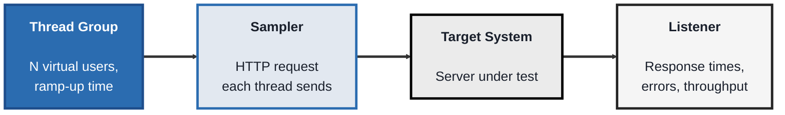
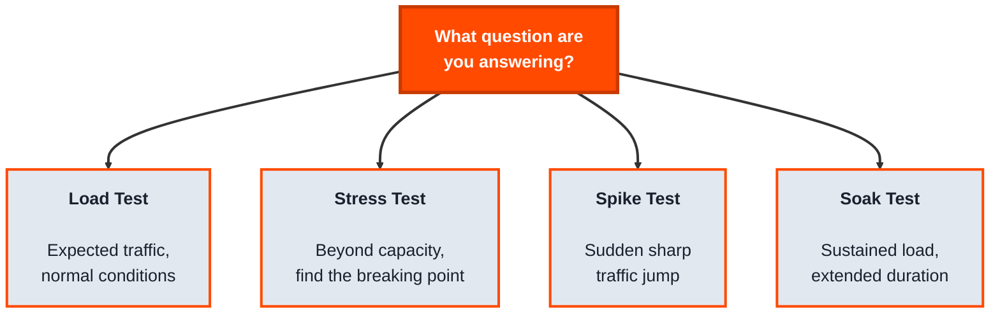
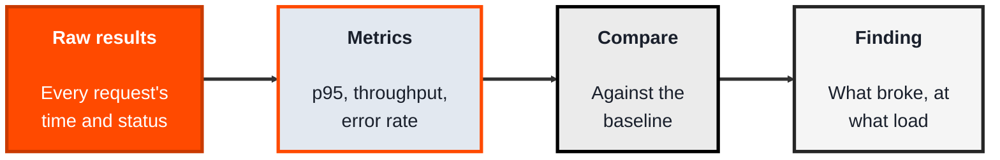

<!-- order: 6 -->
## Module 5: Performance Testing

**Time: about 6 hours** (roughly 2 hours per topic).

**By the end of this module, you'll be able to:**
- Build a JMeter test plan with a Thread Group, an HTTP sampler, and a Listener against a local practice app
- Compare load, stress, spike, and soak tests, and pick the right one for a business question
- Run JMeter in non-GUI mode and read p95, throughput, and error rate from its HTML report
- Write a performance finding based on percentiles and a baseline, not averages
- Explain why you only ever load-test systems you own or have written permission to test

**Tools needed for this module:** [Apache JMeter](https://jmeter.apache.org) (requires Java), and [Docker Desktop](https://www.docker.com/products/docker-desktop/) to run a practice target on your own computer. Every lab in this module tests **OWASP Juice Shop**, a free practice web app, running locally at http://localhost:3000. Start it in a terminal and leave it running while you work:

```bash
docker run --rm -p 127.0.0.1:3000:3000 bkimminich/juice-shop
```

When the log says the server is listening on port 3000, open http://localhost:3000 in a browser to check it's up. Press Ctrl+C in that terminal to stop it. (The `127.0.0.1:` part keeps it reachable only from your own computer, which matters because Juice Shop is deliberately insecure.)

> **The rule for this whole module: never load-test a system you don't own or have written permission to test.** A load test, and especially a stress or spike test, sends the same kind of traffic as a denial-of-service attack. Pointed at someone else's site, it can slow or crash a service other people rely on, and it can break the law and the site's terms of use. "It's a public endpoint" is not permission. In a job, get written approval that names the system, the time window, and the load levels before you run anything.

### Topic 5.1: JMeter

*Time: about 2 hours*

#### Concept

**Apache JMeter** is an open source tool for sending many requests, simulating many users, at a system to measure how it behaves under load. Where functional testing asks "does this work correctly," JMeter asks "does this still work correctly, and fast enough, when a hundred or a thousand people hit it at once."

- A **Thread Group** represents a group of simulated users, each **thread** acts as one virtual user running through the same set of requests
- A **Sampler** is a single request JMeter sends (an HTTP request, for example), the actual unit of load being generated
- A **Listener** collects and displays the results, response times, error rates, throughput, as the test runs or after it finishes
- **Ramp-up period** controls how gradually those simulated users start, all at once versus spread out over time, which changes what kind of load pattern you're actually simulating

#### Structure at a Glance


- JMeter can simulate load without a browser at all, it sends the underlying HTTP requests directly, which is what lets one machine simulate far more concurrent users than would be possible driving real browsers one by one
- Results are only meaningful relative to a clear question, "how many users" and "doing what" need to be defined before a number like "average response time: 400ms" means anything

#### Where you'd actually use this

Confirming a system can handle expected traffic before a big product launch or marketing push, finding the point at which response times start degrading as load increases, or verifying a fix for a performance issue actually improved things under realistic load, not just in isolation.

#### Lab

1. **Install JMeter** (requires Java) and open it, either the GUI (`jmeter.bat` / `jmeter.sh`) or note that real load runs are typically done in non-GUI mode for accuracy.
2. **Create a new Test Plan**, then add a **Thread Group**: set it to 10 users, with a ramp-up period of 5 seconds.
3. **Add an HTTP Request sampler** inside the Thread Group, pointing at your local Juice Shop (start it first, as shown at the top of this module). Set **Protocol** to `http`, **Server Name or IP** to `localhost`, **Port Number** to `3000`, **Method** to `GET`, and **Path** to `/rest/products/search?q=apple`. This is Juice Shop's product search API, so each request does real work on the server.
4. **Add a Listener**, such as "View Results in Table" or "Summary Report," to see results as the test runs.
5. **Run the test** and observe the results: average response time, error count if any, and throughput (requests per second).
6. **Increase the Thread Group to 50 users** and re-run, comparing the new results to the first run, does response time increase, do any errors appear that didn't before.

Because JMeter and Juice Shop share one computer, your numbers describe your laptop, not a production server. That's fine for learning how to run and read tests; just say so when you report them.

#### Checkpoint
You have a working JMeter test plan with a Thread Group, an HTTP sampler, and a Listener, and you've compared results between two different load levels (10 vs. 50 users) against your local Juice Shop.

#### Quiz
1. What does a Thread Group represent, and what does each individual thread simulate?
2. What is a Sampler, in JMeter terms?
3. What is a Listener used for?
4. What does the "ramp-up period" control, and why does it matter for what kind of load you're actually simulating?
5. Why can JMeter simulate far more concurrent users from one machine than an approach that drives real browsers?

*Answers: 1) A Thread Group represents a group of simulated users; each individual thread simulates one virtual user running through the same set of requests. 2) A single request JMeter sends, such as an HTTP request, the actual unit of load being generated against the target. 3) Collecting and displaying results, response times, error rates, and throughput, either as the test runs or after it finishes. 4) It controls how gradually the simulated users start, all at once versus spread out over time; a sudden ramp-up simulates a traffic spike, while a slow ramp-up simulates gradually increasing load, and these represent different real-world scenarios. 5) Because it sends the underlying HTTP requests directly rather than driving a real browser for each simulated user, avoiding the overhead of rendering, JavaScript execution, and a full browser process per user.*

---

### Topic 5.2: Load Testing

*Time: about 2 hours*

#### Concept

**Load testing** is the broader discipline JMeter is a tool for, deliberately generating realistic (or gradually increasing) traffic against a system to answer specific questions about its capacity and behavior under stress. It's a category with several related but distinct types, and knowing which one you're actually running matters, because they answer different questions and require different setups.

- **Load testing** (in the narrow sense) checks behavior under an expected, realistic level of traffic
- **Stress testing** pushes load beyond expected capacity, deliberately, to find the breaking point and see how the system fails (gracefully, or catastrophically)
- **Spike testing** simulates a sudden, sharp jump in traffic (a flash sale, a viral post) rather than a gradual increase
- **Soak testing** (endurance testing) runs a sustained, moderate load for an extended period, to catch problems that only appear over time (memory leaks, slow resource exhaustion)
- Key metrics across all of these: **response time**, **throughput** (requests handled per second), and **error rate**, plus system-level metrics like CPU and memory usage on the server side

#### Structure at a Glance


- Running the wrong type for the question you're actually asking gives you a real number that answers nothing useful, "it handled 50 users fine for 2 minutes" doesn't tell you whether it survives a launch-day spike, or whether it stays stable after running for 12 hours straight
- Performance results should always be reported with context: what load pattern, for how long, against what environment, a bare number without that context is close to meaningless

#### Where you'd actually use this

Deciding which type to run starts with the actual business risk: an expected-traffic increase (load test), a flash-sale style launch (spike test), an always-on service that needs to run reliably for days or weeks (soak test), or simply wanting to know where the system breaks and how (stress test).

#### Lab

> These runs deliberately push a server toward breaking. Run them only against your local Juice Shop at http://localhost:3000, never against a public site or any system you don't own or have written permission to test.

1. **Take the JMeter test plan from the previous lab**, make sure Juice Shop is running, and check the HTTP Request still points at `localhost`, port `3000`.
2. **Reconfigure it as a stress test:** increase the Thread Group well beyond your earlier 50-user run (for example, 200+ users) with a short ramp-up, and run it, watching for the point where errors start appearing or response times spike sharply.
3. **Reconfigure it as a spike test:** set a very short ramp-up period (for example, all users starting within 1-2 seconds) at a moderate-to-high user count, and compare the results to the same user count with a longer ramp-up.
4. **Write a one-paragraph summary** distinguishing what each of your three runs (the 50-user load run from Topic 5.1, plus the stress and spike runs above) was actually testing for, and what each result would (and wouldn't) tell a team making a launch decision.

#### Checkpoint
You've run at least two different load pattern types (stress and spike) against your local Juice Shop using the same base test plan, and written a summary explaining what each type does and doesn't tell you.

#### Quiz
1. What question does a stress test answer that a standard load test doesn't?
2. What is a spike test simulating, and how does its setup differ from a gradual load test?
3. What is a soak test designed to catch that a short test wouldn't?
4. Why must you only load-test systems you own or have written permission to test, even if an endpoint is public?
5. Why is a performance result like "average response time: 400ms" meaningless without additional context?

*Answers: 1) Where the system's actual breaking point is, and how it behaves when pushed past expected capacity, gracefully or catastrophically, rather than just confirming it handles expected traffic. 2) A sudden, sharp jump in traffic, like a flash sale or viral post; its setup uses a very short ramp-up period so many simulated users start almost simultaneously, rather than gradually over time. 3) Problems that only appear over an extended period under sustained load, like memory leaks or slow resource exhaustion, which a short test wouldn't run long enough to reveal. 4) Heavy test traffic is the same as a denial-of-service attack to the owner: it can slow or crash a service others rely on and can be illegal or break the site's terms, and being public is not permission. 5) Because the number only means something in context, what load pattern produced it, how many users, for how long, against what environment, without that, there's no way to know if 400ms is good, bad, or comparable to any other result.*

---

### Topic 5.3: Reading and Reporting Performance Results

*Time: about 2 hours*

#### Concept

A load test is only useful if someone can act on its results. Averages hide the problem: if 19 of 20 requests take 200 ms and one takes 6,000 ms, the average is 490 ms (9,800 ms ÷ 20), which still looks fine while a real user waited 6 seconds. With exactly one slow request in twenty, that request sits right on the p95 boundary, so depending on how a tool calculates it, p95 may show it or may read as 200 ms; p99 and the maximum show it clearly. That's why you look at several percentiles (p90, p95, p99, max), not one number. Performance testers report **percentiles**, compare every run against a **baseline**, and turn numbers into a clear finding: what slowed down, at what load, and what it means for users.

- A **percentile** (p90, p95, p99) is the response time that 90, 95, or 99 percent of requests took that long or less (for example, "p95 = 1.2 seconds" means 95% of requests took 1.2 seconds or less); p95 is a common headline number because it reflects the slow experiences an average hides
- **Throughput** is how many requests the system handled per second; the **error rate** is the share that failed
- A **baseline** is a run under normal conditions that later runs are compared against, so "slower" has a precise meaning
- A **bottleneck** is the one resource that limits everything else, such as database connections, CPU, or memory; response times usually climb sharply once it's reached
- The **saturation point** is the load at which throughput stops rising while response times and errors keep climbing

#### Structure at a Glance


- Always run JMeter in **non-GUI mode** for real tests; the GUI is for building a plan and uses enough memory to distort results
- A good finding names the load level, the metric that crossed the line, and the likely cause, so a developer knows where to look first

#### Where you'd actually use this

Before a big sale, a shop asks whether checkout will survive five times its normal traffic. Your report shows p95 stays under a second up to three times normal load, then climbs to eight seconds with a 4% error rate at four times, pointing to database connections as the bottleneck. That tells the team exactly what to fix before the sale.

#### Lab

1. **Reuse your Topic 5.2 test plan** against your local Juice Shop at http://localhost:3000 (start it again if you stopped it), and save it as `plan.jmx`.
2. **Run a baseline in non-GUI mode** with a small number of users, generating an HTML report:
   ```bash
   jmeter -n -t plan.jmx -l baseline.jtl -e -o baseline-report
   ```
3. **Open `baseline-report/index.html`** and record the p95 response time, throughput, and error rate.
4. **Run again at a higher load** (for example, double the users) into a new results file and report folder, and record the same three numbers. JMeter refuses to write a report into a folder that already has files in it, so give each run new names, for example `-l run2.jtl -e -o run2-report`.
5. **Write a one-paragraph finding** comparing the runs: the load level, what changed, and one likely cause. Use percentiles, not averages.

#### Checkpoint
You have two HTML reports from non-GUI runs, a table comparing p95, throughput, and error rate between them, and a written finding a developer could act on.

#### Quiz
1. Why are averages misleading in performance testing?
2. What does "p95 = 1.2 seconds" mean?
3. What is a baseline, and why do you need one?
4. What is the saturation point?
5. Why run JMeter in non-GUI mode for real tests?

*Answers: 1) A small number of very slow requests can hide behind a healthy-looking average, even though real users are experiencing them. 2) 95% of requests completed in 1.2 seconds or less. 3) A run under normal conditions that later runs are compared against, so you can say precisely how much slower or less stable a new run is. 4) The load at which throughput stops increasing while response times and errors keep rising. 5) The GUI uses a lot of memory and can distort the results; non-GUI mode is lighter and designed for real test runs.*

```watch
{
 "scenes": [
  {
   "kind": "title",
   "art": "gauge",
   "kicker": "Module 5 · Performance testing",
   "title": "Still fast with a crowd",
   "beats": [
    {
     "say": "Welcome to Module 5, performance testing."
    },
    {
     "say": "Functional testing asks, does this work? Performance testing asks, does it still work, and fast enough, when a hundred or a thousand people hit it at once?"
    }
   ]
  },
  {
   "kind": "quote",
   "art": "warning",
   "kicker": "The rule for this module",
   "title": "Only test what you own",
   "quote": "Never load-test a system you don't own or have written permission to test.",
   "beats": [
    {
     "say": "First, the rule for this whole module.",
     "show": 0
    },
    {
     "say": "Never load-test a system you don't own or have written permission to test.",
     "show": 1
    },
    {
     "say": "A load test looks like a denial of service attack. It can crash a service people rely on, and break the law. A public endpoint is not permission.",
     "show": 1
    },
    {
     "say": "So every lab here targets O WASP Juice Shop, a practice app running on your own computer, on port three thousand.",
     "show": 1
    }
   ]
  },
  {
   "kind": "diagram",
   "kicker": "Topic 5.1 · JMeter",
   "title": "One request, from plan to result",
   "nodes": [
    {
     "id": "tg",
     "label": "Thread Group",
     "x": 12,
     "y": 25,
     "sub": "10 users · 5 s ramp-up",
     "art": "people"
    },
    {
     "id": "s",
     "label": "HTTP Request",
     "x": 48,
     "y": 25,
     "sub": "the Sampler",
     "art": "api"
    },
    {
     "id": "js",
     "label": "Juice Shop",
     "x": 86,
     "y": 50,
     "sub": "localhost:3000",
     "art": "server"
    },
    {
     "id": "l",
     "label": "Summary Report",
     "x": 48,
     "y": 78,
     "sub": "the Listener",
     "art": "dashboard"
    }
   ],
   "edges": [
    {
     "from": "tg",
     "to": "s"
    },
    {
     "from": "s",
     "to": "js"
    },
    {
     "from": "s",
     "to": "l"
    }
   ],
   "beats": [
    {
     "say": "In J Meter, a Thread Group is a group of simulated users. Each thread is one virtual user.",
     "show": 1,
     "on": "tg"
    },
    {
     "say": "Each thread runs a Sampler: one request, here an H T T P request.",
     "show": 2,
     "on": "s",
     "send": {
      "from": "tg",
      "to": "s",
      "label": "each thread"
     }
    },
    {
     "say": "It asks your local Juice Shop to search products for apple.",
     "show": 3,
     "on": "js",
     "send": {
      "from": "s",
      "to": "js",
      "label": "GET ?q=apple"
     }
    },
    {
     "say": "Juice Shop replies.",
     "show": 3,
     "on": "s",
     "send": {
      "from": "js",
      "to": "s",
      "label": "200 · products"
     }
    },
    {
     "say": "A Listener, like Summary Report, records each time and status, then shows response times, errors and throughput.",
     "show": 4,
     "on": "l",
     "send": {
      "from": "s",
      "to": "l",
      "label": "time · status"
     }
    },
    {
     "say": "No browser is involved, which is how one machine can simulate so many users.",
     "show": 4,
     "on": [
      "tg",
      "s"
     ]
    }
   ]
  },
  {
   "kind": "array",
   "kicker": "Topic 5.1 · Ramp-up",
   "title": "Ten users, started over five seconds",
   "values": [
    "U1",
    "U2",
    "U3",
    "U4",
    "U5",
    "U6",
    "U7",
    "U8",
    "U9",
    "U10"
   ],
   "beats": [
    {
     "say": "Ramp-up controls how gradually users start. Ten users over five seconds means a new one every half second.",
     "note": "5 s ÷ 10 users = 0.5 s apart"
    },
    {
     "say": "At zero seconds, user one starts.",
     "hl": 0,
     "ptr": {
      "t = 0 s": 0
     },
     "note": "t = 0 s → 1 running"
    },
    {
     "say": "By two seconds, five are running.",
     "hl": [
      0,
      1,
      2,
      3,
      4
     ],
     "ptr": {
      "t = 2 s": 4
     },
     "note": "t = 2 s → 5 running"
    },
    {
     "say": "At four and a half seconds, the tenth starts.",
     "hl": [
      0,
      1,
      2,
      3,
      4,
      5,
      6,
      7,
      8,
      9
     ],
     "ptr": {
      "t = 4.5 s": 9
     },
     "note": "t = 4.5 s → all 10 running"
    },
    {
     "say": "Shrink the ramp-up to one second, and they all start almost at once. That's a spike.",
     "hl": [
      0,
      1,
      2,
      3,
      4,
      5,
      6,
      7,
      8,
      9
     ],
     "note": "Ramp-up 1 s → 0.1 s apart"
    },
    {
     "say": "In the lab, run ten users, then fifty, and compare response times and errors.",
     "ok": [
      0,
      1,
      2,
      3,
      4,
      5,
      6,
      7,
      8,
      9
     ],
     "note": "Run 1: 10 users · Run 2: 50 users"
    }
   ]
  },
  {
   "kind": "table",
   "kicker": "Topic 5.2 · Load testing",
   "title": "Pick the test that answers your question",
   "columns": [
    "Test",
    "Load pattern",
    "Answers"
   ],
   "rows": [
    [
     "Load",
     "Expected traffic",
     "Fine on a normal day?"
    ],
    [
     "Stress",
     "200+ users, short ramp",
     "Where does it break?"
    ],
    [
     "Spike",
     "All start in 1–2 s",
     "Survives a flash sale?"
    ],
    [
     "Soak",
     "Moderate, for hours",
     "Leaks over time?"
    ]
   ],
   "beats": [
    {
     "say": "There are four kinds of load test. Pick one by the business risk."
    },
    {
     "say": "Expecting more normal traffic? A load test.",
     "hl": 0,
     "dim": true,
     "sql": "Risk: more normal traffic"
    },
    {
     "say": "Need the breaking point, and how it fails? A stress test.",
     "hl": 1,
     "dim": true,
     "sql": "Risk: unknown breaking point"
    },
    {
     "say": "A flash sale? A spike test, with a very short ramp-up.",
     "hl": 2,
     "dim": true,
     "sql": "Risk: launch-day rush"
    },
    {
     "say": "An always-on service? A soak test, to catch memory leaks over time.",
     "hl": 3,
     "dim": true,
     "sql": "Risk: runs for days"
    },
    {
     "say": "So report every result with its pattern, duration and environment.",
     "col": 1,
     "sql": "50 users · 2 minutes · my laptop"
    }
   ]
  },
  {
   "kind": "table",
   "kicker": "Topic 5.3 · Reading results",
   "title": "Averages hide the slow ones",
   "columns": [
    "Requests",
    "Each took",
    "Adds up to"
   ],
   "rows": [
    [
     "19 of 20",
     "200 ms",
     "3,800 ms"
    ],
    [
     "1 of 20",
     "6,000 ms",
     "6,000 ms"
    ],
    [
     "All 20",
     "—",
     "9,800 ms"
    ]
   ],
   "beats": [
    {
     "say": "Twenty requests: nineteen take two hundred milliseconds, one takes six seconds.",
     "hl": [
      0,
      1
     ],
     "col": 1
    },
    {
     "say": "The average is four hundred and ninety milliseconds. Looks fine.",
     "hl": 2,
     "col": 2,
     "sql": "average = 9,800 ÷ 20 = 490 ms"
    },
    {
     "say": "But one user in twenty waited six seconds.",
     "hl": 1,
     "dim": true,
     "col": 1
    },
    {
     "say": "So report percentiles. P ninety five is the time that ninety five percent of requests took, or less.",
     "hl": 1,
     "col": 1,
     "sql": "p95 = the time 95% of requests beat"
    },
    {
     "say": "Plus throughput, requests per second, and error rate, the share that failed.",
     "sql": "Report: p95 · throughput · error rate"
    }
   ]
  },
  {
   "kind": "chart",
   "kicker": "Topic 5.3 · Finding",
   "title": "Will checkout survive the sale?",
   "points": [
    [
     20,
     4
    ],
    [
     40,
     5
    ],
    [
     60,
     9
    ],
    [
     80,
     80
    ]
   ],
   "xlabel": "load (× normal traffic)",
   "ylabel": "checkout p95 (0 to 10 s)",
   "beats": [
    {
     "say": "A shop asks: will checkout survive five times normal traffic? Each dot is one run."
    },
    {
     "say": "The normal-load run is the baseline the others are compared against.",
     "marks": [
      [
       20,
       4
      ]
     ]
    },
    {
     "say": "Up to three times normal load, p ninety five stays under the one second line.",
     "line": [
      0,
      10
     ],
     "groups": [
      1,
      1,
      1,
      0
     ]
    },
    {
     "say": "At four times, it jumps to eight seconds, with four percent errors.",
     "line": [
      0,
      10
     ],
     "groups": [
      1,
      1,
      1,
      2
     ],
     "marks": [
      [
       80,
       80
      ]
     ]
    },
    {
     "say": "The likely cause is database connections, the bottleneck. A good finding names that load, that metric, and that cause.",
     "line": [
      0,
      10
     ],
     "groups": [
      1,
      1,
      1,
      2
     ],
     "marks": [
      [
       80,
       80
      ]
     ]
    },
    {
     "say": "The saturation point is where throughput stops rising, while response times and errors keep climbing.",
     "line": [
      0,
      10
     ],
     "groups": [
      1,
      1,
      1,
      2
     ],
     "marks": [
      [
       80,
       80
      ]
     ]
    }
   ]
  },
  {
   "kind": "table",
   "kicker": "Topic 5.3 · Lab",
   "title": "Read the non-GUI command, flag by flag",
   "columns": [
    "Flag",
    "Value",
    "Means"
   ],
   "rows": [
    [
     "-n",
     "—",
     "non-GUI mode"
    ],
    [
     "-t",
     "plan.jmx",
     "the test plan to run"
    ],
    [
     "-l",
     "baseline.jtl",
     "raw results file"
    ],
    [
     "-e -o",
     "baseline-report",
     "build HTML report here"
    ]
   ],
   "beats": [
    {
     "say": "Real runs use non GUI mode, because the GUI's memory use distorts results.",
     "hl": 0,
     "dim": true,
     "sql": "jmeter -n -t plan.jmx -l baseline.jtl -e -o baseline-report"
    },
    {
     "say": "Dash t is your plan. Dash l saves every result.",
     "hl": [
      1,
      2
     ],
     "dim": true
    },
    {
     "say": "Dash e and dash o build an H T M L report. Record its p ninety five, throughput and error rate.",
     "hl": 3,
     "dim": true
    },
    {
     "say": "Run again at double the users, with new names, since J Meter won't overwrite a report folder.",
     "hl": [
      2,
      3
     ],
     "dim": true,
     "col": 1,
     "sql": "jmeter -n -t plan.jmx -l run2.jtl -e -o run2-report"
    }
   ]
  },
  {
   "kind": "quiz",
   "art": "ask",
   "kicker": "Quick check",
   "title": "Which test is designed to find where a system breaks, and how it fails?",
   "options": [
    "A stress test",
    "A soak test",
    "A load test at expected traffic"
   ],
   "answer": 0,
   "good": "That's right. A stress test pushes beyond expected capacity to find the breaking point, and whether the system fails gracefully or catastrophically.",
   "bad": "Not quite. A stress test pushes beyond expected capacity to find the breaking point, and whether the system fails gracefully or catastrophically.",
   "beats": [
    {
     "say": "Quick check.",
     "show": 0
    },
    {
     "say": "Which test is designed to find where a system breaks, and how it fails?",
     "show": 0
    },
    {
     "say": "Tap your answer.",
     "show": 1
    }
   ]
  },
  {
   "kind": "list",
   "art": "proof",
   "kicker": "Checkpoint",
   "title": "You're done when",
   "items": [
    [
     "You know the permission rule",
     ""
    ],
    [
     "JMeter plan: 10 vs. 50 users",
     ""
    ],
    [
     "Stress and spike runs done",
     ""
    ],
    [
     "You can name all four types",
     ""
    ],
    [
     "Two non-GUI HTML reports compared",
     ""
    ],
    [
     "A percentile-based finding",
     ""
    ]
   ],
   "beats": [
    {
     "say": "That's Module 5.",
     "show": 0
    },
    {
     "say": "You're done when:",
     "show": 0
    },
    {
     "say": "you can explain why you only load-test systems you own or have permission to test,",
     "show": 1
    },
    {
     "say": "you've built a J Meter plan and compared ten and fifty users against your local Juice Shop,",
     "show": 2
    },
    {
     "say": "run the same plan as a stress test and a spike test,",
     "show": 3
    },
    {
     "say": "can name load, stress, spike and soak, and the question each answers,",
     "show": 4
    },
    {
     "say": "compared p ninety five, throughput and error rate across two non GUI runs,",
     "show": 5
    },
    {
     "say": "and written a finding using percentiles, not averages.",
     "show": 6
    },
    {
     "say": "Next, in Module 6, mobile testing.",
     "show": 6
    }
   ]
  }
 ]
}
```

---

## Module 5 Completion Checklist
- [ ] Ran OWASP Juice Shop locally as your test target
- [ ] Can explain why you never load-test a system you don't own or have written permission to test
- [ ] Built a working JMeter test plan with a Thread Group, HTTP sampler, and Listener
- [ ] Compared results between two different load levels (10 vs. 50 users) against your local target
- [ ] Run the same base test plan reconfigured as both a stress test and a spike test
- [ ] Can name all four load pattern types (load, stress, spike, soak) and the specific question each one answers
- [ ] Can explain why a performance number needs context (load pattern, duration, environment) to be meaningful
- [ ] Ran a baseline and a higher-load test in non-GUI mode with HTML reports
- [ ] Compared p95, throughput, and error rate across two runs
- [ ] Written a performance finding using percentiles, not averages
