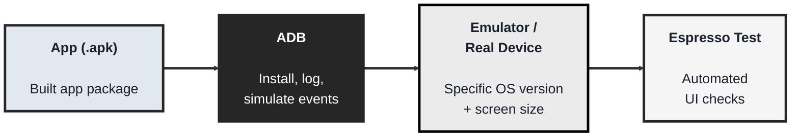
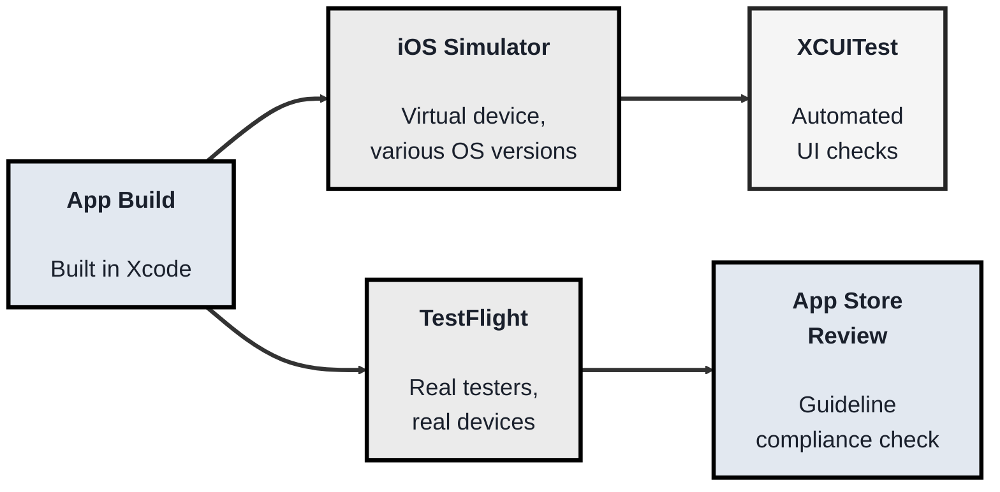
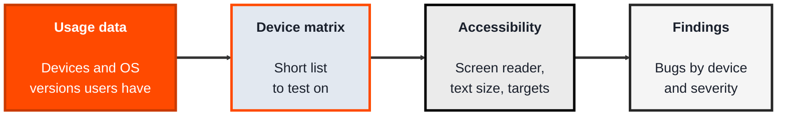

<!-- order: 7 -->
## Module 6: Mobile Testing

**Time: about 8 hours** (3 hours each for Android and iOS, 2 hours for device coverage and accessibility).

**By the end of this module, you'll be able to:**
- Create Android emulators, connect to them with ADB, and test how an app handles interruptions
- Run an app and a basic XCUITest on two iOS Simulator device and OS combinations
- Build a device matrix from real usage reasoning
- Test an app with TalkBack or VoiceOver and at the largest text size, and file device-specific accessibility bug reports

**Tools needed for this module:** [Android Studio](https://developer.android.com/studio) (includes emulators and Android debugging tools) for the Android topic, and a Mac with [Xcode](https://developer.apple.com/xcode/) (includes the iOS Simulator) for the iOS topic. Real devices are ideal but not required to start. **No Mac?** Do Topics 6.1 and 6.3 on Android, read Topic 6.2, and do only its App Store guideline step (step 6); the Android work covers the same testing skills.

### Topic 6.1: Android

*Time: about 3 hours*

#### Concept

Testing Android apps means testing against real fragmentation, many device manufacturers, many screen sizes, and multiple OS versions all still in active use at once, which is very different from testing a website that renders roughly the same everywhere. Android testing tools exist specifically to manage that variety, letting you test broadly without owning every physical device yourself.

- The **Android Emulator** (in Android Studio) runs a virtual Android device on your computer, letting you test different OS versions and screen sizes without owning the physical hardware
- **ADB (Android Debug Bridge)** is a command-line tool for communicating directly with a device or emulator, installing an app, pulling logs, simulating events
- **Espresso** is Google's own UI testing framework for Android, used to write automated tests that run directly on a device or emulator
- **Device fragmentation** refers to the wide spread of manufacturers, screen sizes, and OS versions in real use, a core reason mobile testing needs broader device/OS coverage than most web testing

#### Structure at a Glance


- A real testing effort usually runs the same checks across a small deliberate matrix of emulators/devices (an old OS version on a small screen, a new OS version on a large screen), rather than testing on just one
- Mobile-specific behaviors, like what happens when a phone call interrupts the app, or the app is backgrounded and resumed, don't have a clean equivalent in web testing and need to be checked directly on-device

#### Where you'd actually use this

Verifying an app behaves correctly across the real spread of Android versions and screen sizes your actual users have, not just the one device sitting on your desk, and catching mobile-specific issues like interruption handling that a web-focused test plan would never think to check.

#### Lab

1. **Open Android Studio and launch the Android Virtual Device (AVD) Manager.** Create an emulator for a mid-range phone profile on a recent Android version.
2. **Install a simple test app on the emulator** (Android Studio's default "Empty Activity" template project works fine, build and run it directly onto the emulator).
3. **Use ADB from the command line** to confirm the device is connected and check basic info:
```bash
adb devices
adb shell getprop ro.build.version.release
```
4. **Simulate an interruption:** while the app is running, use the emulator's controls to simulate an incoming call or press the home button to background the app, then bring it back to the foreground, and note whether its state was preserved correctly.
5. **Create a second emulator with a different screen size or OS version**, install the same app, and compare its layout and behavior side by side with the first.

#### Checkpoint
You have two emulators running with different configurations, you've confirmed ADB can talk to a device, and you've documented what happened to the app's state after an interruption and after switching device profiles.

#### Quiz
1. What is the Android Emulator, and what does it let you test without owning physical hardware?
2. What is ADB used for?
3. What is Espresso, and what is it used for?
4. What is "device fragmentation," and why does it matter more for Android testing than for most web testing?
5. Give an example of a mobile-specific behavior that doesn't have a clean equivalent in web testing.

*Answers: 1) A virtual Android device running on your computer; it lets you test different OS versions and screen sizes without needing to own each physical device. 2) Communicating directly with a device or emulator from the command line, installing an app, pulling logs, and simulating events. 3) Google's own UI testing framework for Android; it's used to write automated tests that run directly on a device or emulator. 4) The wide spread of manufacturers, screen sizes, and OS versions actually in use among real users; it matters more for Android because, unlike most websites, an app's behavior and layout can genuinely differ across that spread. 5) Handling an interruption like an incoming phone call, or being backgrounded and resumed, checking whether the app's state is preserved correctly, something a website simply doesn't experience in the same way.*

---

### Topic 6.2: iOS

*Time: about 3 hours*

#### Concept

Testing iOS apps happens in a much more controlled hardware and OS environment than Android, fewer device models, tighter OS version adoption, but comes with its own strict platform rules (Apple's App Store review guidelines) and its own tooling built around Xcode. Knowing the iOS-specific tools matters because they don't map one-to-one onto Android's, even though the underlying goal, verifying the app works correctly, is the same.

- The **iOS Simulator** (built into Xcode) runs a virtual iOS device on a Mac, similar in purpose to the Android Emulator, but it simulates iOS software behavior rather than emulating real device hardware
- **XCUITest** is Apple's own UI testing framework, built into Xcode, used to write automated tests that interact with the app's real interface
- **TestFlight** is Apple's platform for distributing pre-release builds to real testers on real devices, before a public App Store release
- **App Store Review Guidelines** are Apple's rules every app must pass before release; testing for compliance (privacy prompts, required disclosures, prohibited behaviors) is its own category of testing; Android has its counterpart in Google Play's Developer Program Policies and app review, but the two sets of rules differ, so each platform needs its own compliance checks

#### Structure at a Glance


- The iOS Simulator is fast and convenient but doesn't perfectly replicate real hardware performance, sensors, or camera behavior, some checks genuinely need a real device
- TestFlight testing catches real-device issues (and real-world usage patterns) that the Simulator alone can't, before an app ever reaches formal App Store review

#### Where you'd actually use this

Verifying an app works correctly across supported iOS versions on a Mac-based workflow, catching App Store guideline violations before a rejected submission costs a release cycle, or getting real, real-device feedback from testers through TestFlight before a public launch.

#### Lab

1. **Open Xcode and create a new iOS app project** using a basic template (or use an existing sample project).
2. **Run the app on the iOS Simulator**, choosing a specific simulated device and iOS version from Xcode's device selector.
3. **Write a basic XCUITest** (Xcode can generate a UI test target automatically): record or write a test that launches the app and taps a button or checks a label's text exists. The `@MainActor` line runs the test on the main thread, which UI tests need; without it, Swift 6's strict concurrency checking reports errors.
```swift
import XCTest

final class BasicUITests: XCTestCase {
    @MainActor
    func testAppLaunches() throws {
        let app = XCUIApplication()
        app.launch()
        XCTAssertTrue(app.staticTexts.firstMatch.exists)
    }
}
```
4. **Run the test** against the Simulator and confirm it passes.
5. **Switch the Simulator's device and OS version** in Xcode's device selector, re-run the same test, and note whether it still passes and whether the layout looks correct on the new device profile.
6. **Look up one App Store Review Guideline** relevant to a real app category (for example, a rule about requesting camera or location permission) and write one sentence on how you'd test for compliance with it.

#### Checkpoint
You have a passing XCUITest run against at least two different Simulator device/OS combinations, and you've identified one App Store guideline along with a concrete way to test compliance with it.

#### Quiz
1. What is the iOS Simulator, and how is it different from emulating real device hardware?
2. What is XCUITest?
3. What is TestFlight used for, and why does it matter beyond just Simulator testing?
4. What are App Store Review Guidelines, and why can't you reuse your Android compliance checks for them?
5. Name one thing the iOS Simulator can't fully replicate compared to a real device.

*Answers: 1) A virtual iOS device running on a Mac; it's different from hardware emulation because it simulates the iOS software's behavior rather than emulating the actual physical hardware components. 2) Apple's own UI testing framework, built into Xcode, used to write automated tests that interact with the app's real interface. 3) A platform for distributing pre-release builds to real testers on real devices before a public release; it matters because it catches real-device issues and real usage patterns that Simulator-only testing can miss. 4) Apple's rules that every app must pass before release, covering things like required privacy disclosures and prohibited behaviors; Google Play has its own Developer Program Policies and app review, but the rules differ between the two stores, so compliance checks written for one platform don't transfer directly to the other. 5) Real hardware performance, sensors, or camera behavior, some checks genuinely require testing on a real device rather than the Simulator.*

---

### Topic 6.3: Device Coverage and Accessibility

*Time: about 2 hours*

#### Concept

A mobile app has to work on phones you'll never own: different screen sizes, operating system versions, text sizes, and ways of using a phone. You can't test every device, so testers choose a **device matrix**, a deliberate short list that covers the combinations real users have. Part of that coverage is **accessibility**: people who use screen readers, larger text, or switch controls must be able to use the app too.

- A **device matrix** lists the devices and OS versions you'll test on, chosen from real usage data (for example, the most common screen sizes and the oldest OS version you support)
- **Screen readers** read the interface aloud: **TalkBack** on Android and **VoiceOver** on iOS; every button needs a meaningful label, not "button 3"
- **Dynamic text size** lets users enlarge text system-wide; layouts must still fit without cutting words off or overlapping
- **Touch targets** must be large enough to tap reliably: Android's guidance is at least 48 × 48 dp, and Apple's is at least 44 × 44 points
- Automated checkers help: Google's **Accessibility Scanner** app on Android and the **Accessibility Inspector** in Xcode on iOS

#### Structure at a Glance


- Emulators and simulators cover most layout checks cheaply; keep at least one real device for touch, camera, and performance
- Accessibility bugs are real bugs with severity like any other: a checkout button a screen reader can't find blocks a user from paying

#### Where you'd actually use this

A banking app looks perfect on the team's new phones. Tested at the largest text size on a small, older Android phone, the transfer button is pushed off screen, and TalkBack reads it only as "button". Both are release-blocking for the users they affect.

#### Lab

1. **Build a device matrix** of four rows for an app you use: two Android and two iOS entries, each with a screen size and OS version, and one sentence on why each is included.
2. **Test with a screen reader:** turn on TalkBack (Android emulator) or VoiceOver (iOS Simulator or an iPhone) and try to complete one task, such as signing in, using only the screen reader.
3. **Test large text:** set the system text size to the largest option and check every screen in that task for cut-off or overlapping text.
4. **Run an automated check:** use Accessibility Scanner on Android or the Accessibility Inspector in Xcode on one screen, and note what it flags.
5. **Write two bug reports** from what you found, using the Module 2 format, with the device, OS version, and accessibility setting in each.

#### Checkpoint
You have a four-device matrix with reasons, you've completed a task using only a screen reader, and you've written two bug reports that include the device and accessibility setting.

#### Quiz
1. What is a device matrix, and how should you choose its entries?
2. What are TalkBack and VoiceOver?
3. What is the minimum recommended touch-target size on Android and on iOS?
4. Why keep at least one real device when emulators exist?
5. Why is an unlabelled button a real bug?

*Answers: 1) A short, deliberate list of devices and OS versions to test on, chosen from real usage data such as common screen sizes and the oldest supported OS. 2) The built-in screen readers on Android and iOS, which read the interface aloud for people who can't see the screen. 3) At least 48 × 48 dp on Android and 44 × 44 points on iOS. 4) Emulators miss real-world behaviour such as touch accuracy, camera, sensors, and true performance. 5) A screen reader user can't tell what it does, which can block them from completing a task, the same impact as a broken button.*

```watch
{
 "scenes": [
  {
   "kind": "title",
   "art": "phone",
   "kicker": "Module 6 · Mobile testing",
   "title": "Phones you'll never own",
   "beats": [
    {
     "say": "Welcome to Module 6, mobile testing."
    },
    {
     "say": "You'll test on Android and i O S, choose which devices to cover, and check the app works for people using screen readers and large text."
    },
    {
     "say": "No Mac? Do the Android topics, read the i O S one, and do just its App Store guideline step."
    }
   ]
  },
  {
   "kind": "diagram",
   "kicker": "Topic 6.1 · Android",
   "title": "From app package to automated test",
   "nodes": [
    {
     "id": "apk",
     "label": "App (.apk)",
     "x": 12,
     "y": 30,
     "sub": "built app package",
     "art": "package"
    },
    {
     "id": "adb",
     "label": "ADB",
     "x": 38,
     "y": 70,
     "sub": "install, logs, events",
     "art": "terminal"
    },
    {
     "id": "em",
     "label": "Emulator",
     "x": 62,
     "y": 30,
     "sub": "OS version + screen",
     "art": "phone"
    },
    {
     "id": "esp",
     "label": "Espresso test",
     "x": 88,
     "y": 70,
     "sub": "automated UI checks",
     "art": "test"
    }
   ],
   "edges": [
    {
     "from": "apk",
     "to": "adb"
    },
    {
     "from": "adb",
     "to": "em"
    },
    {
     "from": "em",
     "to": "esp"
    }
   ],
   "beats": [
    {
     "say": "It starts with a built app, an A P K.",
     "show": 1,
     "on": "apk"
    },
    {
     "say": "A D B, the Android Debug Bridge, talks to a device from the command line.",
     "show": 2,
     "on": "adb",
     "send": {
      "from": "apk",
      "to": "adb",
      "label": "app.apk"
     }
    },
    {
     "say": "It installs the app on the Android Emulator, a virtual device with a chosen O S version and screen size.",
     "show": 3,
     "on": "em",
     "send": {
      "from": "adb",
      "to": "em",
      "label": "install"
     }
    },
    {
     "say": "Android is fragmented: many makers, sizes and O S versions in use at once. So you test on several, not one.",
     "show": 3,
     "on": "em"
    },
    {
     "say": "Espresso, Google's U I testing framework, runs automated checks on that device.",
     "show": 4,
     "on": "esp",
     "send": {
      "from": "esp",
      "to": "em",
      "label": "tap + check"
     }
    },
    {
     "say": "And A D B can pull the logs back.",
     "show": 4,
     "on": "adb",
     "send": {
      "from": "em",
      "to": "adb",
      "label": "logs"
     }
    }
   ]
  },
  {
   "kind": "walk",
   "kicker": "Topic 6.1 · Lab",
   "title": "Ask the emulator who it is",
   "file": "terminal",
   "code": "adb devices\nadb shell getprop ro.build.version.release",
   "beats": [
    {
     "say": "In the lab, create an emulator in Android Studio, and run a simple app on it."
    },
    {
     "say": "A D B devices lists what's connected.",
     "line": 1,
     "out": [
      "List of devices attached",
      "emulator-5554   device"
     ]
    },
    {
     "say": "Your emulator shows as device: A D B can talk to it.",
     "line": 1,
     "vars": {
      "connected": "emulator-5554"
     }
    },
    {
     "say": "Next, read the device's Android version.",
     "line": 2
    },
    {
     "say": "It answers with a number, here, fifteen.",
     "line": 2,
     "out": "15",
     "vars": {
      "connected": "emulator-5554",
      "android": "15"
     }
    }
   ]
  },
  {
   "kind": "diagram",
   "kicker": "Topic 6.1 · Lab",
   "title": "Interrupt it, then check the state",
   "nodes": [
    {
     "id": "run",
     "label": "App running",
     "x": 15,
     "y": 40,
     "sub": "you've entered input",
     "art": "phone"
    },
    {
     "id": "bg",
     "label": "Interrupted",
     "x": 50,
     "y": 72,
     "sub": "incoming call or Home",
     "art": "bell"
    },
    {
     "id": "back",
     "label": "Back in front",
     "x": 85,
     "y": 40,
     "sub": "is the input kept?",
     "art": "search"
    }
   ],
   "edges": [
    {
     "from": "run",
     "to": "bg"
    },
    {
     "from": "bg",
     "to": "back"
    }
   ],
   "beats": [
    {
     "say": "Now a check the web doesn't need. The app is running, with some input entered.",
     "show": 1,
     "on": "run"
    },
    {
     "say": "Simulate an incoming call, or press home to background it.",
     "show": 2,
     "on": "bg",
     "send": {
      "from": "run",
      "to": "bg",
      "label": "call / Home"
     }
    },
    {
     "say": "Bring it back.",
     "show": 3,
     "on": "back",
     "send": {
      "from": "bg",
      "to": "back",
      "label": "resume"
     }
    },
    {
     "say": "Was its state kept? Write down what happened.",
     "show": 3,
     "on": "back"
    },
    {
     "say": "Then repeat on a second emulator, with a different size or O S version, and compare.",
     "show": 3,
     "on": [
      "run",
      "back"
     ]
    }
   ]
  },
  {
   "kind": "diagram",
   "kicker": "Topic 6.2 · iOS",
   "title": "Two paths for an iOS build",
   "nodes": [
    {
     "id": "app",
     "label": "App build",
     "x": 12,
     "y": 50,
     "sub": "built in Xcode",
     "art": "laptop"
    },
    {
     "id": "sim",
     "label": "iOS Simulator",
     "x": 45,
     "y": 25,
     "sub": "virtual device on Mac",
     "art": "phone"
    },
    {
     "id": "x",
     "label": "XCUITest",
     "x": 85,
     "y": 25,
     "sub": "automated UI checks",
     "art": "test"
    },
    {
     "id": "tf",
     "label": "TestFlight",
     "x": 45,
     "y": 75,
     "sub": "real testers, devices",
     "art": "people"
    },
    {
     "id": "rev",
     "label": "App Store Review",
     "x": 85,
     "y": 75,
     "sub": "guideline compliance",
     "art": "checklist"
    }
   ],
   "edges": [
    {
     "from": "app",
     "to": "sim"
    },
    {
     "from": "sim",
     "to": "x"
    },
    {
     "from": "app",
     "to": "tf"
    },
    {
     "from": "tf",
     "to": "rev"
    }
   ],
   "beats": [
    {
     "say": "i O S is more controlled, with fewer devices. Every app starts as an Xcode build.",
     "show": 1,
     "on": "app"
    },
    {
     "say": "One path is the i O S Simulator on a Mac. It simulates the software, not the hardware.",
     "show": 2,
     "on": "sim",
     "send": {
      "from": "app",
      "to": "sim",
      "label": "run"
     }
    },
    {
     "say": "There, X C U I Test, Apple's U I testing framework, drives the interface.",
     "show": 3,
     "on": "x",
     "send": {
      "from": "x",
      "to": "sim",
      "label": "tap + assert"
     }
    },
    {
     "say": "The other path, TestFlight, sends pre-release builds to real testers on real devices.",
     "show": 4,
     "on": "tf",
     "send": {
      "from": "app",
      "to": "tf",
      "label": "beta build"
     }
    },
    {
     "say": "That catches what the Simulator can't: true performance, sensors, and the camera.",
     "show": 4,
     "on": "tf"
    },
    {
     "say": "Then App Store Review checks Apple's guidelines. Google Play's rules differ, so each needs its own checks.",
     "show": 5,
     "on": "rev",
     "send": {
      "from": "tf",
      "to": "rev",
      "label": "submit"
     }
    }
   ]
  },
  {
   "kind": "walk",
   "kicker": "Topic 6.2 · Lab",
   "title": "Run a basic XCUITest",
   "file": "BasicUITests.swift",
   "code": "import XCTest\n\nfinal class BasicUITests: XCTestCase {\n  @MainActor\n  func testAppLaunches() throws {\n    let app = XCUIApplication()\n    app.launch()\n    XCTAssertTrue(app.staticTexts.firstMatch.exists)\n  }\n}",
   "beats": [
    {
     "say": "Xcode can generate a U I test class for you.",
     "line": 3
    },
    {
     "say": "Main actor runs it on the main thread, which Swift 6 requires for U I tests.",
     "line": 4
    },
    {
     "say": "It gets a handle to your app,",
     "line": 6,
     "vars": {
      "app": "XCUIApplication"
     }
    },
    {
     "say": "launches it on the Simulator,",
     "line": 7,
     "vars": {
      "app": "launched"
     }
    },
    {
     "say": "and asserts a text label exists.",
     "line": 8,
     "vars": {
      "app": "launched",
      "label exists": "true"
     }
    },
    {
     "say": "It passes.",
     "line": 8,
     "out": "testAppLaunches passed"
    },
    {
     "say": "Switch the Simulator's device and version, and run it again. Still passing? Layout still right?",
     "line": 5,
     "out": "testAppLaunches passed (device 2)"
    },
    {
     "say": "Then pick one App Store guideline, like camera permission, and write how you'd test it."
    }
   ]
  },
  {
   "kind": "table",
   "kicker": "Topic 6.3 · Coverage",
   "title": "A device matrix: a short, deliberate list",
   "columns": [
    "Device",
    "OS version",
    "Why it's in"
   ],
   "rows": [
    [
     "Small Android phone",
     "Oldest supported",
     "Small screen, old OS"
    ],
    [
     "Large Android phone",
     "Newest",
     "Common large screen"
    ],
    [
     "Small iPhone",
     "Oldest supported",
     "Small screen, old OS"
    ],
    [
     "Large iPhone",
     "Newest",
     "Common large screen"
    ],
    [
     "One real device",
     "Any in the list",
     "Touch, camera, speed"
    ]
   ],
   "beats": [
    {
     "say": "You can't test every phone, so you pick a device matrix, from real usage data.",
     "sql": "Choose from usage data:\ncommon screen sizes + oldest supported OS"
    },
    {
     "say": "For example, two Android rows: small on the oldest supported version, large on the newest.",
     "hl": [
      0,
      1
     ],
     "dim": true
    },
    {
     "say": "Two i O S rows, the same way.",
     "hl": [
      2,
      3
     ],
     "dim": true
    },
    {
     "say": "Each row says why it's there.",
     "col": 2
    },
    {
     "say": "Emulators cover layout cheaply, but keep one real device for touch, camera and performance.",
     "hl": 4,
     "dim": true
    }
   ]
  },
  {
   "kind": "array",
   "kicker": "Topic 6.3 · Accessibility",
   "title": "What a screen reader hears",
   "values": [
    "Back",
    "Amount",
    "To account",
    "button"
   ],
   "beats": [
    {
     "say": "A banking app's transfer screen, as a screen reader sees it."
    },
    {
     "say": "TalkBack or VoiceOver reads each element as you swipe. Back.",
     "hl": 0,
     "ptr": {
      "focus": 0
     }
    },
    {
     "say": "Amount.",
     "hl": 1,
     "ok": [
      0
     ],
     "ptr": {
      "focus": 1
     }
    },
    {
     "say": "To account.",
     "hl": 2,
     "ok": [
      0,
      1
     ],
     "ptr": {
      "focus": 2
     }
    },
    {
     "say": "Then just: button. Which one? The user can't tell it sends the money.",
     "hl": 3,
     "ok": [
      0,
      1,
      2
     ],
     "ptr": {
      "focus": 3
     },
     "note": "No label: user can't pay"
    },
    {
     "say": "That blocks a payment, so it's a real bug. The fix is a meaningful label.",
     "vals": [
      "Back",
      "Amount",
      "To account",
      "Transfer, button"
     ],
     "ok": [
      0,
      1,
      2,
      3
     ],
     "ptr": {
      "focus": 3
     },
     "note": "Labelled: \"Transfer, button\""
    },
    {
     "say": "At the largest text size, on a small older Android phone, this button was pushed off screen.",
     "vals": [
      "Back",
      "Amount",
      "To account",
      "Transfer, button"
     ],
     "gone": [
      3
     ],
     "note": "Largest text: button off screen"
    },
    {
     "say": "Touch targets need at least forty eight d p square on Android, forty four points on i O S.",
     "vals": [
      "Back",
      "Amount",
      "To account",
      "Transfer, button"
     ],
     "hl": 3,
     "note": "Targets: 48 × 48 dp · 44 × 44 pt"
    },
    {
     "say": "Run an automated checker, then file two bug reports with the device, O S, and setting.",
     "vals": [
      "Back",
      "Amount",
      "To account",
      "Transfer, button"
     ],
     "hl": 3,
     "note": "Bug report: device + OS + setting"
    }
   ]
  },
  {
   "kind": "quiz",
   "art": "ask",
   "kicker": "Quick check",
   "title": "Why is an unlabelled button a real bug?",
   "options": [
    "It looks untidy in the design",
    "It makes the app load more slowly",
    "A screen reader user can't tell what it does, which can block a task"
   ],
   "answer": 2,
   "good": "That's right. A screen reader user can't tell what the button does, which can block them from finishing a task, the same impact as a broken button.",
   "bad": "Not quite. A screen reader user can't tell what the button does, which can block them from finishing a task, the same impact as a broken button.",
   "beats": [
    {
     "say": "Quick check.",
     "show": 0
    },
    {
     "say": "Why is an unlabelled button a real bug?",
     "show": 0
    },
    {
     "say": "Tap your answer.",
     "show": 1
    }
   ]
  },
  {
   "kind": "list",
   "art": "proof",
   "kicker": "Checkpoint",
   "title": "You're done when",
   "items": [
    [
     "Two emulators + ADB",
     ""
    ],
    [
     "Interruption documented",
     ""
    ],
    [
     "XCUITest on two Simulators",
     ""
    ],
    [
     "One App Store guideline check",
     ""
    ],
    [
     "Device matrix + screen reader task",
     ""
    ],
    [
     "Two accessibility bug reports",
     ""
    ]
   ],
   "beats": [
    {
     "say": "That's Module 6.",
     "show": 0
    },
    {
     "say": "You're done when:",
     "show": 0
    },
    {
     "say": "you've run an app on two Android emulators and confirmed A D B works,",
     "show": 1
    },
    {
     "say": "documented app state after an interruption,",
     "show": 2
    },
    {
     "say": "passed an X C U I Test on two Simulator device and O S combinations,",
     "show": 3
    },
    {
     "say": "found one App Store guideline and a way to test it,",
     "show": 4
    },
    {
     "say": "built a four device matrix and completed a task with a screen reader,",
     "show": 5
    },
    {
     "say": "and filed two device specific bug reports at the largest text size.",
     "show": 6
    },
    {
     "say": "Next, in Module 7, security testing.",
     "show": 6
    }
   ]
  }
 ]
}
```

---

## Module 6 Completion Checklist
- [ ] Run an app on two Android emulators with different device/OS configurations and confirmed ADB connectivity
- [ ] Documented what happened to app state after simulating an interruption on Android
- [ ] Written and passed a basic XCUITest against the iOS Simulator
- [ ] Re-run the same iOS test against a second Simulator device/OS combination
- [ ] Identified one App Store Review Guideline and a concrete way to test compliance with it
- [ ] Built a four-device test matrix from real usage reasoning
- [ ] Completed a task using only TalkBack or VoiceOver
- [ ] Tested at the largest text size and filed two device-specific bug reports
