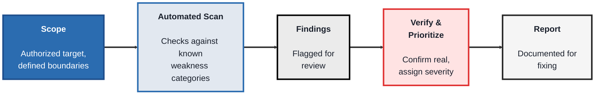
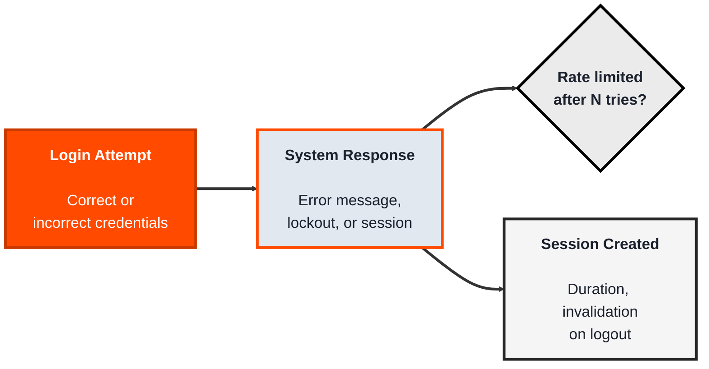
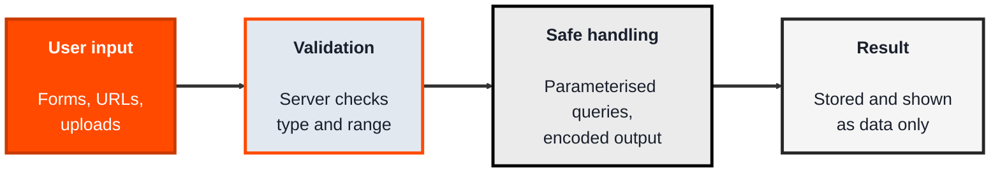

<!-- order: 8 -->
## Module 7: Security Testing

**Time: about 8 hours** (3 hours for vulnerability testing, 2 hours for authentication testing, 3 hours for input validation testing).

**By the end of this module, you'll be able to:**
- Run OWASP Juice Shop on your own computer and scan it with ZAP
- Map scan findings to OWASP Top 10:2025 categories and assign justified severities
- Test login error messages, rate limiting, logout, and password rules against current guidance (NIST SP 800-63B-4)
- Test inputs with boundary, type, and HTML values, and write a security bug report with a recommended fix
- Explain why every security test needs scope and permission first

**Tools needed for this module:** [ZAP](https://www.zaproxy.org) (a free, open source security testing tool, formerly OWASP ZAP and now ZAP by Checkmarx), [Docker Desktop](https://www.docker.com/products/docker-desktop/) to run the practice app, and a deliberately vulnerable practice application to test against. Every lab uses **OWASP Juice Shop**, an intentionally vulnerable training app, running only on your own computer at `http://localhost:3000`. Never point ZAP or any of these tests at a real site, a public "practice" site, or any system you don't own.

### Topic 7.1: Vulnerability Testing

*Time: about 3 hours*

#### Concept

**Vulnerability testing** is checking an application for weaknesses that could be exploited to cause harm, exposing data, bypassing controls, or disrupting the system, before someone with bad intent finds them first. As a QA activity, it's about systematically checking for well-known categories of weakness, not "hacking" in an open-ended sense, and it's always done against systems you're explicitly authorized to test.

- The **OWASP Top 10** is a regularly updated list of the most critical, common web application security risks (things like injection flaws, broken access control, and security misconfiguration), it's the standard reference point for what to check for
- A **vulnerability scanner** (like ZAP) automatically probes an application for known categories of weakness and reports what it finds, flagging things for a human to investigate further
- **Input validation testing** checks whether an application properly rejects or safely handles unexpected, malformed, or unusually long input, rather than assuming all input will be well-formed
- A finding's **severity** (critical, high, medium, low) reflects how much potential harm a specific weakness could enable if actually exploited, this drives how urgently it needs fixing

#### Structure at a Glance


- Automated scan results always need human verification, scanners flag *potential* issues, but confirming a finding is real (and not a false positive) is a distinct, necessary step before it goes into a report
- Defining **scope** before scanning, exactly what's authorized to be tested, is not optional, testing outside authorized scope, even accidentally, can have serious legal consequences

#### Where you'd actually use this

Any application handling sensitive data (personal information, payment details, credentials) needs recurring vulnerability testing, both to catch new weaknesses introduced by recent changes and to satisfy compliance requirements many industries are held to.

#### Lab

1. **Start OWASP Juice Shop locally.** It's an intentionally vulnerable training app, built to be tested against safely. With Docker Desktop running, open a terminal and run:
   ```bash
   docker run --rm -p 127.0.0.1:3000:3000 bkimminich/juice-shop
   ```
   When the log says the server is listening on port 3000, open http://localhost:3000 in a browser to check it's up. Leave the terminal running (Ctrl+C stops it). The `127.0.0.1:` part keeps the app reachable only from your own computer, which matters because it's deliberately insecure.
2. **Install ZAP** from zaproxy.org and open it. You don't need any proxy setup for this lab.
3. **Run ZAP's automated scan:** on the Quick Start tab choose **Automated Scan**, enter `http://localhost:3000` as the URL to attack, click **Attack**, and review the findings in the **Alerts** tab when it finishes.
4. **Pick three findings** from the scan results, look up each one's category in the current edition, the OWASP Top 10:2025 (at owasp.org/Top10/2025), and write one sentence per finding explaining what the underlying weakness actually is.
5. **Assign a severity** (critical, high, medium, low) to each of the three findings, and justify your reasoning for at least one of them in a sentence.

#### Checkpoint
You have real automated scan results from a training application, three findings mapped to OWASP Top 10 categories with plain-language explanations, and a justified severity rating for each.

#### Quiz
1. What is the OWASP Top 10, and why is it used as a standard reference?
2. What does a vulnerability scanner do, and why do its findings still need human verification?
3. What is "input validation testing" checking for?
4. Why does severity matter beyond just "is this a real problem"?
5. Why must scope be clearly defined before any vulnerability testing begins?

*Answers: 1) A regularly updated list of the most critical, common web application security risks; it's used as a standard reference because it represents an industry-wide consensus on which categories of weakness matter most and are most commonly seen. 2) It automatically probes an application for known categories of weakness and flags potential issues; findings still need human verification because scanners can produce false positives, flagging something that isn't actually exploitable or isn't a real issue in context. 3) Whether an application properly rejects or safely handles unexpected, malformed, or unusually long input, rather than assuming all input arriving will be well-formed. 4) Severity drives how urgently a finding needs to be fixed; without it, a team can't tell which of several real findings to prioritize first. 5) Because testing outside authorized boundaries, even by accident, can have serious legal consequences; scope defines exactly what's permitted to be tested before any testing activity starts.*

---

### Topic 7.2: Authentication Testing

*Time: about 2 hours*

#### Concept

**Authentication testing** checks specifically whether the systems that verify who a user is, login, password reset, session handling, actually hold up against realistic misuse, not just whether a correct username and password logs someone in successfully. Authentication is one of the highest-value targets for real attackers, which is why it gets tested as its own dedicated category rather than folded generically into vulnerability testing.

- **Credential testing** checks how the system responds to wrong passwords, repeated failed attempts, and whether it reveals too much information in error messages (like confirming a specific email exists in the system)
- **Session management testing** checks how login sessions are created, how long they last, and whether they're properly invalidated on logout, an improperly handled session can let access persist longer than intended
- **Account lockout / rate limiting** testing checks whether repeated failed login attempts are throttled or blocked, this is what prevents an attacker from simply guessing passwords indefinitely
- **Password policy testing** checks whether weak passwords are actually rejected as the system's stated policy claims they should be
- A useful yardstick is **NIST SP 800-63B-4** (2025), the US government's current digital identity guideline: it asks for longer passwords (at least 15 characters when the password is the only factor, 8 with MFA), checks against lists of common or breached passwords, rate limiting of failed attempts, and no forced complexity rules or routine password expiry

#### Structure at a Glance


- Checking error messages specifically for information leakage (does "wrong password" vs. "no such account" reveal which emails are registered) is a small, easy check that's frequently overlooked
- Authentication testing, like all security testing, is performed only against systems you're explicitly authorized to test, and generally against a test or staging environment rather than a live production system with real user accounts

#### Where you'd actually use this

Any login-based application, verifying that account lockout actually kicks in after repeated failed attempts, that sessions expire and invalidate correctly, and that error messages don't quietly leak which accounts exist, checks that are easy to overlook but directly protect real user accounts.

#### Lab

1. **Register a test account first.** In your local Juice Shop from the Vulnerability Testing lab (start it again with the same Docker command if you stopped it; because that command uses `--rm`, a restart starts from a fresh copy, so re-register your test account after any restart; don't use any other site for this lab), go to **Account → Login → Not yet a customer?** and create an account with a made-up email and password. Then log out and try to log in with that email and an intentionally wrong password, and note the exact error message shown.
2. **Attempt a login with a username that doesn't exist at all**, using any password, and compare that error message word-for-word against the previous one, do they differ in a way that reveals whether an account exists.
3. **Attempt several rapid, consecutive failed logins** against the same account (five or so) and observe whether the system locks the account, introduces a delay, or shows any rate-limiting behavior at all.
4. **Check whether logout really ends the session.** Log in with your test account, open the browser's DevTools (F12, or right-click → Inspect), go to the **Application** tab, and find the `token` value under **Local Storage** or **Cookies** for `http://localhost:3000`. Copy it. Log out, then re-send the copied token from a terminal (replace `PASTE_TOKEN_HERE` with your token):
   ```bash
   curl -H "Authorization: Bearer PASTE_TOKEN_HERE" http://localhost:3000/rest/user/whoami
   ```
   If the response still shows your account's email, the token wasn't invalidated on logout; write that down as a finding.
5. **Try registering a second test account with deliberately weak passwords** (like `123`, then `password`, then `12345`), and record which ones Juice Shop rejects. Compare the results with the NIST SP 800-63B-4 yardstick above, and write one finding for any weak password it accepts.

#### Checkpoint
You have documented results for wrong-password vs. non-existent-account error messages, observed whether rate limiting kicked in after repeated failed attempts, and confirmed whether a logged-out session was actually invalidated.

#### Quiz
1. Why is authentication testing treated as its own dedicated category rather than just part of general vulnerability testing?
2. What is "session management testing" checking for?
3. What does account lockout or rate limiting protect against, specifically?
4. Give an example of how an error message itself can leak information, and why that's a problem.
5. Why should authentication testing be performed against a test/staging environment rather than a live production system with real accounts?

*Answers: 1) Because the systems verifying who a user is are one of the highest-value targets for real attackers, and testing them requires specific checks (session handling, lockout behavior, credential responses) that go well beyond a generic vulnerability scan. 2) How login sessions are created, how long they last, and whether they're properly invalidated on logout; the concern is a session persisting or remaining valid longer than intended. 3) An attacker simply guessing passwords repeatedly and indefinitely until one works, rate limiting or lockout prevents unlimited guessing attempts. 4) If a "wrong password" error and a "no such account" error are worded differently, an attacker can use that difference to determine which email addresses or usernames are actually registered in the system, even without ever guessing a correct password. 5) To avoid disrupting or exposing real user accounts and data during testing, deliberately triggering things like lockouts or repeated failed logins against a live system with real users could cause real harm or real account lockouts for actual people.*

---

### Topic 7.3: Input Validation Testing

*Time: about 3 hours*

#### Concept

Almost every serious web vulnerability starts with the same mistake: an application trusts what a user typed. **Input validation testing** checks that every field, URL parameter, and uploaded file is checked and safely handled, so input is treated as data and never as code. This is where testers find cross-site scripting and injection flaws, two of the most common and damaging weaknesses.

- **Validation** checks that input matches what's expected (a date is a date, a quantity is a positive number) and rejects the rest, on the server as well as in the browser
- **Output encoding** makes sure user text shown on a page is displayed as text, never run as part of the page
- **Cross-site scripting (XSS)** happens when a page displays user input without encoding, letting that input run as script in other users' browsers
- **Injection** happens when input is pasted straight into a database query or command; the fix is parameterised queries, never building queries from strings
- **Boundary and type testing** tries empty values, very long values, wrong types, and special characters, to see whether the app rejects them cleanly

#### Structure at a Glance


- Browser-side checks improve the user experience but prove nothing about security; anyone can send a request that skips them, so the server must check too
- A tester's job is to show the flaw exists and report it clearly, not to exploit it further

#### Where you'd actually use this

A comment box shows your text back on the page. You enter a comment containing simple HTML formatting and it appears in bold instead of as plain text, which shows the page isn't encoding output. You report it as a likely XSS risk with the exact steps, before an attacker finds it.

#### Lab

Use only **OWASP Juice Shop**, an application built to be attacked for training, running on your own computer. Never test a site you don't own or have written permission to test.

1. **Start Juice Shop locally** with the same Docker command as in Topic 7.1, then open `http://localhost:3000`:
   ```bash
   docker run --rm -p 127.0.0.1:3000:3000 bkimminich/juice-shop
   ```
2. **Map the inputs:** list every place a user can type or upload something (search, login, feedback, account fields).
3. **Try boundary and type inputs** in three of them: an empty value, a very long value, a value of the wrong type, and a short piece of HTML such as `<b>test</b>`. Note whether each is rejected cleanly or shown back unencoded.
4. **Run an automated scan** with ZAP against `http://localhost:3000` only, and read the input-related alerts it raises.
5. **Write one security bug report** for your most serious finding: the input, the steps, what happened, the risk, and the fix you'd recommend (server-side validation, output encoding, or parameterised queries).

#### Checkpoint
You have a map of Juice Shop's inputs, results from boundary and type testing on three of them, a ZAP scan of your local copy only, and one clear security bug report with a recommended fix.

#### Quiz
1. What is the difference between validation and output encoding?
2. What causes cross-site scripting?
3. What is the standard fix for injection into database queries?
4. Why isn't browser-side validation enough?
5. What is the one rule that applies before any security test?

*Answers: 1) Validation checks input is what's expected and rejects the rest; output encoding makes sure user text displayed on a page is shown as text, never run as code. 2) A page displaying user input without encoding it, so the input runs as script in other users' browsers. 3) Parameterised queries, which keep user input separate from the query itself. 4) Anyone can send requests directly to the server and skip the browser's checks, so the server must validate too. 5) Only test systems you own or have written permission to test.*

```watch
{
 "scenes": [
  {
   "kind": "title",
   "art": "shield",
   "kicker": "Module 7 · Security testing",
   "title": "Find weaknesses first",
   "beats": [
    {
     "say": "Welcome to Module 7, security testing."
    },
    {
     "say": "You'll check an app for weaknesses before someone with bad intent finds them, always against a system you're authorized to test."
    },
    {
     "say": "Every lab uses O WASP Juice Shop, a deliberately vulnerable training app, running only on your own computer."
    }
   ]
  },
  {
   "kind": "diagram",
   "kicker": "Topic 7.1 · Vulnerability testing",
   "title": "From scope to report",
   "nodes": [
    {
     "id": "sc",
     "label": "Scope",
     "x": 10,
     "y": 30,
     "sub": "localhost:3000 only",
     "art": "lock"
    },
    {
     "id": "scan",
     "label": "Automated scan",
     "x": 30,
     "y": 70,
     "sub": "ZAP",
     "art": "radar"
    },
    {
     "id": "find",
     "label": "Findings",
     "x": 50,
     "y": 30,
     "sub": "flagged for review",
     "art": "bug"
    },
    {
     "id": "ver",
     "label": "Verify + severity",
     "x": 70,
     "y": 70,
     "sub": "real? how harmful?",
     "art": "search"
    },
    {
     "id": "rep",
     "label": "Report",
     "x": 90,
     "y": 30,
     "sub": "documented for fixing",
     "art": "doc"
    }
   ],
   "edges": [
    {
     "from": "sc",
     "to": "scan"
    },
    {
     "from": "scan",
     "to": "find"
    },
    {
     "from": "find",
     "to": "ver"
    },
    {
     "from": "ver",
     "to": "rep"
    }
   ],
   "beats": [
    {
     "say": "Vulnerability testing checks for known kinds of weakness. It's systematic, not open ended hacking.",
     "show": 1,
     "on": "sc"
    },
    {
     "say": "It starts with scope: exactly what you may test. Here, only Juice Shop on your computer.",
     "show": 1,
     "on": "sc"
    },
    {
     "say": "Going outside scope, even by accident, can have legal consequences.",
     "show": 1,
     "on": "sc"
    },
    {
     "say": "ZAP scans inside that scope.",
     "show": 2,
     "on": "scan",
     "send": {
      "from": "sc",
      "to": "scan",
      "label": "localhost:3000"
     }
    },
    {
     "say": "It flags possible problems.",
     "show": 3,
     "on": "find",
     "send": {
      "from": "scan",
      "to": "find",
      "label": "alerts"
     }
    },
    {
     "say": "A human confirms each, since scanners give false positives, and sets a severity.",
     "show": 4,
     "on": "ver",
     "send": {
      "from": "find",
      "to": "ver",
      "label": "check each"
     }
    },
    {
     "say": "Confirmed findings go in the report.",
     "show": 5,
     "on": "rep",
     "send": {
      "from": "ver",
      "to": "rep",
      "label": "confirmed"
     }
    }
   ]
  },
  {
   "kind": "table",
   "kicker": "Topic 7.1 · Lab",
   "title": "Map each alert, then rate it",
   "columns": [
    "Example ZAP alert",
    "OWASP Top 10:2025",
    "Severity"
   ],
   "rows": [
    [
     "CSP header not set",
     "A02 Security Misconfig",
     "Medium"
    ],
    [
     "SQL injection",
     "A05 Injection",
     "High"
    ],
    [
     "Cross-domain misconfig",
     "A02 Security Misconfig",
     "Medium"
    ]
   ],
   "beats": [
    {
     "say": "Start Juice Shop with Docker. The one two seven part keeps it reachable only from your computer. Then scan localhost port three thousand with ZAP.",
     "sql": "docker run --rm -p 127.0.0.1:3000:3000 bkimminich/juice-shop"
    },
    {
     "say": "Here are three example alerts. Yours will differ."
    },
    {
     "say": "First, find each one's O WASP Top Ten twenty twenty five category.",
     "col": 1,
     "sql": "owasp.org/Top10/2025"
    },
    {
     "say": "A missing security header is a setup mistake: security misconfiguration.",
     "hl": 0,
     "dim": true,
     "col": 1
    },
    {
     "say": "S Q L injection maps to injection.",
     "hl": 1,
     "dim": true,
     "col": 1
    },
    {
     "say": "Then set a severity. Injection could expose stored data, so it's high, and fixed first.",
     "hl": 1,
     "dim": true,
     "col": 2
    },
    {
     "say": "Severity tells the team what to fix first.",
     "col": 2
    }
   ]
  },
  {
   "kind": "table",
   "kicker": "Topic 7.2 · Authentication",
   "title": "What a leaky login looks like",
   "columns": [
    "Login attempt",
    "Message shown",
    "What it reveals"
   ],
   "rows": [
    [
     "Real email, wrong pw",
     "Wrong password",
     "This email exists"
    ],
    [
     "Unknown email",
     "No such account",
     "This email doesn't"
    ],
    [
     "5 rapid failures",
     "Locked? Slowed?",
     "Unlimited guessing?"
    ]
   ],
   "beats": [
    {
     "say": "Login is a top target for attackers, so it gets its own tests. Here's a leaky login."
    },
    {
     "say": "Register a test account, then log in with the wrong password. Note the message.",
     "hl": 0,
     "dim": true
    },
    {
     "say": "Then try an email that doesn't exist.",
     "hl": 1,
     "dim": true
    },
    {
     "say": "Different wording tells anyone which emails are registered.",
     "hl": [
      0,
      1
     ],
     "col": 2
    },
    {
     "say": "Safe apps use one message for both.",
     "hl": [
      0,
      1
     ],
     "sql": "Safe: one message for both\n\"Invalid email or password\""
    },
    {
     "say": "Next, five quick failed logins. Lockout, delay, or nothing?",
     "hl": 2,
     "dim": true
    },
    {
     "say": "Rate limiting stops endless guessing. Nothing slows you? That's a finding.",
     "hl": 2,
     "dim": true,
     "col": 2
    }
   ]
  },
  {
   "kind": "diagram",
   "kicker": "Topic 7.2 · Lab",
   "title": "Does logout really end the session?",
   "nodes": [
    {
     "id": "br",
     "label": "Browser",
     "x": 15,
     "y": 28,
     "sub": "DevTools: token",
     "art": "browser"
    },
    {
     "id": "srv",
     "label": "Juice Shop",
     "x": 82,
     "y": 50,
     "sub": "localhost:3000",
     "art": "server"
    },
    {
     "id": "cu",
     "label": "Terminal",
     "x": 15,
     "y": 76,
     "sub": "curl",
     "art": "terminal"
    }
   ],
   "edges": [
    {
     "from": "br",
     "to": "srv"
    },
    {
     "from": "cu",
     "to": "srv"
    }
   ],
   "beats": [
    {
     "say": "Does logout really end a session?",
     "show": 2
    },
    {
     "say": "Log in, and the server gives your browser a token.",
     "show": 2,
     "on": "br",
     "send": {
      "from": "srv",
      "to": "br",
      "label": "token"
     }
    },
    {
     "say": "Copy it from the DevTools Application tab.",
     "show": 2,
     "on": "br"
    },
    {
     "say": "Log out.",
     "show": 2,
     "on": "br",
     "send": {
      "from": "br",
      "to": "srv",
      "label": "log out"
     }
    },
    {
     "say": "Then re-send the token with curl, asking who am I.",
     "show": 3,
     "on": "cu",
     "send": {
      "from": "cu",
      "to": "srv",
      "label": "whoami + token"
     }
    },
    {
     "say": "If your email comes back, logout didn't invalidate it. That's a finding.",
     "show": 3,
     "on": "srv",
     "send": {
      "from": "srv",
      "to": "cu",
      "label": "your email?"
     }
    },
    {
     "say": "Run tests like this on test systems, never real users' accounts.",
     "show": 3,
     "on": [
      "br",
      "srv",
      "cu"
     ]
    }
   ]
  },
  {
   "kind": "table",
   "kicker": "Topic 7.2 · Lab",
   "title": "Weak passwords against the yardstick",
   "columns": [
    "Password",
    "Length",
    "NIST 800-63B-4"
   ],
   "rows": [
    [
     "123",
     "3",
     "Too short"
    ],
    [
     "password",
     "8",
     "Common, breached"
    ],
    [
     "12345",
     "5",
     "Too short, common"
    ]
   ],
   "beats": [
    {
     "say": "Try registering with weak passwords: one two three, password, and one two three four five."
    },
    {
     "say": "N I S T S P eight hundred sixty three B four wants fifteen characters for a password alone, eight with M F A.",
     "col": 1,
     "sql": "Only factor: at least 15 characters\nWith MFA: at least 8\nBlock common or breached passwords"
    },
    {
     "say": "So two are far too short.",
     "hl": [
      0,
      2
     ],
     "dim": true,
     "col": 1
    },
    {
     "say": "Password is eight, but so common it should be blocked.",
     "hl": 1,
     "dim": true,
     "col": 2
    },
    {
     "say": "It also drops forced complexity and expiry. Write a finding for any Juice Shop accepts.",
     "col": 2
    }
   ]
  },
  {
   "kind": "table",
   "kicker": "Topic 7.3 · Input validation",
   "title": "Probe an input four ways",
   "columns": [
    "Probe",
    "Example value",
    "Clean result"
   ],
   "rows": [
    [
     "Empty",
     "(nothing)",
     "Rejected with message"
    ],
    [
     "Very long",
     "a very long string",
     "Rejected or limited"
    ],
    [
     "Wrong type",
     "letters as quantity",
     "Rejected"
    ],
    [
     "HTML",
     "<b>test</b>",
     "Shown as plain text"
    ]
   ],
   "beats": [
    {
     "say": "Most serious flaws start with trusting user input. Map every input, then probe three."
    },
    {
     "say": "Empty should be rejected clearly.",
     "hl": 0,
     "dim": true
    },
    {
     "say": "Very long should be rejected or limited.",
     "hl": 1,
     "dim": true
    },
    {
     "say": "The wrong type, rejected.",
     "hl": 2,
     "dim": true
    },
    {
     "say": "And H T M L, like bold test, should show as plain text.",
     "hl": 3,
     "dim": true
    },
    {
     "say": "If it shows in bold, output isn't encoded: a likely cross site scripting risk.",
     "hl": 3,
     "dim": true,
     "col": 2,
     "sql": "Shown in bold? Output isn't encoded\n= likely XSS risk"
    },
    {
     "say": "Report it with steps, and stop. Show the flaw, don't exploit it.",
     "hl": 3,
     "col": 2
    }
   ]
  },
  {
   "kind": "diagram",
   "kicker": "Topic 7.3 · Concept",
   "title": "Why the server must check too",
   "nodes": [
    {
     "id": "form",
     "label": "Browser form",
     "x": 12,
     "y": 28,
     "sub": "checks in the page",
     "art": "form"
    },
    {
     "id": "direct",
     "label": "Direct request",
     "x": 12,
     "y": 76,
     "sub": "skips the browser",
     "art": "terminal"
    },
    {
     "id": "val",
     "label": "Server validation",
     "x": 50,
     "y": 52,
     "sub": "type and range",
     "art": "shield"
    },
    {
     "id": "safe",
     "label": "Safe handling",
     "x": 88,
     "y": 52,
     "sub": "params + encoding",
     "art": "database"
    }
   ],
   "edges": [
    {
     "from": "form",
     "to": "val"
    },
    {
     "from": "direct",
     "to": "val"
    },
    {
     "from": "val",
     "to": "safe"
    }
   ],
   "beats": [
    {
     "say": "A browser form can check input first. That helps users.",
     "show": 3,
     "on": "form",
     "send": {
      "from": "form",
      "to": "val",
      "label": "checked input"
     }
    },
    {
     "say": "But anyone can skip it with a direct request, so it proves nothing about security.",
     "show": 3,
     "on": "direct",
     "send": {
      "from": "direct",
      "to": "val",
      "label": "unchecked input"
     }
    },
    {
     "say": "So the server validates type and range too.",
     "show": 3,
     "on": "val"
    },
    {
     "say": "Parameterised queries keep input separate from the query.",
     "show": 4,
     "on": "safe",
     "send": {
      "from": "val",
      "to": "safe",
      "label": "data only"
     }
    },
    {
     "say": "Output encoding shows it as text, never code.",
     "show": 4,
     "on": "safe"
    },
    {
     "say": "After a ZAP scan of localhost, your bug report names one of these fixes.",
     "show": 4,
     "on": [
      "val",
      "safe"
     ]
    }
   ]
  },
  {
   "kind": "quiz",
   "art": "ask",
   "kicker": "Quick check",
   "title": "What causes cross-site scripting?",
   "options": [
    "A password that is too short",
    "A page displaying user input without encoding it",
    "A server that rate limits logins"
   ],
   "answer": 1,
   "good": "That's right. When a page shows user input without encoding it, that input can run as script in other users' browsers.",
   "bad": "Not quite. When a page shows user input without encoding it, that input can run as script in other users' browsers.",
   "beats": [
    {
     "say": "Quick check.",
     "show": 0
    },
    {
     "say": "What causes cross-site scripting?",
     "show": 0
    },
    {
     "say": "Tap your answer.",
     "show": 1
    }
   ]
  },
  {
   "kind": "list",
   "art": "proof",
   "kicker": "Checkpoint",
   "title": "You're done when",
   "items": [
    [
     "ZAP scan + 3 mapped findings",
     ""
    ],
    [
     "Login errors compared",
     ""
    ],
    [
     "Rate limiting + logout checked",
     ""
    ],
    [
     "Three inputs probed",
     ""
    ],
    [
     "Security bug report with a fix",
     ""
    ]
   ],
   "beats": [
    {
     "say": "That's Module 7.",
     "show": 0
    },
    {
     "say": "You're done when:",
     "show": 0
    },
    {
     "say": "you've run a ZAP scan on your local Juice Shop and mapped three findings to the O WASP Top Ten with severities,",
     "show": 1
    },
    {
     "say": "compared wrong password and unknown account error messages,",
     "show": 2
    },
    {
     "say": "checked rate limiting, and whether logout invalidated the session,",
     "show": 3
    },
    {
     "say": "tested three inputs with boundary, type and H T M L values,",
     "show": 4
    },
    {
     "say": "and written a security bug report with a recommended fix.",
     "show": 5
    },
    {
     "say": "Next, in Module 8, C I, C D testing.",
     "show": 5
    }
   ]
  }
 ]
}
```

---

## Module 7 Completion Checklist
- [ ] Run an automated ZAP scan against your local Juice Shop
- [ ] Mapped three scan findings to OWASP Top 10 categories with plain-language explanations and justified severities
- [ ] Documented and compared error messages for wrong-password vs. non-existent-account login attempts
- [ ] Observed and recorded whether rate limiting/lockout triggered after repeated failed logins
- [ ] Confirmed whether a logged-out session was actually invalidated, and understands why authentication testing is always scoped to authorized, non-production environments
- [ ] Mapped every input in a local, intentionally vulnerable practice app
- [ ] Tested three inputs with boundary, type, and HTML values
- [ ] Run ZAP against your local copy only and written a security bug report with a fix
