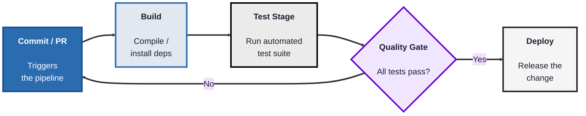
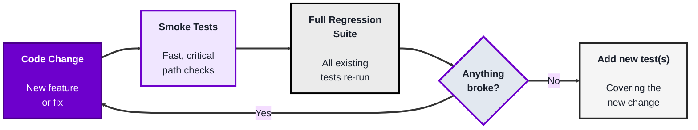
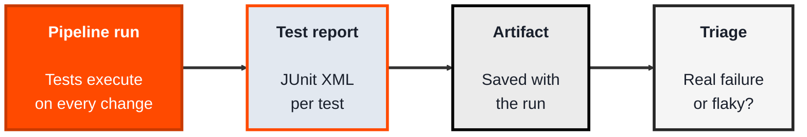

<!-- order: 9 -->
## Module 8: CI/CD Testing

**Time: about 6 hours** (roughly 2 hours per topic).

**By the end of this module, you'll be able to:**
- Build a GitHub Actions workflow that runs your tests on every push and pull request
- Trace a failing pipeline run to the exact commit and step that broke it
- Set up a smoke-test subset with pytest markers that runs before the full regression suite
- Save a JUnit test report as a pipeline artifact on every run, even when tests fail
- Recognise a flaky test and write a triage note to fix or quarantine it

**Tools needed for this module:** A free [GitHub](https://github.com) account (for GitHub Actions), and a small existing test suite to run (the labs reuse simple tests, any language is fine; Topic 8.1 gives you a starter Python test if you don't have one).

### Topic 8.1: Automated Pipelines

*Time: about 2 hours*

#### Concept

A **CI/CD pipeline** automatically builds, tests, and (optionally) deploys code every time it changes, rather than someone manually remembering to run tests before each release. **CI (Continuous Integration)** is the "build and test automatically on every change" part; **CD (Continuous Delivery/Deployment)** extends that to automatically preparing or actually releasing the change. For QA, this matters because it's what turns your test suite from something run occasionally by a person into something run automatically, every time, without being forgotten.

- A **pipeline** is a defined sequence of automated stages (build, test, deploy) that runs in response to a trigger
- A **trigger** starts the pipeline, most commonly a new commit or a pull request being opened
- A **stage** (or job) is one step in the pipeline, "run unit tests" and "run integration tests" are often separate stages, so a failure in one is easy to pinpoint
- A **quality gate** is a rule that blocks the pipeline from progressing (for example, merging or deploying) if a required stage fails, tests must pass, coverage must meet a threshold

#### Structure at a Glance


- Because the pipeline runs the same way every time, a failure is reproducible and traceable to a specific commit, rather than a mystery discovered days later
- A slow pipeline gets skipped or ignored in practice, keeping test stages fast (or running slower stages in parallel) is part of what makes a pipeline actually useful day to day

#### Where you'd actually use this

Any team merging code frequently, catching a broken build or a failing test within minutes of the change that caused it, rather than during a separate, occasional manual test pass days or weeks later, when the cause is much harder to pin down.

#### Lab

1. **Create a small project on GitHub** (or use an existing one) with a simple automated test already in it, any language is fine (anything that runs from the command line with a clear pass/fail exit code). If you don't have one, create a new repository and add these two Python files at its root:
   ```python
   # calculator.py
   def add(a, b):
       return a + b
   ```
   ```python
   # test_calculator.py
   from calculator import add


   def test_add():
       assert add(2, 3) == 5
   ```
   (Run `pytest` on your computer first to check it passes; pytest finds files named `test_*.py` automatically.)
2. **Add a GitHub Actions workflow file** at `.github/workflows/test.yml`. This one is for a Python project using pytest; for another language, swap the setup step and the install and test commands (for example `actions/setup-node`, `npm ci`, and `npm test`):
```yaml
name: Run Tests
on: [push, pull_request]
jobs:
  test:
    runs-on: ubuntu-latest
    steps:
      - uses: actions/checkout@v5
      - name: Set up Python
        uses: actions/setup-python@v6
        with:
          python-version: '3.12'
      - name: Install dependencies
        run: pip install pytest
      - name: Run tests
        run: pytest
```
3. **Commit and push** this file, and watch the pipeline run automatically under your repository's "Actions" tab.
4. **Deliberately break a test** (change an assertion so it fails), commit and push again, and confirm the pipeline reports a failure, and pinpoint exactly which commit and which stage caused it.
5. **Fix the test, push again**, and confirm the pipeline goes back to passing.

#### Checkpoint
You have a working GitHub Actions pipeline that runs automatically on push, and you've seen it both fail on a broken test and pass again after a fix, with the failure clearly traceable to the specific commit that caused it.

#### Quiz
1. What is the difference between what CI and CD each automate?
2. What is a "trigger," in the context of a pipeline?
3. Why are build, test, and deploy usually separate stages rather than one combined step?
4. What is a "quality gate," and what does it block?
5. Why does keeping pipeline stages fast matter for whether a team actually keeps using it?

*Answers: 1) CI (Continuous Integration) automatically builds and tests code on every change; CD (Continuous Delivery/Deployment) extends that to automatically preparing or actually releasing the change. 2) The event that starts the pipeline running, most commonly a new commit being pushed or a pull request being opened. 3) So a failure can be pinpointed to a specific stage (build vs. test vs. deploy) rather than only knowing "something in the whole process failed" without knowing where. 4) A rule that blocks the pipeline from progressing, such as merging or deploying, unless required conditions are met, like all tests passing or coverage meeting a threshold. 5) A slow pipeline tends to get skipped, ignored, or worked around in practice, undermining the whole point of testing automatically on every change; keeping it fast (including running independent stages in parallel) keeps it actually useful day to day.*

---

### Topic 8.2: Regression Testing

*Time: about 2 hours*

#### Concept

**Regression testing** is re-running existing tests after a change to confirm that the change didn't break anything that used to work. It exists because fixing one thing or adding a new feature can quietly break something unrelated, and without deliberately re-checking, that kind of breakage often isn't discovered until a user finds it. Inside a CI/CD pipeline, regression testing is what the automated "Test Stage" is actually doing on every single run.

- A **regression test suite** is the set of existing tests re-run after a change, specifically to catch this kind of unintended breakage, as distinct from new tests written for the new change itself
- **Test suite maintenance** is the ongoing work of updating, removing, or rewriting tests as the application itself changes, an outdated regression suite either misses real regressions or fails on things that aren't actually broken
- **Smoke tests** are a small, fast subset of the regression suite covering only the most critical functionality, often run first (or on every commit) before the full, slower suite runs
- **Test flakiness** (a test that sometimes passes and sometimes fails with no code change) undermines trust in a regression suite; Topic 8.3 covers how to handle it

#### Structure at a Glance


- Regression testing and new-feature testing are complementary but distinct, passing regression tests means "nothing old broke," it says nothing about whether the new feature itself works correctly, that still needs its own new test cases
- As a regression suite grows, running literally everything on every single commit can get slow, this is exactly why smoke tests exist, fast coverage first, full coverage before anything more consequential (like a merge or deploy)

#### Where you'd actually use this

Every single pipeline run in Module 8.1 is regression testing in practice, but it's also directly relevant any time a fix is made to one part of an app and you need a defensible answer to "are you sure this didn't break anything else," rather than just a gut feeling.

#### Lab

1. **Take the small project and test suite from the Automated Pipelines lab.**
2. **Add one new test** covering a new, small piece of functionality you add to the project (anything simple, a new function that formats a string a certain way, for example).
3. **Deliberately introduce a small, unrelated bug elsewhere in the code**, something that would break a different, existing test that has nothing to do with your new feature.
4. **Run the full test suite** and confirm the existing test (unrelated to your new feature) fails, this is regression testing doing its job, catching unintended breakage.
5. **Designate two or three of your fastest, most critical tests as a "smoke test" subset.** With pytest, tag each one with a marker:
   ```python
   import pytest

   @pytest.mark.smoke
   def test_addition():
       assert 1 + 1 == 2
   ```
   Register the marker in a `pytest.ini` file in the project's root folder, so pytest knows it and doesn't warn about it:
   ```ini
   [pytest]
   markers =
       smoke: fast checks of the most critical behavior
   ```
   Then, in your workflow file, replace the `Run tests` step with these two steps, so the smoke tests run first (if they fail, the full suite is skipped):
   ```yaml
         - name: Run smoke tests
           run: pytest -m smoke
         - name: Run full test suite
           run: pytest
   ```
6. **Fix the unrelated bug, push again**, and confirm the full suite passes, including both your new test and the previously-broken one.

#### Checkpoint
You have a project where a deliberately introduced, unrelated bug was caught by an existing regression test, a designated smoke test subset running before the full suite, and a final passing run after the fix.

#### Quiz
1. What is a "regression test suite" checking for, specifically?
2. Why is test suite maintenance an ongoing task rather than a one-time setup?
3. What are "smoke tests," and why are they often run before the full regression suite?
4. Does a passing regression suite tell you whether a brand-new feature works correctly? Why or why not?
5. What is "test flakiness," and why is it a problem even if the flaky test eventually shows a pass?

*Answers: 1) Whether a change broke something that used to work, re-running existing tests specifically to catch unintended breakage caused by an unrelated change. 2) Because the application itself keeps changing, tests need to be updated, removed, or rewritten to stay accurate, an outdated suite either misses real regressions or fails on things that were intentionally changed and aren't actually broken. 3) A small, fast subset of the regression suite covering only the most critical functionality; they're run first because they give a quick signal before spending the time to run the full, slower suite. 4) No, a passing regression suite only confirms nothing old broke; the new feature itself still needs its own new test cases to confirm it actually works correctly. 5) Test flakiness is when a test sometimes passes and sometimes fails with no underlying code change; it's a problem even with an eventual pass because it undermines trust in the whole suite, a real failure can start being dismissed as "probably just flaky" instead of being investigated.*

---

### Topic 8.3: Test Reports and Flaky Tests

*Time: about 2 hours*

#### Concept

A pipeline that says only "failed" slows everyone down. Teams need **test reports** that show exactly which test failed and why, kept with each pipeline run. They also need to deal with **flaky tests**: tests that pass and fail on the same code. A flaky test teaches people to ignore red builds, which defeats the purpose of automated testing.

- A **test report** records every test's result in a standard format, commonly **JUnit XML**, which most CI tools and dashboards can read
- An **artifact** is a file a pipeline saves from a run, such as a test report or screenshots, so you can download it after the run ends
- A **flaky test** passes and fails without any code change, usually because of timing, test order, shared data, or an unreliable external service
- **Quarantining** moves a known flaky test out of the blocking suite while it's fixed, with a tracking ticket, so it can't block every merge in the meantime
- **Retries** can hide flakiness; use them sparingly, and always record when a test only passed on retry

#### Structure at a Glance


- The first question on any red build is whether it's a real failure or a flaky test; reports and history answer it in minutes instead of hours
- Fix the cause of flakiness (wait for the right condition, isolate test data) rather than adding sleeps, which make tests slower and still unreliable

#### Where you'd actually use this

Merges keep failing on a login test that passes when re-run. The saved reports show it fails about one run in ten, always right after a test that changes the same user account. Isolating each test's data fixes the flakiness, and the team starts trusting red builds again.

#### Lab

1. **Reuse the repository and workflow from Topics 8.1 and 8.2.** If your tests use pytest, change the full test suite step to write a JUnit report:
   ```bash
   pytest --junitxml=report.xml
   ```
   (Most test runners can write JUnit XML too: Playwright has a built-in `junit` reporter, and Jest does it with the `jest-junit` package.)
2. **Save the report as an artifact** by adding this step after your tests in the workflow file, indented to line up with your other `- name:` steps:
   ```yaml
   - name: Upload test report
     if: always()
     uses: actions/upload-artifact@v5
     with:
       name: test-report
       path: report.xml
   ```
3. **Push a change, open the finished run on GitHub,** and download the `test-report` artifact. Find one test's result inside it.
4. **Create a deliberately flaky test** (for example, one that fails when a random number is below 0.3), push it, and re-run the workflow several times to watch it pass and fail on the same code.
5. **Write a short triage note:** how you confirmed it was flaky, what the cause was, and how you'd fix or quarantine it. Then remove the flaky test.

#### Checkpoint
Your workflow saves a JUnit report as an artifact on every run, even when tests fail, and you've written a triage note for a flaky test you watched pass and fail on the same code.

#### Quiz
1. What is a flaky test?
2. Why are flaky tests harmful to a team?
3. What is a pipeline artifact?
4. Why use `if: always()` on the upload step?
5. Why is quarantining better than simply deleting a flaky test?

*Answers: 1) A test that passes and fails on the same code without any change, often because of timing, test order, shared data, or an unreliable external service. 2) People learn to ignore red builds, so real failures get missed. 3) A file saved from a pipeline run, such as a test report, that you can download after the run finishes. 4) So the report is saved even when tests fail, which is exactly when you need it. 5) The test's coverage isn't lost: it's tracked with a ticket, fixed, and returned to the blocking suite.*

```watch
{
 "scenes": [
  {
   "kind": "title",
   "art": "loop",
   "kicker": "Module 8 · CI/CD testing",
   "title": "Tests that run themselves",
   "beats": [
    {
     "say": "Welcome to Module 8, C I, C D testing."
    },
    {
     "say": "A pipeline turns your test suite from something a person runs occasionally into something that runs automatically, every time, without being forgotten."
    }
   ]
  },
  {
   "kind": "flow",
   "art": "path",
   "kicker": "Topic 8.1 · Automated pipelines",
   "title": "From commit to deploy",
   "steps": [
    "Commit / PR",
    "Build",
    "Test stage",
    "Quality gate",
    "Deploy"
   ],
   "beats": [
    {
     "say": "C I, continuous integration, builds and tests automatically on every change. C D extends that to preparing or releasing the change.",
     "show": 0
    },
    {
     "say": "A trigger, like a commit or pull request, starts the pipeline.",
     "show": 1
    },
    {
     "say": "It builds, installing dependencies.",
     "show": 2
    },
    {
     "say": "A test stage runs the suite. Separate stages make a failure easy to pinpoint.",
     "show": 3
    },
    {
     "say": "A quality gate blocks merging or deploying unless the tests pass.",
     "show": 4
    },
    {
     "say": "Only then does it deploy. And keep it fast, because a slow pipeline gets skipped.",
     "show": 5
    }
   ]
  },
  {
   "kind": "code",
   "art": "git",
   "kicker": "Topic 8.1 · Lab",
   "title": "A GitHub Actions workflow",
   "file": ".github/workflows/test.yml",
   "code": "on: [push, pull_request]\njobs:\n  test:\n    runs-on: ubuntu-latest\n    steps:\n      - uses: actions/checkout@v5\n      - name: Set up Python\n        uses: actions/setup-python@v6\n        with:\n          python-version: '3.12'\n      - name: Install dependencies\n        run: pip install pytest\n      - name: Run tests\n        run: pytest",
   "beats": [
    {
     "say": "In the lab, start with a tiny Python project: an add function, and a pytest test.",
     "show": 0
    },
    {
     "say": "Add this file at dot github, workflows, test dot y m l.",
     "show": 1
    },
    {
     "say": "On every push and pull request, it checks out the code, sets up Python, installs pytest, and runs it.",
     "show": 1
    }
   ]
  },
  {
   "kind": "flow",
   "art": "proof",
   "kicker": "Topic 8.1 · Lab",
   "title": "Break it, then fix it",
   "steps": [
    "Push: green",
    "Break a test: red",
    "Trace commit + stage",
    "Fix: green again"
   ],
   "beats": [
    {
     "say": "Push it, and watch it run under the Actions tab.",
     "show": 1
    },
    {
     "say": "Then break a test on purpose, and push. The pipeline fails.",
     "show": 2
    },
    {
     "say": "Pinpoint exactly which commit and which stage caused it.",
     "show": 3
    },
    {
     "say": "Fix the test, push again, and it goes back to passing.",
     "show": 4
    }
   ]
  },
  {
   "kind": "list",
   "art": "loop",
   "kicker": "Topic 8.2 · Regression testing",
   "title": "Did anything old break?",
   "items": [
    [
     "Regression suite",
     "Existing tests, re-run"
    ],
    [
     "Maintenance",
     "Keep tests accurate"
    ],
    [
     "Smoke tests",
     "Fast critical subset, first"
    ],
    [
     "New feature?",
     "Still needs new tests"
    ]
   ],
   "beats": [
    {
     "say": "Regression testing re-runs existing tests after a change, to confirm nothing that used to work broke.",
     "show": 0
    },
    {
     "say": "Test suite maintenance keeps those tests accurate as the app changes.",
     "show": 1
    },
    {
     "say": "Smoke tests are a small, fast subset of the most critical checks, run first.",
     "show": 2
    },
    {
     "say": "And a passing regression suite only means nothing old broke. A new feature still needs its own new tests.",
     "show": 3
    }
   ]
  },
  {
   "kind": "code",
   "art": "test",
   "kicker": "Topic 8.2 · Lab",
   "title": "Smoke tests first",
   "file": "test_calculator.py · test.yml",
   "code": "import pytest\n\n@pytest.mark.smoke\ndef test_addition():\n    assert 1 + 1 == 2\n\n# in the workflow:\n      - name: Run smoke tests\n        run: pytest -m smoke\n      - name: Run full test suite\n        run: pytest",
   "beats": [
    {
     "say": "In the lab, add a test for a small new feature, then slip in an unrelated bug elsewhere. An existing test catches it. That's regression testing doing its job.",
     "show": 0
    },
    {
     "say": "Then tag your fastest, most critical tests with a pytest marker called smoke, and register it in pytest dot i n i.",
     "show": 1
    },
    {
     "say": "In the workflow, run pytest dash m smoke first. If smoke tests fail, the full suite is skipped.",
     "show": 1
    }
   ]
  },
  {
   "kind": "list",
   "art": "file",
   "kicker": "Topic 8.3 · Test reports",
   "title": "More than just failed",
   "items": [
    [
     "Test report",
     "JUnit XML, every test"
    ],
    [
     "Artifact",
     "Saved with the run"
    ],
    [
     "if: always()",
     "Upload even on failure"
    ]
   ],
   "beats": [
    {
     "say": "A pipeline that only says failed slows everyone down.",
     "show": 0
    },
    {
     "say": "A test report records every test's result, commonly as J Unit X M L, which most C I tools can read.",
     "show": 1
    },
    {
     "say": "An artifact is a file the pipeline saves from a run, so you can download it later.",
     "show": 2
    },
    {
     "say": "In the lab, run pytest with junit x m l equals report dot x m l, and upload it with if always, so it's saved even when tests fail, which is exactly when you need it.",
     "show": 3
    }
   ]
  },
  {
   "kind": "list",
   "art": "warning",
   "kicker": "Topic 8.3 · Flaky tests",
   "title": "Pass and fail, same code",
   "items": [
    [
     "Causes",
     "Timing, order, shared data, services"
    ],
    [
     "Harm",
     "Red builds get ignored"
    ],
    [
     "Quarantine",
     "Out of the gate, with a ticket"
    ],
    [
     "Don't",
     "Hide it with retries or sleeps"
    ]
   ],
   "beats": [
    {
     "say": "A flaky test passes and fails with no code change, usually from timing, test order, shared data, or an unreliable external service.",
     "show": 0
    },
    {
     "say": "It teaches people to ignore red builds, so real failures get missed.",
     "show": 1
    },
    {
     "say": "Quarantine it: move it out of the blocking suite while it's fixed, with a tracking ticket.",
     "show": 2
    },
    {
     "say": "Use retries sparingly, and fix the cause rather than adding sleeps.",
     "show": 3
    },
    {
     "say": "In the lab, make a test that fails when a random number is below zero point three, rerun it several times, write a triage note, then remove it.",
     "show": 4
    }
   ]
  },
  {
   "kind": "quiz",
   "art": "ask",
   "kicker": "Quick check",
   "title": "What does a passing regression suite tell you?",
   "options": [
    "That nothing that used to work has broken",
    "That the new feature works correctly",
    "That there are no flaky tests"
   ],
   "answer": 0,
   "good": "That's right. A passing regression suite only confirms nothing old broke. A new feature still needs its own new tests.",
   "bad": "Not quite. A passing regression suite only confirms nothing old broke. A new feature still needs its own new tests.",
   "beats": [
    {
     "say": "Quick check.",
     "show": 0
    },
    {
     "say": "What does a passing regression suite tell you?",
     "show": 0
    },
    {
     "say": "Tap your answer.",
     "show": 1
    }
   ]
  },
  {
   "kind": "list",
   "art": "proof",
   "kicker": "Checkpoint",
   "title": "You're done when",
   "items": [
    [
     "Pipeline on push, failure traced",
     ""
    ],
    [
     "Regression test caught a bug",
     ""
    ],
    [
     "Smoke tests run first",
     ""
    ],
    [
     "JUnit report saved as an artifact",
     ""
    ],
    [
     "Flaky test triaged",
     ""
    ]
   ],
   "beats": [
    {
     "say": "That's Module 8.",
     "show": 0
    },
    {
     "say": "You're done when:",
     "show": 0
    },
    {
     "say": "you've built a GitHub Actions pipeline that runs on push, and traced a failure to a specific commit,",
     "show": 1
    },
    {
     "say": "caught an unrelated bug with an existing regression test,",
     "show": 2
    },
    {
     "say": "set up a smoke test subset that runs before the full suite,",
     "show": 3
    },
    {
     "say": "saved a J Unit report as an artifact on every run,",
     "show": 4
    },
    {
     "say": "and written a triage note for a flaky test you watched pass and fail.",
     "show": 5
    },
    {
     "say": "Next, in Module 9, testing A I agents.",
     "show": 5
    }
   ]
  }
 ]
}
```

---

## Module 8 Completion Checklist
- [ ] Built a working GitHub Actions pipeline triggered automatically on push
- [ ] Seen the pipeline both fail on a broken test and pass again after a fix, traced to a specific commit
- [ ] Added a new test for a new feature and confirmed an unrelated, deliberately introduced bug was caught by an existing regression test
- [ ] Designated and configured a smoke test subset that runs before the full regression suite
- [ ] Can explain why passing regression tests doesn't confirm a new feature works, and why test flakiness needs to be fixed rather than ignored
- [ ] Configured the pipeline to save a JUnit test report as an artifact on every run
- [ ] Watched a deliberately flaky test pass and fail on the same code
- [ ] Written a triage note and removed the flaky test
